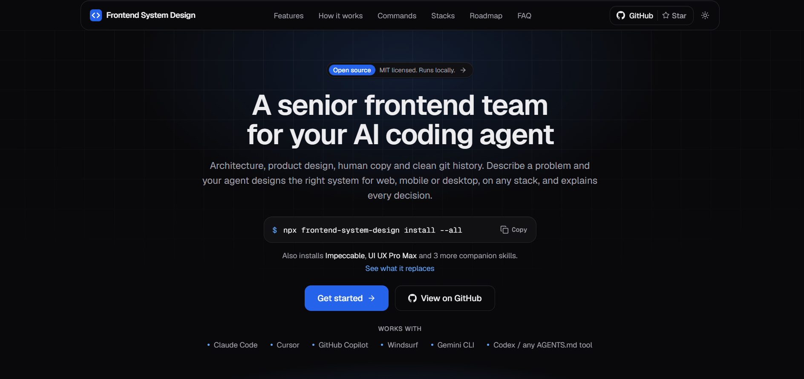
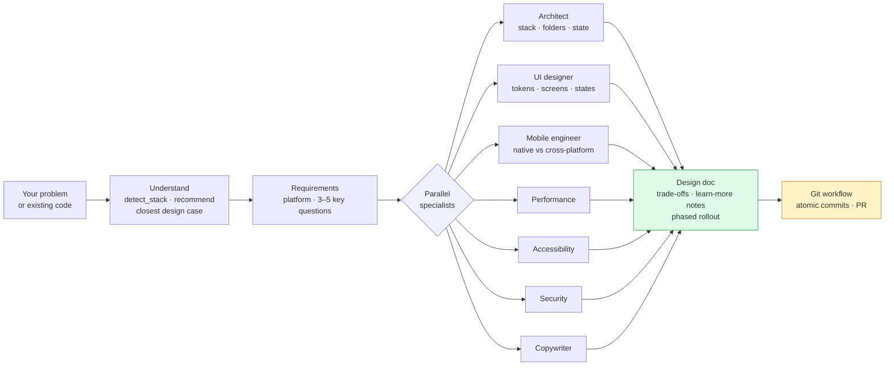

<div align="center">

# Frontend System Design

### A senior frontend team for your AI coding agent: architecture, product design, human copy and clean git history

Describe a problem. Your agent designs the right system for **web, mobile or desktop, on any stack**, and explains every decision. It audits existing apps and writes copy that sounds human. Then it commits the work the way a careful senior engineer would.

[](https://github.com/Muzammil8989/frontend-system-design/actions/workflows/ci.yml)
[](https://github.com/Muzammil8989/frontend-system-design/releases)
[](./LICENSE)
[](./LICENSE-NOTES.md)
[](./CONTRIBUTING.md)


**Claude Code** · **Cursor** · **GitHub Copilot** · **Windsurf** · **Gemini CLI** · **Codex & any `AGENTS.md` tool**

```bash
npx frontend-system-design install --all
```

<sub>No more running a separate <code>npx</code> for every skill. One command installs UI UX Pro Max, Impeccable, Vercel agent-skills, Anthropic frontend-design and Cloudflare security-audit, plus this project's own skills, in every AI tool you use.<br/>Prefer to pick each piece yourself? Run <code>install</code> without flags. See <a href="#choose-your-install">Choose your install</a>.</sub>

[Quick start](#quick-start) · [Features](#features) · [Git workflow](#git-workflow-skill) · [Hooks](#guardrail-hooks) · [MCP](#mcp-server) · [Stacks](#supported-platforms--stacks) · [Roadmap](#learning-roadmap) · [Docs](./docs/architecture.md) · [Contributing](./CONTRIBUTING.md)

<br/>



</div>

---

## Overview

On their own, AI coding agents pick the same default stack, the same generic UI and the same AI-sounding copy for every project, and they leave behind commits like `update stuff`. This project gives them the judgement of a senior team, packaged as **agent skills** you install with one command.

| | You ask | You get |
|---|---|---|
| **Design** | *"Offline-first field-service app for 2,000 technicians"* | A design doc covering the platform decision, stack, **folder structure**, state and data, design tokens, every screen state, performance budgets, accessibility, security and a phased rollout. Each trade-off links to the note that explains it |
| **Audit** | *"Review ./apps/web"* | A 100-point scored report with `file:line` evidence, blockers and fixes ranked by impact ÷ effort |
| **Write** | *"Rewrite our landing page and onboarding"* | Story-driven copy that sounds human, checked by a scorer that flags AI-sounding phrasing. Proof it can't verify is left as a placeholder, never invented |
| **Commit** | *"Commit this"* · *"Open a PR"* · *"I committed to main by mistake"* | Atomic commits with checked Conventional Commit messages, a ready-to-paste PR description, and the safest fix for a git mistake. It commits only after your OK and pushes only when you ask |
| **Learn** | *"Teach me the critical rendering path"* | A lesson taught from the roadmap notes: ELI5 → core concept → example → quiz |

---

## Table of Contents

- [Quick Start](#quick-start)
- [One Command, Not Six](#one-command-not-six)
- [Why This Repo](#why-this-repo)
- [Features](#features)
- [Git Workflow Skill](#git-workflow-skill)
- [Guardrail Hooks](#guardrail-hooks)
- [MCP Server](#mcp-server)
- [Supported Tools](#supported-tools)
- [Supported Platforms & Stacks](#supported-platforms--stacks)
- [How It Works](#how-it-works)
- [Usage](#usage)
- [Companion Skills](#companion-skills)
- [CLI Reference](#cli-reference)
- [FAQ](#faq)
- [Repository Structure](#repository-structure)
- [Learning Roadmap](#learning-roadmap)
- [Contributing](#contributing)
- [License](#license)

---

## Quick Start

**Requirements**

- **Node.js 18 or later.** Node 22.20 or later is recommended. The Vercel, Anthropic and Cloudflare packs install through `npx skills`, which needs it. On older Node those packs are skipped, and the installer tells you how to add them later.
- **Python 3.9 or later**, for the helper scripts. They use only the standard library, so there's nothing to `pip install`.

### Choose your install

Run one of these in your project folder.

| | **Recommended: everything** | **Choose yourself** | **Built-in skills only** |
|---|---|---|---|
| **Command** | `npx frontend-system-design install --all` | `npx frontend-system-design install` | `npx frontend-system-design install --all --no-companions` |
| **Installs** | The built-in skills, 8 agents and 9 commands, plus all five companions: UI UX Pro Max, Impeccable, Vercel agent-skills, Anthropic frontend-design and Cloudflare security-audit | Only what you tick in the wizard: AI tools, project or global scope, skills and companions. Everything recommended starts ticked | The built-in skills, 8 agents and 9 commands. No third-party code |
| **Choose it if** | You want the full setup without any decisions. This is the right choice for most people | You want to leave something out, or install for only some of your AI tools | Your company restricts third-party packages, or you only want the built-in skills |
| **Good to know** | Asks once before running the five third-party installers; add `--yes` to skip that question | Shows every command, and any warning, before you confirm | Quickest to install. Add the companions later by running `install --all` |

**About Cloudflare security-audit.** Its audits run many parallel subagents, so expect higher token use, and run any audited code only inside a sandbox. The installer prints this warning before Cloudflare's installer runs. To leave it out, untick it in the wizard, or name the companions you want: `--companions ui-ux-pro-max,impeccable,vercel-agent-skills,frontend-design`.

**Two opt-in extras** work with any of the three: `--hooks` adds [guardrail hooks](#guardrail-hooks) that enforce the git rules, and `--mcp` connects the [MCP server](#mcp-server) to your AI tools. The wizard asks about both.

Add `--dry-run` to any command to see exactly what it would do without changing anything.

<sub>Want the latest unreleased changes from <code>main</code>? Replace <code>npx frontend-system-design</code> with <code>npx github:Muzammil8989/frontend-system-design</code>.</sub>

> **You don't need to clone this repo to use it.** The installer copies only what your agent needs: the skills (with all 120 notes inside), the specialist agents and the commands. That's about 7 MB, with no tests, docs or build files. Clone the repo only if you want to [contribute](#contributing).

| Install for | Where the files go |
|---|---|
| This project (default) | `.claude/` and/or `.agents/skills/` in your project, plus small rule files for Cursor, Windsurf, Copilot or Gemini |
| Every project (`--global`) | Your home folder, e.g. `C:\Users\<you>\.claude\` on Windows or `~/.claude/` on macOS and Linux. Nothing is added to the project |

Without flags, the wizard detects the AI tools on your machine, preselects them, and lets you choose the rest:

```text
┌   Frontend System Design v1.1.0
│
◇  Detected ────────────────────────────────────╮
│  AI tools found: Claude Code, Cursor           │
│  Project stack: Next.js                        │
├────────────────────────────────────────────────╯
◆  Which AI coding tools should get the skills?
│  ◼ Claude Code        (`claude` on PATH)
│  ◼ Cursor             (.cursor/ in project)
│  ◻ GitHub Copilot (VS Code)
│  ◻ Windsurf
│  ◻ Gemini CLI
│  ◻ Codex & other AGENTS.md tools
◆  Where should Claude Code get them?   ● This project   ○ Globally (~/.claude)
◆  Which skills?   ◼ Frontend System Design   ◼ Product Copywriting   ◼ Git Workflow
◆  Recommended companion skills (space to untick):
│  ◼ UI UX Pro Max   ◼ Impeccable   ◼ Vercel agent-skills   ◼ frontend-design   ◼ Cloudflare security-audit
◇  Ready to install: shows every command, and the Cloudflare sandbox warning
◆  Install now?   Yes
└  Done. Happy building!
```

Then ask your agent, for example:

```text
/fsd:design "real-time analytics dashboard for a logistics company"
/fsd:commit
```

<details>
<summary><b>More install commands (CI, scripts, dotfiles)</b></summary>

| Goal | Command |
|---|---|
| Recommended (everything), with no questions at all | `npx frontend-system-design install --all --yes` |
| Everything except Cloudflare security-audit | `npx frontend-system-design install --all --companions ui-ux-pro-max,impeccable,vercel-agent-skills,frontend-design` |
| Claude Code only, for every project | `npx frontend-system-design install --agent claude --global --yes` |
| Only the Git Workflow skill, for Claude Code and Cursor | `npx frontend-system-design install --agent claude,cursor --skills git-workflow --no-companions --yes` |
| Only the copywriter, for Cursor and Windsurf | `npx frontend-system-design install --agent cursor,windsurf --skills product-copywriting --yes` |
| Pick specific companions | `npx frontend-system-design install --all --companions impeccable,security-audit` |
| Preview without changing anything | `npx frontend-system-design install --all --dry-run` |

`--yes` alone never runs third-party installers. They run only when you pass `--all` or `--companions`.

</details>

---

## One Command, Not Six

A good setup for an AI agent usually means finding each skill pack, learning its installer, and running it again for every tool you use:

```bash
# Without this repo, for Claude Code alone:
npx ui-ux-pro-max-cli init --ai claude
npx impeccable install --providers=claude --scope=project
npx skills add vercel-labs/agent-skills --skill vercel-react-best-practices web-design-guidelines vercel-composition-patterns --agent claude-code
npx skills add anthropics/skills --skill frontend-design --agent claude-code
npx skills add cloudflare/security-audit-skill --skill security-audit --agent claude-code
# ...then the same again for Cursor, Copilot, Windsurf, Gemini and Codex,
# and you still have no architect, no copywriter and no git workflow.
```

With this repo:

```bash
npx frontend-system-design install --all      # everything, for every AI tool
npx frontend-system-design install            # or choose each piece in the wizard
```

| That one command | What it does |
|---|---|
| **Finds your AI tools** | Claude Code, Cursor, GitHub Copilot, Windsurf, Gemini CLI and Codex, each with the right file layout and flags |
| **Installs the built-in skills** | Frontend System Design, Product Copywriting and Git Workflow, plus 8 specialist agents, 9 `/fsd:*` commands and 120 notes |
| **Installs five well-known third-party skills** | [UI UX Pro Max](https://github.com/nextlevelbuilder/ui-ux-pro-max-skill), [Impeccable](https://github.com/pbakaus/impeccable), [Vercel agent-skills](https://github.com/vercel-labs/agent-skills), [Anthropic frontend-design](https://github.com/anthropics/skills/tree/main/skills/frontend-design) and [Cloudflare security-audit](https://github.com/cloudflare/security-audit-skill), in parallel |
| **Lets you choose** | Without `--all`, a short wizard lets you untick any tool, skill or companion before anything runs |
| **Wires them together** | The built-in skills hand off to the companions when they're installed, so your agent uses them on its own |

What it runs, and how you can check it:

- **Pinned:** [`companions.json`](./companions.json) pins every third-party installer to an exact version.
- **Visible:** the installer prints each command before it runs, and `--dry-run` shows them all without running anything.
- **Official:** each companion's own upstream installer does the work. This repo copies none of their code ([THIRD_PARTY.md](./THIRD_PARTY.md)).

---

## Why This Repo

You open your editor to start a new product. Your AI agent is ready, and fast. Ten minutes later it has picked the stack it always picks and built the same dashboard as last time. The hero line could belong to any startup, and all of it is committed as `update`.

So you open tabs. A blog post on SSR versus SSG. A WCAG checklist. A thread about where to store auth tokens. A performance guide that's three years old. A copy tool to make your words sound less robotic. A Stack Overflow answer on undoing a commit you already pushed. Each tab knows one thing. None of them knows your project, and none of them talks to your agent.

This repo closes those tabs. It puts the whole team in one place and hands it to your agent:

| Your agent gets | So it can |
|---|---|
| **An architect** | Choose the platform, rendering per route, stack, folder structure, state and data flow, and explain every trade-off |
| **A product designer** | Set the visual direction, design tokens, components and every screen state: empty, loading, error, offline, success |
| **Performance, accessibility and security specialists** | Set budgets for Core Web Vitals and app startup, plan for WCAG 2.2 AA, and lock down auth, CSP, XSS and secure storage |
| **A mobile and desktop engineer** | Decide native or cross-platform, and plan offline sync, push, deep links and releases |
| **A reviewer** | Audit an existing app and score it out of 100, with `file:line` evidence and fixes ranked by impact |
| **A product copywriter** | Write landing pages, onboarding and microcopy that sound human, without inventing proof |
| **A git and release engineer** | Split work into atomic commits, write messages and PRs reviewers can scan, fix git mistakes safely, and cut releases with a proper changelog |
| **A teacher** | Teach any of 120 notes across 11 phases, from how browsers work to designing a Figma-like canvas, step by step with a quiz |

**What you gain by having it all in one place:**

- **One command, every skill.** Architecture, UI, performance, accessibility, security, mobile, copy, git and learning arrive together, along with five well-known third-party skills for design and security. And the skills know about each other: the architect hands copy to the copywriter, and the git skill commits a design in reviewable slices.
- **Grounded, not guessed.** Every decision cites the note that explains it. When the notes don't cover something, the agent says so instead of making it up.
- **Safe by default.** Third-party installers are pinned and shown before they run. The git skill never commits without your OK, and never pushes, force-pushes or skips hooks unless you ask.
- **Any stack, any AI tool.** 20 stacks across web, mobile and desktop. Works in Claude Code, Cursor, GitHub Copilot, Windsurf, Gemini CLI and Codex.
- **Light on your machine and your tokens.** The installer copies only the skills, notes, agents and commands (about 7 MB), never the whole repo. Agents read a note section by section instead of loading it whole.
- **Free and open.** MIT-licensed code, CC BY 4.0 notes, and helper scripts that run offline with only the Python standard library.

---

## Features

### Skills

| Skill | What it does |
|---|---|
| **`frontend-system-design`** | **Problem-first system design.** It restates your problem, matches it to a known system design case, and works through **RADIO + UI**: Requirements, Architecture, Data, Interface, Optimizations, then the UI system. It decides native vs cross-platform, rendering per route, the stack and a feature-based **folder structure**, then state and data, design tokens, every screen state, budgets, accessibility (WCAG 2.2 AA) and security. Every trade-off includes a *"Why — learn more"* link to a roadmap note. It also **audits** existing apps and **teaches** topics |
| **`product-copywriting`** | **Website and app copy that reads as human.** The customer is the hero, using story frameworks such as PAS, BAB and origin stories. It covers landing pages, about pages, pricing, onboarding, empty states, errors, permission prompts, push notifications, app-store listings and microcopy. A bundled checker flags 170 AI-sounding phrases, filler, passive voice, flat rhythm and reading level. Unverified proof becomes a `[placeholder]`, never a made-up testimonial or statistic |
| **`git-workflow`** | **Clean, reviewable history.** It reads your repo's conventions first. Then it writes atomic commits with checked [Conventional Commit](https://www.conventionalcommits.org/) messages, plus PR titles and descriptions. Releases get a [semver](https://semver.org/) bump and a [Keep a Changelog](https://keepachangelog.com/) entry. Its undo playbook covers 34 common git mistakes, from a wrong-branch commit to a leaked secret, each with the safest fix first and its risk level. [More below](#git-workflow-skill) |

### Commands and specialist agents

| Command | What happens |
|---|---|
| `/fsd:design <problem>` | The lead architect runs **specialists in parallel** and merges their work into one design doc: `ui-designer`, `mobile-engineer`, `performance-engineer`, `accessibility-specialist`, `security-reviewer` and `copywriter` |
| `/fsd:docs [focus]` | Writes or refreshes the project docs in `docs/`: architecture, system design, design tokens (`tokens.json`), color with a computed contrast table, typography with the type scale, components and quality |
| `/fsd:audit [path]` | The read-only `ui-ux-reviewer` and the specialists score the app out of 100 |
| `/fsd:learn <topic>` | An interactive lesson from the roadmap notes |
| `/fsd:copy <page>` | The `copywriter` writes, checks and revises until the copy scores at least 80 |
| `/fsd:commit [hint]` | Reads the staged diff, proposes atomic commits, checks each message, and commits only after you confirm |
| `/fsd:pr [base]` | Branch name, PR title and description from the whole branch, plus a size check and split suggestions |
| `/fsd:undo <problem>` | Diagnoses a git mistake and gives the least destructive fix, its risk level, and a way back |
| `/fsd:release [version]` | Picks the semver bump from the commits, writes the CHANGELOG entry and release notes, and prepares the tag |

Copilot gets the same commands as `/fsd-design`, `/fsd-docs`, `/fsd-audit`, `/fsd-learn`, `/fsd-copy`, `/fsd-commit`, `/fsd-pr`, `/fsd-undo` and `/fsd-release`. In Cursor, Windsurf, Gemini CLI and Codex, ask in plain language ("commit this", "design the frontend for…"). Tools without subagents run each specialist role in sequence.

### Python engine (standard library only, offline)

| Script | Purpose |
|---|---|
| `recommend.py` | Problem → product type, platform, stack, UI styles, contrast-checked palettes, fonts, UX patterns, budget, files to read, and the notes that explain the choices |
| `detect_stack.py` | Detects the stack of an existing project, including monorepos: web, React Native, Flutter, Swift, Kotlin, MAUI, Tauri and Electron |
| `search.py` | BM25 search over the curated datasets: 20 product types, 73 stacks, 16 UI styles, 21 WCAG-AA palettes, 23 font pairings and 41 UX patterns |
| `budget.py` | Core Web Vitals and size budgets for the web (including a Lighthouse `budget.json`), plus startup, frame and size targets for mobile and desktop |
| `audit_scan.py` | Static accessibility, security and performance scan for web, React Native, Flutter, Swift, Kotlin and XAML |
| `tokens_check.py` | Validates a design-token file: references, types, and color contrast |
| `copy_check.py` | Scores copy from 0 to 100 with line-level fixes |
| `commit_check.py` | Lints a commit message or a whole branch (0-100) and suggests the next semver version from the commits |

---

## Git Workflow Skill

Most agents can run `git commit`. Few leave history that a reviewer, `git bisect` or a release tool can use. This skill covers the whole loop, and it **follows your repo's own conventions first**: it reads `CONTRIBUTING`, commitlint or hook config, the PR template and recent `git log` before it writes anything.

| Mode | Ask | What it does |
|---|---|---|
| **Commit** | `/fsd:commit` · *"commit this"* | Reviews the staged diff, stops if it finds a secret, splits mixed changes into atomic commits, writes and checks each message, then commits **after you say yes**. It never pushes |
| **PR** | `/fsd:pr` · *"open a PR"* | Suggests a branch name and reads every commit on the branch. It flags `wip` and `fixup!` commits and checks the size. Then it writes the title and description from your PR template, listing only the tests you ran |
| **Undo** | `/fsd:undo committed to main` | Diagnoses with `status`, `log` and `reflog`, asks whether the work was pushed, then gives the safest fix with its risk level, whether it rewrites history, and how to undo the fix. Destructive steps need an explicit yes, every time |
| **Release** | `/fsd:release` | Works out major, minor or patch from the commits since the last tag, writes a user-facing CHANGELOG entry and release notes, then prepares the commit and annotated tag. It pushes only when you ask |

**Ground rules the skill always follows:**

- No push, force-push, history rewrite or `--no-verify` unless you ask for that exact action.
- No secrets or build output in commits, and no invented issue numbers, versions or test results.
- `revert` over `reset` on shared branches, and `--force-with-lease`, never plain `--force`.
- A backup branch before anything risky.

Check messages yourself, or in CI:

```bash
python3 .claude/skills/git-workflow/scripts/commit_check.py "feat(cli): add --companions all"
python3 .claude/skills/git-workflow/scripts/commit_check.py --range origin/main..HEAD
python3 .claude/skills/git-workflow/scripts/commit_check.py --range v1.1.0..HEAD --suggest-bump
# Suggested bump: minor (v1.1.0 → v1.2.0)
```

---

## Guardrail Hooks

A skill is advice: the agent follows it most of the time. A hook is a rule the tool enforces every time. Add `--hooks` to turn the git skill's safety rules into hooks:

```bash
npx frontend-system-design install --all --hooks
```

**In Claude Code** (`.claude/hooks/fsd-guard.js`, registered in `.claude/settings.json`), every shell command the agent runs is checked first:

| The agent tries to… | What happens |
|---|---|
| `git push --force`, `push -f`, `push +branch` | **Blocked.** It's told to use `--force-with-lease` on its own branch, and only when you ask |
| `--no-verify` / `commit -n` | **Blocked.** It has to fix what your hooks report |
| Commit `.env`, private keys, certificates or credential files | **Blocked**, with the steps to unstage them and commit an example file instead |
| `git push`, `--force-with-lease`, `reset --hard`, `clean -f`, `branch -D`, `stash drop`, `filter-repo`, discard the whole tree, delete a tag | **Asks you first** |
| Anything else | Runs as normal |

**In git itself** (`.git/hooks/commit-msg`), every commit message, yours included, is checked by `commit_check.py`. `wip` and `fixup!` commits are allowed locally, so your workflow isn't blocked; `commit_check.py --range` catches them before you merge.

It's built to stay out of your way:
- Your other hooks are kept. The settings file is merged, and the git hook is skipped (with the line to add by hand) if you already use husky, lefthook, `core.hooksPath` or your own `commit-msg` hook.
- If the guard itself fails, it lets the command run. A bug in a guardrail should never stop your work.
- To remove it, delete the `fsd-guard.js` entry under `hooks.PreToolUse` in `.claude/settings.json`, `.claude/hooks/fsd-guard.js`, and `.git/hooks/commit-msg`.

---

## MCP Server

The skills work inside coding agents. The **MCP server** brings the same engine and the 120 notes to any [MCP](https://modelcontextprotocol.io/) client: Claude Desktop, ChatGPT, VS Code, Cursor, Gemini CLI, n8n and others.

```bash
npx frontend-system-design mcp                   # stdio server; tools may read the current folder
npx frontend-system-design install --all --mcp   # or register it in each selected tool's MCP config
```

| Tool | What it does |
|---|---|
| `recommend` | Product idea → platform, stack, styles, palettes, fonts, UX patterns, budget, and the notes behind each choice |
| `search` | Search products, stacks, UI styles, WCAG-AA palettes, font pairings and UX patterns |
| `budget` | Core Web Vitals and size budgets for web; startup and frame targets for mobile and desktop |
| `detect_stack` · `audit_scan` | Detect an existing project's stack; static accessibility, security and performance scan |
| `tokens_check` | Validate a design-tokens file, including color contrast |
| `copy_check` | Score UI and marketing copy for human, specific writing |
| `commit_check` | Lint a commit message or a whole branch, and suggest the next version |
| `list_notes` · `read_note` | Find a learning note, then read only the sections you need (Key Points and Cheat Sheet by default) |

`--mcp` writes `.mcp.json` (Claude Code), `.cursor/mcp.json`, `.vscode/mcp.json` and `.gemini/settings.json` for the tools you select. It merges with what's there and prints a snippet for Windsurf and for files it can't merge (for example, JSON with comments). For any other client, add a stdio server:

```json
{ "mcpServers": { "frontend-system-design": { "command": "npx", "args": ["-y", "frontend-system-design", "mcp", "--dir", "/path/to/your/project"] } } }
```

**Local and contained.** It runs on your machine with no network calls of its own. Tools can read only the folder given with `--dir` (default: the current folder), and paths outside it are refused. It has no new dependencies and needs Python 3.9+ for the engine tools; the note tools work without it.

---

## Supported Tools

| Tool | What gets installed |
|---|---|
| **Claude Code** | `.claude/skills/*`, 8 subagents in `.claude/agents/`, and 9 `/fsd:*` commands. Use `--global` to install to `~/.claude` |
| **Cursor** | `.agents/skills/*` plus agent-requested rules in `.cursor/rules/*.mdc` |
| **GitHub Copilot** (VS Code) | `.agents/skills/*`, a managed block in `.github/copilot-instructions.md`, and `/fsd-*` prompt files |
| **Windsurf** | `.agents/skills/*` plus `.windsurf/rules/*.md` (model-decision trigger) |
| **Gemini CLI** | `.agents/skills/*` plus a managed block in `GEMINI.md` |
| **Codex & others** | `.agents/skills/*` plus a managed block in `AGENTS.md` |

---

## Supported Platforms & Stacks

Every stack has a guide covering:
- when to choose it, and when to avoid it;
- a **production folder structure**;
- routing and navigation, state and data, styling;
- performance and accessibility specifics, testing, build and deploy;
- common pitfalls.

| Platform | Stacks |
|---|---|
| **Web** | React + Vite · Next.js · React Router (Remix) · Vue / Nuxt · Angular · Svelte / SvelteKit · Solid / SolidStart · Astro · Qwik · Web Components (Lit) · Server-rendered (htmx, Hotwire, Livewire, Django, Rails, Laravel, LiveView) |
| **Mobile & cross-platform** | React Native + Expo · Flutter · SwiftUI · Jetpack Compose · Compose Multiplatform (KMP) · .NET MAUI · Ionic + Capacitor |
| **Desktop** | Electron · Tauri |

There are also platform guides for **web**, **mobile** and **desktop**:
- native vs cross-platform decision tables;
- Apple HIG and Material 3 conventions;
- offline sync, push notifications and deep links;
- store rules, auto-update, code signing.

---

## How It Works



<details>
<summary><b>Sample output: <code>recommend.py "fitness tracking app for iOS and Android"</code> (abridged)</b></summary>

```text
## Recommendation: Fitness / health app · platform: mobile

### Architecture
- Rendering / app model: Native/cross-platform · offline-first logging · background sync with health APIs
- State: Local DB is source of truth for logs · sync queue · server for plans and social

### Stack
| framework | SwiftUI          | mobile | Native Apple-platform apps with the best platform fit  |
| framework | Jetpack Compose  | mobile | Native Android apps with modern declarative UI         |
| framework | Flutter          | cross  | One codebase for iOS, Android, web and desktop         |
| framework | Expo (RN)        | mobile | Cross-platform iOS/Android apps for React/TS teams     |

### Read next
- references/platforms/mobile.md
- references/stacks/swiftui.md · jetpack-compose.md · flutter.md · react-native-expo.md

### Learn more (project notes behind these decisions)
- Browser Storage Mechanisms: client persistence, offline-first, auth token storage
```

</details>

---

## Usage

**Claude Code**

```text
/fsd:design "offline-first field-service app, iOS + Android + web admin"
/fsd:audit ./apps/mobile
/fsd:learn event loop
/fsd:copy "landing page hero and about page"
/fsd:commit
/fsd:pr main
/fsd:undo "I committed to main instead of my feature branch"
/fsd:release
> Riverpod or Bloc for our Flutter app?
```

**Cursor, Windsurf, Gemini CLI, Codex.** Ask in plain language, e.g. *"Design the frontend for a hotel booking marketplace"*, *"Rewrite our onboarding so it sounds human"* or *"Commit this and write the PR description"*.

**Copilot Chat:** `/fsd-design`, `/fsd-docs`, `/fsd-audit`, `/fsd-learn`, `/fsd-copy`, `/fsd-commit`, `/fsd-pr`, `/fsd-undo`, `/fsd-release`.

**Any terminal:**

```bash
S=.claude/skills/frontend-system-design/scripts   # or .agents/skills/frontend-system-design/scripts
python3 $S/recommend.py "add a booking flow" --project .
python3 $S/detect_stack.py .
python3 $S/budget.py --type mobile-consumer --platform mobile
python3 .claude/skills/product-copywriting/scripts/copy_check.py hero.md --min-score 80
python3 .claude/skills/git-workflow/scripts/commit_check.py --range origin/main..HEAD
```

On Windows, use `py` (or `python`) instead of `python3`.

---

## Companion Skills

The built-in skills act as the **architect**, the **storyteller** and the **release engineer**. The installer adds these five well-regarded skills for extra depth, and the built-in skills hand off to them when they're installed. Each one is installed with **its own official installer**; nothing is copied into this repository.

| How you install | Which companions you get |
|---|---|
| `install --all` | All five, after one confirmation (none with `--yes`) |
| `install` (wizard) | All five start ticked; untick any you don't want |
| `--companions <ids>` | Only the ones you name, e.g. `--companions impeccable,security-audit` |
| `--no-companions` | None |

| Companion | Adds | License | Replaces running, per tool |
|---|---|---|---|
| [UI UX Pro Max](https://github.com/nextlevelbuilder/ui-ux-pro-max-skill) | A large searchable catalogue of UI styles, palettes, font pairings and UX guidelines | MIT | `npx ui-ux-pro-max-cli init --ai <tool>` |
| [Impeccable](https://github.com/pbakaus/impeccable) | Design polish, critique and audit commands; anti-pattern detection (Claude Code, Cursor, Codex) | Apache-2.0 | `npx impeccable install --providers=<tools> --scope=<scope>` |
| [Vercel agent-skills](https://github.com/vercel-labs/agent-skills) | `vercel-react-best-practices`, `web-design-guidelines`, `vercel-composition-patterns` | MIT | `npx skills add vercel-labs/agent-skills --skill … --agent <tools>` |
| [Anthropic frontend-design](https://github.com/anthropics/skills/tree/main/skills/frontend-design) | Distinctive, non-generic visual direction | See upstream | `npx skills add anthropics/skills --skill frontend-design --agent <tools>` |
| [Cloudflare security-audit](https://github.com/cloudflare/security-audit-skill) | Full multi-phase security audits of a codebase, with independently verified findings and a report. Needs an agent with parallel subagents (higher token use); run target code only inside a sandbox | MIT | `npx skills add cloudflare/security-audit-skill --skill security-audit --agent <tools>` |

Every installer is pinned to an exact version in [`companions.json`](./companions.json), and its command is shown before it runs, with a warning where one applies. For `npx skills` packs, the installer reads the per-skill result and marks the companion ✖ if any requested skill wasn't installed. Non-interactive runs (`--yes`) install companions only when you ask for them with `--all` or `--companions <ids>`. See [THIRD_PARTY.md](./THIRD_PARTY.md).

---

## CLI Reference

```text
npx frontend-system-design <command> [options]

install                  Interactive wizard in a terminal; flags skip questions
  --agent <list>           claude, cursor, copilot, windsurf, gemini, agents, all
  --skills <list>          frontend-system-design, product-copywriting, git-workflow (default: all)
  --global                 Claude Code: install to ~/.claude (all projects)
  --dir <path>             Target project (default: current directory)
  --companions <ids|all>   Run only these companion installers (pinned versions)
  --no-companions          Skip third-party companion skills
  --all                    Every tool + every recommended companion skill
  --yes, -y                No questions; companions only with --all or --companions
  --hooks                  Guardrail hooks: Claude Code guard + git commit-msg check (opt-in)
  --mcp                    Register the MCP server in each selected tool's MCP config (opt-in)
  --force                  Overwrite files you changed locally
  --dry-run                Preview; write and run nothing
mcp                      Run the MCP server on stdio
  --dir <path>             Folder the tools may read (default: current directory)
list                     Show what each tool integration installs
list-companions          Show companion skills and licenses
```

Re-running `install` is safe:
- unchanged files are left alone;
- shared files (`AGENTS.md`, `GEMINI.md`, `copilot-instructions.md`) only get a managed `<!-- fsd:start -->` block;
- files you edited are kept unless you pass `--force`.

---

## FAQ

<details>
<summary><b>Which install should I choose?</b></summary>

Start with **Recommended** (`install --all`): it installs everything. Run `install` without flags to **choose yourself** in the wizard, for example to leave out Cloudflare security-audit if you can't run audited code in a sandbox. Choose **Built-in skills only** (`--no-companions`) if you can't install third-party packages. You can switch later: re-running with different flags only adds what's missing.

</details>

<details>
<summary><b>Will the git skill commit or push without asking?</b></summary>

No. It shows the files and the full message and runs `git commit` only after you say yes. It never pushes, force-pushes, rewrites shared history, deletes branches or skips hooks unless you ask for that exact action. Destructive undo steps (`reset --hard`, `clean`, `branch -D`) each need their own yes, and it makes a backup branch first.

</details>

<details>
<summary><b>My team doesn't use Conventional Commits. Will the git skill fight that?</b></summary>

No. It reads `CONTRIBUTING`, commitlint or hook config and your recent `git log` first, and follows what it finds. Conventional Commits is only the fallback. The checker accepts extra types with `--types`.

</details>

<details>
<summary><b>Does anything get sent over the network?</b></summary>

The installer only copies files into your project, or into `~/.claude` with `--global`. The Python scripts make no network calls. The only network activity is the companion installers (pinned versions). The MCP server and the guardrail hooks run locally and make no network calls. In the wizard you see their exact commands before confirming; with `--yes` they run only if you pass `--all` or `--companions`. Skip them with `--no-companions`. See [SECURITY.md](./SECURITY.md).

</details>

<details>
<summary><b>How do I update?</b></summary>

Run the same `npx … install` command again. Unchanged files are updated in place and files you customised are kept; add `--force` to overwrite them too.

</details>

<details>
<summary><b>How do I uninstall?</b></summary>

Delete the folders and files listed by `npx frontend-system-design list`:
- `.claude/skills/frontend-system-design`, `.claude/skills/product-copywriting`, `.claude/skills/git-workflow`, the agents and `.claude/commands/fsd/`;
- `.agents/skills/…`;
- the `.cursor` and `.windsurf` rules;
- the `fsd:start … fsd:end` block in `AGENTS.md`, `GEMINI.md` or `copilot-instructions.md`;
- with `--hooks`: `.claude/hooks/fsd-guard.js`, its entry in `.claude/settings.json`, and `.git/hooks/commit-msg`;
- with `--mcp`: the `frontend-system-design` entry in `.mcp.json`, `.cursor/mcp.json`, `.vscode/mcp.json` or `.gemini/settings.json`.

</details>

<details>
<summary><b>I don't have Python. Does it still work?</b></summary>

Yes. The skills, agents and commands work without it. Python only powers the optional helper scripts, and agents fall back to the reference files.

</details>

<details>
<summary><b>Will it force a particular stack on my project?</b></summary>

No. In an existing codebase it detects your stack, follows that stack's guide, and only recommends changing it when the stack itself is the problem.

</details>

---

## Repository Structure

```text
frontend-system-design/
├── skills/
│   ├── frontend-system-design/     SKILL.md · references/{core,platforms,stacks,playbooks,templates,knowledge} · scripts/ · data/
│   ├── product-copywriting/        SKILL.md · references/ · scripts/copy_check.py · data/
│   └── git-workflow/               SKILL.md · references/ · scripts/commit_check.py · data/{commit-types,git-recipes}.csv
├── agents/                         8 specialist subagents
├── commands/                       /fsd:design · docs · audit · learn · copy · commit · pr · undo · release
├── src/cli/                        installer: index · install · wizard · detect · adapters/ · writer · companions · hooks · mcp-config · python
├── src/mcp/                        MCP server: server (stdio JSON-RPC) · tools
├── hooks/fsd-guard.js              Claude Code guardrail hook (installed with --hooks)
├── bin/cli.js                      npx entry point
├── notes/                          learning roadmap: 01-web-fundamentals/ … 11-system-design-cases/ (synced into the skill's knowledge/)
├── scripts/                        lint-notes · sync-knowledge · validate-skills · run-python-tests
├── tests/                          node/ (installer) · python/ (engine, platforms, tokens, copy and commit checkers)
├── docs/                           architecture · adding a stack · adding an AI tool · reading the notes
└── .github/ · companions.json · CHANGELOG · CONTRIBUTING · SECURITY · LICENSE
```

Read [docs/architecture.md](./docs/architecture.md) for how the pieces fit together.

---

## Learning Roadmap

The roadmap has **120 topics in 11 phases**, and every topic is written. Each topic is a structured, diagram-rich note with:
- an ELI5 explanation;
- real-world code;
- quiz questions with answers;
- a cheat sheet and curated references.

The notes have two jobs. **Learners** read them, on GitHub or with [`/fsd:learn`](#usage). **Builders** get them through the skill, which ships them as its knowledge base and cites them in every design.

**Legend:** ✅ written · ⬜ planned · New here? Read [how to read the notes](./docs/reading-the-notes.md), including the VS Code Mermaid setup.

### Learning Path

```mermaid
flowchart LR
    P1["1 · Web<br/>Fundamentals"] --> P2["2 · Rendering &<br/>Architecture"]
    P2 --> P3["3 · State<br/>& Data"]
    P3 --> P4["4 · Performance"]
    P4 --> P5["5 · Design Systems<br/>& Components"]
    P5 --> P6["6 · A11y<br/>& i18n"]
    P6 --> P7["7 · Security"]
    P7 --> P8["8 · Testing"]
    P8 --> P9["9 · Monitoring"]
    P9 --> P10["10 · Advanced"]
    P10 --> P11["11 · System<br/>Design Cases"]
    style P1 fill:#dcfce7,stroke:#16a34a
    style P2 fill:#dcfce7,stroke:#16a34a
    style P3 fill:#dcfce7,stroke:#16a34a
    style P4 fill:#dcfce7,stroke:#16a34a
    style P5 fill:#dcfce7,stroke:#16a34a
    style P6 fill:#dcfce7,stroke:#16a34a
    style P7 fill:#dcfce7,stroke:#16a34a
    style P8 fill:#dcfce7,stroke:#16a34a
    style P9 fill:#dcfce7,stroke:#16a34a
    style P10 fill:#dcfce7,stroke:#16a34a
    style P11 fill:#dcfce7,stroke:#16a34a
```



Phases 1–4 build the foundations. Phases 5–9 cover the engineering practices used in production. Phases 10–11 combine everything into interview-style system design cases.

### Progress

| Phase | Done | Total | Topics |
|---|:---:|:---:|---|
| 1 · Web Fundamentals | 14 | 14 | [View](#phase-1--web-fundamentals) |
| 2 · Rendering & Architecture | 12 | 12 | [View](#phase-2--rendering--architecture) |
| 3 · State & Data | 12 | 12 | [View](#phase-3--state--data) |
| 4 · Performance Engineering | 15 | 15 | [View](#phase-4--performance-engineering) |
| 5 · Design Systems & Components | 12 | 12 | [View](#phase-5--design-systems--components) |
| 6 · Accessibility & i18n | 9 | 9 | [View](#phase-6--accessibility--i18n) |
| 7 · Security | 8 | 8 | [View](#phase-7--security) |
| 8 · Testing | 8 | 8 | [View](#phase-8--testing) |
| 9 · Monitoring & Observability | 7 | 7 | [View](#phase-9--monitoring--observability) |
| 10 · Advanced Topics | 8 | 8 | [View](#phase-10--advanced-topics) |
| 11 · System Design Cases | 15 | 15 | [View](#phase-11--system-design-cases) |
| **Total** | **120** | **120** | |

### How each note is structured

1. **ELI5:** the idea in plain language.
2. **Core concept:** step by step, with Mermaid diagrams.
3. **Real-world examples:** copy-pasteable code.
4. **Key points summary:** one-liners.
5. **Test your understanding:** questions with collapsible answers.
6. **Cheat sheet:** definitions, quick reference, common mistakes.
7. **References & further reading:** MDN, web.dev, specs, deep dives.

## Phase 1 — Web Fundamentals

<details open>
<summary><b>14 topics · 14 written</b></summary>

| # | Topic | Category |
|---|---|---|
| 1 | ✅ [How Browsers Work](./notes/01-web-fundamentals/how-browsers-work.md) | Browser Internals |
| 2 | ✅ [Critical Rendering Path](./notes/01-web-fundamentals/critical-rendering-path.md) | Browser Internals |
| 3 | ✅ [Browser Storage Mechanisms](./notes/01-web-fundamentals/browser-storage-mechanisms.md) | Browser Internals |
| 4 | ✅ [JavaScript Runtime & Event Loop](./notes/01-web-fundamentals/javascript-runtime-event-loop.md) | Browser Internals |
| 5 | ✅ [DOM & Virtual DOM](./notes/01-web-fundamentals/dom-and-virtual-dom.md) | Browser Internals |
| 6 | ✅ [HTTP/1.1 vs HTTP/2 vs HTTP/3](./notes/01-web-fundamentals/http1-vs-http2-vs-http3.md) | Networking |
| 7 | ✅ [DNS Resolution & CDN](./notes/01-web-fundamentals/dns-resolution-and-cdn.md) | Networking |
| 8 | ✅ [TCP/TLS Handshake](./notes/01-web-fundamentals/tcp-tls-handshake.md) | Networking |
| 9 | ✅ [REST vs GraphQL vs gRPC-Web](./notes/01-web-fundamentals/rest-vs-graphql-vs-grpc-web.md) | Networking |
| 10 | ✅ [WebSockets & SSE & Long Polling](./notes/01-web-fundamentals/websockets-sse-long-polling.md) | Networking |
| 11 | ✅ [CORS & Same-Origin Policy](./notes/01-web-fundamentals/cors-and-same-origin-policy.md) | Networking |
| 12 | ✅ [Service Workers & Web Workers](./notes/01-web-fundamentals/service-workers-and-web-workers.md) | Browser APIs |
| 13 | ✅ [Web APIs (Intersection Observer, ResizeObserver)](./notes/01-web-fundamentals/web-apis-intersection-observer-resizeobserver.md) | Browser APIs |
| 14 | ✅ [Browser Caching Strategies](./notes/01-web-fundamentals/browser-caching-strategies.md) | Caching |

</details>

## Phase 2 — Rendering & Architecture

<details open>
<summary><b>12 topics · 12 written</b></summary>

| # | Topic | Category |
|---|---|---|
| 15 | ✅ [Client-Side Rendering (CSR)](./notes/02-rendering-and-architecture/client-side-rendering-csr.md) | Rendering Patterns |
| 16 | ✅ [Server-Side Rendering (SSR)](./notes/02-rendering-and-architecture/server-side-rendering-ssr.md) | Rendering Patterns |
| 17 | ✅ [Static Site Generation (SSG)](./notes/02-rendering-and-architecture/static-site-generation-ssg.md) | Rendering Patterns |
| 18 | ✅ [Incremental Static Regeneration (ISR)](./notes/02-rendering-and-architecture/incremental-static-regeneration-isr.md) | Rendering Patterns |
| 19 | ✅ [Streaming SSR & React Server Components](./notes/02-rendering-and-architecture/streaming-ssr-and-react-server-components.md) | Rendering Patterns |
| 20 | ✅ [Island Architecture](./notes/02-rendering-and-architecture/island-architecture.md) | Rendering Patterns |
| 21 | ✅ [Edge Rendering](./notes/02-rendering-and-architecture/edge-rendering.md) | Rendering Patterns |
| 22 | ✅ [Micro-Frontends Architecture](./notes/02-rendering-and-architecture/micro-frontends-architecture.md) | Architecture |
| 23 | ✅ [Mono-repo vs Multi-repo](./notes/02-rendering-and-architecture/mono-repo-vs-multi-repo.md) | Architecture |
| 24 | ✅ [Component Architecture & Design Systems](./notes/02-rendering-and-architecture/component-architecture-and-design-systems.md) | Architecture |
| 25 | ✅ [Feature-Sliced Design](./notes/02-rendering-and-architecture/feature-sliced-design.md) | Architecture |
| 26 | ✅ [Module Bundling & Build Systems](./notes/02-rendering-and-architecture/module-bundling-and-build-systems.md) | Build Tools |

</details>

## Phase 3 — State & Data

<details open>
<summary><b>12 topics · 12 written</b></summary>

| # | Topic | Category |
|---|---|---|
| 27 | ✅ [Client State Management Patterns](./notes/03-state-and-data/client-state-management-patterns.md) | State Management |
| 28 | ✅ [Redux & Redux Toolkit](./notes/03-state-and-data/redux-and-redux-toolkit.md) | State Management |
| 29 | ✅ [Zustand / Jotai / Recoil](./notes/03-state-and-data/zustand-jotai-recoil.md) | State Management |
| 30 | ✅ [Server State vs Client State](./notes/03-state-and-data/server-state-vs-client-state.md) | State Management |
| 31 | ✅ [React Query / TanStack Query](./notes/03-state-and-data/react-query-tanstack-query.md) | Data Fetching |
| 32 | ✅ [SWR & Stale-While-Revalidate](./notes/03-state-and-data/swr-and-stale-while-revalidate.md) | Data Fetching |
| 33 | ✅ [GraphQL Client (Apollo, urql)](./notes/03-state-and-data/graphql-client-apollo-urql.md) | Data Fetching |
| 34 | ✅ [Data Normalization & Caching](./notes/03-state-and-data/data-normalization-and-caching.md) | Data Fetching |
| 35 | ✅ [Optimistic UI Updates](./notes/03-state-and-data/optimistic-ui-updates.md) | Data Fetching |
| 36 | ✅ [Pagination & Infinite Scroll](./notes/03-state-and-data/pagination-and-infinite-scroll.md) | Data Fetching |
| 37 | ✅ [Real-Time Data Sync](./notes/03-state-and-data/real-time-data-sync.md) | Data Fetching |
| 38 | ✅ [Offline-First Architecture](./notes/03-state-and-data/offline-first-architecture.md) | Data Fetching |

</details>

## Phase 4 — Performance Engineering

<details open>
<summary><b>15 topics · 15 written</b></summary>

| # | Topic | Category |
|---|---|---|
| 39 | ✅ [Core Web Vitals (LCP, INP, CLS)](./notes/04-performance-engineering/core-web-vitals-lcp-inp-cls.md) | Performance Metrics |
| 40 | ✅ [Lighthouse & Performance Auditing](./notes/04-performance-engineering/lighthouse-and-performance-auditing.md) | Performance Metrics |
| 41 | ✅ [Performance Budgets](./notes/04-performance-engineering/performance-budgets.md) | Performance Metrics |
| 42 | ✅ [Code Splitting & Lazy Loading](./notes/04-performance-engineering/code-splitting-and-lazy-loading.md) | Loading Performance |
| 43 | ✅ [Tree Shaking & Dead Code Elimination](./notes/04-performance-engineering/tree-shaking-and-dead-code-elimination.md) | Loading Performance |
| 44 | ✅ [Image Optimization](./notes/04-performance-engineering/image-optimization.md) | Loading Performance |
| 45 | ✅ [Font Loading Strategies](./notes/04-performance-engineering/font-loading-strategies.md) | Loading Performance |
| 46 | ✅ [Prefetching & Preloading](./notes/04-performance-engineering/prefetching-and-preloading.md) | Loading Performance |
| 47 | ✅ [JavaScript Bundle Optimization](./notes/04-performance-engineering/javascript-bundle-optimization.md) | Loading Performance |
| 48 | ✅ [Virtual Scrolling & Windowing](./notes/04-performance-engineering/virtual-scrolling-and-windowing.md) | Runtime Performance |
| 49 | ✅ [React Performance (memo, useMemo, useCallback)](./notes/04-performance-engineering/react-performance-memo-usememo-usecallback.md) | Runtime Performance |
| 50 | ✅ [Debouncing & Throttling](./notes/04-performance-engineering/debouncing-and-throttling.md) | Runtime Performance |
| 51 | ✅ [Web Workers for Heavy Computation](./notes/04-performance-engineering/web-workers-for-heavy-computation.md) | Runtime Performance |
| 52 | ✅ [Memory Leaks in Frontend Apps](./notes/04-performance-engineering/memory-leaks-in-frontend-apps.md) | Runtime Performance |
| 53 | ✅ [Animation Performance (CSS vs JS)](./notes/04-performance-engineering/animation-performance-css-vs-js.md) | Runtime Performance |

</details>

## Phase 5 — Design Systems & Components

<details open>
<summary><b>12 topics · 12 written</b></summary>

| # | Topic | Category |
|---|---|---|
| 54 | ✅ [Atomic Design Methodology](./notes/05-design-systems-and-components/atomic-design-methodology.md) | Design System |
| 55 | ✅ [Design Tokens](./notes/05-design-systems-and-components/design-tokens.md) | Design System |
| 56 | ✅ [Component API Design](./notes/05-design-systems-and-components/component-api-design.md) | Design System |
| 57 | ✅ [Compound Component Pattern](./notes/05-design-systems-and-components/compound-component-pattern.md) | Component Patterns |
| 58 | ✅ [Headless UI / Renderless Components](./notes/05-design-systems-and-components/headless-ui-renderless-components.md) | Component Patterns |
| 59 | ✅ [Controlled vs Uncontrolled Components](./notes/05-design-systems-and-components/controlled-vs-uncontrolled-components.md) | Component Patterns |
| 60 | ✅ [Higher-Order Components & Render Props](./notes/05-design-systems-and-components/higher-order-components-and-render-props.md) | Component Patterns |
| 61 | ✅ [Custom Hooks Patterns](./notes/05-design-systems-and-components/custom-hooks-patterns.md) | Component Patterns |
| 62 | ✅ [Storybook & Component Documentation](./notes/05-design-systems-and-components/storybook-and-component-documentation.md) | Design System |
| 63 | ✅ [CSS Architecture (CSS-in-JS, Tailwind, CSS Modules)](./notes/05-design-systems-and-components/css-architecture-css-in-js-tailwind-css-modules.md) | Styling |
| 64 | ✅ [Responsive Design Patterns](./notes/05-design-systems-and-components/responsive-design-patterns.md) | Styling |
| 65 | ✅ [Theming & Dark Mode](./notes/05-design-systems-and-components/theming-and-dark-mode.md) | Styling |

</details>

## Phase 6 — Accessibility & i18n

<details open>
<summary><b>9 topics · 9 written</b></summary>

| # | Topic | Category |
|---|---|---|
| 66 | ✅ [ARIA Roles, States & Properties](./notes/06-accessibility-and-i18n/aria-roles-states-and-properties.md) | Accessibility |
| 67 | ✅ [Keyboard Navigation & Focus Management](./notes/06-accessibility-and-i18n/keyboard-navigation-and-focus-management.md) | Accessibility |
| 68 | ✅ [Screen Reader Testing](./notes/06-accessibility-and-i18n/screen-reader-testing.md) | Accessibility |
| 69 | ✅ [Color Contrast & Visual Accessibility](./notes/06-accessibility-and-i18n/color-contrast-and-visual-accessibility.md) | Accessibility |
| 70 | ✅ [Accessible Forms & Error Handling](./notes/06-accessibility-and-i18n/accessible-forms-and-error-handling.md) | Accessibility |
| 71 | ✅ [Automated A11y Testing (axe, Lighthouse)](./notes/06-accessibility-and-i18n/automated-a11y-testing-axe-lighthouse.md) | Accessibility |
| 72 | ✅ [Internationalization (i18n) Architecture](./notes/06-accessibility-and-i18n/internationalization-i18n-architecture.md) | Internationalization |
| 73 | ✅ [RTL Layout Support](./notes/06-accessibility-and-i18n/rtl-layout-support.md) | Internationalization |
| 74 | ✅ [Date, Number & Currency Formatting](./notes/06-accessibility-and-i18n/date-number-and-currency-formatting.md) | Internationalization |

</details>

## Phase 7 — Security

<details open>
<summary><b>8 topics · 8 written</b></summary>

| # | Topic | Category |
|---|---|---|
| 75 | ✅ [XSS Prevention (Reflected, Stored, DOM)](./notes/07-security/xss-prevention-reflected-stored-dom.md) | Frontend Security |
| 76 | ✅ [Content Security Policy (CSP)](./notes/07-security/content-security-policy-csp.md) | Frontend Security |
| 77 | ✅ [CSRF Protection](./notes/07-security/csrf-protection.md) | Frontend Security |
| 78 | ✅ [Authentication Flows in SPAs](./notes/07-security/authentication-flows-in-spas.md) | Frontend Security |
| 79 | ✅ [Secure Token Storage](./notes/07-security/secure-token-storage.md) | Frontend Security |
| 80 | ✅ [Subresource Integrity (SRI)](./notes/07-security/subresource-integrity-sri.md) | Frontend Security |
| 81 | ✅ [Clickjacking & iframe Protection](./notes/07-security/clickjacking-and-iframe-protection.md) | Frontend Security |
| 82 | ✅ [Dependency Vulnerability Scanning](./notes/07-security/dependency-vulnerability-scanning.md) | Frontend Security |

</details>

## Phase 8 — Testing

<details open>
<summary><b>8 topics · 8 written</b></summary>

| # | Topic | Category |
|---|---|---|
| 83 | ✅ [Unit Testing Components (Jest, Vitest)](./notes/08-testing/unit-testing-components-jest-vitest.md) | Testing |
| 84 | ✅ [React Testing Library Patterns](./notes/08-testing/react-testing-library-patterns.md) | Testing |
| 85 | ✅ [Integration Testing](./notes/08-testing/integration-testing.md) | Testing |
| 86 | ✅ [E2E Testing (Playwright, Cypress)](./notes/08-testing/e2e-testing-playwright-cypress.md) | Testing |
| 87 | ✅ [Visual Regression Testing](./notes/08-testing/visual-regression-testing.md) | Testing |
| 88 | ✅ [Performance Testing](./notes/08-testing/performance-testing.md) | Testing |
| 89 | ✅ [Accessibility Testing](./notes/08-testing/accessibility-testing.md) | Testing |
| 90 | ✅ [Testing Strategies & Pyramid](./notes/08-testing/testing-strategies-and-pyramid.md) | Testing |

</details>

## Phase 9 — Monitoring & Observability

<details open>
<summary><b>7 topics · 7 written</b></summary>

| # | Topic | Category |
|---|---|---|
| 91 | ✅ [Error Boundaries & Global Error Handling](./notes/09-monitoring-and-observability/error-boundaries-and-global-error-handling.md) | Error Handling |
| 92 | ✅ [Error Tracking (Sentry, Datadog RUM)](./notes/09-monitoring-and-observability/error-tracking-sentry-datadog-rum.md) | Error Handling |
| 93 | ✅ [Real User Monitoring (RUM)](./notes/09-monitoring-and-observability/real-user-monitoring-rum.md) | Monitoring |
| 94 | ✅ [Synthetic Monitoring](./notes/09-monitoring-and-observability/synthetic-monitoring.md) | Monitoring |
| 95 | ✅ [Feature Flags & A/B Testing](./notes/09-monitoring-and-observability/feature-flags-and-a-b-testing.md) | Analytics |
| 96 | ✅ [Analytics Architecture](./notes/09-monitoring-and-observability/analytics-architecture.md) | Analytics |
| 97 | ✅ [Logging Best Practices](./notes/09-monitoring-and-observability/logging-best-practices.md) | Monitoring |

</details>

## Phase 10 — Advanced Topics

<details open>
<summary><b>8 topics · 8 written</b></summary>

| # | Topic | Category |
|---|---|---|
| 98 | ✅ [Progressive Web Apps (PWA)](./notes/10-advanced-topics/progressive-web-apps-pwa.md) | Advanced |
| 99 | ✅ [WebAssembly (WASM) in Frontend](./notes/10-advanced-topics/webassembly-wasm-in-frontend.md) | Advanced |
| 100 | ✅ [Web Components & Shadow DOM](./notes/10-advanced-topics/web-components-and-shadow-dom.md) | Advanced |
| 101 | ✅ [Authentication Architecture (BFF Pattern)](./notes/10-advanced-topics/authentication-architecture-bff-pattern.md) | Advanced |
| 102 | ✅ [SEO for SPAs & Dynamic Content](./notes/10-advanced-topics/seo-for-spas-and-dynamic-content.md) | Advanced |
| 103 | ✅ [Deployment & CI/CD for Frontend](./notes/10-advanced-topics/deployment-and-ci-cd-for-frontend.md) | Advanced |
| 104 | ✅ [CDN Architecture & Edge Caching](./notes/10-advanced-topics/cdn-architecture-and-edge-caching.md) | Advanced |
| 105 | ✅ [Monorepo Tooling (Turborepo, Nx)](./notes/10-advanced-topics/monorepo-tooling-turborepo-nx.md) | Advanced |

</details>

## Phase 11 — System Design Cases

<details open>
<summary><b>15 topics · 15 written</b></summary>

| # | Topic | Category |
|---|---|---|
| 106 | ✅ [Design a News Feed (Facebook/Twitter)](./notes/11-system-design-cases/design-a-news-feed-facebook-twitter.md) | Social |
| 107 | ✅ [Design an Autocomplete / Typeahead](./notes/11-system-design-cases/design-an-autocomplete-typeahead.md) | Search |
| 108 | ✅ [Design an Image Carousel / Gallery](./notes/11-system-design-cases/design-an-image-carousel-gallery.md) | Media |
| 109 | ✅ [Design a Chat Application UI](./notes/11-system-design-cases/design-a-chat-application-ui.md) | Messaging |
| 110 | ✅ [Design a Spreadsheet (Google Sheets)](./notes/11-system-design-cases/design-a-spreadsheet-google-sheets.md) | Productivity |
| 111 | ✅ [Design a Video Player (YouTube)](./notes/11-system-design-cases/design-a-video-player-youtube.md) | Media |
| 112 | ✅ [Design a Drag-and-Drop Board (Trello)](./notes/11-system-design-cases/design-a-drag-and-drop-board-trello.md) | Productivity |
| 113 | ✅ [Design a Rich Text Editor](./notes/11-system-design-cases/design-a-rich-text-editor.md) | Productivity |
| 114 | ✅ [Design an E-Commerce Product Page](./notes/11-system-design-cases/design-an-e-commerce-product-page.md) | E-Commerce |
| 115 | ✅ [Design a Dashboard with Real-Time Data](./notes/11-system-design-cases/design-a-dashboard-with-real-time-data.md) | Analytics |
| 116 | ✅ [Design a Multi-Step Form / Wizard](./notes/11-system-design-cases/design-a-multi-step-form-wizard.md) | Forms |
| 117 | ✅ [Design a Notification System UI](./notes/11-system-design-cases/design-a-notification-system-ui.md) | Notification |
| 118 | ✅ [Design a Map-Based Application](./notes/11-system-design-cases/design-a-map-based-application.md) | Geo |
| 119 | ✅ [Design a Calendar Component](./notes/11-system-design-cases/design-a-calendar-component.md) | Productivity |
| 120 | ✅ [Design a Design Tool (Figma-like Canvas)](./notes/11-system-design-cases/design-a-design-tool-figma-like-canvas.md) | Advanced |

</details>

---

### Suggested Resources

| Resource | Why |
|---|---|
| [MDN Web Docs](https://developer.mozilla.org/) | Authoritative reference for HTML, CSS, JS and Web APIs |
| [web.dev](https://web.dev/) | Performance, Core Web Vitals, PWA and accessibility guides |
| [Chrome for Developers](https://developer.chrome.com/) | Browser internals, DevTools, new platform features |
| [WHATWG HTML Standard](https://html.spec.whatwg.org/) | The spec behind parsing, scripting and the event loop |
| [patterns.dev](https://www.patterns.dev/) | Rendering, design and performance patterns |
| [GreatFrontEnd](https://www.greatfrontend.com/) | Frontend interview and system design practice |
| [Frontend Masters](https://frontendmasters.com/) | In-depth video courses |
| [W3C WAI](https://www.w3.org/WAI/) | Accessibility standards (WCAG, ARIA) |
| [OWASP Cheat Sheet Series](https://cheatsheetseries.owasp.org/) | Practical web security guidance |

---

## Contributing

Contributions of every size are welcome: a new stack guide, a product playbook, a better palette, a sharper agent, copywriting rules, a git recipe, support for another AI tool, or a roadmap note.

> **Clone only to contribute.** To *use* the skills, run the [one-line installer](#quick-start) instead.

**You need:** Git, Node.js 18 or later, and Python 3.9 or later (standard library only; nothing to `pip install`).

**1. Set up**

```bash
git clone https://github.com/Muzammil8989/frontend-system-design.git
cd frontend-system-design
npm ci && npm test        # same checks as CI: note lint, knowledge sync, validation, Node and Python tests
```

**2. Find where your change goes**

| You want to change | Edit | Then run |
|---|---|---|
| A learning note | `notes/<NN-phase>/<slug>.md` (new note: `npm run new-note -- <slug> --phase <1-11>`) | `npm run lint:notes` and `npm run sync:knowledge` |
| The architect skill | `skills/frontend-system-design/` (`SKILL.md`, `references/`, `scripts/`, `data/`) | `npm run validate` |
| The copywriting skill | `skills/product-copywriting/` | `npm run validate` |
| The git skill | `skills/git-workflow/` (rules in `references/`, recipes in `data/git-recipes.csv`) | `npm run validate` and `npm run test:py` |
| An agent or a command | `agents/*.md`, `commands/*.md` | `npm run validate` |
| The installer or a new AI tool | `src/cli/` | `npm run test:node` |

Never edit `skills/frontend-system-design/references/knowledge/` by hand. It is generated from `notes/` by `npm run sync:knowledge`.

**3. Check and open a PR**

```bash
git checkout -b feat/<short-name>
npm test                  # must pass before you open the PR
npm run skills:install -- --agent claude --no-companions   # optional: try your change in your own agent
```

Use [Conventional Commits](https://www.conventionalcommits.org/) (`feat(notes): …`, `fix(skill): …`). Check your branch with `python skills/git-workflow/scripts/commit_check.py --range origin/main..HEAD`, or let `/fsd:commit` write the messages for you. Start with [CONTRIBUTING.md](./CONTRIBUTING.md), then use the guide for your change: [adding a stack](./docs/adding-a-stack.md) or [adding an AI tool](./docs/adding-an-agent-tool.md).

| | |
|---|---|
| Report a wrong recommendation or suggest an improvement | [Skill improvement issue](https://github.com/Muzammil8989/frontend-system-design/issues/new?template=skill-improvement.yml) |
| Write a roadmap note | [Claim a topic](https://github.com/Muzammil8989/frontend-system-design/issues/new?template=new-topic.yml) |
| Fix something in a note | [Correction issue](https://github.com/Muzammil8989/frontend-system-design/issues/new?template=correction.yml) |
| Report a vulnerability | [Security policy](./SECURITY.md) |

Please read the [Code of Conduct](./CODE_OF_CONDUCT.md). Release history is in the [Changelog](./CHANGELOG.md).

---

## License

- **Code, skills, agents, scripts and data:** [MIT](./LICENSE).
- **Learning notes:** [CC BY 4.0](./LICENSE-NOTES.md).
- **Companion skills** belong to their respective authors. See [THIRD_PARTY.md](./THIRD_PARTY.md).

<div align="center">

If this project helps you, consider giving it a ⭐. It helps others find it.

</div>
