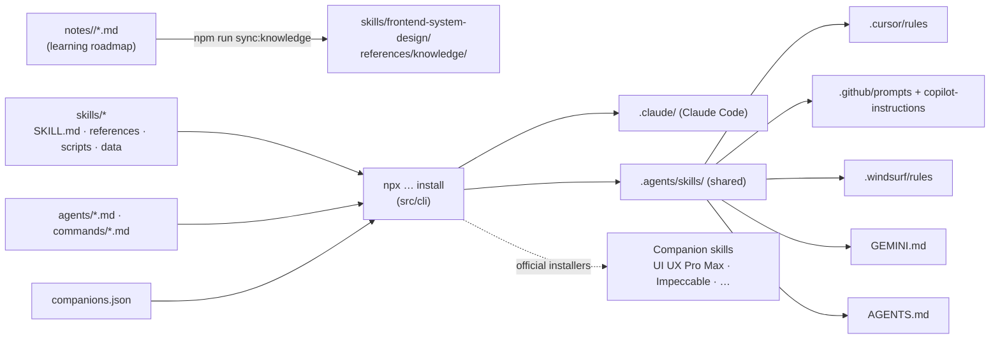

# How this repository works

This repo ships **AI agent skills**: instructions, references, data and Python tools that coding agents load on demand. It also ships an **installer** that puts those skills into each AI tool's folders, and a **learning roadmap** whose notes double as the skills' knowledge base.

## Folder layout

| Path | What lives there | Edited by |
|---|---|---|
| `skills/frontend-system-design/` | Architect skill: `SKILL.md`, `references/{core,platforms,stacks,playbooks,templates,knowledge}`, `scripts/*.py`, `data/*.csv` | Contributors (except `knowledge/`, which is generated) |
| `skills/product-copywriting/` | Copy skill: `SKILL.md`, `references/`, `scripts/copy_check.py`, `data/` | Contributors |
| `agents/` | Claude Code subagents (specialists) | Contributors |
| `commands/` | Slash commands (`/fsd:design`, `/fsd:audit`, `/fsd:learn`, `/fsd:copy`); also turned into Copilot prompt files | Contributors |
| `src/cli/` | Installer source: `index` (args) → `install` → `wizard` / `detect` / `adapters` / `writer` / `companions` | Maintainers |
| `bin/cli.js` | Thin npx entry point | — |
| `notes/` | Learning notes (source of truth), one folder per roadmap phase (`01-web-fundamentals/` … `11-system-design-cases/`) + `_TEMPLATE.md` | Contributors |
| `scripts/` | Repo tooling: `lint-notes`, `sync-knowledge`, `validate-skills`, `run-python-tests` | Maintainers |
| `tests/node/`, `tests/python/` | Installer tests (node:test) and engine and copy-checker tests (unittest) | Contributors |
| `companions.json` | Third-party companion skills and their official install commands | Maintainers |

## Key design decisions

- **One source of truth per skill.**
  - The installer copies `skills/<id>/` unchanged into `.claude/skills/<id>/` or `.agents/skills/<id>/`.
  - Tools that can't load skills natively get a small pointer (Cursor rule, Copilot prompt file, Windsurf rule, `AGENTS.md`/`GEMINI.md` block) that routes requests to the shared copy.
- **The notes are the knowledge base.**
  - `scripts/sync-knowledge.js` copies the notes into the skill and generates `INDEX.md` and `index.json`.
  - The index maps all 120 roadmap topics to the design decisions they inform.
  - `recommend.py` cites the notes, the agents link them in every trade-off table, and `/fsd:learn` teaches from them.
  - CI fails if the copy is stale.
- **Idempotent installs.**
  - Unchanged files are left alone.
  - Shared files only get a managed `<!-- fsd:start --> … <!-- fsd:end -->` block.
  - Files the user changed are kept unless they pass `--force`.
- **No vendoring of third-party skills.** Companions run through their own installers. Their licenses and updates stay with their authors.
- **Python standard library only.** The scripts run anywhere Python 3.9+ exists, with nothing to install and no network access.
- **Multi-agent orchestration.**
  - Claude Code subagents can't spawn other subagents, so the *commands* orchestrate: they run the specialists in parallel and merge the results.
  - Tools without subagents play the roles in sequence.

## Common tasks

| Task | Where |
|---|---|
| Add or upgrade a stack | [adding-a-stack.md](./adding-a-stack.md) |
| Support another AI tool | [adding-an-agent-tool.md](./adding-an-agent-tool.md) |
| Add a product type, palette, font pairing or pattern | `skills/frontend-system-design/data/*.csv`, then `npm run test:py` |
| Write a learning note | [CONTRIBUTING.md](../CONTRIBUTING.md#contributing-a-learning-note), then `npm run sync:knowledge` |
| Release | [CONTRIBUTING.md](../CONTRIBUTING.md#releases) |
