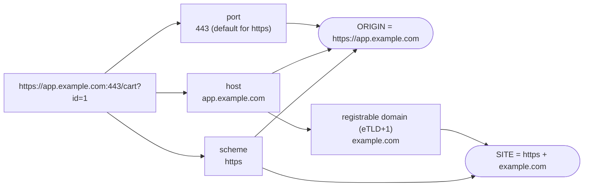
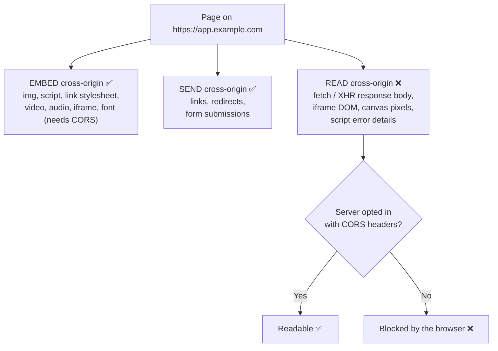
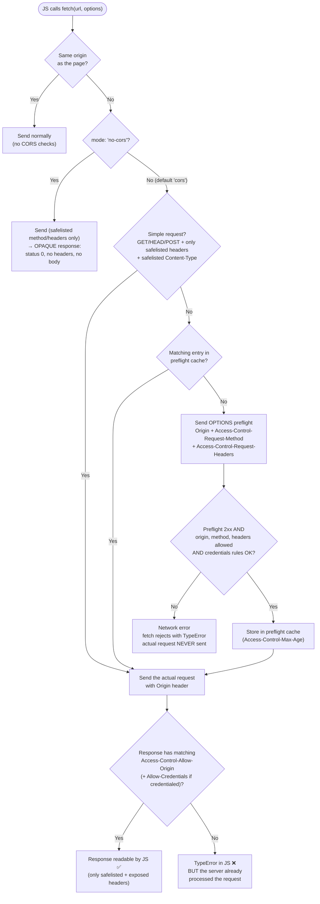
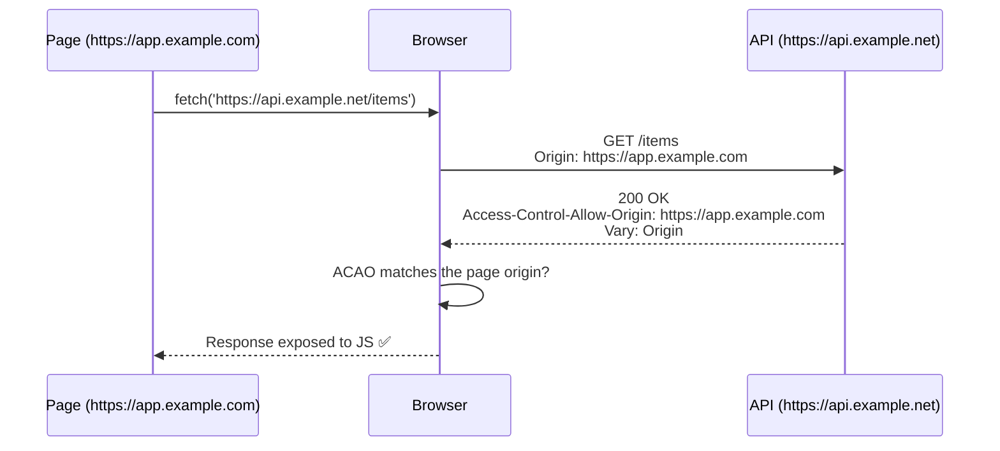
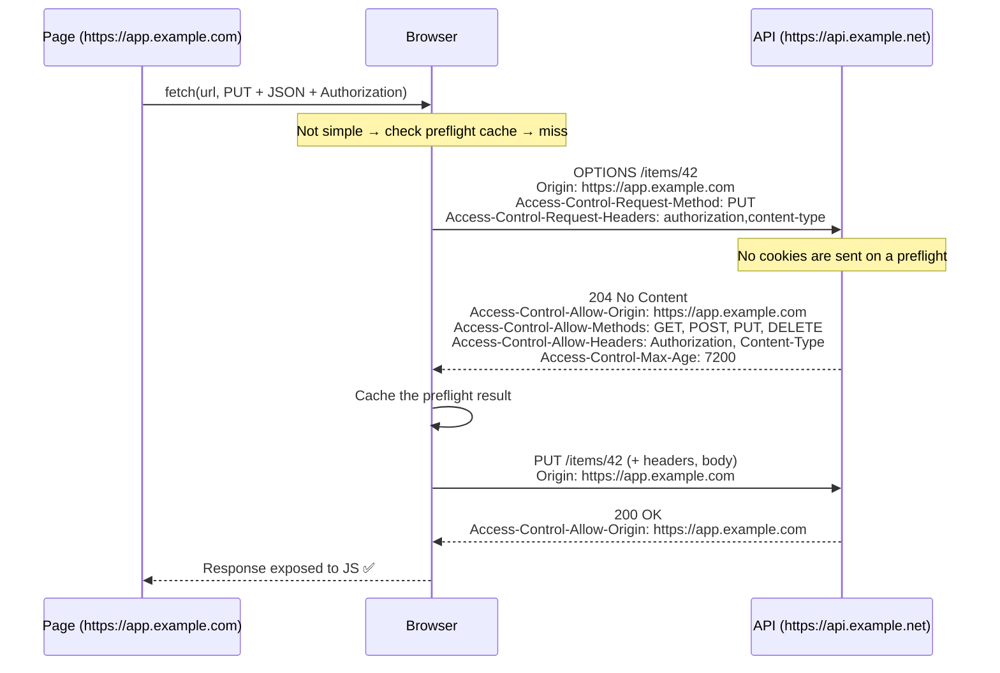
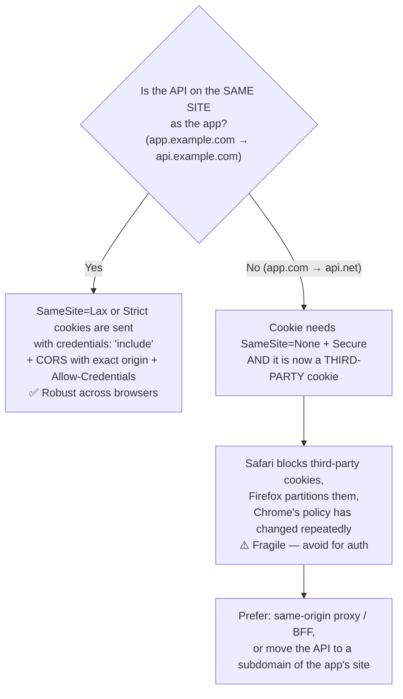
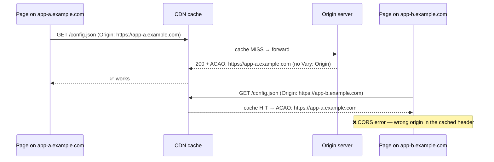
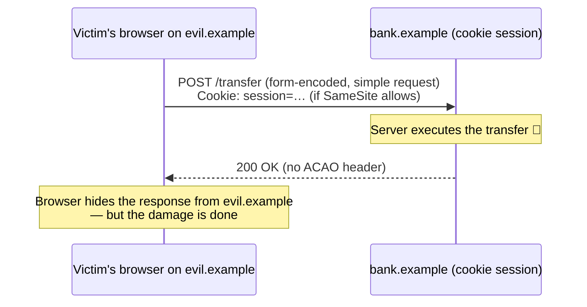
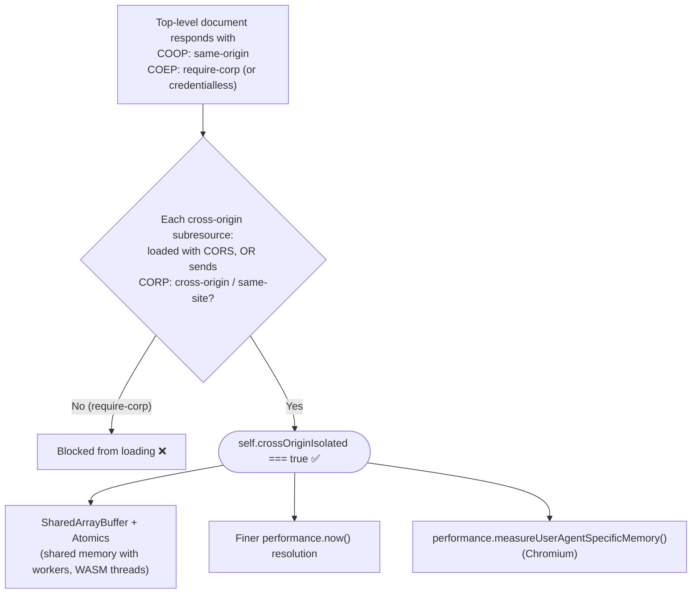
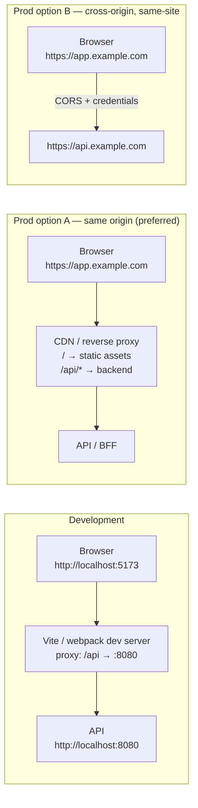

# CORS & Same-Origin Policy

> **Date:** 2026-11-06 · **Last updated:** 2026-11-09
> **Category:** Frontend System Design
> **Sub-Topic:** Networking / Security
> **Level:** Intermediate · **Reading time:** ~35 min
> **Informs:** API/BFF topology, cookie & auth setup across domains, CDN/asset hosting, cross-origin isolation

> **Pre-requisite:** [How Browsers Work](./how-browsers-work.md) (site isolation, processes) and [Browser Storage Mechanisms](./browser-storage-mechanisms.md) (cookies, `SameSite`).
> This note explains **why the browser refuses to let one origin read another origin's data**, and the exact protocol (CORS) servers use to opt in.

**Previous:** [WebSockets & SSE & Long Polling](./websockets-sse-long-polling.md) · **Next:** [Service Workers & Web Workers](./service-workers-and-web-workers.md)

---

## Table of Contents

1. [ELI5 — Simple Explanation](#eli5--simple-explanation)
2. [Section 1: Origin vs Site](#section-1-origin-vs-site)
3. [Section 2: The Same-Origin Policy — What It Blocks and Allows](#section-2-the-same-origin-policy--what-it-blocks-and-allows)
4. [Section 3: How CORS Works — the Big Picture](#section-3-how-cors-works--the-big-picture)
5. [Section 4: Simple Requests vs Preflighted Requests](#section-4-simple-requests-vs-preflighted-requests)
6. [Section 5: The Access-Control Headers](#section-5-the-access-control-headers)
7. [Section 6: Credentials and Why the Wildcard Is Forbidden](#section-6-credentials-and-why-the-wildcard-is-forbidden)
8. [Section 7: Caching — Max-Age and the Vary Origin Pitfall](#section-7-caching--max-age-and-the-vary-origin-pitfall)
9. [Section 8: Opaque Responses and no-cors](#section-8-opaque-responses-and-no-cors)
10. [Section 9: CORS Is Not CSRF Protection](#section-9-cors-is-not-csrf-protection)
11. [Section 10: CORP, COEP, COOP and Cross-Origin Isolation](#section-10-corp-coep-coop-and-cross-origin-isolation)
12. [Section 11: Private Network Access and Local Network Access](#section-11-private-network-access-and-local-network-access)
13. [Section 12: Dev Proxy vs Production Topology](#section-12-dev-proxy-vs-production-topology)
14. [Section 13: Debugging CORS Errors in DevTools](#section-13-debugging-cors-errors-in-devtools)
15. [Real-World Examples](#real-world-examples)
16. [Key Points Summary](#key-points-summary)
17. [Test Your Understanding (with answers)](#test-your-understanding)
18. [Cheat Sheet](#cheat-sheet)
19. [References & Further Reading](#references--further-reading)

---

## ELI5 — Simple Explanation

Imagine every website is a **flat in a big apartment building**, and each flat has its own **mailbox**.

- **Same-Origin Policy (SOP)** is the building rule: *you may receive flyers and posters from any flat (embedding images, scripts, styles), but you may **not open another flat's mail** (read its responses with JavaScript).*
- **CORS** is a **signed permission slip** that the *other* flat attaches to its mail: *"Residents of flat `app.example.com` may read this."* The **browser is the building manager** who checks the slip before handing the letter over.
- A **preflight** is the manager **phoning ahead** before delivering an unusual package (`PUT`, JSON body, `Authorization` header): *"Will you accept this?"* If the answer is no, the package is never sent.
- Crucially, the manager only controls **who can read the reply**. A plain letter (a "simple" form POST) still gets **delivered and acted on** — that's why CORS does **not** stop CSRF.

> **One-line takeaway: SOP stops a page from *reading* cross-origin data. CORS is the server's opt-in that relaxes that rule for specific origins. It is enforced by the browser, protects users (not servers), and is not an authentication or CSRF defence.**

---

## Core Concept — Step by Step

### Section 1: Origin vs Site

An **origin** is the triple **scheme + host + port**. Two URLs are *same-origin* only if all three match exactly.



A **site** is coarser: **scheme + registrable domain** (eTLD+1 — the public suffix such as `.com` or `.co.uk`, plus one label). The public suffix comes from the [Public Suffix List](https://publicsuffix.org/), which is why `alice.github.io` and `bob.github.io` are **different sites** (`github.io` is itself a public suffix).

| URL A | URL B | Same origin? | Same site? | Why |
|---|---|---|---|---|
| `https://app.example.com` | `https://app.example.com/other` | ✅ | ✅ | Path doesn't matter |
| `https://app.example.com` | `http://app.example.com` | ❌ | ❌ | Scheme differs ("schemeful same-site") |
| `https://app.example.com` | `https://app.example.com:8443` | ❌ | ✅ | Port differs — site ignores port |
| `https://app.example.com` | `https://api.example.com` | ❌ | ✅ | Different host, same eTLD+1 |
| `https://example.com` | `https://example.co.uk` | ❌ | ❌ | Different registrable domain |
| `https://alice.github.io` | `https://bob.github.io` | ❌ | ❌ | `github.io` is a public suffix |

**Why both matter:**

| Concept | Used by |
|---|---|
| **Origin** | SOP, CORS, storage partitioning (localStorage, IndexedDB, Cache API), Service Worker scope, `postMessage` targeting, permissions |
| **Site** | `SameSite` cookies, `Sec-Fetch-Site`, CORP `same-site`, Chrome's site isolation (one renderer process per site) |

> **Design consequence:** `app.example.com` → `api.example.com` is **cross-origin** (CORS needed) but **same-site** (`SameSite=Lax/Strict` cookies still flow, third-party cookie blocking does not apply). That combination is the sweet spot for SPA + API topologies — see Section 12.

---

### Section 2: The Same-Origin Policy — What It Blocks and Allows

The SOP is not one rule; it's a family of restrictions. The useful mental model: **cross-origin *embedding* and *sending* are mostly allowed; cross-origin *reading* is blocked.**



| Action | Cross-origin allowed? | Notes |
|---|---|---|
| ``, `<video>`, `<audio>` | ✅ Display | Drawing into `<canvas>` **taints** it — `getImageData()` / `toDataURL()` throw unless loaded with `crossorigin` + CORS |
| `<script src>` | ✅ Execute | Errors show as just `"Script error."` in `window.onerror` unless `<script crossorigin>` + CORS |
| `<link rel="stylesheet">` | ✅ Apply | Reading `cssRules` of a cross-origin sheet throws without CORS |
| Web fonts (`@font-face`) | ⚠️ Only with CORS | Fonts are always fetched in CORS mode |
| `<script type="module">` | ⚠️ Only with CORS | Module scripts are fetched in CORS mode |
| `<iframe>` | ✅ Embed | Parent cannot read the frame's DOM (and vice versa); use `postMessage` |
| `<form action>` POST | ✅ Send | The response navigates the page; JS can't read it — this is the classic CSRF vector |
| `fetch()` / `XMLHttpRequest` | ⚠️ Request may be sent; **response unreadable** without CORS | The core of this note |
| `window.open()` reference | ⚠️ Limited | Only a few properties (`location` set, `close()`, `postMessage()`) cross origins |
| Storage (localStorage, IndexedDB, cookies via JS) | ❌ | Partitioned per origin (cookies per domain) |

**Two legacy escapes to know (and avoid):**

- **`document.domain`** — used to relax SOP between subdomains. It is deprecated; Chromium makes the setter a no-op by default (origin-keyed agent clusters). Use `postMessage` instead.
- **JSONP** — `<script src="api?callback=fn">` abuses the "scripts can be embedded" rule. It only supports GET, executes arbitrary code from the API, and has no error handling. Replaced by CORS.

**`postMessage` is the sanctioned cross-origin channel between windows** — always pin the target origin and verify `event.origin`:

```javascript
// Parent on https://app.example.com
frame.contentWindow.postMessage({ type: 'THEME', value: 'dark' }, 'https://widget.example.net');

// Inside the iframe on https://widget.example.net
window.addEventListener('message', (event) => {
  if (event.origin !== 'https://app.example.com') return; // ❗ never skip this check
  applyTheme(event.data.value);
});
```

---

### Section 3: How CORS Works — the Big Picture

**CORS (Cross-Origin Resource Sharing)** is defined in the [Fetch Standard](https://fetch.spec.whatwg.org/#http-cors-protocol). It is an HTTP-header protocol:

1. The browser adds an **`Origin`** request header to cross-origin requests made in CORS mode.
2. The server answers with **`Access-Control-*`** response headers saying which origins/methods/headers it accepts.
3. The **browser** compares them and either exposes the response to JS or throws a `TypeError`.

> **Key fact:** CORS is enforced **only by browsers**. `curl`, Postman, server-to-server calls and mobile apps ignore it completely. CORS protects **users' browsers** from malicious pages reading data with the user's ambient credentials (cookies, client certs, intranet access) — it does not protect your API from being called.

**The browser's CORS decision (the flowchart to memorise):**



Notice the asymmetry in the last step: for a simple request, **the server has already received and executed the request** before the browser decides the page can't read the response.

---

### Section 4: Simple Requests vs Preflighted Requests

#### 4.1 The exact "simple request" conditions

The spec doesn't use the word "simple" any more (it speaks of *CORS-safelisted* methods and headers), but the community term stuck. A request skips the preflight **only if all** of these hold:

| Condition | Allowed values |
|---|---|
| **Method** | `GET`, `HEAD`, `POST` |
| **Headers set by your code** | Only CORS-safelisted request headers: `Accept`, `Accept-Language`, `Content-Language`, `Content-Type` (restricted, below), `Range` (single simple range only, e.g. `bytes=0-499`) |
| **`Content-Type`** | Only `application/x-www-form-urlencoded`, `multipart/form-data`, `text/plain` |
| **Header values** | Each safelisted value ≤ 128 bytes and free of "unsafe" bytes; total safelisted value length is capped too |
| **XHR only** | No event listener on `xhr.upload` |
| **Body** | Not a `ReadableStream` |

Headers the browser adds itself (`User-Agent`, `Cookie`, `Origin`, `Sec-Fetch-*`, `Referer`…) **don't count** — only headers *you* set. **Cookies alone never trigger a preflight.**

Things that **do** trigger a preflight (very common in SPAs):

```text
Content-Type: application/json          ← the #1 trigger
Authorization: Bearer …                 ← any auth header
X-Requested-With / X-CSRF-Token / X-*   ← any custom header
PUT, PATCH, DELETE                      ← non-safelisted methods
```

#### 4.2 A simple request on the wire



#### 4.3 A preflighted request on the wire



Preflight rules that bite in production:

| Rule | Consequence |
|---|---|
| Preflight must get an **ok status (200–299)** | A `401` from auth middleware, `404` for unknown `OPTIONS` route, or `405` fails it |
| Preflight **must not redirect** | `http→https` or trailing-slash redirects on the API break preflighted calls |
| Preflight is sent **without credentials** | Auth middleware must let `OPTIONS` through *before* checking cookies/tokens |
| Actual response **also** needs `Access-Control-Allow-Origin` | Passing the preflight isn't enough |
| Cache entry is **per URL** (plus origin, credentials mode, method/header) | `/items/1` and `/items/2` each need their own preflight |

> **Why preflights exist:** before CORS, a page could only send cross-origin `GET`/`POST` with form-like bodies (via `<form>`/``). Servers were built assuming nothing else could arrive cross-origin. The preflight asks permission before sending anything a 2005-era form **couldn't** have sent, so CORS added no new attack surface to legacy servers.

---

### Section 5: The Access-Control Headers

**Request headers (set by the browser — you can't set them from JS):**

| Header | When | Example |
|---|---|---|
| `Origin` | All CORS requests; also non-GET/HEAD same-origin requests | `Origin: https://app.example.com` |
| `Access-Control-Request-Method` | Preflight only | `PUT` |
| `Access-Control-Request-Headers` | Preflight only (lower-cased, comma-separated) | `authorization,content-type` |

**Response headers (set by your server):**

| Header | On | Meaning | Gotchas |
|---|---|---|---|
| `Access-Control-Allow-Origin` | Preflight **and** actual | Which origin may read: **one** origin or `*` | No lists, no patterns — validate against an allow-list and echo the single match |
| `Access-Control-Allow-Methods` | Preflight | Allowed methods | `*` works only for non-credentialed requests |
| `Access-Control-Allow-Headers` | Preflight | Allowed request headers | `*` doesn't cover `Authorization` per the Fetch spec (Chromium/Firefox enforce this; MDN compat shows Safari differs) — **list it explicitly** |
| `Access-Control-Allow-Credentials` | Preflight **and** actual | `true` = response may be exposed when credentials were included | Only valid value is `true`; omit it otherwise |
| `Access-Control-Expose-Headers` | Actual | Extra response headers JS may read | Default readable: `Cache-Control`, `Content-Language`, `Content-Length`, `Content-Type`, `Expires`, `Last-Modified`, `Pragma` |
| `Access-Control-Max-Age` | Preflight | Seconds to cache the preflight | Default 5 s; browsers cap it (below) |

```http
# Typical credentialed preflight response
HTTP/1.1 204 No Content
Access-Control-Allow-Origin: https://app.example.com
Access-Control-Allow-Credentials: true
Access-Control-Allow-Methods: GET, POST, PUT, PATCH, DELETE
Access-Control-Allow-Headers: Authorization, Content-Type, X-CSRF-Token
Access-Control-Max-Age: 7200
Vary: Origin
```

```javascript
// Reading a custom header — invisible unless exposed
const res = await fetch('https://api.example.net/items');
res.headers.get('X-Total-Count'); // null unless: Access-Control-Expose-Headers: X-Total-Count
```

---

### Section 6: Credentials and Why the Wildcard Is Forbidden

**Credentials** = cookies, HTTP auth, and TLS client certificates. Cross-origin, they are **not** sent unless you opt in:

| API | Default | Opt in |
|---|---|---|
| `fetch` | `credentials: 'same-origin'` | `credentials: 'include'` |
| `XMLHttpRequest` | not sent cross-origin | `xhr.withCredentials = true` |
| ``/`<script>` with `crossorigin` | `crossorigin="anonymous"` → no credentials | `crossorigin="use-credentials"` |

Note that `Authorization: Bearer …` set manually is **just a header**, not a "credential" in the CORS sense — it triggers a preflight, but doesn't need `Allow-Credentials`.

For a credentialed CORS request, the browser requires **all** of:

```text
Access-Control-Allow-Origin: https://app.example.com   ← exact origin, NOT *
Access-Control-Allow-Credentials: true
(and on preflight) Allow-Methods / Allow-Headers listed explicitly — * is treated as a literal "*"
```

**Why `*` + credentials is forbidden:** `*` means "any website may read this". With credentials, the response is personalised by the *user's* cookies. If both were allowed, **any page the user visits** could silently call `fetch('https://bank.example/api/account', { credentials: 'include' })` and read their account data. The spec forces the server to name a specific origin, i.e. to make a deliberate trust decision.

> **The classic misconfiguration:** "fixing" the error by **reflecting whatever `Origin` arrives** with `Allow-Credentials: true`. That is functionally *worse* than `*` — it is exactly the attack above, now permitted. Also never allow-list the literal origin **`null`** (sent by sandboxed iframes, `file:` pages and some redirects — attackers can produce it).

**Cookies also need the right `SameSite` attributes** (see [Browser Storage Mechanisms](./browser-storage-mechanisms.md)):



---

### Section 7: Caching — Max-Age and the Vary Origin Pitfall

#### 7.1 `Access-Control-Max-Age`

Preflights add a full round trip before every non-simple request. `Access-Control-Max-Age` lets the browser reuse the result:

| Browser | Cap |
|---|---|
| Default when header absent | **5 seconds** |
| Chromium (v76+) | **7200 s (2 h)** |
| Firefox | **86400 s (24 h)** |
| `-1` | Disables caching |

Remember the cache is **per URL** — REST paths with IDs (`/orders/123`) still preflight once per distinct URL. If preflight latency matters (mobile, high-RTT), the real fix is architectural: make the API **same-origin** (Section 12) or keep hot-path requests "simple".

#### 7.2 The `Vary: Origin` caching pitfall

If your server returns a **different `Access-Control-Allow-Origin` depending on the request's `Origin`** (allow-list echo), any cache between (CDN, proxy, browser HTTP cache) must know the response varies by `Origin`. Otherwise:



A related trap: an image is first loaded **without** CORS (`` → no `Origin` header → server omits ACAO), gets cached, then the same URL is requested **with** CORS (`` or `fetch`) and the cached copy has no ACAO → failure.

**Fix:** send **`Vary: Origin`** on every response whose CORS headers depend on the `Origin` — including responses where you *omitted* ACAO because the origin wasn't allowed. Alternatively, for truly public, non-credentialed resources (public CDN assets, fonts), send a constant `Access-Control-Allow-Origin: *` — then the response doesn't vary at all.

---

### Section 8: Opaque Responses and no-cors

`fetch(url, { mode: 'no-cors' })` asks for a cross-origin resource **without** CORS. The browser sends it (only with safelisted methods/headers) and returns an **opaque** response:

```javascript
const res = await fetch('https://other.example.net/data.json', { mode: 'no-cors' });
res.type;    // 'opaque'
res.status;  // 0
res.ok;      // false
await res.text(); // '' — body is not readable
```

| Use | Legit? |
|---|---|
| A Service Worker caching cross-origin images/scripts to serve them back to ``/`<script>` | ✅ The element can still use it; your JS can't read it |
| Fire-and-forget pings/analytics where you don't need the reply | ✅ (or `navigator.sendBeacon`) |
| "Fixing" a CORS error so you can read JSON | ❌ **Doesn't work** — you just get an empty opaque response |

Opaque responses have a hidden cost when cached: you can't see the status, so you might cache a 404/500 forever, and Chrome pads each opaque response's quota usage (Workbox docs cite **around 7 MB per response**) to avoid leaking its size. More in [Service Workers & Web Workers](./service-workers-and-web-workers.md).

---

### Section 9: CORS Is Not CSRF Protection

**CSRF (Cross-Site Request Forgery):** a malicious page makes the victim's browser send a state-changing request to your site, riding on the victim's cookies.

CORS doesn't stop that, because **CORS controls reading, not sending**:



| Defence | How it helps | Notes |
|---|---|---|
| **`SameSite=Lax` / `Strict` cookies** | Cookie isn't attached on cross-site subresource/POST requests | Defence in depth — pair with `Origin`/`Sec-Fetch-Site` checks or CSRF tokens. *Same-site* sibling subdomains are **not** stopped — a compromised `blog.example.com` can still send `SameSite` cookies to `api.example.com` |
| **Verify `Origin`** (and/or `Sec-Fetch-Site`) on state-changing requests | Reject unknown origins server-side | `Sec-Fetch-Site` (`same-origin` / `same-site` / `cross-site` / `none`) is sent by all modern browsers |
| **CSRF tokens** (synchronizer / double-submit) | Attacker can't read the token, so can't forge it | Still recommended by OWASP for cookie-auth apps |
| **Require JSON or a custom header** | Forces a preflight, which your CORS policy rejects | Defence-in-depth only — don't accept the same endpoint as form-encoded |
| **Bearer tokens in `Authorization`** (not cookies) | Browser never attaches them automatically | But the token now lives in JS → XSS exposure |

Note the default: **Chromium treats cookies with no `SameSite` attribute as `Lax`**; other engines don't necessarily, so always set `SameSite` explicitly.

> CORS **misconfiguration** can also *create* vulnerabilities: reflecting arbitrary origins with credentials, trusting `null`, or regex allow-lists like `/example\.com$/` that also match `evilexample.com`.

---

### Section 10: CORP, COEP, COOP and Cross-Origin Isolation

After the **Spectre** CPU side-channel attacks (2018), browsers needed a way to guarantee that a process contains **no cross-origin data it wasn't explicitly granted**, before re-enabling powerful features like `SharedArrayBuffer` and high-resolution timers. Three headers do this:

| Header | Set on | Values | Purpose |
|---|---|---|---|
| **CORP** `Cross-Origin-Resource-Policy` | The **resource** (image, script, JSON) | `same-origin`, `same-site`, `cross-origin` | "Who may *embed* me in no-cors mode." Blocks other origins from even loading it into their process |
| **COEP** `Cross-Origin-Embedder-Policy` | The **document** | `unsafe-none` (default), `require-corp`, `credentialless` | "Every cross-origin subresource I load must opt in (CORS or CORP)" — or, with `credentialless`, be fetched without cookies |
| **COOP** `Cross-Origin-Opener-Policy` | The **document** | `unsafe-none` (default), `same-origin-allow-popups`, `same-origin`, `noopener-allow-popups` | Severs the `window.opener` link with cross-origin windows so they can live in separate browsing context groups/processes |



```http
Cross-Origin-Opener-Policy: same-origin
Cross-Origin-Embedder-Policy: require-corp
```

```javascript
if (self.crossOriginIsolated) {
  const shared = new SharedArrayBuffer(1024);   // shared with a worker, no copying
  worker.postMessage(shared);
} else {
  // Fallback: transfer an ArrayBuffer instead (see the workers note)
}
```

**Trade-offs to plan for:**

- **COOP `same-origin` breaks popup flows** that rely on `window.opener` — OAuth/SSO and payment popups. Options: `same-origin-allow-popups` (keeps opener to popups you open, but does **not** give cross-origin isolation), redirect-based flows instead of popups, or isolate only the pages that need `SharedArrayBuffer`.
- **COEP `require-corp`** blocks every third-party image/script/iframe that doesn't send CORP or support CORS — ads, embeds, analytics pixels. `credentialless` relaxes this (no-cors requests sent without cookies) but per MDN compat data it is supported in Chromium and Firefox (119+), **not Safari**.
- Your **own CDN** should send `Cross-Origin-Resource-Policy: cross-origin` (or `same-site`) on static assets so isolated pages can load them.
- CORP is also useful **on its own**: `Cross-Origin-Resource-Policy: same-origin` on sensitive JSON stops other sites from pulling it into their process via ``/`<script>` tricks.

---

### Section 11: Private Network Access and Local Network Access

Public websites making requests to **your router, printer, or a dev server on `localhost`** are a CSRF/fingerprinting risk SOP doesn't address (no response needs to be read to reconfigure a router).

| Proposal | Approach | Status (Nov 2026 — verify before relying on it) |
|---|---|---|
| **Private Network Access (PNA)** | Require secure context, plus a preflight with `Access-Control-Request-Private-Network: true` that the device answers with `Access-Control-Allow-Private-Network: true` | Chrome shipped the secure-context part, trialled the preflights, then **put PNA on hold** |
| **Local Network Access (LNA)** | Requests from a **public** origin to **local/loopback** addresses require a **user permission prompt** ("look for and connect to any device on your local network"); secure contexts only | Chrome: opt-in flag from 138, permission prompt launched in **Chrome 142** (Oct 2025). Other engines: not shipped as of this writing |

What it means for frontend design:

- A public HTTPS site talking to a **local agent** (`http://127.0.0.1:port` desktop helper, IoT device, scanner/printer bridge) will now trigger a permission prompt in Chrome — design UX around it.
- Chrome's LNA exempts such requests from mixed-content blocking when it can tell they're local: private IP literals, `.local` names, or `fetch(url, { targetAddressSpace: 'local' })`.
- Plain local development (`localhost` page → `localhost` API) is unaffected — the rule targets **public → local** requests.

---

### Section 12: Dev Proxy vs Production Topology

The cheapest CORS policy is **no CORS at all**: serve the app and the API from the **same origin**.



| Topology | CORS? | Cookies | Preflight cost | When |
|---|---|---|---|---|
| **Same origin** via reverse proxy / CDN path routing / BFF | None | First-party, `SameSite=Strict/Lax` | None | Default for SPAs with cookie auth |
| **Same-site subdomain** (`app.` → `api.`) | Yes (exact origin + credentials) | `SameSite=Lax` works; host-only cookie (ideally `__Host-`) set by the API host — avoid `Domain=example.com`, which exposes it to every subdomain | Yes, per URL (cached) | Separate API deploys/teams |
| **Cross-site** (`app.com` → `api.net`) | Yes | Third-party → blocked/partitioned in Safari/Firefox | Yes | Public APIs with **bearer tokens**, not cookies |
| **Public, anonymous data / CDN assets** | `ACAO: *` | None | Only if non-simple | Fonts, public JSON, open data |

> **Dev-proxy warning:** a dev proxy *hides* CORS. Code that works on `localhost:5173` via the proxy will fail in production if prod is cross-origin and the API isn't configured. Make dev mirror prod: either both same-origin (proxy in dev, reverse proxy in prod) or both cross-origin (real CORS config in both).

```javascript
// vite.config.js — dev only: browser sees same origin, Vite forwards /api to the backend
import { defineConfig } from 'vite';

export default defineConfig({
  server: {
    proxy: {
      '/api': { target: 'http://localhost:8080', changeOrigin: true },
    },
  },
});
```

```nginx
# Production: one origin for app + API → zero CORS, first-party cookies
server {
  listen 443 ssl;
  server_name app.example.com;

  location /api/ {
    proxy_pass http://backend:8080/;
    proxy_set_header Host $host;
  }

  location / {
    root /var/www/app;
    try_files $uri /index.html;
  }
}
```

---

### Section 13: Debugging CORS Errors in DevTools

**Step 1 — read the console message carefully.** Chromium tells you exactly which check failed:

```text
Access to fetch at 'https://api.example.net/items' from origin 'https://app.example.com'
has been blocked by CORS policy: Response to preflight request doesn't pass access control
check: No 'Access-Control-Allow-Origin' header is present on the requested resource.
```

| Message fragment | Cause | Fix |
|---|---|---|
| `No 'Access-Control-Allow-Origin' header is present` | Server didn't send ACAO — often because the request **errored** (500/502/401) and the error path skips CORS middleware | Add CORS headers on error responses too (nginx: `add_header … always`) |
| `Response to preflight request doesn't pass access control check: It does not have HTTP ok status` | `OPTIONS` got 401/404/405 | Handle `OPTIONS` before auth; return 204 |
| `Redirect is not allowed for a preflight request` | API redirects (http→https, trailing slash) | Call the final URL directly |
| `must not be the wildcard '*' when the request's credentials mode is 'include'` | `ACAO: *` + `credentials: 'include'` | Echo the exact allow-listed origin + `Allow-Credentials: true` |
| `Request header field authorization is not allowed by Access-Control-Allow-Headers` | Header missing from allow list | Add it explicitly (wildcard doesn't cover `Authorization`) |
| `Method PUT is not allowed by Access-Control-Allow-Methods` | Method missing | Add it |
| `The 'Access-Control-Allow-Origin' header contains multiple values` | Both app **and** proxy/CDN add ACAO | Set CORS in exactly one layer |

**Step 2 — Network panel.**

- The failed request shows **"CORS error"** in the Status column (Chromium). Firefox's console links each failure to a specific MDN page (e.g. `CORSMissingAllowOrigin`).
- Look for the separate **`OPTIONS` preflight** entry — Chromium lists it next to the real request (type `preflight`). Inspect its response headers.
- Check the **request `Origin`** header actually matches what the server allow-lists (scheme and port included — `http://localhost:3000` ≠ `http://127.0.0.1:3000`).
- Chromium's **Issues** panel groups CORS problems with an explanation.

**Step 3 — reproduce outside the browser** to see raw headers:

```bash
curl -i -X OPTIONS https://api.example.net/items/42 \
  -H "Origin: https://app.example.com" \
  -H "Access-Control-Request-Method: PUT" \
  -H "Access-Control-Request-Headers: authorization,content-type"
```

> **From JS you can't see the reason.** A CORS failure surfaces only as a generic `TypeError` (`Failed to fetch` in Chromium, `NetworkError when attempting to fetch resource.` in Firefox, `Load failed` in Safari) — deliberately, so pages can't probe other origins. Always debug from DevTools, not from `catch` blocks.

---

## Real-World Examples

**Example 1 — Express API with a strict CORS allow-list (zero dependencies):**
```javascript
// server.js — Node 20+, Express 4/5, "type": "module"
import express from 'express';

const app = express();
const ALLOWED_ORIGINS = new Set([
  'https://app.example.com',
  'https://admin.example.com',
  ...(process.env.NODE_ENV !== 'production' ? ['http://localhost:5173'] : []),
]);

app.use((req, res, next) => {
  const origin = req.get('Origin');
  res.vary('Origin');                                  // response depends on Origin → caches must key on it

  if (origin && ALLOWED_ORIGINS.has(origin)) {
    res.set('Access-Control-Allow-Origin', origin);    // echo ONE validated origin, never blindly
    res.set('Access-Control-Allow-Credentials', 'true');
    res.set('Access-Control-Expose-Headers', 'X-Request-Id, X-Total-Count');
  }

  // Preflight: answer BEFORE auth middleware (preflights carry no cookies)
  if (req.method === 'OPTIONS' && req.get('Access-Control-Request-Method')) {
    if (origin && ALLOWED_ORIGINS.has(origin)) {
      res.set('Access-Control-Allow-Methods', 'GET, POST, PUT, PATCH, DELETE');
      res.set('Access-Control-Allow-Headers', 'Authorization, Content-Type, X-CSRF-Token');
      res.set('Access-Control-Max-Age', '7200');
    }
    return res.sendStatus(204);
  }
  next();
});

app.use(express.json());
app.get('/me', requireSession, (req, res) => res.json(req.user)); // requireSession = your auth middleware
app.listen(8080);
```

**Example 1b — Same thing with the `cors` package:**
```javascript
import cors from 'cors';

app.use(cors({
  origin: ['https://app.example.com', 'https://admin.example.com'], // array → echoes the match + Vary: Origin
  credentials: true,
  methods: ['GET', 'POST', 'PUT', 'PATCH', 'DELETE'],
  allowedHeaders: ['Authorization', 'Content-Type', 'X-CSRF-Token'],
  exposedHeaders: ['X-Request-Id'],
  maxAge: 7200,
}));
// app.use(cors(...)) also answers OPTIONS preflights — register it BEFORE auth middleware.
```

**Example 2 — The "make the error go away" anti-patterns:**
```javascript
// ❌ BAD: reflect any origin with credentials → any website can read your users' data
app.use((req, res, next) => {
  res.set('Access-Control-Allow-Origin', req.get('Origin'));
  res.set('Access-Control-Allow-Credentials', 'true');
  next();
});

// ❌ BAD: regex that also matches https://evil-example.com and https://example.com.evil.net
const ok = /example\.com/.test(origin);

// ❌ BAD (client): no-cors does not bypass CORS — you get an unreadable opaque response
const res = await fetch(apiUrl, { mode: 'no-cors' });
await res.json(); // SyntaxError: body is empty

// ✅ GOOD: exact-match allow-list (Example 1), or remove CORS entirely with a same-origin proxy
```

**Example 3 — Client: credentialed cross-origin call:**
```javascript
// App on https://app.example.com, API on https://api.example.com (same site, cross origin)
async function updateProfile(patch) {
  const res = await fetch('https://api.example.com/me', {
    method: 'PATCH',                          // non-safelisted → preflight
    credentials: 'include',                   // send the SameSite=Lax session cookie
    headers: {
      'Content-Type': 'application/json',     // non-safelisted value → preflight
      'X-CSRF-Token': getCsrfToken(),         // custom header → preflight
    },
    body: JSON.stringify(patch),
  });
  if (!res.ok) throw new Error(`HTTP ${res.status}`);
  return res.json();
}
// Server must answer: ACAO: https://app.example.com + Allow-Credentials: true (+ preflight headers)
// Cookie (set by api.example.com, host-only — no Domain, so sibling subdomains never get it):
// Set-Cookie: __Host-session=…; Path=/; Secure; HttpOnly; SameSite=Lax
```

**Example 4 — CSRF defence that doesn't rely on CORS:**
```javascript
// Reject cross-site state-changing requests using Fetch Metadata + Origin
const SAFE = new Set(['GET', 'HEAD', 'OPTIONS']);

app.use((req, res, next) => {
  if (SAFE.has(req.method)) return next();
  const site = req.get('Sec-Fetch-Site');            // same-origin | same-site | cross-site | none
  const origin = req.get('Origin');
  if (site === 'cross-site') return res.status(403).json({ error: 'cross-site request blocked' });
  if (origin && !ALLOWED_ORIGINS.has(origin)) return res.status(403).json({ error: 'bad origin' });
  next();                                             // plus SameSite cookies + CSRF token
});
```

**Example 5 — nginx adding CORS for a public, credential-free API:**
```nginx
location /public-api/ {
  if ($request_method = OPTIONS) {
    add_header Access-Control-Allow-Origin "*";
    add_header Access-Control-Allow-Methods "GET, POST, OPTIONS";
    add_header Access-Control-Allow-Headers "Content-Type";
    add_header Access-Control-Max-Age 7200;
    return 204;
  }
  add_header Access-Control-Allow-Origin "*" always;   # "always" → also on 4xx/5xx
  proxy_pass http://public_backend;
}
```

**Example 6 — Enabling cross-origin isolation for a WASM/`SharedArrayBuffer` app:**
```javascript
// Express: isolate only the route that needs SharedArrayBuffer (e.g. a video editor)
app.get('/editor', (req, res) => {
  res.set('Cross-Origin-Opener-Policy', 'same-origin');
  res.set('Cross-Origin-Embedder-Policy', 'require-corp');
  res.sendFile('editor.html', { root: 'public' });
});

// Static assets from your CDN must opt in to being embedded by isolated pages:
//   Cross-Origin-Resource-Policy: cross-origin
// Third-party scripts must be loaded with <script crossorigin> and served with CORS.
```

---

## Key Points Summary

| Concept | One-Line Explanation |
|---|---|
| **Origin** | scheme + host + port — the SOP/CORS/storage boundary |
| **Site** | scheme + eTLD+1 — the `SameSite` cookie / `Sec-Fetch-Site` boundary |
| **Same-Origin Policy** | Cross-origin embedding/sending mostly allowed; *reading* blocked |
| **CORS** | Server opt-in (`Access-Control-*`) letting specific origins read responses; browser-enforced |
| **Simple request** | GET/HEAD/POST + safelisted headers + form/text Content-Type → no preflight |
| **Preflight** | `OPTIONS` with `Access-Control-Request-*`; must return 2xx, no redirect, no credentials |
| **Credentials** | `credentials: 'include'` requires exact ACAO + `Allow-Credentials: true`, never `*` |
| **Max-Age** | Caches preflights per URL; default 5 s, Chromium ≤ 2 h, Firefox ≤ 24 h |
| **`Vary: Origin`** | Required when ACAO depends on the request origin, or caches serve the wrong header |
| **Opaque response** | `no-cors` result: status 0, unreadable; OK for SW asset caching, useless for data |
| **CORS ≠ CSRF defence** | Simple requests are still sent and executed — use SameSite, Origin checks, tokens |
| **CORP / COEP / COOP** | Resource opt-in / document embed policy / window isolation → `crossOriginIsolated` |
| **Cross-origin isolation** | Unlocks `SharedArrayBuffer`; costs popup flows and third-party embeds |
| **LNA (Chrome)** | Public → local-network requests need a user permission prompt (Chrome 142+) |
| **Same-origin proxy / BFF** | Removes CORS and third-party-cookie problems entirely |

---

## Test Your Understanding

**Q1 (Basic):**
Are `https://shop.example.com` and `https://api.example.com` same-origin? Same-site? What does that mean for cookies and CORS?

<details>
<summary>Answer</summary>

**Cross-origin** (hosts differ) but **same-site** (same scheme + eTLD+1 `example.com`).

- **CORS:** required — the browser enforces SOP per *origin*, so the API must return `Access-Control-Allow-Origin: https://shop.example.com` (and `Allow-Credentials: true` if cookies are used).
- **Cookies:** `SameSite` is evaluated per *site*, so `SameSite=Lax`/`Strict` cookies **are** sent with `credentials: 'include'`, and third-party-cookie blocking does not apply (it's a first-party context). This is why putting the API on a subdomain of the app's site is a robust topology.
</details>

**Q2 (Basic):**
Your SPA sends `fetch('/api/items', { method: 'POST', headers: { 'Content-Type': 'application/json' }, body })` to another origin. In the Network panel you see an `OPTIONS` request first. Why, and how could you avoid it?

<details>
<summary>Answer</summary>

`application/json` is **not** a CORS-safelisted `Content-Type` (only `application/x-www-form-urlencoded`, `multipart/form-data`, `text/plain` are), so the request isn't "simple" and the browser must preflight to ask permission first.

Avoid it by: (1) **making the API same-origin** (reverse proxy / BFF — best); (2) relying on `Access-Control-Max-Age` to cache it (still one per URL, capped at 2 h in Chromium); or (3) sending `text/plain` — technically works but is a hack that also weakens the "JSON forces a preflight" CSRF defence-in-depth. Option 1 is the design answer.
</details>

**Q3 (Application):**
A teammate fixes a CORS error by setting `Access-Control-Allow-Origin: *` and `Access-Control-Allow-Credentials: true`. It still fails. They then change it to echo `req.headers.origin`. Now it works. What's wrong?

<details>
<summary>Answer</summary>

The first version fails because the browser **forbids `*` with credentialed requests** — the spec requires an explicit origin so the server makes a deliberate trust decision. The second version "works" but is a **critical vulnerability**: echoing any origin with `Allow-Credentials: true` lets *every* website the user visits read authenticated API responses (profile, tokens, PII) using the user's cookies. Fix: validate `Origin` against an **exact-match allow-list**, echo only matching values, add `Vary: Origin`, and never allow-list `null`.
</details>

**Q4 (Application):**
After a CDN was added in front of your API, users of `admin.example.com` intermittently get CORS errors, but `app.example.com` works. The API echoes the allowed origin. What's happening?

<details>
<summary>Answer</summary>

The responses vary by `Origin` but don't say so. The CDN caches the first response (e.g. with `Access-Control-Allow-Origin: https://app.example.com`) and serves it to the admin origin, whose check fails. It's intermittent because it depends on which origin populated the cache first. Fix: send **`Vary: Origin`** on all such responses (including ones without ACAO) and make sure the CDN honours it — or configure the CDN to include `Origin` in the cache key. If the resource is public and uncredentialed, `ACAO: *` avoids variation altogether.
</details>

**Q5 (Tricky):**
"We have CORS configured with a strict allow-list, so we're protected against CSRF." True or false?

<details>
<summary>Answer</summary>

**False.** CORS only decides whether the *response* is exposed to the calling page. A cross-site **simple request** (e.g. an auto-submitted `<form method="POST">` with `application/x-www-form-urlencoded`) is sent **without a preflight**, with whatever cookies `SameSite` allows, and the server **executes** it. The browser merely hides the response afterwards. Real CSRF defences: `SameSite=Lax/Strict` session cookies, verifying `Origin`/`Sec-Fetch-Site` on state-changing requests, CSRF tokens, and refusing form-encoded bodies on JSON endpoints. Remember `SameSite` doesn't stop *same-site* attackers (a compromised sibling subdomain).
</details>

**Q6 (Tricky / System design):**
You're adding a WASM video editor that needs `SharedArrayBuffer` to an app that uses Google sign-in via popup and embeds YouTube previews. What breaks and how do you design around it?

<details>
<summary>Answer</summary>

`SharedArrayBuffer` requires `crossOriginIsolated === true`, i.e. **`COOP: same-origin` + `COEP: require-corp` (or `credentialless`)**.

- **COOP `same-origin`** severs `window.opener` with cross-origin popups → the sign-in popup can't message back. `same-origin-allow-popups` keeps popups working but does **not** produce isolation.
- **COEP `require-corp`** blocks cross-origin embeds that don't send CORP/CORS — the YouTube iframe and many third-party images. `credentialless` helps for no-cors subresources in Chromium/Firefox but isn't supported in Safari.

Design: **isolate only the editor route** (send the headers on `/editor` alone), keep sign-in and embeds on non-isolated pages, use a redirect-based sign-in flow if the editor needs auth, serve your own assets with `Cross-Origin-Resource-Policy: cross-origin`, and feature-detect `crossOriginIsolated` to fall back to transferring `ArrayBuffer`s instead of sharing memory.
</details>

---

## Cheat Sheet

**Key Definitions:**
- **Origin:** scheme + host + port. **Site:** scheme + eTLD+1 (port ignored).
- **SOP:** browsers block cross-origin *reads* (fetch bodies, iframe DOM, canvas pixels); embedding and sending are mostly allowed.
- **CORS:** HTTP-header protocol letting a server permit specific origins to read its responses.
- **Preflight:** `OPTIONS` request the browser sends before non-simple requests.
- **Credentialed request:** includes cookies/HTTP auth/client certs (`credentials: 'include'`).
- **Opaque response:** result of `mode: 'no-cors'` — status 0, unreadable.
- **Cross-origin isolation:** COOP `same-origin` + COEP `require-corp`/`credentialless` → `SharedArrayBuffer`.

**Quick Reference:**
```text
SIMPLE REQUEST (no preflight)
  method:        GET | HEAD | POST
  your headers:  Accept, Accept-Language, Content-Language, Content-Type, Range (single range)
  Content-Type:  application/x-www-form-urlencoded | multipart/form-data | text/plain
  → anything else (JSON, Authorization, X-*, PUT/PATCH/DELETE) = PREFLIGHT

SERVER RESPONSE CHECKLIST
  Access-Control-Allow-Origin:      <exact origin> | *  (never * with credentials)
  Access-Control-Allow-Credentials: true               (only if cookies needed)
  Access-Control-Allow-Methods:     GET, POST, PUT, ... (preflight)
  Access-Control-Allow-Headers:     Authorization, Content-Type, ... (preflight; list Authorization explicitly)
  Access-Control-Expose-Headers:    X-Request-Id       (custom headers JS needs)
  Access-Control-Max-Age:           7200               (Chromium cap 2h, Firefox 24h, default 5s)
  Vary: Origin                                        (whenever ACAO depends on Origin)

PREFLIGHT MUST: return 2xx · not redirect · bypass auth (no cookies sent)

CLIENT
  fetch(url, { credentials: 'include' })   cross-origin cookies
              readable canvas pixels (needs ACAO)
  <script crossorigin>                     real error messages (needs ACAO)

ISOLATION
  Cross-Origin-Opener-Policy:   same-origin
  Cross-Origin-Embedder-Policy: require-corp | credentialless
  Cross-Origin-Resource-Policy: same-origin | same-site | cross-origin  (on resources)
  check: self.crossOriginIsolated

TOPOLOGY PREFERENCE
  same origin (proxy/BFF)  >  same-site subdomain + CORS  >  cross-site + bearer tokens
```

**Common Mistakes to Avoid:**

| Mistake | Why Wrong | Fix |
|---|---|---|
| Reflecting any `Origin` with `Allow-Credentials: true` | Every website can read users' authenticated data | Exact-match allow-list |
| `ACAO: *` with `credentials: 'include'` | Forbidden by spec — browser rejects | Echo the specific origin + `Allow-Credentials: true` |
| Using `mode: 'no-cors'` to "fix" CORS | Returns an opaque, unreadable response | Configure CORS server-side or use a same-origin proxy |
| Auth middleware runs before CORS and 401s the `OPTIONS` | Preflights carry no credentials → preflight fails | Handle CORS/`OPTIONS` first |
| CORS headers only on success responses | 4xx/5xx appear as "CORS error", hiding the real failure | Add headers on all responses (nginx `always`) |
| Dynamic ACAO without `Vary: Origin` | CDN/browser cache serves the wrong origin | `Vary: Origin` everywhere ACAO is dynamic |
| Allow-listing `null` or using loose regexes | `null` is attacker-producible; regexes over-match | Exact strings; parse and compare full origins |
| Treating CORS as CSRF protection | Simple cross-site requests are still sent and executed | SameSite cookies + Origin/`Sec-Fetch-Site` checks + CSRF tokens |
| Thinking CORS protects the API from other clients | Only browsers enforce it; curl/bots ignore it | Real authN/authZ + rate limiting |
| CORS set in both app and proxy/CDN | Duplicate `ACAO` values → browser rejects | Configure CORS in exactly one layer |
| API redirects (http→https, trailing slash) | Preflight can't follow redirects | Call canonical URLs; fix redirects at the edge |
| Wildcard `Allow-Headers: *` expecting it to cover `Authorization` | Spec excludes `Authorization` from the wildcard | List `Authorization` explicitly |
| Dev proxy in dev, cross-origin in prod | CORS bugs only appear after deploy | Make dev topology mirror prod |
| Turning on COOP `same-origin` site-wide | Breaks OAuth/payment popups | Isolate only routes that need `SharedArrayBuffer` |

---

## References & Further Reading

**Core docs (MDN)**
- MDN: [Cross-Origin Resource Sharing (CORS)](https://developer.mozilla.org/en-US/docs/Web/HTTP/Guides/CORS)
- MDN: [CORS errors (per-error explanations)](https://developer.mozilla.org/en-US/docs/Web/HTTP/Guides/CORS/Errors)
- MDN: [Same-origin policy](https://developer.mozilla.org/en-US/docs/Web/Security/Same-origin_policy)
- MDN: [Origin](https://developer.mozilla.org/en-US/docs/Glossary/Origin) · [Site](https://developer.mozilla.org/en-US/docs/Glossary/Site)
- MDN: [`Access-Control-Max-Age`](https://developer.mozilla.org/en-US/docs/Web/HTTP/Reference/Headers/Access-Control-Max-Age) · [`Vary`](https://developer.mozilla.org/en-US/docs/Web/HTTP/Reference/Headers/Vary) · [`Sec-Fetch-Site`](https://developer.mozilla.org/en-US/docs/Web/HTTP/Reference/Headers/Sec-Fetch-Site)
- MDN: [`Response.type` (opaque responses)](https://developer.mozilla.org/en-US/docs/Web/API/Response/type)
- MDN: [`Cross-Origin-Embedder-Policy`](https://developer.mozilla.org/en-US/docs/Web/HTTP/Reference/Headers/Cross-Origin-Embedder-Policy) · [`Cross-Origin-Opener-Policy`](https://developer.mozilla.org/en-US/docs/Web/HTTP/Reference/Headers/Cross-Origin-Opener-Policy) · [`Cross-Origin-Resource-Policy`](https://developer.mozilla.org/en-US/docs/Web/HTTP/Reference/Headers/Cross-Origin-Resource-Policy)
- MDN: [`crossOriginIsolated`](https://developer.mozilla.org/en-US/docs/Web/API/Window/crossOriginIsolated)

**Specs**
- WHATWG Fetch Standard: [CORS protocol](https://fetch.spec.whatwg.org/#http-cors-protocol) · [CORS-safelisted request headers](https://fetch.spec.whatwg.org/#cors-safelisted-request-header) · [CORS-preflight fetch](https://fetch.spec.whatwg.org/#cors-preflight-fetch)
- [Public Suffix List](https://publicsuffix.org/)

**web.dev / Chrome for Developers**
- web.dev: [Cross-Origin Resource Sharing (CORS)](https://web.dev/articles/cross-origin-resource-sharing)
- web.dev: [Understanding "same-site" and "same-origin"](https://web.dev/articles/same-site-same-origin)
- web.dev: [Making your website "cross-origin isolated" using COOP and COEP](https://web.dev/articles/coop-coep) · [Why you need cross-origin isolation](https://web.dev/articles/why-coop-coep)
- web.dev: [SameSite cookies explained](https://web.dev/articles/samesite-cookies-explained) · [Protect your resources with Fetch Metadata](https://web.dev/articles/fetch-metadata)
- Chrome for Developers: [New permission prompt for Local Network Access](https://developer.chrome.com/blog/local-network-access) · [Private Network Access: introducing preflights (historical)](https://developer.chrome.com/blog/private-network-access-preflight)

**Security**
- OWASP: [Cross-Site Request Forgery Prevention Cheat Sheet](https://cheatsheetseries.owasp.org/cheatsheets/Cross-Site_Request_Forgery_Prevention_Cheat_Sheet.html)
- PortSwigger Web Security Academy: [CORS vulnerabilities](https://portswigger.net/web-security/cors)

**Tooling**
- Express: [`cors` middleware](https://expressjs.com/en/resources/middleware/cors.html)
- Vite: [Server options — `server.proxy`](https://vite.dev/config/server-options)

---

> **Previous Topic:** [WebSockets & SSE & Long Polling](./websockets-sse-long-polling.md)
> — Real-time transports and their connection models

> **Next Topic:** [Service Workers & Web Workers](./service-workers-and-web-workers.md)
> — Background threads, offline caching, and update rollout

*Saved on: 2026-11-06 | Repo: Frontend System Design Learning Notes*
