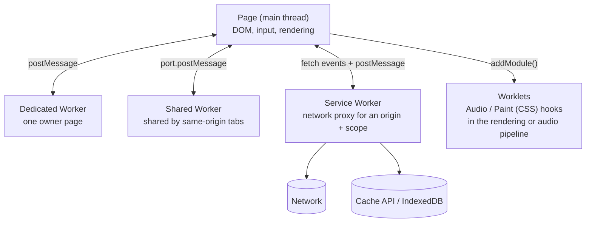
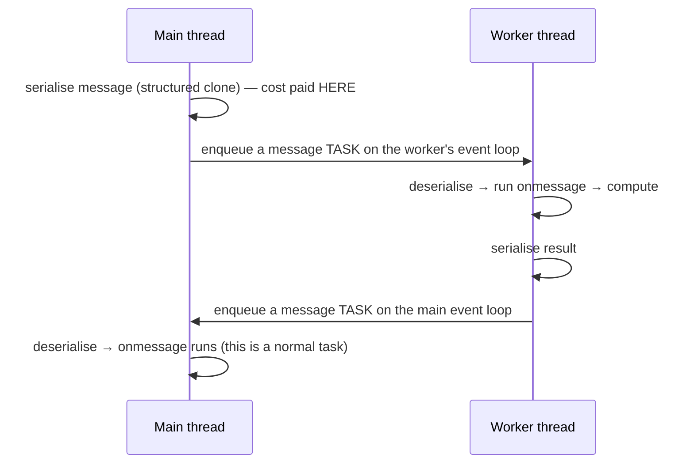
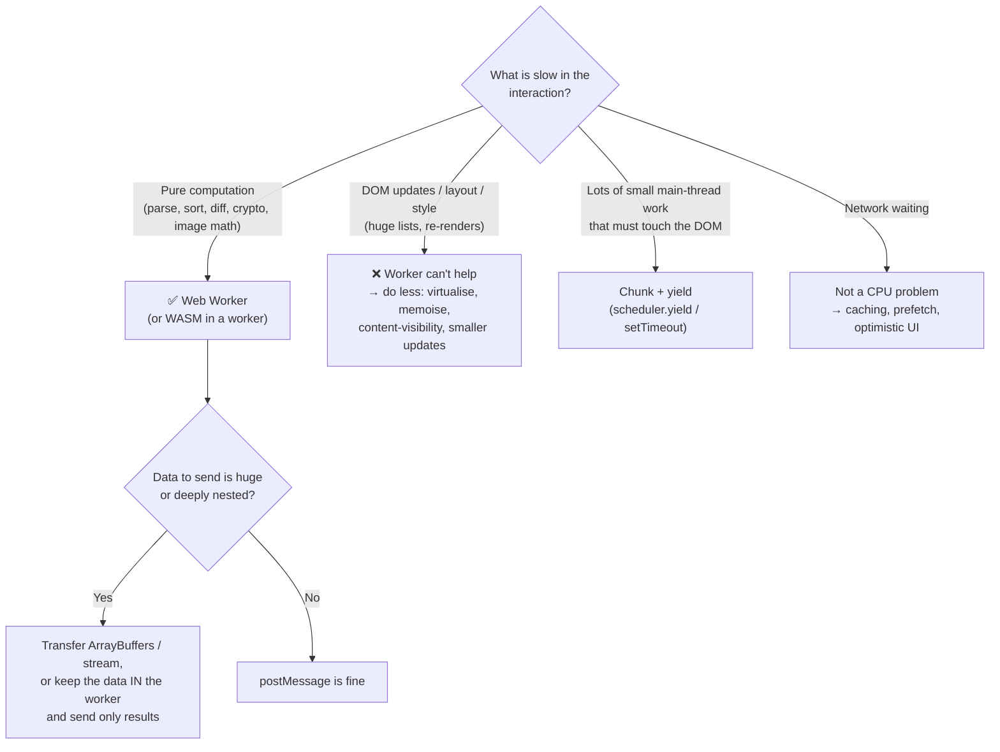
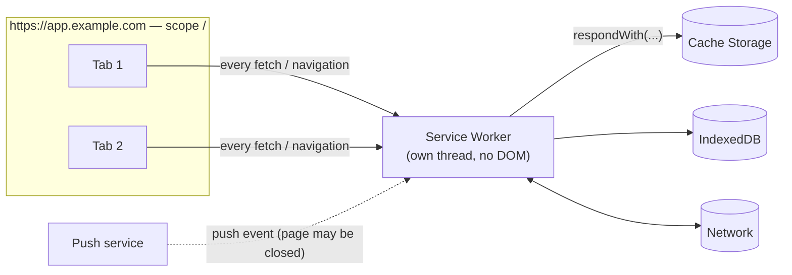
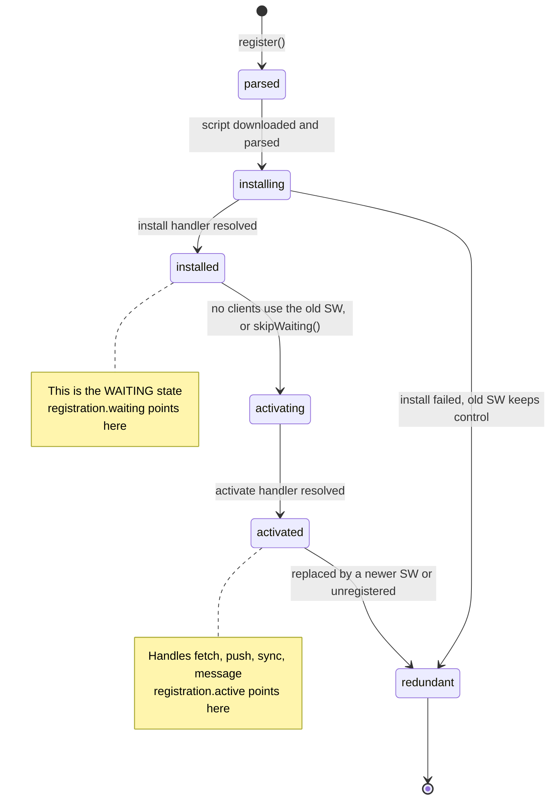
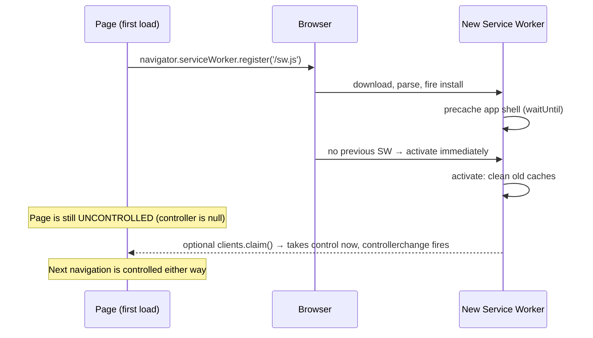
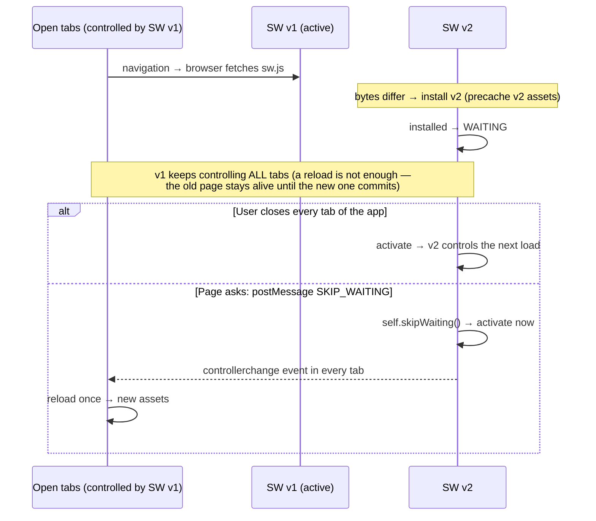
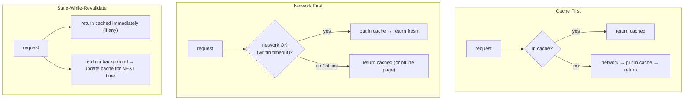
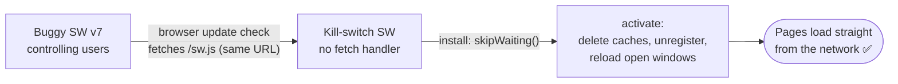

# Service Workers & Web Workers

> **Date:** 2026-11-06 · **Last updated:** 2026-11-06
> **Category:** Frontend System Design
> **Sub-Topic:** Browser APIs / Concurrency & Offline
> **Level:** Intermediate · **Reading time:** ~40 min
> **Informs:** offline-first/PWA architecture, caching strategy, offloading heavy work (INP), update rollout

> **Pre-requisite:** [JavaScript Runtime & Event Loop](./javascript-runtime-event-loop.md) (tasks, long tasks, Section 11 on workers), [Browser Storage Mechanisms](./browser-storage-mechanisms.md) (Cache API, IndexedDB) and [CORS & Same-Origin Policy](./cors-and-same-origin-policy.md) (opaque responses, cross-origin isolation).
> This note covers the two kinds of background JavaScript: **workers that compute** (Web Workers) and **workers that sit between your app and the network** (Service Workers).

**Previous:** [CORS & Same-Origin Policy](./cors-and-same-origin-policy.md) · **Next:** [Web APIs (Intersection Observer, ResizeObserver)](./web-apis-intersection-observer-resizeobserver.md)

---

## Table of Contents

1. [ELI5 — Simple Explanation](#eli5--simple-explanation)
2. [Section 1: The Worker Family at a Glance](#section-1-the-worker-family-at-a-glance)
3. [Section 2: Dedicated Workers, postMessage and Structured Clone](#section-2-dedicated-workers-postmessage-and-structured-clone)
4. [Section 3: Transferable Objects and Shared Memory](#section-3-transferable-objects-and-shared-memory)
5. [Section 4: RPC Instead of Message Soup — Comlink](#section-4-rpc-instead-of-message-soup--comlink)
6. [Section 5: OffscreenCanvas](#section-5-offscreencanvas)
7. [Section 6: When Workers Help INP (and When They Don't)](#section-6-when-workers-help-inp-and-when-they-dont)
8. [Section 7: Shared Workers and Worklets](#section-7-shared-workers-and-worklets)
9. [Section 8: What a Service Worker Is](#section-8-what-a-service-worker-is)
10. [Section 9: The Service Worker Lifecycle](#section-9-the-service-worker-lifecycle)
11. [Section 10: Updates — Waiting, skipWaiting and clients.claim](#section-10-updates--waiting-skipwaiting-and-clientsclaim)
12. [Section 11: Fetch Interception](#section-11-fetch-interception)
13. [Section 12: Caching Strategies](#section-12-caching-strategies)
14. [Section 13: Precaching and Cache Versioning](#section-13-precaching-and-cache-versioning)
15. [Section 14: Navigation Preload](#section-14-navigation-preload)
16. [Section 15: Background Sync and Push — Support Caveats](#section-15-background-sync-and-push--support-caveats)
17. [Section 16: Workbox](#section-16-workbox)
18. [Section 17: Pitfalls and the Kill Switch](#section-17-pitfalls-and-the-kill-switch)
19. [Real-World Examples](#real-world-examples)
20. [Key Points Summary](#key-points-summary)
21. [Test Your Understanding (with answers)](#test-your-understanding)
22. [Cheat Sheet](#cheat-sheet)
23. [References & Further Reading](#references--further-reading)

---

## ELI5 — Simple Explanation

Picture a **restaurant**:

- The **main thread** is the **one waiter** on the floor — takes orders, talks to guests, clears tables (handles input, runs your JS, renders). If the waiter starts chopping onions, every guest waits.
- A **Web Worker** is a **cook in the kitchen**. The waiter passes an order slip through the hatch (`postMessage`), the cook does the heavy chopping, and passes the dish back. The cook **can't walk onto the floor** (no DOM access).
- A **Service Worker** is the **host at the front door** who intercepts *every* order going to the supplier (the network). The host can answer from the **pantry** (Cache API), call the supplier, or both — and keeps the restaurant serving **when the supplier's road is closed** (offline). The host doesn't need the dining room to be open to receive deliveries (push, background sync).
- When you hire a **new host** (deploy a new SW), they **wait outside until every current guest has left**, so no table gets served by two different hosts with different menus.

> **One-line takeaway: Web Workers move *computation* off the main thread; Service Workers move *network control* into your code. Both are separate threads with no DOM, talking to pages via messages.**

---

## Core Concept — Step by Step

### Section 1: The Worker Family at a Glance



| | **Dedicated Worker** | **Shared Worker** | **Service Worker** | **Worklet** |
|---|---|---|---|---|
| Purpose | Offload CPU work | Share one connection/state across tabs | Intercept network, offline, push, sync | Hook into audio/paint pipelines |
| Lifetime | Until owner page closes or `terminate()` | While any connected tab is alive | **Event-driven**: started for an event, killed when idle | Managed by the engine |
| Owners | 1 document | Many same-origin documents | All pages in its **scope** | Engine-managed |
| DOM access | ❌ | ❌ | ❌ | ❌ |
| Survives page close | ❌ | ❌ (when last tab closes) | ✅ Registration persists | ❌ |
| Requires HTTPS | No | No | **Yes** (or `localhost`) | Secure context for most |

All workers have **their own global scope, heap, call stack and event loop** (see [Section 11 of the Event Loop note](./javascript-runtime-event-loop.md#section-11-web-workers--more-threads-more-event-loops)). Inside a worker you have `self`, `fetch`, `IndexedDB`, `caches`, `WebSocket`, timers, `crypto` — but **no `window`, `document`, `localStorage` or `sessionStorage`**.

---

### Section 2: Dedicated Workers, postMessage and Structured Clone

```javascript
// main.js — module worker; bundlers (Vite, webpack 5) understand this URL pattern
const worker = new Worker(new URL('./parse.worker.js', import.meta.url), { type: 'module' });

worker.postMessage({ type: 'PARSE', csv: bigCsvString });
worker.addEventListener('message', (e) => renderTable(e.data.rows));
worker.addEventListener('error', (e) => console.error('worker crashed', e.message));
worker.addEventListener('messageerror', () => console.error('message could not be deserialised'));

// parse.worker.js
self.addEventListener('message', (e) => {
  if (e.data.type !== 'PARSE') return;
  const rows = e.data.csv.split('\n').map((line) => line.split(','));
  self.postMessage({ rows });
});
```

`postMessage` **copies** data using the **structured clone algorithm** (the same one `structuredClone()`, IndexedDB and `history.pushState` use):



| Structured clone **can** copy | **Cannot** copy (throws `DataCloneError` or loses info) |
|---|---|
| Primitives (except `Symbol`), plain objects, arrays | Functions, closures |
| `Date`, `RegExp`, `Map`, `Set`, `BigInt` | DOM nodes |
| `ArrayBuffer`, typed arrays, `DataView` | Class identity — instances arrive as **plain objects** (prototype and methods lost) |
| `Blob`, `File`, `FileList`, `ImageData`, `ImageBitmap` | Getters/setters and property descriptors |
| Most `Error` types | `Symbol` values and symbol-keyed properties |
| Circular references | `WeakMap`, `WeakSet`, Promises |

> **Cost model:** cloning is synchronous on the **sending** thread and proportional to the size and complexity of the data. Sending a 50 MB object graph from the main thread can itself be a long task. Fixes: send less, send flat binary (`ArrayBuffer`), or **transfer** instead of copy (next section).

---

### Section 3: Transferable Objects and Shared Memory

A **transfer** moves ownership of the underlying memory to the other thread — **no copy**. The sender's object becomes **detached** (unusable).

```javascript
const pixels = new Uint8ClampedArray(4096 * 4096 * 4);     // ~64 MB
worker.postMessage({ pixels }, [pixels.buffer]);           // transfer list: the ArrayBuffer, not the view
console.log(pixels.byteLength);                            // 0 — detached on this side

// Equivalent options form:
// worker.postMessage({ pixels }, { transfer: [pixels.buffer] });
```

Common transferables: `ArrayBuffer`, `MessagePort`, `ImageBitmap`, `OffscreenCanvas`, `ReadableStream` / `WritableStream` / `TransformStream`, `VideoFrame`, `AudioData` (support varies — check MDN's list).

| Approach | Copies? | Both threads can use it? | Requirements |
|---|---|---|---|
| Structured clone | Yes | Each has its own copy | None |
| Transfer | No | **One owner at a time** | Transferable type |
| `SharedArrayBuffer` + `Atomics` | No | **Yes, simultaneously** | Page must be **`crossOriginIsolated`** (COOP + COEP — see [CORS note, Section 10](./cors-and-same-origin-policy.md#section-10-corp-coep-coop-and-cross-origin-isolation)) |

`SharedArrayBuffer` brings real shared-memory concurrency (and real data races) — coordinate with `Atomics`. Note `Atomics.wait()` is not allowed on the browser main thread (it would block the UI); it's for workers.

---

### Section 4: RPC Instead of Message Soup — Comlink

Raw `postMessage` quickly becomes a switch statement over message types with manual request IDs. [Comlink](https://github.com/GoogleChromeLabs/comlink) (Google Chrome Labs) wraps a worker in a **Proxy** so calls look like async function calls:

```javascript
// math.worker.js
import * as Comlink from 'comlink';

const api = {
  fib(n) { return n < 2 ? n : api.fib(n - 1) + api.fib(n - 2); },
  async resize(bitmap, width) { /* ... */ return Comlink.transfer(result, [result]); },
};
Comlink.expose(api);

// main.js
import * as Comlink from 'comlink';
const math = Comlink.wrap(new Worker(new URL('./math.worker.js', import.meta.url), { type: 'module' }));
const value = await math.fib(35);        // every call returns a Promise
```

A powerful pattern this enables: **keep the big dataset inside the worker** (`load(url)` once) and expose `search(query)` that returns only the ~50 visible results — the main thread never clones the dataset.

Same idea in other tools: `vite-plugin-comlink`, and frameworks that ship worker helpers. It's still `postMessage` underneath — the clone/transfer costs from Sections 2–3 still apply.

---

### Section 5: OffscreenCanvas

`OffscreenCanvas` lets a worker **draw to a canvas** without touching the DOM — chart rendering, image filters, maps, games. Supported in all modern engines (Safari since 16.4).

```javascript
// main.js
const canvas = document.querySelector('#chart');
const offscreen = canvas.transferControlToOffscreen();   // DOM canvas now mirrors the worker's drawing
const worker = new Worker(new URL('./chart.worker.js', import.meta.url), { type: 'module' });
worker.postMessage({ canvas: offscreen, data }, [offscreen]);

// chart.worker.js
self.onmessage = ({ data: { canvas, data } }) => {
  const ctx = canvas.getContext('2d');
  for (const [i, v] of data.entries()) ctx.fillRect(i * 4, canvas.height - v, 3, v);
  // Frames are committed to the on-screen canvas automatically — no DOM access needed
};
```

You can also create `new OffscreenCanvas(w, h)` in a worker purely for image processing and return an `ImageBitmap` / `Blob` (`convertToBlob()`).

---

### Section 6: When Workers Help INP (and When They Don't)

**INP** (Interaction to Next Paint) = input delay + processing time + presentation delay. Workers help by keeping **long tasks off the main thread**, so inputs aren't stuck behind them.



Rules of thumb:

- Worth it when the work is **CPU-bound and regularly > ~50 ms** (a long task), and doesn't need the DOM.
- **Spawning** a worker costs startup time and memory — create it early (or lazily on first need) and **reuse** it; for parallelism, a small pool sized from `navigator.hardwareConcurrency`.
- **Keep state in the worker** (e.g. the full dataset), send only queries in and small results out — avoids repeated large clones.
- The final DOM update still happens on the main thread — keep it small.

---

### Section 7: Shared Workers and Worklets

**Shared Worker** — one instance shared by all same-origin tabs/iframes that construct it with the same URL and name. Classic uses: **one WebSocket for all tabs**, a shared in-memory cache, cross-tab coordination.

```javascript
// any tab
const shared = new SharedWorker(new URL('./hub.worker.js', import.meta.url), { name: 'hub' });
shared.port.onmessage = (e) => console.log('from hub', e.data);
shared.port.postMessage({ type: 'SUBSCRIBE', channel: 'prices' });

// hub.worker.js
const ports = new Set();
self.onconnect = (e) => {
  const port = e.ports[0];
  ports.add(port);
  port.onmessage = (msg) => { /* handle; broadcast with ports.forEach(p => p.postMessage(...)) */ };
};
```

> **Support caveat:** Shared Workers are supported in desktop browsers and Safari (16+), but **Chrome for Android only added them very recently** (version 148 per MDN's compat data). If you must support older Android Chrome, fall back to `BroadcastChannel` + a leader-election scheme (e.g. Web Locks API) — see the real-time note [WebSockets & SSE & Long Polling](./websockets-sse-long-polling.md).

**Worklets** are tiny, specialised workers the engine runs inside a specific pipeline. You don't `postMessage` to them freely — you register code with `addModule()`:

| Worklet | Runs in | Support |
|---|---|---|
| `AudioWorklet` | Audio rendering thread — custom DSP with low latency | All modern browsers |
| `CSS.paintWorklet` (CSS Painting API) | Paint step — draw backgrounds/borders procedurally | Chromium only |
| Animation / Layout worklets | Compositor / layout | Experimental (Houdini) |

---

### Section 8: What a Service Worker Is

A **Service Worker (SW)** is an event-driven worker that the browser runs **between your pages and the network** for one origin + path **scope**. It can intercept requests, answer from caches, and wake up for push messages or sync events even when no page is open.



| Property | Detail |
|---|---|
| **Secure context only** | HTTPS, or `http://localhost` for development |
| **Scope** | Defaults to the SW script's directory. `/sw.js` can control `/`; `/js/sw.js` can only control `/js/` unless the server sends `Service-Worker-Allowed: /` → **serve `sw.js` from the root** |
| **Controls clients** | A page is "controlled" if it was loaded (navigated) while an active SW owned its scope. Check `navigator.serviceWorker.controller` |
| **Intercepts** | Navigations in scope **and** every subresource request from controlled pages — including cross-origin requests (which then return opaque responses if `no-cors`) |
| **Lifetime** | Started on demand for an event, **terminated when idle** — global variables don't persist; store state in IndexedDB / Cache API |
| **No** | DOM, `localStorage`, synchronous XHR |
| **Bypassed by** | Hard reload (Shift + Reload) — the page loads **uncontrolled** |

```javascript
// Register from the page — after load, so SW install doesn't compete with first paint
if ('serviceWorker' in navigator) {
  window.addEventListener('load', () => {
    navigator.serviceWorker.register('/sw.js', { scope: '/' })
      .then((reg) => console.log('SW registered for', reg.scope))
      .catch((err) => console.error('SW registration failed', err));
  });
}
```

---

### Section 9: The Service Worker Lifecycle



| Event | Typical job | Notes |
|---|---|---|
| `install` | **Precache** the app shell | `event.waitUntil(promise)` — if it rejects, this SW is discarded and the old one stays |
| `activate` | **Delete old caches**, enable navigation preload, migrate IndexedDB | Runs when the SW takes over; old SW is gone |
| `fetch` | Respond to requests | Only reaches pages the SW **controls** |
| `message` | Commands from pages (e.g. `SKIP_WAITING`) | `event.source` is the sending client |
| `push`, `sync`, `notificationclick` | Background features | See Section 15 |

**First visit** — the page that registered the SW is **not controlled** by it (it loaded without one). Only the next navigation is, unless the SW calls `clients.claim()`:



---

### Section 10: Updates — Waiting, skipWaiting and clients.claim

**When does the browser check for a new SW?** On navigation to an in-scope page, on functional events like `push`/`sync` (if no check happened in the last 24 h), and when you call `registration.update()`. It re-downloads `sw.js` (bypassing the HTTP cache by default — `updateViaCache: 'imports'`) and compares it — and its imported scripts — **byte-for-byte**. Any difference → a new SW starts installing.



| Tool | What it does | Risk |
|---|---|---|
| **Waiting (default)** | New SW waits until no tab uses the old one | Users with long-lived tabs stay on the old version for days |
| **`self.skipWaiting()`** | Activate the new SW immediately | Pages loaded with **v1 HTML/JS** are now served by **v2** — lazy-loaded chunks from v1 may be gone from the cache/CDN → broken routes |
| **`clients.claim()`** | Active SW takes control of in-scope **uncontrolled** clients now | Usually fine on first install; combined with `skipWaiting` it amplifies the version-mixing risk |
| **`registration.update()`** | Manually check for a new SW | Call on an interval or on `visibilitychange` for long-lived SPAs |

**The recommended UX — "A new version is available → Reload":**

1. Detect a waiting SW (`registration.waiting`, or `updatefound` → `installing.statechange === 'installed'` **and** `navigator.serviceWorker.controller` exists, which means it's an *update*, not the first install).
2. Show a non-blocking toast.
3. On click, `postMessage({ type: 'SKIP_WAITING' })` to the waiting SW.
4. On `controllerchange`, reload **once** (guard against loops).

Full code in [Real-World Example 3](#real-world-examples). Auto-reloading without asking can lose unsaved form state — only do it silently when the app knows there's nothing to lose (e.g. on the next route change).

---

### Section 11: Fetch Interception

```javascript
self.addEventListener('fetch', (event) => {
  const { request } = event;
  const url = new URL(request.url);

  if (request.method !== 'GET') return;                       // let the browser handle it (Cache API only stores GET)
  if (url.origin !== self.location.origin) return;            // leave cross-origin alone unless you mean it

  if (request.mode === 'navigate') {                          // HTML page loads
    event.respondWith(networkFirst(request, 'pages'));
    return;
  }
  if (url.pathname.startsWith('/assets/')) {                  // hashed, immutable bundles
    event.respondWith(cacheFirst(request, 'assets'));
  }
  // No respondWith → request falls through to the network as if no SW existed
});
```

Rules:

- `event.respondWith()` must be called **synchronously** during the event dispatch (you pass it a Promise; the work inside can be async).
- Not calling it = default network behaviour. That's the cheapest path — **only intercept what you have a strategy for**.
- A response body can be read **once** — `response.clone()` before putting one copy in the cache and returning the other.
- `cache.put()` rejects for non-GET requests and for `206 Partial Content` responses.
- Every intercepted request may require **starting the SW** first, which adds latency (noticeable on low-end mobile). Navigation preload (Section 14) mitigates this for navigations. Chromium also offers a **Static Routing API** (declare routes at install so some requests skip the SW entirely) — Chromium-only.

---

### Section 12: Caching Strategies

These are the patterns from Jake Archibald's [Offline Cookbook](https://jakearchibald.com/2014/offline-cookbook/), also shipped by Workbox. The storage side (Cache API) is covered in [Browser Storage Mechanisms, Section 6](./browser-storage-mechanisms.md#section-6-cache-api). The HTTP cache (`Cache-Control`, `ETag`) that sits *underneath* the SW is covered in [Browser Caching Strategies](./browser-caching-strategies.md).



| Strategy | Freshness | Speed | Offline | Use for |
|---|---|---|---|---|
| **Cache first** | Stale until the cache entry changes | ⚡ Fastest | ✅ | **Hashed/versioned** assets (`app.3f9a1c.js`), fonts, images that never change at the same URL |
| **Network first** (+ timeout) | Fresh when online | Network speed | ✅ fallback | HTML navigations, API data where freshness matters |
| **Stale-while-revalidate** | One visit behind | ⚡ Fast | ✅ | Avatars, non-critical API data, feeds, CMS content |
| **Cache only** | Whatever was precached | ⚡ | ✅ | Precached app shell / offline page |
| **Network only** | Always fresh | Network | ❌ | Auth, payments, analytics POSTs, anything non-GET |

> Cache-first on an **unversioned URL** (`/app.js`, `/index.html`) is the #1 cause of "users stuck on an old version" — see Section 17.

**Cache hygiene:** runtime caches grow forever unless you cap them (max entries / max age — Workbox's `ExpirationPlugin`), and **opaque** cross-origin responses can't be status-checked and are padded in Chrome's quota accounting (Workbox docs: around 7 MB each). Only cache opaque responses deliberately.

---

### Section 13: Precaching and Cache Versioning

**Precaching** = downloading a known list of files during `install`, so the app works offline from the first controlled load. The list must carry **revisions** so an update re-downloads only changed files:

```javascript
// sw.js (hand-rolled) — bump VERSION on every deploy (or generate it at build time)
const VERSION = 'v42';
const PRECACHE = `precache-${VERSION}`;
const PRECACHE_URLS = ['/', '/offline.html', '/assets/app.3f9a1c.js', '/assets/app.88b2e1.css'];

self.addEventListener('install', (event) => {
  event.waitUntil(caches.open(PRECACHE).then((c) => c.addAll(PRECACHE_URLS)));   // atomic: any 404 fails install
});

self.addEventListener('activate', (event) => {
  event.waitUntil((async () => {
    const keep = new Set([PRECACHE, 'pages', 'assets', 'images']);
    for (const key of await caches.keys()) if (!keep.has(key)) await caches.delete(key);
  })());
});
```

In practice, let the **build tool generate the manifest** (`[{ url, revision }]`) — Workbox's `injectManifest` / `generateSW`, `vite-plugin-pwa`. Hand-maintained lists drift.

| Precache | Don't precache |
|---|---|
| App shell, offline page, critical CSS/JS, core icons | Every route's chunk on a large app (huge first install on mobile data) |
| Small, versioned assets | Large media, user-specific API data |

---

### Section 14: Navigation Preload

Problem: with a network-first navigation handler, the browser must **boot the SW** before it can even *start* the network request — the boot time is pure added latency. **Navigation preload** starts the navigation request **in parallel** with SW startup:

```javascript
self.addEventListener('activate', (event) => {
  event.waitUntil(self.registration.navigationPreload?.enable());
});

self.addEventListener('fetch', (event) => {
  if (event.request.mode !== 'navigate') return;
  event.respondWith((async () => {
    try {
      const preloaded = await event.preloadResponse;       // started before the SW was even running
      if (preloaded) return preloaded;
      return await fetch(event.request);
    } catch {
      return (await caches.match('/offline.html')) ?? Response.error();
    }
  })());
});
```

- The preload request carries `Service-Worker-Navigation-Preload: true` — the server can return a lighter response (e.g. just the content partial) if it wants.
- Supported in Chrome 59+, Firefox 99+, Safari 15.4+ (per web.dev).
- If you enable it, **use** `event.preloadResponse` (or `event.waitUntil(event.preloadResponse)`) — otherwise you pay for a request you throw away.
- Not useful with cache-first navigations (you aren't going to the network anyway).

---

### Section 15: Background Sync and Push — Support Caveats

| Feature | What it does | Chromium | Firefox | Safari |
|---|---|---|---|---|
| **Push API** + Notifications | Server wakes the SW to show a notification | ✅ | ✅ | ✅ macOS (Safari 16+, Ventura+); **iOS/iPadOS 16.4+ only for web apps added to the Home Screen** |
| **Declarative Web Push** | Push payload declares the notification; no SW JS required to display | ❌ | ❌ | ✅ iOS/iPadOS 18.4+ Home Screen web apps (WebKit) |
| **Background Sync** (`sync`) | Retry a queued action once connectivity returns | ✅ | ❌ | ❌ |
| **Periodic Background Sync** | Wake periodically to refresh content | ✅ (installed PWA, engagement-gated) | ❌ | ❌ |
| **Background Fetch** | Large downloads that survive page close | ✅ | ❌ | ❌ |

**Design implications:**

- Treat Background Sync as an **enhancement**. The robust pattern: write the action to an **IndexedDB outbox**, try to send immediately, register `sync` where supported, and **also** flush the outbox on app start / `online` event / next SW startup everywhere else. (Workbox's `BackgroundSyncPlugin` implements exactly this fallback.)
- **Push requires a visible notification** for every push (`userVisibleOnly: true` in Chrome; Safari enforces the same rule) — silent background pushes aren't allowed.
- Ask for notification permission **in response to a user gesture** and after explaining the value — Safari and Firefox require a gesture, and Chrome quiets prompts on sites with low acceptance.
- On iOS, push is only available after the user **adds the web app to the Home Screen** — design onboarding for it, and never make core flows depend on push.

```javascript
// Page: queue + register sync where available
async function sendMessage(msg) {
  await outbox.add(msg);                                   // IndexedDB (e.g. via idb)
  const reg = await navigator.serviceWorker.ready;
  if ('sync' in reg) await reg.sync.register('flush-outbox');
  else flushOutbox();                                      // fallback: try now (and on 'online')
}

// sw.js
self.addEventListener('sync', (event) => {
  if (event.tag === 'flush-outbox') event.waitUntil(flushOutbox());   // rejected promise → browser retries later
});
```

---

### Section 16: Workbox

[Workbox](https://developer.chrome.com/docs/workbox) (from the Chrome team; v7 is current, with a slow release cadence) packages everything above as modules:

| Module | Gives you |
|---|---|
| `workbox-precaching` | `precacheAndRoute(self.__WB_MANIFEST)` — revisioned precache, cleanup of outdated precaches |
| `workbox-routing` | `registerRoute(match, handler)`, `NavigationRoute`, `setCatchHandler` (offline fallback) |
| `workbox-strategies` | `CacheFirst`, `NetworkFirst` (`networkTimeoutSeconds`), `StaleWhileRevalidate`, `CacheOnly`, `NetworkOnly` |
| `workbox-expiration` | `ExpirationPlugin({ maxEntries, maxAgeSeconds })` |
| `workbox-cacheable-response` | `CacheableResponsePlugin({ statuses: [0, 200] })` — opt in to caching opaque (status 0) |
| `workbox-background-sync` | `BackgroundSyncPlugin` — IndexedDB queue with non-Chromium fallback |
| `workbox-navigation-preload` | `enable()` + strategies that consume the preload response |
| `workbox-window` | Page-side helper: `waiting` / `controlling` events, `messageSkipWaiting()` |
| `workbox-build` / `-webpack-plugin` / `-cli` | `generateSW` (config only) or `injectManifest` (your own SW + generated manifest) |

Integrations: **`vite-plugin-pwa`** (Vite, built on Workbox) and **Serwist** (a community fork of Workbox, popular with Next.js). Choose `injectManifest` once you need custom logic (push, sync, messaging); `generateSW` for a pure caching SW.

---

### Section 17: Pitfalls and the Kill Switch

| Pitfall | What happens | Prevention |
|---|---|---|
| **Cache-first `index.html`** | HTML references old hashed bundles forever; deploys never reach users | Network-first (with timeout) for navigations, or precache HTML **with a revision** + update prompt |
| **Long `Cache-Control` on `sw.js`** | Older browsers/configs may delay update checks | Serve `sw.js` with `Cache-Control: no-cache`; keep the default `updateViaCache: 'imports'` |
| **Renaming the SW** (`sw-v2.js`) | Old cached HTML still registers/keeps the old SW; you can end up with the old one forever | **Keep a stable URL** (`/sw.js`); version *inside* the file |
| **`skipWaiting()` on every deploy** | Running pages get a new SW mid-session → missing lazy chunks | Prompt the user; keep previous deploy's assets on the CDN for a grace period |
| **Never cleaning caches** | Quota fills; stale assets served | Delete unknown caches on `activate`; `ExpirationPlugin` |
| **Caching errors / opaque junk** | A 500 or a captive-portal page cached as "the" response | Check `response.ok` (or allow status 0 deliberately) |
| **Caching personalised API responses** | Next user on a shared device sees the previous user's data | Network-only for user data, or clear caches on logout |
| **State in SW globals** | SW is killed when idle → state disappears | IndexedDB / Cache API |
| **Testing only with "Update on reload" on** | Real users follow the waiting lifecycle | Test the real update flow in a fresh profile |
| **Safari storage eviction** | Safari may delete script-writable storage, **including SW registrations and caches**, after 7 days without user interaction (Home Screen apps exempt) | Never treat the SW cache as the only copy of data |

**The kill switch** — when a buggy SW is out in the wild, deploy a **no-op SW at the same URL** (per Chrome's [Remove buggy service workers](https://developer.chrome.com/docs/workbox/remove-buggy-service-workers) guide):



Optionally add the `Clear-Site-Data: "storage"` response header on a page as a supplement — it unregisters service workers in supporting browsers, but it **also wipes localStorage and IndexedDB** for the origin and support is incomplete, so don't rely on it alone.

---

## Real-World Examples

**Example 1 — Image filter: BAD on the main thread → GOOD in a worker with transferables:**
```javascript
// ❌ BAD: 20 MP image processed on the main thread → multi-second long task, terrible INP
function grayscale(imageData) {
  const d = imageData.data;
  for (let i = 0; i < d.length; i += 4) d[i] = d[i + 1] = d[i + 2] = 0.299 * d[i] + 0.587 * d[i + 1] + 0.114 * d[i + 2];
  return imageData;
}

// ✅ GOOD (main.js): transfer the pixel buffer — zero copy both ways
const filterWorker = new Worker(new URL('./filter.worker.js', import.meta.url), { type: 'module' });

function grayscaleOffThread(imageData) {
  return new Promise((resolve, reject) => {
    const { width, height, data } = imageData;
    filterWorker.onmessage = (e) => resolve(new ImageData(new Uint8ClampedArray(e.data.buffer), width, height));
    filterWorker.onerror = reject;
    filterWorker.postMessage({ buffer: data.buffer }, [data.buffer]);   // imageData is now detached here
  });
}

// filter.worker.js
self.onmessage = ({ data: { buffer } }) => {
  const d = new Uint8ClampedArray(buffer);
  for (let i = 0; i < d.length; i += 4) d[i] = d[i + 1] = d[i + 2] = 0.299 * d[i] + 0.587 * d[i + 1] + 0.114 * d[i + 2];
  self.postMessage({ buffer }, [buffer]);                                // transfer back
};
```

**Example 2 — Hand-written SW with per-route strategies:**
```javascript
// sw.js
const RUNTIME = { pages: 'pages', assets: 'assets', images: 'images' };

async function cacheFirst(request, cacheName) {
  const cached = await caches.match(request);
  if (cached) return cached;
  const response = await fetch(request);
  if (response.ok) (await caches.open(cacheName)).put(request, response.clone());
  return response;
}

async function networkFirst(request, cacheName, timeoutMs = 3000) {
  const cache = await caches.open(cacheName);
  try {
    const response = await fetch(request, { signal: AbortSignal.timeout(timeoutMs) });
    if (response.ok) cache.put(request, response.clone());
    return response;
  } catch {
    return (await cache.match(request)) ?? (await caches.match('/offline.html')) ?? Response.error();
  }
}

async function staleWhileRevalidate(event, cacheName) {
  const cache = await caches.open(cacheName);
  const cached = await cache.match(event.request);
  const network = fetch(event.request).then((response) => {
    if (response.ok) cache.put(event.request, response.clone());
    return response;
  });
  event.waitUntil(network.catch(() => {}));       // keep the SW alive until the cache update finishes
  return cached ?? network;
}

self.addEventListener('fetch', (event) => {
  const { request } = event;
  const url = new URL(request.url);
  if (request.method !== 'GET' || url.origin !== location.origin) return;
  if (url.pathname.startsWith('/api/auth')) return;                                   // network only

  if (request.mode === 'navigate') event.respondWith(networkFirst(request, RUNTIME.pages));
  else if (url.pathname.startsWith('/assets/')) event.respondWith(cacheFirst(request, RUNTIME.assets));
  else if (request.destination === 'image') event.respondWith(staleWhileRevalidate(event, RUNTIME.images));
});

self.addEventListener('message', (event) => {
  if (event.data?.type === 'SKIP_WAITING') self.skipWaiting();
});
```

**Example 3 — "New version available" prompt (vanilla page code):**
```javascript
// register-sw.js
async function registerSW() {
  if (!('serviceWorker' in navigator)) return;
  const reg = await navigator.serviceWorker.register('/sw.js');

  const promptUser = (worker) =>
    showToast('A new version is available.', 'Reload', () => worker.postMessage({ type: 'SKIP_WAITING' }));

  if (reg.waiting && navigator.serviceWorker.controller) promptUser(reg.waiting);   // update already waiting

  reg.addEventListener('updatefound', () => {
    const installing = reg.installing;
    installing.addEventListener('statechange', () => {
      // 'installed' + an existing controller = an UPDATE (not the first install)
      if (installing.state === 'installed' && navigator.serviceWorker.controller) promptUser(installing);
    });
  });

  let reloaded = false;
  navigator.serviceWorker.addEventListener('controllerchange', () => {
    if (reloaded) return;                       // guard against reload loops
    reloaded = true;
    window.location.reload();
  });

  // Long-lived SPA tabs: check for updates when the user comes back
  document.addEventListener('visibilitychange', () => {
    if (document.visibilityState === 'visible') reg.update();
  });
}
window.addEventListener('load', registerSW);
```

**Example 4 — The same with Workbox (`injectManifest` + `workbox-window`):**
```javascript
// src/sw.js — Workbox injects the revisioned precache manifest at build time
import { precacheAndRoute, cleanupOutdatedCaches } from 'workbox-precaching';
import { registerRoute, NavigationRoute } from 'workbox-routing';
import { NetworkFirst, StaleWhileRevalidate, CacheFirst } from 'workbox-strategies';
import { ExpirationPlugin } from 'workbox-expiration';
import { CacheableResponsePlugin } from 'workbox-cacheable-response';
import * as navigationPreload from 'workbox-navigation-preload';

precacheAndRoute(self.__WB_MANIFEST);
cleanupOutdatedCaches();
navigationPreload.enable();

registerRoute(new NavigationRoute(new NetworkFirst({ cacheName: 'pages', networkTimeoutSeconds: 3 })));
registerRoute(({ request }) => request.destination === 'image',
  new CacheFirst({ cacheName: 'images', plugins: [new ExpirationPlugin({ maxEntries: 100, maxAgeSeconds: 30 * 24 * 3600 })] }));
registerRoute(({ url }) => url.pathname.startsWith('/api/catalog'),
  new StaleWhileRevalidate({ cacheName: 'catalog', plugins: [new CacheableResponsePlugin({ statuses: [200] })] }));

self.addEventListener('message', (e) => { if (e.data?.type === 'SKIP_WAITING') self.skipWaiting(); });

// src/main.js — page side
import { Workbox } from 'workbox-window';
const wb = new Workbox('/sw.js');
wb.addEventListener('waiting', () => {
  showToast('Update ready', 'Reload', () => {
    wb.addEventListener('controlling', () => window.location.reload());
    wb.messageSkipWaiting();                    // sends { type: 'SKIP_WAITING' } to the waiting SW
  });
});
wb.register();
```

**Example 5 — Kill-switch service worker (deploy at the SAME URL as the buggy one):**
```javascript
// /sw.js — no fetch handler on purpose: requests go straight to the network
self.addEventListener('install', () => self.skipWaiting());

self.addEventListener('activate', (event) => {
  event.waitUntil((async () => {
    const keys = await caches.keys();
    await Promise.all(keys.map((key) => caches.delete(key)));
    await self.registration.unregister();
    const windows = await self.clients.matchAll({ type: 'window' });
    for (const client of windows) client.navigate(client.url);    // reload pages without the SW
  })());
});
```

---

## Key Points Summary

| Concept | One-Line Explanation |
|---|---|
| **Dedicated Worker** | Background thread owned by one page; offloads CPU work; no DOM |
| **Structured clone** | `postMessage` copies data; cost is paid synchronously by the sender |
| **Transferable** | Moves `ArrayBuffer`/`OffscreenCanvas`/streams with zero copy; sender's copy is detached |
| **SharedArrayBuffer** | True shared memory between threads; needs `crossOriginIsolated` |
| **Comlink** | Proxy-based RPC over `postMessage` — call worker functions as async functions |
| **OffscreenCanvas** | Render a canvas from a worker |
| **Workers and INP** | Help with CPU-bound long tasks; useless for DOM/layout cost |
| **Shared Worker** | One worker shared by same-origin tabs (newly in Chrome Android) |
| **Worklet** | Lightweight hook into audio/paint pipelines |
| **Service Worker** | Event-driven network proxy per origin + scope; HTTPS only |
| **Lifecycle** | install → (waiting) → activate → controls clients; new versions wait for old tabs to close |
| **`skipWaiting()` / `clients.claim()`** | Activate now / take control now — powerful, but can mix versions |
| **Caching strategies** | Cache-first (hashed assets), network-first (HTML/API), SWR (non-critical), cache-only, network-only |
| **Precaching** | Revisioned manifest downloaded at install — generate it, don't hand-write it |
| **Navigation preload** | Starts the navigation request in parallel with SW boot |
| **Background Sync / Periodic Sync** | Chromium only — always ship a fallback |
| **Web Push on iOS** | 16.4+ and only for Home Screen web apps |
| **Kill switch** | No-op SW at the same URL: skipWaiting, clear caches, unregister, reload |

---

## Test Your Understanding

**Q1 (Basic):**
What can't a Web Worker do that the main thread can, and how do the two communicate?

<details>
<summary>Answer</summary>

Workers have **no DOM** (`document`, `window`) and no `localStorage`/`sessionStorage`; they can use `fetch`, IndexedDB, Cache API, WebSockets, timers and `OffscreenCanvas`. They communicate via **`postMessage`**, which delivers a **message task** to the other thread's event loop. Data is **structured-cloned** (copied) by default, or **transferred** (zero-copy, sender loses access) for transferables like `ArrayBuffer`. Shared memory is only possible with `SharedArrayBuffer`, which requires cross-origin isolation. This separation is *why* workers are safe: no shared mutable state, no DOM races.
</details>

**Q2 (Application):**
A dashboard parses a 40 MB JSON export in a worker, then `postMessage`s the parsed 200k-object array back to the main thread. INP is still bad. Why, and what would you change?

<details>
<summary>Answer</summary>

The worker removed the parse from the main thread, but **sending a 200k-object graph back requires structured-cloning it**, and the main thread must **deserialise** it in one task — itself a long task. Then rendering 200k rows hits DOM/layout costs the worker can't help with.

Fixes: **keep the data in the worker** and expose queries (filter/sort/page) that return only the visible slice (e.g. 50 rows); if bulk data must cross, use a compact **binary format** and **transfer** the `ArrayBuffer`; and **virtualise** the table so the DOM only holds visible rows.
</details>

**Q3 (Application):**
You deployed a fix, but users report still seeing the old bug for days, even after reloading. The SW precaches assets and uses the default lifecycle. Explain, and design a better rollout.

<details>
<summary>Answer</summary>

The new SW installed but is **waiting**: the browser won't activate it while **any tab** is controlled by the old SW. A reload doesn't help because the old page stays alive until the new navigation commits, so there's always a controlled client. Users who keep a tab open (or many tabs) stay on the old version, and the old SW keeps serving old precached HTML/JS.

Better rollout: detect `registration.waiting` (and `updatefound` → `installed` with an existing controller), show a **"New version — Reload"** prompt, `postMessage({type:'SKIP_WAITING'})` on click, reload once on `controllerchange`. Call `registration.update()` on `visibilitychange` for long-lived tabs. Use **network-first for HTML** so a navigation can pick up new HTML, and keep the previous deploy's hashed assets on the CDN for a grace period so pages still on the old version can lazy-load their chunks.
</details>

**Q4 (Tricky):**
Why is calling `self.skipWaiting()` unconditionally in `install` risky for a code-split SPA, and when is it fine?

<details>
<summary>Answer</summary>

`skipWaiting()` activates the new SW **while pages loaded with the old HTML/JS are still open**. Those pages may later request lazy chunks like `/assets/settings.a1b2.js` that **belong to the old build**. The new SW's precache doesn't have them, it deleted the old caches in `activate`, and the CDN may have removed them → the route fails to load. It's also confusing for any SW↔page message protocol that changed.

It's fine when: the SW has **no versioned dependency** with the page (e.g. it only does runtime caching of immutable URLs), it's a **kill-switch** SW, or the app reloads immediately after activation (user-confirmed prompt). Otherwise prefer the prompt-then-skipWaiting flow.
</details>

**Q5 (Tricky):**
Pick a caching strategy for each and explain: (a) `/assets/app.3f9a1c.js`, (b) `/index.html`, (c) `/api/user/profile`, (d) user avatars from a third-party CDN, (e) `POST /api/checkout`.

<details>
<summary>Answer</summary>

- **(a) Cache-first** (or precache): the URL contains a content hash, so the content at that URL never changes — a cached copy is always correct.
- **(b) Network-first with a timeout** (falling back to cache/offline page), or precache with a revision + update prompt. Cache-first HTML would pin users to old bundle references forever.
- **(c) Network-only**, or network-first with care: it's personalised — caching risks showing stale or another user's data on shared devices. If cached for offline, clear on logout.
- **(d) Stale-while-revalidate** — fast, and slightly stale avatars are fine. These are cross-origin and probably **opaque** (`no-cors` ``), so you can't check the status; cap entries with expiration, and remember Chrome pads opaque responses in quota (~7 MB each per Workbox docs). Better: have the CDN send CORS headers and load with `crossorigin` so responses aren't opaque.
- **(e) Network-only** — non-GET requests can't be stored in the Cache API, and payments must never be replayed from a cache. For offline resilience of *non-critical* writes, use an IndexedDB outbox + Background Sync (Chromium) with a fallback; for checkout, show a clear offline error instead.
</details>

**Q6 (System design):**
Your product team wants "works offline + push notifications + background upload retry" for a field-inspection app used on iPhones and Android. What's realistic, and how do you architect it?

<details>
<summary>Answer</summary>

- **Offline:** realistic everywhere. Precache the app shell (revisioned manifest), network-first for navigations with an offline page, data in **IndexedDB** (inspections, photos as Blobs), and an **outbox** for pending uploads. Call `navigator.storage.persist()` and sync to the server promptly — Safari can evict script-writable storage (including SW registrations) after 7 days without interaction for non-Home-Screen sites.
- **Push:** Android Chrome/Firefox ✅. iPhone: only **iOS 16.4+** and only when the app is **added to the Home Screen** — so onboarding must guide installation, and push can't be the only channel (keep in-app inbox/email).
- **Background upload retry:** **Background Sync is Chromium-only** — on iOS it doesn't exist. Design the outbox to flush on app open, `online` events and SW startup, with **idempotency keys** so retries never duplicate inspections. Use Background Sync on Android as an enhancement.
- **Updates:** prompt-to-reload flow so inspectors aren't switched mid-form; never `skipWaiting` silently.
</details>

---

## Cheat Sheet

**Key Definitions:**
- **Web Worker:** background thread with its own event loop; no DOM; `postMessage` messaging.
- **Structured clone:** deep-copy algorithm used by `postMessage`; no functions/DOM/prototypes.
- **Transferable:** object whose memory moves between threads without copying (sender detached).
- **Service Worker:** event-driven proxy between pages and network for an origin + scope; HTTPS only.
- **Controlled client:** a page whose requests go through an active SW.
- **Waiting SW:** installed new version that can't activate while old clients exist.
- **Precache:** revisioned files fetched at install. **Runtime cache:** filled on demand by strategies.
- **Navigation preload:** navigation request started in parallel with SW boot.

**Quick Reference:**
```text
WEB WORKERS
  new Worker(new URL('./w.js', import.meta.url), { type: 'module' })
  worker.postMessage(data)                    copy (structured clone)
  worker.postMessage(data, [buf])             transfer (buf detached)
  structuredClone(value)                      same algorithm, same thread
  canvas.transferControlToOffscreen()         render from a worker
  new SharedWorker(url) → port.postMessage    one worker for all same-origin tabs
  Comlink.expose(api) / Comlink.wrap(worker)  RPC ergonomics
  worker.terminate() / self.close()

SERVICE WORKER LIFECYCLE
  register → install (precache) → [waiting] → activate (clean caches) → fetch/push/sync
  self.skipWaiting()       activate new version now
  self.clients.claim()     control already-open uncontrolled pages
  registration.update()    check for a new sw.js
  controllerchange         page event: a new SW took control → reload once

STRATEGIES
  Cache first ............ hashed assets, fonts
  Network first (+timeout) HTML navigations, fresh API data
  Stale-while-revalidate . avatars, feeds, non-critical API
  Cache only ............. precached shell / offline page
  Network only ........... auth, payments, non-GET

SUPPORT (verify on MDN before shipping)
  Push ............... Chromium, Firefox, Safari macOS 16+, iOS 16.4+ Home Screen apps only
  Background Sync .... Chromium only
  Periodic Sync ...... Chromium only (installed PWA)
  Navigation preload . Chrome 59+, Firefox 99+, Safari 15.4+
  OffscreenCanvas .... all modern (Safari 16.4+)

DEVTOOLS (Chrome): Application → Service Workers (Update on reload, Bypass for network,
  skipWaiting, Unregister) · Application → Cache storage · Network: "from ServiceWorker"
```

**Common Mistakes to Avoid:**

| Mistake | Why Wrong | Fix |
|---|---|---|
| Moving DOM-heavy work to a worker | Workers can't touch the DOM; layout cost stays on main thread | Do less DOM work, virtualise, chunk + yield |
| Cloning huge objects across `postMessage` | Serialisation is a long task on the sender | Keep data in the worker; transfer `ArrayBuffer`s |
| Transferring a typed array view instead of its `.buffer` | Only the `ArrayBuffer` is transferable | `postMessage(msg, [view.buffer])` |
| Creating a new worker per task | Startup cost and memory each time | Reuse one worker or a small pool |
| `sw.js` under `/js/` | Scope limited to `/js/` | Serve from root (or `Service-Worker-Allowed`) |
| Cache-first `index.html` | Users pinned to old builds | Network-first for navigations / revisioned precache + prompt |
| Renaming the SW file per release | Old HTML keeps the old SW alive | Stable `/sw.js` URL |
| Silent `skipWaiting()` in code-split apps | Old pages lose their lazy chunks | Prompt → `SKIP_WAITING` → reload once |
| Forgetting `response.clone()` | Body already used → errors | Clone before `cache.put` |
| Unbounded runtime caches / caching opaque responses blindly | Quota blow-up (opaque ≈ 7 MB each in Chrome) | Expiration limits; cache opaque deliberately |
| Caching personalised API responses | Data leaks across users on shared devices | Network-only or clear caches on logout |
| Relying on Background Sync/Periodic Sync | Chromium-only | IndexedDB outbox + flush on open/`online` |
| Expecting push on iOS Safari tabs | Only Home Screen web apps (16.4+) | Install onboarding + alternative channels |
| Keeping state in SW global variables | SW is terminated when idle | IndexedDB |
| No plan for a broken SW in production | Bug cached on every device | Pre-built kill-switch SW; stable URL |

---

## References & Further Reading

**Core docs (MDN)**
- MDN: [Using Web Workers](https://developer.mozilla.org/en-US/docs/Web/API/Web_Workers_API/Using_web_workers)
- MDN: [Structured clone algorithm](https://developer.mozilla.org/en-US/docs/Web/API/Web_Workers_API/Structured_clone_algorithm) · [Transferable objects](https://developer.mozilla.org/en-US/docs/Web/API/Web_Workers_API/Transferable_objects)
- MDN: [`SharedWorker`](https://developer.mozilla.org/en-US/docs/Web/API/SharedWorker) · [`OffscreenCanvas`](https://developer.mozilla.org/en-US/docs/Web/API/OffscreenCanvas) · [`Worklet`](https://developer.mozilla.org/en-US/docs/Web/API/Worklet)
- MDN: [Using Service Workers](https://developer.mozilla.org/en-US/docs/Web/API/Service_Worker_API/Using_Service_Workers)
- MDN: [`ServiceWorkerGlobalScope.skipWaiting()`](https://developer.mozilla.org/en-US/docs/Web/API/ServiceWorkerGlobalScope/skipWaiting) · [`Clients.claim()`](https://developer.mozilla.org/en-US/docs/Web/API/Clients/claim) · [`NavigationPreloadManager`](https://developer.mozilla.org/en-US/docs/Web/API/NavigationPreloadManager)
- MDN: [Background Synchronization API](https://developer.mozilla.org/en-US/docs/Web/API/Background_Synchronization_API) · [Push API](https://developer.mozilla.org/en-US/docs/Web/API/Push_API) · [`Clear-Site-Data`](https://developer.mozilla.org/en-US/docs/Web/HTTP/Reference/Headers/Clear-Site-Data)

**Specs**
- W3C: [Service Workers](https://w3c.github.io/ServiceWorker/)
- WHATWG HTML: [Web workers](https://html.spec.whatwg.org/multipage/workers.html)

**web.dev**
- web.dev: [The service worker lifecycle](https://web.dev/articles/service-worker-lifecycle) — Jake Archibald
- web.dev: [Speed up service worker with navigation preloads](https://web.dev/blog/navigation-preload)
- web.dev: [Use web workers to run JavaScript off the browser's main thread](https://web.dev/articles/off-main-thread)
- web.dev: [OffscreenCanvas — speed up your canvas operations with a web worker](https://web.dev/articles/offscreen-canvas)
- web.dev: [Learn PWA — Service workers](https://web.dev/learn/pwa/service-workers)

**Chrome for Developers / Workbox**
- [Workbox overview](https://developer.chrome.com/docs/workbox) · [Caching strategies overview](https://developer.chrome.com/docs/workbox/caching-strategies-overview) · [`workbox-strategies`](https://developer.chrome.com/docs/workbox/modules/workbox-strategies)
- [The service worker lifecycle (Workbox docs)](https://developer.chrome.com/docs/workbox/service-worker-lifecycle) · [Handling service worker updates](https://developer.chrome.com/docs/workbox/handling-service-worker-updates) · [`workbox-window`](https://developer.chrome.com/docs/workbox/modules/workbox-window)
- [Understanding storage quota (opaque responses)](https://developer.chrome.com/docs/workbox/understanding-storage-quota)
- [Remove buggy service workers](https://developer.chrome.com/docs/workbox/remove-buggy-service-workers)

**Platform support**
- WebKit: [Web Push for Web Apps on iOS and iPadOS](https://webkit.org/blog/13878/web-push-for-web-apps-on-ios-and-ipados/) · [Meet Declarative Web Push](https://webkit.org/blog/16535/meet-declarative-web-push/)

**Deep dives & libraries**
- Jake Archibald: [The Offline Cookbook](https://jakearchibald.com/2014/offline-cookbook/)
- [Comlink](https://github.com/GoogleChromeLabs/comlink) — RPC for workers

---

> **Previous Topic:** [CORS & Same-Origin Policy](./cors-and-same-origin-policy.md)
> — Who may read whose responses, and the headers that decide it

> **Next Topic:** [Web APIs (Intersection Observer, ResizeObserver)](./web-apis-intersection-observer-resizeobserver.md)
> — Observing visibility and size changes without polling the main thread

*Saved on: 2026-11-06 | Repo: Frontend System Design Learning Notes*
