# WebSockets & SSE & Long Polling

> **Date:** 2026-11-06 · **Last updated:** 2026-11-06
> **Category:** Frontend System Design
> **Sub-Topic:** Networking / Real-Time
> **Level:** Intermediate · **Reading time:** ~35 min
> **Informs:** real-time transport choice, reconnection strategy, live dashboards, chat, streaming AI responses

> **Pre-requisite:** [REST vs GraphQL vs gRPC-Web](./rest-vs-graphql-vs-grpc-web.md) (request/response APIs) and [JavaScript Runtime & Event Loop](./javascript-runtime-event-loop.md) (tasks, `requestAnimationFrame`).
> This note covers how a server **pushes** data to the browser — and how to keep that connection healthy, ordered, secure and cheap to render.

**Previous:** [REST vs GraphQL vs gRPC-Web](./rest-vs-graphql-vs-grpc-web.md) · **Next:** [CORS & Same-Origin Policy](./cors-and-same-origin-policy.md)

---

## Table of Contents

1. [ELI5 — Simple Explanation](#eli5--simple-explanation)
2. [Section 1: The Problem — HTTP Is Request/Response](#section-1-the-problem--http-is-requestresponse)
3. [Section 2: Short Polling](#section-2-short-polling)
4. [Section 3: Long Polling](#section-3-long-polling)
5. [Section 4: Server-Sent Events (SSE)](#section-4-server-sent-events-sse)
6. [Section 5: WebSockets](#section-5-websockets)
7. [Section 6: WebTransport (Briefly)](#section-6-webtransport-briefly)
8. [Section 7: Reconnection — Exponential Backoff and Jitter](#section-7-reconnection--exponential-backoff-and-jitter)
9. [Section 8: Message Ordering, Gaps and Deduplication](#section-8-message-ordering-gaps-and-deduplication)
10. [Section 9: Authentication on Connect](#section-9-authentication-on-connect)
11. [Section 10: Batching UI Updates with requestAnimationFrame](#section-10-batching-ui-updates-with-requestanimationframe)
12. [Section 11: Streaming LLM Tokens (SSE over fetch)](#section-11-streaming-llm-tokens-sse-over-fetch)
13. [System Design Angle — Scaling Real-Time Connections](#system-design-angle--scaling-real-time-connections)
14. [Decision Matrix — Choosing a Transport](#decision-matrix--choosing-a-transport)
15. [Real-World Examples](#real-world-examples)
16. [Key Points Summary](#key-points-summary)
17. [Test Your Understanding (with answers)](#test-your-understanding)
18. [Cheat Sheet](#cheat-sheet)
19. [References & Further Reading](#references--further-reading)

---

## ELI5 — Simple Explanation

You're waiting for a pizza delivery:

- **Short polling** = calling the restaurant **every 30 seconds**: "Is it ready?" "No." "Is it ready?" "No." Wasteful for both of you, and you still hear the news up to 30 s late.
- **Long polling** = calling once and the restaurant says **"stay on the line, I'll tell you the moment it's ready."** When they answer, you hang up and immediately call again for the next update.
- **Server-Sent Events (SSE)** = a **radio station**. You tune in once and the restaurant **broadcasts** every update to you. You can't talk back on the radio (one-way), but if the signal drops your radio **re-tunes automatically** and asks "what did I miss since update #41?"
- **WebSockets** = a **phone call that stays open**. Both sides can talk any time, instantly. But if the line goes silent you don't know whether they hung up — so you occasionally say "still there?" (**heartbeat**), and if the call drops, *you* must redial (**reconnect with backoff**).
- **WebTransport** = a **walkie-talkie network on a new radio band** (HTTP/3): many channels at once, and you can choose "don't bother resending if a message is lost" — great for games and live media.

> **One-line takeaway: Use the simplest transport that fits the traffic direction. Server → client only (feeds, notifications, AI token streams) → SSE / streamed fetch. Frequent two-way messages (chat, collaboration, games) → WebSockets. Rare updates or hostile networks → polling. Whatever you choose, you own reconnection, ordering, auth and render batching.**

---

## Core Concept — Step by Step

### Section 1: The Problem — HTTP Is Request/Response

Classic HTTP is **client-initiated**: the server can only answer a request. "Real-time" means the server needs a way to deliver an event **when it happens**, not when the client next asks.

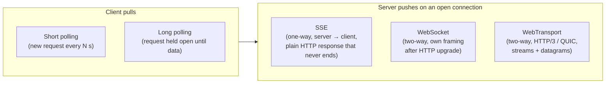

| | Short polling | Long polling | SSE | WebSocket | WebTransport |
|---|---|---|---|---|---|
| Direction | Client pulls | Client pulls (server delays answer) | Server → client | **Bidirectional** | **Bidirectional** |
| Latency | Up to the poll interval | ~1 round trip after event | Immediate | Immediate | Immediate |
| Protocol | Plain HTTP | Plain HTTP | Plain HTTP (`text/event-stream`) | `ws://` / `wss://` after `101` upgrade | HTTP/3 (QUIC) |
| Data | Any | Any | **UTF-8 text only** | Text **and binary** | Binary streams + datagrams |
| Auto-reconnect | n/a | You build it | ✅ **Built in** (`EventSource`) | ❌ You build it | ❌ You build it |
| Resume after drop | Cursor in URL | Cursor in URL | ✅ `Last-Event-ID` | You build it (sequence numbers) | You build it |
| Through proxies/firewalls | ✅ Best | ✅ Good | ✅ Good (beware buffering) | ⚠️ Usually fine; some corporate proxies break it | ⚠️ Needs UDP/HTTP/3 allowed |
| Browser support | Universal | Universal | All modern browsers | All modern browsers | Partial — check support |

---

### Section 2: Short Polling

Ask on a timer. Simple, stateless, cache-friendly — and fine more often than people admit (a build-status badge refreshed every 30 s doesn't need a socket).

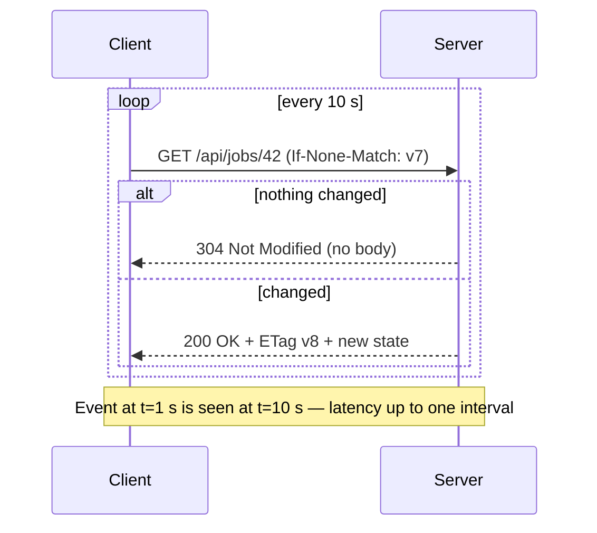

Make it cheap and polite:

```javascript
// ❌ BAD: setInterval keeps firing even if the previous request hasn't returned,
// polls in background tabs, and never backs off on errors
setInterval(() => fetch('/api/jobs/42').then(r => r.json()).then(render), 2000);

// ✅ GOOD: next poll scheduled only after the current one finishes; pauses when hidden
let timer;
async function poll(interval = 10_000) {
  if (document.visibilityState === 'hidden') return;   // resumed by visibilitychange
  try {
    const res = await fetch('/api/jobs/42', { signal: AbortSignal.timeout(8000) });
    if (res.ok) render(await res.json());               // browser cache + ETag handles 304s
  } catch { interval = Math.min(interval * 2, 60_000); } // back off on failure
  timer = setTimeout(() => poll(interval), interval);
}
document.addEventListener('visibilitychange', () => {
  clearTimeout(timer);
  if (document.visibilityState === 'visible') poll();
});
poll();
```

**Cost model:** `clients × (1 / interval)` requests per second **even when nothing changes**. 50 000 clients polling every 5 s = 10 000 requests/s of mostly "no news".

---

### Section 3: Long Polling

The server **holds** the request open until it has data **or** a timeout passes (often tens of seconds, kept below proxy/load-balancer idle timeouts), then responds. The client immediately re-requests. This was the classic "Comet" technique and is still the **fallback** many libraries use when WebSockets are blocked. Its trade-offs are documented in [RFC 6202](https://www.rfc-editor.org/rfc/rfc6202).

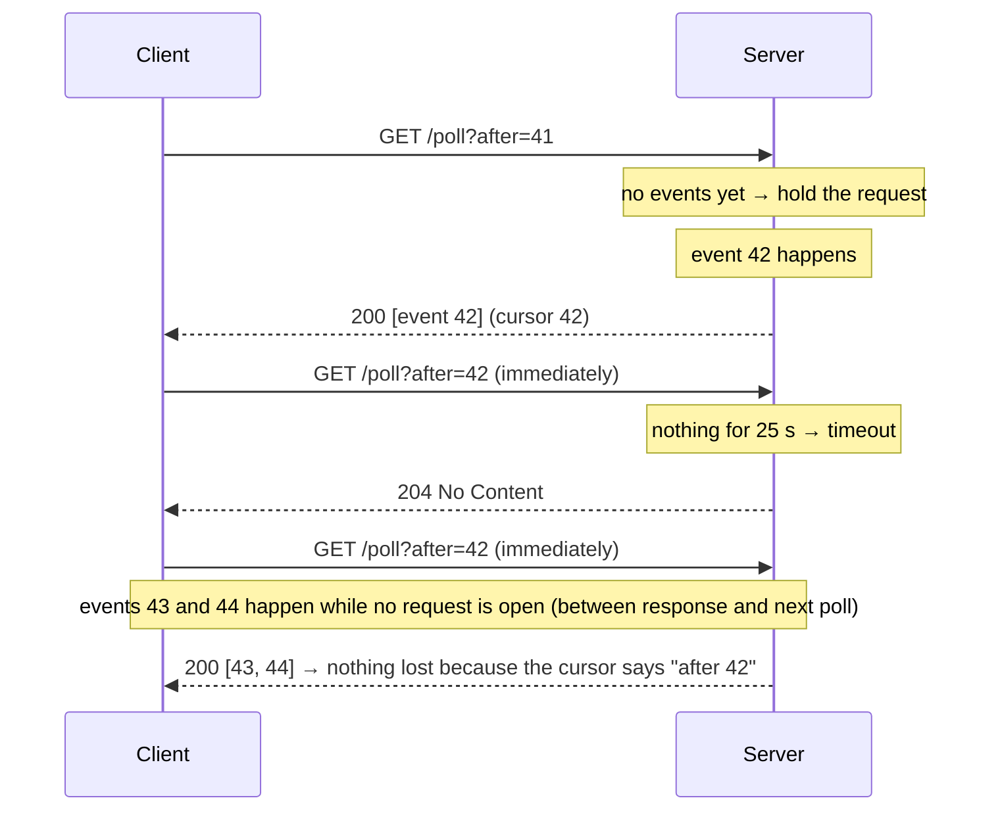

Key rules:

- **Always send a cursor** (`after=<last id>`). Events that happen *between* one response and the next request would otherwise be lost.
- The server must **buffer** recent events per channel to answer "after=42".
- Each poll is a **new HTTP request** — with HTTP/1.1 it also occupies one of the browser's ~6 connections per host while held.
- Behind a load balancer, consecutive polls may hit **different servers** → the event buffer must be shared (Redis, a log) or you need **sticky sessions** (see [System Design Angle](#system-design-angle--scaling-real-time-connections)).
- Overhead per message = full HTTP headers + a new request. Bad for high-frequency updates.

---

### Section 4: Server-Sent Events (SSE)

SSE is defined in the [HTML Living Standard](https://html.spec.whatwg.org/multipage/server-sent-events.html): the server answers a normal `GET` with `Content-Type: text/event-stream` and **never finishes the response** — it keeps writing events. The browser API is **`EventSource`**.

#### 4.1 The `EventSource` API

```javascript
const es = new EventSource('/api/notifications', { withCredentials: false });

es.onopen = () => console.log('connected');           // readyState: 0 CONNECTING → 1 OPEN
es.onmessage = (e) => render(JSON.parse(e.data));    // only events WITHOUT an "event:" field
es.addEventListener('price', (e) => {                // named events need addEventListener
  const { symbol, value } = JSON.parse(e.data);
  updatePrice(symbol, value);
  console.log('last id:', e.lastEventId);
});
es.onerror = () => {
  if (es.readyState === EventSource.CLOSED) {
    // The browser gave up (e.g. non-200 status or wrong Content-Type) — it will NOT retry.
    scheduleManualReconnect();
  }
  // readyState CONNECTING → the browser is already retrying on its own
};

// later
es.close(); // readyState → 2 CLOSED, no more reconnects
```

Limitations to know before choosing it:

- **GET only, no request body, no custom headers** (no `Authorization: Bearer …`). Cookies are sent; for cross-origin cookies use `withCredentials: true` plus CORS with credentials.
- **Text only (UTF-8).** Binary must be encoded (e.g. base64) — or use WebSockets.
- **One direction.** Client → server messages go through normal `fetch` requests.

#### 4.2 The wire format: `text/event-stream`

```text
HTTP/1.1 200 OK
Content-Type: text/event-stream
Cache-Control: no-cache

retry: 5000                        ← reconnection delay in ms for this EventSource

: this is a comment (ignored by the client — useful as a heartbeat)

id: 41
data: {"msg":"build started"}      ← default event → onmessage

id: 42
event: price                       ← named event → addEventListener('price', ...)
data: {"symbol":"ACME",
data: "value":101.5}               ← multiple data: lines are joined with "\n"

                                    ← a BLANK LINE terminates (dispatches) each event
```

| Field | Meaning |
|---|---|
| `data:` | Payload line; several lines are joined with `\n` |
| `event:` | Event type name (default `message`) |
| `id:` | Sets the **last event ID**; the browser remembers it for reconnection |
| `retry:` | Reconnection time in milliseconds |
| `: …` | Comment line — ignored; commonly used as a keep-alive |

#### 4.3 Automatic reconnection, `Last-Event-ID` and `retry`

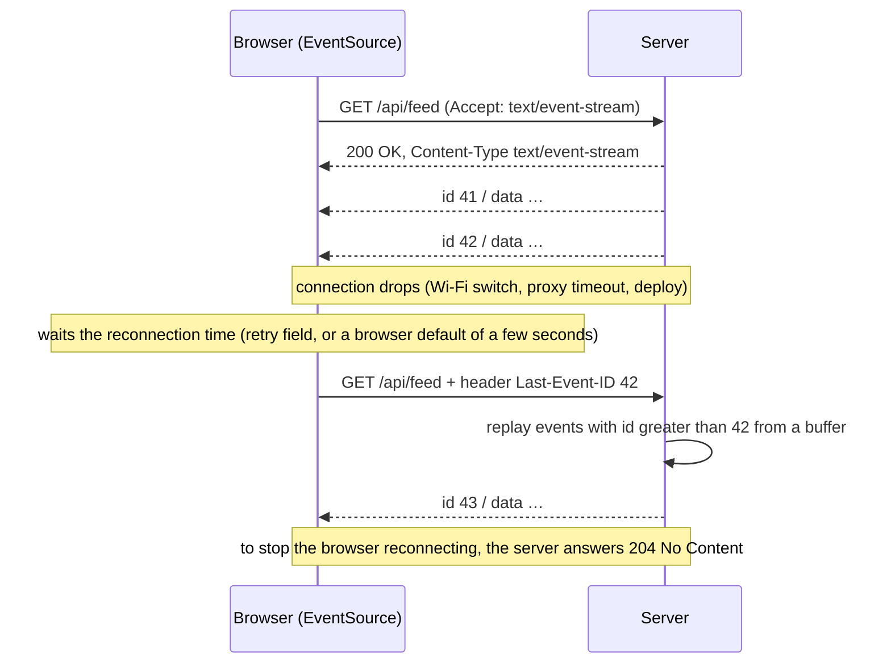

What the spec gives you **for free**: reconnect after network errors, the `Last-Event-ID` request header, and a server-controlled delay via `retry:`.

What it does **not** give you:

- **No exponential backoff** — the browser retries at the fixed reconnection time. For large audiences, raise `retry:` from the server during incidents, or manage reconnection yourself.
- **A non-200 status or a wrong `Content-Type` fails the connection permanently** (`readyState === CLOSED`, no retry). Your code must notice and decide whether to reconnect (with backoff).
- `Last-Event-ID` is only sent on the browser's **own** reconnects. If you create a **new** `EventSource` (e.g. after a manual reconnect), pass the last ID yourself (e.g. `?lastEventId=42`).
- **Replay is your server's job** — it must keep enough recent history to answer "after 42".

#### 4.4 Connection limits: HTTP/1.1 vs HTTP/2

Over **HTTP/1.1**, browsers limit concurrent connections **per host to about 6**, shared by **all tabs** of that browser. Each open `EventSource` permanently uses one. Open the app in 6 tabs and **every other request to that host stalls**. MDN documents this limit, and Chrome and Firefox have declined to raise it for SSE.

Over **HTTP/2 (and HTTP/3)**, each SSE stream is just **one multiplexed stream** on a shared connection; the limit becomes the server's `SETTINGS_MAX_CONCURRENT_STREAMS` (RFC 9113 recommends at least 100).

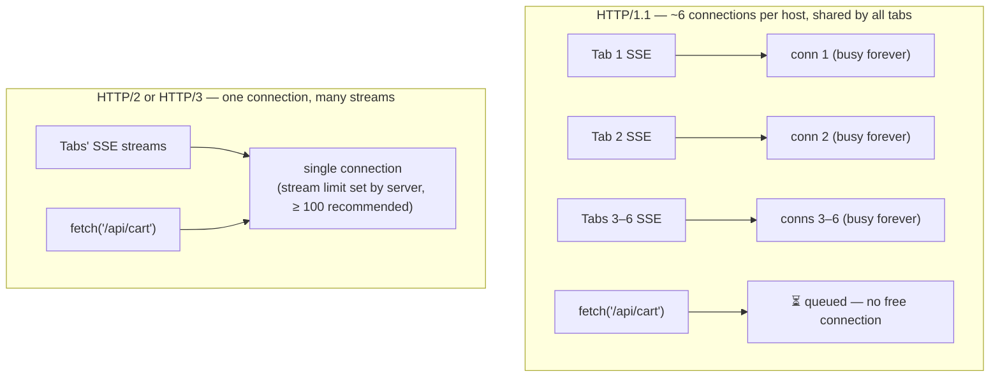

Mitigations on HTTP/1.1: serve SSE over HTTP/2+ (the real fix), share **one** connection across tabs (a `SharedWorker`, or one leader tab + `BroadcastChannel`), or host the stream on a separate subdomain.

#### 4.5 Server and proxy requirements

- Respond `200` with `Content-Type: text/event-stream` and `Cache-Control: no-cache`.
- **Flush each event immediately.** Reverse proxies and compression middleware often **buffer** responses — events then arrive in bursts or only when the connection closes. (For nginx, `X-Accel-Buffering: no` or `proxy_buffering off` on that location.)
- Send a **comment heartbeat** (`: ping`) every ~15–30 s so idle-timeout proxies and load balancers don't cut the connection.
- Keep a **replay buffer** keyed by event ID for `Last-Event-ID` resumption.
- Detect client disconnects (`req.on('close')`) and release resources.

---

### Section 5: WebSockets

A WebSocket ([RFC 6455](https://www.rfc-editor.org/rfc/rfc6455)) starts as an HTTP request and then **upgrades** the TCP (TLS) connection into a **full-duplex message channel** with its own lightweight framing. The browser API is specified in the [WHATWG WebSockets Standard](https://websockets.spec.whatwg.org/).

#### 5.1 The upgrade handshake

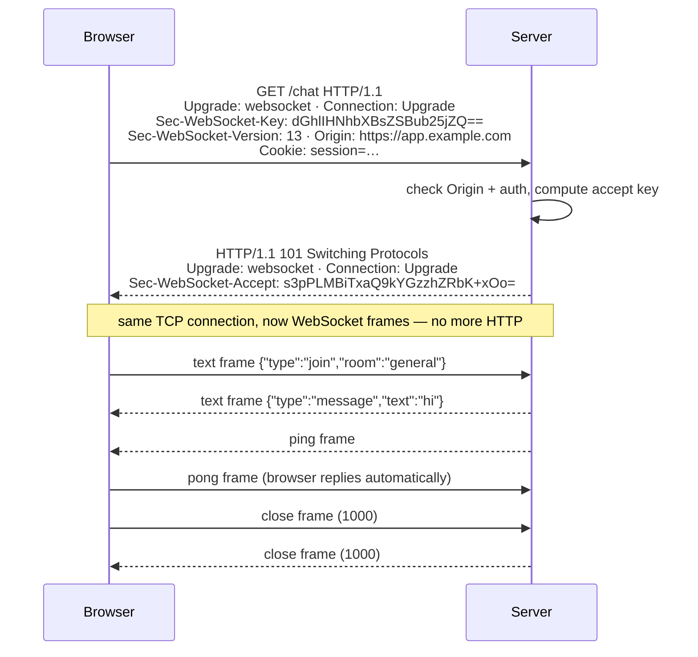

- `Sec-WebSocket-Accept` = base64(SHA-1(`Sec-WebSocket-Key` + the fixed GUID `258EAFA5-E914-47DA-95CA-C5AB0DC85B11`)). It proves the server understood the WebSocket handshake — **it is not authentication**.
- **CORS does not apply to WebSockets.** Any site can open a socket to your server, and the browser will attach your cookies. The server **must check the `Origin` header** (see Section 9).
- Optional `Sec-WebSocket-Protocol` negotiates an application sub-protocol (e.g. `graphql-transport-ws`); `Sec-WebSocket-Extensions` negotiates compression (`permessage-deflate`, RFC 7692).
- Always use **`wss://`** (TLS): it's encrypted and far less likely to be mangled by middleboxes.

#### 5.2 Frames

```text
 0                   1                   2                   3
 0 1 2 3 4 5 6 7 8 9 0 1 2 3 4 5 6 7 8 9 0 1 2 3 4 5 6 7 8 9 0 1
+-+-+-+-+-------+-+-------------+-------------------------------+
|F|R|R|R| opcode|M| Payload len |    Extended payload length    |
|I|S|S|S|  (4)  |A|     (7)     |             (16/64)           |
|N|V|V|V|       |S|             |   (if payload len==126/127)   |
| |1|2|3|       |K|             |                               |
+-+-+-+-+-------+-+-------------+ - - - - - - - - - - - - - - - +
|     Masking-key (32 bits, client→server frames only)  | Payload ...
+-------------------------------------------------------+
(from RFC 6455 §5.2 — header is 2 to 14 bytes)
```

| Opcode | Frame | Notes |
|---|---|---|
| `0x1` | Text | UTF-8 |
| `0x2` | Binary | `ArrayBuffer` / `Blob` in JS (`ws.binaryType`) |
| `0x0` | Continuation | Large messages may be fragmented (`FIN` = 0 until the last fragment) |
| `0x8` | Close | Carries a status code + reason |
| `0x9` / `0xA` | Ping / Pong | Control frames, payload ≤ 125 bytes |

- **Client → server frames are masked** (XOR with a random key) to stop cache-poisoning attacks against naive intermediaries; server → client frames are not.
- The JS API hides frames: you `send()` and receive whole **messages** (the browser reassembles fragments).

#### 5.3 Heartbeats: why you need application-level ping/pong

TCP can stay "open" for a long time after the other side is gone (laptop sleep, mobile network switch, NAT entry expired) — a **half-open connection**. Neither side gets a `close` event.

- The **server** can send protocol **ping** frames; browsers **answer with pong automatically**.
- **Browser JavaScript cannot send ping frames or observe pongs.** To detect a dead connection from the client, send an **application message** (`{"type":"ping"}`) every N seconds and expect a reply within a deadline; if none arrives, close and reconnect.
- Keep the heartbeat interval **below every idle timeout on the path** (many load balancers default to around 60 s — e.g. AWS ALB).

#### 5.4 Close codes

| Code | Meaning | Typical client reaction |
|---|---|---|
| `1000` | Normal closure | Don't reconnect (unless you expected the connection to stay up) |
| `1001` | Going away (server shutdown, page navigation) | Reconnect with backoff |
| `1006` | **Abnormal** — no close frame received (reserved; never sent on the wire) | Reconnect with backoff |
| `1008` | Policy violation | Usually don't reconnect blindly |
| `1011` | Server internal error | Reconnect with backoff |
| `1012` / `1013` | Service restart / Try again later (IANA-registered) | Reconnect with backoff (longer for 1013) |
| `4000–4999` | **Application-defined** (e.g. `4401` "auth expired") | Your protocol decides |

From JavaScript, `ws.close(code, reason)` only accepts `1000` or `3000–4999`; other codes throw an `InvalidAccessError`. An `error` event carries **no details** (by design) and is followed by a `close` event — put reconnection logic in `onclose`.

#### 5.5 Backpressure: `bufferedAmount` and `WebSocketStream`

`ws.send()` never blocks — it **queues** data and returns immediately. If you produce faster than the network drains, memory grows without limit.

```javascript
const HIGH_WATER_MARK = 1 * 1024 * 1024; // 1 MB

function sendWithBackpressure(ws, data) {
  if (ws.bufferedAmount > HIGH_WATER_MARK) {
    return false; // caller should drop/coalesce, or retry later
  }
  ws.send(data);
  return true;
}
```

- `bufferedAmount` = bytes queued by `send()` but **not yet transmitted**. Poll it to throttle *sending*.
- There is **no backpressure for receiving**: `onmessage` fires as fast as messages arrive, even if your app can't keep up (batch rendering helps — Section 10).
- **`WebSocketStream`** is a promise/Streams-based API with built-in backpressure in both directions. It is **not broadly supported** — it has shipped in Chromium-based browsers only at the time of writing. Check [MDN's compatibility table](https://developer.mozilla.org/en-US/docs/Web/API/WebSocketStream) and feature-detect (`'WebSocketStream' in globalThis`) before using it.

> **Libraries:** Socket.IO adds rooms, acknowledgements, reconnection and an HTTP long-polling fallback — but it uses **its own protocol on top of** WebSocket/HTTP: a Socket.IO client can't talk to a plain WebSocket server, and vice versa.

---

### Section 6: WebTransport (Briefly)

[WebTransport](https://www.w3.org/TR/webtransport/) is a newer browser API built on **HTTP/3 (QUIC over UDP)**:

- **Multiple independent streams** (bidirectional and unidirectional) on one connection — a lost packet only stalls **its own stream** (no TCP head-of-line blocking across streams).
- **Unreliable datagrams** — fire-and-forget messages that are not retransmitted; ideal when stale data is useless (game positions, live cursor positions, media).
- Uses the Streams API, so **backpressure is built in**.

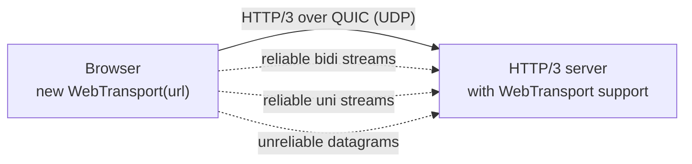

Caveats: it needs an **HTTP/3 server** with WebTransport support, UDP must be allowed by the network, and **browser support is incomplete** (it has been available in Chromium and Firefox; Safari support has lagged — check [MDN compat](https://developer.mozilla.org/en-US/docs/Web/API/WebTransport_API) before relying on it). For most product UIs, WebSockets or SSE remain the pragmatic default; keep a fallback if you adopt WebTransport.

---

### Section 7: Reconnection — Exponential Backoff and Jitter

Connections **will** drop: deploys, mobile handoffs, laptop sleep, proxies. A reconnection strategy must avoid two failure modes:

1. **Hammering** — reconnecting instantly in a loop while the server is down.
2. **Thundering herd** — a deploy drops 100 000 sockets and **all** clients reconnect at the same moment, overloading the servers that just came back.

**Exponential backoff** spaces retries out (0.5 s, 1 s, 2 s, 4 s… up to a cap); **jitter** randomises each delay so clients spread out. "Full jitter" (from the AWS Architecture Blog analysis):

```text
delay = random(0, min(cap, base × 2^attempt))
e.g. base = 500 ms, cap = 30 s:
attempt 0 → 0–0.5 s · 1 → 0–1 s · 2 → 0–2 s · 3 → 0–4 s · … · 6+ → 0–30 s
```

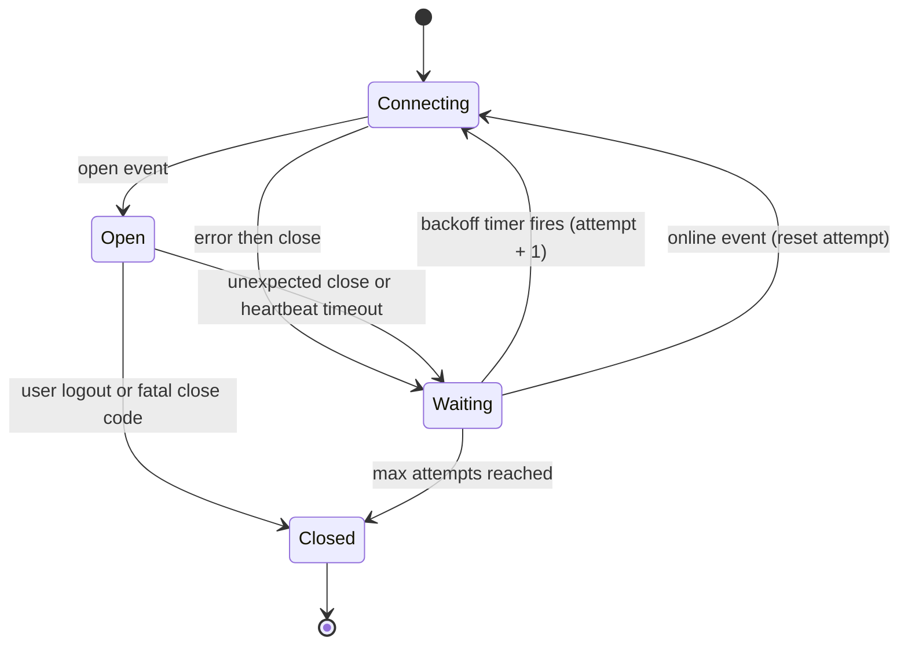

Rules that make it production-grade:

- **Reset the attempt counter only after the connection has been stable** (e.g. open for 10 s or first message received) — otherwise a server that accepts then immediately drops you causes a tight loop.
- **Don't reconnect on fatal codes** (auth rejected, policy violation) — fix the cause first (e.g. refresh the token).
- Listen for **`online`/`offline`**: stop retrying while offline, reconnect immediately when back online.
- Consider pausing non-essential connections when the tab is **hidden** for a long time, and close them on `pagehide` — open connections can make a page ineligible for the back/forward cache in some browsers.
- Respect server hints: SSE `retry:`, close code `1013` (try again later), `Retry-After` on HTTP fallbacks.
- **Show connection state in the UI** ("Reconnecting…", stale-data indicators) instead of silently showing old data.
- After reconnecting, **resync** missed data (Section 8).

---

### Section 8: Message Ordering, Gaps and Deduplication

- **Within one connection** TCP (and therefore SSE and WebSocket) delivers messages **in order**.
- **Across reconnects, multiple connections or multiple servers**, nothing is guaranteed: messages can be **lost** (sent while you were disconnected), **duplicated** (replayed after resume), or **reordered** (an HTTP response and a socket push racing).

The standard toolkit:

| Tool | How |
|---|---|
| **Sequence numbers** | Server stamps each message per stream/channel: `seq: 1042`. Client tracks `lastSeq`. |
| **Gap detection** | Got `seq 1045` but `lastSeq` is `1042` → missing 1043–1044 → fetch them (`GET /events?after=1042`) or refetch a snapshot. |
| **Dedup** | Ignore `seq ≤ lastSeq`, or keep a bounded set of recent message IDs. |
| **Idempotent apply** | Updates carry absolute values or versions (`{id, version, fields}`) rather than deltas like "+1", so applying twice is harmless. |
| **Resume token** | `Last-Event-ID` (SSE) or `{type:'resume', after: lastSeq}` (WebSocket) on reconnect. |
| **Client-generated IDs** | For messages the client sends (chat), a `clientMsgId` lets the server dedupe retries and lets the UI match the echo to the optimistic message. |

**Snapshot + delta** — the safe way to start (or restart) a live view:

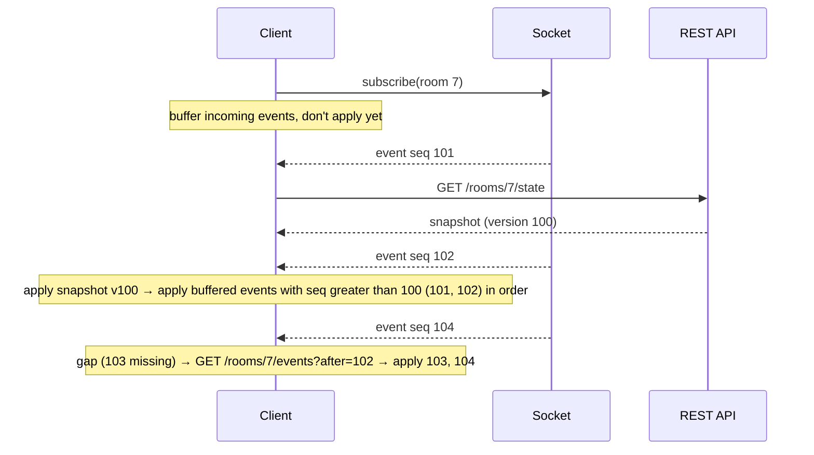

Subscribe **before** fetching the snapshot; otherwise events that happen between the snapshot and the subscription are lost.

---

### Section 9: Authentication on Connect

Browser constraint: **neither `new WebSocket()` nor `new EventSource()` lets you set custom headers** (no `Authorization: Bearer …`). Options:

| Approach | How | Pros | Cons / must-do |
|---|---|---|---|
| **Cookies** (session, `HttpOnly`, `Secure`, `SameSite`) | Sent automatically on the handshake (WebSocket) / request (SSE) | Simplest; token never exposed to JS | **Must validate `Origin`** on the server — otherwise **Cross-Site WebSocket Hijacking (CSWSH)**: a malicious page opens a socket and the browser attaches the victim's cookies |
| **Short-lived ticket in the URL** | `POST /ws-ticket` (authenticated) → `wss://…/ws?ticket=abc` | Works cross-domain, no cookies | Ticket must be **single-use and expire in seconds** — URLs end up in logs |
| **First-message auth** | Connect, then send `{type:'auth', token}` | Token not in URL or logs | Server must accept **nothing else** before auth and close unauthenticated sockets after a short timeout |
| **`fetch`-based SSE** | Stream with `fetch()` (Section 11) | Can send `Authorization` header and a POST body | No built-in reconnect — you implement it |

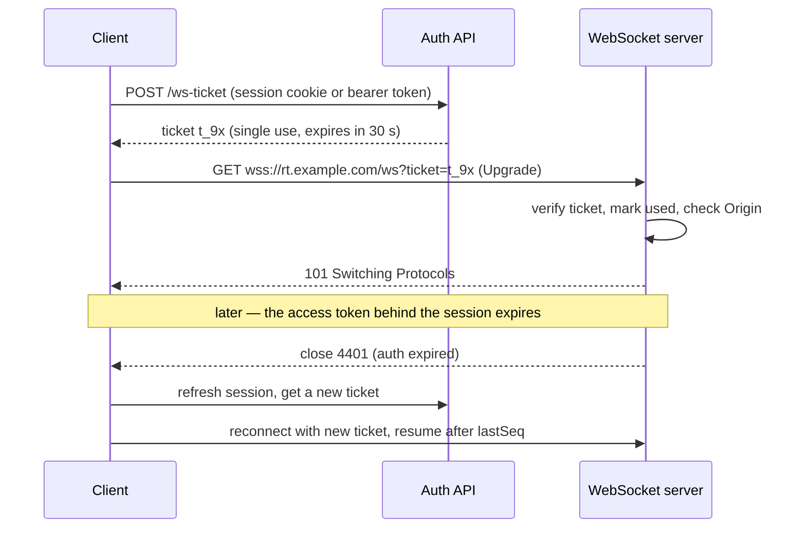

Long-lived connections outlive tokens: the server should **re-check authorization** (on a timer or on permission changes) and close with an app-specific code; the client refreshes credentials and reconnects. **Authorize every subscription** (can this user join room 7?), not just the connection.

---

### Section 10: Batching UI Updates with requestAnimationFrame

A trading dashboard may receive hundreds of messages per second. Updating the DOM (or React state) **per message** causes far more work than the screen can show — a display only refreshes once per frame. Batch to **at most one render per frame**:

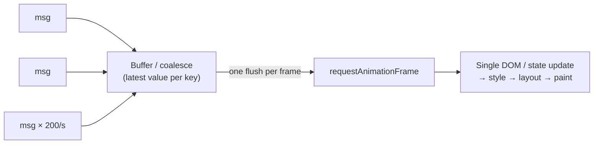

```javascript
// Coalesce by key: only the latest price per symbol matters
const pending = new Map();
let scheduled = false;

socket.onmessage = (e) => {
  const { symbol, price } = JSON.parse(e.data);
  pending.set(symbol, price);                 // overwrite older values
  if (!scheduled) {
    scheduled = true;
    requestAnimationFrame(flush);
  }
};

function flush() {
  scheduled = false;
  for (const [symbol, price] of pending) updateRow(symbol, price);
  pending.clear();
}
```

- **Coalescing by key** keeps memory bounded. This matters because **`requestAnimationFrame` does not run in hidden tabs** — a plain append-only array would grow until the user returns.
- For events that must **all** be shown (chat messages), append them in one batch per frame rather than dropping any.
- In React, apply the whole batch with **one** state update; React 18+ also batches updates automatically, but parsing and reconciling 200 separate updates still costs CPU.
- Very heavy parsing (large binary payloads) can move to a **Web Worker** that posts batched results to the main thread.

---

### Section 11: Streaming LLM Tokens (SSE over fetch)

AI chat UIs stream tokens as they are generated. Many LLM APIs use the **`text/event-stream` format** in response to a **POST** (the prompt is in the body). `EventSource` can't send a POST or an `Authorization` header, so the client reads the stream with **`fetch` + `ReadableStream`** and parses the SSE format itself.

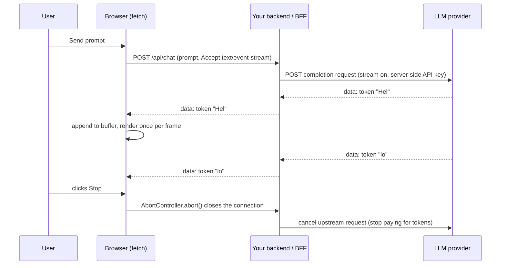

Design points:

- Proxy through **your backend** so the provider API key never reaches the browser; the backend can also enforce quotas and log usage.
- **Chunks ≠ events.** A network chunk can contain several events or half of one — buffer until the blank-line separator.
- **Stop button** = `AbortController.abort()`; the server must detect the closed connection and cancel the upstream request.
- **Render cost grows with the answer:** re-parsing Markdown on every token is O(n²) work over a long answer — batch per frame and parse incrementally where possible.
- **Accessibility:** don't make screen readers announce every token; announce completion (or use a polite live region with throttled updates).
- **Buffering proxies** break streaming exactly as for SSE (Section 4.5).
- Plain `fetch` streams have **no automatic resume**; if resumability matters, persist the generation server-side with an ID and support "continue from offset".
- For a library rather than a hand-written parser: [`eventsource-parser`](https://github.com/rexxars/eventsource-parser) or [`@microsoft/fetch-event-source`](https://github.com/Azure/fetch-event-source).

---

## System Design Angle — Scaling Real-Time Connections

Real-time connections make servers **stateful**: each open socket lives on **one** server process and holds memory and a file descriptor for as long as the user is online.

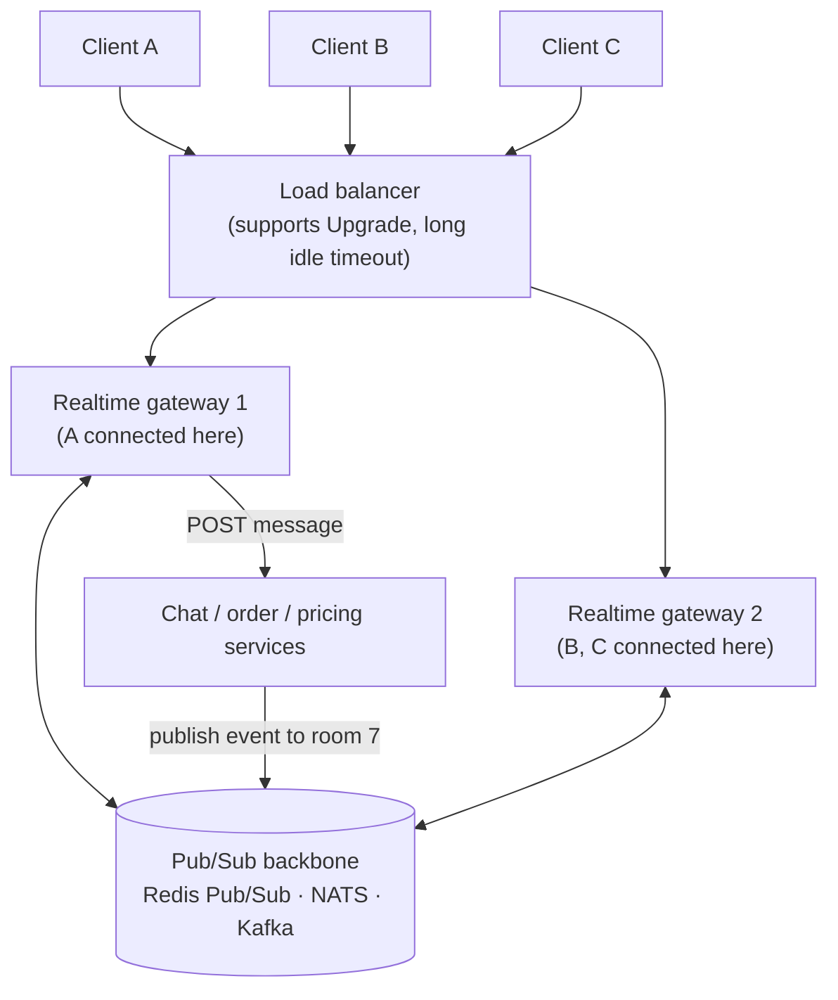

| Concern | What to do |
|---|---|
| **Fan-out across servers** | User A (gateway 1) sends to room 7; members are on gateway 2 → gateways **subscribe to a pub/sub backbone** and forward to their local sockets |
| **Sticky sessions** | Needed when one logical session spans **multiple HTTP requests** (long polling; Socket.IO's handshake/polling transport). A single WebSocket is already pinned to one server for its lifetime. Prefer **stateless gateways** + resumable streams over stickiness |
| **Load balancer** | Must support the `Upgrade` handshake (WebSocket) and unbuffered streaming (SSE); idle timeout longer than your heartbeat |
| **Deploys** | Drain gracefully: stop accepting, send close `1012`/`1001`, let clients reconnect **with jitter** to other instances |
| **Separation** | Run connection gateways separately from business services so a deploy of business logic doesn't drop every socket |
| **Per-connection limits** | Bound queues per socket; disconnect slow consumers instead of buffering forever |
| **Capacity** | Plan by **concurrent connections** and **messages/second**, not requests/second; tune OS file-descriptor limits |
| **Build vs buy** | Managed real-time services or serverless WebSocket gateways remove connection management at a cost per message/connection |

Frontend-side scaling decisions: **one connection per app, not per component** (multiplex subscriptions over it); share one connection across tabs where it matters (`SharedWorker` / `BroadcastChannel` leader election); unsubscribe from channels when views unmount.

---

## Decision Matrix — Choosing a Transport

| Use case | Recommended | Why |
|---|---|---|
| Notifications, activity feed, live scores | **SSE** | One-way, auto-reconnect + resume built in, plain HTTP |
| Streaming AI responses | **`fetch` stream (SSE format)** | Needs POST body + auth header; one request per answer |
| Chat, presence, typing indicators | **WebSocket** | Frequent messages in both directions |
| Collaborative editing (CRDT/OT sync) | **WebSocket** | Low-latency bidirectional, binary support |
| Live dashboard with high-frequency ticks | **WebSocket** (or SSE if one-way) + rAF batching | Push + coalescing |
| Multiplayer game state, live media | **WebTransport** (with WebSocket fallback) | Unreliable datagrams, no head-of-line blocking |
| Job status every 30 s, low traffic | **Short polling** + ETag | Simplest; cacheable; stateless servers |
| Restrictive corporate networks | **Long polling** fallback | Works anywhere plain HTTP works |
| GraphQL subscriptions | `graphql-ws` (WebSocket) or GraphQL over SSE | Matches the API layer from the [previous note](./rest-vs-graphql-vs-grpc-web.md) |

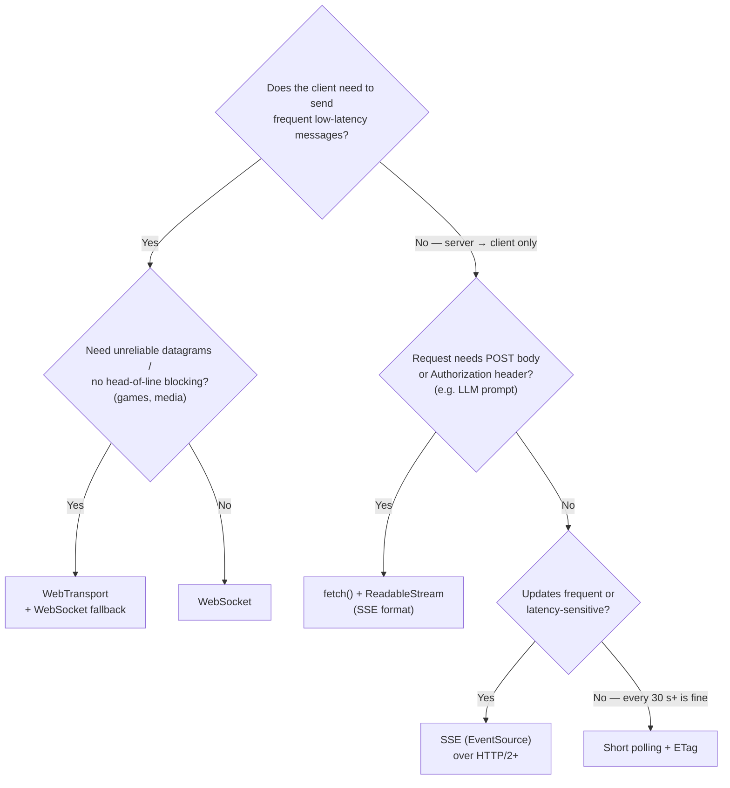

---

## Real-World Examples

**Example 1 — Resilient `EventSource` with typed events and manual recovery:**
```javascript
function subscribeToFeed({ onEvent, onStatus }) {
  let es;
  let lastEventId = null;
  let attempt = 0;
  let retryTimer;

  const connect = () => {
    const url = new URL('/api/feed', location.origin);
    if (lastEventId) url.searchParams.set('lastEventId', lastEventId); // new EventSource → pass it ourselves
    es = new EventSource(url);
    onStatus('connecting');

    es.onopen = () => { attempt = 0; onStatus('open'); };
    es.addEventListener('update', (e) => {
      lastEventId = e.lastEventId || lastEventId;
      onEvent(JSON.parse(e.data));
    });
    es.onerror = () => {
      if (es.readyState === EventSource.CONNECTING) { onStatus('reconnecting'); return; } // browser retries
      // CLOSED: the browser gave up (e.g. HTTP 500/401, wrong Content-Type) → our own backoff
      onStatus('reconnecting');
      const delay = Math.random() * Math.min(30_000, 500 * 2 ** attempt++);
      retryTimer = setTimeout(connect, delay);
    };
  };

  connect();
  return () => { clearTimeout(retryTimer); es?.close(); onStatus('closed'); };
}
```

**Example 2 — A minimal SSE endpoint (Node.js, no framework):**
```javascript
import http from 'node:http';

const history = []; // [{ id, data }] — in production: Redis stream / DB log
let nextId = 1;
const clients = new Set();

export function publish(data) {
  const event = { id: nextId++, data: JSON.stringify(data) };
  history.push(event);
  if (history.length > 1000) history.shift();
  for (const res of clients) res.write(`id: ${event.id}\nevent: update\ndata: ${event.data}\n\n`);
}

http.createServer((req, res) => {
  const url = new URL(req.url, 'http://localhost');
  if (url.pathname !== '/api/feed') { res.writeHead(404).end(); return; }

  res.writeHead(200, {
    'Content-Type': 'text/event-stream',
    'Cache-Control': 'no-cache',
    'X-Accel-Buffering': 'no',           // ask nginx not to buffer
  });
  res.write('retry: 3000\n\n');

  // Resume: header on browser auto-reconnect, query param on manual reconnect
  const lastId = Number(req.headers['last-event-id'] ?? url.searchParams.get('lastEventId') ?? 0);
  for (const e of history) if (e.id > lastId) res.write(`id: ${e.id}\nevent: update\ndata: ${e.data}\n\n`);

  clients.add(res);
  const heartbeat = setInterval(() => res.write(': ping\n\n'), 15_000);
  req.on('close', () => { clearInterval(heartbeat); clients.delete(res); });
}).listen(3000);
```

**Example 3 — WebSocket wrapper: backoff + jitter, heartbeat, ticket auth, send queue:**
```typescript
type Status = 'connecting' | 'open' | 'reconnecting' | 'closed';

export class LiveSocket {
  private ws?: WebSocket;
  private attempt = 0;
  private openedAt = 0;
  private lastPong = 0;
  private stopped = true;                          // true until connect() is called
  private outbox: string[] = [];
  private reconnectTimer?: ReturnType<typeof setTimeout>;
  private heartbeatTimer?: ReturnType<typeof setInterval>;

  constructor(
    private getUrl: () => Promise<string>,          // e.g. fetches a fresh single-use ticket
    private onMessage: (msg: { type: string; seq?: number }) => void,
    private onStatus: (s: Status) => void = () => {},
  ) {
    window.addEventListener('online', () => { this.attempt = 0; this.reconnectNow(); });
  }

  async connect() {
    this.stopped = false;
    this.onStatus(this.attempt === 0 ? 'connecting' : 'reconnecting');
    let url: string;
    try { url = await this.getUrl(); } catch { return this.scheduleReconnect(); }
    if (this.stopped) return;

    const ws = new WebSocket(url);
    this.ws = ws;
    ws.onopen = () => {
      this.openedAt = this.lastPong = Date.now();
      this.onStatus('open');
      this.startHeartbeat();
      this.flushOutbox();
    };
    ws.onmessage = (e) => {
      const msg = JSON.parse(e.data);
      if (msg.type === 'pong') { this.lastPong = Date.now(); return; }
      this.onMessage(msg);
    };
    ws.onclose = (e) => {
      this.stopHeartbeat();
      if (Date.now() - this.openedAt > 10_000) this.attempt = 0; // reset only after a STABLE connection
      if (this.stopped || e.code === 1008) { this.onStatus('closed'); return; } // fatal: don't loop
      this.scheduleReconnect();                                  // 4401 etc: getUrl() fetches new credentials
    };
    // 'error' is always followed by 'close' → no reconnect logic here
  }

  send(msg: object) {
    const data = JSON.stringify(msg);
    if (this.ws?.readyState === WebSocket.OPEN && this.ws.bufferedAmount < 1_000_000) this.ws.send(data);
    else if (this.outbox.length < 500) this.outbox.push(data);   // bounded queue
  }

  close() {
    this.stopped = true;
    clearTimeout(this.reconnectTimer);
    this.ws?.close(1000, 'client closed');
  }

  private scheduleReconnect() {
    this.onStatus('reconnecting');
    const delay = Math.random() * Math.min(30_000, 500 * 2 ** this.attempt++); // full jitter
    clearTimeout(this.reconnectTimer);
    this.reconnectTimer = setTimeout(() => this.connect(), delay);
  }

  private reconnectNow() {
    const state = this.ws?.readyState;
    if (this.stopped || state === WebSocket.OPEN || state === WebSocket.CONNECTING) return;
    clearTimeout(this.reconnectTimer);
    this.connect();
  }

  private startHeartbeat() {
    this.heartbeatTimer = setInterval(() => {
      if (Date.now() - this.lastPong > 45_000) {         // no pong → half-open connection
        const dead = this.ws!;
        dead.onclose = null;                              // don't wait for a close that may never come
        dead.close();
        this.stopHeartbeat();
        this.scheduleReconnect();
        return;
      }
      this.ws?.send(JSON.stringify({ type: 'ping' }));
    }, 20_000);
  }

  private stopHeartbeat() { clearInterval(this.heartbeatTimer); }

  private flushOutbox() {
    while (this.outbox.length && this.ws?.readyState === WebSocket.OPEN) this.ws.send(this.outbox.shift()!);
  }
}

// Usage
const socket = new LiveSocket(
  async () => {
    const { ticket } = await fetch('/api/ws-ticket', { method: 'POST' }).then((r) => r.json());
    return `wss://rt.example.com/ws?ticket=${encodeURIComponent(ticket)}`;
  },
  (msg) => store.apply(msg),          // store dedupes by seq and detects gaps (Section 8)
  (s) => setBanner(s),
);
socket.connect();
```

**Example 4 — Streaming LLM tokens with `fetch`, abort and per-frame rendering:**
```javascript
// ❌ BAD: EventSource can't POST the prompt or send Authorization; and rendering per token is wasteful
// const es = new EventSource('/api/chat?prompt=' + encodeURIComponent(longPrompt));

// ✅ GOOD
async function streamChat(prompt, { onText, signal }) {
  const res = await fetch('/api/chat', {
    method: 'POST',
    headers: { 'Content-Type': 'application/json', Accept: 'text/event-stream' },
    body: JSON.stringify({ prompt }),
    signal,
  });
  if (!res.ok || !res.body) throw new Error(`HTTP ${res.status}`);

  const reader = res.body.pipeThrough(new TextDecoderStream()).getReader();
  let buffer = '';
  for (;;) {
    const { value, done } = await reader.read();
    if (done) break;
    buffer += value;
    let boundary;
    // Simplified parser: assumes "\n" line endings. Use eventsource-parser in production.
    while ((boundary = buffer.indexOf('\n\n')) !== -1) {
      const rawEvent = buffer.slice(0, boundary);
      buffer = buffer.slice(boundary + 2);
      const data = rawEvent.split('\n')
        .filter((line) => line.startsWith('data:'))
        .map((line) => line.slice(5).replace(/^ /, ''))
        .join('\n');
      if (!data) continue;
      if (data === '[DONE]') return;          // sentinel used by some APIs — follow your API's docs
      onText(JSON.parse(data).text);          // payload shape depends on your backend
    }
  }
}

// UI wiring: batch tokens per animation frame, Stop button aborts
const controller = new AbortController();
stopButton.onclick = () => controller.abort();

let pendingText = '';
let frameRequested = false;
streamChat(promptInput.value, {
  signal: controller.signal,
  onText(text) {
    pendingText += text;
    if (frameRequested) return;
    frameRequested = true;
    requestAnimationFrame(() => {
      frameRequested = false;
      answerEl.append(pendingText);          // one DOM write per frame
      pendingText = '';
    });
  },
}).catch((err) => { if (err.name !== 'AbortError') showError(err); });
```

---

## Key Points Summary

| Concept | One-Line Explanation |
|---|---|
| **Short polling** | Request on a timer; simple, cacheable, wasteful, latency ≤ interval |
| **Long polling** | Server holds the request until data/timeout; client re-requests with a cursor |
| **SSE** | One-way server → client stream over HTTP (`text/event-stream`), UTF-8 only |
| **EventSource** | Browser SSE client: auto-reconnect, `Last-Event-ID`, `retry:`; GET only, no custom headers |
| **HTTP/1.1 limit** | ~6 connections per host shared across tabs — SSE over HTTP/1.1 exhausts them; HTTP/2 multiplexes |
| **WebSocket** | Full-duplex framed messages after an HTTP `101` upgrade (RFC 6455) |
| **Heartbeat** | App-level ping/pong to detect half-open connections and keep proxies from timing out |
| **`bufferedAmount`** | Bytes queued by `send()` — the only send-side backpressure signal in the classic API |
| **WebSocketStream** | Streams-based WebSocket with backpressure; Chromium-only at the time of writing |
| **WebTransport** | HTTP/3/QUIC streams + unreliable datagrams; incomplete browser support |
| **Backoff + jitter** | `random(0, min(cap, base × 2^n))` — avoids hammering and thundering herds |
| **Sequence numbers** | Detect gaps, drop duplicates, resume after reconnect |
| **Snapshot + delta** | Subscribe, buffer, fetch snapshot, apply events newer than its version |
| **CSWSH** | Cookies are sent on WebSocket handshakes and CORS doesn't apply → validate `Origin` |
| **rAF batching** | Coalesce many messages into ≤ 1 render per frame |
| **LLM streaming** | `fetch` + `ReadableStream` parsing SSE format; abort to stop; batch renders |
| **Pub/sub fan-out** | Gateways subscribe to a shared backbone so any server can reach any connected user |

---

## Test Your Understanding

**Q1 (Basic):**
What does long polling do differently from short polling, and why must a long-polling client send a cursor?

<details>
<summary>Answer</summary>

Short polling asks on a fixed timer and the server answers immediately (usually "no change"). Long polling sends a request that the **server holds open** until there is data or a timeout, so the client learns about an event about one round trip after it happens, with far fewer empty responses.

The cursor (`?after=42`) is needed because there is always a **window between one response and the next request** where no request is open. Events in that window would be lost unless the server can answer "everything after 42" from a buffer.
</details>

**Q2 (Basic):**
List three things `EventSource` gives you for free and three limitations.

<details>
<summary>Answer</summary>

**Free:** automatic reconnection after network errors; the `Last-Event-ID` header on reconnect (from the last `id:` field); server-controlled reconnection delay via `retry:`; named events via `event:`; plain HTTP that works with existing auth cookies, proxies and HTTP/2 multiplexing.

**Limitations:** **GET only** with no request body and **no custom headers** (no bearer token); **UTF-8 text only**; **one-way**; a non-200 response or wrong `Content-Type` closes it **permanently**; no exponential backoff; over HTTP/1.1 each stream holds one of ~6 per-host connections shared by all tabs.
</details>

**Q3 (Application):**
Users report the app "freezes" after opening it in several tabs. Each tab opens an `EventSource`, and the site is served over HTTP/1.1. Explain and fix.

<details>
<summary>Answer</summary>

Browsers allow about **6 concurrent HTTP/1.1 connections per host**, shared across **all tabs**. Each `EventSource` holds one connection open forever, so with ~6 tabs every connection is occupied and **all other requests to that host queue** (API calls, images) — the app appears frozen.

Fixes: serve over **HTTP/2 or HTTP/3**, where SSE streams are multiplexed on one connection (limit set by `SETTINGS_MAX_CONCURRENT_STREAMS`, typically 100+); or share one stream across tabs (`SharedWorker`, or one leader tab relaying via `BroadcastChannel`); or move the stream to a separate subdomain as a stopgap.
</details>

**Q4 (Application):**
A deploy restarts all WebSocket servers at once. Within a second, 200 000 clients reconnect and the new servers fall over. What went wrong in the client design, and what's the fix?

<details>
<summary>Answer</summary>

Clients reconnected **immediately and simultaneously** — a **thundering herd**. Even fixed exponential backoff (1 s, 2 s, 4 s…) keeps clients synchronised, because they all disconnected at the same moment.

Fix: **exponential backoff with jitter** — e.g. full jitter `delay = random(0, min(cap, base × 2^attempt))` — so reconnections spread over time; reset the attempt counter only after a **stable** connection; on the server side, **drain gracefully** (rolling restarts, close codes `1012`/`1013`, maybe a server-suggested delay). Also resync state after reconnect with sequence numbers rather than re-downloading everything at once.
</details>

**Q5 (Tricky):**
Your WebSocket server authenticates users with the session cookie and nothing else. Is that safe?

<details>
<summary>Answer</summary>

Not by itself. **CORS does not apply to WebSockets**, and the browser attaches the user's cookies to the handshake for the target host (subject to `SameSite` rules). A malicious page could open `wss://your-app/ws` and act as the victim — **Cross-Site WebSocket Hijacking (CSWSH)**.

Make it safe by **validating the `Origin` header** against an allowlist during the handshake, using `SameSite` cookies, and/or requiring a **CSRF-style token or a short-lived single-use ticket** obtained via an authenticated same-origin request. Also authorize each **subscription** (room/channel), and re-check permissions over the connection's lifetime since sessions can be revoked.
</details>

**Q6 (System design):**
Design the client side of a live stock dashboard: 500 symbols, ~300 updates/s, must survive network drops and never show silently stale prices.

<details>
<summary>Answer</summary>

- **Transport:** server → client only → **SSE over HTTP/2** is enough (or a WebSocket if the client also changes subscriptions frequently — with SSE, subscription changes go through normal `fetch` calls).
- **One connection** for the app, multiplexing all symbols; subscribe only to visible symbols where possible.
- **Messages carry `seq` per stream and absolute values** (`{symbol, price, seq}`) → idempotent; detect gaps → refetch a snapshot.
- **Startup:** subscribe → buffer → fetch snapshot → apply events newer than the snapshot version.
- **Rendering:** coalesce into a `Map<symbol, price>` and flush **once per `requestAnimationFrame`** — bounded memory even when the tab is hidden; virtualize the table.
- **Resilience:** heartbeats (SSE comments or app pings), reconnection with **backoff + jitter**, `Last-Event-ID`/`seq` resume, `online`/`offline` handling.
- **No silent staleness:** show connection status, timestamp the last update, grey out prices older than N seconds.
</details>

---

## Cheat Sheet

**Key Definitions:**
- **Short polling:** timed requests; **long polling:** server holds the request until data or timeout.
- **SSE:** `text/event-stream` over HTTP; `EventSource` client; fields `data`, `event`, `id`, `retry`, `:` comment.
- **WebSocket:** RFC 6455; `GET` + `Upgrade: websocket` → `101 Switching Protocols` → frames (text, binary, ping, pong, close).
- **Half-open connection:** one side is gone but TCP hasn't noticed — detect with heartbeats.
- **Backpressure:** slowing the producer when the consumer/network can't keep up (`bufferedAmount`, Streams APIs).
- **Full jitter:** `delay = random(0, min(cap, base × 2^attempt))`.
- **CSWSH:** cross-site WebSocket hijacking via automatically attached cookies — validate `Origin`.

**Quick Reference — transport choice:**
```text
Server → client, GET, cookies OK ........... SSE (EventSource) over HTTP/2+
Server → client, needs POST/auth header .... fetch() + ReadableStream (SSE format)  ← LLM streaming
Two-way, frequent, text or binary .......... WebSocket (wss://) + heartbeat + backoff
Games / media / lossy-OK datagrams ......... WebTransport (check support) + fallback
Rare updates (≥ 30 s), simple infra ........ short polling + ETag/304
Hostile proxies / legacy fallback .......... long polling with cursor
```

**Quick Reference — SSE event and WebSocket close codes:**
```text
SSE:   id: 42\nevent: price\ndata: {"symbol":"ACME"}\n\n     (blank line ends the event)
       retry: 5000\n\n  → reconnect delay   ·  ": ping\n\n" → heartbeat comment
       server answers 204 → browser stops reconnecting
WS:    1000 normal · 1001 going away · 1006 abnormal (never sent) · 1008 policy
       1011 server error · 1012 restart · 1013 try later · 4000–4999 app-defined
       JS close() accepts only 1000 or 3000–4999
```

**Common Mistakes to Avoid:**

| Mistake | Why Wrong | Fix |
|---|---|---|
| WebSocket for one-way notifications | Extra complexity: own reconnection, auth, LB config | SSE / streamed fetch |
| SSE over HTTP/1.1 in many tabs | ~6 connections per host shared by tabs → app stalls | HTTP/2+, share one stream across tabs |
| Reconnecting instantly / without jitter | Hammering + thundering herd after deploys | Exponential backoff with full jitter, cap |
| Resetting backoff on `open` | Accept-then-drop servers cause tight loops | Reset after a stable period or first message |
| Assuming `onerror` means "will retry" for SSE | Non-200 / wrong type closes it permanently | Check `readyState === CLOSED`, reconnect yourself |
| No heartbeat | Half-open sockets look "connected"; proxies cut idle connections | App-level ping/pong below idle timeouts |
| Relying only on cookies for WebSocket auth | CSWSH — CORS doesn't protect sockets | Validate `Origin`, tickets/tokens, authorize subscriptions |
| Long-lived tokens in `wss://…?token=` | URLs are logged | Single-use, seconds-long tickets or first-message auth |
| Fetching snapshot before subscribing | Events between the two are lost | Subscribe → buffer → snapshot → apply newer |
| No sequence numbers | Can't detect gaps or duplicates after reconnect | `seq` per stream + resume token |
| Rendering every message | Wasted layout/paint, jank, poor INP | Coalesce + one flush per `requestAnimationFrame` |
| Unbounded buffers in hidden tabs | rAF doesn't run when hidden → memory grows | Coalesce by key, bound queues |
| Ignoring `bufferedAmount` | Memory grows on slow networks | Throttle/drop when above a threshold |
| Buffering proxy in front of SSE/LLM streams | Events arrive in bursts or at the end | Disable proxy buffering/compression for streams |
| Stop button that only hides the UI | Server keeps generating (and billing) tokens | `AbortController.abort()` + server cancels upstream |

---

## References & Further Reading

**Core docs**
- MDN: [Using server-sent events](https://developer.mozilla.org/en-US/docs/Web/API/Server-sent_events/Using_server-sent_events) · [`EventSource`](https://developer.mozilla.org/en-US/docs/Web/API/EventSource)
- MDN: [The WebSocket API](https://developer.mozilla.org/en-US/docs/Web/API/WebSockets_API) · [Writing WebSocket servers](https://developer.mozilla.org/en-US/docs/Web/API/WebSockets_API/Writing_WebSocket_servers)
- MDN: [`WebSocket.bufferedAmount`](https://developer.mozilla.org/en-US/docs/Web/API/WebSocket/bufferedAmount) · [`CloseEvent.code`](https://developer.mozilla.org/en-US/docs/Web/API/CloseEvent/code) · [`WebSocketStream`](https://developer.mozilla.org/en-US/docs/Web/API/WebSocketStream)
- MDN: [WebTransport API](https://developer.mozilla.org/en-US/docs/Web/API/WebTransport_API)
- MDN: [Using readable streams](https://developer.mozilla.org/en-US/docs/Web/API/Streams_API/Using_readable_streams) · [`AbortController`](https://developer.mozilla.org/en-US/docs/Web/API/AbortController)
- web.dev: [Stream updates with server-sent events](https://web.dev/articles/eventsource-basics) · [Back/forward cache](https://web.dev/articles/bfcache)
- Chrome for Developers: [WebSocketStream](https://developer.chrome.com/docs/capabilities/web-apis/websocketstream) · [Using WebTransport](https://developer.chrome.com/docs/capabilities/web-apis/webtransport)

**Specs**
- WHATWG HTML Living Standard: [Server-sent events](https://html.spec.whatwg.org/multipage/server-sent-events.html)
- IETF: [RFC 6455 — The WebSocket Protocol](https://www.rfc-editor.org/rfc/rfc6455) · [RFC 7692 — permessage-deflate](https://www.rfc-editor.org/rfc/rfc7692) · [RFC 8441 — WebSockets over HTTP/2](https://www.rfc-editor.org/rfc/rfc8441)
- WHATWG: [WebSockets Standard (browser API)](https://websockets.spec.whatwg.org/)
- IANA: [WebSocket close code registry](https://www.iana.org/assignments/websocket/websocket.xhtml)
- IETF: [RFC 6202 — Known Issues and Best Practices for Long Polling and Streaming](https://www.rfc-editor.org/rfc/rfc6202)
- IETF: [RFC 9113 — HTTP/2](https://www.rfc-editor.org/rfc/rfc9113) (`SETTINGS_MAX_CONCURRENT_STREAMS`)
- W3C: [WebTransport](https://www.w3.org/TR/webtransport/)

**Deep dives**
- AWS Architecture Blog: [Exponential Backoff and Jitter](https://aws.amazon.com/blogs/architecture/exponential-backoff-and-jitter/)
- PortSwigger Web Security Academy: [Cross-site WebSocket hijacking](https://portswigger.net/web-security/websockets/cross-site-websocket-hijacking)
- Socket.IO docs: [Using multiple nodes (sticky sessions, adapters)](https://socket.io/docs/v4/using-multiple-nodes/)
- [graphql-ws](https://github.com/enisdenjo/graphql-ws) · [eventsource-parser](https://github.com/rexxars/eventsource-parser) · [@microsoft/fetch-event-source](https://github.com/Azure/fetch-event-source)

---

> **Previous Topic:** [REST vs GraphQL vs gRPC-Web](./rest-vs-graphql-vs-grpc-web.md)
> — Request/response API styles, caching and typed contracts

> **Next Topic:** [CORS & Same-Origin Policy](./cors-and-same-origin-policy.md)
> — Why the browser blocks some cross-origin requests, and why WebSockets are different

*Saved on: 2026-11-06 | Repo: Frontend System Design Learning Notes*
