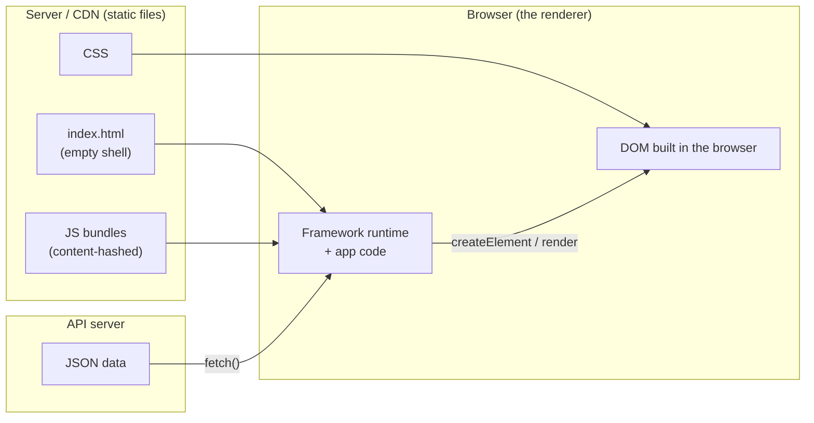
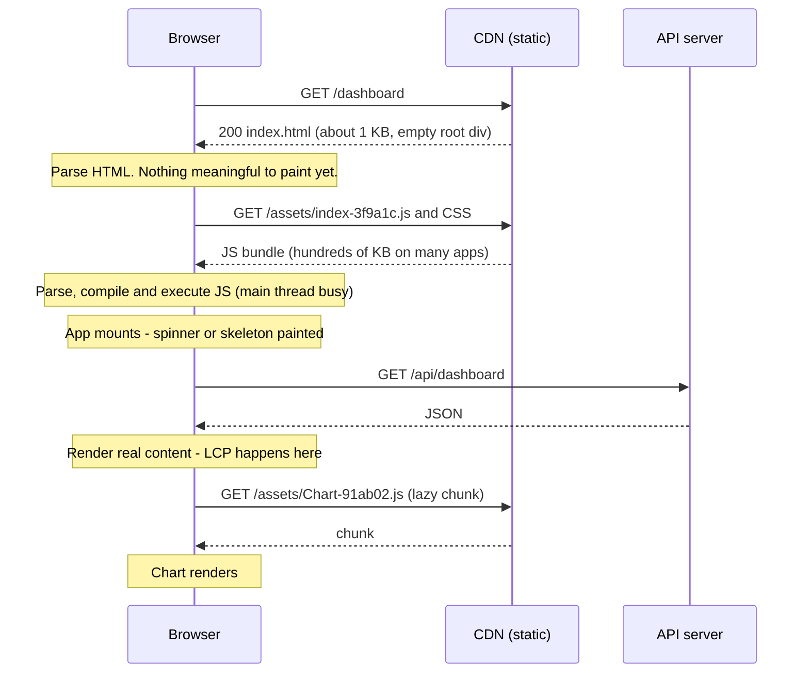
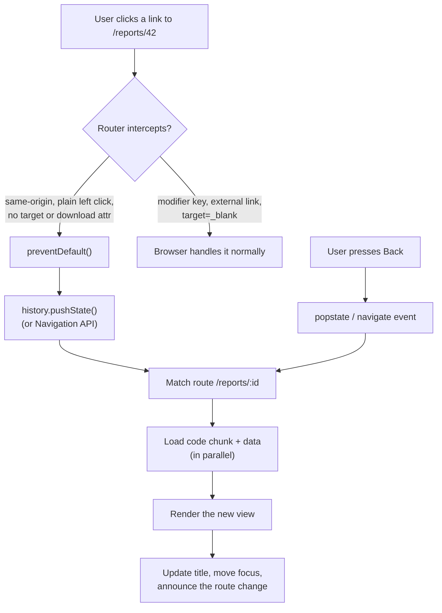
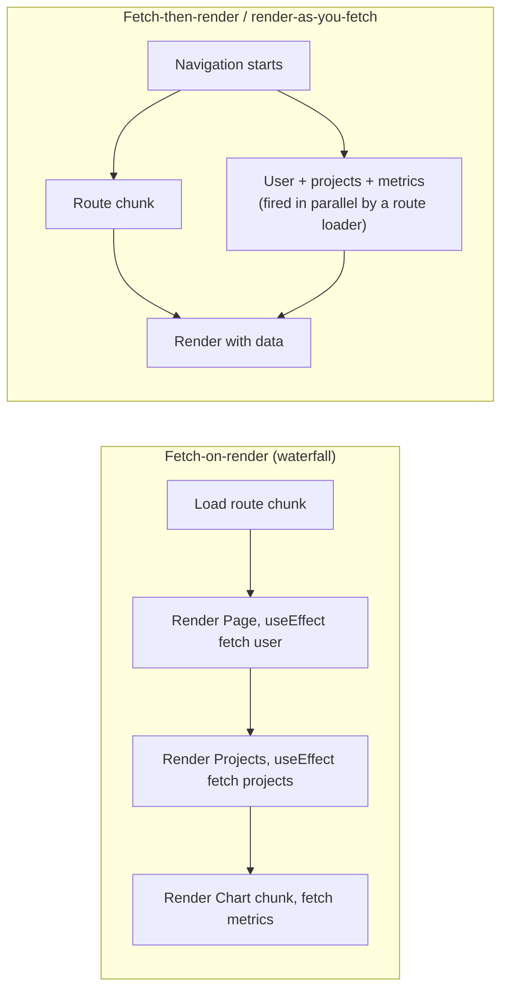
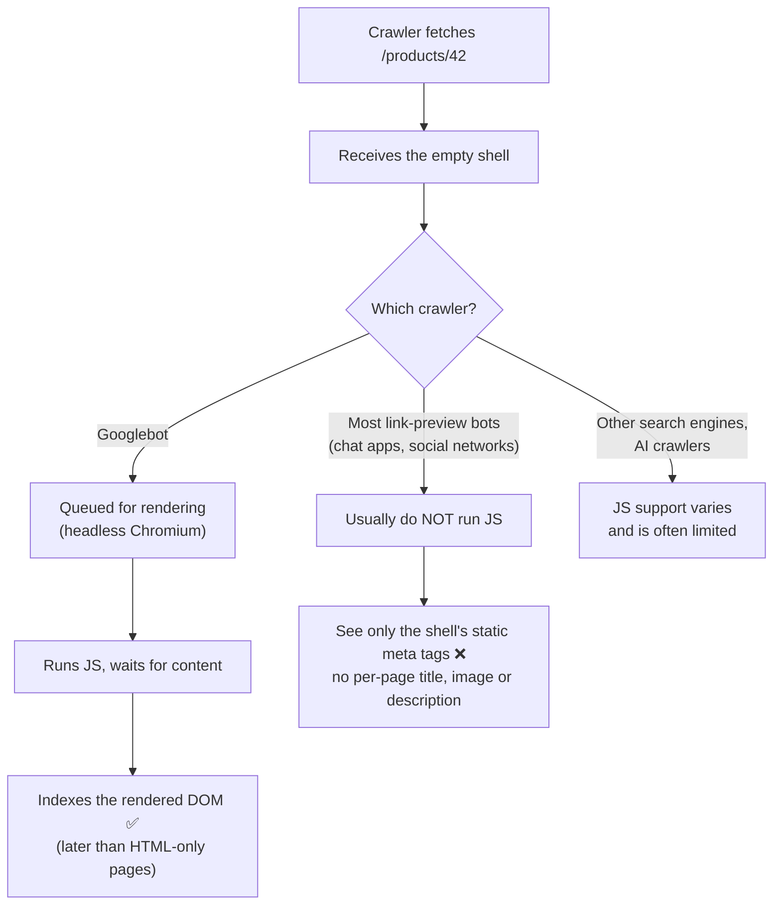
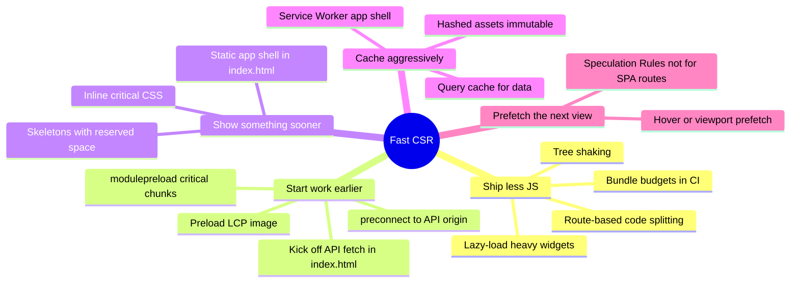
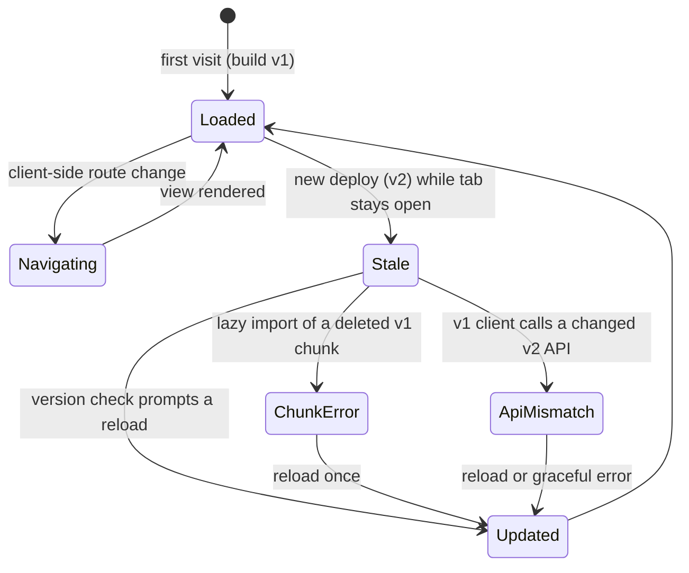
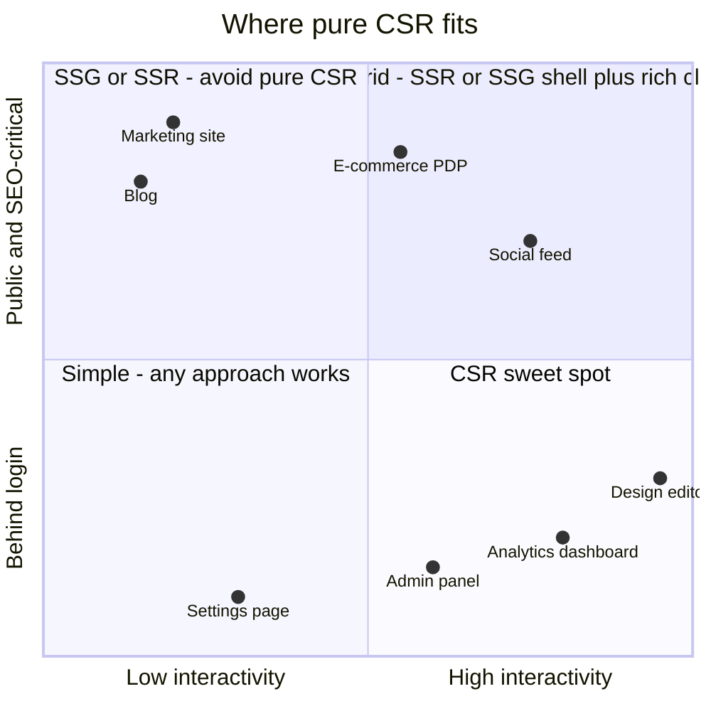

# Client-Side Rendering (CSR)

> **Date:** 2026-11-06 · **Last updated:** 2026-11-06
> **Category:** Frontend System Design
> **Sub-Topic:** Rendering & Architecture / Client-Side Rendering
> **Level:** Intermediate · **Reading time:** ~25 min
> **Informs:** rendering strategy per route, SEO and link previews, LCP vs TTFB trade-offs, JS bundle budgets, client routing and data-loading waterfalls, static hosting and SPA fallback, deploy version skew

> **Pre-requisite:** [Critical Rendering Path](../01-web-fundamentals/critical-rendering-path.md) (what blocks the first paint) and [Browser Caching Strategies](../01-web-fundamentals/browser-caching-strategies.md) (how the shell and bundles are cached).
> This note opens Phase 2: **where the HTML for a page gets built**. CSR is the baseline every other rendering pattern is compared against.

**Previous:** [Browser Caching Strategies](../01-web-fundamentals/browser-caching-strategies.md) · **Next:** [Server-Side Rendering (SSR)](./server-side-rendering-ssr.md)

---

## Table of Contents

1. [ELI5 — Simple Explanation](#eli5--simple-explanation)
2. [Section 1: What CSR Actually Is](#section-1-what-csr-actually-is)
3. [Section 2: The CSR Loading Waterfall](#section-2-the-csr-loading-waterfall)
4. [Section 3: CSR and the Performance Metrics](#section-3-csr-and-the-performance-metrics)
5. [Section 4: Client-Side Routing](#section-4-client-side-routing)
6. [Section 5: Data Fetching — Escaping the Waterfall](#section-5-data-fetching--escaping-the-waterfall)
7. [Section 6: SEO, Crawlers and Link Previews](#section-6-seo-crawlers-and-link-previews)
8. [Section 7: Making CSR Fast](#section-7-making-csr-fast)
9. [Section 8: Long-Lived Sessions — Memory, Version Skew, Accessibility](#section-8-long-lived-sessions--memory-version-skew-accessibility)
10. [Section 9: Security Implications](#section-9-security-implications)
11. [Section 10: CSR Across Frameworks and Platforms](#section-10-csr-across-frameworks-and-platforms)
12. [Decision Matrix — When CSR Is the Right Call](#decision-matrix--when-csr-is-the-right-call)
13. [Real-World Examples](#real-world-examples)
14. [Key Points Summary](#key-points-summary)
15. [Test Your Understanding (with answers)](#test-your-understanding)
16. [Cheat Sheet](#cheat-sheet)
17. [References & Further Reading](#references--further-reading)

---

## ELI5 — Simple Explanation

Think of buying furniture:

- **CSR is flat-pack furniture.** The shop hands you a **box** (an almost empty HTML page) and an **instruction booklet plus tools** (the JavaScript bundle). You carry it home and **assemble it yourself** (the browser builds the page). Until you finish assembling, you have no table — just a box (a blank screen or a spinner).
- **SSR is a showroom piece.** The shop assembles the table and delivers it ready to use (the server sends finished HTML). You can put a cup on it straight away.
- With flat-pack, **the second piece of furniture is quick**: you already own the tools (the bundle is cached), so new parts (pages) are assembled at home without another trip to the shop (no full page reload).
- But a **delivery inspector** (a search engine or a link-preview bot) who peeks into the box sees **only cardboard** unless they bother to assemble it.

> **CSR moves the work of building HTML from the server to the user's device: cheap to host and great for app-like interactivity, but the first view waits for JavaScript, and bots may see an empty page.**

---

## Core Concept — Step by Step

### Section 1: What CSR Actually Is

In **Client-Side Rendering**, the server (usually a static file host or CDN) returns a **minimal HTML shell**. JavaScript running in the browser then fetches data and builds the DOM.

```html
<!doctype html>
<html lang="en">
  <head>
    <meta charset="UTF-8" />
    <meta name="viewport" content="width=device-width, initial-scale=1" />
    <title>Acme Dashboard</title>
    <script type="module" crossorigin src="/assets/index-3f9a1c.js"></script>
    <link rel="stylesheet" crossorigin href="/assets/index-8b2e44.css" />
  </head>
  <body>
    <div id="root"></div>  <!-- empty until JS runs -->
  </body>
</html>
```



| Term | Meaning |
|---|---|
| **CSR** | HTML for the UI is generated by JavaScript in the browser, not sent by the server |
| **SPA (Single-Page Application)** | One HTML document for the whole app; navigation swaps views with JS instead of loading new documents. Most SPAs are CSR, but SSR frameworks also produce SPAs after the first load |
| **App shell** | The minimal HTML/CSS (header, nav, skeleton) shown before data arrives |
| **Mount** | The moment the framework attaches the app to a DOM node (`createRoot(...).render`, `createApp().mount`, `mount(App, …)`) |
| **Bundle** | The JS (and CSS) files a bundler produces from your source |

> **CSR ≠ SPA.** CSR is about **where HTML is produced** (the client). SPA is about **how navigation works** (no full document reloads). Next.js, Nuxt, SvelteKit and Angular SSR apps render the first page on the server and then behave like SPAs.

---

### Section 2: The CSR Loading Waterfall

The defining cost of CSR: content can't appear until a chain of **dependent** steps completes.



Every arrow is at least one network round trip, and they happen **one after another**:

```text
HTML  ──►  JS + CSS  ──►  parse/execute JS  ──►  API data  ──►  render  ──►  lazy chunks
 (RTT)       (RTT +           (CPU-bound,          (RTT +        (CPU)        (RTT)
             download)        slow on low-end      server time)
                              phones)
```

**Two kinds of cost stack up:**

| Cost | Grows with | Hurts most on |
|---|---|---|
| **Network** (round trips, bytes) | Number of sequential requests, bundle size | High-latency mobile networks |
| **CPU** (parse, compile, execute, render) | JS size and complexity | Low-end Android devices, where JS processing can be many times slower than on a developer laptop |

This is why "it loads instantly on my MacBook" says little about CSR performance for real users.

---

### Section 3: CSR and the Performance Metrics

```mermaid
gantt
    title Typical CSR first load (illustrative, not measured)
    dateFormat x
    axisFormat %S.%L s
    section Network
    HTML shell              :a1, 0, 150
    JS and CSS download     :a2, after a1, 600
    API request             :a4, after a3, 400
    section Main thread
    Parse and execute JS    :a3, after a2, 500
    Render content          :a5, after a4, 150
    section Metrics
    TTFB                    :milestone, m1, 150, 0
    FCP (shell or spinner)  :milestone, m2, 1250, 0
    LCP (real content)      :milestone, m3, 1800, 0
```



| Metric | Behaviour under CSR | Why |
|---|---|---|
| **TTFB** | ✅ Usually excellent | Static `index.html` served from a CDN; no server-side work |
| **FCP** | ⚠️ Delayed | Nothing paints until CSS (and usually JS) loads; with an empty `<div>` the first paint is often blank |
| **LCP** | ❌ Usually the weak point | The largest element (hero text, image, table) only exists after JS runs **and** data arrives. LCP images are also undiscoverable by the browser's preload scanner because they aren't in the HTML |
| **CLS** | ⚠️ Risky | Content pops in after data loads; spinners replaced by tall content shift the layout unless space is reserved |
| **INP** | ✅/⚠️ Depends | After load, interactions don't need the network for navigation; but huge bundles and heavy re-renders cause long tasks |
| **TBT / long tasks** | ⚠️ | Parsing and executing a big bundle is one or more long tasks during load |
| **Subsequent navigations** | ✅ Strength | Only data (and maybe a lazy chunk) is fetched; no document reload, no re-parse of the framework |

> **The LCP discovery problem:** in server-rendered HTML, `` is found by the preload scanner within milliseconds of the HTML arriving. In CSR the URL only exists after JS runs and the API responds. Fix by **preloading** known LCP resources (`<link rel="preload" as="image" fetchpriority="high">`) when the URL is predictable. See [Critical Rendering Path](../01-web-fundamentals/critical-rendering-path.md).

---

### Section 4: Client-Side Routing

A CSR app owns navigation. Instead of letting the browser load a new document, the router intercepts link clicks, updates the URL and swaps components.



| Mechanism | How it works | Notes |
|---|---|---|
| **History API** (`pushState`, `replaceState`, `popstate`) | Change the URL without loading a document; listen for Back/Forward | What most routers use today. Clean URLs need a **server fallback** (Section 7) |
| **Navigation API** (`navigation.addEventListener('navigate', …)`) | A single `navigate` event for all navigations, with `event.intercept()` | Supported in Chromium for years and, per MDN browser-compat-data, in Firefox 147+ and Safari 26.2+. Check MDN before relying on it without a fallback |
| **Hash routing** (`/#/reports/42`) | Only the fragment changes; the server always sees `/` | Works on any static host with no fallback config, but ugly URLs and the fragment is never sent to the server (bad for SEO and server logs) |

**Router responsibilities you inherit with CSR** (the browser did these for free with multi-page apps):
- Scroll restoration on Back/Forward, and scroll-to-top on new navigations.
- Updating `document.title` and meta tags.
- Moving focus and **announcing** the new page to screen readers.
- Showing a loading indicator (the browser's own spinner doesn't run for `pushState` navigations).
- Handling unknown routes (a real 404 view).

---

### Section 5: Data Fetching — Escaping the Waterfall

The most common CSR performance bug is a **render-then-fetch waterfall**: a component renders, then starts its fetch in an effect, then its child renders and starts **its** fetch, and so on.



| Pattern | When fetches start | Result |
|---|---|---|
| **Fetch-on-render** (`useEffect` + `fetch`) | After each component mounts | Sequential round trips; spinners inside spinners |
| **Fetch-then-render** (route loaders) | At navigation, before rendering the route | Parallel requests; render once with data |
| **Render-as-you-fetch** (Suspense + a cache) | At navigation or on hover/intent; components read from a cache and suspend | Parallel, streams in progressively |

**Tools that implement the good patterns:**
- **React Router** (data/framework mode) `loader` / `clientLoader`, **TanStack Router** loaders with preloading on intent.
- **TanStack Query** / **SWR**: `queryClient.prefetchQuery` / `ensureQueryData` in a loader, then `useQuery` / `useSuspenseQuery` in the component. See [React Query / TanStack Query](../03-state-and-data/react-query-tanstack-query.md).
- **Vue Router** navigation guards or `<Suspense>` with async `setup()`, **Angular** route resolvers, **SvelteKit** `load` functions (which also run on the client in SPA mode).

> **Rule:** the code that knows the URL should start every request the URL needs. Don't let the component tree discover data needs one level at a time.

---

### Section 6: SEO, Crawlers and Link Previews



What Google documents (see References):
- Googlebot processes JavaScript pages in three phases: **crawling, rendering, indexing**. Pages wait in a render queue, so content that only appears after JS runs is indexed later than content in the initial HTML.
- Use real `<a href="/path">` links, not click handlers on `<div>`s — crawlers discover URLs from `href`.
- A CSR app that returns **HTTP 200 for every URL** (the SPA fallback) creates **soft 404s**. Google suggests either redirecting to a URL that returns a real 404 status, or adding `<meta name="robots" content="noindex">` with JavaScript on error views.
- **Dynamic rendering** (serving pre-rendered HTML only to bots) is described by Google as a **workaround, not a long-term solution**; prefer SSR, static rendering or hydration.

**Link previews** (Open Graph / Twitter Card tags) are read from the **initial HTML**. A pure CSR app shows the same generic title and image for every shared URL. Options: pre-render the public pages, render just the `<head>` at the edge, or move those routes to SSR/SSG. See [Server-Side Rendering (SSR)](./server-side-rendering-ssr.md) and [Static Site Generation (SSG)](./static-site-generation-ssg.md).

> **Design takeaway:** CSR is a poor default for **public, content-driven, shareable** pages. It's a fine default for pages behind a login, which crawlers can't see anyway.

---

### Section 7: Making CSR Fast



| Technique | What it fixes | Caveat |
|---|---|---|
| **Route-based code splitting** (`React.lazy`, `defineAsyncComponent`, `loadComponent`) | Smaller initial bundle | Creates a new waterfall (chunk → data) unless loaders start both in parallel |
| **`<link rel="modulepreload">`** for the entry's static imports | Avoids discovering imports one level at a time | Vite injects these automatically for the entry chunk |
| **Early data fetch** in `index.html` or `<link rel="preload" as="fetch" crossorigin>` | Overlaps the API call with JS download | The preload must match the later `fetch()` (URL, mode, credentials) or it's wasted |
| **Static shell in `index.html`** (header, skeleton, inline critical CSS) | Real FCP instead of a blank page | Keep it in sync with the app's real layout to avoid CLS |
| **Pre-rendering the shell at build time** | Moves toward SSG for the shell | See [Static Site Generation (SSG)](./static-site-generation-ssg.md) |
| **Service Worker app shell** | Repeat visits and offline work without the network | Needs careful update flows. See [Service Workers & Web Workers](../01-web-fundamentals/service-workers-and-web-workers.md) |
| **Hashed assets + `immutable`** | Repeat visits download almost nothing | HTML must be `no-cache`. See [Browser Caching Strategies](../01-web-fundamentals/browser-caching-strategies.md) |
| **Prefetch on hover / in viewport** | Next navigation feels instant | Don't prefetch on metered connections (`navigator.connection.saveData`, where supported) |

**SPA fallback on the server:** with History API routing, a hard refresh on `/reports/42` asks the server for that path. The host must return `index.html` for app routes, but **never** for missing `/assets/*` files (that turns a missing chunk into HTML parsed as JS). See Example 3.

---

### Section 8: Long-Lived Sessions — Memory, Version Skew, Accessibility

CSR apps often stay open for **hours or days** (dashboards, email, chat). Problems a multi-page site never had:



| Problem | Why CSR is exposed | Mitigation |
|---|---|---|
| **Version skew** | Old JS keeps running after you deploy | Keep old hashed assets for a while, version your API, poll a `/version.json` and offer "Reload to update" |
| **Memory leaks** | No page reload ever clears the heap | Clean up listeners, timers, subscriptions in effect cleanup / `onUnmounted` / `ngOnDestroy` / `DestroyRef` / `$effect` teardown. See [Memory Leaks in Frontend Apps](../04-performance-engineering/memory-leaks-in-frontend-apps.md) |
| **Stale data** | Data fetched an hour ago is still on screen | Refetch on focus/reconnect (TanStack Query, SWR do this), real-time sync where needed |
| **Route-change accessibility** | Screen readers announce a full page load, but not a `pushState` | Move focus to the new `<h1>` or main region, update `document.title`, use a polite live region to announce the route |
| **Auth expiry** | Session can expire mid-use | Handle 401 globally: refresh the token or redirect to login while preserving the return URL |

---

### Section 9: Security Implications

| Concern | Detail |
|---|---|
| **Everything shipped is public** | Any env var baked into the bundle (`import.meta.env.VITE_*`, `process.env.REACT_APP_*`, Angular `environment.ts`) is readable by anyone. Never put secrets there |
| **Client-side route guards are UX, not security** | Hiding `/admin` in the router doesn't protect data. The API must authorize every request |
| **XSS has a bigger blast radius** | One long-lived JS context holds tokens and state for hours. Use framework escaping, avoid `dangerouslySetInnerHTML` / `v-html` / `innerHTML` with untrusted data, adopt a strict **CSP** and Trusted Types where supported |
| **Token storage** | Tokens in `localStorage` are readable by any injected script; `HttpOnly` cookies are not readable by JS but need CSRF protection. See [Browser Storage Mechanisms](../01-web-fundamentals/browser-storage-mechanisms.md) and [CORS & Same-Origin Policy](../01-web-fundamentals/cors-and-same-origin-policy.md) |
| **Source maps** | Public source maps reveal your source. Upload them to your error tracker and don't serve them publicly if that matters to you |

---

### Section 10: CSR Across Frameworks and Platforms

| Stack | How you get pure CSR | Status notes |
|---|---|---|
| **React** | **Vite** (`npm create vite@latest`, React template), Parcel or Rsbuild; `createRoot(el).render(<App />)` | **Create React App is deprecated** (React team announcement, February 2025). Migrate to a framework or a build tool such as Vite. React's docs recommend starting with a framework, which can still output a CSR/SPA build |
| **React frameworks** | React Router framework mode with `ssr: false` (SPA mode); Next.js `output: 'export'` for a static SPA-style export | Lets you move individual routes to SSR/SSG later |
| **Vue** | `npm create vue@latest` (Vite) + `createApp(App).mount('#app')` + Vue Router `createWebHistory()` | Nuxt: `ssr: false` in `nuxt.config` for SPA mode |
| **Angular** | `ng new` and decline SSR; `bootstrapApplication(App, appConfig)` with `provideRouter(routes)` | Recent CLI versions ask whether to enable SSR; lazy routes use `loadComponent`, and `@defer` blocks lazy-load parts of a template |
| **Svelte** | Svelte 5 `mount(App, { target })` with Vite; or **SvelteKit** with `export const ssr = false` in the root `+layout.js` and `adapter-static` with a `fallback` page | SvelteKit docs warn that SPA mode has SEO and performance costs |
| **Native mobile (iOS/Android, React Native, Flutter)** | The UI is always built on the device from bundled code + API data | Conceptually "CSR": the binary is the bundle (installed ahead of time) and the app fetches JSON. **Server-driven UI** is the native counterpart to SSR |



---

## Decision Matrix — When CSR Is the Right Call

| Factor | Favors CSR | Favors SSR / SSG |
|---|---|---|
| **Audience** | Logged-in users who return often | Anonymous first-time visitors from search or social |
| **SEO / link previews** | Not needed | Required |
| **Interactivity** | App-like (editors, dashboards, chat, maps) | Mostly reading |
| **Session length** | Long sessions, many navigations | Short visits, few pages |
| **Infrastructure** | Static hosting only, no server runtime wanted | Server or edge runtime available |
| **Device profile** | Capable desktops (internal tools) | Low-end mobile on slow networks |
| **Offline** | Offline-first PWA with a Service Worker shell | — |
| **Embedding** | Widgets embedded in other sites | — |

```text
Choose pure CSR when ALL of these hold:
  ✔ the route is behind auth (or SEO/link previews don't matter)
  ✔ users return often, so cached bundles pay off
  ✔ the UI is highly interactive
Otherwise: render the first view on the server or at build time (SSR / SSG / ISR / islands),
and keep CSR for the interactive parts. Most real products mix strategies per route.
```

---

## Real-World Examples

**Example 1 — Minimal CSR entry with React + Vite (TypeScript):**
```tsx
// src/main.tsx
import { StrictMode } from 'react';
import { createRoot } from 'react-dom/client';
import { RouterProvider } from 'react-router';
import { QueryClientProvider } from '@tanstack/react-query';
import { router } from './router';
import { queryClient } from './queryClient';
import './index.css';

createRoot(document.getElementById('root')!).render(
  <StrictMode>
    <QueryClientProvider client={queryClient}>
      <RouterProvider router={router} />
    </QueryClientProvider>
  </StrictMode>,
);
```

**Example 2 — Fetch waterfall (BAD) → route loader + lazy route in parallel (GOOD):**
```tsx
// ❌ BAD: chunk loads, component mounts, THEN the fetch starts
import { lazy, useEffect, useState } from 'react';

const Report = lazy(() => import('./Report'));

function ReportPageBad({ id }: { id: string }) {
  const [data, setData] = useState<ReportData | null>(null);
  useEffect(() => {
    fetch(`/api/reports/${id}`).then((r) => r.json()).then(setData);
  }, [id]);
  if (!data) return <Spinner />;
  return <Report data={data} />;
}
```

```tsx
// ✅ GOOD: the router starts the chunk download AND the data request together
// src/router.tsx
import { createBrowserRouter } from 'react-router';
import { queryOptions } from '@tanstack/react-query';
import { queryClient } from './queryClient';

export const reportQuery = (id: string) =>
  queryOptions({
    queryKey: ['report', id],
    queryFn: async () => {
      const res = await fetch(`/api/reports/${id}`);
      if (!res.ok) throw new Response('Not found', { status: res.status });
      return (await res.json()) as ReportData;
    },
    staleTime: 30_000,
  });

export const router = createBrowserRouter([
  {
    path: '/reports/:id',
    // Route module (component) is code-split…
    lazy: async () => {
      const { ReportPage } = await import('./routes/ReportPage');
      return { Component: ReportPage };
    },
    // …and the loader runs in parallel with the chunk download
    loader: ({ params }) => queryClient.ensureQueryData(reportQuery(params.id!)),
  },
]);

// src/routes/ReportPage.tsx
import { useParams } from 'react-router';
import { useSuspenseQuery } from '@tanstack/react-query';
import { reportQuery } from '../router';

export function ReportPage() {
  const { id } = useParams();
  const { data } = useSuspenseQuery(reportQuery(id!)); // already in the cache
  return <Report data={data} />;
}
```

**Example 3 — SPA fallback that doesn't swallow missing chunks (nginx):**
```nginx
server {
    listen 443 ssl;
    server_name app.example.com;
    root /var/www/app/dist;

    location /assets/ {
        add_header Cache-Control "public, max-age=31536000, immutable" always;
        try_files $uri =404;            # missing chunk → real 404, not index.html
    }

    location / {
        add_header Cache-Control "no-cache" always;
        try_files $uri /index.html;      # deep links and refreshes → the app shell
    }
}
```

**Example 4 — Start the API request before the bundle finishes (index.html):**
```html
<head>
  <link rel="preconnect" href="https://api.example.com" crossorigin />
  <!-- Must match the later fetch(): same URL, CORS mode, credentials -->
  <link rel="preload" href="https://api.example.com/v1/dashboard"
        as="fetch" crossorigin="use-credentials" />
  <!-- Known LCP image: let the preload scanner find it immediately -->
  <link rel="preload" as="image" href="/hero.avif" fetchpriority="high" />
  <script type="module" src="/src/main.tsx"></script>
</head>
<body>
  <!-- Static shell: real first paint while JS loads -->
  <div id="root">
    <header class="topbar">Acme</header>
    <main class="skeleton" aria-busy="true" style="min-height: 60vh"></main>
  </div>
</body>
```
```typescript
// Later, in app code: matches the preload, so the browser reuses the response
const res = await fetch('https://api.example.com/v1/dashboard', { credentials: 'include' });
```

**Example 5 — Accessible route changes (React):**
```tsx
import { useEffect, useRef } from 'react';
import { useLocation } from 'react-router';

export function RouteAnnouncer({ title }: { title: string }) {
  const { pathname } = useLocation();
  const ref = useRef<HTMLParagraphElement>(null);

  useEffect(() => {
    document.title = `${title} · Acme`;
    // Move focus to the main heading so keyboard and screen-reader users start at the new content
    document.querySelector<HTMLElement>('main h1')?.focus();
    if (ref.current) ref.current.textContent = `Navigated to ${title}`;
  }, [pathname, title]);

  return <p ref={ref} aria-live="polite" className="visually-hidden" />;
}
// Give the page <h1 tabIndex={-1}> so it can receive programmatic focus.
```

**Example 6 — The same CSR bootstrap in Vue, Angular and Svelte:**
```typescript
// Vue 3 — main.ts
import { createApp } from 'vue';
import { createRouter, createWebHistory } from 'vue-router';
import App from './App.vue';

const router = createRouter({
  history: createWebHistory(),
  routes: [{ path: '/reports/:id', component: () => import('./ReportPage.vue') }], // lazy
});
createApp(App).use(router).mount('#app');
```
```typescript
// Angular (standalone) — main.ts
import { bootstrapApplication } from '@angular/platform-browser';
import { provideRouter, Routes } from '@angular/router';
import { provideHttpClient } from '@angular/common/http';
import { AppComponent } from './app/app.component';

const routes: Routes = [
  { path: 'reports/:id', loadComponent: () => import('./app/report.component').then((m) => m.ReportComponent) },
];
bootstrapApplication(AppComponent, { providers: [provideRouter(routes), provideHttpClient()] });
```
```typescript
// Svelte 5 + Vite — main.ts
import { mount } from 'svelte';
import App from './App.svelte';

export default mount(App, { target: document.getElementById('app')! });
// SvelteKit SPA mode instead: src/routes/+layout.ts → export const ssr = false;
```

**Example 7 — Detect a new deploy in a long-lived tab:**
```typescript
// Build step writes /version.json = { "version": "<git sha>" } served with Cache-Control: no-cache
const CURRENT = import.meta.env.VITE_APP_VERSION; // public value baked in at build time

async function checkForUpdate() {
  const res = await fetch('/version.json', { cache: 'no-cache' });
  const { version } = await res.json();
  if (version !== CURRENT) showToast('A new version is available.', { action: 'Reload', onAction: () => location.reload() });
}
document.addEventListener('visibilitychange', () => {
  if (document.visibilityState === 'visible') void checkForUpdate();
});
```

---

## Key Points Summary

| Concept | One-Line Explanation |
|---|---|
| **CSR** | The browser builds the HTML with JS; the server sends an empty shell |
| **CSR vs SPA** | CSR = where HTML is produced; SPA = navigation without document reloads |
| **Loading waterfall** | HTML → JS → execute → data → render, each step waiting for the last |
| **TTFB** | Usually great (static shell from a CDN) |
| **LCP** | Usually the weak point: content needs JS **and** data first |
| **Preload scanner blindness** | Images and data referenced only in JS aren't discovered early |
| **Client routing** | History API / Navigation API swap views; the app owns scroll, focus, title |
| **Fetch-on-render** | Effects fetch after mount, causing sequential waterfalls |
| **Route loaders** | Start code and data in parallel at navigation time |
| **SEO** | Googlebot renders JS later; most link-preview bots don't run JS at all |
| **Soft 404** | SPA fallback returns 200 for unknown URLs; use noindex or a real 404 |
| **SPA fallback** | Serve `index.html` for app routes but 404 for missing assets |
| **Version skew** | Open tabs keep running old code after a deploy |
| **Secrets** | Anything in the bundle is public |
| **Best fit** | Authenticated, highly interactive, long-session apps |

---

## Test Your Understanding

**Q1 (Basic):**
A CSR app has a 90 ms TTFB but a 3.5 s LCP on mobile. Explain how both can be true.

<details>
<summary>Answer</summary>

TTFB measures how quickly the **first byte of the HTML document** arrives. In CSR that document is a tiny static shell served from a CDN, so TTFB is fast. LCP measures when the **largest content element** is painted. In CSR that element doesn't exist until the JS bundle has downloaded, been parsed and executed, the app has fetched its data, and the framework has rendered it. On a mobile CPU and network, that chain of dependent steps easily takes seconds. A fast TTFB tells you almost nothing about CSR user experience. Optimize the chain instead: smaller bundles, parallel data fetching and preloading the LCP resource.
</details>

**Q2 (Application):**
You're building an internal analytics dashboard used all day by 200 employees on desktops, behind SSO. A colleague insists on SSR "for performance". What do you recommend and why?

<details>
<summary>Answer</summary>

**CSR (an SPA built with Vite, or a framework in SPA mode) is a sound choice here.** The page is behind SSO, so SEO and link previews don't matter. Users return all day, so hashed bundles are cached after the first visit and later loads fetch only data. Sessions are long with many navigations, which is where client-side routing shines. Desktops handle the JS cost well. Static hosting is also simpler and cheaper to run than an SSR server.

SSR would mainly improve the **first** paint of the **first** visit, which matters little for this audience. It would also add a server runtime, hydration cost and more complex data fetching (auth on the server). Still apply the CSR hygiene: route-level code splitting, loaders that fetch in parallel, skeletons with reserved space, and a version check for long-lived tabs.
</details>

**Q3 (Tricky):**
After you added route-based code splitting, the bundle shrank by 40% but the report page got **slower** to show data. Why, and how do you fix it?

<details>
<summary>Answer</summary>

Splitting moved the report component into a **lazy chunk** that's only requested on navigation, and its data fetch lives in a `useEffect` **inside** that chunk. The sequence became: navigate → download chunk → mount → start fetch → render. Before the split, the code was already loaded, so the fetch started right away. You've added one network round trip to the critical path.

Fix: **decouple data from components.** Start the data request at navigation time in a route `loader` (React Router, TanStack Router, Angular resolver, SvelteKit `load`), in parallel with the chunk download. Prefetch both on link hover or when the link enters the viewport. Code splitting should reduce bytes, not add sequential round trips.
</details>

**Q4 (Tricky):**
Marketing complains that when users share `https://shop.example/products/42` in a chat app, the preview always shows the generic homepage title and logo. Google Search shows the right titles. Why the difference?

<details>
<summary>Answer</summary>

Googlebot **renders JavaScript** with a headless Chromium (after a render queue delay), so it sees the per-product `<title>` your app sets at runtime. Most **link-preview scrapers** (chat apps and social networks) fetch only the **initial HTML** and **don't run JS**, so they see the static shell's default `<title>` and `og:*` tags.

Fixes: render the public product pages on the server or at build time (SSR, SSG or ISR) so the `<head>` contains real Open Graph tags. Alternatively, inject the `<head>` at the edge (an edge function that looks up the product and rewrites meta tags in the shell). Bot-only "dynamic rendering" works, but Google calls it a workaround, and it doubles your rendering paths.
</details>

**Q5 (System design):**
Design the rendering strategy for a SaaS product with a public marketing site, a pricing page, a docs site and the logged-in app (editor + dashboards).

<details>
<summary>Answer</summary>

Mix strategies **per route** rather than choosing one for the product:
- **Marketing and pricing:** SSG (or ISR if content comes from a CMS). They're public, SEO-critical and need link previews. They change rarely, ship little JS and are served from a CDN.
- **Docs:** SSG with client-side search, possibly islands for interactive examples.
- **Logged-in app:** CSR/SPA. It's behind auth, highly interactive and long-session. Use route-level splitting, loaders, TanStack Query for server state, a Service Worker shell if offline matters, and a version check for long-lived tabs.
- **Shareable app URLs** (e.g. public dashboards): a thin server-rendered `<head>` or SSR for just those routes, so previews work.

Deploy them as separate apps on subpaths or subdomains, or as one framework (Next.js, Nuxt, SvelteKit, React Router, Angular) with per-route rendering modes. Share the design system and keep auth on a common domain. Justify each choice with the audience, SEO needs and interactivity, not with fashion.
</details>

**Q6 (Tricky):**
Users who keep the app open overnight report a blank screen when they open the Settings page the next morning. The console shows `Failed to fetch dynamically imported module`. What happened, and what's the full fix?

<details>
<summary>Answer</summary>

**Version skew.** The tab loaded build v1 yesterday. Overnight you deployed v2 and deleted the v1 assets (or the SPA fallback served `index.html` for the missing path). When the user opens Settings, the v1 router asks for `Settings-<v1hash>.js`, which no longer exists. CSR makes this likely because one document stays alive across deploys.

Full fix:
1. **Keep old hashed assets** for days or weeks after a deploy.
2. Make `/assets/*` return a real **404**, never the HTML fallback.
3. **Catch chunk-load errors** and reload once (guarding against loops), or show an error boundary with a Reload button.
4. **Detect new versions** proactively (poll `/version.json` on focus) and prompt users to reload at a convenient time.
5. Keep the **API backward compatible** for at least one release, so v1 clients don't break on data shape changes.
</details>

---

## Cheat Sheet

**Key Definitions:**
- **CSR:** The UI's HTML is generated in the browser by JavaScript
- **SPA:** One document; navigation handled by a client router
- **App shell:** Minimal static HTML/CSS shown before the app renders
- **SPA fallback:** Server rule that returns `index.html` for unknown app routes
- **Fetch-on-render:** Data requested only after the component mounts (causes waterfalls)
- **Route loader:** Function the router calls on navigation to fetch data in parallel with code
- **Soft 404:** An error page served with HTTP 200
- **Version skew:** Old client code running against new assets or APIs after a deploy

**Quick Reference:**
```text
Pick CSR for:   behind-login, highly interactive, long sessions, static hosting, offline PWA, widgets
Avoid CSR for:  public content, SEO, link previews, first-visit mobile users

Headers:        index.html → no-cache + ETag      /assets/*-[hash].* → max-age=31536000, immutable
Server:         app routes → index.html            missing /assets/* → 404 (never HTML)
Load path:      preconnect API · preload LCP image · modulepreload entry · early data fetch
Routing:        real <a href> · title + focus + live-region announce · scroll restoration
Data:           start fetches in route loaders, in parallel with lazy chunks
Long sessions:  keep old assets · reload once on chunk error · /version.json check · cleanup effects
Security:       no secrets in the bundle · API authorizes everything · CSP · careful token storage

Bootstrap:  React createRoot(el).render(<App/>) · Vue createApp(App).mount('#app')
            Angular bootstrapApplication(App, cfg) · Svelte mount(App, { target })
SPA modes:  Next output:'export' · Nuxt ssr:false · SvelteKit ssr=false + adapter-static fallback
            React Router framework ssr:false
CRA:        deprecated (Feb 2025) → Vite, Parcel, Rsbuild, or a framework
```

**Common Mistakes to Avoid:**

| Mistake | Why Wrong | Fix |
|---|---|---|
| CSR for public, SEO-critical pages | Late indexing, no link previews, slow first-visit LCP | SSR/SSG/ISR for those routes |
| Fetching in `useEffect` in nested components | Sequential round trips | Route loaders / prefetch in parallel |
| Code splitting without parallel data loading | Adds a round trip to the critical path | Start the chunk and the data together |
| Empty `<div id="root">` with no shell | Blank screen until JS runs | Static shell, inline critical CSS, skeletons |
| Spinners that collapse to zero height | CLS when content arrives | Reserve space with skeletons / `min-height` |
| SPA fallback for `/assets/*` | Missing chunk returns HTML → cryptic errors | `try_files $uri =404` for assets |
| Returning 200 for unknown routes | Soft 404s in search | Real 404 URL or `noindex` meta on error views |
| `<div onClick>` navigation | Not crawlable, not accessible, breaks open-in-new-tab | Real `<a href>` via the router's `Link` |
| Ignoring focus/title on route change | Screen-reader users aren't told the page changed | Focus `<h1>`, update title, live region |
| Secrets in `VITE_*` / `REACT_APP_*` env vars | Shipped to every user | Keep secrets on the server; proxy the call |
| Relying on client route guards for security | Anyone can call the API | Authorize on the server |
| Starting new projects with Create React App | Deprecated and unmaintained | Vite or a framework |
| Deleting old chunks on deploy | Open tabs crash on lazy import | Keep old assets; reload once on error |

---

## References & Further Reading

**Core docs**
- web.dev: [Rendering on the Web](https://web.dev/articles/rendering-on-the-web)
- web.dev: [Largest Contentful Paint (LCP)](https://web.dev/articles/lcp) · [Optimize LCP](https://web.dev/articles/optimize-lcp)
- web.dev: [Preload modules (`modulepreload`)](https://web.dev/articles/modulepreload)
- MDN: [Single-page application (Glossary)](https://developer.mozilla.org/en-US/docs/Glossary/SPA)
- MDN: [History API](https://developer.mozilla.org/en-US/docs/Web/API/History_API) · [Navigation API](https://developer.mozilla.org/en-US/docs/Web/API/Navigation_API)
- MDN: [`rel=preload`](https://developer.mozilla.org/en-US/docs/Web/HTML/Reference/Attributes/rel/preload) · [`rel=modulepreload`](https://developer.mozilla.org/en-US/docs/Web/HTML/Reference/Attributes/rel/modulepreload)

**SEO**
- Google Search Central: [Understand JavaScript SEO basics](https://developers.google.com/search/docs/crawling-indexing/javascript/javascript-seo-basics)
- Google Search Central: [Dynamic rendering as a workaround](https://developers.google.com/search/docs/crawling-indexing/javascript/dynamic-rendering)
- The Open Graph protocol: [ogp.me](https://ogp.me/)

**Framework docs**
- React blog: [Sunsetting Create React App](https://react.dev/blog/2025/02/14/sunsetting-create-react-app)
- React: [Build a React app from scratch](https://react.dev/learn/build-a-react-app-from-scratch)
- Vite: [Getting Started](https://vite.dev/guide/)
- React Router: [Single Page App (SPA) mode](https://reactrouter.com/how-to/spa)
- TanStack Query: [Prefetching & Router Integration](https://tanstack.com/query/latest/docs/framework/react/guides/prefetching)
- Next.js: [Static Exports](https://nextjs.org/docs/app/guides/static-exports)
- Vue Router: [Lazy Loading Routes](https://router.vuejs.org/guide/advanced/lazy-loading.html) · Nuxt: [Rendering modes](https://nuxt.com/docs/guide/concepts/rendering)
- Angular: [Lazy-loading routes](https://angular.dev/guide/routing/define-routes) · [Deferrable views (`@defer`)](https://angular.dev/guide/templates/defer)
- SvelteKit: [Single-page apps](https://svelte.dev/docs/kit/single-page-apps)

**Deep dives**
- web.dev: [Optimize long tasks](https://web.dev/articles/optimize-long-tasks)
- Next.js: [Accessibility — route announcements](https://nextjs.org/docs/architecture/accessibility#route-announcements) (how a framework announces client-side navigations)

---

> **Previous Topic:** [Browser Caching Strategies](../01-web-fundamentals/browser-caching-strategies.md)
> — How the shell, bundles and API responses are cached

> **Next Topic:** [Server-Side Rendering (SSR)](./server-side-rendering-ssr.md)
> — Render the first view on the server, then hydrate it in the browser

*Saved on: 2026-11-06 | Repo: Frontend System Design Learning Notes*
