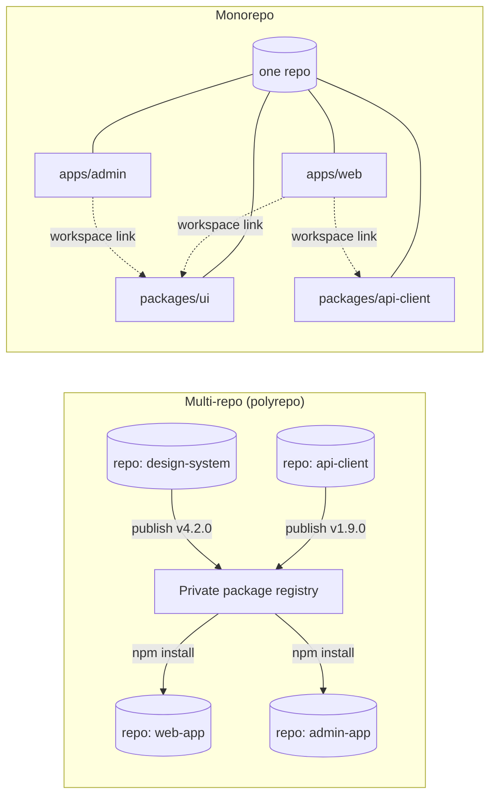
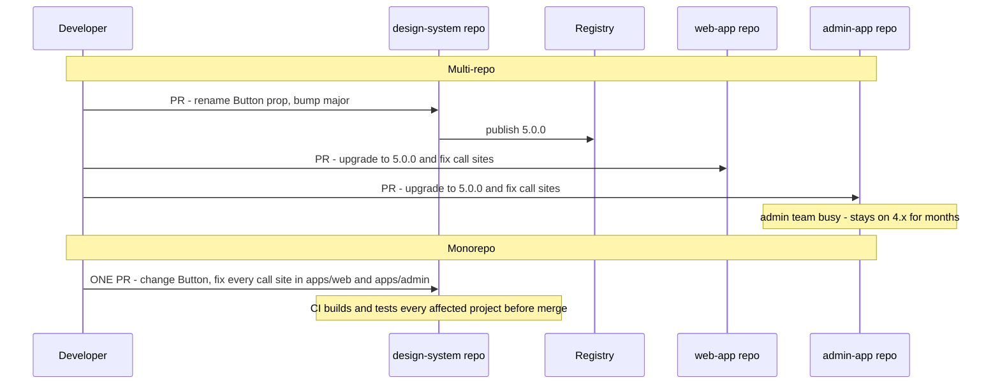
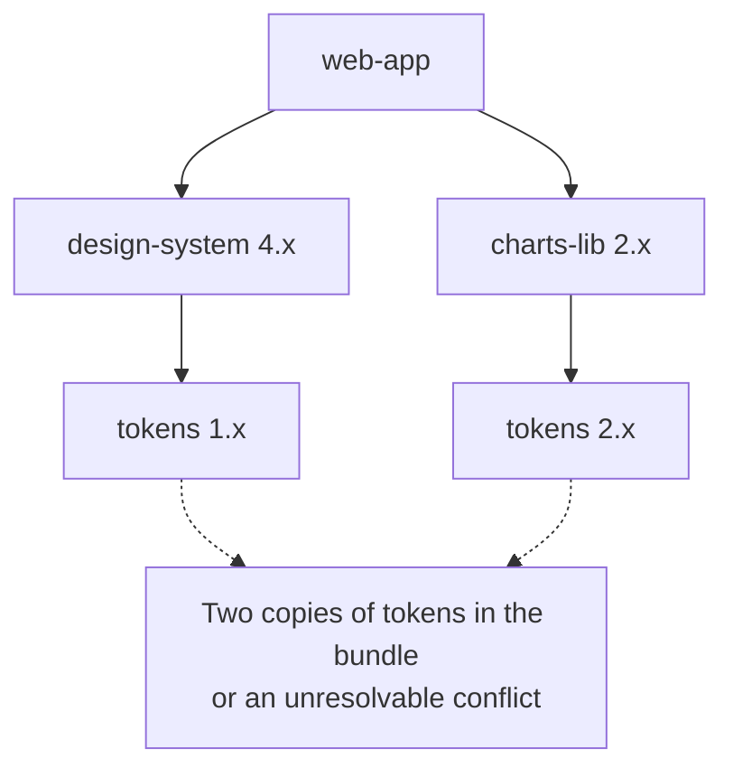
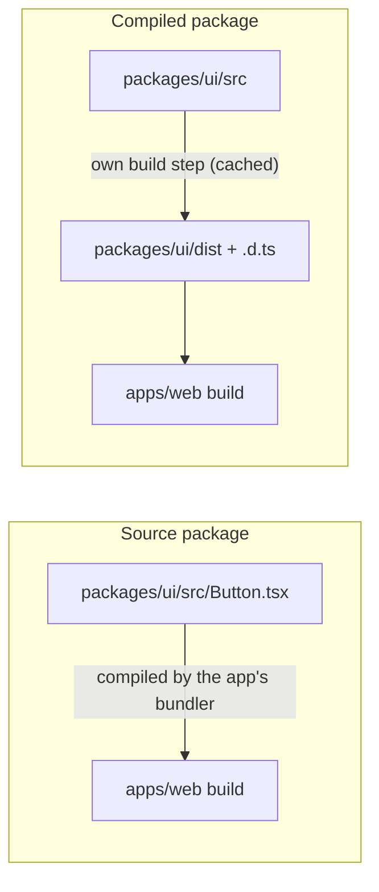
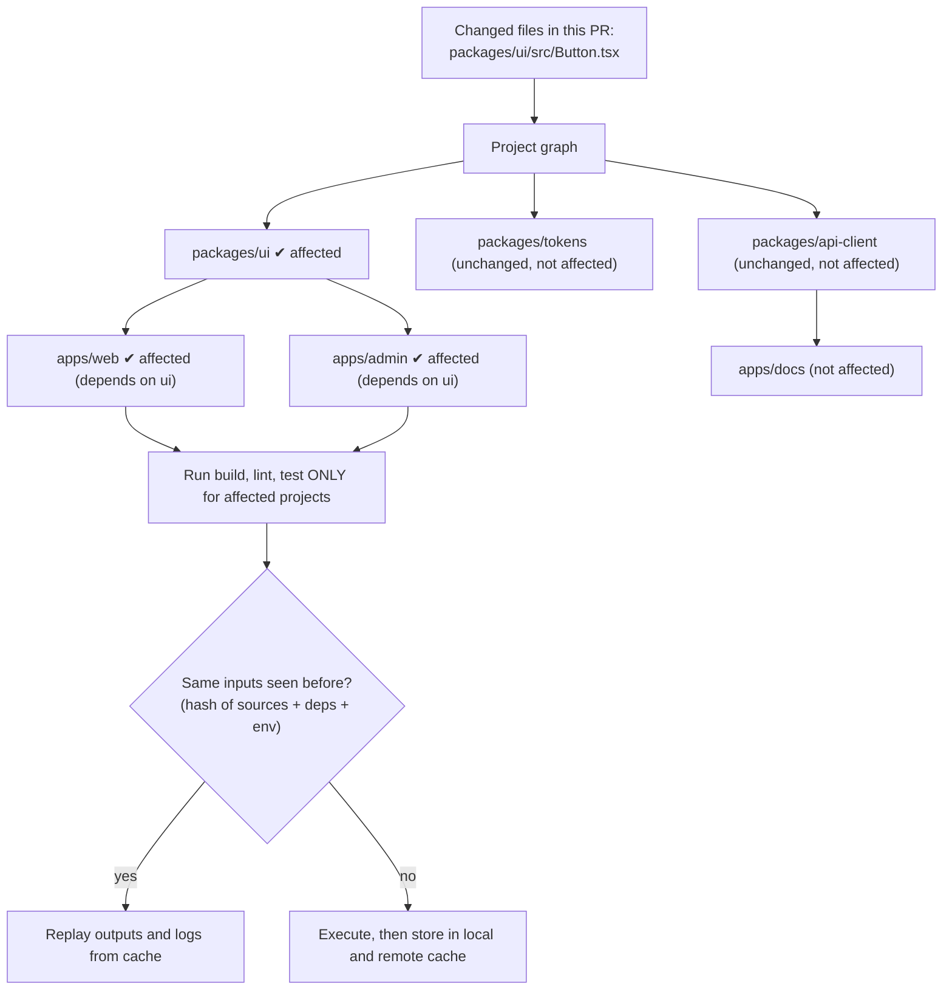
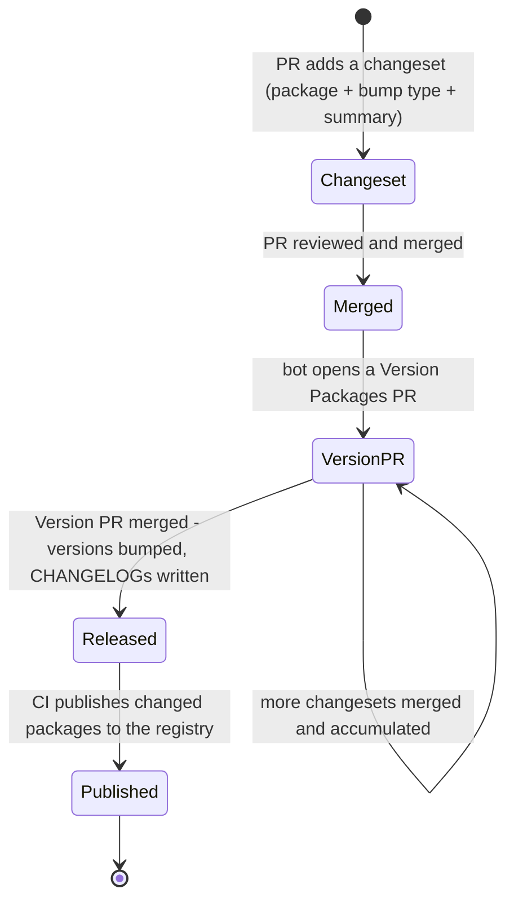
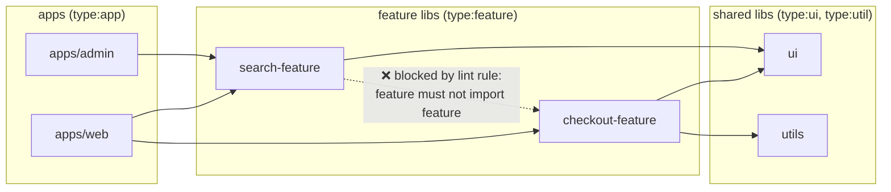
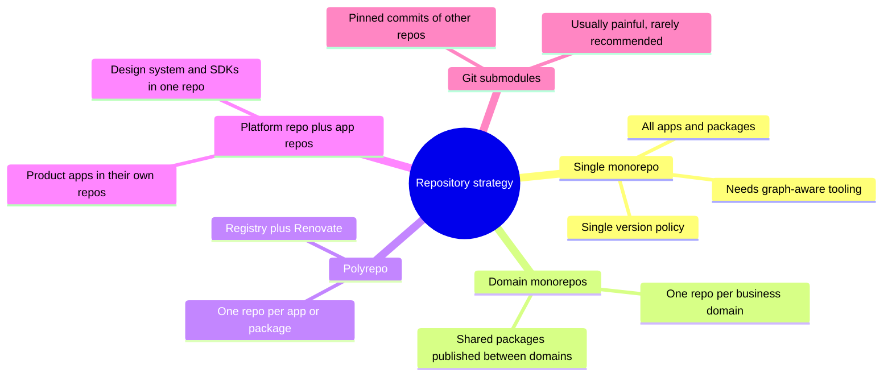
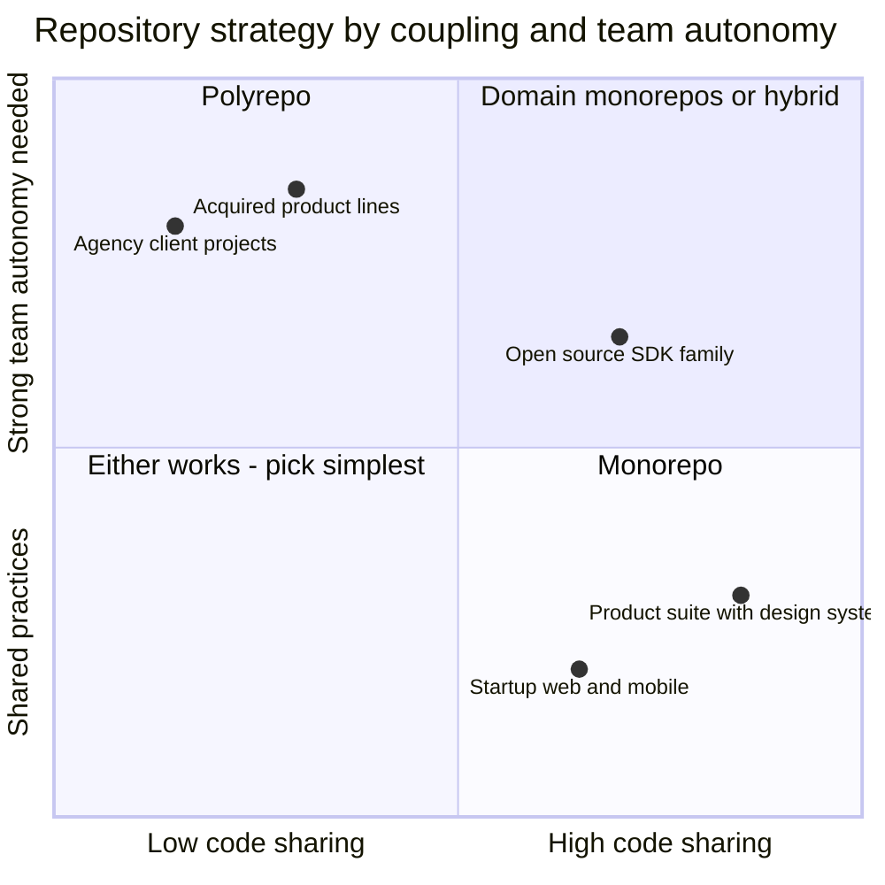

# Mono-repo vs Multi-repo

> **Date:** 2026-11-06 · **Last updated:** 2026-11-06
> **Category:** Frontend System Design
> **Sub-Topic:** Rendering & Architecture / Architecture
> **Level:** Intermediate · **Reading time:** ~26 min
> **Informs:** repository strategy for multiple apps and shared packages, design-system distribution, dependency and version policy, CI scale (affected builds, remote caching), release and versioning model, code ownership and module boundaries, how micro-frontends are organised in source control

> **Pre-requisite:** [Micro-Frontends Architecture](./micro-frontends-architecture.md) (why one product may consist of many deployable apps).
> This note is about **source-code organisation, not runtime architecture**: how many repositories hold your apps and packages, and what that does to refactoring, dependencies, CI and releases. Tool deep dives live in [Monorepo Tooling (Turborepo, Nx)](../10-advanced-topics/monorepo-tooling-turborepo-nx.md).

**Previous:** [Micro-Frontends Architecture](./micro-frontends-architecture.md) · **Next:** [Component Architecture & Design Systems](./component-architecture-and-design-systems.md)

---

## Table of Contents

1. [ELI5 — Simple Explanation](#eli5--simple-explanation)
2. [Section 1: Definitions — and What a Monorepo Is Not](#section-1-definitions--and-what-a-monorepo-is-not)
3. [Section 2: Change Flow — Atomic Commits vs the Publish Dance](#section-2-change-flow--atomic-commits-vs-the-publish-dance)
4. [Section 3: Dependency Management](#section-3-dependency-management)
5. [Section 4: Internal Packages](#section-4-internal-packages)
6. [Section 5: Build and CI at Scale](#section-5-build-and-ci-at-scale)
7. [Section 6: Versioning and Releases](#section-6-versioning-and-releases)
8. [Section 7: Ownership and Boundaries](#section-7-ownership-and-boundaries)
9. [Section 8: Git at Scale](#section-8-git-at-scale)
10. [Section 9: Hybrid Models](#section-9-hybrid-models)
11. [Decision Matrix](#decision-matrix)
12. [Real-World Examples](#real-world-examples)
13. [Key Points Summary](#key-points-summary)
14. [Test Your Understanding (with answers)](#test-your-understanding)
15. [Cheat Sheet](#cheat-sheet)
16. [References & Further Reading](#references--further-reading)

---

## ELI5 — Simple Explanation

Picture a family that cooks together.

- **Multi-repo (polyrepo)** = every family member has **their own kitchen** with their own fridge. Nobody gets in anybody's way. But when Grandma improves the family sauce recipe, she has to **mail a jar to every kitchen**, and half of them keep using the old jar for months.
- **Monorepo** = **one big shared kitchen**. Grandma changes the sauce and everyone uses the new one at the next meal. She can even taste every dish that uses it before she commits to the change. But the kitchen needs **rules** (labelled shelves, who may touch what) and **good appliances** (a dishwasher that only washes the dirty plates, not every plate in the house).

> **A monorepo makes cross-project change cheap and keeps everyone on the same versions, but needs tooling to scale. A multi-repo makes isolation cheap, but every shared change becomes a versioned release that consumers must adopt.**

---

## Core Concept — Step by Step

### Section 1: Definitions — and What a Monorepo Is Not



| Term | Meaning |
|---|---|
| **Monorepo** | Many distinct projects (apps, libraries, services) in **one** version-control repository, with defined relationships between them |
| **Multi-repo / polyrepo** | One repository per project; projects consume each other as **published, versioned packages** (or APIs) |
| **Monolith** | One deployable unit — a **runtime** concept. A monolith can live in a polyrepo, and a monorepo can contain many independently deployed apps |
| **Workspace** | Package-manager feature that links local packages together inside one repo (npm, Yarn, pnpm, Bun) |
| **Hybrid** | A few repos, each a small monorepo for one domain or team |

> **Monorepo ≠ monolith.** Large monorepos at companies like Google and Meta contain huge numbers of independently built and deployed projects. "One repo" says nothing about "one deploy".

---

### Section 2: Change Flow — Atomic Commits vs the Publish Dance

The biggest practical difference shows up when you change a **shared** package — say, renaming a prop on the design system's `Button`.



| Aspect | Monorepo | Multi-repo |
|---|---|---|
| **Cross-project change** | One atomic PR, reviewed and tested together | One PR per repo + a publish step; order matters |
| **Breaking a consumer** | Caught by CI before merge | Discovered when the consumer upgrades (maybe months later) |
| **Who pays for upgrades** | The **producer** fixes call sites (they know the change best) | Each **consumer** pays, on their own schedule |
| **Version drift** | Usually none — everyone uses `HEAD` | Common — apps on different majors of shared libs |
| **Large-scale refactors / codemods** | Run once across the repo | Run per repo; coordinate many owners |
| **Experimenting with a breaking change** | Must update all consumers (or use a new export path) | Publish a new major; consumers opt in |

> **Trade-off in one sentence:** the monorepo moves the cost of change to the **author**; the multi-repo moves it to the **consumers**, deferred and multiplied.

---

### Section 3: Dependency Management

#### The diamond and drift problems



In a polyrepo, each library pins its own dependency ranges. Over time the app ends up with **two versions** of the same package (bigger bundle, duplicated singletons like React context providers), or with conflicts that need `overrides`/`resolutions`.

| Policy | How | Where it fits |
|---|---|---|
| **Single-version policy** | One version of each third-party dependency for the whole repo | Monorepos (Google-style); simplest mental model, upgrades are repo-wide |
| **pnpm catalogs** | Define versions once in `pnpm-workspace.yaml`, reference with `catalog:` in each `package.json` | pnpm monorepos — single source of truth without hoisting tricks |
| **Syncpack / lint rules** | Check that every package uses the same range | Any workspace manager |
| **Independent ranges + Renovate/Dependabot** | Bots open upgrade PRs per repo | Polyrepos; works, but drift is the default |
| **`overrides` / `resolutions`** | Force a transitive version | Emergency fixes (e.g. a vulnerable transitive dep) |

#### Workspaces

All major package managers support workspaces: **npm** (`workspaces` in `package.json`), **Yarn**, **pnpm** (`pnpm-workspace.yaml`) and **Bun**. They:
- install every package's dependencies with one command and one lockfile;
- **symlink** local packages into `node_modules`, so `import { Button } from '@acme/ui'` resolves to `packages/ui`;
- let you run scripts across packages (`pnpm -r build`, `npm run build --workspaces`).

**Phantom dependencies:** with hoisted `node_modules` (npm, Yarn's default linker), a package can import something it never declared because a sibling installed it. It works locally and breaks when published or moved. pnpm's isolated layout prevents this by default; elsewhere, use lint rules such as `import/no-extraneous-dependencies`.

**`workspace:` protocol** (pnpm, Yarn, Bun): `"@acme/ui": "workspace:*"` guarantees the local package is used and is rewritten to a real version on publish.

---

### Section 4: Internal Packages

How should `apps/web` consume `packages/ui` inside a monorepo?

| Strategy | How it works | Pros | Cons |
|---|---|---|---|
| **Source ("just-in-time") packages** | `exports` points at `.ts`/`.tsx` source; the **app's** bundler compiles it | No build step for the package, instant changes, simple | Every consuming app must be able to compile it; slower app builds; can't publish to npm as-is |
| **Compiled packages** | Package has its own build (`tsup`, `tsc`, Vite library mode) emitting JS + `.d.ts` | Cacheable per package; publishable; consumers stay simple | A build step to orchestrate; source maps and watch mode to configure |
| **TypeScript project references** | `tsconfig` `references` + `composite: true` | Incremental type checking across packages | Extra config; must be kept in sync with the dependency graph |



**Always define a public API with `exports`** in `package.json`. It stops apps from deep-importing private files (`@acme/ui/src/internal/x`), which is how boundaries erode.

---

### Section 5: Build and CI at Scale

A naive monorepo CI runs **every** test for **every** project on **every** PR. That doesn't scale. The fix is a **task graph** plus **affected detection** plus **caching**.



| Capability | What it does | Examples |
|---|---|---|
| **Task graph** | Knows that `web#build` needs `ui#build` first (`dependsOn: ["^build"]`) and runs independent tasks in parallel | Turborepo, Nx, Rush, Bazel, moon |
| **Affected detection** | Runs tasks only for projects changed or depending on changed projects | `nx affected`, `turbo run --affected` / `--filter=...[origin/main]`, `pnpm --filter "...[origin/main]"` |
| **Local cache** | Skips tasks whose input hash hasn't changed | All of the above |
| **Remote cache** | Shares cached outputs between developers and CI machines | Vercel Remote Cache, Nx Cloud, self-hosted servers |
| **Distributed execution** | Spreads tasks across many CI agents | Nx Agents, Bazel remote execution |
| **Hermetic builds** | Every input is declared, so caching is provably correct | Bazel (and Pants/Buck2) — strongest guarantees, steepest learning curve |

> **Cache correctness:** a task's hash must include everything that affects its output — source files, dependency versions, relevant environment variables, tool config. Forget an env var (e.g. `NEXT_PUBLIC_API_URL`) and the cache will happily replay a build made for another environment.

**Polyrepo CI** is naturally scoped (each repo builds only itself), but cross-repo integration testing needs extra machinery: publish pre-release versions, trigger downstream pipelines, or run a separate integration repo.

---

### Section 6: Versioning and Releases

Monorepos still **deploy** apps independently — each app has its own pipeline triggered when it's affected. **Publishing** libraries is where versioning models differ:

| Model | Meaning | Good for |
|---|---|---|
| **Unversioned (internal only)** | Packages are never published; apps consume `HEAD` via workspaces | Most product monorepos |
| **Fixed / locked** | All published packages share one version number | Tightly coupled suites (e.g. a framework's packages) |
| **Independent** | Each package has its own semver | Design systems and SDKs published to external consumers |



- **Changesets** — the most common tool for JS monorepos: contributors add a small markdown file describing the bump; a release PR aggregates them.
- **Conventional commits + semantic-release** — common in polyrepos (one package per repo); versions derived from commit messages.
- **Nx release** and **Lerna** (now maintained by the Nx team) — also handle versioning and publishing in monorepos.

**Polyrepo releases** are simple per repo but require consumers to adopt each new version — keep a support policy (e.g. "we support the current and previous major") so the design-system team isn't maintaining five majors forever.

---

### Section 7: Ownership and Boundaries

A monorepo makes everything **importable**, which is both its strength and its danger. Without rules, it becomes one tangled codebase.



| Tool | Purpose |
|---|---|
| **`CODEOWNERS`** (GitHub, GitLab; Bitbucket has equivalents) | Required reviewers per path — the team owning `packages/ui/` must approve changes to it |
| **Module boundary rules** | Nx's `@nx/enforce-module-boundaries` (tag-based), `eslint-plugin-boundaries`, dependency-cruiser |
| **`exports` in `package.json`** | Only the public API is importable |
| **Branch protection + required checks** | Affected tests must pass before merge |

**In a polyrepo** boundaries come for free (you can only use what's published), but so do **silos**: teams can't easily see or fix each other's code, and duplicated utilities appear in every repo.

---

### Section 8: Git at Scale

Git handles large repos well up to a point; beyond that, use its scaling features (most product monorepos never need more than shallow/partial clones in CI):

| Technique | Command | Effect |
|---|---|---|
| **Shallow clone** (CI) | `git clone --depth=1` | Only the latest commit — but affected detection needs the base commit, so fetch enough history (e.g. `fetch-depth: 0` or fetch the base branch) |
| **Partial clone** | `git clone --filter=blob:none <url>` | Downloads file contents on demand |
| **Sparse checkout** | `git sparse-checkout set apps/web packages/ui` | Only the listed directories appear in the working tree |
| **Scalar** | `scalar clone <url>` | Ships with Git; configures partial clone, sparse checkout, background maintenance and the filesystem monitor for large repos |
| **Filesystem monitor** | `git config core.fsmonitor true` | Faster `git status` in big working trees |

> Google's monorepo runs on its own system (Piper), and Meta's uses Sapling — large-company monorepos often rely on custom VCS tooling. Most frontend teams use plain Git plus the tools above.

---

### Section 9: Hybrid Models

Real organisations rarely pick a pure extreme:



**Micro-frontends and repos are independent choices.** Many teams run micro-frontends **from a monorepo** (independent deploys, shared tooling, atomic contract changes), using Nx or Turborepo to build and deploy only affected apps. Others give each micro-frontend team its own repo for stronger autonomy and access control.

---

## Decision Matrix



| Factor | Favours monorepo | Favours multi-repo |
|---|---|---|
| **Shared code** (design system, API client, types) | Heavy, frequently changing | Small, stable, published like a third-party lib |
| **Cross-project changes** | Frequent | Rare |
| **Team structure** | Teams collaborate across product areas | Autonomous teams or separate organisations / vendors |
| **Access control** | Everyone may read everything | Strict per-project confidentiality (contractors, regulated code) |
| **Tech stacks** | Mostly one ecosystem (e.g. TypeScript everywhere) | Very different toolchains per project |
| **Tooling budget** | Can invest in task-graph tooling and CI caching | Prefer standard per-repo CI with no extra tooling |
| **Release cadence** | Apps deploy continuously from `main` | Packages need independent, slow-moving, versioned releases for external users |

**Default recommendation for a product company building several web/mobile apps with a shared design system:** a **monorepo** with pnpm (or another workspace manager), Turborepo or Nx for the task graph and caching, Changesets if anything is published, `CODEOWNERS` and boundary lint rules from day one.

**Framework notes:**
- **React / Next.js:** first-class in Turborepo and Nx templates; Next.js can compile workspace packages via `transpilePackages`.
- **Angular:** the Angular CLI supports multi-project workspaces (`ng generate library`); Nx grew out of the Angular ecosystem and is common there.
- **Vue / Nuxt:** works with any workspace manager; **Nuxt Layers** share config, components and pages between apps.
- **Svelte:** `@sveltejs/package` builds publishable component libraries from a SvelteKit project.
- **React Native / Expo:** Metro must resolve symlinked workspace packages; Expo documents monorepo setup, and recent Metro versions handle much of it automatically — follow the current Expo guide.

---

## Real-World Examples

**Example 1 — pnpm monorepo layout with a catalog:**
```text
acme/
├─ apps/
│  ├─ web/            (Next.js)
│  ├─ admin/          (Vite + React)
│  └─ mobile/         (Expo)
├─ packages/
│  ├─ ui/             (design-system components)
│  ├─ tokens/         (design tokens)
│  ├─ api-client/     (typed API client)
│  └─ config-eslint/  (shared lint config)
├─ pnpm-workspace.yaml
├─ turbo.json
├─ package.json
└─ .github/CODEOWNERS
```
```yaml
# pnpm-workspace.yaml
packages:
  - 'apps/*'
  - 'packages/*'

# One place to pin third-party versions for every package
catalog:
  react: ^19.0.0
  react-dom: ^19.0.0
  typescript: ^5.6.0
```
```json
{
  "name": "@acme/web",
  "private": true,
  "dependencies": {
    "@acme/ui": "workspace:*",
    "@acme/api-client": "workspace:*",
    "react": "catalog:",
    "react-dom": "catalog:"
  }
}
```

**Example 2 — An internal package with an explicit public API:**
```json
{
  "name": "@acme/ui",
  "version": "0.0.0",
  "private": true,
  "type": "module",
  "exports": {
    ".": { "types": "./dist/index.d.ts", "import": "./dist/index.js" },
    "./styles.css": "./dist/styles.css"
  },
  "scripts": {
    "build": "tsup src/index.ts --format esm --dts",
    "test": "vitest run"
  },
  "peerDependencies": {
    "react": "catalog:"
  }
}
```
> `react` is a **peer** dependency so the app provides the single copy. `exports` makes `@acme/ui/src/internal/*` unimportable.

**Example 3 — Turborepo task graph with caching (Turborepo 2.x uses `tasks`; 1.x used `pipeline`):**
```json
{
  "$schema": "https://turborepo.com/schema.json",
  "tasks": {
    "build": {
      "dependsOn": ["^build"],
      "inputs": ["$TURBO_DEFAULT$", ".env.production"],
      "outputs": ["dist/**", ".next/**", "!.next/cache/**"],
      "env": ["NEXT_PUBLIC_API_URL"]
    },
    "lint": {},
    "test": {
      "dependsOn": ["^build"],
      "outputs": ["coverage/**"]
    },
    "dev": {
      "cache": false,
      "persistent": true
    }
  }
}
```
> `^build` = "build my dependencies first". Listing `NEXT_PUBLIC_API_URL` in `env` puts it in the cache hash, so a staging build is never replayed for production.

**Example 4 — CI that only builds what changed (GitHub Actions):**
```yaml
name: ci
on: pull_request

jobs:
  affected:
    runs-on: ubuntu-latest
    steps:
      - uses: actions/checkout@v4
        with:
          fetch-depth: 0            # affected detection needs the base commit
      - uses: pnpm/action-setup@v4
      - uses: actions/setup-node@v4
        with:
          node-version: 22
          cache: pnpm
      - run: pnpm install --frozen-lockfile
      # Only projects changed since main, plus everything that depends on them
      - run: pnpm turbo run lint test build --filter="...[origin/main]"
        env:
          TURBO_TOKEN: ${{ secrets.TURBO_TOKEN }}   # remote cache
          TURBO_TEAM: ${{ vars.TURBO_TEAM }}
# Nx equivalent:  npx nx affected -t lint test build --base=origin/main
```

**Example 5 — Ownership and boundaries:**
```text
# .github/CODEOWNERS — last matching pattern wins
*                         @acme/platform
/apps/web/                @acme/web-team
/apps/admin/              @acme/internal-tools
/packages/ui/             @acme/design-system
/packages/tokens/         @acme/design-system
/packages/api-client/     @acme/api-team
```
```javascript
// eslint.config.js (Nx) — enforce the layering from Section 7
import nx from '@nx/eslint-plugin';

export default [
  ...nx.configs['flat/base'],
  {
    files: ['**/*.ts', '**/*.tsx'],
    rules: {
      '@nx/enforce-module-boundaries': ['error', {
        depConstraints: [
          { sourceTag: 'type:app', onlyDependOnLibsWithTags: ['type:feature', 'type:ui', 'type:util'] },
          { sourceTag: 'type:feature', onlyDependOnLibsWithTags: ['type:ui', 'type:util'] },
          { sourceTag: 'type:ui', onlyDependOnLibsWithTags: ['type:ui', 'type:util'] },
          { sourceTag: 'type:util', onlyDependOnLibsWithTags: ['type:util'] },
        ],
      }],
    },
  },
];
```

**Example 6 — Releasing a published design system with Changesets:**
```bash
# 1. In your feature PR: describe the change (prompts for packages + bump type)
pnpm changeset

# 2. In CI on main (often via the changesets GitHub Action): bump versions + write CHANGELOGs
pnpm changeset version

# 3. Publish packages whose version changed
pnpm changeset publish
```
```json
{
  "$schema": "https://unpkg.com/@changesets/config/schema.json",
  "changelog": "@changesets/cli/changelog",
  "access": "restricted",
  "baseBranch": "main",
  "fixed": [["@acme/ui", "@acme/tokens"]],
  "updateInternalDependencies": "patch"
}
```

**Example 7 — BAD → GOOD: sharing code in a polyrepo:**
```bash
# ❌ BAD: copy-pasting the API client into every repo ("we'll sync it later")
cp -r ../web-app/src/api ./src/api      # drifts immediately, bug fixes never propagate

# ❌ BAD: git submodules for shared UI — pinned SHAs, confusing updates, broken CI checkouts
git submodule add git@github.com:acme/ui.git vendor/ui

# ✅ GOOD: publish the shared code as a versioned package to a private registry
#          and let a bot propose upgrades in every consumer repo
npm publish --registry https://npm.pkg.github.com
```
```json
{
  "$schema": "https://docs.renovatebot.com/renovate-schema.json",
  "extends": ["config:recommended"],
  "packageRules": [
    { "matchPackageNames": ["@acme/**"], "groupName": "acme internal packages", "automerge": true, "matchUpdateTypes": ["minor", "patch"] }
  ]
}
```

**Example 8 — Working in a huge monorepo locally:**
```bash
# Clone without downloading every historical file version
git clone --filter=blob:none git@github.com:acme/acme.git
cd acme

# Only materialise the parts you work on
git sparse-checkout set apps/web packages/ui packages/tokens

# Or let Scalar configure all of the large-repo features at once
scalar clone git@github.com:acme/acme.git
```

---

## Key Points Summary

| Concept | One-Line Explanation |
|---|---|
| **Monorepo** | Many projects in one repo, linked via workspaces, changed atomically |
| **Multi-repo** | One repo per project; sharing happens through published versions |
| **Monorepo ≠ monolith** | Repo layout is independent of how many things you deploy |
| **Atomic change** | One PR updates a library and all its consumers, tested together |
| **Version drift** | Polyrepo consumers lag behind shared libraries by default |
| **Workspaces + `workspace:`** | Link local packages; replaced by real versions on publish |
| **Single-version policy / catalogs** | One version of each third-party dep across the repo |
| **Task graph** | Builds dependencies first, runs independent tasks in parallel |
| **Affected + cache** | Only run tasks for changed projects; replay unchanged results |
| **Remote cache** | Share task outputs between CI and developers |
| **Changesets** | Per-PR change notes aggregated into versioned releases |
| **CODEOWNERS + boundary rules** | Keep ownership and layering in a repo where everything is importable |
| **Sparse / partial clone, Scalar** | Git features for very large repos |

---

## Test Your Understanding

**Q1 (Basic):**
Is a monorepo the same as a monolith? Explain with an example.

<details>
<summary>Answer</summary>

No. A **monorepo** is about **where source code lives** (one repository). A **monolith** is about **how software is deployed** (one deployable unit). A monorepo can hold a Next.js storefront, a Vite admin app, an Expo mobile app and five micro-frontends, each with its own pipeline and deploy schedule. Conversely, a single monolithic app can live in its own repo inside a polyrepo setup. Mixing the two terms leads to bad decisions, like rejecting a monorepo because "we want independent deploys".
</details>

**Q2 (Application):**
Your design-system team ships a breaking change to `Button`. In your polyrepo, three months later only two of seven apps have upgraded, and the team maintains fixes on two majors. What structural options do you have?

<details>
<summary>Answer</summary>

This is the polyrepo's default failure mode: consumers pay for upgrades on their own schedule, so drift and long-lived majors accumulate.

Options:
1. **Move the design system and the apps into a monorepo** (or at least the apps that consume it heavily). The design-system team then fixes all call sites in the same PR, and CI proves nothing broke.
2. **Stay polyrepo but reduce the pain:** ship **codemods** with every major, automate upgrades with Renovate, adopt a written support policy (current + previous major only), batch breaking changes, and avoid them with additive APIs and deprecation periods.
3. **Hybrid:** a "platform" monorepo for the design system, tokens and API client, with apps in their own repos but upgraded by bots.

The right choice depends on how often shared code changes. Frequent change favours the monorepo.
</details>

**Q3 (Tricky):**
After adopting Turborepo remote caching, production occasionally shows the staging API URL. Builds are "successful". What happened?

<details>
<summary>Answer</summary>

The `build` task's hash didn't include the environment variable that's inlined into the bundle (e.g. `NEXT_PUBLIC_API_URL`). A staging build ran first and was stored in the remote cache. The production build had identical source inputs, so it got a **cache hit** and replayed the staging artefacts.

Fix: declare every env var that affects the output in the task's `env` (or the global env config), including `.env.*` files in `inputs`; use Turborepo's strict env mode so undeclared variables aren't available to tasks; and consider separate cache namespaces per environment. The general rule: **a cache is only as correct as the inputs in its hash.**
</details>

**Q4 (Tricky):**
In a monorepo using npm workspaces, `apps/admin` imports `lodash`, which isn't in its `package.json`. Locally and in CI it works. What's the risk and how do you prevent it?

<details>
<summary>Answer</summary>

It's a **phantom dependency**: npm hoists packages to the root `node_modules`, so `lodash` (installed for another workspace) is resolvable from `apps/admin`. It breaks when the other package drops `lodash`, when versions diverge, when `admin` is deployed with only its own declared dependencies (e.g. a pruned Docker image), or when it's published.

Prevent it with pnpm's isolated `node_modules` layout (undeclared imports fail), or a lint rule such as `import/no-extraneous-dependencies` / Nx's dependency checks, and by building deployable apps with pruned installs (`turbo prune`, `pnpm deploy`) in CI so the problem shows up early.
</details>

**Q5 (System design):**
A company has a React web app, an internal Angular admin tool, an Expo mobile app, a shared design-token package, a typed API client generated from OpenAPI, and plans for micro-frontends. 25 engineers in 5 teams. Propose a repository strategy.

<details>
<summary>Answer</summary>

**One monorepo** with pnpm workspaces and a graph-aware tool. Nx is a natural fit with Angular in the mix, and Turborepo also works.

- `packages/tokens` (source of truth, built to CSS variables, TS constants and React Native values), `packages/api-client` (regenerated from OpenAPI in CI; a spec change and every consumer's fix land in one PR), `packages/ui-react`, `packages/ui-angular`.
- `apps/web`, `apps/admin`, `apps/mobile`, and later `apps/mfe-*`, each with its **own deploy pipeline** triggered when affected.
- **Single-version policy** for React/TypeScript via catalogs, so micro-frontends can share React as a singleton without conflicts.
- **CODEOWNERS** per app/package, **boundary rules** (apps → features → ui/util), `exports` on every package.
- **CI:** affected-only lint/test/build, remote cache, `fetch-depth: 0`.
- **Releases:** apps deploy from `main`; nothing is published unless an external consumer appears (then add Changesets for that package).

A polyrepo would make every token or API change a multi-repo release, which is exactly what these 5 teams would do most often.
</details>

**Q6 (Application):**
Give two situations where a multi-repo is the better choice, and explain why.

<details>
<summary>Answer</summary>

1. **Strict access control or separate organisations.** An agency building apps for different clients, or a contractor team that must not see core IP. Repository-level permissions are the simplest and most auditable boundary. Monorepos can restrict paths, but read access is usually all-or-nothing in common Git hosts.
2. **Genuinely independent products with little shared code.** For example, acquired product lines on different stacks and release cycles, or open-source packages with external contributors and their own issue trackers. The monorepo's main benefit (cheap atomic cross-project change) doesn't apply, while its costs (tooling, CI scale, shared conventions) do.

Also reasonable: projects on very different toolchains, where one task graph adds little value.
</details>

---

## Cheat Sheet

**Key Definitions:**
- **Monorepo:** One repository holding many projects with explicit relationships
- **Polyrepo / multi-repo:** One repository per project; sharing via versioned packages
- **Workspace:** Package-manager feature linking local packages (npm, Yarn, pnpm, Bun)
- **Affected:** Projects changed in a diff plus everything that depends on them
- **Remote cache:** Shared store of task outputs keyed by an input hash
- **Single-version policy:** Each third-party dependency at one version across the repo
- **Phantom dependency:** Importing a package you didn't declare, resolved only thanks to hoisting
- **Changeset:** A small file describing a package's version bump and changelog entry

**Quick Reference:**
```text
Choose monorepo when:   lots of shared code · frequent cross-project changes · one main ecosystem
Choose polyrepo when:   strict access boundaries · unrelated products · very different toolchains
Monorepo starter kit:   pnpm workspaces (+ catalog) · Turborepo or Nx · CODEOWNERS · boundary lint
                        · exports on every package · affected CI · remote cache · Changesets if publishing
Polyrepo starter kit:   private registry · semver · Renovate/Dependabot · codemods for majors
                        · support policy (current + previous major) · shared config packages
Turborepo:              tasks.build.dependsOn ["^build"] · outputs · env in hash · --filter="...[origin/main]"
Nx:                     nx affected -t lint test build · @nx/enforce-module-boundaries · tags
CI checkout:            fetch-depth: 0 (affected needs the base commit)
Big repos:              git clone --filter=blob:none · git sparse-checkout set <dirs> · scalar clone
Never:                  copy-paste shared code · git submodules for active shared libs · undeclared deps
```

**Common Mistakes to Avoid:**

| Mistake | Why Wrong | Fix |
|---|---|---|
| Treating monorepo as monolith | Rejects a good layout for the wrong reason | Keep independent pipelines per app |
| Monorepo without a task graph | CI runs everything on every PR, gets slower every month | Turborepo/Nx with affected + remote cache |
| No boundaries in a monorepo | Everything imports everything; a tangled monolith in disguise | `exports`, boundary lint rules, CODEOWNERS |
| Env vars missing from cache hashes | Wrong-environment artefacts replayed | Declare env in task config; strict env mode |
| Hoisting hides undeclared deps | Breaks on deploy or publish | pnpm isolated layout, lint rules, pruned installs |
| Several versions of React across packages | Duplicate bundles, broken hooks/context | Single-version policy, catalogs, peer deps |
| Shallow clone in CI with affected detection | No base commit → everything or nothing is "affected" | `fetch-depth: 0` or fetch the base ref |
| Polyrepo with copy-pasted shared code | Silent drift, bugs fixed in one copy only | Publish packages; automate upgrades |
| Git submodules for frequently changing libs | Pinned SHAs, confusing workflows | Workspaces (monorepo) or published packages |
| Breaking changes without codemods (polyrepo) | Consumers stall on old majors | Codemods, deprecation periods, support policy |

---

## References & Further Reading

**Concepts**
- monorepo.tools: [Monorepo Explained (concepts and tool comparison)](https://monorepo.tools/)
- Google (CACM 2016): [Why Google Stores Billions of Lines of Code in a Single Repository](https://research.google/pubs/why-google-stores-billions-of-lines-of-code-in-a-single-repository/)
- Turborepo: [Monorepo handbook — structuring a repository](https://turborepo.com/docs/crafting-your-repository/structuring-a-repository)

**Package managers**
- pnpm: [Workspaces](https://pnpm.io/workspaces) · [Catalogs](https://pnpm.io/catalogs)
- npm: [Workspaces](https://docs.npmjs.com/cli/using-npm/workspaces)
- Yarn: [Workspaces](https://yarnpkg.com/features/workspaces)
- Node.js: [Package entry points (`exports`)](https://nodejs.org/api/packages.html#package-entry-points)

**Build tools**
- Turborepo: [Configuring tasks](https://turborepo.com/docs/crafting-your-repository/configuring-tasks) · [Caching](https://turborepo.com/docs/crafting-your-repository/caching)
- Nx: [Run only tasks affected by a PR](https://nx.dev/ci/features/affected) · [Enforce module boundaries](https://nx.dev/features/enforce-module-boundaries)
- Bazel: [Bazel overview](https://bazel.build/about/intro)
- TypeScript: [Project references](https://www.typescriptlang.org/docs/handbook/project-references.html)

**Releases & ownership**
- Changesets: [Changesets repository and docs](https://github.com/changesets/changesets)
- GitHub: [About code owners](https://docs.github.com/en/repositories/managing-your-repositorys-settings-and-features/customizing-your-repository/about-code-owners)
- Renovate: [Configuration options](https://docs.renovatebot.com/configuration-options/)

**Git at scale**
- Git: [`git sparse-checkout`](https://git-scm.com/docs/git-sparse-checkout) · [`scalar`](https://git-scm.com/docs/scalar) · [Partial clone](https://git-scm.com/docs/partial-clone)
- GitHub Blog: [Get up to speed with partial clone and shallow clone](https://github.blog/open-source/git/get-up-to-speed-with-partial-clone-and-shallow-clone/)

**Framework-specific**
- Next.js: [`transpilePackages`](https://nextjs.org/docs/app/api-reference/config/next-config-js/transpilePackages)
- Angular: [File structure — multi-project workspaces](https://angular.dev/reference/configs/file-structure)
- Nuxt: [Layers](https://nuxt.com/docs/getting-started/layers)
- SvelteKit: [Packaging](https://svelte.dev/docs/kit/packaging)
- Expo: [Work with monorepos](https://docs.expo.dev/guides/monorepos/)

---

> **Previous Topic:** [Micro-Frontends Architecture](./micro-frontends-architecture.md)
> — Splitting one frontend into independently built and deployed pieces owned by different teams

> **Next Topic:** [Component Architecture & Design Systems](./component-architecture-and-design-systems.md)
> — Structuring reusable components and the shared design system every app consumes

*Saved on: 2026-11-06 | Repo: Frontend System Design Learning Notes*
