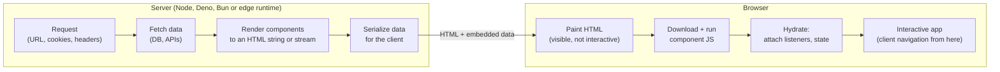
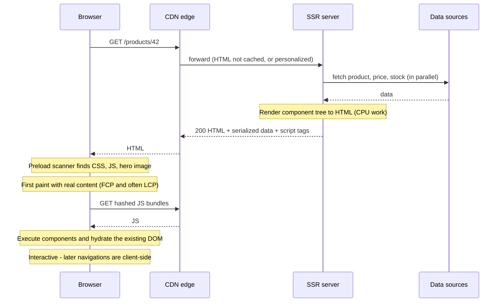
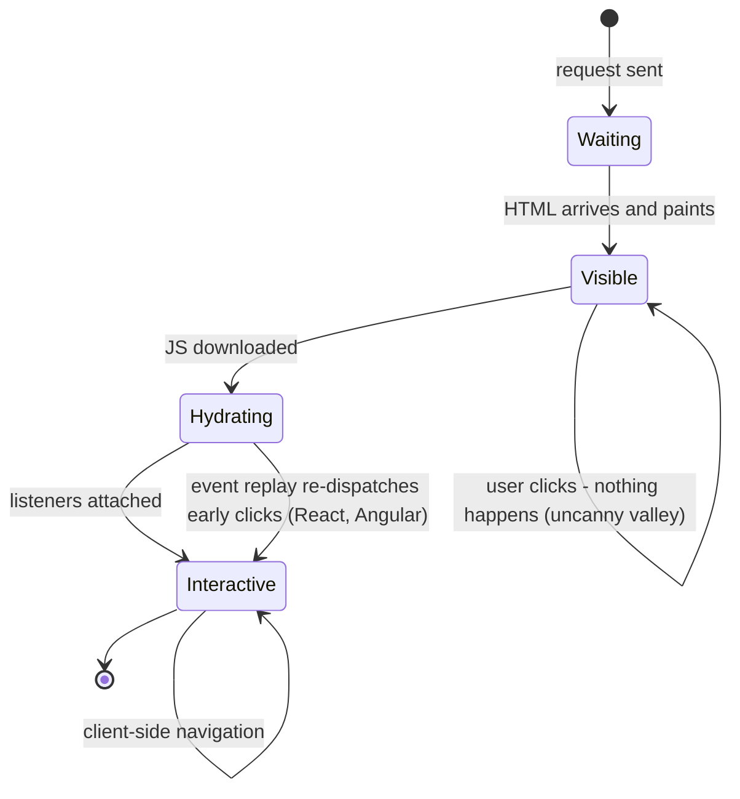
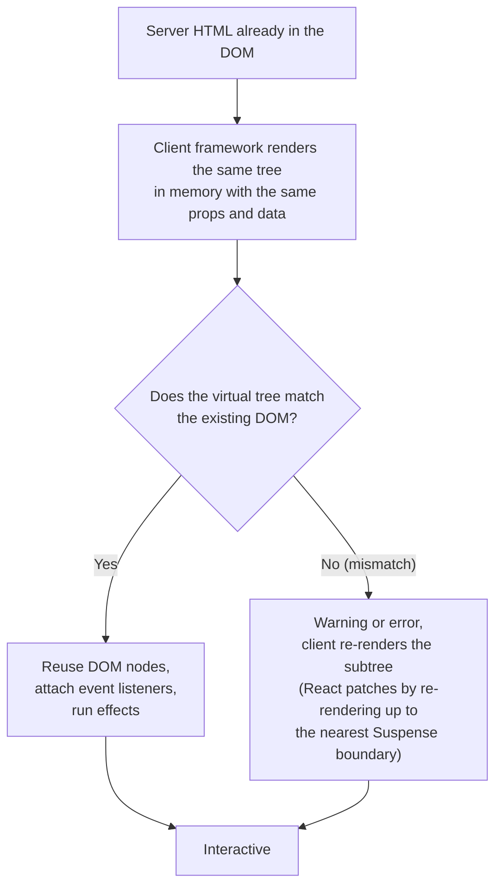
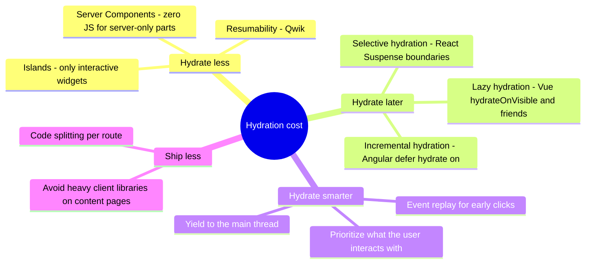
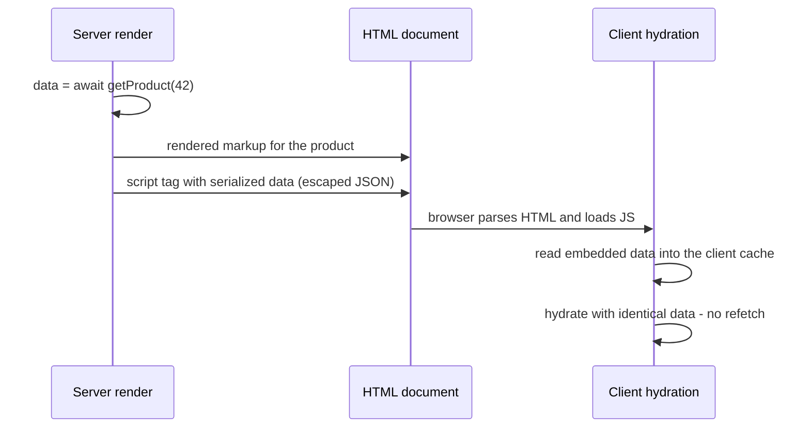
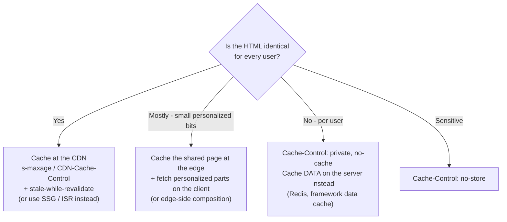
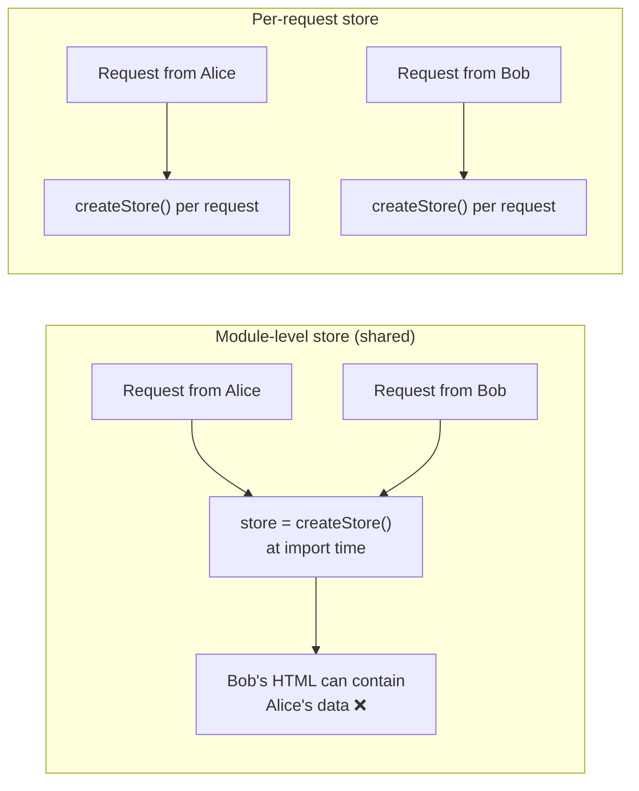

# Server-Side Rendering (SSR)

> **Date:** 2026-11-06 · **Last updated:** 2026-11-09
> **Category:** Frontend System Design
> **Sub-Topic:** Rendering & Architecture / Server-Side Rendering
> **Level:** Intermediate · **Reading time:** ~28 min
> **Informs:** rendering strategy per route, TTFB vs FCP/LCP trade-offs, hydration cost and INP, SEO and link previews, personalization, CDN caching of HTML, server infrastructure and scaling, request-scoped state

> **Pre-requisite:** [Client-Side Rendering (CSR)](./client-side-rendering-csr.md) (the baseline SSR improves on) and [Browser Caching Strategies](../01-web-fundamentals/browser-caching-strategies.md) (how HTML is cached at the edge).
> This note covers **classic per-request SSR plus hydration**. Streaming and React Server Components get their own note.

**Previous:** [Client-Side Rendering (CSR)](./client-side-rendering-csr.md) · **Next:** [Static Site Generation (SSG)](./static-site-generation-ssg.md)

---

## Table of Contents

1. [ELI5 — Simple Explanation](#eli5--simple-explanation)
2. [Section 1: What SSR Actually Is](#section-1-what-ssr-actually-is)
3. [Section 2: The SSR Request Lifecycle](#section-2-the-ssr-request-lifecycle)
4. [Section 3: SSR and the Performance Metrics](#section-3-ssr-and-the-performance-metrics)
5. [Section 4: Hydration — Making Server HTML Interactive](#section-4-hydration--making-server-html-interactive)
6. [Section 5: Hydration Mismatches](#section-5-hydration-mismatches)
7. [Section 6: Reducing Hydration Cost](#section-6-reducing-hydration-cost)
8. [Section 7: Data Fetching and State Transfer](#section-7-data-fetching-and-state-transfer)
9. [Section 8: Caching SSR Output](#section-8-caching-ssr-output)
10. [Section 9: Running the Server — Scaling, Errors, Request Isolation](#section-9-running-the-server--scaling-errors-request-isolation)
11. [Section 10: Security Implications](#section-10-security-implications)
12. [Section 11: SSR Across Frameworks and Platforms](#section-11-ssr-across-frameworks-and-platforms)
13. [Decision Matrix — SSR vs CSR vs SSG](#decision-matrix--ssr-vs-csr-vs-ssg)
14. [Real-World Examples](#real-world-examples)
15. [Key Points Summary](#key-points-summary)
16. [Test Your Understanding (with answers)](#test-your-understanding)
17. [Cheat Sheet](#cheat-sheet)
18. [References & Further Reading](#references--further-reading)

---

## ELI5 — Simple Explanation

Think of a restaurant:

- **CSR** is a meal kit: you get ingredients and a recipe, and you cook at home before you can eat.
- **SSR** is the kitchen **cooking your meal when you order** and bringing a **finished plate**. You can start eating (reading the page) the moment it lands.
- But the plate arrives with a **"do not touch" sign** for a few seconds: the waiter still has to bring **cutlery** (the JavaScript) and set the table (**hydration**) before you can cut, salt or send things back (click buttons, type in inputs).
- Because the kitchen cooks **per order**, a busy evening needs more cooks (servers), and every diner waits for their own plate to be cooked (slower TTFB than grabbing a pre-made sandwich from the fridge, which is **SSG**).

> **SSR renders HTML on the server for every request: users and crawlers see real content immediately, but you pay with server work per request, a slower first byte, and a hydration step before the page is interactive.**

---

## Core Concept — Step by Step

### Section 1: What SSR Actually Is

With **Server-Side Rendering**, the server runs your component code **for each request**, produces complete HTML (with real data), and sends it. The browser paints it immediately, then downloads the same components' JavaScript and **hydrates** the HTML so it becomes interactive.



| Term | Meaning |
|---|---|
| **SSR** | HTML is generated on the server **at request time** |
| **Hydration** | The client framework walks the existing server HTML, attaches event listeners and builds its internal state **without** recreating the DOM |
| **Isomorphic / universal code** | Component code that runs on both server and client |
| **State transfer** | Data used during the server render, embedded in the HTML so the client can hydrate without refetching |
| **Dynamic rendering (framework term)** | Next.js and others use this for "rendered per request" (as opposed to static). Not the same as Google's "dynamic rendering" for bots |
| **Traditional SSR** | PHP, Rails, Django, ASP.NET templates: HTML on the server **without** hydrating a component tree. Still a valid choice for low-interactivity sites |

> **Modern SSR = server HTML + client hydration.** The server makes the first view fast and crawlable; the client takes over as an SPA afterwards.

---

### Section 2: The SSR Request Lifecycle



Compare with CSR: the **data fetch moves to the server**, which is usually close to the database (low latency, fast network), and the browser's first useful response already contains content.

```text
CSR:  HTML(empty) → JS → execute → API → render                 ← content after JS and data
SSR:  [server: data → render] → HTML(full) → paint → JS → hydrate ← content before JS
```

---

### Section 3: SSR and the Performance Metrics

```mermaid
gantt
    title Typical SSR first load (illustrative, not measured)
    dateFormat x
    axisFormat %S.%L s
    section Server
    Data fetch and render        :s1, 0, 400
    section Network
    HTML download                :n1, after s1, 150
    JS download                  :n2, after n1, 600
    section Main thread
    Parse HTML and paint         :m1, after n1, 100
    Execute JS and hydrate       :m2, after n2, 500
    section Metrics
    TTFB                         :milestone, t1, 400, 0
    FCP and LCP                  :milestone, t2, 650, 0
    Hydrated (interactive)       :milestone, t3, 1650, 0
```



| Metric | SSR vs CSR | Why |
|---|---|---|
| **TTFB** | ⚠️ Slower | The server must fetch data and render before it sends the first byte (streaming reduces this) |
| **FCP / LCP** | ✅ Usually much better | Content is in the HTML; the preload scanner finds the LCP image immediately |
| **CLS** | ✅ Usually better | Layout is final on first paint, as long as client code doesn't re-render differently |
| **INP / TBT** | ⚠️ Hydration is a long task | The client must download and run the **same** component code; input during hydration may be delayed or ignored |
| **"Uncanny valley"** | ❌ New risk | The page **looks** ready but buttons don't work yet |
| **Subsequent navigations** | ✅ Like an SPA | After hydration, frameworks navigate client-side and fetch only data (or RSC payloads) |



> **Rule of thumb:** SSR improves **when users see content**; it does **not** reduce how much JS they run. If anything it adds work (render on the server **and** hydrate on the client). To reduce JS, look at islands and Server Components ([Island Architecture](./island-architecture.md), [Streaming SSR & React Server Components](./streaming-ssr-and-react-server-components.md)).

---

### Section 4: Hydration — Making Server HTML Interactive



What hydration needs:
1. **The same component code** on the client (so all page components ship as JS unless the framework supports server-only components).
2. **The same data** the server used (state transfer, Section 7).
3. **Deterministic output**: the first client render must produce identical markup.

| Framework | Hydration entry point |
|---|---|
| React 18+ | `hydrateRoot(container, <App />)` |
| Vue 3 | `createSSRApp(App).mount('#app')` (hydrates when server HTML exists) |
| Angular | `provideClientHydration()` in the app config (non-destructive hydration) |
| Svelte 5 | `hydrate(App, { target })` (SvelteKit does it for you) |
| Solid | `hydrate(() => <App />, el)` |
| Qwik | **No hydration**: "resumability" serializes listeners and state into HTML and loads code on interaction |

---

### Section 5: Hydration Mismatches

A mismatch happens when the server HTML differs from what the client's first render produces.

| Cause | Example | Fix |
|---|---|---|
| **Time** | `new Date().toLocaleTimeString()` | Pass the timestamp as data; format on the client after mount, or render a stable value |
| **Randomness** | `Math.random()` IDs | `useId()` (React), `useId()` (Vue 3.5+), framework-provided IDs |
| **Browser-only checks** | `typeof window !== 'undefined' ? A : B` during render | Render the same thing on both sides; switch in `useEffect` / `onMounted` / `afterNextRender` / `onMount` |
| **Locale / time zone** | Server in UTC, user in Asia/Karachi | Send the user's locale/time zone (cookie, `Accept-Language`) or format on the client |
| **Invalid HTML nesting** | `<p><div>…</div></p>`, `<a>` inside `<a>` | The browser's parser rewrites the DOM, so it no longer matches. Fix the markup |
| **Browser extensions** | Extensions inject attributes or nodes | React 19 tolerates unexpected elements in `<head>`/`<body>` better. Don't chase mismatches you can't reproduce in a clean profile |
| **Auth state differences** | Server thinks logged out, client reads `localStorage` token | Base auth on cookies the server can read |

> **Escape hatches:** `suppressHydrationWarning` (React, one level deep, for unavoidable differences like timestamps) and Vue's `data-allow-mismatch` (3.5+). Use them sparingly; they hide bugs.

---

### Section 6: Reducing Hydration Cost

Full hydration means **every component** on the page downloads and executes, even static ones (footer, article body). Options to cut that cost:



| Technique | Framework support | Effect |
|---|---|---|
| **Selective hydration** | React 18+ with `<Suspense>` boundaries | Boundaries hydrate independently; React prioritizes the one the user interacts with |
| **Lazy hydration strategies** | Vue 3.5+: `defineAsyncComponent({ loader, hydrate: hydrateOnVisible() })` (also `hydrateOnIdle`, `hydrateOnInteraction`, `hydrateOnMediaQuery`); Nuxt offers `hydrate-on-*` props on lazy components | Off-screen components hydrate later |
| **Incremental hydration** | Angular: `@defer (hydrate on viewport) { … }` with `withIncrementalHydration()` | Deferred blocks stay dehydrated until a trigger fires |
| **Event replay** | React (inside Suspense boundaries), Angular `withEventReplay()` | Clicks before hydration aren't lost |
| **Islands** | Astro, Fresh, Eleventy + is-land | Only marked components hydrate |
| **Server Components** | React (Next.js App Router, React Router, others) | Server-only components send no JS |
| **Resumability** | Qwik | No upfront hydration at all |

---

### Section 7: Data Fetching and State Transfer

The server fetches data to render HTML. The client needs **the same data** to hydrate. Without state transfer, the client refetches everything (double fetching) or renders empty and mismatches.



| Framework | Server data API | How state reaches the client |
|---|---|---|
| **Next.js App Router** | `async` Server Components fetching directly | RSC payload embedded in the HTML |
| **Next.js Pages Router** | `getServerSideProps` (still supported) | `__NEXT_DATA__` JSON script |
| **React Router v7 (framework mode)** | `loader` in route modules | Serialized loader data in the HTML |
| **TanStack Query (any React SSR)** | `prefetchQuery` on the server | `dehydrate()` → `<HydrationBoundary state={…}>` |
| **Nuxt** | `useFetch` / `useAsyncData` | Nuxt payload (`useNuxtApp().payload`) |
| **SvelteKit** | `load` in `+page.server.ts` / `+page.ts` | Serialized into the page; universal `load` responses are reused during hydration |
| **Angular SSR** | `HttpClient` calls during render | HTTP transfer cache (enabled by `provideClientHydration()`) replays responses on the client |

**Server-side waterfalls still exist.** `await a(); await b();` in one loader, or nested components each awaiting data, delays TTFB. Start independent requests together (`Promise.all`) and keep the server close to its data sources.

---

### Section 8: Caching SSR Output

Rendering every request from scratch is expensive. **What you can cache depends on whether the HTML is the same for everyone.**



| Layer | What's cached | Notes |
|---|---|---|
| **CDN HTML cache** | Full public pages | Fastest. Never key on cookies, never cache `Set-Cookie` responses |
| **Framework render/data caches** | Rendered segments or fetch results (e.g. Next.js caching APIs) | Behaviour changed across Next.js major versions; read the docs for your version |
| **Application data cache** | DB/API results (Redis, in-memory LRU) | Shares work across users even when HTML is personalized |
| **Browser** | `no-cache` + ETag for HTML | See [Browser Caching Strategies](../01-web-fundamentals/browser-caching-strategies.md) |

> If a page can be cached for everyone for minutes at a time, ask whether it should be **SSG or ISR** instead of SSR. See [Static Site Generation (SSG)](./static-site-generation-ssg.md) and [Incremental Static Regeneration (ISR)](./incremental-static-regeneration-isr.md).

---

### Section 9: Running the Server — Scaling, Errors, Request Isolation

| Concern | Detail | Mitigation |
|---|---|---|
| **CPU-bound rendering** | Rendering to a string is synchronous CPU work. In Node, a slow render blocks the event loop for every request on that process. See [JavaScript Runtime & Event Loop](../01-web-fundamentals/javascript-runtime-event-loop.md) | Keep render trees lean, stream, scale horizontally, cache |
| **Slow dependencies** | TTFB = slowest data call + render time | Timeouts, `Promise.all`, stream non-critical parts behind Suspense |
| **Errors** | A throwing component can fail the whole response | Error boundaries / framework error pages; option to fall back to a CSR shell |
| **Cross-request state pollution** | Module-level variables (singletons, stores created at import time) are **shared by every request** on that server process | Create stores, query clients and router instances **per request** |
| **Browser-only APIs** | `window`, `document`, `localStorage` don't exist on the server | Access them only in effects / lifecycle hooks; guard third-party libraries |
| **Cold starts** | Serverless functions may start slowly after idle | Keep bundles small, consider edge runtimes, provisioned concurrency. See [Edge Rendering](./edge-rendering.md) |
| **Observability** | Server render time is now part of your frontend performance | Use the `Server-Timing` response header and APM traces |



---

### Section 10: Security Implications

| Concern | Detail |
|---|---|
| **XSS via serialized state** | Embedding data with `JSON.stringify` inside `<script>` is unsafe: a value containing `</script>` closes the tag. Use the framework's serializer or escape `<`, `>`, `&`, U+2028 and U+2029 |
| **Server secrets leaking to the client** | Isomorphic code can accidentally import server modules. Use server-only boundaries: `import 'server-only'` (Next.js), `*.server.ts` modules (React Router, SvelteKit `$lib/server`), Nuxt `server/` directory |
| **SSRF** | Server-side fetches built from user input (`?url=`) can reach internal services. Validate and allow-list hosts |
| **Caching personalized HTML** | A CDN caching a logged-in page under a shared key leaks one user's data to others. Use `private` / `no-store` |
| **Auth** | SSR fits **HttpOnly cookies** naturally (the server reads them on each request); remember CSRF protection for mutations. See [CORS & Same-Origin Policy](../01-web-fundamentals/cors-and-same-origin-policy.md) |
| **Denial of service** | Expensive renders are an amplification vector. Rate-limit, cache, set render timeouts |

---

### Section 11: SSR Across Frameworks and Platforms

| Stack | SSR approach | Notes |
|---|---|---|
| **Next.js** | App Router: routes render dynamically when they read request data (`cookies()`, `headers()`, `searchParams`) or opt out of caching. Pages Router: `getServerSideProps` | Caching defaults have changed across majors; newer versions add Cache Components (`'use cache'`). Check the docs for your version |
| **React Router v7 (framework mode, formerly Remix)** | `loader` / `action` per route, SSR on by default | Runs on Node, Deno, Bun, Cloudflare and others via adapters |
| **TanStack Start** | Full-stack React on TanStack Router with SSR and server functions | Newer; check its docs for current status |
| **Nuxt (Vue)** | Universal rendering by default; per-route `routeRules` can switch to SSG/ISR/SPA | `useFetch` / `useAsyncData` handle state transfer |
| **SvelteKit** | SSR by default; `export const ssr = false` per route to opt out | `+page.server.ts` for server-only loading |
| **Angular** | `@angular/ssr` (`ng add @angular/ssr` or choose SSR in `ng new`) | Non-destructive hydration, event replay, incremental hydration, per-route render modes (server / prerender / client) |
| **Astro** | Static by default; `output: 'server'` or per-page `export const prerender = false` | Islands hydrate only interactive components |
| **Qwik City / SolidStart** | SSR with resumability (Qwik) or fine-grained hydration (Solid) | Smaller hydration cost by design |
| **Traditional (Rails, Django, Laravel, ASP.NET)** | Server templates, sprinkle JS (Hotwire, htmx, Alpine) | No component hydration at all |
| **Native mobile** | Not applicable as HTML; the analog is **server-driven UI** (the server sends a layout description the app renders natively) | Used to ship UI changes without app-store releases |

---

## Decision Matrix — SSR vs CSR vs SSG

| Question | CSR | SSR | SSG |
|---|---|---|---|
| HTML generated | In the browser | On the server, per request | At build time |
| TTFB | ✅ Fast (static) | ⚠️ Server work per request | ✅ Fast (CDN) |
| FCP / LCP | ❌ After JS and data | ✅ Content in HTML | ✅ Content in HTML |
| SEO / link previews | ❌ Weak | ✅ | ✅ |
| Personalized per request | ✅ (client-side) | ✅ | ❌ (needs client fetch) |
| Data freshness | ✅ Live | ✅ Live | ⚠️ As of last build (or ISR) |
| Infrastructure | Static host | Server / serverless / edge runtime | Static host / CDN |
| Cost under traffic spikes | ✅ Low | ⚠️ Scales with requests | ✅ Low |
| JS shipped | Full app | Full app (hydration) unless islands/RSC | Full app if hydrated; can be near zero |

```text
Choose SSR when the page is:
  ✔ public or shareable (SEO, link previews) AND
  ✔ personalized or must be fresh on every request (prices, stock, search results, feeds)
Prefer SSG/ISR when the HTML is the same for everyone and can be minutes old.
Prefer CSR when the page is behind login and highly interactive.
```

---

## Real-World Examples

**Example 1 — Minimal React SSR with Express (streaming API) + hydration:**
```tsx
// server.tsx
import express from 'express';
import { renderToPipeableStream } from 'react-dom/server';
import { App } from './App';
import { getProduct } from './data';

const app = express();
app.use('/assets', express.static('dist/assets', { immutable: true, maxAge: '1y' }));

// Escape so a value containing </script> can't break out of the script tag
const serialize = (data: unknown) =>
  JSON.stringify(data)
    .replace(/</g, '\\u003c')
    .replace(/>/g, '\\u003e')
    .replace(/&/g, '\\u0026')
    .replace(/\u2028/g, '\\u2028')
    .replace(/\u2029/g, '\\u2029');

app.get('/products/:id', async (req, res) => {
  const product = await getProduct(req.params.id); // per-request data
  if (!product) return res.status(404).send('Not found');

  const { pipe } = renderToPipeableStream(<App product={product} />, {
    bootstrapScriptContent: `window.__DATA__=${serialize({ product })}`,
    bootstrapModules: ['/assets/client.js'],
    onShellReady() {
      res.status(200);
      res.setHeader('Content-Type', 'text/html; charset=utf-8');
      res.setHeader('Cache-Control', 'private, no-cache');
      pipe(res);
    },
    onShellError() {
      res.status(500).send('<!doctype html><p>Something went wrong</p>');
    },
    onError(err) {
      console.error(err);
    },
  });
});

app.listen(3000);
```
```tsx
// client.tsx — hydrate with the SAME data the server used
import { hydrateRoot } from 'react-dom/client';
import { App } from './App';

const { product } = (window as any).__DATA__;
hydrateRoot(document, <App product={product} />, {
  onRecoverableError: (err) => reportToMonitoring(err), // hydration mismatches land here
});
```
> `App` renders the full `<html>` document here. `renderToString` still exists but has limited Suspense support; React's docs recommend the streaming APIs (`renderToPipeableStream` for Node, `renderToReadableStream` for Web Streams runtimes).

**Example 2 — Next.js App Router: a page rendered per request:**
```tsx
// app/products/[id]/page.tsx
import { cookies } from 'next/headers';
import { notFound } from 'next/navigation';
import { AddToCart } from './AddToCart'; // 'use client' component, hydrated

export default async function ProductPage({ params }: { params: Promise<{ id: string }> }) {
  const { id } = await params;
  const currency = (await cookies()).get('currency')?.value ?? 'USD'; // request data → dynamic
  const [product, price] = await Promise.all([getProduct(id), getPrice(id, currency)]); // no waterfall
  if (!product) notFound(); // real 404 status

  return (
    <main>
      <h1>{product.name}</h1>
      <p>{price.formatted}</p>
      <AddToCart productId={id} />
    </main>
  );
}
```

**Example 3 — Hydration mismatch (BAD → GOOD):**
```tsx
// ❌ BAD: server renders its own clock/time zone; client renders a different string
function LastUpdated() {
  return <span>Updated {new Date().toLocaleTimeString()}</span>;
}

// ✅ GOOD: render data from the server, enhance after hydration
import { useEffect, useState } from 'react';

function LastUpdatedGood({ iso }: { iso: string }) {
  const [label, setLabel] = useState(iso.slice(0, 10)); // deterministic on both sides
  useEffect(() => {
    setLabel(new Date(iso).toLocaleTimeString()); // user's locale and time zone, client only
  }, [iso]);
  return <time dateTime={iso}>Updated {label}</time>;
}
```

**Example 4 — Cross-request state pollution (BAD → GOOD) with TanStack Query:**
```tsx
// ❌ BAD: one QueryClient for the whole server process → data shared across users
import { QueryClient } from '@tanstack/react-query';
export const queryClient = new QueryClient();

// ✅ GOOD: a new client per request on the server, one stable client in the browser
import { QueryClient, dehydrate, HydrationBoundary } from '@tanstack/react-query';

export async function renderPage(userId: string) {
  const queryClient = new QueryClient(); // per request
  await queryClient.prefetchQuery({ queryKey: ['me'], queryFn: () => getUser(userId) });
  return (
    <HydrationBoundary state={dehydrate(queryClient)}>
      <Dashboard />
    </HydrationBoundary>
  );
}
```

**Example 5 — Vue/Nuxt, SvelteKit and Angular equivalents:**
```vue
<!-- Nuxt: pages/products/[id].vue — fetched on the server, transferred in the payload -->
<script setup lang="ts">
const route = useRoute();
const { data: product, error } = await useFetch(`/api/products/${route.params.id}`);
if (error.value) throw createError({ statusCode: 404, statusMessage: 'Product not found' });
</script>

<template>
  <h1>{{ product?.name }}</h1>
</template>
```
```typescript
// SvelteKit: src/routes/products/[id]/+page.server.ts — runs only on the server
import { error } from '@sveltejs/kit';
import type { PageServerLoad } from './$types';

export const load: PageServerLoad = async ({ params, cookies }) => {
  const product = await db.product.find(params.id); // server-only module ($lib/server/db)
  if (!product) error(404, 'Not found');
  return { product, currency: cookies.get('currency') ?? 'USD' };
};
```
```typescript
// Angular: app.config.ts — hydration, event replay, HTTP transfer cache
import { ApplicationConfig } from '@angular/core';
import { provideClientHydration, withEventReplay, withIncrementalHydration } from '@angular/platform-browser';
import { provideHttpClient, withFetch } from '@angular/common/http';
import { provideRouter } from '@angular/router';
import { routes } from './app.routes';

export const appConfig: ApplicationConfig = {
  providers: [
    provideRouter(routes),
    provideHttpClient(withFetch()),
    provideClientHydration(withEventReplay(), withIncrementalHydration()),
  ],
};
// In a template: @defer (hydrate on viewport) { <app-reviews /> }
```

**Example 6 — Caching headers for SSR responses:**
```typescript
// Public, same for everyone (category page): cache at the edge, revalidate in the browser
res.setHeader('Cache-Control', 'public, no-cache');
res.setHeader('CDN-Cache-Control', 'max-age=60, stale-while-revalidate=300');

// Personalized (cart, account): never in shared caches
res.setHeader('Cache-Control', 'private, no-cache');

// Sensitive (payments): never stored
res.setHeader('Cache-Control', 'no-store');

// Expose server render time in DevTools → Network → Timing
res.setHeader('Server-Timing', `db;dur=${dbMs}, render;dur=${renderMs}`);
```

**Example 7 — Browser-only code in an SSR component:**
```tsx
// ❌ BAD: crashes on the server (window is not defined) or causes a mismatch
const width = window.innerWidth;

// ✅ GOOD: read browser APIs after mount
import { useEffect, useState } from 'react';

function useViewportWidth() {
  const [width, setWidth] = useState<number | null>(null); // same on server and first client render
  useEffect(() => {
    const update = () => setWidth(window.innerWidth);
    update();
    window.addEventListener('resize', update);
    return () => window.removeEventListener('resize', update);
  }, []);
  return width;
}
// Vue: onMounted · Angular: afterNextRender · Svelte: onMount or $effect
```

---

## Key Points Summary

| Concept | One-Line Explanation |
|---|---|
| **SSR** | HTML rendered on the server for each request, then hydrated on the client |
| **Hydration** | Client re-runs components over existing HTML to attach listeners and state |
| **Uncanny valley** | Page looks ready before hydration finishes, but doesn't respond yet |
| **TTFB trade-off** | SSR delays the first byte to deliver content in the first paint |
| **LCP benefit** | Content and image URLs are in the HTML; the preload scanner finds them early |
| **JS cost** | SSR doesn't reduce JS; hydration needs the same component code |
| **Hydration mismatch** | First client render differs from server HTML (time, random, window checks) |
| **State transfer** | Server data embedded in HTML so the client doesn't refetch |
| **Selective / lazy / incremental hydration** | Hydrate parts independently or on demand |
| **Resumability** | Qwik skips hydration by serializing listeners and state |
| **Request isolation** | Never keep per-user state in module-level singletons on the server |
| **Caching** | Public HTML at the CDN; personalized HTML `private`; cache data instead |
| **Serialization XSS** | Escape `</script>` and friends when embedding JSON |
| **Best fit** | Public + fresh/personalized pages: search, product pages, feeds |

---

## Test Your Understanding

**Q1 (Basic):**
After switching from CSR to SSR, LCP improved from 3.2 s to 1.6 s, but TTFB rose from 80 ms to 450 ms and INP got slightly worse. Explain each change.

<details>
<summary>Answer</summary>

- **TTFB rose** because the server now fetches data and renders the component tree **before** sending the first byte. CSR just served a static file.
- **LCP improved** because the HTML now contains the content and the hero image URL. The browser paints content as soon as HTML and CSS arrive, and the preload scanner fetches the LCP image immediately, without waiting for JS and an API call.
- **INP worsened slightly** because hydration is a big chunk of main-thread work during load. Interactions that happen while it runs wait behind it. The same JS still ships, and it now runs while the user may already be trying to interact.

To improve further: stream the HTML to cut TTFB, cache data or HTML where possible, and reduce or split hydration (selective, lazy or incremental hydration, islands or Server Components).
</details>

**Q2 (Application):**
An e-commerce product page shows price and stock that change often, and must have good SEO and share previews. The header shows the logged-in user's name and cart count. Design the rendering and caching.

<details>
<summary>Answer</summary>

Split **shared** from **personalized** content:
- Render the product page (name, images, description, price, stock) on the server, **the same for every user**. Cache it briefly at the CDN (for example `CDN-Cache-Control: max-age=30, stale-while-revalidate=120`) and purge on price or stock changes. This could also be ISR.
- Render the **personalized header bits** (user name, cart count) on the client after hydration from a `private, no-cache` API. Or use edge composition, where the edge fetches the user fragment.
- Never put `Set-Cookie` or per-user markup in the cached HTML.

This keeps SEO and link previews (content is in the HTML), absorbs traffic spikes at the CDN, and keeps personalized data correct. If prices are per user (B2B contracts), render the page `private` per request, cache **data** server-side (Redis) to keep TTFB down, and accept the server cost.
</details>

**Q3 (Tricky):**
Users report that clicking "Add to cart" right after the page appears sometimes does nothing. There are no errors in the console. What's going on, and how do you fix it?

<details>
<summary>Answer</summary>

The **uncanny valley**. The server HTML painted, so the button is visible, but the client JS hasn't finished downloading or hydrating yet, so no click listener is attached. A plain `<button>` with no listener does nothing, and nothing gets logged.

Fixes, in order of impact:
1. **Hydrate sooner:** smaller bundles, code splitting, and making the button's subtree a priority. With React, wrap regions in `<Suspense>` so selective hydration can prioritize the clicked boundary.
2. **Event replay:** React replays discrete events (like clicks) that happen inside dehydrated Suspense boundaries. Angular has `withEventReplay()`.
3. **Progressive enhancement:** make the button part of a real `<form method="post" action="/cart">`, so it works before JS (React Router/Remix actions, SvelteKit form actions and Next.js Server Actions support this pattern).
4. Consider islands or resumability for content-heavy pages.
</details>

**Q4 (Tricky):**
In production, a user occasionally sees **another user's name** in the header of an SSR page. The CDN is configured with `Cache-Control: private` for those pages. What else could cause this?

<details>
<summary>Answer</summary>

**Cross-request state pollution on the server.** A module-level singleton (a Redux/Pinia/Zustand store, a QueryClient, an Apollo client, a plain `let currentUser`) is created once per server process and **shared by every request** it handles. Concurrent requests overwrite each other's state, so request B can render with request A's user.

Fix: create stores and clients **per request**, either in the request handler or with the framework's request-scoped mechanisms (Nuxt/Pinia's SSR integration, Angular DI per request, a QueryClient created inside the render). Keep module scope for immutable config only. Add a test that fires concurrent requests for different users and compares the output. Also double-check that no intermediate cache (reverse proxy, framework full-route cache) stores personalized HTML.
</details>

**Q5 (System design):**
A news site gets sudden traffic spikes (100× normal) when stories go viral. Articles are the same for everyone but get corrections minutes after publishing. The team uses per-request SSR, and the servers fall over during spikes. Redesign it.

<details>
<summary>Answer</summary>

Per-request SSR does work proportional to traffic, which is the wrong shape for identical content under spikes. Options:
1. **Cache SSR output at the CDN** with a short TTL plus `stale-while-revalidate` and **purge on publish or correction** (tag-based purging per article). The origin then renders roughly once per TTL per article, not once per reader.
2. Better: **ISR or SSG with on-demand revalidation.** Articles are generated once and served as static files, and the CMS webhook triggers regeneration on corrections. See [Incremental Static Regeneration (ISR)](./incremental-static-regeneration-isr.md).
3. Move personalized elements (login state, paywall meter, recommendations) to client-side or edge-composed fragments, so the article HTML stays cacheable.
4. Keep SSR for routes that are truly per request (search results, account pages) and protect them with rate limits and autoscaling.

The principle: **render once, serve many** whenever the HTML is shared.
</details>

**Q6 (Application):**
Your Vue/Nuxt app renders a list on the server, and then the client immediately fires the same API request again on hydration. Why, and what's the fix in Nuxt, React and Angular?

<details>
<summary>Answer</summary>

The data fetched on the server wasn't **transferred** to the client, so the client-side code runs its fetch again during hydration. Typically it's a raw `fetch`/`$fetch` inside `onMounted`, or a `useEffect` in React. That wastes a request, can flash a loading state, and may even cause a mismatch if the data changed in between.

Fixes:
- **Nuxt:** use `useFetch` / `useAsyncData` with a stable key. The result goes into the Nuxt payload and is reused during hydration.
- **React:** fetch through the framework's loader or Server Component, or with TanStack Query use `prefetchQuery` on the server plus `dehydrate` / `HydrationBoundary`, with a `staleTime` above zero so it doesn't refetch immediately.
- **Angular:** use `HttpClient`. `provideClientHydration()` enables the HTTP transfer cache, which replays server responses on the client.
- **SvelteKit:** use `load` functions. Their results are serialized and reused.
</details>

---

## Cheat Sheet

**Key Definitions:**
- **SSR:** HTML generated on the server per request
- **Hydration:** Attaching client-side behavior to server-rendered HTML by re-running components
- **Hydration mismatch:** Client's first render differs from the server HTML
- **State transfer:** Embedding server-fetched data in the HTML for the client
- **Selective hydration:** Hydrating Suspense boundaries independently, prioritizing user interaction (React)
- **Incremental / lazy hydration:** Hydrating parts on triggers like viewport or interaction (Angular, Vue, Nuxt)
- **Resumability:** Continuing server execution on the client without hydration (Qwik)
- **Cross-request state pollution:** Module-level state shared between requests on one server process

**Quick Reference:**
```text
Lifecycle:   request → fetch data (parallel) → render HTML → send → paint → load JS → hydrate
Metrics:     TTFB ↑ (server work)   FCP/LCP ↓ (content in HTML)   hydration = long task risk
Determinism: no Date.now()/Math.random()/window checks in render → useId, effects, server data
Browser APIs: React useEffect · Vue onMounted · Angular afterNextRender · Svelte onMount/$effect
State:       Next RSC payload / __NEXT_DATA__ · RR loaders · TanStack dehydrate · Nuxt payload
             SvelteKit load · Angular HTTP transfer cache
Isolation:   create stores/clients PER REQUEST on the server
Caching:     same for all → CDN s-maxage/CDN-Cache-Control + SWR + purge (or SSG/ISR)
             per user     → private, no-cache (cache data in Redis instead)
             sensitive    → no-store
Serialize:   escape < > & U+2028 U+2029 in embedded JSON
Reduce JS:   selective/lazy/incremental hydration · islands · Server Components · resumability
APIs:        React renderToPipeableStream / renderToReadableStream + hydrateRoot
             Vue createSSRApp + renderToString/renderToWebStream · Angular @angular/ssr
             Svelte render() + hydrate()
```

**Common Mistakes to Avoid:**

| Mistake | Why Wrong | Fix |
|---|---|---|
| Expecting SSR to reduce JS | Hydration needs the same component code | Islands, Server Components, lazy hydration |
| Module-level stores on the server | Data leaks between users | Per-request stores and clients |
| `typeof window` branches in render | Hydration mismatch | Same output on both sides; branch in effects |
| `Date.now()` / `Math.random()` in render | Mismatch | Pass values as data; `useId` |
| `JSON.stringify` straight into `<script>` | XSS via `</script>` | Framework serializer or escaping |
| Sequential `await`s in loaders | TTFB grows with every call | `Promise.all`, stream slow parts |
| Caching personalized SSR HTML at the CDN | Cross-user data leaks | `private`; personalize on the client |
| Per-request SSR for identical content | Servers melt during spikes | CDN cache, SSG or ISR |
| Refetching on the client after SSR | Double requests, loading flashes | State transfer / transfer cache |
| Importing server code into client components | Secrets end up in the bundle | `server-only`, `.server.ts`, `$lib/server` |
| Returning 200 for "not found" pages | Soft 404s in search | `notFound()`, `error(404)`, `createError` |
| Ignoring the uncanny valley | Lost clicks, frustrated users | Smaller bundles, event replay, forms that work without JS |
| Confusing SSR "dynamic rendering" with Google's bot-only "dynamic rendering" | Different concepts | SSR serves everyone the same HTML |

---

## References & Further Reading

**Core docs**
- web.dev: [Rendering on the Web](https://web.dev/articles/rendering-on-the-web)
- web.dev: [Optimize Time to First Byte](https://web.dev/articles/optimize-ttfb) · [Optimize LCP](https://web.dev/articles/optimize-lcp)
- MDN: [SSR (Server-side rendering) — Glossary](https://developer.mozilla.org/en-US/docs/Glossary/SSR)
- MDN: [`Server-Timing`](https://developer.mozilla.org/en-US/docs/Web/HTTP/Reference/Headers/Server-Timing)

**React**
- React: [`renderToPipeableStream`](https://react.dev/reference/react-dom/server/renderToPipeableStream) · [`renderToString`](https://react.dev/reference/react-dom/server/renderToString) · [`hydrateRoot`](https://react.dev/reference/react-dom/client/hydrateRoot)
- React working group: [New Suspense SSR Architecture in React 18](https://github.com/reactwg/react-18/discussions/37)
- Next.js: [Rendering — Server Components and dynamic rendering](https://nextjs.org/docs/app/getting-started/server-and-client-components) · [`getServerSideProps`](https://nextjs.org/docs/pages/api-reference/functions/get-server-side-props)
- React Router: [Rendering strategies](https://reactrouter.com/start/framework/rendering)
- TanStack Query: [Server Rendering & Hydration](https://tanstack.com/query/latest/docs/framework/react/guides/ssr)

**Vue, Angular, Svelte, others**
- Vue: [Server-Side Rendering guide](https://vuejs.org/guide/scaling-up/ssr.html) (includes cross-request state pollution and hydration mismatch) · [Lazy hydration](https://vuejs.org/guide/components/async.html#lazy-hydration)
- Nuxt: [Rendering modes](https://nuxt.com/docs/guide/concepts/rendering) · [Data fetching](https://nuxt.com/docs/getting-started/data-fetching)
- Angular: [Server-side and hybrid rendering](https://angular.dev/guide/ssr) · [Hydration](https://angular.dev/guide/hydration) · [Incremental hydration](https://angular.dev/guide/incremental-hydration)
- SvelteKit: [Page options (`ssr`)](https://svelte.dev/docs/kit/page-options) · [Loading data](https://svelte.dev/docs/kit/load)
- Qwik: [Resumable vs hydration](https://qwik.dev/docs/concepts/resumable/)

**Deep dives**
- Patterns.dev: [Server-side Rendering](https://www.patterns.dev/react/server-side-rendering/) · [Progressive Hydration](https://www.patterns.dev/react/progressive-hydration/)
- Google Search Central: [JavaScript SEO basics](https://developers.google.com/search/docs/crawling-indexing/javascript/javascript-seo-basics)

---

> **Previous Topic:** [Client-Side Rendering (CSR)](./client-side-rendering-csr.md)
> — Rendering in the browser: the baseline SSR improves on

> **Next Topic:** [Static Site Generation (SSG)](./static-site-generation-ssg.md)
> — Render once at build time, serve the same HTML to everyone from a CDN

*Saved on: 2026-11-06 | Repo: Frontend System Design Learning Notes*
