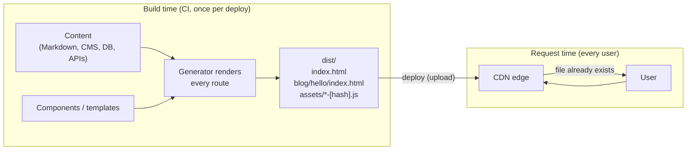
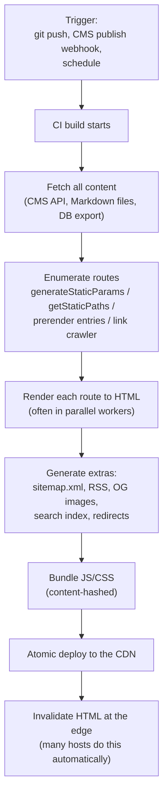
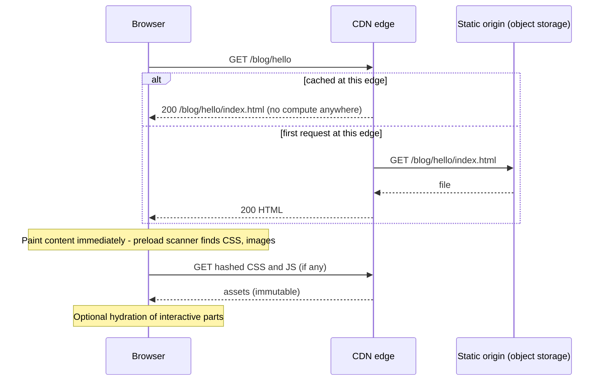
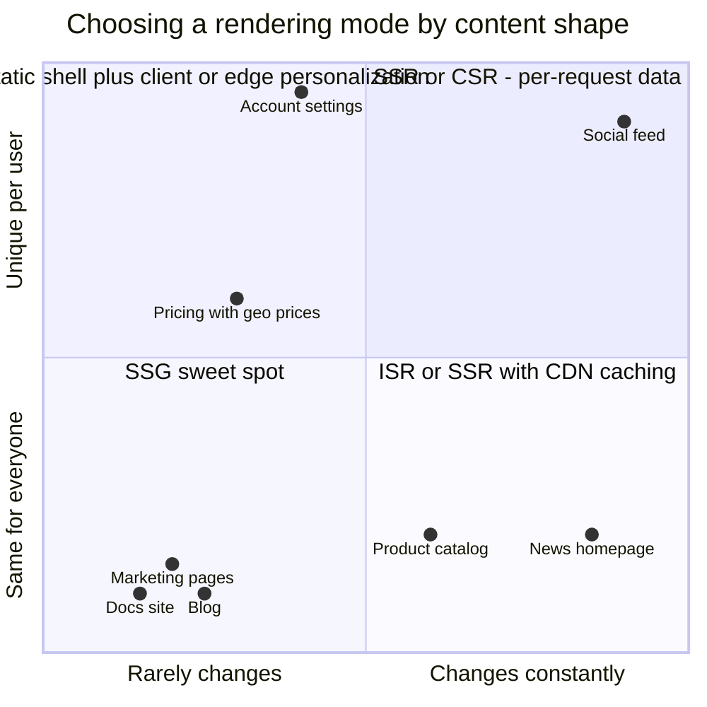
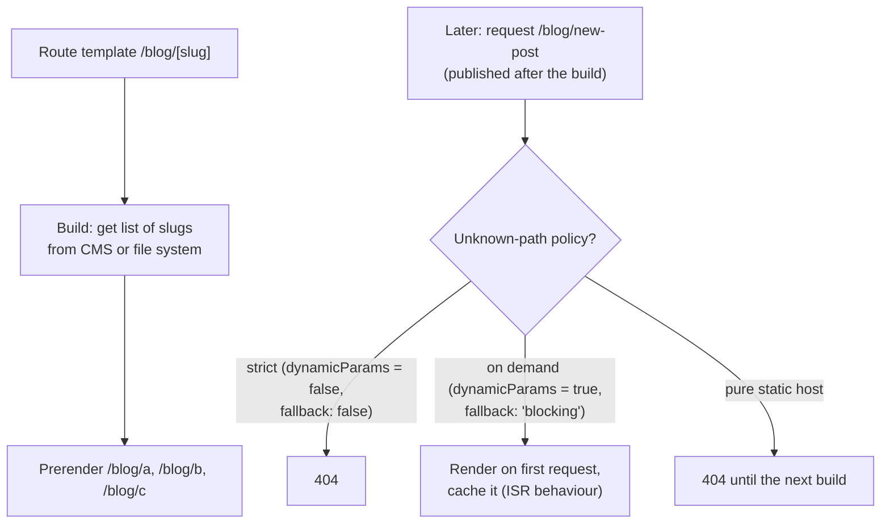
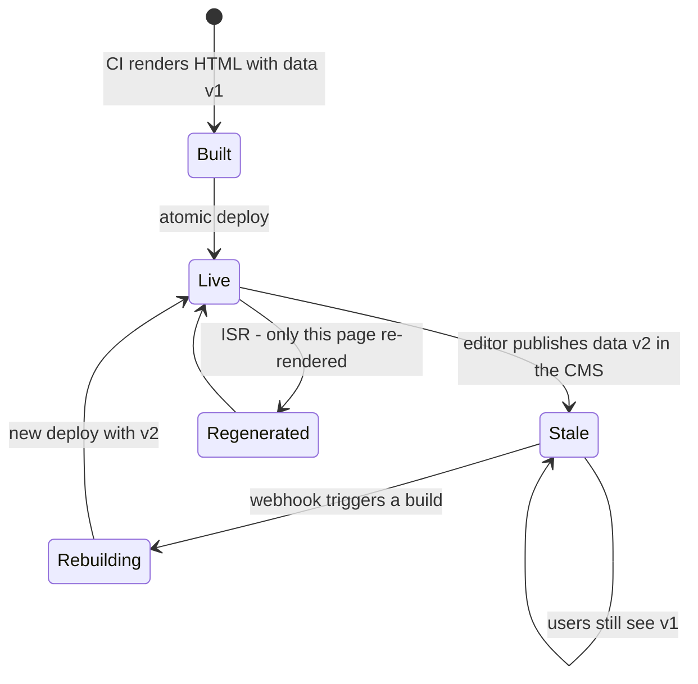
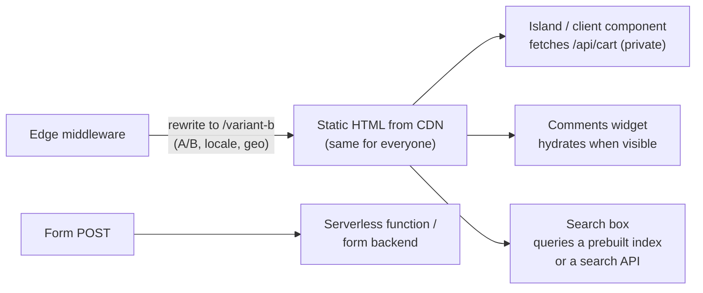
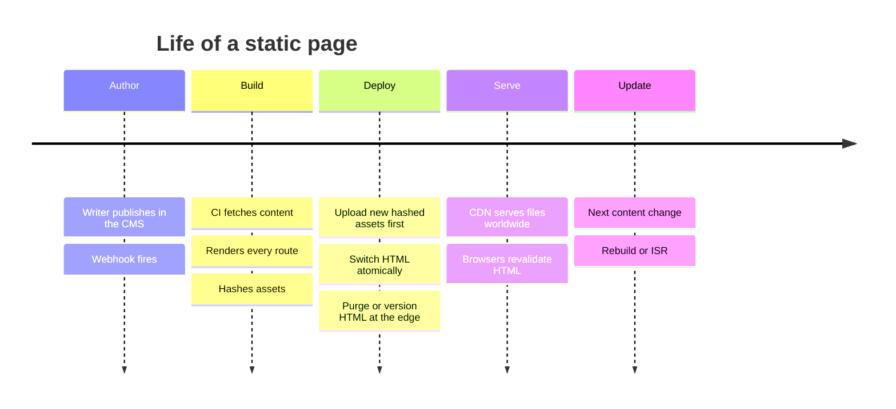
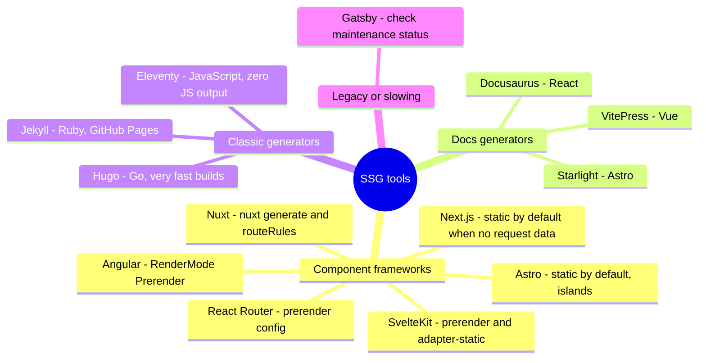

# Static Site Generation (SSG)

> **Date:** 2026-11-06 · **Last updated:** 2026-11-06
> **Category:** Frontend System Design
> **Sub-Topic:** Rendering & Architecture / Static Site Generation
> **Level:** Intermediate · **Reading time:** ~24 min
> **Informs:** rendering strategy per route, build time vs page count, content freshness and rebuild triggers, CDN hosting and atomic deploys, SEO for content sites, JS budget for content pages (zero-JS / islands), handling dynamic or personalized fragments on static pages

> **Pre-requisite:** [Server-Side Rendering (SSR)](./server-side-rendering-ssr.md) (rendering components to HTML and hydrating) and [DNS Resolution & CDN](../01-web-fundamentals/dns-resolution-and-cdn.md) (how static files reach users from the edge).
> SSG is SSR moved to **build time**: the same rendering, done once instead of on every request.

**Previous:** [Server-Side Rendering (SSR)](./server-side-rendering-ssr.md) · **Next:** [Incremental Static Regeneration (ISR)](./incremental-static-regeneration-isr.md)

---

## Table of Contents

1. [ELI5 — Simple Explanation](#eli5--simple-explanation)
2. [Section 1: What SSG Actually Is](#section-1-what-ssg-actually-is)
3. [Section 2: The Build Pipeline](#section-2-the-build-pipeline)
4. [Section 3: Serving Static Pages](#section-3-serving-static-pages)
5. [Section 4: SSG and the Performance Metrics](#section-4-ssg-and-the-performance-metrics)
6. [Section 5: Dynamic Routes — Enumerating Pages at Build Time](#section-5-dynamic-routes--enumerating-pages-at-build-time)
7. [Section 6: The Freshness Problem](#section-6-the-freshness-problem)
8. [Section 7: Dynamic and Personalized Content on Static Pages](#section-7-dynamic-and-personalized-content-on-static-pages)
9. [Section 8: Hosting, Deploys and Caching](#section-8-hosting-deploys-and-caching)
10. [Section 9: Limits of SSG](#section-9-limits-of-ssg)
11. [Section 10: SSG Across Frameworks and Platforms](#section-10-ssg-across-frameworks-and-platforms)
12. [Decision Matrix — SSG vs ISR vs SSR vs CSR](#decision-matrix--ssg-vs-isr-vs-ssr-vs-csr)
13. [Real-World Examples](#real-world-examples)
14. [Key Points Summary](#key-points-summary)
15. [Test Your Understanding (with answers)](#test-your-understanding)
16. [Cheat Sheet](#cheat-sheet)
17. [References & Further Reading](#references--further-reading)

---

## ELI5 — Simple Explanation

Think of a **bakery**:

- **SSG** is baking all the bread **before the shop opens**. When customers arrive, the loaves are already on the shelf and they're served instantly. Lots of identical shops (CDN locations) can each hold a copy.
- **SSR** is baking each loaf **when the customer orders it**. It's always fresh and can be customized, but every customer waits for the oven, and a rush needs more bakers.
- The catch with SSG: if the recipe changes at noon (a price change, a typo fix), the bread on the shelves is **still the morning batch** until you bake again (**rebuild**). Baking ten loaves takes minutes; baking a million takes much longer.
- You can't write each customer's name on a pre-baked loaf. Personal touches (the user's cart, "Hi, Sara") have to be added **at the counter** (in the browser, or at the edge).

> **SSG renders pages once at build time and serves the same HTML files to everyone from a CDN: the fastest and cheapest delivery there is, as long as the content can be identical for all users and only as fresh as your last build.**

---

## Core Concept — Step by Step

### Section 1: What SSG Actually Is

**Static Site Generation** (also called **prerendering** or **static rendering**) runs your templates or components **during the build**, writes one HTML file per route, and deploys those files with the assets to static hosting or a CDN. No code runs on a server when a user requests a page.



| Term | Meaning |
|---|---|
| **SSG / prerendering / static rendering** | HTML produced at build time, served as files |
| **Route enumeration** | Telling the generator which dynamic URLs exist (`/blog/[slug]` → which slugs?) |
| **Hydration (optional)** | Static HTML can still load JS and hydrate, exactly as with SSR |
| **Zero-JS page** | A static page that ships no framework JS at all (Astro's default, Hugo, Eleventy) |
| **Islands** | Only selected interactive components hydrate on an otherwise static page. See [Island Architecture](./island-architecture.md) |
| **Jamstack** | Industry term for prebuilt markup + JavaScript + APIs, served from a CDN |
| **Atomic deploy** | A new build becomes live all at once, never half old and half new |

> **SSG and SSR use the same rendering code.** The difference is **when** it runs: at build time (SSG), on each request (SSR), or at build time plus periodic regeneration ([ISR](./incremental-static-regeneration-isr.md)).

---

### Section 2: The Build Pipeline



**Build time grows with the number of pages:**

```text
build time ≈ fixed setup (install, bundle)
           + content fetching (API calls; watch rate limits)
           + pages × average render time ÷ parallelism
```

That formula is why pure SSG gets painful for very large catalogs: a site with a few hundred pages builds quickly, while one with hundreds of thousands of product pages may take a long time per deploy, and **every typo fix waits for the whole build**. The usual remedies: prerender only the popular pages and generate the rest on demand (ISR or on-demand fallback), incremental builds where the tool supports them, and caching fetched content between builds.

---

### Section 3: Serving Static Pages



There's **no application server in the request path**. Availability and latency are those of the CDN and object storage, which is why static sites survive traffic spikes that take down SSR servers.

---

### Section 4: SSG and the Performance Metrics

| Metric | SSG | Why |
|---|---|---|
| **TTFB** | ✅ Best possible | A file from the nearest edge; no rendering or data fetching per request |
| **FCP / LCP** | ✅ Excellent | Content and image URLs are in the HTML; images can be optimized and sized at build time |
| **CLS** | ✅ Good | Layout is final, as long as client-side fragments reserve their space |
| **INP / TBT** | ✅ to ⚠️ Depends on JS | Zero-JS or islands pages: very little main-thread work. A static page that hydrates a full React app pays the same hydration cost as SSR |
| **Server cost** | ✅ Near zero | Serving files; compute only at build time |
| **Freshness** | ❌ As of the last build | The trade-off you accept (Section 6) |



> **SSG doesn't automatically mean little JS.** "Static" describes how HTML is produced, not how much JavaScript runs afterwards. A Next.js or Gatsby static page still hydrates its components unless they're server-only. Astro, Eleventy and Hugo ship no framework JS by default.

---

### Section 5: Dynamic Routes — Enumerating Pages at Build Time

A route like `/blog/[slug]` is a template. The generator needs the **list of slugs** to produce files. Each framework has a way to provide it, and a policy for **unknown** slugs requested later.



| Framework | Enumerate dynamic paths | Unknown paths |
|---|---|---|
| **Next.js App Router** | `export async function generateStaticParams()` | `export const dynamicParams = true` (default: render on demand) or `false` (404) |
| **Next.js Pages Router** | `getStaticPaths` + `getStaticProps` | `fallback: false` (404), `true` (fallback UI, then render), `'blocking'` (render on request) |
| **Astro** | `export async function getStaticPaths()` returning `{ params, props }` | 404 in static output; on-demand pages need an adapter and `prerender = false` |
| **SvelteKit** | `export const prerender = true` + `entries()` export, or let the crawler follow links from `/` | Not prerendered → 404 on a static host (or SSR if a server adapter is used) |
| **Nuxt** | `nuxt generate` crawls links; `routeRules: { '/blog/**': { prerender: true } }`; `nitro.prerender.routes` for extra URLs | Depends on the deployment: static host → 404, server → SSR |
| **Angular** | `app.routes.server.ts`: `renderMode: RenderMode.Prerender` with `getPrerenderParams()` | `fallback` option (`Server`, `Client` or `None`) for unlisted params |
| **React Router v7** | `prerender: async () => [...paths]` in `react-router.config.ts` | Other paths: SSR if `ssr: true`, or the SPA fallback if `ssr: false` |
| **Hugo / Eleventy / Jekyll** | Every content file becomes a page; pagination and taxonomies generate more | 404 until rebuilt |

> **Crawler-based enumeration is fragile.** If a page is only reachable from a search box or a JS-only link, a link crawler never finds it. Provide explicit entries for those routes.

---

### Section 6: The Freshness Problem

A static page is a **snapshot** of the data at build time.



| Strategy | Freshness | Cost | Good for |
|---|---|---|---|
| **Rebuild on every content change** (CMS webhook → CI) | Minutes (build + deploy time) | Full build each time | Small and medium sites |
| **Scheduled rebuilds** (cron) | Up to the schedule interval | Predictable | Content that tolerates delay (event listings, daily data) |
| **Incremental / partial builds** | Faster rebuilds of changed pages | Tool-dependent | Large sites on tools that support it |
| **ISR** (time-based or on-demand revalidation) | Seconds to minutes, per page | Needs a runtime that supports it | Large catalogs, news. See [Incremental Static Regeneration (ISR)](./incremental-static-regeneration-isr.md) |
| **Static shell + client fetch** for volatile fields | Live for those fields | An extra API call per view | Price, stock, comments, like counts |
| **Edge rendering / composition** | Per request at the edge | Edge compute | Geo, A/B, personalization. See [Edge Rendering](./edge-rendering.md) |

> **Decide freshness per field, not per page.** A product description can be a day old; the price and stock can't. Prerender the slow-changing bulk and fetch the volatile fields on the client (or switch that route to ISR/SSR).

---

### Section 7: Dynamic and Personalized Content on Static Pages

Static doesn't mean non-interactive. Common patterns for adding the parts that can't be prerendered:



| Need | Pattern |
|---|---|
| Logged-in header, cart count | Client fetch after load from a `private` API. Reserve space to avoid CLS |
| Comments, reviews, likes | Island or lazy component hydrated on visibility |
| Search | Prebuilt client-side index (Pagefind, Lunr, FlexSearch) for small sites; a search API for large ones |
| Forms | Serverless function or third-party form backend |
| A/B tests, geo, locale | **Prerender each variant** and choose at the edge (middleware rewrite), instead of flipping content in client JS (avoids flicker and CLS) |
| Draft preview for editors | Framework preview modes (Next.js Draft Mode, Nuxt preview, Astro/SvelteKit with a server route) render drafts on request |

---

### Section 8: Hosting, Deploys and Caching



**Caching rules for SSG output** (details in [Browser Caching Strategies](../01-web-fundamentals/browser-caching-strategies.md)):

| File | Header | Why |
|---|---|---|
| `/assets/*-[hash].js/css`, hashed images | `public, max-age=31536000, immutable` | URL changes when content changes |
| HTML pages | Browser: `no-cache` + ETag. Edge: long TTL **if** the host purges on deploy | A deploy must be visible immediately |
| `sitemap.xml`, `robots.txt`, `feed.xml` | Short TTL (e.g. `max-age=3600`) | Stable URLs |
| `404.html` | Served with status **404** | Avoid soft 404s |

**Hosting details that bite:**
- **Clean URLs and trailing slashes:** `/blog/hello` may be emitted as `blog/hello/index.html` or `blog/hello.html`. Pick one convention and redirect the other, or you get duplicate URLs in search.
- **Redirects** must be configured on the host (`_redirects`, `vercel.json`, `netlify.toml`, CDN rules); there's no server code to do them.
- **Atomic, immutable deploys:** hosts like Netlify, Vercel, Cloudflare Pages and Firebase Hosting publish a build all at once and can roll back instantly to a previous build.
- **Keep old hashed assets** for a while after deploys, or open tabs that lazy-load old chunks will fail.

---

### Section 9: Limits of SSG

| Limitation | Why | Workaround |
|---|---|---|
| **No request data at build time** | There is no request: no cookies, headers, query strings or user | Client-side fetch, edge middleware, or SSR for that route |
| **Query-string pages** (`/search?q=…`) | Infinite combinations can't be prerendered | Static shell + client search, or SSR |
| **Build time scales with page count** | Every page renders on every build | Prerender the popular subset, ISR/on-demand for the long tail |
| **Content staleness** | Snapshot at build time | Webhooks, ISR, client fetch for volatile fields |
| **Build-time API load** | Thousands of CMS/API calls per build | Batch queries, cache between builds, respect rate limits |
| **Secrets at build time** | Build-time env vars are safe only if they never reach client bundles | Use them only in build/server code; prefix rules (`NEXT_PUBLIC_`, `VITE_`, `PUBLIC_`) decide what ships |
| **Per-user pages** | Can't prerender one page per user | CSR or SSR |

---

### Section 10: SSG Across Frameworks and Platforms



| Stack | How to do SSG | Notes |
|---|---|---|
| **Next.js (App Router)** | Routes are prerendered at build time when they use no request-time APIs; `generateStaticParams` for dynamic segments; `output: 'export'` for a fully static export | Newer versions add Cache Components / Partial Prerendering (a static shell with dynamic holes). Check the docs for your version |
| **Next.js (Pages Router)** | `getStaticProps` + `getStaticPaths` | Still supported; App Router is the recommended path for new apps |
| **Astro** | Static output by default; `getStaticPaths` for dynamic routes; islands with `client:*` directives | Content Collections give typed Markdown/MDX content |
| **Nuxt** | `nuxt generate` (full static) or `routeRules` with `prerender: true` per route (hybrid) | Nitro's crawler discovers links |
| **SvelteKit** | `export const prerender = true` (per page or in the root layout) + `adapter-static` for a fully static site | Mix prerendered and SSR routes with other adapters |
| **Angular** | `@angular/ssr` server routes with `RenderMode.Prerender` (build-time) | Hydrates like SSR output |
| **React Router v7** | `prerender` in `react-router.config.ts` | Works with `ssr: false` for static hosting |
| **Hugo / Eleventy / Jekyll** | Templates + content files | No client framework by default |
| **Gatsby** | `gatsby build` with its GraphQL data layer | Development has slowed significantly since its 2023 acquisition by Netlify. Check the project's current status before choosing it for new work; Astro or Next.js are the common migration targets |
| **Native mobile** | Not HTML, but the same idea: **bundle content into the app** or ship prebuilt JSON/content files from a CDN, refreshed in the background | Static JSON on a CDN is an "SSG API" for any client |

---

## Decision Matrix — SSG vs ISR vs SSR vs CSR

| Question | SSG | ISR | SSR | CSR |
|---|---|---|---|---|
| When is HTML made? | Build | Build + background regeneration | Each request | In the browser |
| TTFB | ✅ Best | ✅ Best (cache hit) | ⚠️ Server work | ✅ (empty shell) |
| LCP / SEO | ✅ | ✅ | ✅ | ❌ |
| Freshness | ❌ Last build | ⚠️ Seconds–minutes | ✅ Live | ✅ Live |
| Per-user content | ❌ (client/edge only) | ❌ (client/edge only) | ✅ | ✅ |
| Page count | Small–medium | Huge | Any | Any |
| Infrastructure | Static host | Runtime with ISR support | Server / serverless / edge | Static host |
| Traffic spikes | ✅ CDN absorbs | ✅ CDN absorbs | ⚠️ Scale servers or cache | ✅ (API still loaded) |

```text
Is the HTML the same for every user?
  NO  → SSR (public, fresh) or CSR (behind login)
  YES → Can it be as old as the last build?
          YES → How many pages?  small/medium → SSG    huge → SSG popular pages + ISR/on-demand
          NO  → Seconds-to-minutes old OK? → ISR (or SSR + CDN cache)
                Must be live?              → SSR, or SSG + client fetch for live fields
```

---

## Real-World Examples

**Example 1 — Next.js App Router: prerender all blog posts, 404 for unknown slugs:**
```tsx
// app/blog/[slug]/page.tsx
import type { Metadata } from 'next';
import { notFound } from 'next/navigation';
import { getAllSlugs, getPost } from '@/lib/cms';

export const dynamicParams = false; // unknown slugs → 404 instead of on-demand rendering

export async function generateStaticParams() {
  const slugs = await getAllSlugs();      // runs at build time
  return slugs.map((slug) => ({ slug }));
}

export async function generateMetadata({ params }: { params: Promise<{ slug: string }> }): Promise<Metadata> {
  const { slug } = await params;
  const post = await getPost(slug);
  return {
    title: post?.title,
    description: post?.excerpt,
    openGraph: { images: post?.ogImage ? [post.ogImage] : [] }, // real link previews, no JS needed
  };
}

export default async function PostPage({ params }: { params: Promise<{ slug: string }> }) {
  const { slug } = await params;
  const post = await getPost(slug);
  if (!post) notFound();
  return (
    <article>
      <h1>{post.title}</h1>
      <div dangerouslySetInnerHTML={{ __html: post.html }} /> {/* sanitized at build time */}
    </article>
  );
}
```

**Example 2 — Astro: static page with one interactive island:**
```astro
---
// src/pages/products/[id].astro
import Layout from '../../layouts/Layout.astro';
import StockBadge from '../../components/StockBadge.tsx'; // React, Vue, Svelte or Solid component

export async function getStaticPaths() {
  const products = await fetch('https://cms.example.com/api/products').then((r) => r.json());
  return products.map((p) => ({ params: { id: p.id }, props: { product: p } }));
}

const { product } = Astro.props;
---
<Layout title={product.name}>
  <h1>{product.name}</h1>
  
  <p>{product.description}</p>
  <!-- Only this component ships JS; it hydrates when scrolled into view and fetches live stock -->
  <StockBadge client:visible productId={product.id} />
</Layout>
```

**Example 3 — Volatile fields: build-time price (BAD) → static page + live fetch (GOOD):**
```tsx
// ❌ BAD: price baked into HTML at build time; a sale started an hour ago isn't visible
<p className="price">{product.priceAtBuildTime}</p>

// ✅ GOOD: prerender the description, fetch price and stock live (reserve space for CLS)
'use client';
import { useQuery } from '@tanstack/react-query';

export function LivePrice({ id }: { id: string }) {
  const { data } = useQuery({
    queryKey: ['price', id],
    queryFn: () => fetch(`/api/price/${id}`).then((r) => r.json()),
    staleTime: 30_000,
  });
  return (
    <p className="price" style={{ minHeight: '1.5em' }} aria-live="polite">
      {data ? data.formatted : <span className="skeleton">Loading price…</span>}
    </p>
  );
}
```

**Example 4 — SvelteKit, Nuxt and Angular prerendering:**
```typescript
// SvelteKit: src/routes/blog/[slug]/+page.server.ts
import type { EntryGenerator, PageServerLoad } from './$types';

export const prerender = true;

export const entries: EntryGenerator = async () => {
  const slugs = await getAllSlugs();
  return slugs.map((slug) => ({ slug }));
};

export const load: PageServerLoad = async ({ params }) => ({ post: await getPost(params.slug) });
```
```typescript
// Nuxt: nuxt.config.ts — hybrid rendering per route
export default defineNuxtConfig({
  routeRules: {
    '/': { prerender: true },
    '/blog/**': { prerender: true },     // SSG
    '/products/**': { isr: 3600 },        // ISR where the host supports it
    '/account/**': { ssr: false },        // CSR
  },
});
```
```typescript
// Angular: src/app/app.routes.server.ts
import { RenderMode, ServerRoute } from '@angular/ssr';
import { inject } from '@angular/core';
import { PostService } from './post.service';

export const serverRoutes: ServerRoute[] = [
  { path: '', renderMode: RenderMode.Prerender },
  {
    path: 'blog/:slug',
    renderMode: RenderMode.Prerender,
    async getPrerenderParams() {
      const slugs = await inject(PostService).getAllSlugs();
      return slugs.map((slug) => ({ slug }));
    },
  },
  { path: 'account/**', renderMode: RenderMode.Client },
  { path: '**', renderMode: RenderMode.Server },
];
```

**Example 5 — Rebuild on CMS publish (GitHub Actions + webhook):**
```yaml
# .github/workflows/deploy.yml
name: Build and deploy static site
on:
  push:
    branches: [main]
  repository_dispatch:
    types: [cms-publish]        # the CMS webhook calls the GitHub API with this event type
  schedule:
    - cron: '0 3 * * *'         # nightly safety-net rebuild

concurrency:
  group: deploy
  cancel-in-progress: true      # a newer publish supersedes a running build

jobs:
  build:
    runs-on: ubuntu-latest
    steps:
      - uses: actions/checkout@v4
      - uses: actions/setup-node@v4
        with:
          node-version: 22
          cache: npm
      - run: npm ci
      - run: npm run build      # renders every route to dist/
        env:
          CMS_TOKEN: ${{ secrets.CMS_TOKEN }}   # build-time only, never shipped to the client
      - run: npx wrangler pages deploy dist --project-name=my-site
        env:
          CLOUDFLARE_API_TOKEN: ${{ secrets.CLOUDFLARE_API_TOKEN }}
```

**Example 6 — Headers and redirects for a static host (`_headers` / `_redirects` format used by Netlify and Cloudflare Pages):**
```text
# _headers
/assets/*
  Cache-Control: public, max-age=31536000, immutable

/*
  X-Content-Type-Options: nosniff
  Referrer-Policy: strict-origin-when-cross-origin

# _redirects
/old-blog/*   /blog/:splat   301
/docs         /docs/         301
```
> On these hosts HTML gets a revalidating policy by default and the CDN is purged on every deploy. Check your host's docs before overriding HTML caching.

**Example 7 — Build-time extras: sitemap generated from the same content:**
```typescript
// app/sitemap.ts (Next.js) — emitted as /sitemap.xml at build time
import type { MetadataRoute } from 'next';
import { getAllPosts } from '@/lib/cms';

export default async function sitemap(): Promise<MetadataRoute.Sitemap> {
  const posts = await getAllPosts();
  return [
    { url: 'https://example.com/', lastModified: new Date() },
    ...posts.map((p) => ({ url: `https://example.com/blog/${p.slug}`, lastModified: p.updatedAt })),
  ];
}
// Astro: @astrojs/sitemap · Nuxt: @nuxtjs/sitemap · SvelteKit: a prerendered +server.ts route
```

---

## Key Points Summary

| Concept | One-Line Explanation |
|---|---|
| **SSG** | HTML rendered once at build time and served as static files |
| **Same code as SSR** | Only the timing differs: build vs request |
| **TTFB / LCP** | Best possible: a file from the nearest CDN edge with content in the HTML |
| **JS cost** | Depends on hydration; islands or zero-JS output keep it minimal |
| **Route enumeration** | `generateStaticParams`, `getStaticPaths`, `entries`, prerender lists or crawlers |
| **Unknown paths** | 404 or on-demand rendering (`dynamicParams`, `fallback`) |
| **Freshness** | Snapshot at build time; rebuild, ISR or client fetch to update |
| **Build time** | Grows with page count; prerender popular pages, generate the rest on demand |
| **Personalization** | Client fetch, islands or edge middleware, never baked into shared HTML |
| **No request data** | Cookies, headers and query strings don't exist at build time |
| **Hosting** | Static host/CDN, atomic deploys, instant rollback, near-zero server cost |
| **Caching** | Hashed assets immutable; HTML revalidated and purged on deploy |
| **Best fit** | Docs, blogs, marketing, landing pages, catalogs that change slowly |

---

## Test Your Understanding

**Q1 (Basic):**
What's the difference between SSG and SSR if both produce full HTML with real content? Which one gives a better TTFB, and why?

<details>
<summary>Answer</summary>

Both run the same rendering code. The difference is **when**: SSG renders at **build time** and stores files, while SSR renders on **every request**. SSG has the better TTFB because a request is just a file lookup at the nearest CDN edge. No data fetching or rendering happens in the request path. SSR has to fetch data and render before sending the first byte. The price SSG pays is **freshness** (data as of the last build) and **no per-request information** (no cookies, headers or user).
</details>

**Q2 (Application):**
A documentation site has 800 pages written in Markdown, edited a few times a day, with client-side search and a "Was this helpful?" widget. Choose a rendering strategy and tooling.

<details>
<summary>Answer</summary>

**SSG.** The content is the same for everyone and changes a few times a day, and 800 pages build quickly. Rebuild on every merge to `main`. Use a docs-focused generator (Docusaurus, VitePress, Starlight on Astro) or Astro/Eleventy.

- **Search:** build a static index at build time (e.g. Pagefind) and query it in the browser. No server needed.
- **"Was this helpful?":** a small island or client component that POSTs to a serverless function. Keep everything else zero-JS or minimal JS.
- **Hosting:** a static host with atomic deploys, preview deploys per pull request, hashed assets as `immutable`, and HTML revalidated.

SSR would add servers and cost for no benefit. CSR would hurt SEO, which matters for docs.
</details>

**Q3 (Tricky):**
An e-commerce site with 300,000 products used pure SSG. Builds now take a long time, and price corrections take just as long to appear. What would you change?

<details>
<summary>Answer</summary>

Pure SSG ties freshness and build time to the **whole catalog**. Change both dimensions:
1. **Prerender only the popular products** at build time (top sellers, landing pages). Render the long tail **on demand** on first request, then cache it (ISR, `dynamicParams = true`, `fallback: 'blocking'`, or SSR behind a CDN cache).
2. **Decouple volatile fields:** fetch price and stock on the client (or at the edge) from a fast API, so a price correction is live immediately without regenerating HTML.
3. **On-demand revalidation:** a CMS/PIM webhook regenerates just the changed product page (ISR `revalidatePath`/`revalidateTag`, or your host's equivalent).
4. Cache fetched content between builds, and batch API requests during the build.

Result: fast deploys, seconds-level freshness for the fields that need it, and static-speed delivery for everything else. See [Incremental Static Regeneration (ISR)](./incremental-static-regeneration-isr.md).
</details>

**Q4 (Tricky):**
A static marketing site runs an A/B test by swapping the hero headline in client-side JavaScript after load. Conversion data is noisy and Lighthouse shows CLS and a later LCP. What's wrong, and what's a better design?

<details>
<summary>Answer</summary>

The browser first paints variant A from the static HTML, then JS replaces it with variant B. That causes a **visible flicker**, **layout shift** (the headlines differ in length), and often a **later LCP**, because the largest element changes after load. Some users also see both variants, which pollutes the experiment.

Better: **prerender both variants** at build time (`/` and `/_variants/b`) and choose at the **edge**. Middleware reads or sets a sticky bucketing cookie and **rewrites** the request to the right prerendered file. Each user gets a complete, stable page in the first response, and the HTML stays cacheable per variant. If edge compute isn't available, at least reserve the space and keep the swap before first paint, though that blocks rendering and is a worse trade.
</details>

**Q5 (System design):**
Design the rendering for a conference website: schedule, speaker pages and venue info (edited by organizers), a live "now playing" banner during the event, ticket purchase, and an attendee dashboard.

<details>
<summary>Answer</summary>

- **Schedule, speakers, venue:** SSG, rebuilt by a CMS webhook. These pages are public, SEO-relevant and shared on social media, so real Open Graph tags matter. During the event, use ISR or more frequent rebuilds if sessions move rooms.
- **"Now playing" banner:** a client island that polls or subscribes (SSE) to a small API. The static page reserves its space, and the banner never forces a rebuild.
- **Ticket purchase:** the static page links to a checkout flow that is SSR or a hosted payment page. Payments need per-request data, `no-store` caching and server validation.
- **Attendee dashboard:** CSR (or SSR) behind login. It's personal, interactive and not crawlable.

Hosting: a static host/CDN for the SSG part (it absorbs launch-day spikes), and serverless functions for checkout and the API. Each route gets the cheapest mode that meets its freshness and personalization needs.
</details>

**Q6 (Application):**
After deploying a static site, `/blog/new-post` returns 404 even though the post exists in the CMS. Locally, `npm run dev` shows it fine. List the likely causes.

<details>
<summary>Answer</summary>

Dev servers render on request, so every route works in development. In production, only **enumerated** routes exist as files. Likely causes:
1. The post was **published after the last build**, and no webhook triggered a rebuild.
2. The route **wasn't enumerated**: `generateStaticParams` / `getStaticPaths` / `entries` filtered it out (draft status, pagination limit, an API page size that only returns the first 100 items), or the link crawler never found a link to it.
3. `dynamicParams = false` / `fallback: false` (or a pure static host) means unknown paths are 404 by design.
4. **Path mismatch:** a trailing slash or `.html` convention, or a case difference between the CMS slug and the generated file name.
5. The CDN cached a **404** from before the deploy and wasn't purged.

Fix the enumeration (and paginate CMS queries), wire the publish webhook, and decide the unknown-path policy deliberately (404 vs on-demand rendering).
</details>

---

## Cheat Sheet

**Key Definitions:**
- **SSG / prerendering:** Rendering routes to HTML files at build time
- **Route enumeration:** Supplying the list of dynamic paths to prerender
- **On-demand fallback:** Rendering an unlisted path on its first request and caching it
- **Atomic deploy:** Switching all files of a new build live at once
- **Zero-JS output:** Static HTML with no framework runtime shipped
- **Island:** An interactive component hydrated on its own inside static HTML
- **Rebuild trigger:** Git push, CMS webhook or schedule that starts a new build

**Quick Reference:**
```text
When:        content same for all users + can be as old as the last build
Strengths:   best TTFB · great LCP/SEO/link previews · near-zero server cost · survives spikes
Weaknesses:  staleness · build time ∝ pages · no cookies/headers/query at build time

Enumerate:   Next generateStaticParams (+ dynamicParams) · Pages getStaticPaths (+ fallback)
             Astro getStaticPaths · SvelteKit prerender + entries · Nuxt nuxt generate / routeRules prerender
             Angular RenderMode.Prerender + getPrerenderParams · React Router prerender: [...]
Static-only: Next output:'export' · SvelteKit adapter-static · Nuxt nuxt generate · Astro (default)

Freshness:   webhook rebuild · cron rebuild · ISR (time or on-demand) · client fetch for volatile fields
Dynamic:     islands/client components · edge middleware rewrites (A/B, geo) · serverless forms
Caching:     /assets/*-[hash] → max-age=31536000, immutable    HTML → no-cache + purge on deploy
SEO:         generate sitemap.xml + OG tags at build · 404.html with status 404 · one trailing-slash rule
```

**Common Mistakes to Avoid:**

| Mistake | Why Wrong | Fix |
|---|---|---|
| Baking prices/stock into static HTML | Users see stale values until the next build | Client or edge fetch for volatile fields, or ISR |
| Prerendering hundreds of thousands of pages on every deploy | Long builds, slow fixes | Popular subset + on-demand/ISR for the long tail |
| Assuming "static" means "no JS" | Hydrating a full app costs as much as SSR | Islands, server-only components, zero-JS tools |
| Personalizing shared HTML at build time | There is no user at build time | Client fetch or edge middleware |
| A/B testing by swapping content in client JS | Flicker, CLS, polluted results | Prerender variants, choose at the edge |
| CMS queries that return only the first page of results | Missing pages → 404 in production | Paginate through all results in enumeration |
| No rebuild trigger on content publish | Content never appears | CMS webhook → CI, plus a scheduled safety-net build |
| Long edge TTL on HTML without purge on deploy | Old HTML points at removed assets | Purge on deploy or revalidate HTML |
| Inconsistent trailing slashes | Duplicate URLs, redirect chains | One convention + redirects |
| Secrets in public env prefixes (`NEXT_PUBLIC_`, `VITE_`, `PUBLIC_`) | Shipped in the bundle | Use un-prefixed vars only in build/server code |
| Choosing Gatsby for a new project without checking status | Slower maintenance since 2023 | Evaluate Astro, Next.js or a docs generator |
| Serving `404.html` with status 200 | Soft 404s in search | Configure the host to return 404 |

---

## References & Further Reading

**Core docs**
- web.dev: [Rendering on the Web](https://web.dev/articles/rendering-on-the-web) (static rendering and prerendering)
- Patterns.dev: [Static Rendering](https://www.patterns.dev/react/static-rendering/)
- Jamstack: [What is Jamstack?](https://jamstack.org/what-is-jamstack/)
- Google Search Central: [Build and submit a sitemap](https://developers.google.com/search/docs/crawling-indexing/sitemaps/build-sitemap)

**Framework docs**
- Next.js: [`generateStaticParams`](https://nextjs.org/docs/app/api-reference/functions/generate-static-params) · [`dynamicParams`](https://nextjs.org/docs/app/api-reference/file-conventions/route-segment-config) · [Static Exports](https://nextjs.org/docs/app/guides/static-exports)
- Next.js (Pages Router): [`getStaticPaths`](https://nextjs.org/docs/pages/api-reference/functions/get-static-paths) · [`getStaticProps`](https://nextjs.org/docs/pages/api-reference/functions/get-static-props)
- Astro: [Routing — static (SSG) mode](https://docs.astro.build/en/guides/routing/#static-ssg-mode) · [Islands architecture](https://docs.astro.build/en/concepts/islands/)
- SvelteKit: [Page options — `prerender` and `entries`](https://svelte.dev/docs/kit/page-options) · [Static site generation (`adapter-static`)](https://svelte.dev/docs/kit/adapter-static)
- Nuxt: [Prerendering](https://nuxt.com/docs/getting-started/prerendering) · [Rendering modes (hybrid `routeRules`)](https://nuxt.com/docs/guide/concepts/rendering)
- Angular: [Server and hybrid rendering — render modes](https://angular.dev/guide/ssr)
- React Router: [Pre-rendering](https://reactrouter.com/how-to/pre-rendering)

**Generators**
- [Hugo documentation](https://gohugo.io/documentation/) · [Eleventy documentation](https://www.11ty.dev/docs/) · [Jekyll documentation](https://jekyllrb.com/docs/)
- [Docusaurus](https://docusaurus.io/docs) · [VitePress](https://vitepress.dev/guide/what-is-vitepress) · [Starlight](https://starlight.astro.build/)
- [Pagefind — static search](https://pagefind.app/)

**Hosting**
- Netlify: [Custom headers](https://docs.netlify.com/routing/headers/) · Cloudflare Pages: [Headers](https://developers.cloudflare.com/pages/configuration/headers/) · [Redirects](https://developers.cloudflare.com/pages/configuration/redirects/)

---

> **Previous Topic:** [Server-Side Rendering (SSR)](./server-side-rendering-ssr.md)
> — Rendering per request on the server, then hydrating

> **Next Topic:** [Incremental Static Regeneration (ISR)](./incremental-static-regeneration-isr.md)
> — Static pages that regenerate themselves in the background, page by page

*Saved on: 2026-11-06 | Repo: Frontend System Design Learning Notes*
