# GraphQL Client (Apollo, urql)

> **Date:** 2026-11-06 · **Last updated:** 2026-11-06
> **Category:** Frontend System Design
> **Sub-Topic:** State & Data / GraphQL Clients
> **Level:** Intermediate · **Reading time:** ~35 min
> **Informs:** GraphQL client choice (Apollo vs urql vs Relay vs plain fetch + TanStack Query), normalized vs document cache, fetch/request policies, cache updates after mutations, fragment colocation, SSR hydration of GraphQL data, persisted queries, auth and subscription transport

> **Pre-requisite:** [REST vs GraphQL vs gRPC-Web](../01-web-fundamentals/rest-vs-graphql-vs-grpc-web.md) (schema, operations, persisted queries) and [Server State vs Client State](./server-state-vs-client-state.md).
> This note is about the **client side** of GraphQL: what a GraphQL client library does beyond `fetch`, how Apollo Client and urql are built, and how to choose between them.

**Previous:** [SWR & Stale-While-Revalidate](./swr-and-stale-while-revalidate.md) · **Next:** [Data Normalization & Caching](./data-normalization-and-caching.md)

---

## Table of Contents

1. [ELI5 — Simple Explanation](#eli5--simple-explanation)
2. [Section 1: What a GraphQL Client Actually Does](#section-1-what-a-graphql-client-actually-does)
3. [Section 2: The Client Landscape](#section-2-the-client-landscape)
4. [Section 3: Apollo Client Architecture](#section-3-apollo-client-architecture)
5. [Section 4: Fetch Policies and Request Policies](#section-4-fetch-policies-and-request-policies)
6. [Section 5: Apollo's InMemoryCache](#section-5-apollos-inmemorycache)
7. [Section 6: Updating the Cache After Mutations](#section-6-updating-the-cache-after-mutations)
8. [Section 7: urql Architecture — Exchanges](#section-7-urql-architecture--exchanges)
9. [Section 8: Document Cache vs Graphcache](#section-8-document-cache-vs-graphcache)
10. [Section 9: Fragments, Colocation and Data Masking](#section-9-fragments-colocation-and-data-masking)
11. [Section 10: Errors and Partial Data](#section-10-errors-and-partial-data)
12. [Section 11: Auth, Retries, Subscriptions and Persisted Queries](#section-11-auth-retries-subscriptions-and-persisted-queries)
13. [Section 12: SSR, Streaming and React Server Components](#section-12-ssr-streaming-and-react-server-components)
14. [Section 13: Other Frameworks and Native Mobile](#section-13-other-frameworks-and-native-mobile)
15. [Decision Matrix](#decision-matrix)
16. [Real-World Examples](#real-world-examples)
17. [Key Points Summary](#key-points-summary)
18. [Test Your Understanding (with answers)](#test-your-understanding)
19. [Cheat Sheet](#cheat-sheet)
20. [References & Further Reading](#references--further-reading)

---

## ELI5 — Simple Explanation

Imagine a **library with a very smart librarian**.

- You hand the librarian a **shopping list** of exactly the facts you want ("the title of book 7 and its author's name") — that's a **GraphQL query**.
- A plain `fetch` librarian walks to the warehouse **every time**, even if you asked for the same thing a minute ago.
- A **GraphQL client** librarian keeps a **card catalogue** (the cache). Before walking to the warehouse, it checks the catalogue. If the answer is there, you get it instantly.
- **urql's default librarian** files whole answers by the shopping list itself: "list X → answer Y". If anything about *authors* changes, it throws away every answer that mentioned an author and fetches them again. Simple and safe.
- **Apollo's (and Graphcache's) librarian** files every **book and author on its own card** (`Author:42`). If author 42 changes name, it updates **one card** — and every answer that points at that card is instantly correct.
- **Fragments** are like each department of the library writing its own section of the shopping list, so nobody forgets a field and nobody peeks at another department's facts.

> **A GraphQL client = transport + cache + framework bindings. The big decision is the cache: whole-response (document) caching is simple; normalized (per-entity) caching keeps every screen consistent but needs `id`s and update rules.**

---

## Core Concept — Step by Step

### Section 1: What a GraphQL Client Actually Does

GraphQL is "just" an HTTP `POST` (or `GET`) with a JSON body. You **can** use `fetch` directly. A client library adds the layers in the middle:

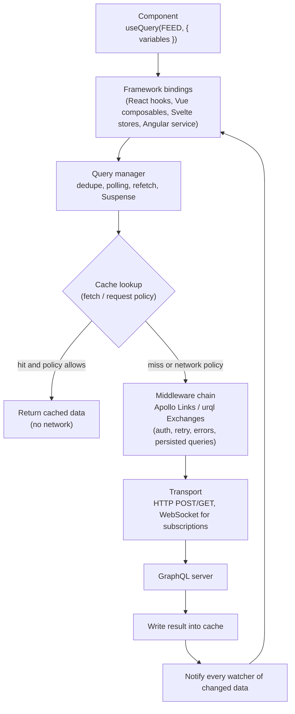

| Layer | Without a client (`fetch`) | With Apollo / urql |
|---|---|---|
| **Transport** | You write it | `HttpLink` / `fetchExchange`, WebSocket link/exchange |
| **Request dedupe** | Two components → two identical requests | Identical in-flight operations share one request |
| **Cache** | None (or HTTP cache, which ignores `POST`) | Document or normalized cache in memory |
| **Reactivity** | Manual state | Every component watching changed data re-renders |
| **Mutations → UI** | You refetch by hand | Automatic merge by `id`, or cache update functions |
| **Middleware** | Ad-hoc wrappers | Composable links / exchanges |
| **Tooling** | — | Devtools, codegen integration, SSR helpers |

> If your app has a handful of GraphQL calls and no cross-screen consistency needs, **`fetch` + [TanStack Query](./react-query-tanstack-query.md)** (with a tiny request helper) is a legitimate choice. The client libraries earn their weight when **the same entities appear on many screens**.

---

### Section 2: The Client Landscape

| Client | Cache model | Strengths | Costs | Bindings |
|---|---|---|---|---|
| **Apollo Client** | **Normalized** (`InMemoryCache`) | Mature, feature-rich (type/field policies, pagination helpers, Suspense hooks, data masking, devtools), big ecosystem | Largest of the group; many concepts; cache rules to learn | React (first-party); Vue, Angular via community/partner packages |
| **urql** | **Document** by default; **normalized** via Graphcache (opt-in) | Small core, exchange-based extensibility, simple mental model | Default cache invalidates coarsely; Graphcache adds config similar to Apollo's | React/Preact, Vue, Svelte, Solid (first-party packages) |
| **Relay** | Normalized, compiler-driven | Strongest fragment colocation and data masking, pagination conventions, performance at scale | Requires the Relay compiler and server conventions (`Node` interface, connections) | React only |
| **Houdini** | Normalized, compiler-driven | Built for SvelteKit; generates typed stores | Svelte/SvelteKit-specific | Svelte |
| **`graphql-request` / `fetch` + TanStack Query** | Per-query key (no normalization) | Minimal, familiar, works with any query library | You manage invalidation; no entity-level updates | Any |
| **Apollo Kotlin / Apollo iOS** | Normalized (in-memory and SQLite) | Native mobile with codegen | Platform-specific | Android / iOS |

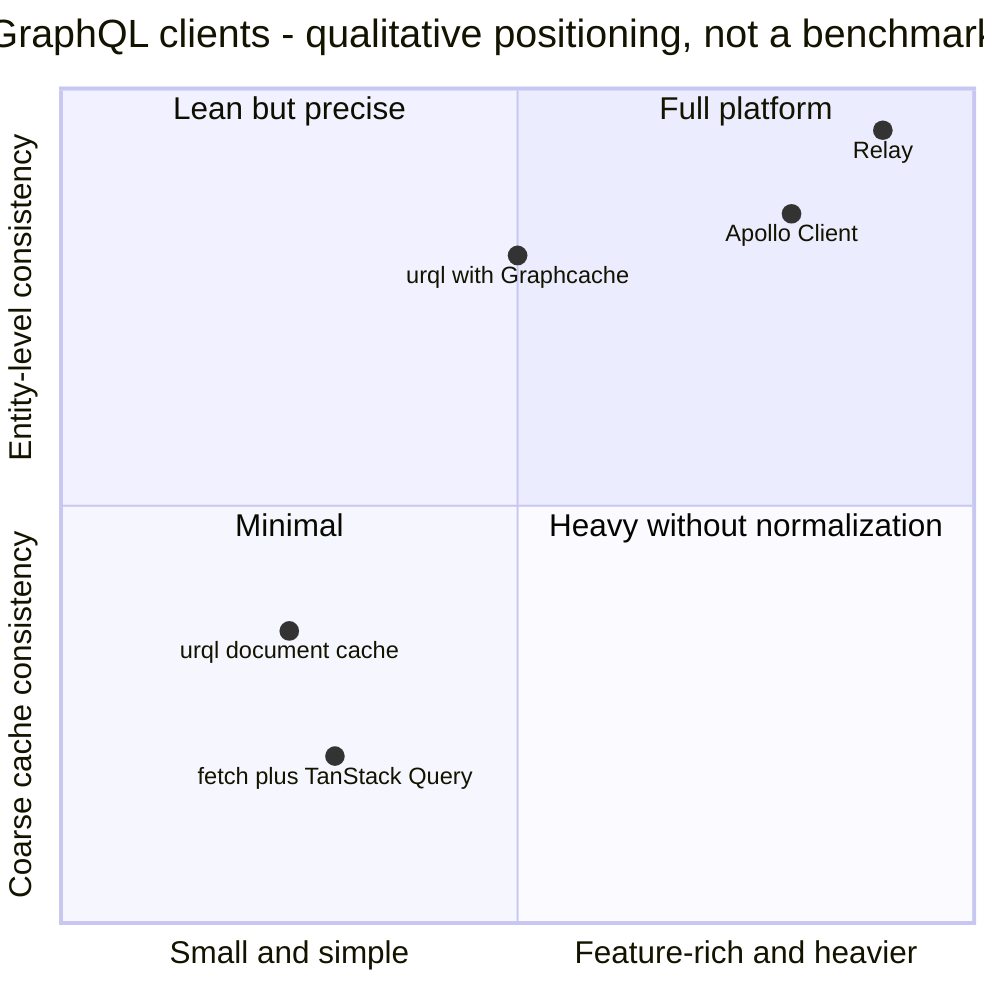

> Positions are a **qualitative** summary of design trade-offs, not measurements. Measure bundle size for **your** imports with your bundler's analyzer.

---

### Section 3: Apollo Client Architecture

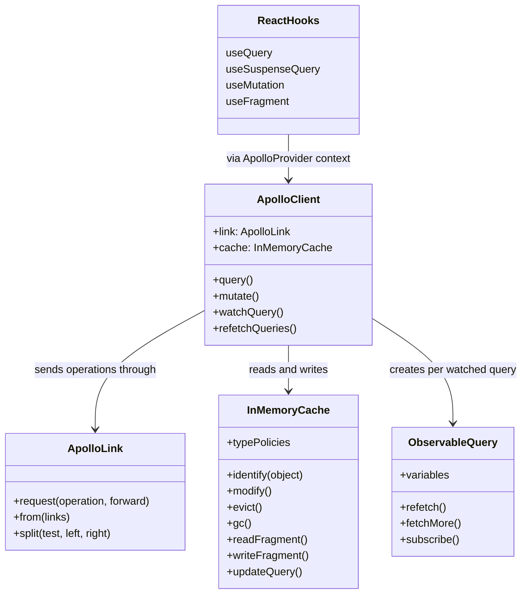

**The request path for `useQuery` with the default `cache-first` policy:**

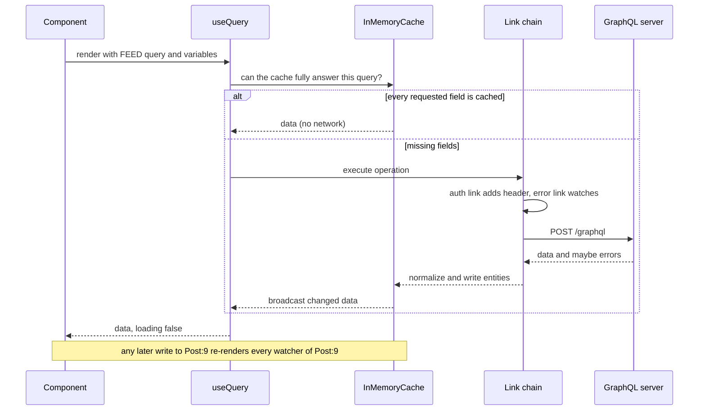

**Apollo Client 4 notes** (released 2025 — check the [migration guide](https://www.apollographql.com/docs/react/migrating/apollo-client-4-migration) for your version):
- React hooks and `ApolloProvider` are imported from **`@apollo/client/react`**.
- The `uri` shortcut on `new ApolloClient()` is gone: pass `link: new HttpLink({ uri })` explicitly.
- Link helpers became classes: `SetContextLink`, `ErrorLink`, `HttpLink`, `PersistedQueryLink`; compose with `ApolloLink.from` / `ApolloLink.split`.
- `ApolloError` was removed: GraphQL errors arrive as `CombinedGraphQLErrors`, network errors as-is (`ServerError`, etc.), each with a static `.is()` check.
- `onCompleted` / `onError` callbacks were removed from `useQuery` — derive from `data`/`error` or use effects.
- `rxjs` is a peer dependency (Observables moved from `zen-observable` to RxJS).

Most Apollo Client 3 code you find online still uses the old imports — the concepts below are the same in both.

---

### Section 4: Fetch Policies and Request Policies

The **policy** decides whether a query reads the cache, the network, or both. Choose it **per query**, based on how stale the data may be.

| Apollo `fetchPolicy` | urql `requestPolicy` | Behavior | Use for |
|---|---|---|---|
| `cache-first` (default) | `cache-first` (default) | Cache if complete, else network | Most data; rarely changing entities |
| `cache-and-network` | `cache-and-network` | Return cache **now**, always refetch in the background (urql marks `result.stale`) | Feeds, dashboards — this is stale-while-revalidate |
| `network-only` | `network-only` | Always fetch, **write** result to cache | "Must be fresh" screens (checkout totals) |
| `no-cache` | — | Always fetch, **don't** write to cache | One-off, huge or sensitive results |
| `cache-only` | `cache-only` | Never fetch; error/`null` if missing | Offline mode, reading data you know is present |
| `standby` | — | Like `cache-first` but doesn't auto-update | Rare, advanced |

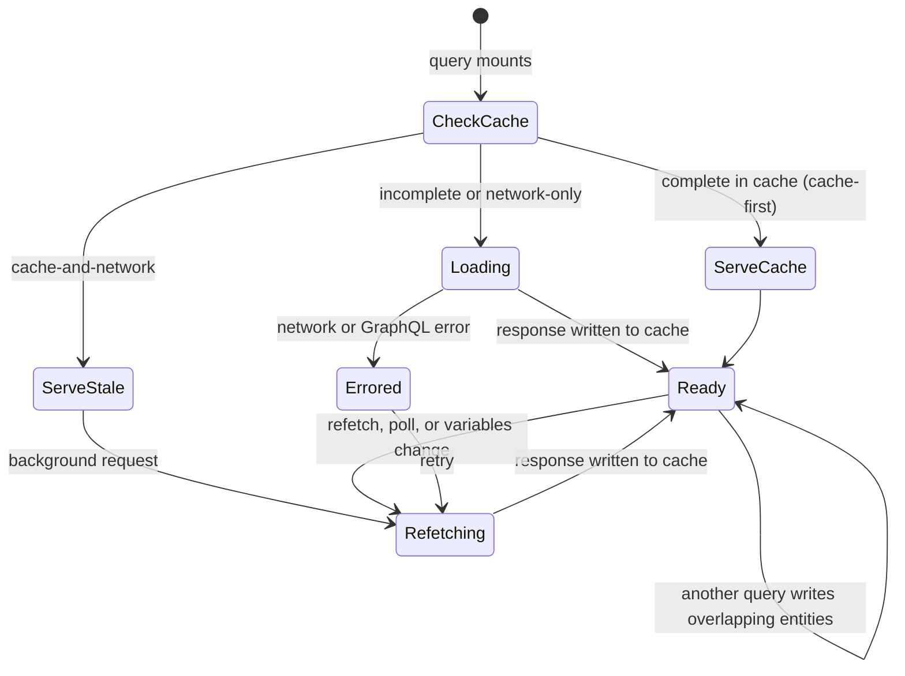

**`nextFetchPolicy` (Apollo):** a common pattern is `fetchPolicy: 'cache-and-network', nextFetchPolicy: 'cache-first'` — refresh on mount, but don't refetch on every later cache update.

**Polling vs refetch vs subscriptions:** `pollInterval` is the simplest "live" data (dashboards); subscriptions push changes ([Real-Time Data Sync](./real-time-data-sync.md)); `refetch()` is for user-initiated refresh.

---

### Section 5: Apollo's InMemoryCache

Apollo **normalizes** every response: each object with a `__typename` and `id` (or `_id`) becomes a separate record keyed `Typename:id`, and parents store **references** to it. (Full theory in [Data Normalization & Caching](./data-normalization-and-caching.md).)

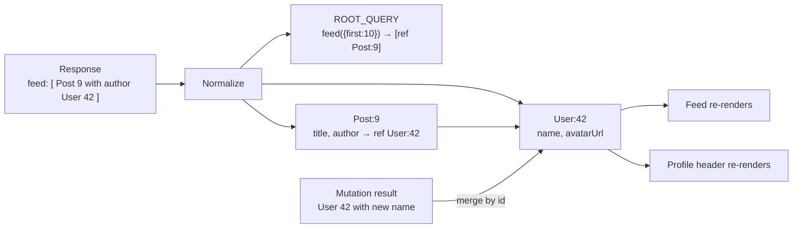

**Type and field policies** customize identity and storage:

| Need | Configuration |
|---|---|
| Object identified by something other than `id` | `typePolicies: { Product: { keyFields: ['sku'] } }` |
| Singleton object (one per app) | `keyFields: []` |
| Never normalize (embedded value object) | `keyFields: false` |
| Paginated list that should **accumulate** | Field policy with `merge` (or helpers `offsetLimitPagination()`, `relayStylePagination()` from `@apollo/client/utilities`) |
| Cache key should ignore some arguments | `keyArgs: ['filter']` |
| Redirect `product(id: 7)` to an already-cached `Product:7` | Field `read` function using `toReference` |
| Interfaces / unions | `possibleTypes` (often generated by codegen) |
| Client-only computed field | Field `read` function (or Apollo's local state feature) |

**Golden rules:**
1. **Always select `id`** (and let the client add `__typename`) on every object — otherwise it can't be normalized and gets stored **inside its parent**, so updates don't propagate.
2. **Mutations should return the changed object with its `id` and the changed fields** — the cache merges them automatically.
3. Configure **pagination field policies**; otherwise each `fetchMore` page with different arguments is stored as a **separate** field entry.

---

### Section 6: Updating the Cache After Mutations

The cache knows how to **update an existing entity** (same `Typename:id`), but it **cannot guess list membership**: after `createTodo`, which lists should contain the new todo?

```mermaid
flowchart TD
    M["Mutation succeeded"] --> E{"What changed?"}
    E -->|"fields of an existing entity<br/>(rename, toggle)"| A["Return id + changed fields<br/>→ automatic merge ✅"]
    E -->|"item added to a list"| L{"Know exactly which lists?"}
    L -->|"yes, one or two"| U["update(cache) with<br/>cache.updateQuery / cache.modify"]
    L -->|"no, many filtered lists"| R["refetchQueries<br/>(or evict the list field)"]
    E -->|"item deleted"| D["cache.evict({ id: cache.identify(obj) })<br/>then cache.gc()"]
    E -->|"server computes side effects<br/>(totals, counters, ranks)"| R
    U --> O["Optionally add optimisticResponse<br/>(see Optimistic UI note)"]
```

| Technique | Precision | Network cost | Risk |
|---|---|---|---|
| Automatic merge by `id` | Exact | None | Forgetting to select `id` / fields |
| `update` + `cache.updateQuery` / `cache.modify` | Exact | None | Code must match every affected list + variables |
| `refetchQueries` | Whatever the server says | Extra request(s) | Slower; extra load |
| `cache.evict` + `gc` | Removes entity/field; watchers refetch if needed | Possibly later | Over-eviction → refetch storms |

> urql's Graphcache has the same split: `updates.Mutation.<field>(result, args, cache, info)` with `cache.updateQuery`, `cache.link`, `cache.invalidate`. urql's **document** cache instead invalidates **every cached query that contains a `__typename` returned by the mutation**.

---

### Section 7: urql Architecture — Exchanges

urql's `Client` is a **stream pipeline**. Each operation flows through an ordered list of **exchanges**; results flow back. Built-in deduplication means identical in-flight operations share one request (the old `dedupExchange` is no longer needed in current versions).

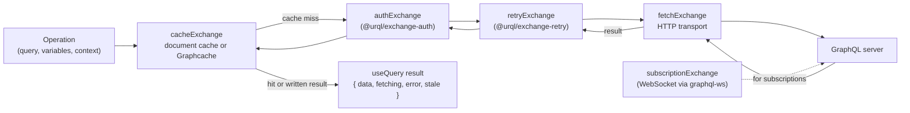

**Order matters:** synchronous exchanges (cache) come **before** asynchronous ones (auth, retry), and the transport (`fetchExchange`, `subscriptionExchange`) comes **last**. A cache placed after `fetchExchange` would never see operations.

| Exchange | Package | Job |
|---|---|---|
| `cacheExchange` | `urql` / `@urql/core` | Document cache (query + variables → result) |
| `cacheExchange` (Graphcache) | `@urql/exchange-graphcache` | Normalized cache, `keys`, `resolvers`, `updates`, `optimistic`, offline support |
| `fetchExchange` | `urql` / `@urql/core` | HTTP |
| `subscriptionExchange` | `urql` / `@urql/core` | Forwards subscriptions to a transport you provide |
| `ssrExchange` | `urql` / `@urql/core` | Collect results on the server, rehydrate on the client |
| `mapExchange` | `urql` / `@urql/core` | Inspect/modify operations, results and errors (global error toast, logging) |
| `authExchange` | `@urql/exchange-auth` | Add tokens, detect auth errors, refresh once, retry |
| `retryExchange` | `@urql/exchange-retry` | Retry network errors with backoff |
| `persistedExchange` | `@urql/exchange-persisted` | Automatic persisted queries |

`useQuery` in React returns a tuple: `[result, reexecuteQuery]`; `useMutation` returns `[result, executeMutation]`.

---

### Section 8: Document Cache vs Graphcache

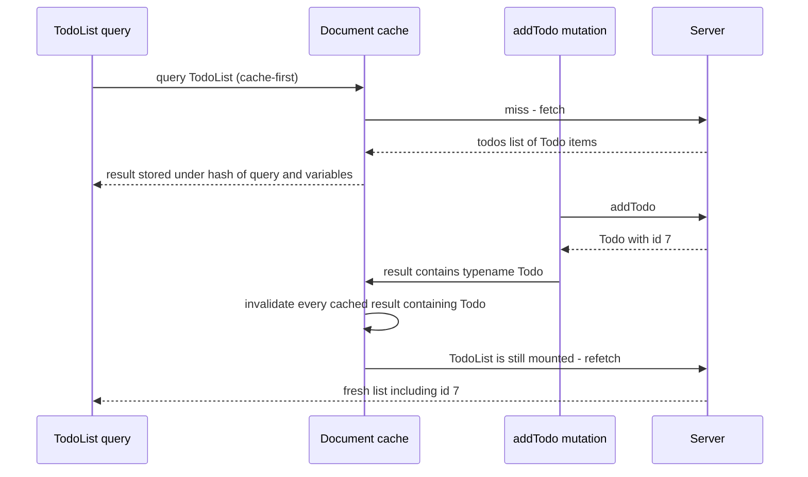

| | **Document cache** (urql default) | **Normalized** (Graphcache, Apollo, Relay) |
|---|---|---|
| Cache key | Hash of query document + variables | `Typename:id` per entity + root fields |
| Same entity in two queries | Two independent copies | One record, shared |
| After a mutation | Invalidate every result containing a returned `__typename` → **refetch** | Merge changed fields in place → **no refetch** for field edits |
| Empty lists | Contain no `__typename`, so they can't be invalidated — add `additionalTypenames` | Handled via `updates` / `update` |
| Config needed | Almost none | `keys`/`keyFields`, list updaters, pagination |
| Best for | Content sites, read-mostly apps, small apps | Highly interactive apps, the same entity on many screens |

> **Rule of thumb:** start with urql's document cache if the app is read-mostly; switch to Graphcache (same `Client`, swap one exchange) when refetch storms or inconsistent screens appear.

---

### Section 9: Fragments, Colocation and Data Masking

**Fragment colocation:** each component declares the fields it needs **next to its code**; parent queries spread child fragments. Fields can't go missing when someone edits a child, and removing a component removes its fields.

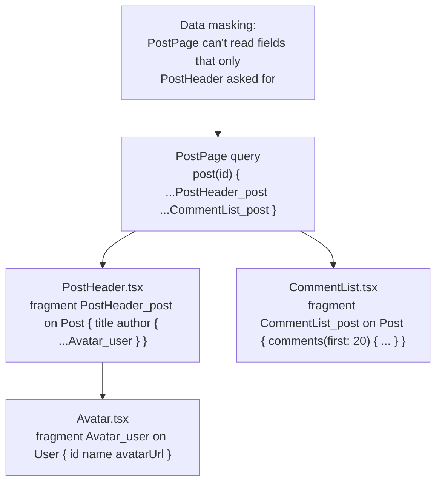

| Feature | Apollo Client | urql | Relay |
|---|---|---|---|
| Fragments | ✅ | ✅ | ✅ (required) |
| Read a fragment from cache in a child | `useFragment` (watches that entity only) | Via codegen helpers / Graphcache reads | `useFragment` |
| **Data masking** (parent can't see child's fields) | Opt-in (`dataMasking: true`, added in the 3.12 era) | Via codegen ("fragment masking" in GraphQL Code Generator's client preset, or gql.tada) | Built in, always on |
| Re-render scope | Components using `useFragment` re-render only when their entity changes | Query-level | Fragment-level |

**Type safety:** generate types from the schema and your operations — **GraphQL Code Generator** (client preset) or **gql.tada** (types inferred in TypeScript without a codegen step). Generated types also power fragment masking. Relay has its own compiler that generates types.

---

### Section 10: Errors and Partial Data

GraphQL can return **both** `data` and `errors` in the same `200` response (one field failed, others succeeded). Clients must decide what to show.

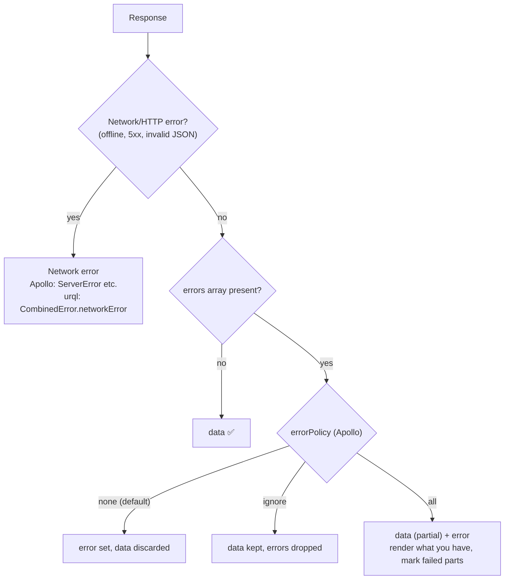

| | Apollo Client 4 | urql |
|---|---|---|
| Error object | `error` — check `CombinedGraphQLErrors.is(error)` for GraphQL errors; network errors are returned as-is | `CombinedError` with `.graphQLErrors[]` and `.networkError` |
| Partial data | `errorPolicy: 'all'` | `data` and `error` can both be set |
| Global handling | `ErrorLink` in the link chain | `mapExchange({ onError })` |

**Design rules:**
- Use typed **error codes** in `extensions.code` (`UNAUTHENTICATED`, `FORBIDDEN`, `BAD_USER_INPUT`) — don't parse messages.
- Model **expected** failures (validation, out of stock) as **result types in the schema** (`union CheckoutResult = Order | OutOfStockError`) so they're typed data, not exceptions.
- Wrap query components in an **error boundary** when using Suspense hooks (`useSuspenseQuery`) — errors are thrown to it.

---

### Section 11: Auth, Retries, Subscriptions and Persisted Queries

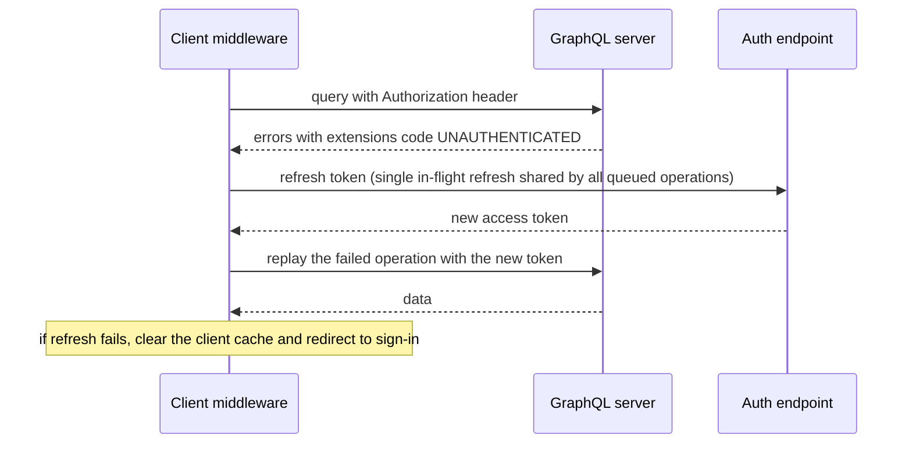

| Concern | Apollo Client | urql |
|---|---|---|
| Add auth header | `SetContextLink` (callback args are `(prevContext, operation)` in v4) | `authExchange` → `addAuthToOperation` |
| Detect + refresh | `ErrorLink` + retry logic | `authExchange` → `didAuthError`, `refreshAuth` |
| Retry network errors | `RetryLink` | `retryExchange` |
| Subscriptions | `GraphQLWsLink` with `graphql-ws`, routed via `ApolloLink.split` | `subscriptionExchange` with `graphql-ws` |
| Persisted queries (APQ) | `PersistedQueryLink` (+ `useGETForQueries` on `HttpLink` for CDN caching) | `persistedExchange` |
| Batching | `BatchHttpLink` | Not built in |
| Logout | `client.clearStore()` / `resetStore()` | Create a new `Client` (simplest way to drop all cached data) |

> **Subscriptions:** use the **`graphql-ws`** library (`graphql-transport-ws` protocol). The older `subscriptions-transport-ws` is unmaintained; your server must support the protocol the client speaks. See [WebSockets, SSE & Long Polling](../01-web-fundamentals/websockets-sse-long-polling.md).

> **Security:** never cache per-user data in a client that outlives the session — clear the store on logout. Persisted-query **allowlists** (trusted documents) are the real protection against arbitrary expensive queries ([REST vs GraphQL vs gRPC-Web](../01-web-fundamentals/rest-vs-graphql-vs-grpc-web.md)).

---

### Section 12: SSR, Streaming and React Server Components

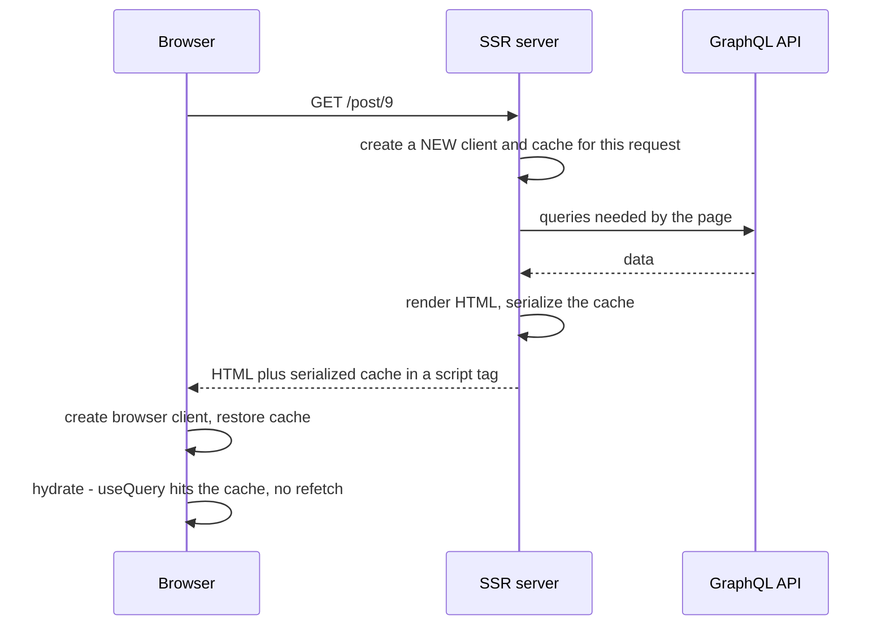

**Rules that prevent data leaks and double fetching:**
- **One client per server request.** A module-level singleton on the server shares one user's cache with another user.
- **One client per browser tab** — create it once (module scope or `useState(() => makeClient())`), never in render.
- **Serialize safely** (escape `<` in the JSON) when embedding the cache in HTML.

| Setup | Apollo Client | urql |
|---|---|---|
| Classic SSR | `getDataFromTree` / `renderToStringWithData` + `cache.extract()` / `cache.restore()` | `ssrExchange` (`extractData()` on the server, `initialState` in the browser) |
| Next.js App Router (RSC + streaming SSR) | `@apollo/client-integration-nextjs` (formerly `@apollo/experimental-nextjs-app-support`): `registerApolloClient` for RSC, a provider for client components, `PreloadQuery` to start queries on the server | `@urql/next` |
| Other meta-frameworks | Apollo also publishes integrations for React Router and TanStack Start (check current status) | `ssrExchange` with the framework's loader |

> **RSC caveat:** data fetched in a **Server Component** is not in the browser cache. If a client component later queries the same entity, it fetches again unless you pass data down or use the integration's preload/hydration helpers. Decide per route which side owns the data.

---

### Section 13: Other Frameworks and Native Mobile

| Stack | Apollo-based | urql-based | Other |
|---|---|---|---|
| **React / React Native** | `@apollo/client` (hooks from `@apollo/client/react` in v4) | `urql` | Relay |
| **Vue 3** | `@vue/apollo-composable` (`useQuery` returns refs: `result`, `loading`, `error`) | `@urql/vue` (`useQuery` returns `data`, `fetching`, `error` refs) | `villus` |
| **Angular** | `apollo-angular` (injectable `Apollo` service, `watchQuery().valueChanges` Observable) | — | TanStack Query (Angular adapter) + a request helper |
| **Svelte / SvelteKit** | Community wrappers | `@urql/svelte` (`queryStore`, `getContextClient`) | Houdini (compiler + normalized cache) |
| **Solid** | — | `@urql/solid` | — |
| **Android** | Apollo Kotlin (normalized cache, SQLite option) | — | — |
| **iOS** | Apollo iOS (normalized cache, SQLite option) | — | — |

Community bindings track the core library with a delay — **check that your binding supports the core version** (for example, Apollo Client 4) before upgrading.

---

## Decision Matrix

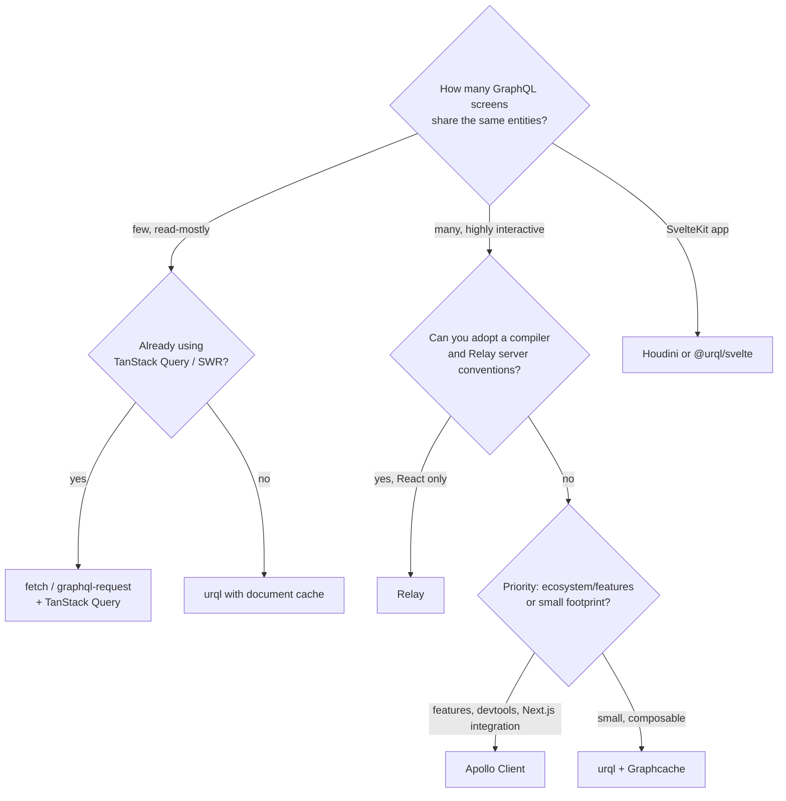

| Criterion | Apollo Client | urql (document) | urql + Graphcache | Relay | fetch + TanStack Query |
|---|---|---|---|---|---|
| Cross-screen consistency | ✅ | ⚠️ via refetch | ✅ | ✅ | ⚠️ manual invalidation |
| Learning curve | Medium–high | Low | Medium | High | Low |
| Bundle footprint | Larger | Small | Medium | Medium + compiler | Small |
| Fragment masking | Opt-in | Codegen | Codegen | Built in | Codegen |
| Multi-framework | React first-party; others community | Many first-party | Many first-party | React only | Many |
| Offline persistence | Community cache-persist packages | — | `offlineExchange` + storage | Custom | `persistQueryClient` |

---

## Real-World Examples

**Example 1 — Apollo Client 4 setup with auth, errors and type policies (TypeScript/React):**
```tsx
// apollo.ts
import { ApolloClient, ApolloLink, HttpLink, InMemoryCache, CombinedGraphQLErrors } from '@apollo/client';
import { SetContextLink } from '@apollo/client/link/context';
import { ErrorLink } from '@apollo/client/link/error';
import { relayStylePagination } from '@apollo/client/utilities';

const authLink = new SetContextLink((prevContext) => ({
  headers: { ...prevContext.headers, authorization: `Bearer ${getAccessToken()}` },
}));

const errorLink = new ErrorLink(({ error }) => {
  if (CombinedGraphQLErrors.is(error)) {
    if (error.errors.some((e) => e.extensions?.code === 'UNAUTHENTICATED')) redirectToSignIn();
  } else {
    reportNetworkError(error); // offline, 5xx, bad JSON
  }
});

export function makeClient() {
  return new ApolloClient({
    link: ApolloLink.from([errorLink, authLink, new HttpLink({ uri: '/graphql' })]),
    cache: new InMemoryCache({
      typePolicies: {
        Product: { keyFields: ['sku'] },          // identity is sku, not id
        Query: { fields: { feed: relayStylePagination(['filter']) } }, // accumulate pages per filter
      },
    }),
  });
}

// main.tsx
import { ApolloProvider } from '@apollo/client/react';
const client = makeClient(); // once per tab, never inside a component
root.render(<ApolloProvider client={client}><App /></ApolloProvider>);
```

**Example 2 — Query + mutation with cache update (BAD → GOOD):**
```tsx
import { gql } from '@apollo/client';
import { useMutation, useQuery } from '@apollo/client/react';

const TODOS = gql`
  query Todos { todos { id text done } }
`;

// ❌ BAD: no id selected → result can't be merged; list never learns about the new todo
const ADD_TODO_BAD = gql`mutation AddTodo($text: String!) { addTodo(text: $text) { text } }`;

// ✅ GOOD: return id + fields, and add the new item to the list we know about
const ADD_TODO = gql`
  mutation AddTodo($text: String!) { addTodo(text: $text) { id text done } }
`;

export function TodoList() {
  const { data, loading, error } = useQuery(TODOS, { fetchPolicy: 'cache-and-network', nextFetchPolicy: 'cache-first' });
  const [addTodo, { loading: saving }] = useMutation(ADD_TODO, {
    update(cache, { data: result }) {
      if (!result) return;
      cache.updateQuery({ query: TODOS }, (current) =>
        current ? { todos: [...current.todos, result.addTodo] } : current,
      );
    },
  });

  if (loading && !data) return <p>Loading…</p>;
  if (error) return <p role="alert">Could not load todos.</p>;
  return (
    <>
      <ul>{data?.todos.map((t) => <li key={t.id}>{t.text}</li>)}</ul>
      <button disabled={saving} onClick={() => addTodo({ variables: { text: 'New' } })}>Add</button>
    </>
  );
}

// Deleting: remove the entity everywhere, then collect unreachable records
// update(cache) { cache.evict({ id: cache.identify({ __typename: 'Todo', id }) }); cache.gc(); }
```

**Example 3 — urql with Graphcache, auth and retry:**
```tsx
import { Client, Provider, fetchExchange, useQuery } from 'urql';
import { cacheExchange } from '@urql/exchange-graphcache';
import { relayPagination } from '@urql/exchange-graphcache/extras';
import { authExchange } from '@urql/exchange-auth';
import { retryExchange } from '@urql/exchange-retry';
import { gql } from 'urql';

const TodoList = gql`query TodoList { todos { id text done } }`;

const client = new Client({
  url: '/graphql',
  exchanges: [
    cacheExchange({
      keys: { Product: (p) => (p.sku as string) ?? null },
      resolvers: { Query: { feed: relayPagination() } },
      updates: {
        Mutation: {
          addTodo(result, _args, cache) {
            cache.updateQuery({ query: TodoList }, (data) => {
              data?.todos.push(result.addTodo); // data is a copy - mutating is allowed
              return data;
            });
          },
          deleteTodo(_result, args, cache) {
            cache.invalidate({ __typename: 'Todo', id: args.id as string });
          },
        },
      },
    }),
    authExchange(async (utils) => ({
      addAuthToOperation: (op) => utils.appendHeaders(op, { Authorization: `Bearer ${getAccessToken()}` }),
      didAuthError: (error) => error.graphQLErrors.some((e) => e.extensions?.code === 'UNAUTHENTICATED'),
      refreshAuth: async () => { await refreshAccessToken(); },
    })),
    retryExchange({ maxNumberAttempts: 3 }),
    fetchExchange, // transport always last
  ],
});

function Todos() {
  const [{ data, fetching, error }, reexecute] = useQuery({ query: TodoList });
  if (fetching && !data) return <p>Loading…</p>;
  if (error) return <button onClick={() => reexecute({ requestPolicy: 'network-only' })}>Retry</button>;
  return <ul>{data.todos.map((t: { id: string; text: string }) => <li key={t.id}>{t.text}</li>)}</ul>;
}

export const App = () => <Provider value={client}><Todos /></Provider>;
```

**Example 4 — urql's document cache and empty lists (BAD → GOOD):**
```typescript
import { useMemo } from 'react';
import { useQuery } from 'urql';

// ❌ BAD: the list is empty → the result contains no "Todo" typename →
//    an addTodo mutation can't invalidate it, so the list stays empty
const [result] = useQuery({ query: TodoList });

// ✅ GOOD: tell the document cache which types this query depends on (stable reference)
const context = useMemo(() => ({ additionalTypenames: ['Todo'] }), []);
const [fixed] = useQuery({ query: TodoList, context });
```

**Example 5 — Vue 3 and Angular:**
```typescript
// Vue 3 + @urql/vue  (app.use(urql, client) or provideClient(client) once at the root)
import { useQuery } from '@urql/vue';
const { data, fetching, error } = useQuery({ query: TodoList }); // reactive refs

// Angular + apollo-angular (an injectable Apollo service wraps ApolloClient)
import { Component, inject } from '@angular/core';
import { AsyncPipe } from '@angular/common';
import { Apollo, gql } from 'apollo-angular';
import { map } from 'rxjs';

@Component({
  selector: 'app-todos',
  imports: [AsyncPipe],
  template: `@for (t of todos$ | async; track t.id) { <li>{{ t.text }}</li> }`,
})
export class TodosComponent {
  private apollo = inject(Apollo);
  todos$ = this.apollo
    .watchQuery<{ todos: { id: string; text: string }[] }>({ query: gql`query Todos { todos { id text } }` })
    .valueChanges.pipe(map((r) => r.data?.todos ?? []));
}
```

**Example 6 — Typed operations with GraphQL Code Generator (client preset):**
```typescript
// codegen.ts
import type { CodegenConfig } from '@graphql-codegen/cli';

const config: CodegenConfig = {
  schema: 'https://api.example.com/graphql',
  documents: ['src/**/*.{ts,tsx}'],
  generates: { './src/gql/': { preset: 'client' } }, // emits a typed graphql() function
};
export default config;

// In a component — variables and result are fully typed from the schema:
// import { graphql } from './gql';
// const PostQuery = graphql(`query Post($id: ID!) { post(id: $id) { id title } }`);
```

---

## Key Points Summary

| Concept | One-Line Explanation |
|---|---|
| **GraphQL client** | Transport + cache + middleware + framework bindings on top of `fetch` |
| **Document cache** | Caches whole results by query + variables; invalidates by `__typename` (urql default) |
| **Normalized cache** | Stores each entity once as `Typename:id`; updates propagate everywhere (Apollo, Graphcache, Relay) |
| **Fetch / request policy** | Per-query choice: cache-first, cache-and-network, network-only, no-cache, cache-only |
| **Links / exchanges** | Composable middleware chains for auth, errors, retries, transport |
| **`keyFields` / `keys`** | Tell the cache how to identify objects without a plain `id` |
| **Field policies / resolvers** | Control pagination merging, cache redirects and computed fields |
| **List updates** | Caches can't guess list membership — use `update`/`updates` or refetch |
| **Fragment colocation** | Each component declares its own fields; parents spread fragments |
| **Data masking** | A component sees only the fields its own fragment requested |
| **`errorPolicy`** | Decides whether partial data with GraphQL errors is shown |
| **SSR rule** | New client per server request; restore serialized cache in the browser |
| **Subscriptions** | `graphql-ws` transport; route via split link or `subscriptionExchange` |

---

## Test Your Understanding

**Q1 (Basic):**
What does a GraphQL client like Apollo or urql give you that `fetch('/graphql', { method: 'POST' })` doesn't?

<details>
<summary>Answer</summary>

Request **deduplication**, an in-memory **cache** with per-query policies, **reactivity** (components re-render when cached data changes, even if a *different* query or mutation changed it), composable **middleware** (auth headers, token refresh, retries, error reporting, persisted queries), **subscription** transport, **SSR** serialization/hydration helpers, devtools and framework bindings. Plain `fetch` to `/graphql` is usually a `POST`, so even the browser HTTP cache doesn't help. For a few simple calls, `fetch` + TanStack Query is fine; the dedicated clients win when many screens share entities.
</details>

**Q2 (Basic):**
Explain the difference between urql's default document cache and a normalized cache, and what happens after a "rename user" mutation in each.

<details>
<summary>Answer</summary>

The **document cache** stores each result under a hash of the query document + variables. After the mutation, urql looks at the `__typename`s in the mutation result (`User`) and **invalidates every cached result that contains `User`**; mounted queries refetch. Correct, but costs network requests.

A **normalized cache** stores `User:42` once and points to it from every result. The mutation returns `{ id: 42, name }`, the cache **merges it into `User:42`**, and every component showing that user re-renders with the new name — **no refetch**.
</details>

**Q3 (Application):**
After `createProject` succeeds, the new project appears on the detail page but not in the sidebar list. The mutation returns `{ id name }`. Why, and what are your options?

<details>
<summary>Answer</summary>

A normalized cache can merge fields of **known** entities, but it can't know that a **new** `Project:123` belongs in the `projects` list field (or which filtered/paginated variants of it). Options:
1. **`update`** (Apollo) / **`updates.Mutation.createProject`** (Graphcache): append the new reference to the list with `cache.updateQuery` / `cache.modify` / `cache.link`.
2. **`refetchQueries: ['Projects']`** — simplest; one extra request; right when there are many filtered lists or server-computed ordering.
3. **Evict/invalidate** the `projects` field so watchers refetch.
Choose 1 for one or two well-known lists (fast, no network), 2/3 when membership depends on server logic.
</details>

**Q4 (Tricky):**
A Next.js app creates `const client = new ApolloClient(...)` at module scope in a file imported by both server and client components. Users occasionally see another user's name in the header after a server render. Why?

<details>
<summary>Answer</summary>

On the server, module scope lives as long as the **server process**, so the singleton's cache is **shared across requests and users**. User A's `me` query is cached; user B's render reads it from the cache (`cache-first`) and the HTML contains A's data. Fix: create a **new client per request** on the server (the Next.js integration's `registerApolloClient` does this for RSC; its provider handles client components) and one client per tab in the browser. Never put per-user data in shared server state; clear the client store on logout.
</details>

**Q5 (Tricky):**
With urql's default cache, a todo list that starts **empty** never shows newly added todos until a full reload. Lists with at least one item work. Why?

<details>
<summary>Answer</summary>

The document cache decides which results to invalidate from the **`__typename`s present in each cached result**. An empty list contains no `Todo` objects, so the result has no `Todo` typename, and the `addTodo` mutation (which returns a `Todo`) doesn't invalidate it. Fix: pass `context: { additionalTypenames: ['Todo'] }` (memoized) on the query, or switch to Graphcache and add an `updates` rule.
</details>

**Q6 (System design):**
You're choosing a GraphQL client for (a) a marketing/content site with a few GraphQL queries, (b) a project-management app where tasks appear in boards, lists, search results and detail panels, and (c) a SvelteKit dashboard. What do you pick and why?

<details>
<summary>Answer</summary>

- **(a)** Read-mostly, few screens: **urql with the document cache** or **`fetch` + TanStack Query** — small, simple; HTTP/CDN caching with persisted `GET` queries matters more than client normalization. Often the queries can run at build time or on the server.
- **(b)** The same `Task` appears on many screens and changes constantly: a **normalized cache** — **Apollo Client** (ecosystem, devtools, Next.js integration) or **urql + Graphcache** (smaller, exchange model); **Relay** if the team can adopt the compiler and server conventions for maximum fragment-level performance. Plan `keyFields`, pagination policies, list update rules and optimistic responses.
- **(c)** **Houdini** (SvelteKit-native, normalized) or **`@urql/svelte`** (with Graphcache if entities are shared). Apollo has no first-party Svelte bindings.
</details>

---

## Cheat Sheet

**Key Definitions:**
- **Operation:** A query, mutation or subscription document + variables
- **Link (Apollo) / Exchange (urql):** Middleware in the request/result pipeline
- **Document cache:** Results cached by query + variables
- **Normalized cache:** Entities stored once by `Typename:id`, referenced from results
- **Fetch policy / request policy:** Per-query rule for cache vs network
- **`keyFields` / `keys`:** Custom entity identity
- **Fragment colocation:** Components declare their own data needs
- **Data masking:** Components only see fields from their own fragments
- **`errorPolicy`:** How GraphQL errors and partial data are surfaced (Apollo)

**Quick Reference:**
```text
Apollo 4 setup:     new ApolloClient({ link: ApolloLink.from([errorLink, authLink, new HttpLink({ uri })]), cache: new InMemoryCache({ typePolicies }) })
Apollo 4 hooks:     import { useQuery, useMutation, useSuspenseQuery, useFragment, ApolloProvider } from '@apollo/client/react'
urql setup:         new Client({ url, exchanges: [cacheExchange, authExchange(...), retryExchange(...), fetchExchange] })
urql hooks:         const [{ data, fetching, error, stale }, reexecute] = useQuery({ query, variables, requestPolicy })

Policies:           cache-first (default) · cache-and-network (SWR) · network-only · no-cache (Apollo) · cache-only
Field edit:         return id + changed fields → auto-merge
List add:           update / updates.Mutation + cache.updateQuery, or refetchQueries
Delete:             Apollo cache.evict({ id: cache.identify(obj) }) + cache.gc()   ·   Graphcache cache.invalidate(entity)
Pagination:         Apollo relayStylePagination() / offsetLimitPagination()  ·  Graphcache relayPagination() / simplePagination()
Empty list (urql):  context: { additionalTypenames: ['Todo'] }
Subscriptions:      graphql-ws  (not subscriptions-transport-ws)
SSR:                new client per request · serialize cache · restore in browser · one client per tab
Logout:             client.clearStore() (Apollo) / new Client (urql)
```

**Common Mistakes to Avoid:**

| Mistake | Why Wrong | Fix |
|---|---|---|
| Not selecting `id` on objects | Can't normalize → updates don't propagate | Always select `id` (and keep `__typename`) |
| Mutation returns only `success: Boolean` | Cache has nothing to merge | Return the changed entity with `id` + fields |
| Creating the client inside a component | New empty cache every render/mount | Create once per tab (module scope or lazy state) |
| Module-level client on the SSR server | Cache shared between users → data leak | New client per request |
| No pagination field policy | Each page stored separately; `fetchMore` doesn't append | `relayStylePagination` / `merge` / Graphcache `relayPagination` |
| `refetchQueries` for every mutation | Extra requests and slow UI | Merge by `id`; `update` for lists; refetch only when needed |
| `fetchExchange` placed before `cacheExchange` | Cache never sees operations | Transport exchange last |
| Ignoring partial data | Whole screen errors when one field fails | `errorPolicy: 'all'` + per-section fallbacks |
| Not clearing the store on logout | Next user sees previous user's cached data | `clearStore()` / new client |
| Using `subscriptions-transport-ws` | Unmaintained protocol | `graphql-ws` |
| Copying Apollo 3 imports into a v4 app | Hooks moved; `uri` and link helpers changed | Follow the v4 migration guide / codemod |

---

## References & Further Reading

**Apollo Client**
- Apollo Docs: [Apollo Client introduction](https://www.apollographql.com/docs/react)
- Apollo Docs: [Migrating to Apollo Client 4.0](https://www.apollographql.com/docs/react/migrating/apollo-client-4-migration)
- Apollo Docs: [Caching overview](https://www.apollographql.com/docs/react/caching/overview) · [Customizing cache IDs and type policies](https://www.apollographql.com/docs/react/caching/cache-configuration)
- Apollo Docs: [Queries and fetch policies](https://www.apollographql.com/docs/react/data/queries) · [Mutations and cache updates](https://www.apollographql.com/docs/react/data/mutations)
- Apollo Docs: [Data masking](https://www.apollographql.com/docs/react/data/fragments) (fragments page) · [Error handling](https://www.apollographql.com/docs/react/data/error-handling)
- GitHub: [apollo-client-integrations (Next.js App Router, React Router, TanStack Start)](https://github.com/apollographql/apollo-client-integrations)

**urql**
- urql Docs: [Introduction](https://urql.dev/docs/) · [Document caching](https://urql.dev/docs/basics/document-caching/) · [Graphcache](https://urql.dev/docs/graphcache/)
- urql Docs: [Authorization (`authExchange`)](https://urql.dev/docs/advanced/authentication/) · [Server-side rendering](https://urql.dev/docs/advanced/server-side-rendering/)

**Other clients & tooling**
- Relay: [Relay documentation](https://relay.dev/docs/) · [GraphQL Server Specification (Node, connections)](https://relay.dev/docs/guides/graphql-server-specification/)
- Houdini: [Houdini docs](https://houdinigraphql.com/)
- The Guild: [GraphQL Code Generator — client preset](https://the-guild.dev/graphql/codegen/plugins/presets/preset-client)
- gql.tada: [Documentation](https://gql-tada.0no.co/)
- graphql-ws: [GitHub repository](https://github.com/enisdenjo/graphql-ws)
- Vue Apollo: [Documentation](https://apollo.vuejs.org/) · Apollo Angular: [Documentation](https://the-guild.dev/graphql/apollo-angular)
- Apollo Kotlin: [Documentation](https://www.apollographql.com/docs/kotlin) · Apollo iOS: [Documentation](https://www.apollographql.com/docs/ios)

**Specs**
- GraphQL Foundation: [GraphQL specification](https://spec.graphql.org/) · [GraphQL over HTTP (draft)](https://graphql.github.io/graphql-over-http/)

---

> **Previous Topic:** [SWR & Stale-While-Revalidate](./swr-and-stale-while-revalidate.md)
> — Serve cached data instantly and revalidate in the background

> **Next Topic:** [Data Normalization & Caching](./data-normalization-and-caching.md)
> — Storing entities once, keeping every screen consistent, and deciding when cached data expires

*Saved on: 2026-11-06 | Repo: Frontend System Design Learning Notes*
