# Pagination & Infinite Scroll

> **Date:** 2026-11-06 · **Last updated:** 2026-11-06
> **Category:** Frontend System Design
> **Sub-Topic:** State & Data / Data Fetching
> **Level:** Intermediate · **Reading time:** ~32 min
> **Informs:** offset vs cursor API contract, numbered pages vs load more vs infinite scroll, list virtualization, scroll restoration, feed accessibility, SEO of listing pages, infinite-query cache design

> **Pre-requisite:** [Web APIs (Intersection Observer, ResizeObserver)](../01-web-fundamentals/web-apis-intersection-observer-resizeobserver.md) (the sentinel pattern) and [React Query / TanStack Query](./react-query-tanstack-query.md) (query keys, stale time).
> This note covers how to split a large or endless list into pieces — on the **server** (the API contract), in the **cache** (how pages are stored) and in the **UI** (how users move through them).

**Previous:** [Optimistic UI Updates](./optimistic-ui-updates.md) · **Next:** [Real-Time Data Sync](./real-time-data-sync.md)

---

## Table of Contents

1. [ELI5 — Simple Explanation](#eli5--simple-explanation)
2. [Section 1: Why Paginate at All](#section-1-why-paginate-at-all)
3. [Section 2: Offset / Limit Pagination](#section-2-offset--limit-pagination)
4. [Section 3: Cursor (Keyset) Pagination](#section-3-cursor-keyset-pagination)
5. [Section 4: The GraphQL Connection Pattern](#section-4-the-graphql-connection-pattern)
6. [Section 5: Three UI Patterns — Pages, Load More, Infinite Scroll](#section-5-three-ui-patterns--pages-load-more-infinite-scroll)
7. [Section 6: Infinite Scroll Mechanics](#section-6-infinite-scroll-mechanics)
8. [Section 7: Caching Pages on the Client](#section-7-caching-pages-on-the-client)
9. [Section 8: Virtualization (Windowing)](#section-8-virtualization-windowing)
10. [Section 9: URL State, Back Button and Scroll Restoration](#section-9-url-state-back-button-and-scroll-restoration)
11. [Section 10: Bidirectional Lists and Chat](#section-10-bidirectional-lists-and-chat)
12. [Section 11: Accessibility](#section-11-accessibility)
13. [Section 12: SEO for Paginated Content](#section-12-seo-for-paginated-content)
14. [Framework Comparison](#framework-comparison)
15. [Decision Matrix](#decision-matrix)
16. [Real-World Examples](#real-world-examples)
17. [Key Points Summary](#key-points-summary)
18. [Test Your Understanding (with answers)](#test-your-understanding)
19. [Cheat Sheet](#cheat-sheet)
20. [References & Further Reading](#references--further-reading)

---

## ELI5 — Simple Explanation

Think of a **library with a million books**:

- **Offset pagination** = "give me books 41–60 from the shelf". Easy to say, but if someone **slips a new book in at the front** while you're reading, everything shifts by one: you see one book twice or miss one. And the librarian has to **count past 40 books** every time — counting past 900,000 is slow.
- **Cursor pagination** = a **bookmark**: "give me the 20 books **after this one**". New books at the front don't move your bookmark, and the librarian walks straight to it.
- **Numbered pages** = a book's table of contents — you can jump to page 7 and tell a friend "it's on page 7".
- **Load more** = a waiter who brings the next plate only when you ask.
- **Infinite scroll** = a conveyor-belt sushi bar: plates keep coming as long as you sit there — great for browsing, terrible if you want to reach the exit (the footer).
- **Virtualization** = a stage set: only the scenery in front of the audience is built; everything off-stage is rebuilt the moment it comes into view.

> **Pick the API contract by data behaviour (offset for small/stable sets, cursors for big/live ones), pick the UI pattern by user intent (find vs browse), and virtualize whenever the DOM would otherwise grow without limit.**

---

## Core Concept — Step by Step

### Section 1: Why Paginate at All

Sending a whole collection to the client fails on four axes at once:

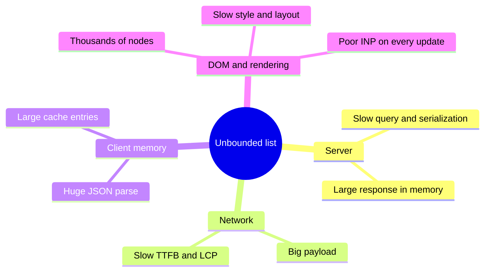

| Layer | What pagination limits | What it costs you |
|---|---|---|
| **API** | Rows read, serialized and transferred per request | A contract for "what comes next" |
| **Client cache** | Memory held for the list | Logic to merge, refetch and invalidate pages |
| **DOM** | Nodes the browser must lay out and paint | Pagination alone does **not** limit the DOM in infinite scroll — that's virtualization's job (Section 8) |
| **UX** | Cognitive load per screen | Navigation, position memory, footer reachability |

> **Two separate problems:** *pagination* limits **how much data you fetch**; *virtualization* limits **how much of it you render**. Infinite scroll needs both.

---

### Section 2: Offset / Limit Pagination

The client asks for a position: `GET /api/products?offset=40&limit=20` (or `?page=3&pageSize=20`, which is the same thing). The database does:

```sql
SELECT * FROM products ORDER BY created_at DESC LIMIT 20 OFFSET 40;
```

**Strengths:** trivial to build, can jump to any page, easy to show "Page 3 of 50" (with a `COUNT(*)`), shareable URLs (`?page=3`).

**Weakness 1 — page drift on a live dataset.** If a row is inserted or deleted *before* the current offset between two requests, every row shifts:

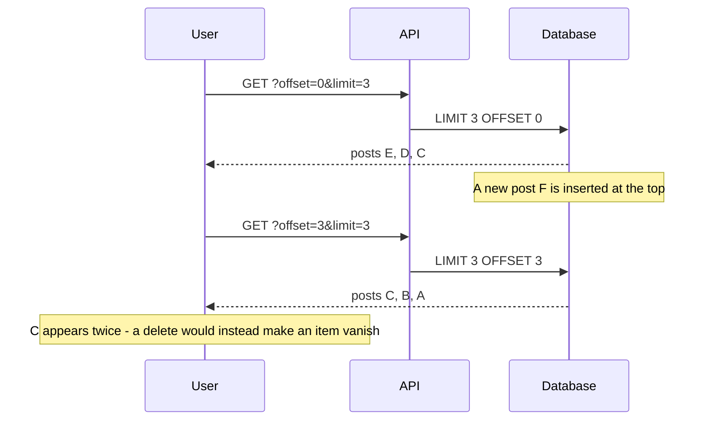

**Weakness 2 — deep offsets get slow.** `OFFSET 900000` means the database must find and **discard** 900,000 rows before returning 20. The cost grows with the offset, so the last pages of a big table are the slowest.

**Weakness 3 — totals are expensive.** An exact `COUNT(*)` over a large filtered table can cost as much as the query itself. Many products show "1,000+ results" or omit the total.

| Use offset when… | Avoid offset when… |
|---|---|
| The set is small or changes rarely (admin tables, settings lists) | Items are inserted at the top constantly (feeds, chat, notifications) |
| Users need **jump to page N** and a total | Users scroll deep into very large tables |
| Sorting by arbitrary user-chosen columns | You need a stable, duplicate-free stream |

> **Client-side mitigation** for drift: de-duplicate items by `id` when merging pages. It hides duplicates, but can't recover a skipped item.

---

### Section 3: Cursor (Keyset) Pagination

Instead of a position, the client sends **where it stopped**: "the 20 items after the item whose sort key is X". The server turns that into an indexed range query:

```sql
-- Sort by newest first, with id as a unique tie-breaker
SELECT * FROM posts
WHERE (created_at, id) < ($1, $2)          -- the cursor: last item's (created_at, id)
ORDER BY created_at DESC, id DESC
LIMIT 21;                                  -- fetch limit + 1 to know if there is a next page
```

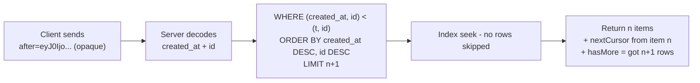

**Rules for good cursors:**

| Rule | Why |
|---|---|
| **Order by a unique key** (append `id` as a tie-breaker) | Two rows with the same `created_at` would otherwise be skipped or repeated |
| **Make the cursor opaque** (e.g. base64url of JSON) | Clients must not build or parse cursors — you can change the encoding later |
| **Validate (or sign) cursors on the server** | A tampered cursor is user input like any other |
| **Back the sort with a matching index** | `(created_at DESC, id DESC)` turns each page into an index seek |
| **Tie the cursor to the sort and filters** | A cursor from "sort by price" is meaningless under "sort by date"; changing filters resets to the first page |
| **Fetch `limit + 1`** | Tells you `hasMore` without a count query |

**Trade-offs:** you can't jump to page 37, totals still need a separate count, and sorting by arbitrary columns needs an index per sort. In exchange you get **stable pages under inserts/deletes** and **constant cost regardless of depth**.

> Row-value comparison `(a, b) < (x, y)` is supported in PostgreSQL. Where it isn't (or isn't index-friendly), expand it: `a < x OR (a = x AND b < y)`.

**Common response shapes:**

```json
{
  "items": [{ "id": "p_981", "title": "…" }],
  "nextCursor": "eyJ0IjoiMjAyNi0xMS0wNlQxMDowMDowMFoiLCJpZCI6InBfOTgxIn0",
  "hasMore": true
}
```

```http
HTTP/1.1 200 OK
Link: <https://api.example.com/posts?after=eyJ0Ijo>; rel="next", <https://api.example.com/posts>; rel="first"
```

The `Link` header ([RFC 8288](https://www.rfc-editor.org/rfc/rfc8288)) is how GitHub's REST API exposes pagination. The client follows `rel="next"` without knowing how cursors are built.

---

### Section 4: The GraphQL Connection Pattern

GraphQL APIs usually follow the **Relay Cursor Connections** convention: a list field takes `first`/`after` (forward) or `last`/`before` (backward) and returns **edges** plus **pageInfo**.

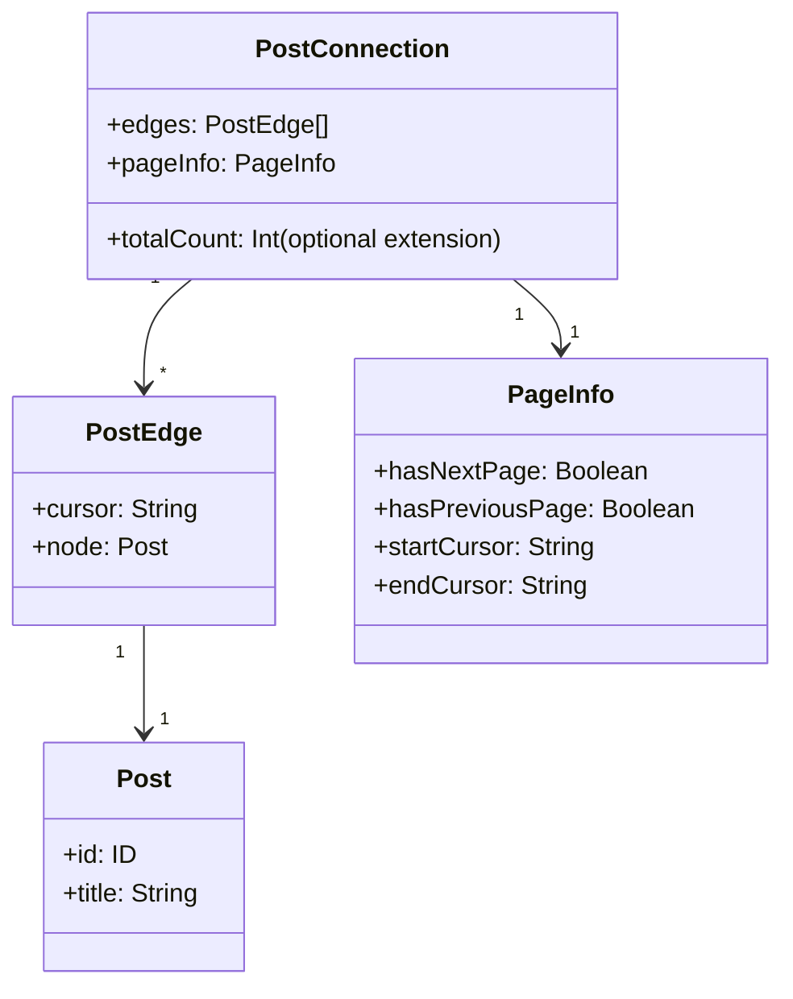

```graphql
query Feed($first: Int!, $after: String) {
  feed(first: $first, after: $after) {
    edges { cursor node { id title author { id name } } }
    pageInfo { hasNextPage endCursor }
  }
}
```

GraphQL clients ship merge helpers for this shape (Section 7): Apollo's `relayStylePagination()`, urql Graphcache's `relayPagination()`, and Relay's `@connection` + `usePaginationFragment`. See [GraphQL Client (Apollo, urql)](./graphql-client-apollo-urql.md).

---

### Section 5: Three UI Patterns — Pages, Load More, Infinite Scroll

The API contract and the UI pattern are **independent choices**: cursor APIs can drive numbered "Next/Previous" buttons, and offset APIs can drive infinite scroll.

| | **Numbered pages** | **Load more button** | **Infinite scroll** |
|---|---|---|---|
| Best for | Goal-directed search, comparison, tables | Product grids, comment threads, search on mobile | Exploratory, endless feeds (social, media) |
| User control | High — jump, share, return | High — explicit action | Low — content arrives on its own |
| Position memory | Easy (`?page=4`) | Medium (store count/cursor) | Hard (scroll restoration, Section 9) |
| Footer reachable | ✅ | ✅ | ❌ unless loading stops or the footer moves |
| Keyboard / screen readers | ✅ | ✅ (with focus management) | ⚠️ needs the feed pattern (Section 11) |
| SEO | ✅ crawlable URLs | ⚠️ needs paginated URLs behind it | ⚠️ needs paginated URLs behind it |
| DOM growth | Bounded | Grows | Grows — virtualize |

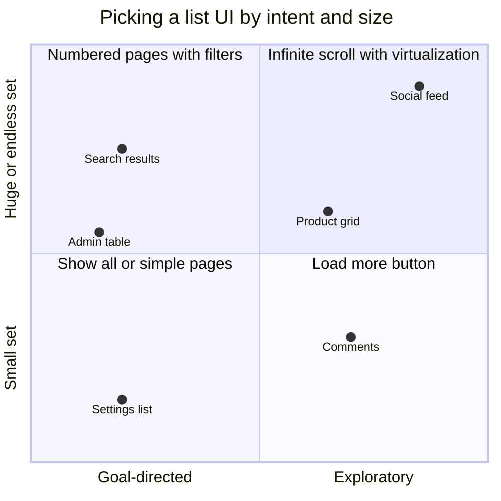

> **Hybrid that often wins:** auto-load the first one or two extra pages on scroll, then switch to a **Load more** button. Users browse effortlessly, the footer becomes reachable, and the DOM stays bounded.

---

### Section 6: Infinite Scroll Mechanics

**Trigger with an `IntersectionObserver` sentinel**, never a scroll listener that reads `scrollTop`/`offsetHeight` (that forces layout on every scroll event). Place an empty element after the last item and start fetching when it comes within a margin of the viewport:

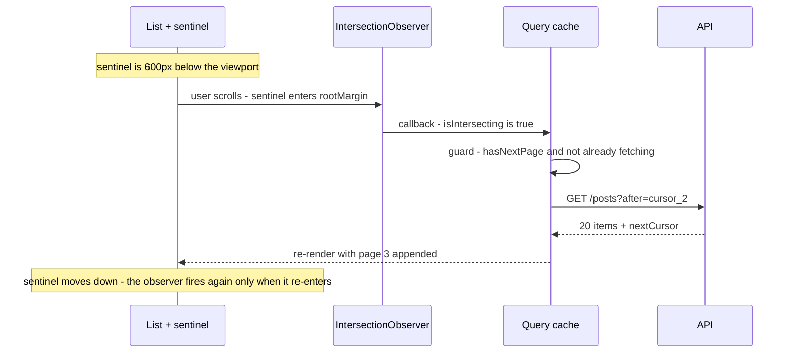

Every infinite list is a small **state machine**. Modelling it explicitly avoids duplicate requests and "spinner forever" bugs:

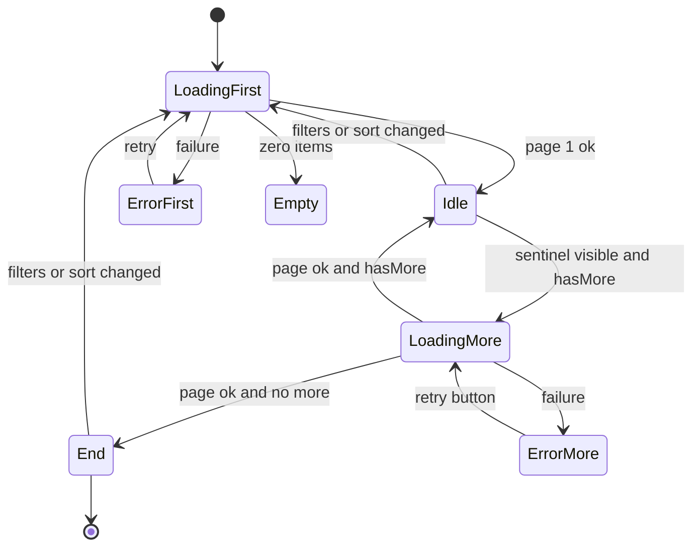

**Checklist:**
- **Guard against double fetches**: ignore the observer while a page is in flight (`isFetchingNextPage`).
- **Prefetch early**: a `rootMargin` of roughly one viewport means the next page usually arrives before the user hits the bottom.
- **Show a stable loader**: a skeleton row with a reserved height avoids layout shift; a spinner that collapses to 0px when done does not.
- **Stop at the end**: render an explicit "You're all caught up" and disconnect the observer.
- **Never auto-retry in a tight loop**: on error, show a **Retry** button instead of letting the visible sentinel fire again immediately.
- **Fill tall screens**: if page 1 doesn't fill the viewport, the sentinel is already visible. The observer only fires on *changes* in intersection, so check again after each page renders (TanStack's pattern of re-running an effect on `inView` handles this).
- **Reset on filter change**: the filters belong in the query key, so a new filter is a new list starting at page 1. Stale responses for old filters must be discarded (abort them).

---

### Section 7: Caching Pages on the Client

An infinite list is **one cache entry holding an array of pages**, not one entry per page:

```text
queryKey: ['posts', { sort: 'new', tag: 'css' }]
data: {
  pages:      [ {items:[…20], nextCursor:'c1'}, {items:[…20], nextCursor:'c2'}, {items:[…20], nextCursor:null} ],
  pageParams: [ null, 'c1', 'c2' ]
}
```

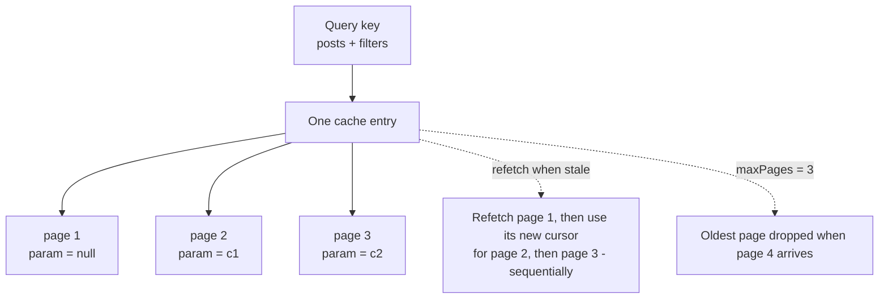

| Concern | Behaviour / technique |
|---|---|
| **Refetch** | TanStack Query refetches an infinite query **page by page from the first**, so cursors stay consistent. Fifty loaded pages = fifty sequential requests — cap with `maxPages` |
| **Memory cap** | `maxPages` keeps only the most recent N pages in the cache (needs `getPreviousPageParam` so users can scroll back) |
| **Numbered pages** | Use a **normal query per page** (`['products', { page }]`) with `placeholderData: keepPreviousData` so the old page stays visible while the next loads |
| **Prefetch** | Prefetch page N+1 when page N renders, or on hover over "Next" |
| **Mutations** | After creating/deleting an item, either update the pages in place (see [Optimistic UI Updates](./optimistic-ui-updates.md)) or invalidate the whole list |
| **Normalization** | GraphQL caches store each item once by id; the list stores references (see [Data Normalization & Caching](./data-normalization-and-caching.md)) |
| **Live inserts** | Don't splice new items into the top of a list the user is reading — show a "5 new posts" pill (see [Real-Time Data Sync](./real-time-data-sync.md)) |

**Library equivalents:**

| Library | Infinite API | Merge / page logic |
|---|---|---|
| TanStack Query (React, Vue, Solid, Svelte, Angular) | `useInfiniteQuery` / `injectInfiniteQuery` / `createInfiniteQuery` | `initialPageParam`, `getNextPageParam`, `getPreviousPageParam`, `maxPages` |
| SWR | `useSWRInfinite` (from `swr/infinite`) | `getKey(pageIndex, previousPageData)` returns `null` to stop; `size` / `setSize` |
| RTK Query | `build.infiniteQuery` endpoints (recent versions) | `infiniteQueryOptions: { initialPageParam, getNextPageParam }` |
| Apollo Client | `fetchMore` | `typePolicies` field policy: `relayStylePagination()` / `offsetLimitPagination()` |
| urql Graphcache | re-query with new variables | `relayPagination()` / `simplePagination()` resolvers |
| Relay | `usePaginationFragment` | `@connection` directive |

---

### Section 8: Virtualization (Windowing)

After a few hundred rich rows, the list itself becomes the bottleneck: style recalculation, layout, memory and every re-render scale with the number of DOM nodes. **Virtualization renders only the rows in (and just around) the viewport** and uses spacer height to keep the scrollbar honest.

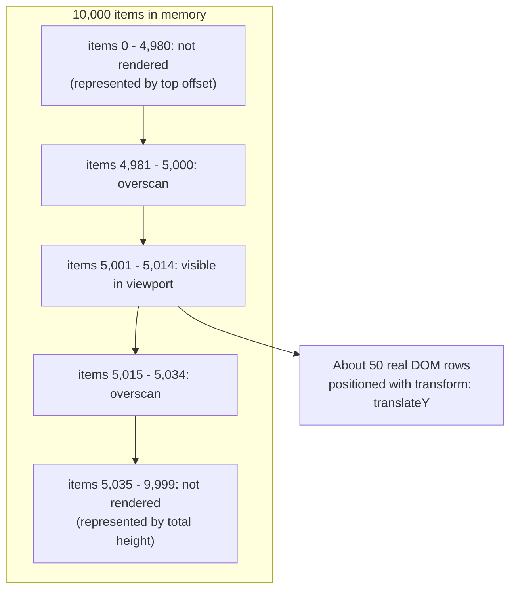

| Concept | Meaning |
|---|---|
| **Fixed vs dynamic height** | Fixed is simple maths; dynamic needs an **estimate** first, then real measurement (ResizeObserver) and offset correction |
| **Overscan** | Extra rows above/below the viewport so fast scrolling doesn't flash blank space |
| **Total size** | Sum of (measured or estimated) heights — the scroll container's inner height |
| **Scroll element** | Usually a fixed-height container; window-scrolling variants exist |

**Costs of virtualization:** browser **find-in-page (Ctrl/Cmd+F)** only finds rendered rows; screen readers can't see off-screen items; anchors/`scrollIntoView` to unrendered rows need the library's `scrollToIndex`; dynamic heights can cause small jumps.

**A lighter alternative — `content-visibility: auto`:** the browser keeps all nodes in the DOM but **skips rendering work** for off-screen sections. It keeps find-in-page and accessibility intact, but doesn't reduce node count or memory. Supported in Chromium, Firefox and Safari 18+ (check MDN).

```css
.feed-item {
  content-visibility: auto;
  contain-intrinsic-size: auto 320px; /* placeholder size until rendered, then remembered */
}
```

| Rough list size | Approach |
|---|---|
| Up to a few hundred simple rows | Render normally |
| Hundreds to a few thousand, need Ctrl+F / a11y | `content-visibility: auto` on sections |
| Thousands+ or endless | Virtualize (TanStack Virtual, react-virtuoso, react-window; Angular CDK virtual scroll; vue-virtual-scroller) |

> These thresholds are rules of thumb, not benchmarks. Measure on a low-end device with the Performance panel before deciding.

---

### Section 9: URL State, Back Button and Scroll Restoration

The classic infinite-scroll complaint: *"I scrolled 200 items, opened one, pressed Back — and I'm at the top again."*

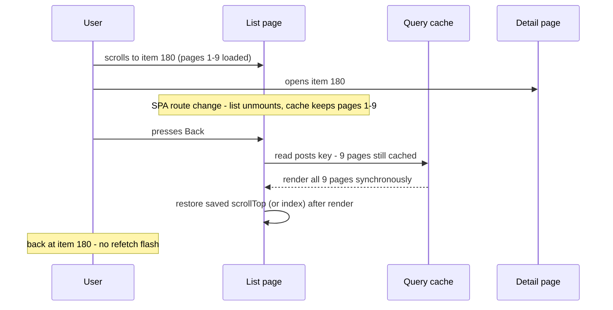

| Situation | What restores position |
|---|---|
| **Full-page navigation + bfcache hit** | The whole page is restored from memory (see [Browser Caching Strategies](../01-web-fundamentals/browser-caching-strategies.md#section-12-backforward-cache-bfcache)) |
| **Full-page navigation, no bfcache** | Browser scroll restoration works only if the content is the **same height** when it re-renders — fetched pages are gone, so it usually fails |
| **SPA navigation** | Router scroll restoration (React Router `<ScrollRestoration />`, TanStack Router, Vue Router `scrollBehavior`, Angular `withInMemoryScrolling`) + **cached pages** so the list renders at full height before the scroll position is applied |
| **Virtualized list** | Save the **first visible index** (or offset) and call `scrollToIndex` / `scrollToOffset` on return |
| **Shared link / reload** | Put durable state in the URL: `?page=4` for numbered pages, `?cursor=…` or the filters for others |

Set `history.scrollRestoration = 'manual'` only if you take over restoration yourself; otherwise leave it on `'auto'`.

> **Opening details in a modal or side panel** (the list stays mounted, the URL still changes) sidesteps the whole problem — a common choice for feeds and galleries.

---

### Section 10: Bidirectional Lists and Chat

Chat, logs and timelines load **older items upward**. Prepending content above the viewport pushes what the user is reading **down** unless the scroll position is corrected.

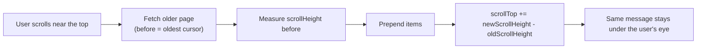

- **CSS scroll anchoring** (`overflow-anchor: auto`, the default) does this correction automatically in Chromium and Firefox. Safari only added support very recently (check MDN), so production chat UIs still adjust `scrollTop` manually or use a library (react-virtuoso has chat-oriented modes).
- **Stick to bottom**: when a new message arrives, auto-scroll only if the user is already near the bottom; otherwise show "↓ New messages".
- `flex-direction: column-reverse` is a common trick to start a scroller at the bottom. It reverses visual order relative to DOM order, so check keyboard and screen-reader order before using it.
- Use **bidirectional cursors** (`before`/`after`) — offsets break as soon as new messages arrive.

---

### Section 11: Accessibility

Infinite scroll is one of the most cited accessibility problems of the modern web: keyboard users can't reach the footer, screen-reader users don't know new content appeared, and focus can get lost.

**WAI-ARIA `feed` pattern** (for genuinely endless lists):

```html
<section aria-labelledby="feed-title">
  <h2 id="feed-title">Latest posts</h2>
  <div role="feed" aria-busy="false" aria-labelledby="feed-title">
    <article tabindex="0" aria-posinset="1" aria-setsize="-1" aria-labelledby="p1-title">
      <h3 id="p1-title">…</h3>
    </article>
    <!-- aria-setsize="-1" = total unknown; set aria-busy="true" while adding articles -->
  </div>
</section>
```

The APG feed pattern defines keyboard support: **Page Down / Page Up** move focus between articles, **Ctrl+End** / **Ctrl+Home** move focus past or before the feed. Support across screen readers varies — test it.

| Pattern | Accessibility must-haves |
|---|---|
| **Numbered pages** | `<nav aria-label="Pagination">`, real `<a href>` links, `aria-current="page"` on the current page, move focus to the results heading after navigation |
| **Load more** | A real `<button>`; after loading, move focus to the **first new item** (or keep focus on the button and announce "20 more results loaded" in a polite live region) |
| **Infinite scroll** | `role="feed"` + `aria-busy`, a way to reach the footer (stop after N pages or put footer links elsewhere), a "Load more" fallback, respect for `prefers-reduced-motion` in loaders |
| **Virtualized lists** | `aria-rowcount`/`aria-rowindex` (grids) or `aria-setsize`/`aria-posinset` (lists) so assistive tech knows the full size; keep focus on a rendered row when scrolling via keyboard |

---

### Section 12: SEO for Paginated Content

Search crawlers **don't scroll and don't click "Load more"**. Content that only appears after a JS-triggered fetch may never be indexed.

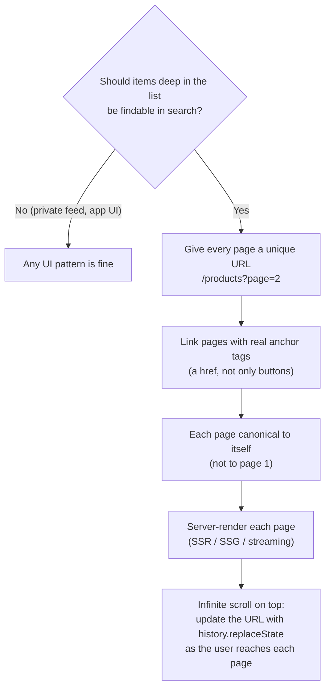

- Google stopped using `rel="next"`/`rel="prev"` as an indexing signal in 2019; crawlable links between pages are what matter. Other search engines may still read them, and they do no harm.
- Don't put the page number in a URL fragment (`#page=2`) — crawlers generally ignore fragments.
- Server-render the first page of any public listing (Next.js `searchParams`, Nuxt `useRoute().query`, SvelteKit `url.searchParams`, Angular SSR) so the first content is in the HTML and LCP isn't waiting on a client fetch.

---

## Framework Comparison

| Stack | Paged / infinite data | Infinite trigger | Virtualization |
|---|---|---|---|
| **React** | TanStack Query `useInfiniteQuery`, SWR `useSWRInfinite`, RTK Query `infiniteQuery`, Apollo `fetchMore`, Relay `usePaginationFragment` | IntersectionObserver hook (e.g. `react-intersection-observer`) | TanStack Virtual, react-virtuoso, react-window |
| **Next.js (App Router)** | Server Component renders page 1 from `searchParams`; client component continues with an infinite query | Same as React | Same as React |
| **Vue / Nuxt** | TanStack Vue Query `useInfiniteQuery`; Pinia Colada; Apollo/urql Vue bindings | VueUse `useInfiniteScroll` / `useIntersectionObserver` | vue-virtual-scroller, VueUse `useVirtualList`, TanStack Virtual (Vue adapter) |
| **Angular** | TanStack Angular Query `injectInfiniteQuery` (check its stability status), or RxJS `scan` over page streams; Apollo Angular | IntersectionObserver in a directive | **CDK** `<cdk-virtual-scroll-viewport>` + `*cdkVirtualFor` |
| **Svelte / SvelteKit** | TanStack Svelte Query `createInfiniteQuery`; `load` with `url.searchParams` for pages | IntersectionObserver in an action (`use:`) | TanStack Virtual (Svelte adapter) |
| **React Native** | Same data libraries | `FlatList` `onEndReached` + `onEndReachedThreshold` | `FlatList` virtualizes natively; Shopify FlashList recycles views |
| **iOS / Android native** | Your repository layer | `UITableView`/`UICollectionView` prefetching data source; SwiftUI `onAppear` on the last rows | Cell reuse is built in; Android **Jetpack Paging 3** with `RecyclerView` or Compose `LazyColumn` |

---

## Decision Matrix

| Question | If yes → |
|---|---|
| Will rows be inserted/deleted while users page through? | **Cursor** API |
| Do users need "jump to page N" or "page 3 of 40"? | **Offset** (or cursor + approximate page numbers) |
| Can users sort by many different columns? | Offset is simpler; cursor needs an index per sort |
| Are users **searching for something specific** or comparing? | **Numbered pages** |
| Are users **browsing** with no end goal? | **Infinite scroll** (+ load more after a few pages) |
| Does the page have a footer users need? | **Load more** or numbered pages |
| Must deep items be indexed by search engines? | Unique, linked, server-rendered page URLs |
| Will more than a few thousand rows be in the DOM? | **Virtualize** |
| Is Ctrl+F or full screen-reader access to all rows essential? | Numbered pages or `content-visibility` instead of virtualization |

---

## Real-World Examples

**Example 1 — Cursor endpoint (Node/Express + PostgreSQL):**
```typescript
import express from 'express';
import { Pool } from 'pg';

const db = new Pool();
const app = express();
const MAX_LIMIT = 100;

type Cursor = { t: string; id: string };
const encode = (c: Cursor) => Buffer.from(JSON.stringify(c)).toString('base64url');
function decode(raw: unknown): Cursor | null {
  if (typeof raw !== 'string' || raw === '') return null;
  try {
    const c = JSON.parse(Buffer.from(raw, 'base64url').toString('utf8'));
    if (typeof c?.t !== 'string' || typeof c?.id !== 'string' || Number.isNaN(Date.parse(c.t))) return null;
    return c;
  } catch {
    return null;
  }
}

app.get('/api/posts', async (req, res) => {
  const limit = Math.min(Math.max(Number(req.query.limit) || 20, 1), MAX_LIMIT); // never trust the client's page size
  const after = decode(req.query.after);
  if (req.query.after && !after) return res.status(400).json({ error: 'invalid cursor' });

  const { rows } = await db.query(
    `SELECT id, title, created_at FROM posts
     WHERE ($1::timestamptz IS NULL OR (created_at, id) < ($1::timestamptz, $2::text))
     ORDER BY created_at DESC, id DESC
     LIMIT $3`,
    [after?.t ?? null, after?.id ?? null, limit + 1], // +1 row tells us whether there is a next page
  );

  const hasMore = rows.length > limit;
  const items = rows.slice(0, limit);
  const last = items.at(-1);
  res.json({
    items,
    hasMore,
    nextCursor: hasMore && last ? encode({ t: last.created_at.toISOString(), id: last.id }) : null,
  });
});

app.listen(3000);
```

**Example 2 — Infinite feed with TanStack Query v5 + IntersectionObserver (React):**
```tsx
import { useEffect, useRef } from 'react';
import { useInfiniteQuery } from '@tanstack/react-query';

type Post = { id: string; title: string };
type Page = { items: Post[]; nextCursor: string | null };

async function fetchPosts(cursor: string | null, signal: AbortSignal): Promise<Page> {
  const url = new URL('/api/posts', location.origin);
  if (cursor) url.searchParams.set('after', cursor);
  const res = await fetch(url, { signal });
  if (!res.ok) throw new Error(`HTTP ${res.status}`);
  return res.json();
}

export function Feed({ tag }: { tag: string }) {
  const q = useInfiniteQuery({
    queryKey: ['posts', { tag }],                 // new tag = new list, starts at page 1
    queryFn: ({ pageParam, signal }) => fetchPosts(pageParam, signal),
    initialPageParam: null as string | null,
    getNextPageParam: (lastPage) => lastPage.nextCursor, // null/undefined = no next page
    maxPages: 10,                                  // cap memory and refetch cost
    getPreviousPageParam: () => undefined,         // see note below
  });

  const sentinel = useRef<HTMLDivElement>(null);
  const { hasNextPage, isFetchingNextPage, fetchNextPage, isError } = q;

  useEffect(() => {
    const el = sentinel.current;
    if (!el || !hasNextPage || isFetchingNextPage || isError) return;
    const io = new IntersectionObserver(
      ([entry]) => { if (entry.isIntersecting) fetchNextPage(); },
      { rootMargin: '0px 0px 800px 0px' },         // start ~one viewport early
    );
    io.observe(el);
    return () => io.disconnect();                  // re-created after each page, so a still-visible sentinel fires again
  }, [hasNextPage, isFetchingNextPage, isError, fetchNextPage]);

  if (q.isPending) return <FeedSkeleton />;
  if (q.isError && !q.data) return <ErrorState onRetry={() => q.refetch()} />;

  const posts = q.data.pages.flatMap((p) => p.items);
  if (posts.length === 0) return <p>No posts yet.</p>;

  return (
    <div role="feed" aria-busy={isFetchingNextPage} aria-label={`Posts tagged ${tag}`}>
      {posts.map((post, i) => (
        <article key={post.id} tabIndex={0} aria-posinset={i + 1} aria-setsize={-1}>
          <h3>{post.title}</h3>
        </article>
      ))}
      <div ref={sentinel} aria-hidden="true" />
      {isFetchingNextPage && <RowSkeleton />}
      {q.isFetchNextPageError && <button onClick={() => fetchNextPage()}>Retry loading more</button>}
      {!hasNextPage && <p>You're all caught up.</p>}
    </div>
  );
}
```

> With `maxPages`, dropped pages can only be re-fetched if `getPreviousPageParam` returns a cursor — this one-directional API returns `undefined`, so scrolling far back would show only the last 10 pages. Either add `before` cursors to the API or drop `maxPages` and virtualize instead. Vue, Svelte and Angular adapters take the same options (`useInfiniteQuery` / `createInfiniteQuery` / `injectInfiniteQuery`).

**Example 3 — Virtualizing the loaded pages with TanStack Virtual:**
```tsx
import { useRef, useEffect } from 'react';
import { useVirtualizer } from '@tanstack/react-virtual';

export function VirtualFeed({ posts, hasNextPage, isFetchingNextPage, fetchNextPage }: {
  posts: { id: string; title: string }[];
  hasNextPage: boolean;
  isFetchingNextPage: boolean;
  fetchNextPage: () => void;
}) {
  const parentRef = useRef<HTMLDivElement>(null);
  const rowCount = hasNextPage ? posts.length + 1 : posts.length; // +1 = loader row

  const virtualizer = useVirtualizer({
    count: rowCount,
    getScrollElement: () => parentRef.current,
    estimateSize: () => 120,       // initial guess, replaced by real measurements
    overscan: 6,
  });
  const items = virtualizer.getVirtualItems();

  // No sentinel needed: fetch when the last rendered index reaches the loader row
  const lastIndex = items.at(-1)?.index ?? 0;
  useEffect(() => {
    if (lastIndex >= posts.length - 1 && hasNextPage && !isFetchingNextPage) fetchNextPage();
  }, [lastIndex, posts.length, hasNextPage, isFetchingNextPage, fetchNextPage]);

  return (
    <div ref={parentRef} style={{ height: '100dvh', overflowY: 'auto' }}>
      <div style={{ height: virtualizer.getTotalSize(), position: 'relative' }}>
        {items.map((row) => (
          <div
            key={row.key}
            data-index={row.index}
            ref={virtualizer.measureElement}   // measures real height for dynamic rows
            style={{ position: 'absolute', top: 0, left: 0, width: '100%', transform: `translateY(${row.start}px)` }}
          >
            {row.index < posts.length ? <PostCard post={posts[row.index]} /> : <RowSkeleton />}
          </div>
        ))}
      </div>
    </div>
  );
}
```

**Example 4 — Numbered pages synced to the URL (BAD → GOOD):**
```tsx
import { useEffect, useState } from 'react';

// ❌ BAD: page lives only in component state - not shareable, lost on reload,
//         Back leaves the list page entirely, and every page change flashes a spinner
const [page, setPage] = useState(1);
const { data } = useQuery({ queryKey: ['products', page], queryFn: () => getProducts(page) });

// ✅ GOOD: page lives in the URL, previous page stays visible while the next loads,
//          and the next page is prefetched
import { useSearchParams, Link } from 'react-router';
import { useQuery, useQueryClient, keepPreviousData } from '@tanstack/react-query';

export function ProductList() {
  const [params] = useSearchParams();
  const page = Math.max(1, Number(params.get('page')) || 1);
  const qc = useQueryClient();

  const { data, isPlaceholderData } = useQuery({
    queryKey: ['products', { page }],
    queryFn: () => getProducts(page),
    placeholderData: keepPreviousData,
  });

  useEffect(() => {
    if (data?.hasMore) {
      qc.prefetchQuery({ queryKey: ['products', { page: page + 1 }], queryFn: () => getProducts(page + 1) });
    }
  }, [data, page, qc]);

  return (
    <>
      <ul style={{ opacity: isPlaceholderData ? 0.6 : 1 }}>{/* rows */}</ul>
      <nav aria-label="Pagination">
        {page > 1 && <Link to={`?page=${page - 1}`}>Previous</Link>}
        <span aria-current="page">Page {page}</span>
        {data?.hasMore && <Link to={`?page=${page + 1}`}>Next</Link>}
      </nav>
    </>
  );
}
```

**Example 5 — Apollo Client: merging Relay-style pages:**
```typescript
import { ApolloClient, InMemoryCache, HttpLink } from '@apollo/client';
import { relayStylePagination } from '@apollo/client/utilities';

export const client = new ApolloClient({
  link: new HttpLink({ uri: '/graphql' }),
  cache: new InMemoryCache({
    typePolicies: {
      Query: {
        fields: {
          // keyArgs: a different tag is a different list; first/after are merged into one list
          feed: relayStylePagination(['tag']),
        },
      },
    },
  }),
});

// In a component: fetchMore({ variables: { after: data.feed.pageInfo.endCursor } })
```

**Example 6 — Accessible "Load more" with focus management:**
```tsx
import { useEffect, useRef } from 'react';

type Props = { items: { id: string; title: string }[]; onLoadMore: () => void; hasMore: boolean; loading: boolean };

function LoadMoreList({ items, onLoadMore, hasMore, loading }: Props) {
  const firstNewRef = useRef<HTMLLIElement>(null);
  const prevCount = useRef(items.length);

  useEffect(() => {
    if (items.length > prevCount.current) firstNewRef.current?.focus(); // focus the first new item
    prevCount.current = items.length;
  }, [items.length]);

  const firstNewIndex = prevCount.current;
  return (
    <>
      <ul>
        {items.map((item, i) => (
          <li key={item.id} tabIndex={-1} ref={i === firstNewIndex ? firstNewRef : undefined}>
            {item.title}
          </li>
        ))}
      </ul>
      <p role="status" aria-live="polite">{loading ? 'Loading more results…' : ''}</p>
      {hasMore && (
        <button type="button" onClick={onLoadMore} disabled={loading}>
          Load more
        </button>
      )}
    </>
  );
}
```

---

## Key Points Summary

| Concept | One-Line Explanation |
|---|---|
| **Offset pagination** | "Skip N, take M" — simple and jump-able, but drifts on live data and slows with depth |
| **Cursor (keyset) pagination** | "Take M after this key" — stable under inserts and constant cost, but no page jumps |
| **Tie-breaker** | Sort by a unique key (e.g. `created_at, id`) so no row is skipped or repeated |
| **Opaque cursor** | Clients pass it back verbatim; the server owns and validates its format |
| **`limit + 1`** | Fetch one extra row to know `hasMore` without counting |
| **Relay connection** | `edges { cursor node }` + `pageInfo { hasNextPage endCursor }`, args `first/after`, `last/before` |
| **Numbered pages** | Best for goal-directed search, tables and SEO |
| **Load more** | Explicit, footer-friendly middle ground |
| **Infinite scroll** | Best for exploratory feeds; needs virtualization, a11y work and scroll restoration |
| **Sentinel + IntersectionObserver** | Trigger loading without scroll listeners or forced layout |
| **Infinite query cache** | One entry with `pages[]` + `pageParams[]`, refetched sequentially from page 1 |
| **`maxPages`** | Caps pages kept in memory and refetched |
| **Virtualization** | Render only visible rows + overscan; total height keeps the scrollbar right |
| **`content-visibility: auto`** | Skip rendering off-screen sections while keeping them in the DOM |
| **Scroll restoration** | Needs cached pages (or saved index) so content is full-height before scrolling |
| **SEO** | Unique, linked, self-canonical page URLs; crawlers don't scroll |

---

## Test Your Understanding

**Q1 (Basic):**
A notifications list uses `?offset=20&limit=20`. Users report seeing the same notification twice when they scroll. Why, and what's the proper fix?

<details>
<summary>Answer</summary>

New notifications are **inserted at the top** between the first and second request. Every existing row shifts down by the number of inserts, so the row that was at position 19 is now at position 20+ and is returned again on the second page (deletes cause the opposite: a row is skipped).

The proper fix is **cursor (keyset) pagination**: ask for "20 items older than `(created_at, id)` of the last item I have". Inserts at the top don't affect that range. De-duplicating by `id` on the client hides duplicates but can't recover skipped rows, so it's only a stopgap.
</details>

**Q2 (Application):**
Design the API and UI for an e-commerce search results page with filters, sorting by price/rating/newest, and a need for SEO.

<details>
<summary>Answer</summary>

- **UI:** numbered pages (or Load more on mobile) — users are goal-directed, compare items, share links and expect to reach the footer. Filters, sort and page live in the URL: `/search?q=shoes&sort=price&page=3`.
- **API:** offset/page-based is acceptable here: the result set is filtered and relatively stable during a session, users want "page 3 of 12", and sorting by several columns is easier. Cap `pageSize`, and consider an approximate total ("500+ results") if exact counts are expensive. If catalogues are huge and deep paging is common, cap max page depth or switch to search-engine `search_after`-style cursors.
- **Rendering:** server-render each page for SEO and LCP; each page URL is canonical to itself and linked with real `<a href>`; changing filters resets to page 1.
- **Client cache:** one query per page with `keepPreviousData`, prefetch page N+1.
</details>

**Q3 (Tricky):**
Your infinite feed loads page 1 and then stops on a 4K monitor — the user sees 8 posts, no scrollbar, and no more ever load. The sentinel is visible on screen. What's wrong?

<details>
<summary>Answer</summary>

`IntersectionObserver` fires when the intersection **changes**. On the tall screen the sentinel was already intersecting after page 1 rendered; if the code fetched page 2 only on the first callback and the guard (`isFetchingNextPage`) swallowed it, or if the observer isn't re-created after each page, there's no further change and no scrollbar to create one. Fixes: re-create the observer (or re-check `isIntersecting`) after each page finishes, as Example 2 does by depending on `isFetchingNextPage`; or loop "fetch while sentinel visible and hasMore"; and choose a page size that fills at least one to two viewports on large screens.
</details>

**Q4 (Tricky):**
After switching from offset to cursor pagination sorted by `created_at`, QA finds that a batch-imported set of posts (all with identical `created_at`) shows only partially. Why?

<details>
<summary>Answer</summary>

The sort key isn't **unique**. If page 1 ends in the middle of rows sharing the same `created_at`, the cursor `WHERE created_at < t` skips all the remaining rows with that exact timestamp (and `<=` would repeat some). Add a unique **tie-breaker** to both the `ORDER BY` and the cursor — `ORDER BY created_at DESC, id DESC` with `WHERE (created_at, id) < (t, id)` — and back it with a composite index.
</details>

**Q5 (System design):**
Design the list layer for a social feed showing 1,000+ posts per session with images, live new posts, and a requirement that Back from a post returns to the same position.

<details>
<summary>Answer</summary>

- **API:** cursor pagination (`after` for older posts), opaque cursors, `limit + 1`, server-capped page size. New posts arrive through a real-time channel or "posts newer than the top cursor" polling.
- **Cache:** one infinite query keyed by feed type; `maxPages` with bidirectional cursors (or no cap + virtualization). Long `staleTime` so returning to the feed doesn't refetch every page sequentially.
- **Rendering:** virtualize with dynamic heights (TanStack Virtual / react-virtuoso); reserve image space with `width`/`height` or `aspect-ratio` so measurement is stable; sentinel or "last virtual index" triggers the next page.
- **Live posts:** never insert above the reading position; show a "12 new posts" pill that scrolls to top and merges them on click.
- **Back navigation:** open posts in an overlay route so the feed stays mounted, or save the first visible index and restore with `scrollToIndex` from cached pages.
- **A11y:** `role="feed"` with `aria-busy`, articles with `aria-posinset`/`aria-setsize="-1"`, footer links duplicated in a menu.
</details>

**Q6 (Application):**
A product manager wants infinite scroll on the company blog index "because it's modern". What concerns do you raise and what do you propose?

<details>
<summary>Answer</summary>

Concerns: **SEO** (crawlers don't scroll, so older posts lose internal links unless paginated URLs exist), **footer reachability** (newsletter sign-up, legal links), **position memory** when readers return from an article, **accessibility** for keyboard and screen-reader users, and unbounded DOM growth. A blog index is also fairly goal-directed (find an article), not an endless browse.

Proposal: server-rendered numbered pages (`/blog?page=2`, self-canonical, linked with `<a>`), optionally enhanced with a **Load more** button that fetches the next page, appends it, and updates the URL with `history.replaceState` — keeping crawlable pages and a reachable footer while still feeling smooth.
</details>

---

## Cheat Sheet

**Key Definitions:**
- **Offset pagination:** Skip `offset` rows, return `limit` rows
- **Cursor / keyset pagination:** Return rows after (or before) a key taken from the last item seen
- **Opaque cursor:** Encoded token clients pass back without interpreting
- **Connection:** GraphQL list shape with `edges`, `node`, `cursor` and `pageInfo`
- **Sentinel:** Empty element after the last item that triggers the next fetch when it nears the viewport
- **Virtualization / windowing:** Rendering only rows near the viewport
- **Overscan:** Extra rows rendered outside the viewport to hide blanking during fast scroll
- **Scroll anchoring:** Browser keeps the visible content steady when content above it changes size
- **Feed role:** ARIA pattern for a scrollable, dynamically loading list of articles

**Quick Reference:**
```text
API (live / big data)    → cursor: ?after=<opaque>&limit=20 → { items, nextCursor, hasMore }
API (small / jumpable)   → offset: ?page=3&pageSize=20     → { items, page, totalPages? }
Keyset SQL               → WHERE (created_at, id) < ($t, $id) ORDER BY created_at DESC, id DESC LIMIT n+1
GraphQL                  → feed(first: 20, after: $cursor) { edges { cursor node } pageInfo { hasNextPage endCursor } }
REST discovery           → Link: <…?after=x>; rel="next"

UI: find/compare         → numbered pages (URL ?page=N, aria-current="page")
UI: browse, has footer   → load more (focus first new item)
UI: endless browse       → infinite scroll + virtualization + role="feed" + load-more fallback

Trigger                  → IntersectionObserver sentinel, rootMargin ≈ 1 viewport, guard in-flight
Cache                    → useInfiniteQuery: initialPageParam + getNextPageParam (+ maxPages)
Numbered pages cache     → one query per page + placeholderData: keepPreviousData + prefetch N+1
Virtualize               → TanStack Virtual / react-virtuoso / Angular CDK / vue-virtual-scroller
Cheaper alternative      → content-visibility: auto; contain-intrinsic-size: auto 300px
Back button              → keep pages cached, restore scroll after render, or open details in an overlay
SEO                      → unique self-canonical URLs, <a href> between pages, SSR page 1..N
```

**Common Mistakes to Avoid:**

| Mistake | Why Wrong | Fix |
|---|---|---|
| Offset pagination on a live feed | Inserts/deletes cause duplicates and skipped items | Cursor pagination |
| Cursor on a non-unique sort key | Rows with equal keys get skipped or repeated | Add `id` as a tie-breaker in sort, cursor and index |
| Trusting client `limit` | `?limit=1000000` becomes a denial-of-service | Clamp to a server maximum |
| Scroll listener reading layout | Forced layout on every scroll event, janky | IntersectionObserver sentinel |
| No in-flight guard | Same page requested several times | Check `isFetchingNextPage` / disconnect while loading |
| Auto-retry when the sentinel is visible | Request storm while the API is down | Show a Retry button |
| Infinite scroll with no virtualization | DOM grows without bound, INP degrades | Virtualize, `content-visibility`, or switch to load more |
| Infinite scroll on a page with a footer | Footer is unreachable | Load more after N pages, or move footer links |
| Page state only in component state | Not shareable, lost on reload/Back | Put page/filters in the URL |
| Spinner flash between numbered pages | Content disappears on every page change | `placeholderData: keepPreviousData` |
| Inserting live items above the reader | Content jumps, users lose their place, CLS | "N new items" pill |
| Fragment-based page URLs (`#page=2`) | Crawlers ignore fragments | `?page=2` with real links |
| Canonicalizing all pages to page 1 | Deeper items drop out of the index | Self-referencing canonical per page |
| Huge `maxPages`-less infinite queries | Refetch fires every page sequentially | `maxPages`, longer `staleTime`, or reset on return |

---

## References & Further Reading

**Core docs**
- MDN: [Intersection Observer API](https://developer.mozilla.org/en-US/docs/Web/API/Intersection_Observer_API)
- MDN: [`content-visibility`](https://developer.mozilla.org/en-US/docs/Web/CSS/content-visibility) · [`contain-intrinsic-size`](https://developer.mozilla.org/en-US/docs/Web/CSS/contain-intrinsic-size) · [`overflow-anchor`](https://developer.mozilla.org/en-US/docs/Web/CSS/overflow-anchor)
- MDN: [`History.scrollRestoration`](https://developer.mozilla.org/en-US/docs/Web/API/History/scrollRestoration)
- MDN: [ARIA `feed` role](https://developer.mozilla.org/en-US/docs/Web/Accessibility/ARIA/Reference/Roles/feed_role)
- web.dev: [content-visibility: the new CSS property that boosts your rendering performance](https://web.dev/articles/content-visibility)
- web.dev: [Virtualize large lists with react-window](https://web.dev/articles/virtualize-long-lists-react-window)

**Libraries**
- TanStack Query: [Infinite Queries](https://tanstack.com/query/latest/docs/framework/react/guides/infinite-queries) · [Paginated Queries](https://tanstack.com/query/latest/docs/framework/react/guides/paginated-queries)
- TanStack Virtual: [Introduction](https://tanstack.com/virtual/latest/docs/introduction)
- SWR: [Pagination](https://swr.vercel.app/docs/pagination)
- Redux Toolkit: [RTK Query infinite queries](https://redux-toolkit.js.org/rtk-query/usage/infinite-queries)
- Apollo Client: [Cursor-based pagination](https://www.apollographql.com/docs/react/pagination/cursor-based)
- Relay: [Rendering connections / pagination](https://relay.dev/docs/guided-tour/list-data/pagination/)
- Angular CDK: [Scrolling (virtual scroll)](https://material.angular.dev/cdk/scrolling/overview)
- React Native: [`FlatList`](https://reactnative.dev/docs/flatlist)
- Android Developers: [Paging library overview](https://developer.android.com/topic/libraries/architecture/paging/v3-overview)

**Specs & standards**
- GraphQL: [Cursor Connections Specification](https://relay.dev/graphql/connections.htm)
- IETF: [RFC 8288 — Web Linking (`Link` header)](https://www.rfc-editor.org/rfc/rfc8288)
- W3C WAI-ARIA APG: [Feed pattern](https://www.w3.org/WAI/ARIA/apg/patterns/feed/)
- GitHub Docs: [Using pagination in the REST API](https://docs.github.com/en/rest/using-the-rest-api/using-pagination-in-the-rest-api)

**SEO & UX**
- Google Search Central: [Pagination, incremental page loading, and their impact on Google Search](https://developers.google.com/search/docs/specialty/ecommerce/pagination-and-incremental-page-loading)
- Nielsen Norman Group: [Infinite Scrolling Is Not for Every Website](https://www.nngroup.com/articles/infinite-scrolling/)

**Deep dives**
- Markus Winand (Use The Index, Luke): [Paging Through Results — the seek method](https://use-the-index-luke.com/sql/partial-results/fetch-next-page)

---

> **Previous Topic:** [Optimistic UI Updates](./optimistic-ui-updates.md)
> — Showing the result of a mutation before the server confirms it

> **Next Topic:** [Real-Time Data Sync](./real-time-data-sync.md)
> — Keeping client data in sync with the server as it changes

*Saved on: 2026-11-06 | Repo: Frontend System Design Learning Notes*
