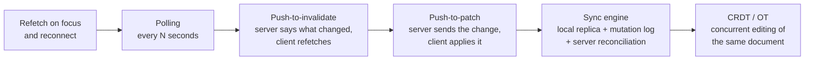
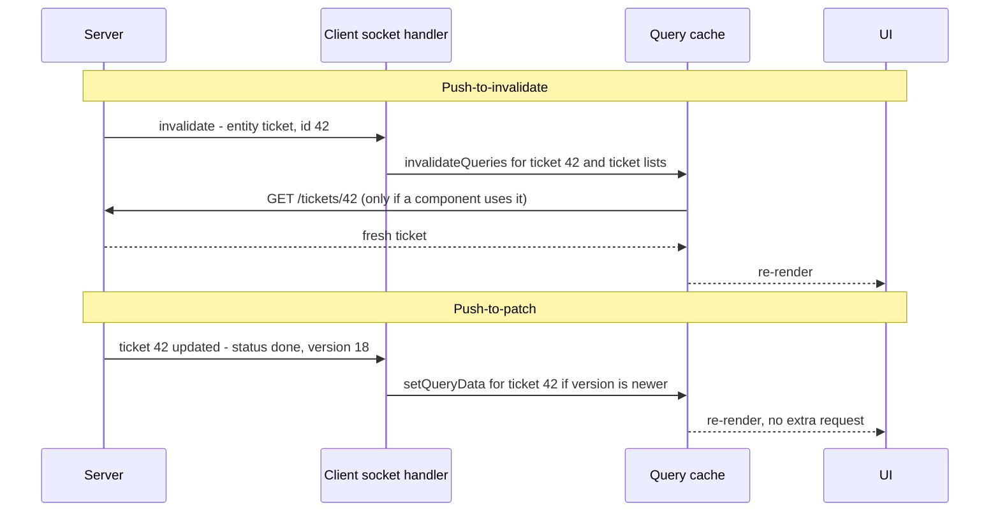
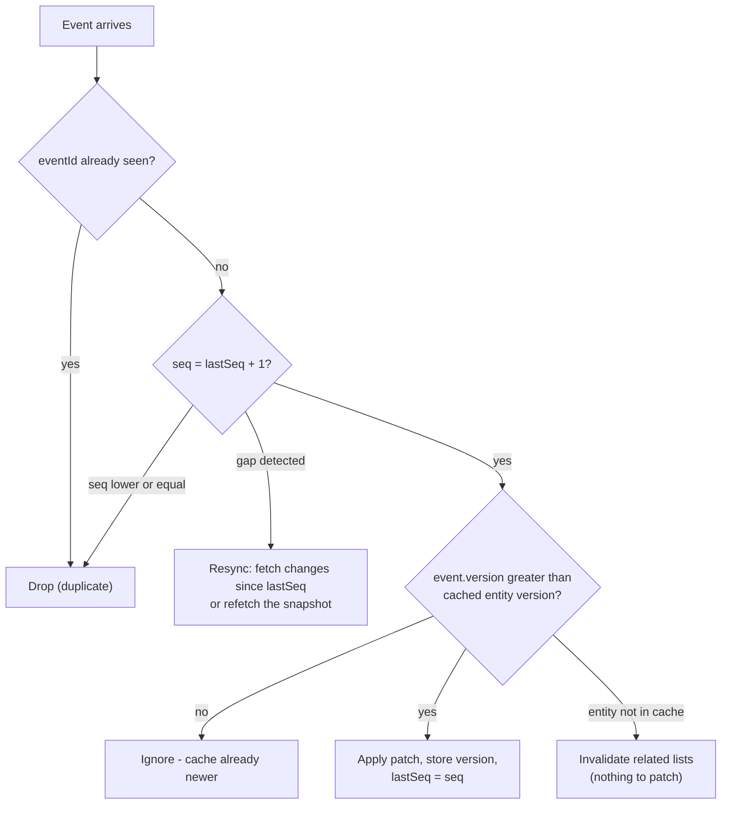
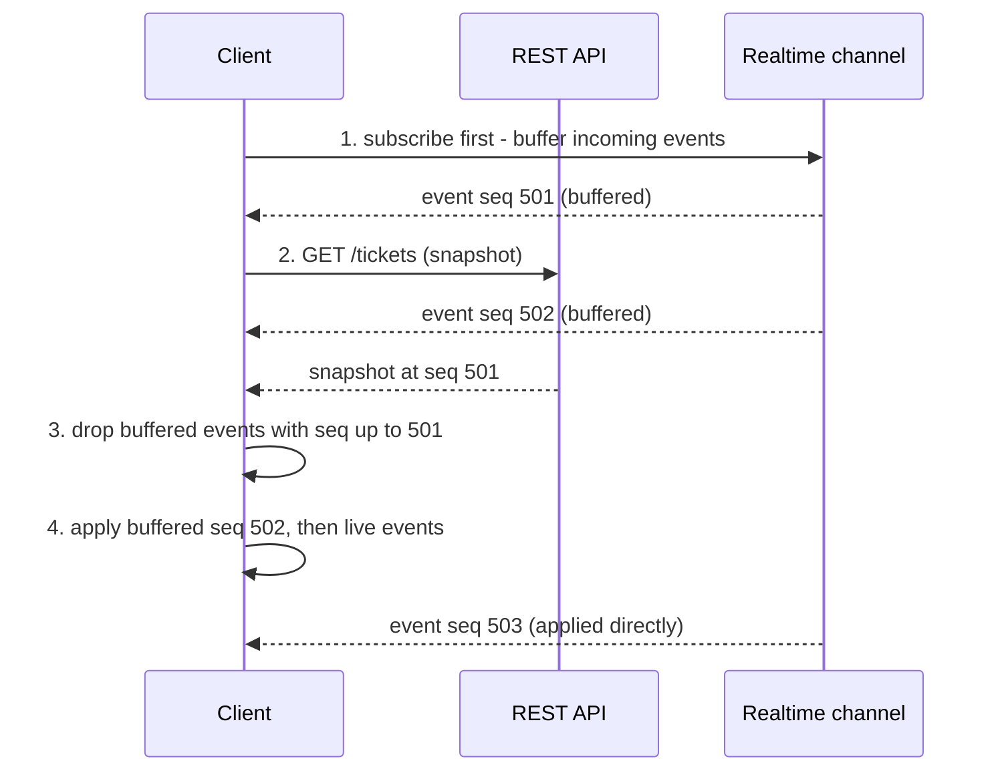
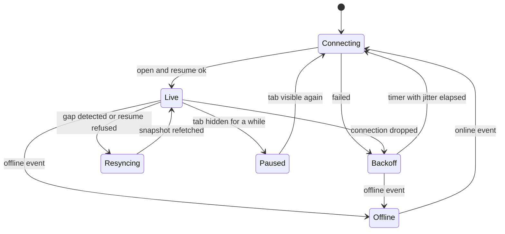
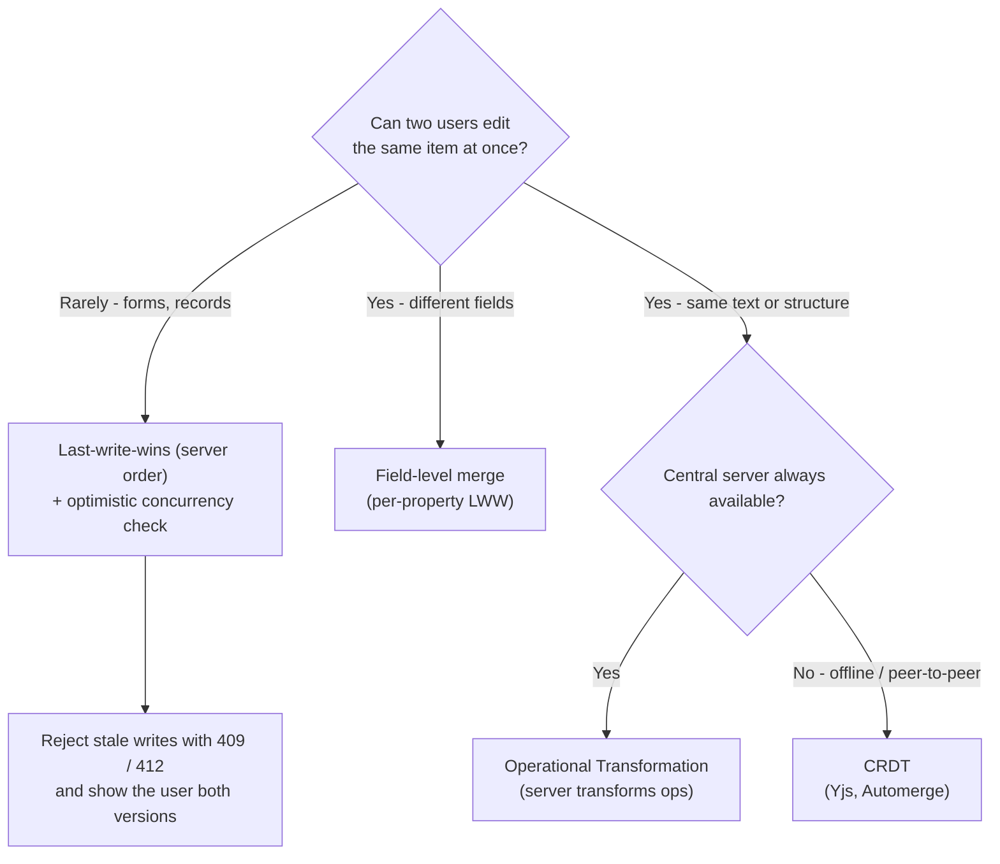
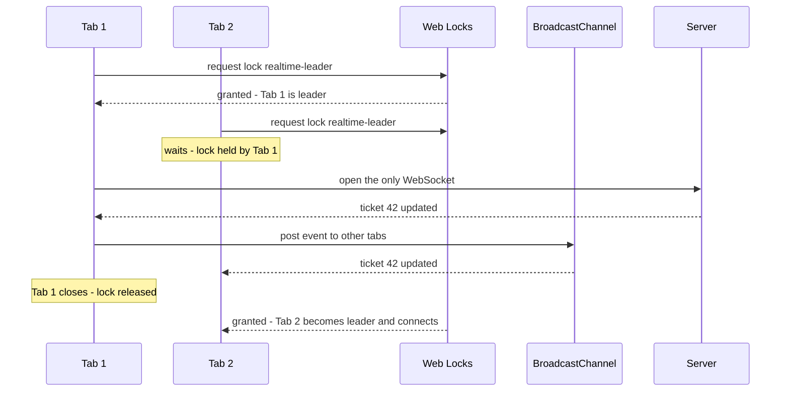
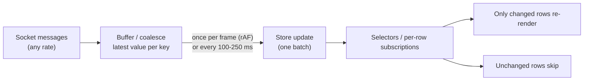
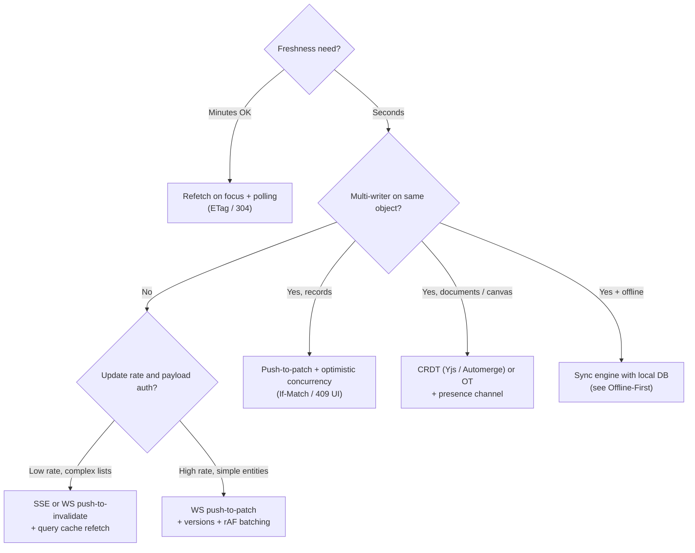

# Real-Time Data Sync

> **Date:** 2026-11-06 · **Last updated:** 2026-11-06
> **Category:** Frontend System Design
> **Sub-Topic:** State & Data / Data Fetching
> **Level:** Advanced · **Reading time:** ~34 min
> **Informs:** polling vs push-invalidate vs push-patch, merging live events into the query cache, event ordering and resync after reconnect, conflict resolution (LWW, OT, CRDT), presence, multi-tab connection sharing, rendering high-frequency updates

> **Pre-requisite:** [WebSockets & SSE & Long Polling](../01-web-fundamentals/websockets-sse-long-polling.md) (the transports) and [Server State vs Client State](./server-state-vs-client-state.md) (why server data lives in a cache).
> The transport note answers *how bytes get pushed*. This note answers *what the client does with them*: how a local copy of server data stays correct, ordered and consistent while many people change it.

**Previous:** [Pagination & Infinite Scroll](./pagination-and-infinite-scroll.md) · **Next:** [Offline-First Architecture](./offline-first-architecture.md)

---

## Table of Contents

1. [ELI5 — Simple Explanation](#eli5--simple-explanation)
2. [Section 1: The Sync Spectrum](#section-1-the-sync-spectrum)
3. [Section 2: Pull — Polling and Refetch Triggers](#section-2-pull--polling-and-refetch-triggers)
4. [Section 3: Push-to-Invalidate vs Push-to-Patch](#section-3-push-to-invalidate-vs-push-to-patch)
5. [Section 4: Designing the Event Payload](#section-4-designing-the-event-payload)
6. [Section 5: Ordering, Versions and Idempotency](#section-5-ordering-versions-and-idempotency)
7. [Section 6: Snapshot + Delta — Closing the Race Window](#section-6-snapshot--delta--closing-the-race-window)
8. [Section 7: Connection Lifecycle and Resync](#section-7-connection-lifecycle-and-resync)
9. [Section 8: Concurrent Edits and Conflict Resolution](#section-8-concurrent-edits-and-conflict-resolution)
10. [Section 9: Presence and Ephemeral State](#section-9-presence-and-ephemeral-state)
11. [Section 10: Multi-Tab Sync](#section-10-multi-tab-sync)
12. [Section 11: Rendering High-Frequency Updates](#section-11-rendering-high-frequency-updates)
13. [Section 12: Security for Live Data](#section-12-security-for-live-data)
14. [System Design Angle — Choosing a Sync Architecture](#system-design-angle--choosing-a-sync-architecture)
15. [Framework Comparison](#framework-comparison)
16. [Real-World Examples](#real-world-examples)
17. [Key Points Summary](#key-points-summary)
18. [Test Your Understanding (with answers)](#test-your-understanding)
19. [Cheat Sheet](#cheat-sheet)
20. [References & Further Reading](#references--further-reading)

---

## ELI5 — Simple Explanation

Imagine a **shared family whiteboard** in the kitchen, and everyone also keeps a **photo of it on their phone**.

- **Polling** = you walk to the kitchen every 10 minutes to take a new photo. Simple, but usually nothing changed, and you miss changes for up to 10 minutes.
- **Push-to-invalidate** = someone texts you "the whiteboard changed!" — you go and take a new photo.
- **Push-to-patch** = someone texts you "Mum added *buy milk* in line 4" — you edit your photo without walking anywhere.
- **Ordering** = texts can arrive out of order. If you get "line 4 deleted" before "line 4 added", your photo is wrong — so every message carries a **number**, and if you notice you missed number 17, you go take a fresh photo.
- **Conflicts** = Dad and you both rewrite line 2 at the same moment. You need a rule: *latest wins*, *merge both*, or a clever data structure (**CRDT**) that always merges the same way for everyone.
- **Presence** = seeing who is standing at the whiteboard right now. Nobody cares if that information is a second old or gets lost.

> **Real-time sync is not "open a WebSocket". It's a contract: a starting snapshot, an ordered stream of changes on top of it, a way to detect gaps and resync, and a rule for conflicting writes.**

---

## Core Concept — Step by Step

### Section 1: The Sync Spectrum

There is no single "real-time" design. Pick the cheapest point on this spectrum that meets the freshness and collaboration requirements:



| Level | Freshness | Complexity | Typical product |
|---|---|---|---|
| Refetch on focus/reconnect | When the user comes back | Trivial | Settings, profile, most CRUD screens |
| Polling | Interval (seconds–minutes) | Low | Order status, build status, admin dashboards |
| Push-to-invalidate | Near real-time | Medium | Notifications, inboxes, issue trackers |
| Push-to-patch | Real-time | Medium–high | Live scores, stock tickers, chat, feeds |
| Sync engine | Real-time + instant local writes | High (or buy one) | Productivity apps, offline-capable tools |
| CRDT / OT | Character-level, multi-writer | Highest | Docs, whiteboards, design tools |

> **Interview tip:** start by asking "how stale can this data be?" and "can two people edit the same thing at once?". The answers usually pick the level for you.

---

### Section 2: Pull — Polling and Refetch Triggers

Server-state libraries already give you a lot of "real-time" for free:

| Trigger | TanStack Query option (default) | Equivalent elsewhere |
|---|---|---|
| Window regains focus | `refetchOnWindowFocus` (`true`) | SWR `revalidateOnFocus`, RTK Query `refetchOnFocus` (needs `setupListeners`) |
| Network comes back | `refetchOnReconnect` (`true`) | SWR `revalidateOnReconnect`, RTK Query `refetchOnReconnect` |
| Interval | `refetchInterval` (off) | SWR `refreshInterval`, RTK Query `pollingInterval`, Apollo `pollInterval` |
| Interval while tab hidden | `refetchIntervalInBackground` (`false`) | SWR `refreshWhenHidden` |

Refetches only fire for **stale** queries (`staleTime` controls that), and only for queries that are in use.

```text
Polling cost ≈ clients × (1 / interval) requests, whether or not anything changed.
10,000 open dashboards polling every 5 s ≈ 2,000 requests/second of mostly "nothing new".
```

Make polling cheap with **ETags / 304** (see [Browser Caching Strategies](../01-web-fundamentals/browser-caching-strategies.md#section-4-validators--etag-and-last-modified)), "changes since version X" endpoints, and **adaptive intervals** (poll fast while something is in progress, slow down or stop when it settles or the tab is hidden).

---

### Section 3: Push-to-Invalidate vs Push-to-Patch

Once you have a push channel, the server can send either a **hint** or the **data**:



| | **Push-to-invalidate** | **Push-to-patch** |
|---|---|---|
| Payload | Tiny (`{ type, id }`) | The changed data (full entity or diff) |
| Extra requests | One refetch per active query affected | None |
| Authorization | Reuses normal API auth on refetch — the event leaks only "something changed" | Every event payload must be filtered per subscriber |
| Correctness | Very robust — the server response is always the truth | Must handle ordering, gaps, partial updates |
| Latency | Event + one round trip | Event only |
| Bursts | Debounce/coalesce invalidations | Batch per frame (Section 11) |
| Best for | Lists with complex filters/sorting, low–medium update rates | High-frequency values, chat messages, counters, cursors |

> **Pragmatic hybrid:** patch the **entity** queries you can update precisely (`['ticket', 42]`), and **invalidate** the derived queries you can't (`['tickets', { filter, sort }]`, counts, aggregates). Re-implementing server filtering and sorting on the client to place a new item in the right list is a common source of bugs.

---

### Section 4: Designing the Event Payload

A good event is self-describing, ordered and safe to apply twice:

```json
{
  "eventId": "evt_01JC9Z…",
  "type": "ticket.updated",
  "entity": "ticket",
  "id": "42",
  "version": 18,
  "seq": 99123,
  "changedFields": ["status", "updatedAt"],
  "data": { "status": "done", "updatedAt": "2026-11-06T10:02:11Z" },
  "actorId": "u_7"
}
```

| Field | Why it's there |
|---|---|
| `eventId` | **Idempotency** — drop duplicates after a reconnect or retry |
| `type` / `entity` / `id` | Routing to the right cache keys |
| `version` | **Per-entity** monotonic counter — ignore events older than what you already have |
| `seq` | **Per-stream** sequence — detect **gaps** (missed events) and resume from the last one |
| `data` / `changedFields` | Patch payload (or omit for invalidate-only events) |
| `actorId` | Skip echoing your own optimistic change, show "edited by Ana" |

**Full entity vs diff:** sending the full entity (or full changed fields) makes events **idempotent and self-healing**. Sending operations like "increment by 1" is smaller, but applying one twice or out of order corrupts the state.

---

### Section 5: Ordering, Versions and Idempotency

Networks, reconnects and multi-server backends mean events can arrive **duplicated, late or out of order**. The client applies a simple decision for each event:



- **Versions come from the server.** Use a database row version or a server-assigned counter, not client clocks — client clocks drift, and two devices can disagree by minutes.
- **Per-entity version** decides "is this newer than what I have?". **Per-stream sequence** decides "did I miss something?". You often need both: a refetch can make the cache newer than the next event in the stream.
- **Ordering is only guaranteed within one connection to one server process.** If your backend fans out through several brokers or partitions, guarantee ordering per entity (e.g. partition by entity id), not globally.

---

### Section 6: Snapshot + Delta — Closing the Race Window

The classic bug: the client fetches the list, *then* subscribes. Any change that happens **between** the fetch response and the subscription is lost forever.



Two standard ways to close the window:

| Approach | How |
|---|---|
| **Subscribe, then snapshot** (above) | Subscribe and buffer; fetch a snapshot that reports its sequence/version; discard buffered events ≤ snapshot seq; apply the rest |
| **Snapshot with a cursor, then subscribe from it** | Fetch the snapshot plus `seq`; subscribe with `since=seq`; the server replays everything after it (needs a server-side event log or change feed) |

SSE has resumption built in: if the server sends `id:` lines, the browser's `EventSource` sends a **`Last-Event-ID`** header when it reconnects, so the server can replay from there. With WebSockets you build the same thing yourself (`{ type: 'resume', since: lastSeq }`).

> **If the server can't replay** (the log is gone, or the gap is too large), the fallback is always the same: **refetch the snapshot** — e.g. `queryClient.invalidateQueries()` for the affected keys.

---

### Section 7: Connection Lifecycle and Resync

A real-time client is a state machine, not a socket:



| Event | Do |
|---|---|
| **Drop** | Reconnect with exponential backoff + jitter (details in [WebSockets & SSE & Long Polling](../01-web-fundamentals/websockets-sse-long-polling.md#section-7-reconnection--exponential-backoff-and-jitter)) |
| **Reconnect** | Resume from `lastSeq`; if refused, invalidate/refetch affected queries |
| **`offline` / `online`** | Stop retrying while offline; reconnect immediately on `online` (the event is a hint — confirm with a real request) |
| **Tab hidden** (`visibilitychange`) | Optionally close after a grace period to save server connections and battery; resync on return |
| **bfcache restore** (`pageshow` with `persisted`) | The page may have been frozen for minutes — reconnect and resync |
| **Token expiry** | Re-authenticate the channel before the token expires, or reconnect with a fresh token |
| **Server deploy** | Expect mass disconnects; jitter prevents a reconnect stampede |

Show connection state in the UI when it matters ("Reconnecting…", "Live", last-updated time). Silent staleness is worse than a visible banner for anything financial or operational.

---

### Section 8: Concurrent Edits and Conflict Resolution

Once **two clients can change the same data**, you need a rule for what happens when their changes cross.



| Strategy | How it works | Good for | Watch out for |
|---|---|---|---|
| **Last-write-wins (LWW)** | Server applies writes in arrival order; the last one stands | Simple records, settings | Silent lost updates |
| **Optimistic concurrency** | Client sends the version it edited (`If-Match: "v17"` or `version: 17`); server rejects with **412**/**409** if it changed | Forms, admin tools | Needs a "someone else changed this" UX |
| **Field-level merge** | LWW per property instead of per record | Kanban cards, structured objects | Invariants spanning several fields |
| **Server reconciliation (rebase)** | Client applies mutations optimistically; server is authoritative; client replays its pending mutations on top of the server state | Sync engines, most "instant" apps | Mutations must be re-runnable functions, not fixed values |
| **OT** | Operations are transformed against concurrent ones by a central server | Collaborative text (Google Docs is the well-known example) | Hard to implement correctly; needs a central server |
| **CRDT** | Data types whose merges are commutative and convergent — every replica reaches the same state regardless of order | Offline-capable collaboration, P2P | Metadata overhead, tombstones, "merged but semantically odd" results |

> Optimistic updates (see [Optimistic UI Updates](./optimistic-ui-updates.md)) and real-time events interact: when your own change echoes back from the server, recognise it (by `actorId` or a client mutation id) so you don't apply it twice or flash the old value.

---

### Section 9: Presence and Ephemeral State

**Presence** (who's online, live cursors, "Ana is typing…", selections) is a different kind of data:

| | Durable data (documents, tickets) | Ephemeral state (presence, cursors) |
|---|---|---|
| Stored | Database, event log | Memory only, with a TTL |
| Delivery | Ordered, every event matters | Latest value wins; drops are fine |
| Rate | Per user action | Up to many per second |
| On reconnect | Resync | Just send the current state again |

Rules: **throttle** outgoing updates (e.g. cursor positions a few times per second), **expire** peers that stop heart-beating, keep presence on a **separate channel or message type** so a burst of cursor moves never delays a real data event, and interpolate/animate remote cursors so a low update rate still looks smooth. Hosted tools (Liveblocks, Supabase Realtime Presence, Ably, Pusher, PartyKit/Cloudflare Durable Objects, Yjs awareness) provide this out of the box.

---

### Section 10: Multi-Tab Sync

A user with five tabs open has five copies of the cache — and, naively, **five sockets**.



| Tool | Use it for |
|---|---|
| **`BroadcastChannel`** | Fan out events and cache updates between same-origin tabs |
| **Web Locks API** (`navigator.locks.request`) | Leader election — the lock is released automatically when the holder tab closes |
| **`SharedWorker`** | Hold one connection shared by all tabs; Chrome on Android added support only very recently — check MDN |
| **`storage` event** | Legacy cross-tab signal via `localStorage` (synchronous storage, string-only) |
| **TanStack `broadcastQueryClient`** | Experimental plugin that syncs query cache updates across tabs |

Even without sharing the socket, **broadcast logout and auth changes** to every tab — a tab still showing private data after logout elsewhere is a real bug.

---

### Section 11: Rendering High-Frequency Updates

Applying 200 events per second as 200 React renders will destroy INP. Separate **receiving** from **rendering**:



- **Coalesce**: if price for `AAPL` changes 30 times in a frame, keep only the last value.
- **Batch**: flush once per `requestAnimationFrame` (or on a timer for non-visual consumers); pause flushing when the tab is hidden.
- **Subscribe narrowly**: a normalized store with per-entity subscriptions (`useSyncExternalStore` with a selector, Zustand/Redux selectors, signals in Vue/Angular/Svelte/Solid) so one tick re-renders one row, not the table.
- **Heavy parsing or aggregation** (e.g. order-book maths) can move to a [Web Worker](../01-web-fundamentals/service-workers-and-web-workers.md).
- **Don't shift content under the reader**: new items go behind a "N new" pill; highlight changed values briefly instead of reordering rows on every tick. Respect `prefers-reduced-motion` for flash animations.
- **Accessibility**: don't put a rapidly updating value in an `aria-live` region — screen readers would announce constantly. Announce meaningful changes only ("Order filled").

---

### Section 12: Security for Live Data

| Risk | Mitigation |
|---|---|
| Subscribing to someone else's channel (`/tenant/123`) | **Authorize every subscribe** on the server, per topic, not just at connect time |
| Permissions change while connected | Re-check on events or force-unsubscribe when roles change; reconnect on token refresh |
| Patch payload leaks fields the user can't see | Filter payloads per subscriber, or send invalidate-only events and let the normal API apply field-level auth |
| Cross-Site WebSocket Hijacking (cookie auth) | Check the `Origin` header on the WebSocket handshake; prefer short-lived tokens |
| Malicious client events (presence, collaborative ops) | Validate and rate-limit everything a client sends; never trust `actorId` from the client |
| Rendering event content | Treat it as untrusted input — no `innerHTML` with event data |

---

## System Design Angle — Choosing a Sync Architecture



| Build vs buy | Examples (not endorsements) | You get |
|---|---|---|
| Build on your API | WebSocket/SSE server + Redis/Kafka pub/sub + query cache | Full control; you own ordering, resync, scale |
| Backend-as-a-service realtime | Firebase/Firestore listeners, Supabase Realtime, AWS AppSync subscriptions, Convex | Live queries with auth rules, less control over protocol |
| Messaging platforms | Ably, Pusher, PubNub | Managed fan-out, presence, history |
| Collaboration | Yjs (+ y-websocket / Hocuspocus), Automerge, Liveblocks | CRDT documents, presence, undo |
| Sync engines | ElectricSQL, Zero / Replicache, PowerSync | Local replica, mutation queue, partial sync |

**Questions to ask in a design interview:** expected concurrent connections, update rate per client, acceptable staleness, who can edit what, offline requirement, ordering scope (global vs per entity), history/replay needs, and mobile background behaviour.

---

## Framework Comparison

| Stack | Pull | Push into state | Notes |
|---|---|---|---|
| **React** | TanStack Query / SWR / RTK Query options (Section 2) | Socket handler → `queryClient.setQueryData` / `invalidateQueries`; RTK Query `onCacheEntryAdded` + `updateCachedData`; external stores via `useSyncExternalStore` | Apollo/urql/Relay: GraphQL **subscriptions** over `graphql-ws` (the older `subscriptions-transport-ws` is deprecated) |
| **Vue / Nuxt** | TanStack Vue Query, Pinia Colada | VueUse `useWebSocket` / `useEventSource` feeding a Pinia store or query client | `shallowRef` for large live collections |
| **Angular** | `HttpClient` + RxJS `timer`/`switchMap`, TanStack Angular Query | RxJS `webSocket()` subject with `retry({ delay })`, `toSignal()` for templates; Apollo Angular subscriptions | Run high-frequency handlers outside the zone (or zoneless) to avoid app-wide change detection |
| **Svelte / SvelteKit** | TanStack Svelte Query | `readable` stores whose start/stop function opens/closes the socket; Svelte 5 `createSubscriber` in `svelte/reactivity` | Store subscribers drive connection lifetime automatically |
| **React Native** | Same libraries + `AppState` for focus | Same as React; reconnect on `AppState` → `active` and NetInfo changes | OS suspends sockets in background — use push notifications for wake-ups |
| **iOS / Android native** | `URLSession` / OkHttp | `URLSessionWebSocketTask`, OkHttp `WebSocket`; Firebase/Supabase SDKs | Background execution is limited — resync on foreground |

---

## Real-World Examples

**Example 1 — Merging WebSocket events into TanStack Query (React):**
```typescript
import { useEffect } from 'react';
import { useQueryClient, type QueryClient } from '@tanstack/react-query';

type Ticket = { id: string; title: string; status: string; version: number };
type ServerEvent =
  | { type: 'ticket.updated'; seq: number; eventId: string; data: Ticket }
  | { type: 'ticket.created' | 'ticket.deleted'; seq: number; eventId: string; id: string };

function applyEvent(qc: QueryClient, ev: ServerEvent) {
  switch (ev.type) {
    case 'ticket.updated':
      // Patch the entity query only if the event is newer than what we hold
      qc.setQueryData<Ticket>(['ticket', ev.data.id], (old) =>
        old && old.version >= ev.data.version ? old : ev.data,
      );
      // Lists have server-side filters/sort - let the server recompute them
      qc.invalidateQueries({ queryKey: ['tickets'] });
      break;
    case 'ticket.created':
    case 'ticket.deleted':
      qc.invalidateQueries({ queryKey: ['tickets'] });
      if (ev.type === 'ticket.deleted') qc.removeQueries({ queryKey: ['ticket', ev.id] });
      break;
  }
}

export function useTicketSync(url: string) {
  const qc = useQueryClient();

  useEffect(() => {
    let ws: WebSocket | undefined;
    let lastSeq = 0;
    let attempt = 0;
    let timer: ReturnType<typeof setTimeout> | undefined;
    let stopped = false;
    const seen = new Set<string>();

    const connect = () => {
      ws = new WebSocket(url);
      ws.onopen = () => {
        attempt = 0;
        ws!.send(JSON.stringify({ type: 'resume', since: lastSeq }));
      };
      ws.onmessage = (msg) => {
        const ev = JSON.parse(msg.data);
        if (ev.type === 'resync-required') {           // server can't replay the gap
          qc.invalidateQueries({ queryKey: ['ticket'] });
          qc.invalidateQueries({ queryKey: ['tickets'] });
          lastSeq = ev.seq;
          return;
        }
        if (seen.has(ev.eventId) || ev.seq <= lastSeq) return;   // duplicate or old
        if (lastSeq !== 0 && ev.seq > lastSeq + 1) {               // gap: ask for a replay
          ws!.send(JSON.stringify({ type: 'resume', since: lastSeq }));
          return;
        }
        seen.add(ev.eventId);
        if (seen.size > 1000) seen.clear();            // bounded memory
        lastSeq = ev.seq;
        applyEvent(qc, ev);
      };
      ws.onclose = () => {
        if (stopped) return;
        const delay = Math.min(30_000, 500 * 2 ** attempt++) * Math.random(); // full jitter
        timer = setTimeout(connect, delay);
      };
    };

    connect();
    return () => {
      stopped = true;
      clearTimeout(timer);
      ws?.close();
    };
  }, [url, qc]);
}
```

> The server side must keep a short replay log per stream for `resume` to work, and reply `resync-required` when `since` is too old. Production code also batches invalidations (Example 4) and reconnects on `online` / `pageshow`.

**Example 2 — Subscribe-then-snapshot buffer (framework-agnostic):**
```typescript
type Event<T> = { seq: number; apply: (state: T) => T };

export class SnapshotSync<T> {
  private state: T | undefined;
  private snapshotSeq = -1;
  private buffer: Event<T>[] = [];

  constructor(private onChange: (state: T) => void) {}

  // 1. Call this from the socket handler as soon as you subscribe
  receive(ev: Event<T>) {
    if (this.state === undefined) { this.buffer.push(ev); return; } // still loading
    if (ev.seq <= this.snapshotSeq) return;                          // already in snapshot
    this.state = ev.apply(this.state);
    this.snapshotSeq = ev.seq;
    this.onChange(this.state);
  }

  // 2. Call this when the snapshot (which reports its seq) arrives
  loadSnapshot(state: T, seq: number) {
    this.state = state;
    this.snapshotSeq = seq;
    for (const ev of this.buffer.sort((a, b) => a.seq - b.seq)) {
      if (ev.seq > this.snapshotSeq) {
        this.state = ev.apply(this.state);
        this.snapshotSeq = ev.seq;
      }
    }
    this.buffer = [];
    this.onChange(this.state);
  }
}
```

**Example 3 — One socket for all tabs: Web Locks leader + BroadcastChannel:**
```typescript
const channel = new BroadcastChannel('realtime');
const listeners = new Set<(ev: unknown) => void>();

channel.onmessage = (msg) => listeners.forEach((fn) => fn(msg.data)); // followers receive here

export function onRealtimeEvent(fn: (ev: unknown) => void) {
  listeners.add(fn);
  return () => listeners.delete(fn);
}

// Every tab queues for the lock; only the holder opens the socket.
// The lock is released automatically if the leader tab closes or crashes.
navigator.locks.request('realtime-leader', async () => {
  const ws = new WebSocket('wss://api.example.com/live');
  ws.onmessage = (msg) => {
    const ev = JSON.parse(msg.data);
    listeners.forEach((fn) => fn(ev)); // the leader handles events itself…
    channel.postMessage(ev);           // …and fans them out (BroadcastChannel skips the sender)
  };
  // Hold the lock until the socket closes for good (reconnect logic omitted)
  await new Promise<void>((resolve) => ws.addEventListener('close', () => resolve()));
});
```

**Example 4 — Coalescing a firehose into one render per frame (BAD → GOOD):**
```typescript
// ❌ BAD: one state update (and render) per message - hundreds per second
ws.onmessage = (m) => {
  const { symbol, price } = JSON.parse(m.data);
  setPrices((prev) => ({ ...prev, [symbol]: price }));
};

// ✅ GOOD: external store + latest-value-per-key buffer + rAF flush + per-row subscriptions
import { useSyncExternalStore } from 'react';

const prices = new Map<string, number>();
const pending = new Map<string, number>();
const subs = new Map<string, Set<() => void>>();
let scheduled = false;

function flush() {
  scheduled = false;
  for (const [symbol, price] of pending) {
    prices.set(symbol, price);
    subs.get(symbol)?.forEach((notify) => notify()); // only rows for changed symbols
  }
  pending.clear();
}

ws.onmessage = (m) => {
  const { symbol, price } = JSON.parse(m.data);
  pending.set(symbol, price);                         // 30 ticks in a frame → 1 value
  if (!scheduled) { scheduled = true; requestAnimationFrame(flush); }
};

export function usePrice(symbol: string) {
  return useSyncExternalStore(
    (notify) => {
      if (!subs.has(symbol)) subs.set(symbol, new Set());
      subs.get(symbol)!.add(notify);
      return () => subs.get(symbol)!.delete(notify);
    },
    () => prices.get(symbol),
  );
}
```

> `requestAnimationFrame` doesn't run in hidden tabs, so `pending` simply keeps the latest values until the tab is visible again — a free "pause while hidden". Vue (`shallowRef` + `triggerRef`), Angular (signals updated in a rAF callback) and Svelte (a store `set` per frame) follow the same pattern.

**Example 5 — GraphQL subscription merged into Apollo's cache:**
```tsx
import { useEffect } from 'react';
import { gql } from '@apollo/client';
import { useQuery } from '@apollo/client/react'; // Apollo Client 4 path; older versions import from '@apollo/client'

const COMMENTS = gql`
  query Comments($postId: ID!) { post(id: $postId) { id comments { id body author { id name } } } }
`;
const COMMENT_ADDED = gql`
  subscription CommentAdded($postId: ID!) { commentAdded(postId: $postId) { id body author { id name } } }
`;

function Comments({ postId }: { postId: string }) {
  const { data, subscribeToMore } = useQuery(COMMENTS, { variables: { postId } });

  useEffect(
    () =>
      subscribeToMore({
        document: COMMENT_ADDED,
        variables: { postId },
        updateQuery: (prev, { subscriptionData }) => {
          const added = subscriptionData.data?.commentAdded;
          if (!added || prev.post.comments.some((c) => c.id === added.id)) return prev; // dedupe
          return { post: { ...prev.post, comments: [...prev.post.comments, added] } };
        },
      }),
    [postId, subscribeToMore],
  );
  // render data.post.comments …
}
```

> The `updateQuery` callback signature has changed between Apollo Client major versions — check the subscriptions docs for your version. The transport is a `GraphQLWsLink` using the `graphql-ws` client.

**Example 6 — Collaborative text with a CRDT (Yjs) and presence:**
```typescript
import * as Y from 'yjs';
import { WebsocketProvider } from 'y-websocket';
import { IndexeddbPersistence } from 'y-indexeddb';

const doc = new Y.Doc();
new IndexeddbPersistence('doc-123', doc);                 // local copy: works offline, loads instantly
const provider = new WebsocketProvider('wss://collab.example.com', 'doc-123', doc);

const text = doc.getText('content');
text.observe(() => render(text.toString()));              // fires for local AND remote changes

// Local edit: merged deterministically with concurrent remote edits on every replica
text.insert(0, 'Hello ');

// Presence: ephemeral, never stored in the document
provider.awareness.setLocalStateField('user', { name: 'Ana', color: '#e91e63' });
provider.awareness.on('change', () => {
  const peers = [...provider.awareness.getStates().values()].map((s) => s.user);
  renderPeers(peers);
});
```

> In real editors you bind Yjs to the editor (y-prosemirror, y-codemirror.next, y-monaco, Tiptap's collaboration extension) instead of calling `insert` by hand.

---

## Key Points Summary

| Concept | One-Line Explanation |
|---|---|
| **Sync spectrum** | Focus refetch → polling → push-invalidate → push-patch → sync engine → CRDT/OT |
| **Push-to-invalidate** | Server says "X changed"; client refetches through the normal API |
| **Push-to-patch** | Server sends the change; client writes it into the cache |
| **Per-entity version** | Ignore events older than the cached copy |
| **Per-stream sequence** | Detect gaps and resume from the last event seen |
| **Idempotent events** | Carry an `eventId` and full values so re-applying is harmless |
| **Snapshot + delta** | Subscribe and buffer, fetch a versioned snapshot, apply only newer events |
| **`Last-Event-ID`** | SSE's built-in resume header on reconnect |
| **Resync fallback** | When replay isn't possible, refetch the snapshot |
| **LWW / optimistic concurrency** | Last write stands, or reject stale writes with 409/412 |
| **OT vs CRDT** | Server-transformed operations vs convergent data types that merge anywhere |
| **Presence** | Ephemeral, lossy, throttled, TTL-based — separate from durable data |
| **Multi-tab** | Web Locks leader + BroadcastChannel = one socket per browser |
| **Rendering** | Coalesce per key, flush per frame, subscribe per row |
| **Security** | Authorize each subscription and filter each payload |

---

## Test Your Understanding

**Q1 (Basic):**
What's the difference between push-to-invalidate and push-to-patch, and when would you prefer invalidation even though it costs an extra request?

<details>
<summary>Answer</summary>

Push-to-invalidate sends only "entity X changed"; the client refetches the affected queries through the normal API. Push-to-patch sends the changed data, and the client writes it directly into its cache.

Prefer invalidation when: lists depend on server-side **filters, sorting, permissions or aggregates** the client can't reproduce reliably; payloads would need **per-user field filtering**; or the update rate is low enough that one refetch per change is cheap. It's also more robust: whatever the server returns is the truth, so ordering mistakes heal themselves.
</details>

**Q2 (Application):**
A dashboard loads `GET /orders`, then opens a WebSocket for `order.*` events. Occasionally an order created right after page load never appears until refresh. Explain and fix.

<details>
<summary>Answer</summary>

It's the **snapshot/subscription race**: the order was created after the database read for `GET /orders` but before the subscription was active, so it's in neither the snapshot nor the stream.

Fix: **subscribe first and buffer events**, then fetch the snapshot with its sequence/version, drop buffered events that the snapshot already includes, and apply the rest (Example 2). Or fetch the snapshot with a `seq` and subscribe with `since=seq` so the server replays the gap. If neither is possible, at least invalidate the list once the socket reports it's live.
</details>

**Q3 (Tricky):**
Your client applies `ticket.updated` events by replacing the cached ticket. Users sometimes see a status flip back to an older value for a few seconds. The backend runs on several nodes. What's happening?

<details>
<summary>Answer</summary>

Events (or an event and a refetch response) are arriving **out of order**. With several backend nodes or brokers, event B can overtake event A; or a refetch started before an event returns after it with older data. Replacing blindly means the last *arrival* wins, not the last *change*.

Fix: give every entity a **server-assigned monotonically increasing version**, include it in both API responses and events, and only apply data whose version is higher than the cached one. Ensure the backend orders events **per entity** (e.g. partition by entity id). Don't use client timestamps.
</details>

**Q4 (Tricky):**
A user has eight tabs of your app open. Your server team complains about connection counts, and users report that after logging out in one tab, the others keep showing private data. How do you fix both?

<details>
<summary>Answer</summary>

Use **leader election** with the Web Locks API so only one tab holds the WebSocket; the leader forwards events to other tabs with `BroadcastChannel` (Example 3). When the leader closes, its lock is released and another tab takes over. (A `SharedWorker` can also own the connection, where supported.)

For logout, **broadcast an auth change** on a `BroadcastChannel`; every tab clears its query cache and in-memory state, closes any sockets and navigates to the login page. Server-side, revoke the session so a stale tab's next request or subscription also fails. `Clear-Site-Data` on the logout response helps clear storage.
</details>

**Q5 (System design):**
Design real-time updates for a trading screen showing 500 instruments with prices that change many times per second, plus an order list.

<details>
<summary>Answer</summary>

- **Transport:** WebSocket (bi-directional subscription management per symbol); subscribe only to visible/watched instruments.
- **Prices:** push-to-patch with latest-value semantics — no need to replay every tick, so on reconnect just request current snapshots. Coalesce per symbol and flush once per frame into an external store; each row subscribes to its own symbol (Example 4). Highlight changes without reordering rows; no `aria-live` on ticking prices.
- **Orders:** durable, ordered data: per-stream `seq`, per-order `version`, idempotent `eventId`, resume after reconnect, and resync from the API if the gap can't be replayed. Show "Reconnecting…" and last-update time prominently — stale prices must be visible as stale.
- **Performance:** parse/aggregate in a Web Worker if needed, virtualize the instrument list, pause or slow updates when hidden.
- **Security:** authorize subscriptions per account; validate all client messages.
</details>

**Q6 (Application):**
Product wants Google-Docs-style co-editing of meeting notes, including editing on a plane. Which conflict strategy do you pick and why not last-write-wins?

<details>
<summary>Answer</summary>

**A CRDT** (e.g. Yjs or Automerge) with a local persistence layer (IndexedDB) and a sync server. CRDT merges are commutative and convergent, so edits made offline can be merged in any order when the device reconnects, and every replica ends up with the same text. OT also works for real-time co-editing, but it relies on a central server transforming operations in order, which suits offline editing poorly.

LWW at the document or field level would make one person's whole paragraph overwrite another's — silent data loss. Add an **awareness/presence** channel for cursors and names, and plan for CRDT metadata growth (document compaction/snapshots).
</details>

---

## Cheat Sheet

**Key Definitions:**
- **Snapshot:** A full, versioned read of server state used as the starting point
- **Delta / event:** A change applied on top of a snapshot
- **Sequence number:** Per-stream counter used to detect gaps and resume
- **Entity version:** Per-record counter used to discard stale updates
- **Idempotency:** Applying the same event twice has the same effect as once
- **LWW:** Last-write-wins — the most recent write overwrites earlier ones
- **OT:** Operational Transformation — server rewrites concurrent operations so they compose
- **CRDT:** Conflict-free Replicated Data Type — replicas converge regardless of merge order
- **Presence / awareness:** Ephemeral "who is here and what are they doing" state

**Quick Reference:**
```text
How stale is OK?      minutes → refetchOnWindowFocus + polling (ETag/304)
                      seconds → push (SSE for server→client, WS for both ways)
Push style            complex lists / auth-sensitive → invalidate
                      simple entities, high rate     → patch (with versions)
Event shape           { eventId, type, id, version, seq, data, actorId }
Apply rule            dup eventId → drop | seq gap → resume/resync | version ≤ cached → ignore
Initial load          subscribe + buffer → snapshot(seq) → apply buffered events with seq > snapshot
Resume                SSE: id: lines + Last-Event-ID   |   WS: { type: 'resume', since: lastSeq }
Reconnect             backoff + jitter, online/offline, visibilitychange, pageshow(persisted)
Conflicts             records → If-Match/409 | fields → per-field LWW | text/canvas → CRDT or OT
Presence              separate channel, throttle, TTL heartbeat, interpolate cursors
Multi-tab             navigator.locks leader + BroadcastChannel fan-out; broadcast logout
Rendering             coalesce per key → rAF flush → per-row subscriptions; no aria-live on tickers
Security              authorize each subscribe, filter payloads, check Origin, validate client events
```

**Common Mistakes to Avoid:**

| Mistake | Why Wrong | Fix |
|---|---|---|
| Fetch first, subscribe after | Changes in between are lost | Subscribe + buffer, then snapshot (or resume from snapshot seq) |
| Applying events in arrival order blindly | Out-of-order events revert newer data | Per-entity versions; apply only newer |
| No sequence numbers | Missed events go unnoticed after reconnect | Per-stream `seq` + resume or resync |
| "Increment" events without ids | Duplicates double-count | Idempotent full-value events with `eventId` |
| Re-implementing server filters to place items in lists | Lists drift from server truth | Patch entities, invalidate lists |
| Client timestamps for ordering | Clock skew between devices | Server-assigned versions |
| One render per message | Main thread saturated, poor INP | Coalesce + rAF batching + narrow subscriptions |
| One socket per tab | Connection count × tabs, inconsistent tabs | Web Locks leader + BroadcastChannel |
| Auth only at connect | Users keep receiving data after permission changes | Authorize each subscription; re-check on role change |
| Presence mixed with durable events | Cursor floods delay real updates | Separate, throttled, lossy channel |
| Silent disconnects | Users act on stale data | Show connection state and last-updated time |
| LWW for collaborative text | Concurrent edits silently overwritten | CRDT or OT |

---

## References & Further Reading

**Core docs**
- MDN: [Using server-sent events (`Last-Event-ID`, `id:` field)](https://developer.mozilla.org/en-US/docs/Web/API/Server-sent_events/Using_server-sent_events)
- MDN: [The WebSocket API](https://developer.mozilla.org/en-US/docs/Web/API/WebSockets_API)
- MDN: [Broadcast Channel API](https://developer.mozilla.org/en-US/docs/Web/API/Broadcast_Channel_API) · [Web Locks API](https://developer.mozilla.org/en-US/docs/Web/API/Web_Locks_API) · [`SharedWorker`](https://developer.mozilla.org/en-US/docs/Web/API/SharedWorker)
- MDN: [Page Visibility API](https://developer.mozilla.org/en-US/docs/Web/API/Page_Visibility_API) · [`Navigator.onLine`](https://developer.mozilla.org/en-US/docs/Web/API/Navigator/onLine)
- MDN: [`If-Match`](https://developer.mozilla.org/en-US/docs/Web/HTTP/Reference/Headers/If-Match) · [`412 Precondition Failed`](https://developer.mozilla.org/en-US/docs/Web/HTTP/Reference/Status/412)
- React: [`useSyncExternalStore`](https://react.dev/reference/react/useSyncExternalStore)

**Libraries**
- TanStack Query: [Window focus refetching](https://tanstack.com/query/latest/docs/framework/react/guides/window-focus-refetching) · [`useQuery` reference (refetch options)](https://tanstack.com/query/latest/docs/framework/react/reference/useQuery)
- TanStack Query: [`broadcastQueryClient` (experimental)](https://tanstack.com/query/latest/docs/framework/react/plugins/broadcastQueryClient)
- Redux Toolkit: [RTK Query streaming updates](https://redux-toolkit.js.org/rtk-query/usage/streaming-updates)
- Apollo Client: [Subscriptions](https://www.apollographql.com/docs/react/data/subscriptions)
- graphql-ws: [Protocol and client](https://github.com/enisdenjo/graphql-ws)
- Yjs: [Documentation](https://docs.yjs.dev/) · Automerge: [Documentation](https://automerge.org/docs/hello/)
- RxJS: [`webSocket`](https://rxjs.dev/api/webSocket/webSocket)

**Specs**
- WHATWG HTML: [Server-sent events](https://html.spec.whatwg.org/multipage/server-sent-events.html) · [Broadcasting to other browsing contexts](https://html.spec.whatwg.org/multipage/web-messaging.html#broadcasting-to-other-browsing-contexts)
- W3C: [Web Locks API](https://w3c.github.io/web-locks/)
- IETF: [RFC 6455 — The WebSocket Protocol](https://www.rfc-editor.org/rfc/rfc6455) · [RFC 9110 — conditional requests (`If-Match`)](https://www.rfc-editor.org/rfc/rfc9110#name-if-match)

**Deep dives**
- Figma: [How Figma's multiplayer technology works](https://www.figma.com/blog/how-figmas-multiplayer-technology-works/)
- Martin Kleppmann et al.: [Local-first software](https://www.inkandswitch.com/local-first/)
- [crdt.tech — CRDT resources](https://crdt.tech/)
- Rocicorp: [Replicache — how it works (server reconciliation)](https://doc.replicache.dev/concepts/how-it-works)

---

> **Previous Topic:** [Pagination & Infinite Scroll](./pagination-and-infinite-scroll.md)
> — Splitting large and endless lists across the API, cache and UI

> **Next Topic:** [Offline-First Architecture](./offline-first-architecture.md)
> — Making the local copy the primary source and syncing when the network allows

*Saved on: 2026-11-06 | Repo: Frontend System Design Learning Notes*
