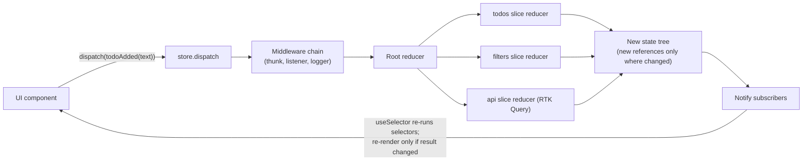
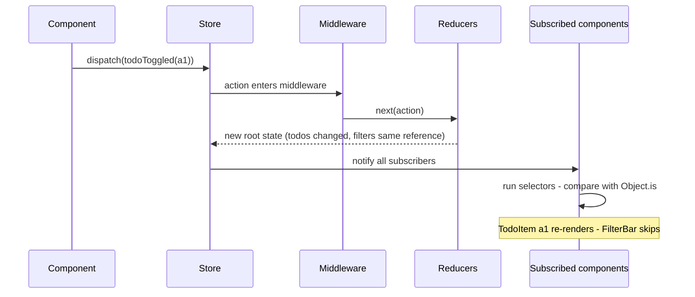
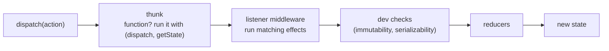
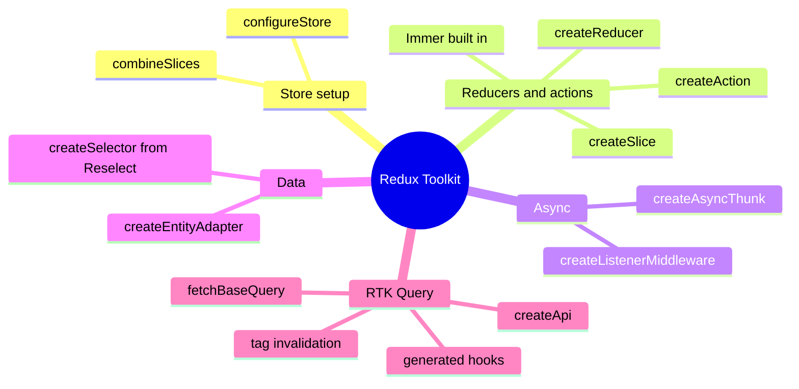
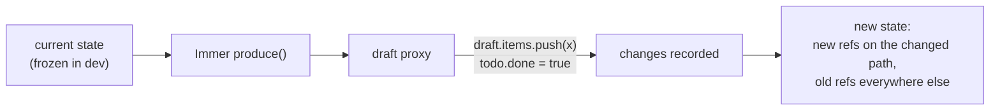
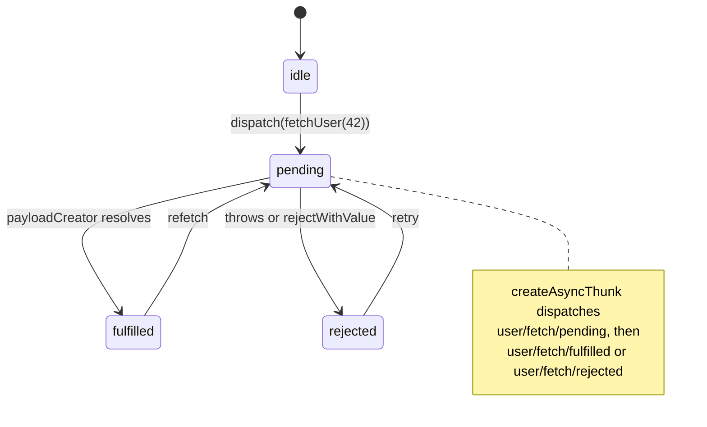
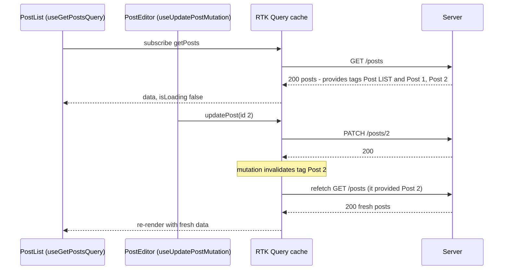
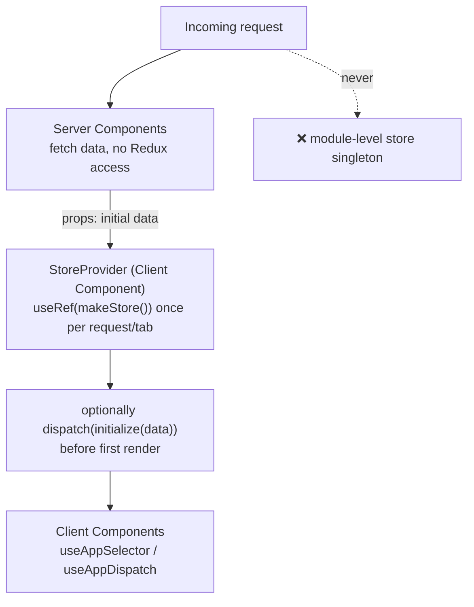
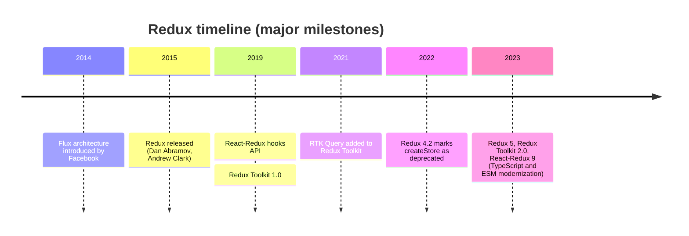
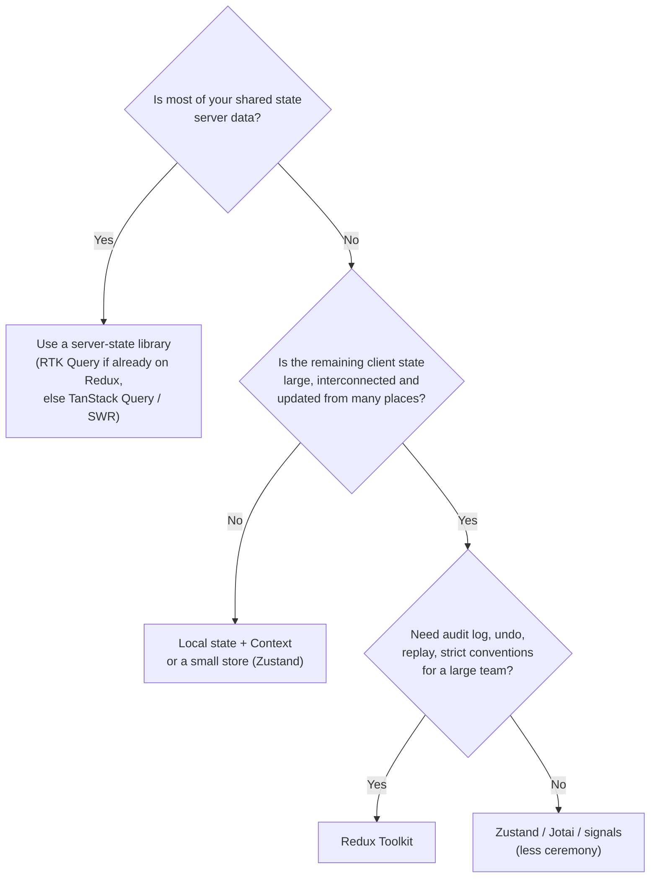

# Redux & Redux Toolkit

> **Date:** 2026-11-06 · **Last updated:** 2026-11-06
> **Category:** Frontend System Design
> **Sub-Topic:** State & Data / State Management
> **Level:** Intermediate · **Reading time:** ~32 min
> **Informs:** whether to adopt a centralized event-driven store, store and slice structure, async side-effect strategy (thunks, listeners, sagas), RTK Query vs a separate server-state library, normalized entity state, SSR store-per-request setup, migrating legacy Redux

> **Pre-requisite:** [Client State Management Patterns](./client-state-management-patterns.md) (where state should live, Flux, selectors, tearing).
> This note covers the **Redux pattern** and the **modern way to write it — Redux Toolkit (RTK) and RTK Query**. Hand-written Redux (switch statements, action-type constants, `createStore`) is legacy; you'll still meet it in older codebases.

**Previous:** [Client State Management Patterns](./client-state-management-patterns.md) · **Next:** [Zustand / Jotai / Recoil](./zustand-jotai-recoil.md)

---

## Table of Contents

1. [ELI5 — Simple Explanation](#eli5--simple-explanation)
2. [Section 1: The Three Principles](#section-1-the-three-principles)
3. [Section 2: The Data Flow — Actions, Reducers, Store](#section-2-the-data-flow--actions-reducers-store)
4. [Section 3: Middleware and Enhancers](#section-3-middleware-and-enhancers)
5. [Section 4: Why Redux Toolkit Exists](#section-4-why-redux-toolkit-exists)
6. [Section 5: configureStore and createSlice](#section-5-configurestore-and-createslice)
7. [Section 6: Immer — "Mutating" Code, Immutable Updates](#section-6-immer--mutating-code-immutable-updates)
8. [Section 7: Selectors and Memoization](#section-7-selectors-and-memoization)
9. [Section 8: Async Logic — Thunks, Listeners, Sagas](#section-8-async-logic--thunks-listeners-sagas)
10. [Section 9: Normalized State with createEntityAdapter](#section-9-normalized-state-with-createentityadapter)
11. [Section 10: RTK Query — Server State Inside Redux](#section-10-rtk-query--server-state-inside-redux)
12. [Section 11: React-Redux Bindings and TypeScript](#section-11-react-redux-bindings-and-typescript)
13. [Section 12: SSR, Next.js and Code Splitting](#section-12-ssr-nextjs-and-code-splitting)
14. [Section 13: History and Current Status](#section-13-history-and-current-status)
15. [System Design Angle — When Redux Fits](#system-design-angle--when-redux-fits)
16. [Framework Comparison](#framework-comparison)
17. [Real-World Examples](#real-world-examples)
18. [Key Points Summary](#key-points-summary)
19. [Test Your Understanding (with answers)](#test-your-understanding)
20. [Cheat Sheet](#cheat-sheet)
21. [References & Further Reading](#references--further-reading)

---

## ELI5 — Simple Explanation

Imagine a bank:
- The **vault** holds the one true record of every balance — that's the **store**. Nobody walks in and edits numbers in the vault.
- To change anything, you fill in a **deposit slip** describing *what happened* ("deposited $50 into account 7") — that's an **action**.
- You hand the slip to the **teller window** — that's **`dispatch`**.
- Before it reaches the clerk, **security and auditors** can look at the slip, log it, or call someone — that's **middleware**.
- A **clerk follows a strict rulebook**: old balance + slip → new balance. Same inputs always give the same result, and the clerk never phones anyone — that's a **pure reducer**.
- Customers watch a **screen showing only their own balance** — that's a **selector**; it changes only when *their* number changes.
- Because every slip is kept, an auditor can **replay the whole day** — that's Redux DevTools' time-travel debugging.

Redux Toolkit is the **pre-printed slip book and rulebook template**: same bank, far less paperwork.

> **Redux = one store, changed only by dispatching events that pure reducers turn into new state. Redux Toolkit is the official, required-in-practice way to write it today.**

---

## Core Concept — Step by Step

### Section 1: The Three Principles

| Principle | Meaning | What it buys you |
|---|---|---|
| **Single source of truth** | Global app state lives in one object tree in one store | Easy to inspect, persist, serialize and hydrate |
| **State is read-only** | The only way to change it is to dispatch an **action** (a plain object describing what happened) | Every change is centralized, ordered and loggable |
| **Changes are made with pure functions** | **Reducers** compute `(state, action) → newState` without side effects or mutation | Predictable, testable, enables time-travel |

```text
Action  = { type: 'todos/todoAdded', payload: { id: 'a1', text: 'Buy milk' } }
Reducer = (state, action) => nextState         // pure: no fetch, no Math.random, no Date.now, no mutation
Store   = { getState, dispatch, subscribe }    // holds state, runs reducers, notifies subscribers
```

> "Single store" is a recommendation for **app-wide** client state — not a rule that *all* state must go in it. The Redux Style Guide itself says to keep form drafts and purely local UI state out of Redux.

---

### Section 2: The Data Flow — Actions, Reducers, Store





**Key detail:** reducers return **new references only for what changed** (structural sharing). Untouched slices keep their old references, which is what lets `useSelector` skip re-renders cheaply.

---

### Section 3: Middleware and Enhancers

Middleware wraps `dispatch`. It sees every action before (and after) the reducers and is where **side effects** belong.

```typescript
import type { Middleware } from '@reduxjs/toolkit';

// store => next => action  (curried signature)
export const analytics: Middleware = (store) => (next) => (action) => {
  const result = next(action);              // let reducers run
  if (typeof action === 'object' && action && 'type' in action && action.type === 'cart/checkedOut') {
    track('checkout', store.getState());    // side effect AFTER state updated
  }
  return result;
};
```



**Enhancers** wrap the whole store (e.g. the Redux DevTools enhancer). You rarely write them; `configureStore` sets up DevTools for you.

> **Redux 5 / RTK 2 typing note:** middleware receives `action` typed as `unknown`, so you must narrow it (use `someActionCreator.match(action)` or type guards like `isAnyOf`) before reading `action.type`.

---

### Section 4: Why Redux Toolkit Exists

Hand-written Redux had well-known pain: action-type constants, action-creator functions, `switch` reducers, spread-heavy immutable updates, manual store setup with middleware and DevTools, and accidental mutations. Redux Toolkit is the Redux team's **official, opinionated toolset** and is the recommended way to write all Redux code.



```text
Legacy Redux for one "add todo" feature:     Redux Toolkit:
  ADD_TODO constant                            createSlice({ name, initialState, reducers: { todoAdded } })
  addTodo action creator                       → action creator, action type and reducer generated
  case ADD_TODO in a switch reducer            → Immer handles the immutable update
  [...state, newTodo] spread logic             → configureStore wires thunk, DevTools and dev checks
  createStore + applyMiddleware + compose
```

**`createStore` is deprecated.** Since Redux 4.2 the core's `createStore` is marked deprecated (it still works — the mark is a nudge toward RTK). `legacy_createStore` is the alias without the warning for code that can't migrate yet.

---

### Section 5: configureStore and createSlice

```typescript
// features/todos/todosSlice.ts
import { createSlice, nanoid, type PayloadAction } from '@reduxjs/toolkit';

type Todo = { id: string; text: string; done: boolean };
type TodosState = { items: Todo[]; filter: 'all' | 'active' | 'done' };

const initialState: TodosState = { items: [], filter: 'all' };

export const todosSlice = createSlice({
  name: 'todos',
  initialState,
  reducers: {
    todoAdded: {
      reducer(state, action: PayloadAction<Todo>) {
        state.items.push(action.payload);              // Immer: safe "mutation"
      },
      prepare(text: string) {                          // keep randomness OUT of the reducer
        return { payload: { id: nanoid(), text, done: false } };
      },
    },
    todoToggled(state, action: PayloadAction<string>) {
      const todo = state.items.find((t) => t.id === action.payload);
      if (todo) todo.done = !todo.done;
    },
    filterChanged(state, action: PayloadAction<TodosState['filter']>) {
      state.filter = action.payload;
    },
  },
  selectors: {
    selectTodos: (s) => s.items,
    selectFilter: (s) => s.filter,
  },
});

export const { todoAdded, todoToggled, filterChanged } = todosSlice.actions;
export const { selectTodos, selectFilter } = todosSlice.selectors;
```

```typescript
// app/store.ts
import { configureStore } from '@reduxjs/toolkit';
import { todosSlice } from '../features/todos/todosSlice';

export const makeStore = () =>
  configureStore({
    reducer: { [todosSlice.reducerPath]: todosSlice.reducer },
    // Defaults: thunk middleware, DevTools, and in development the
    // immutability + serializability check middleware.
  });

export type AppStore = ReturnType<typeof makeStore>;
export type RootState = ReturnType<AppStore['getState']>;
export type AppDispatch = AppStore['dispatch'];
```

| `configureStore` default | Why |
|---|---|
| `redux-thunk` middleware | The standard way to write async logic |
| **Immutability check** (dev only) | Throws if you mutate state outside Immer |
| **Serializability check** (dev only) | Warns on Promises, class instances, functions, etc. in state or actions |
| Redux DevTools Extension | Time-travel, action log, state diff |

Slice `selectors` (added in RTK 2.0) are scoped to the slice's state and automatically wrapped to read from `rootState[reducerPath]`.

---

### Section 6: Immer — "Mutating" Code, Immutable Updates

`createSlice` and `createReducer` run your case reducers inside **Immer's `produce`**. You get a **draft proxy**; Immer records changes and returns a new immutable object with structural sharing.



**Immer rules (common bugs):**

| ✅ Do | ❌ Don't |
|---|---|
| Mutate the draft and return nothing | Mutate the draft **and** return a new value (Immer throws) |
| `return newValue` to replace state entirely | `state = newValue` (reassigning the local variable does nothing) |
| `return initialState` to reset | Store non-draftable values (class instances) and expect deep updates |
| Use `current(draft)` to log a draft's snapshot | `console.log(draft)` (prints a Proxy) |

> Immer only applies **inside** `createSlice`/`createReducer` (and RTK Query's `updateQueryData`). Mutating state in a component, thunk or selector is still a bug — the dev-mode immutability check exists to catch it.

---

### Section 7: Selectors and Memoization

`useSelector` re-runs your selector **after every dispatched action** and re-renders the component if the result is **not `===`** the previous result.

```text
useSelector(s => s.todos.items)                          ✅ existing reference → re-render only when items change
useSelector(s => s.todos.items.length)                   ✅ primitive
useSelector(s => s.todos.items.filter(t => !t.done))     ❌ new array every time → re-renders on EVERY action
useSelector(selectActiveTodos)  // createSelector         ✅ memoized: same input refs → same output ref
```

```typescript
import { createSelector } from '@reduxjs/toolkit';
import type { RootState } from '../../app/store';

const selectItems = (s: RootState) => s.todos.items;
const selectFilter = (s: RootState) => s.todos.filter;

export const selectVisibleTodos = createSelector([selectItems, selectFilter], (items, filter) =>
  filter === 'all' ? items : items.filter((t) => (filter === 'done' ? t.done : !t.done))
);
```

- `createSelector` (Reselect) recomputes only when its **input selectors** return new references. Since Reselect 5 (bundled with RTK 2) the default memoizer is `weakMapMemoize`, which caches results for **many argument combinations** instead of just the last one.
- **Input selectors must just extract** — never transform inside them, or memoization breaks.
- Recent React-Redux versions add **dev-mode checks** in `useSelector`: it warns when a selector returns a different reference for the same state (unstable) or returns the whole state (identity function).
- Prefer **many small `useSelector` calls** to one that returns a big object.

---

### Section 8: Async Logic — Thunks, Listeners, Sagas

Reducers must be pure, so async work lives in middleware. RTK gives two built-in tools; sagas/observables are older third-party options.



| Tool | Model | Best for | Status |
|---|---|---|---|
| **Thunks** (`createAsyncThunk`) | "Dispatch a function"; imperative async/await | Request → dispatch result; multi-step logic triggered by a UI event | Default, included by `configureStore` |
| **Listener middleware** (`createListenerMiddleware`) | "When action/condition X happens, run effect" | Reacting to actions (analytics, persistence, cross-slice reactions, debounce, cancel-previous) | Built into RTK; recommended lightweight alternative to sagas |
| **RTK Query** | Declarative data fetching + cache | **Fetching and caching server data** | Recommended for data fetching |
| **redux-saga** | Generator functions, effects (`takeLatest`, `call`, `put`) | Very complex long-running workflows | Third-party; the Redux team no longer recommends it for data fetching |
| **redux-observable** | RxJS epics | Teams already deep in RxJS | Third-party, niche |

```typescript
// Listener middleware: persist the cart whenever cart actions happen (debounced)
import { createListenerMiddleware, isAnyOf } from '@reduxjs/toolkit';
import { itemAdded, itemRemoved } from './cartSlice';

export const listener = createListenerMiddleware();
listener.startListening({
  matcher: isAnyOf(itemAdded, itemRemoved),
  effect: async (_action, api) => {
    api.cancelActiveListeners();   // "takeLatest": cancel earlier runs
    await api.delay(500);          // debounce
    const { cart } = api.getState() as { cart: unknown };
    localStorage.setItem('cart', JSON.stringify({ v: 1, cart }));
  },
});
// configureStore({ ..., middleware: (gDM) => gDM().prepend(listener.middleware) })
```

> **If you're writing thunks to fetch data and then hand-writing `loading/error/data` reducers, stop:** that's server state, and RTK Query (or TanStack Query) does it with caching, deduplication and invalidation.

---

### Section 9: Normalized State with createEntityAdapter

Relational or list data should be stored **by id** (see [Data Normalization & Caching](./data-normalization-and-caching.md)). `createEntityAdapter` generates the shape, CRUD reducers and selectors.

```text
{ ids: ['u1', 'u2'], entities: { u1: { id: 'u1', name: 'Ana' }, u2: { id: 'u2', name: 'Ben' } } }
   ordered id list          lookup table: O(1) by id, one copy per entity
```

```typescript
import { createEntityAdapter, createSlice, type EntityState } from '@reduxjs/toolkit';

type User = { id: string; name: string };
const usersAdapter = createEntityAdapter<User>({
  sortComparer: (a, b) => a.name.localeCompare(b.name),
});

const usersSlice = createSlice({
  name: 'users',
  initialState: usersAdapter.getInitialState({ status: 'idle' as 'idle' | 'loading' }),
  reducers: {
    userAdded: usersAdapter.addOne,
    userUpdated: usersAdapter.updateOne,        // payload: { id, changes }
    usersReceived: usersAdapter.setAll,
    userRemoved: usersAdapter.removeOne,
  },
});

export const { selectAll: selectAllUsers, selectById: selectUserById } =
  usersAdapter.getSelectors((s: { users: EntityState<User, string> }) => s.users);
```

---

### Section 10: RTK Query — Server State Inside Redux

RTK Query is a **data fetching and caching layer** included in Redux Toolkit (`@reduxjs/toolkit/query/react`). It's conceptually close to TanStack Query (see [React Query / TanStack Query](./react-query-tanstack-query.md)) but stores its cache in the Redux store and is defined as one "API slice" with endpoints.



| Feature | How |
|---|---|
| Deduplication | Components using the same endpoint + args share one request and one cache entry |
| Cache lifetime | Entry removed after the last subscriber unmounts + `keepUnusedDataFor` (default **60 s**) |
| Invalidation | `providesTags` on queries, `invalidatesTags` on mutations → automatic refetch |
| Refetch triggers | `refetchOnMountOrArgChange`, `refetchOnFocus`, `refetchOnReconnect` (the last two need `setupListeners(store.dispatch)`), `pollingInterval` |
| Conditional fetch | `skip: true` or `skipToken` |
| Optimistic updates | `onQueryStarted` + `api.util.updateQueryData` → `patchResult.undo()` on failure |
| Streaming updates | `onCacheEntryAdded` (e.g. apply WebSocket messages to the cache) |
| Codegen | Generate endpoints from OpenAPI or GraphQL schemas |
| Pagination | Args-based pages; newer RTK 2.x releases also add **infinite query** endpoints — check the docs for your version |

**RTK Query vs TanStack Query:** if the app already uses Redux, RTK Query avoids a second cache and integrates with DevTools and listeners. If the app doesn't otherwise need Redux, TanStack Query (or SWR) is the lighter choice — don't adopt Redux only to get RTK Query.

---

### Section 11: React-Redux Bindings and TypeScript

```text
<Provider store={store}>        puts the store in React context (only the store instance — not state)
useSelector(selector)           subscribe to a slice (built on useSyncExternalStore since React-Redux 8)
useDispatch()                   get dispatch
useStore()                      get the store instance (rarely needed)
connect(mapState, mapDispatch)  legacy HOC API — still supported, hooks are recommended for new code
```

Pre-typed hooks (React-Redux 9.1+ `.withTypes()`):

```typescript
// app/hooks.ts
import { useDispatch, useSelector, useStore } from 'react-redux';
import type { AppDispatch, AppStore, RootState } from './store';

export const useAppDispatch = useDispatch.withTypes<AppDispatch>();
export const useAppSelector = useSelector.withTypes<RootState>();
export const useAppStore = useStore.withTypes<AppStore>();
```

**Why `Provider` doesn't cause the Context re-render problem:** the context value is the **store object**, which never changes. Updates flow through the store's own subscription, and each `useSelector` decides independently whether to re-render.

---

### Section 12: SSR, Next.js and Code Splitting

**Store per request.** A module-level `export const store = configureStore(...)` is shared by every request on a Node server and leaks user data between them. The Redux docs' Next.js App Router guide uses a `makeStore()` factory and a client provider:



Rules from the Redux docs for the App Router:
- **No global store** — create it per request.
- **Server Components must not read or write the Redux store** — they can't use hooks or context.
- **Keep route-specific data out of a long-lived store**, or reset it on navigation, since layouts persist across routes.

**Code splitting:** `combineSlices` (RTK 2.0) builds a reducer that slices can be **injected** into later (`rootReducer.inject(slice)` or `slice.injectInto(rootReducer)`), so a lazily-loaded route can bring its own slice. RTK Query APIs can do the same with `api.injectEndpoints`.

---

### Section 13: History and Current Status



**Status as of late 2026:** Redux is mature and actively maintained by the Redux team. It's no longer the default "first choice" for every React app — most apps first move server data to a query library and keep small client state local or in a lightweight store — but RTK remains a strong, well-documented choice for **large, complex client state** and big teams. Check the [Redux releases](https://github.com/reduxjs/redux-toolkit/releases) for anything newer than this note.

**Notable RTK 2.0 / Redux 5 changes** (relevant when upgrading old code):
- `extraReducers` and `createReducer` **only accept the builder callback** (the object syntax was removed).
- Action `type` must be a **string**.
- Middleware `action` is typed `unknown` — narrow it with matchers.
- `createSlice` gained `selectors` and a callback form of `reducers` (`create.reducer`, `create.preparedReducer`, and `create.asyncThunk` when the slice is built with `buildCreateSlice` + `asyncThunkCreator`).
- Reselect 5's `weakMapMemoize` default; React-Redux 9 requires React 18+.

---

## System Design Angle — When Redux Fits



| Redux is a good fit | Redux is overkill |
|---|---|
| Complex client-side domain state (editors, design tools, trading UIs, dashboards with cross-widget interactions) | Mostly CRUD screens over server data |
| Many developers needing one enforced pattern | Small app or small team |
| Need for action logs, replay, undo/redo, cross-tab sync via actions | Only a few global values (theme, user) |
| Complex async workflows that react to events (listener middleware) | Each feature's state is independent |
| Already invested in Redux — RTK Query gives server caching for free | Adopting Redux *only* for data fetching |

**Store-design rules (Redux Style Guide highlights):**
- One store per app; organize code by **feature folders** with one slice file each.
- **Model actions as events** (`orderPlaced`), not setters (`setOrderStatus`).
- Keep state **minimal and serializable**; derive the rest with selectors.
- **Normalize** relational data; use entity adapters.
- Put **"what happened" logic in reducers** (they're pure and testable), not in components or thunks.
- Many components can each `useSelector` small pieces — "connect more components".

---

## Framework Comparison

| Stack | Redux-style option | Notes |
|---|---|---|
| **React / React Native** | Redux Toolkit + React-Redux | Official bindings; same code on web and RN |
| **Angular** | **NgRx Store** (`createAction`, `createReducer`, `createFeature`, `createEffect`, selectors) | Redux-inspired with RxJS effects. **NgRx SignalStore** is a newer, lighter signal-based option from the same team |
| **Vue** | Pinia (official) | Not Redux: mutable reactive stores with actions. **Vuex**, the older Flux-style store, is in maintenance mode — Pinia is the recommended replacement |
| **Svelte** | Svelte stores / runes | Redux core is framework-agnostic and *can* be used, but idiomatic Svelte uses its own reactivity |
| **iOS (Swift)** | The Composable Architecture (TCA) | Reducers + actions + effects, Redux-like |
| **Android (Kotlin)** | MVI with `ViewModel` + `StateFlow` | Intents → reducer → immutable UI state, the same unidirectional idea |

---

## Real-World Examples

**Example 1 — Legacy Redux → Redux Toolkit (BAD → GOOD):**
```javascript
// ❌ LEGACY: constants, creators, switch, manual immutable spreads, createStore
const TODO_TOGGLED = 'TODO_TOGGLED';
const toggleTodo = (id) => ({ type: TODO_TOGGLED, payload: id });
function todosReducer(state = [], action) {
  switch (action.type) {
    case TODO_TOGGLED:
      return state.map((t) => (t.id === action.payload ? { ...t, done: !t.done } : t));
    default:
      return state;
  }
}
// const store = createStore(combineReducers({ todos: todosReducer }), applyMiddleware(thunk));

// ✅ MODERN: createSlice + configureStore
import { configureStore, createSlice } from '@reduxjs/toolkit';
const todos = createSlice({
  name: 'todos',
  initialState: [],
  reducers: {
    todoToggled(state, action) {
      const t = state.find((x) => x.id === action.payload);
      if (t) t.done = !t.done;
    },
  },
});
export const { todoToggled } = todos.actions;
export const store = configureStore({ reducer: { todos: todos.reducer } }); // fine for a client-only SPA
```

**Example 2 — `createAsyncThunk` with typed errors and conditional fetching:**
```typescript
import { createAsyncThunk, createSlice } from '@reduxjs/toolkit';
import type { RootState } from '../../app/store';

type Profile = { id: string; name: string };
type ApiError = { status: number; message: string };

export const fetchProfile = createAsyncThunk<
  Profile,                       // fulfilled payload
  string,                        // argument
  { state: RootState; rejectValue: ApiError }
>(
  'profile/fetch',
  async (id, { signal, rejectWithValue }) => {
    const res = await fetch(`/api/profiles/${id}`, { signal }); // aborts if thunk is aborted
    if (!res.ok) return rejectWithValue({ status: res.status, message: res.statusText });
    return (await res.json()) as Profile;
  },
  {
    condition: (_id, { getState }) => getState().profile.status !== 'loading', // skip duplicates
  }
);

type ProfileState = { data: Profile | null; status: 'idle' | 'loading' | 'succeeded' | 'failed'; error?: ApiError };
const initialState: ProfileState = { data: null, status: 'idle' };

export const profileSlice = createSlice({
  name: 'profile',
  initialState,
  reducers: {},
  extraReducers: (builder) => {
    builder
      .addCase(fetchProfile.pending, (s) => { s.status = 'loading'; s.error = undefined; })
      .addCase(fetchProfile.fulfilled, (s, a) => { s.status = 'succeeded'; s.data = a.payload; })
      .addCase(fetchProfile.rejected, (s, a) => { s.status = 'failed'; s.error = a.payload; });
  },
});

// In a component: const result = await dispatch(fetchProfile(id)).unwrap(); // throws on reject
```
*(This hand-written loading state is exactly what RTK Query removes — see Example 3. Use thunks for workflows, not plain fetching.)*

**Example 3 — RTK Query API slice with tags and an optimistic update:**
```typescript
// services/postsApi.ts
import { createApi, fetchBaseQuery } from '@reduxjs/toolkit/query/react';

type Post = { id: string; title: string; likes: number };

export const postsApi = createApi({
  reducerPath: 'postsApi',
  baseQuery: fetchBaseQuery({ baseUrl: '/api', credentials: 'include' }),
  tagTypes: ['Post'],
  endpoints: (build) => ({
    getPosts: build.query<Post[], void>({
      query: () => '/posts',
      providesTags: (result = []) => [
        { type: 'Post' as const, id: 'LIST' },
        ...result.map(({ id }) => ({ type: 'Post' as const, id })),
      ],
    }),
    addPost: build.mutation<Post, Pick<Post, 'title'>>({
      query: (body) => ({ url: '/posts', method: 'POST', body }),
      invalidatesTags: [{ type: 'Post', id: 'LIST' }],
    }),
    likePost: build.mutation<Post, string>({
      query: (id) => ({ url: `/posts/${id}/like`, method: 'POST' }),
      async onQueryStarted(id, { dispatch, queryFulfilled }) {
        const patch = dispatch(
          postsApi.util.updateQueryData('getPosts', undefined, (draft) => {
            const post = draft.find((p) => p.id === id);
            if (post) post.likes++;                // Immer draft
          })
        );
        try { await queryFulfilled; } catch { patch.undo(); } // roll back on failure
      },
    }),
  }),
});

export const { useGetPostsQuery, useAddPostMutation, useLikePostMutation } = postsApi;
```

```tsx
// store wiring: reducer + middleware are both required
// configureStore({
//   reducer: { [postsApi.reducerPath]: postsApi.reducer, todos: todosSlice.reducer },
//   middleware: (gDM) => gDM().concat(postsApi.middleware),
// });
// setupListeners(store.dispatch); // enables refetchOnFocus / refetchOnReconnect

function PostList() {
  const { data: posts = [], isLoading, isError, refetch } = useGetPostsQuery();
  const [likePost] = useLikePostMutation();
  if (isLoading) return <p>Loading…</p>;
  if (isError) return <button onClick={refetch}>Retry</button>;
  return (
    <ul>
      {posts.map((p) => (
        <li key={p.id}>
          {p.title} <button onClick={() => likePost(p.id)} aria-label={`Like ${p.title}`}>♥ {p.likes}</button>
        </li>
      ))}
    </ul>
  );
}
```

**Example 4 — Next.js App Router store provider (per request):**
```tsx
// app/StoreProvider.tsx
'use client';
import { useRef, type ReactNode } from 'react';
import { Provider } from 'react-redux';
import { makeStore, type AppStore } from '../lib/store';
import { userHydrated } from '../lib/features/user/userSlice';

export default function StoreProvider({ user, children }: { user: { id: string; name: string } | null; children: ReactNode }) {
  const storeRef = useRef<AppStore | null>(null);
  if (!storeRef.current) {
    storeRef.current = makeStore();                       // one store per request (server) / per tab (client)
    if (user) storeRef.current.dispatch(userHydrated(user)); // seed from Server Component props
  }
  return <Provider store={storeRef.current}>{children}</Provider>;
}

// app/layout.tsx (Server Component): fetch the user, then
// <StoreProvider user={user}>{children}</StoreProvider>
```

**Example 5 — Testing: render with a real store (recommended over mocking):**
```tsx
import { render, screen } from '@testing-library/react';
import userEvent from '@testing-library/user-event';
import { Provider } from 'react-redux';
import { makeStore } from '../app/store';
import { TodoApp } from './TodoApp';

test('adds a todo', async () => {
  const store = makeStore();                // fresh store per test
  render(<Provider store={store}><TodoApp /></Provider>);
  await userEvent.type(screen.getByRole('textbox', { name: /new todo/i }), 'Buy milk{Enter}');
  expect(screen.getByText('Buy milk')).toBeInTheDocument();
  expect(store.getState().todos.items).toHaveLength(1);
});

// Reducers are pure — unit tests need no setup at all:
// expect(todosSlice.reducer(undefined, todoAdded('x')).items[0].text).toBe('x');
```
For RTK Query, mock the **network** (e.g. Mock Service Worker) rather than the hooks. See [React Testing Library Patterns](../08-testing/react-testing-library-patterns.md).

---

## Key Points Summary

| Concept | One-Line Explanation |
|---|---|
| **Store** | Holds the single state tree; exposes `getState`, `dispatch`, `subscribe` |
| **Action** | Plain object `{ type, payload }` describing what happened |
| **Reducer** | Pure `(state, action) → newState`, no side effects |
| **Middleware** | Wraps `dispatch`; the place for side effects |
| **Redux Toolkit** | Official, recommended way to write Redux |
| **`configureStore`** | Store with thunk, DevTools and dev-only safety checks |
| **`createSlice`** | Generates action creators, types and reducer; uses Immer |
| **Immer** | Write "mutating" updates on a draft, get immutable results |
| **`createSelector`** | Memoized derived data; stable references for `useSelector` |
| **`createAsyncThunk`** | Async workflow dispatching pending/fulfilled/rejected |
| **Listener middleware** | "When X happens, do Y" side effects; lightweight saga replacement |
| **`createEntityAdapter`** | Normalized `{ ids, entities }` with CRUD reducers and selectors |
| **RTK Query** | Server-state caching with tags, dedupe and generated hooks |
| **`createStore`** | Deprecated in favor of `configureStore` (still works) |
| **SSR rule** | One store per request; Server Components never touch the store |

---

## Test Your Understanding

**Q1 (Basic):**
Why must a Redux reducer be pure? Give two things you must never do inside one, and say where those things belong instead.

<details>
<summary>Answer</summary>

Redux relies on reducers being deterministic: the same `(state, action)` must always give the same result. That makes state changes predictable, makes reducers trivially testable, and enables replay/time-travel (re-running actions must reproduce the same states). Reference-based change detection also depends on not mutating the old state.

Never: (1) perform side effects — API calls, `localStorage` writes, analytics, routing; (2) use non-deterministic values — `Date.now()`, `Math.random()`, `nanoid()`; (3) mutate state outside Immer. Side effects go in **thunks, listener middleware or RTK Query**; random IDs and timestamps go in the action's **`prepare` callback** (or the thunk) so the value is recorded in the action itself.
</details>

**Q2 (Application):**
A product page re-renders on every keystroke in an unrelated search box. The component has `const { items, total } = useSelector(s => ({ items: s.cart.items.filter(i => i.qty > 0), total: s.cart.total }))`. Diagnose and fix.

<details>
<summary>Answer</summary>

`useSelector` re-runs the selector after **every** dispatched action (including the search-box updates) and compares the result with `===`. This selector returns a **new object** (and a new filtered array) each time, so it never matches and the component re-renders on every action. React-Redux 9 also logs a dev warning for this unstable selector.

Fix: split into separate selectors that return existing references or primitives (`useSelector(s => s.cart.total)`), and memoize the filtered list with `createSelector([selectCartItems], items => items.filter(i => i.qty > 0))`. Also question whether the search text belongs in Redux at all — keystroke-level input state is usually local (or URL) state.
</details>

**Q3 (Tricky):**
This reducer "does nothing". Why?
```typescript
reducers: {
  reset(state) { state = initialState; },
  rename(state, action) { state.name = action.payload; return { ...state, renamed: true }; },
}
```

<details>
<summary>Answer</summary>

- `reset`: `state` is a local parameter pointing at the Immer draft. Reassigning the variable doesn't change the draft, and nothing is returned, so Immer produces the unchanged state. Fix: `return initialState;`.
- `rename`: it both **mutates the draft and returns a new object**. Immer throws an error in this case ("An immer producer returned a new value *and* modified its draft"). Fix: either mutate only (`state.name = ...; state.renamed = true;`) or return only a new value.
</details>

**Q4 (Tricky):**
After moving a Redux app to the Next.js App Router, a user briefly sees another user's name in the header. The code has `export const store = configureStore(...)` in `lib/store.ts`. Explain and fix.

<details>
<summary>Answer</summary>

On the server, `lib/store.ts` is evaluated once per server process, so that single store is **shared by every concurrent request**. One request dispatches Ana's user data; another request rendering at the same time reads it and produces HTML with Ana's name for Ben. That's a cross-request data leak.

Fix: export a `makeStore()` factory and create the store **inside a Client Component provider with `useRef`**, so there's one store per request on the server and one per tab on the client (Example 4). Seed it from Server Component props. Never import a store into Server Components — they can't use hooks or context, and they shouldn't read client state anyway.
</details>

**Q5 (Application):**
Your team writes a thunk plus `loading/error/data` reducers for each of 40 endpoints, and screens frequently show stale lists after edits. What would you change, and why?

<details>
<summary>Answer</summary>

That's **server state** being managed by hand: each endpoint re-implements loading flags, there's no request deduplication, no cache lifetime, and no systematic way to refresh lists after a mutation — hence the stale lists.

Move fetching to **RTK Query** (natural since Redux is already present): define endpoints in an API slice, use `providesTags` on queries and `invalidatesTags` on mutations so edits automatically refetch affected lists, and use `onQueryStarted` + `updateQueryData` for optimistic updates. Delete the hand-written slices. Keep Redux slices only for real client state (UI preferences, editor state, wizard progress). If the codebase didn't already use Redux, TanStack Query would be the equally valid choice.
</details>

**Q6 (System design):**
You're designing the client architecture for a spreadsheet-like financial planning tool: ~50k cells, formulas with dependencies, undo/redo, collaborative edits, and 30 engineers across 6 teams. Would you use Redux Toolkit? How would you structure the store?

<details>
<summary>Answer</summary>

Redux Toolkit is a reasonable fit for the **document and workflow** layer: explicit events (`cellEdited`, `rowInserted`) make undo/redo (store inverse actions or Immer patches), audit logs and collaboration (send actions/ops to the server) natural, and RTK's conventions help 30 engineers stay consistent. Structure:
- **Normalized entities** via `createEntityAdapter` (`sheets`, `cells` keyed by `sheetId:row:col`), never nested grids.
- **Formula results as derived data** — computed by a dependency-graph engine (possibly in a **Web Worker**), not stored by hand in reducers; components select only their cell's computed value with stable selectors.
- **Server state** (workspaces, permissions, history) in **RTK Query**; collaborative sync through a WebSocket feeding actions via `onCacheEntryAdded` or listener middleware.
- **Ephemeral UI** (hover, selection rectangle while dragging, scroll position) kept **out of Redux** — local state or a separate lightweight store — to avoid dispatching on every pointer move.
- **Code splitting** with `combineSlices` + injected slices per team feature.
- Virtualized grid rendering so only visible cells subscribe.

The trade-off to state: Redux's per-action selector re-runs across many subscribed cells cost CPU; per-cell subscriptions via signals/atoms could be faster for the grid itself. A hybrid (Redux for document events, fine-grained store for the visible grid) is defensible.
</details>

---

## Cheat Sheet

**Key Definitions:**
- **Action:** `{ type: string, payload? }` describing an event
- **Action creator:** Function returning an action; generated by `createSlice`
- **Reducer:** Pure function `(state, action) → newState`
- **Slice:** A feature's reducer + actions + selectors (`createSlice`)
- **Middleware:** `store => next => action` wrapper around `dispatch`
- **Thunk:** A function dispatched instead of an action; receives `dispatch` and `getState`
- **Selector:** Function reading/deriving data from state
- **Tag (RTK Query):** Label linking cached queries to mutations that invalidate them

**Quick Reference:**
```text
Install:           npm install @reduxjs/toolkit react-redux
Store:             configureStore({ reducer: { [slice.reducerPath]: slice.reducer, [api.reducerPath]: api.reducer },
                                    middleware: gDM => gDM().concat(api.middleware) })
Slice:             createSlice({ name, initialState, reducers: { eventHappened(state, action) {...} }, selectors })
Async workflow:    createAsyncThunk('feature/action', async (arg, { signal, rejectWithValue, getState }) => ...)
React to actions:  createListenerMiddleware().startListening({ actionCreator | matcher, effect })
Derived data:      createSelector([inputA, inputB], (a, b) => result)
Entities:          createEntityAdapter() → { ids, entities } + addOne/updateOne/setAll + getSelectors
Server data:       createApi({ baseQuery: fetchBaseQuery(), tagTypes, endpoints }) → useXQuery / useYMutation
Typed hooks:       useDispatch.withTypes<AppDispatch>(), useSelector.withTypes<RootState>()
Immer:             mutate draft OR return new value — never both; `return initialState` to reset
SSR / Next.js:     makeStore() per request in a 'use client' provider with useRef; no global store
Code splitting:    combineSlices(...).inject(slice) · api.injectEndpoints(...)
```

**Common Mistakes to Avoid:**

| Mistake | Why Wrong | Fix |
|---|---|---|
| Writing legacy Redux by hand in new code | Boilerplate, accidental mutations | Redux Toolkit |
| Side effects or `Date.now()` in reducers | Breaks purity and replay | Thunks/listeners; `prepare` for ids and timestamps |
| Selector returns a new object/array | Re-render on every action | Primitives, `createSelector`, multiple `useSelector` calls |
| Hand-written fetch thunks + loading flags | Reinvents caching badly; stale lists | RTK Query (or TanStack Query) |
| Storing derived data | Gets out of sync | Memoized selectors |
| Nested relational data | Duplicate copies, hard updates | `createEntityAdapter` |
| Non-serializable values in state/actions | Breaks DevTools, persistence, SSR | Keep plain data; store ids/ISO strings |
| Putting form keystrokes or hover state in Redux | Dispatch per keystroke, needless work | Local / form-library state |
| Module-level store with SSR | Cross-request data leak | `makeStore()` per request |
| Forgetting `api.middleware` | RTK Query caching/invalidation breaks | Add the middleware to `configureStore` |
| "Setter" actions (`setX`) everywhere | Logic spreads into components | Model actions as events; logic in reducers |
| Adopting Redux just for data fetching | Unneeded complexity | TanStack Query / SWR |

---

## References & Further Reading

**Official Redux docs**
- Redux: [Redux Essentials tutorial](https://redux.js.org/tutorials/essentials/part-1-overview-concepts)
- Redux: [Style Guide](https://redux.js.org/style-guide/)
- Redux: [Why Redux Toolkit is How To Use Redux Today](https://redux.js.org/introduction/why-rtk-is-redux-today)
- Redux: [When should I use Redux? (FAQ)](https://redux.js.org/faq/general#when-should-i-use-redux)
- Redux: [Redux Toolkit Setup with Next.js](https://redux.js.org/usage/nextjs)
- Redux: [Writing Tests](https://redux.js.org/usage/writing-tests) · [Deriving Data with Selectors](https://redux.js.org/usage/deriving-data-selectors)
- Redux: [Migrating to Modern Redux](https://redux.js.org/usage/migrating-to-modern-redux)

**Redux Toolkit & RTK Query**
- RTK: [`configureStore`](https://redux-toolkit.js.org/api/configureStore) · [`createSlice`](https://redux-toolkit.js.org/api/createSlice) · [`createAsyncThunk`](https://redux-toolkit.js.org/api/createAsyncThunk)
- RTK: [`createListenerMiddleware`](https://redux-toolkit.js.org/api/createListenerMiddleware) · [`createEntityAdapter`](https://redux-toolkit.js.org/api/createEntityAdapter) · [`combineSlices`](https://redux-toolkit.js.org/api/combineSlices)
- RTK: [Writing Reducers with Immer](https://redux-toolkit.js.org/usage/immer-reducers)
- RTK: [RTK Query overview](https://redux-toolkit.js.org/rtk-query/overview) · [Automated re-fetching (tags)](https://redux-toolkit.js.org/rtk-query/usage/automated-refetching) · [Optimistic updates](https://redux-toolkit.js.org/rtk-query/usage/manual-cache-updates)
- RTK: [Comparison with other tools](https://redux-toolkit.js.org/rtk-query/comparison)
- RTK: [Migrating to RTK 2.0 and Redux 5.0](https://redux-toolkit.js.org/usage/migrating-rtk-2)
- GitHub: [Redux Toolkit releases](https://github.com/reduxjs/redux-toolkit/releases)

**React-Redux & Reselect**
- React-Redux: [Hooks API](https://react-redux.js.org/api/hooks) · [Usage with TypeScript](https://react-redux.js.org/using-react-redux/usage-with-typescript)
- Reselect: [Docs](https://reselect.js.org/)

**Other stacks**
- NgRx: [Store](https://ngrx.io/guide/store) · [SignalStore](https://ngrx.io/guide/signals/signal-store)
- Pinia: [What is Pinia? (and comparison with Vuex)](https://pinia.vuejs.org/introduction.html)
- Point-Free: [The Composable Architecture](https://github.com/pointfreeco/swift-composable-architecture)

**Deep dives**
- Mark Erikson: [Blogged Answers: Redux — Not Dead Yet!](https://blog.isquaredsoftware.com/2018/03/redux-not-dead-yet/)
- Mark Erikson: [The Tao of Redux, Part 1 — Implementation and Intent](https://blog.isquaredsoftware.com/2017/05/idiomatic-redux-tao-of-redux-part-1/)
- Immer: [Docs](https://immerjs.github.io/immer/)

---

> **Previous Topic:** [Client State Management Patterns](./client-state-management-patterns.md)
> — Where each kind of state should live, and the pattern families

> **Next Topic:** [Zustand / Jotai / Recoil](./zustand-jotai-recoil.md)
> — Lightweight module stores and atomic state, and the status of Recoil

*Saved on: 2026-11-06 | Repo: Frontend System Design Learning Notes*
