# SWR & Stale-While-Revalidate

> **Date:** 2026-11-06 · **Last updated:** 2026-11-06
> **Category:** Frontend System Design
> **Sub-Topic:** State & Data / Data Fetching
> **Level:** Intermediate · **Reading time:** ~28 min
> **Informs:** perceived latency vs freshness trade-off, `Cache-Control: stale-while-revalidate` at browser/CDN, Service Worker runtime caching strategy, choice between SWR and TanStack Query, revalidation triggers (focus, reconnect, polling), optimistic mutation flow, SSR fallback data

> **Pre-requisite:** [Browser Caching Strategies](../01-web-fundamentals/browser-caching-strategies.md) (freshness, `max-age`, revalidation) and [React Query / TanStack Query](./react-query-tanstack-query.md) (server-state cache model).
> This note covers **stale-while-revalidate as a pattern** at every layer — HTTP, CDN, Service Worker, app cache — and **SWR**, Vercel's React hook library named after it.

**Previous:** [React Query / TanStack Query](./react-query-tanstack-query.md) · **Next:** [GraphQL Client (Apollo, urql)](./graphql-client-apollo-urql.md)

---

## Table of Contents

1. [ELI5 — Simple Explanation](#eli5--simple-explanation)
2. [Section 1: The Pattern — Show Stale, Fetch Fresh](#section-1-the-pattern--show-stale-fetch-fresh)
3. [Section 2: SWR in HTTP — Cache-Control stale-while-revalidate](#section-2-swr-in-http--cache-control-stale-while-revalidate)
4. [Section 3: SWR in a Service Worker](#section-3-swr-in-a-service-worker)
5. [Section 4: The SWR Library — useSWR Basics](#section-4-the-swr-library--useswr-basics)
6. [Section 5: Revalidation Triggers and Defaults](#section-5-revalidation-triggers-and-defaults)
7. [Section 6: Keys, Deduplication and Conditional Fetching](#section-6-keys-deduplication-and-conditional-fetching)
8. [Section 7: Global Configuration and the Cache Provider](#section-7-global-configuration-and-the-cache-provider)
9. [Section 8: Mutations — mutate and useSWRMutation](#section-8-mutations--mutate-and-useswrmutation)
10. [Section 9: Pagination and Infinite Loading](#section-9-pagination-and-infinite-loading)
11. [Section 10: Subscriptions, Immutable Data and Preloading](#section-10-subscriptions-immutable-data-and-preloading)
12. [Section 11: SSR, Server Components and Fallback Data](#section-11-ssr-server-components-and-fallback-data)
13. [SWR vs TanStack Query](#swr-vs-tanstack-query)
14. [The Pattern Beyond React](#the-pattern-beyond-react)
15. [Real-World Examples](#real-world-examples)
16. [Key Points Summary](#key-points-summary)
17. [Test Your Understanding (with answers)](#test-your-understanding)
18. [Cheat Sheet](#cheat-sheet)
19. [References & Further Reading](#references--further-reading)

---

## ELI5 — Simple Explanation

Think of the **weather app on your phone**:

- You open it and **immediately** see the forecast from the last time you looked — maybe 20 minutes old. That's the **stale** data.
- At the same moment, the app quietly asks the server for a new forecast. That's the **revalidate**.
- A second later the numbers change if anything is different. If nothing changed, you never notice.

The alternative — a blank screen with a spinner until the server answers — is slower **every single time**, even though the old forecast was almost always good enough to look at.

Stale-while-revalidate makes a deal: *"Show me something useful instantly; I accept that it may be slightly old for a moment, as long as it's fixed right away."*

> **Stale-while-revalidate = respond from cache now, refresh in the background, update when the fresh copy arrives. It trades a short window of staleness for instant responses.**

---

## Core Concept — Step by Step

### Section 1: The Pattern — Show Stale, Fetch Fresh

The pattern appears at **four layers** of a web app. Same idea, different owner:

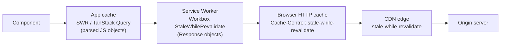

| Layer | Configured by | Stale window defined by | Who sees the update |
|---|---|---|---|
| **App cache** (SWR, TanStack Query) | JS options | Library rules (SWR: always revalidate on triggers; TanStack: `staleTime`) | The **same** render — UI updates in place when fresh data arrives |
| **Service Worker** | Your SW code (Workbox) | Usually "always serve cache, always refresh" | The **next** request/page load |
| **Browser HTTP cache** | `Cache-Control` response header | `stale-while-revalidate=N` seconds after `max-age` | The **next** request |
| **CDN** | `Cache-Control` / `CDN-Cache-Control` / vendor config | `stale-while-revalidate=N` | The **next** user at that edge |

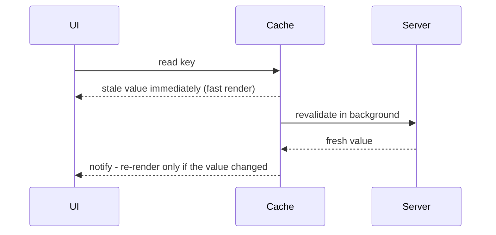

An important difference: **only the app-level cache can update what's already on screen**. HTTP, CDN and Service Worker SWR make the *next* response fresh; the current one stays stale.

The term comes from **HTTP**: [RFC 5861](https://www.rfc-editor.org/rfc/rfc5861) (2010) defined the `stale-while-revalidate` and `stale-if-error` `Cache-Control` extensions. Libraries later borrowed the name for the same idea in memory.

---

### Section 2: SWR in HTTP — Cache-Control stale-while-revalidate

```http
Cache-Control: max-age=60, stale-while-revalidate=300
```

This says: fresh for 60 s; for the **next 300 s** after that, a cache may serve the stale copy **immediately** while revalidating in the background; after 360 s total, it must revalidate before use.

```mermaid
gantt
    title Cache-Control max-age=60, stale-while-revalidate=300
    dateFormat X
    axisFormat %M:%S
    section Response age
    Fresh - served, no request                         :a1, 0, 60
    Stale but within SWR - served now plus background revalidation :a2, after a1, 300
    Too stale - blocking revalidation before use       :a3, after a2, 120
```

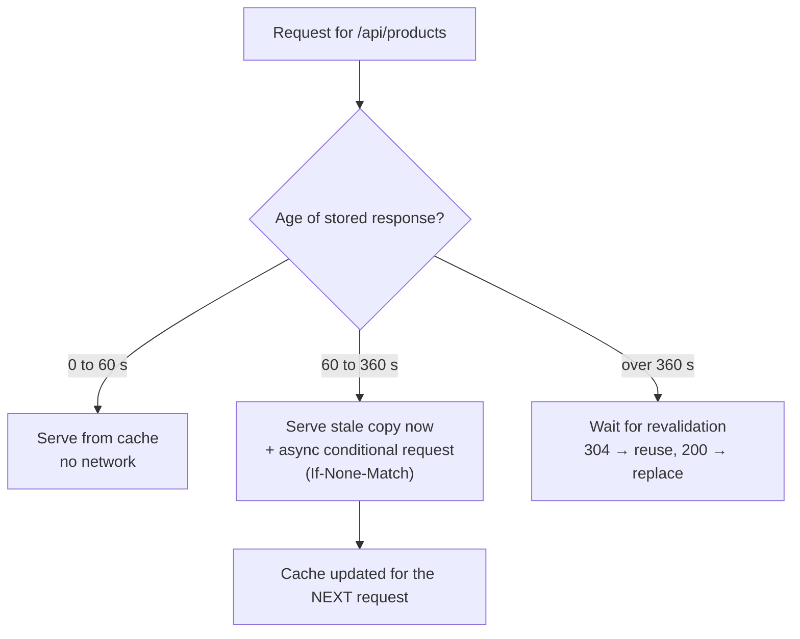

**Browser support** (MDN browser-compat-data): Chrome 75+, Firefox 68+, Safari 14+ honour `stale-while-revalidate` in the HTTP cache. Most CDNs support it too, but whether the revalidation is truly asynchronous, and how it interacts with request collapsing, differs by vendor — check your CDN's documentation.

| Directive | Meaning | Where it's most useful |
|---|---|---|
| `stale-while-revalidate=N` | Serve stale up to N s past expiry while refreshing in the background | Feeds, listings, avatars, public API GETs |
| `stale-if-error=N` | Serve stale up to N s past expiry if the origin errors (5xx) or is unreachable | CDNs, for resilience; browser support is limited — don't rely on it client-side |
| `max-age=0, stale-while-revalidate=N` | Always "stale", always revalidated in the background | Content that should update on the next view but never block |

**When HTTP-level SWR is wrong:**
- **HTML documents** after a deploy — users would get the old HTML (pointing to old asset hashes) for one more load. Prefer `no-cache` + ETag for HTML (see [Browser Caching Strategies](../01-web-fundamentals/browser-caching-strategies.md#section-8-caching-html)).
- **Per-user or sensitive data** at shared caches — use `private`; never let a CDN serve one user's stale data to another.
- **Data where stale = wrong** (balances, stock levels at checkout) — use `no-cache` or `must-revalidate`.

Framework analogues: Next.js **ISR** (`revalidate`) is server-side stale-while-revalidate for rendered pages — see [Incremental Static Regeneration (ISR)](../02-rendering-and-architecture/incremental-static-regeneration-isr.md).

---

### Section 3: SWR in a Service Worker

A Service Worker can implement SWR for any request it intercepts — typically avatars, fonts from your own origin, non-critical API data, or app-shell assets in offline-capable apps.

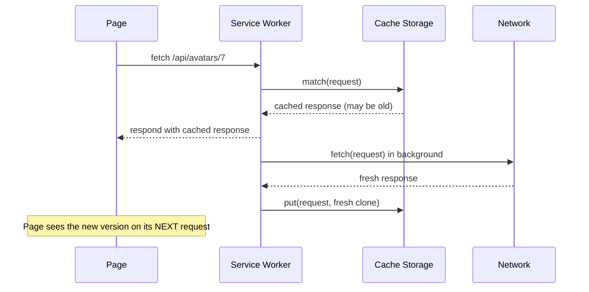

With **Workbox** (Google's Service Worker library):

```javascript
// sw.js
import { registerRoute } from 'workbox-routing';
import { StaleWhileRevalidate } from 'workbox-strategies';
import { ExpirationPlugin } from 'workbox-expiration';
import { CacheableResponsePlugin } from 'workbox-cacheable-response';

registerRoute(
  ({ url, request }) => url.pathname.startsWith('/api/catalog/') && request.method === 'GET',
  new StaleWhileRevalidate({
    cacheName: 'catalog-api',
    plugins: [
      new CacheableResponsePlugin({ statuses: [200] }),                 // never cache errors
      new ExpirationPlugin({ maxEntries: 100, maxAgeSeconds: 60 * 60 * 24 }),
    ],
  }),
);
```

Hand-written equivalent (no library), using `event.waitUntil` so the background update isn't killed when the response is returned:

```javascript
self.addEventListener('fetch', (event) => {
  if (event.request.method !== 'GET' || !event.request.url.includes('/api/catalog/')) return;
  event.respondWith((async () => {
    const cache = await caches.open('catalog-api');
    const cached = await cache.match(event.request);
    const network = fetch(event.request).then(async (res) => {
      if (res.ok) await cache.put(event.request, res.clone());
      return res;
    });
    event.waitUntil(network.catch(() => {}));      // keep the SW alive for the update
    return cached ?? network;                       // stale now, or wait for the network on a miss
  })());
});
```

Workbox's `BroadcastUpdatePlugin` can `postMessage` the page when a cached response changed, so the page can refresh its UI — bridging the "next request only" gap. See [Service Workers & Web Workers](../01-web-fundamentals/service-workers-and-web-workers.md) and [Offline-First Architecture](./offline-first-architecture.md).

---

### Section 4: The SWR Library — useSWR Basics

**SWR** (`swr` on npm, by Vercel) is a small React hooks library for data fetching built on this idea. Current major version: **2.x**.

```tsx
import useSWR from 'swr';

const fetcher = async (url: string) => {
  const res = await fetch(url);
  if (!res.ok) {
    const err = new Error('Request failed') as Error & { status?: number };
    err.status = res.status;
    throw err;                       // SWR only sees an error if the fetcher throws/rejects
  }
  return res.json();
};

function Profile() {
  const { data, error, isLoading, isValidating, mutate } = useSWR<User>('/api/user', fetcher);

  if (error) return <ErrorMessage error={error} />;
  if (isLoading) return <Spinner />;
  return <h1>Hello {data!.name} {isValidating && <SmallSpinner />}</h1>;
}
```

| Return value | Meaning |
|---|---|
| `data` | Cached/latest data for the key (`undefined` until loaded, unless fallback is provided) |
| `error` | Error thrown by the fetcher (kept alongside stale `data` if a revalidation fails) |
| `isLoading` | A request is in flight **and** there's no loaded data yet (first load) |
| `isValidating` | **Any** request or revalidation is in flight |
| `mutate` | Bound mutate for this key — update cache and/or revalidate |

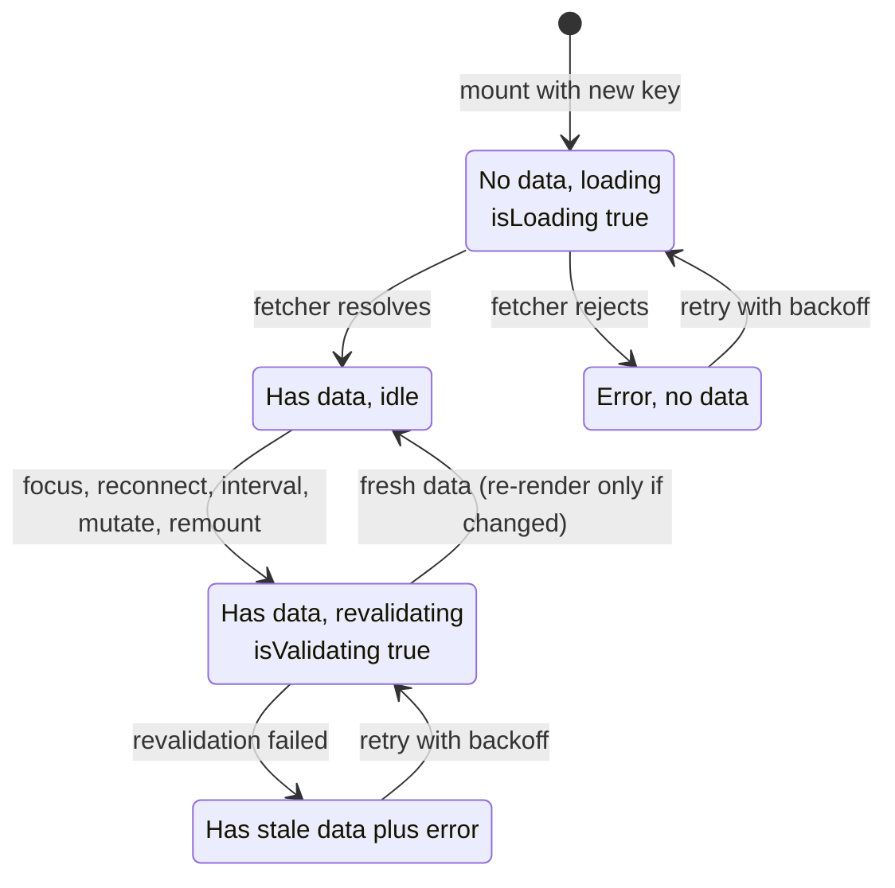

The key (here `'/api/user'`) is passed to the fetcher as its argument. Every component using the same key **shares one cache entry and one in-flight request**.

---

### Section 5: Revalidation Triggers and Defaults

Unlike TanStack Query's `staleTime`, SWR has **no freshness window by default**: data is revalidated whenever a trigger fires, with a short **deduping interval** preventing request storms.

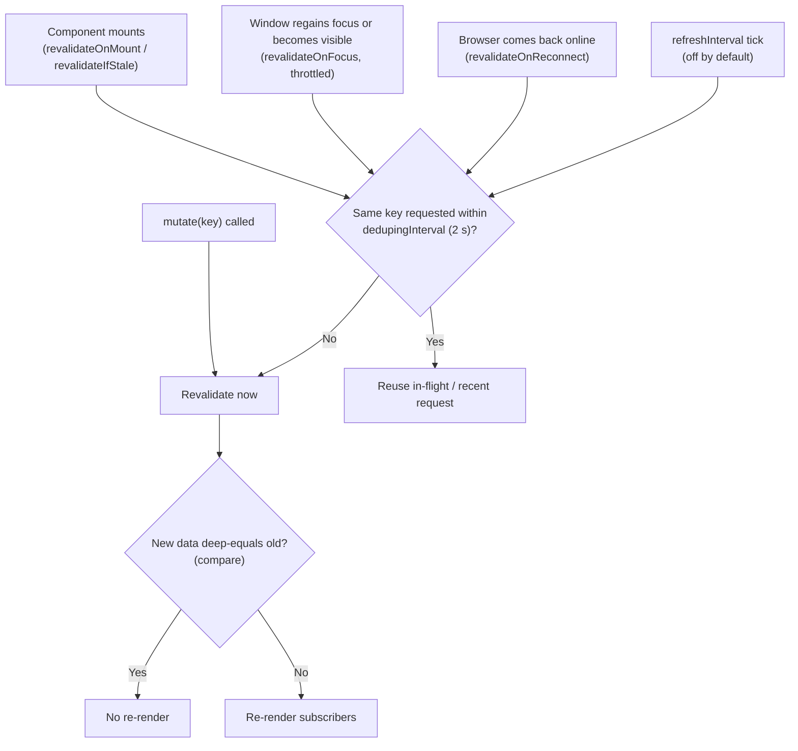

**Defaults** (SWR 2.x — verify on the API page when upgrading):

| Option | Default | Notes |
|---|---|---|
| `revalidateOnFocus` | `true` | Listens to window `focus` and `visibilitychange` |
| `focusThrottleInterval` | `5000` ms | At most one focus revalidation per 5 s |
| `revalidateOnReconnect` | `true` | Browser `online` event |
| `revalidateIfStale` | `true` | Revalidate on mount when cached data exists |
| `revalidateOnMount` | `undefined` | Inherits from `revalidateIfStale` behaviour when not set |
| `refreshInterval` | `0` (off) | Polling; `refreshWhenHidden` and `refreshWhenOffline` default `false` |
| `dedupingInterval` | `2000` ms | Identical key requests within this window are deduped |
| `shouldRetryOnError` | `true` | Exponential backoff based on `errorRetryInterval` |
| `errorRetryInterval` | `5000` ms (`10000` on slow connections) | Base for backoff |
| `errorRetryCount` | unset (keeps retrying) | Set a number to cap retries |
| `loadingTimeout` | `3000` ms (`5000` on slow connections) | Fires `onLoadingSlow` |
| `keepPreviousData` | `false` | Show the previous key's data while the new key loads |
| `compare` | deep equal (`dequal`) | Decides whether new data counts as a change |
| `suspense` | `false` | Throw promises for React Suspense |

> **Production tip:** "revalidate on every focus" is great for freshness but can multiply load for heavy endpoints. Use `dedupingInterval` (a larger value effectively behaves like a freshness window), `revalidateOnFocus: false` for expensive or rarely changing data, or `useSWRImmutable` for data that never changes.

---

### Section 6: Keys, Deduplication and Conditional Fetching

```tsx
// String key → fetcher(url)
useSWR('/api/user', fetcher);

// Array key → fetcher receives the WHOLE array as one argument (SWR 2.x)
useSWR(['/api/orders', status, page], ([url, s, p]) => fetchOrders(url, s, p));

// Object keys work too; they are serialized stably
useSWR({ url: '/api/search', q }, ({ url, q }) => search(url, q));

// Conditional: a falsy key (null/undefined/false) means "don't fetch"
useSWR(shouldFetch ? '/api/data' : null, fetcher);

// Dependent: a function key that throws or returns falsy waits
const { data: user } = useSWR('/api/user', fetcher);
const { data: projects } = useSWR(() => `/api/projects?uid=${user.id}`, fetcher); // throws until user loads
```

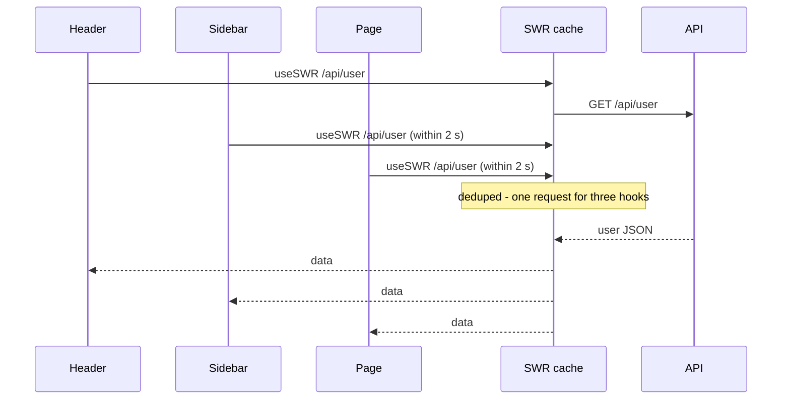

| Rule | Why |
|---|---|
| Put every input the fetcher uses into the key | Different inputs need different cache entries |
| Use the same key shape everywhere for the same data | `'/api/user'` and `['/api/user']` are **different** entries |
| Arrays/objects are hashed by value | A new array literal each render is fine — it isn't refetched just because the reference changed |
| Wrap keys and fetchers in custom hooks (`useUser()`) | One place to change; consistent keys |

---

### Section 7: Global Configuration and the Cache Provider

```tsx
import { SWRConfig } from 'swr';

export function AppProviders({ children }: { children: React.ReactNode }) {
  return (
    <SWRConfig
      value={{
        fetcher,                                       // default fetcher for every useSWR
        dedupingInterval: 5000,
        onError: (err, key) => {
          if (err.status !== 403 && err.status !== 404) reportError(err, { key });
        },
        onErrorRetry: (err, key, config, revalidate, { retryCount }) => {
          if (err.status === 404 || retryCount >= 3) return;   // never retry 404, cap at 3
          setTimeout(() => revalidate({ retryCount }), 5000);
        },
      }}
    >
      {children}
    </SWRConfig>
  );
}
```

**Cache provider:** by default SWR uses one global `Map`. You can supply your own:

```tsx
// Separate cache per test or per sub-app
<SWRConfig value={{ provider: () => new Map() }}>
  <App />
</SWRConfig>
```

| Need | Approach |
|---|---|
| Isolate tests | `provider: () => new Map()` per test render |
| Persist across reloads | Custom provider that restores a `Map` from `localStorage` on start and saves it on `beforeunload`/`visibilitychange` (pattern from the SWR docs) — never for sensitive data |
| Read the cache imperatively | `const { cache, mutate } = useSWRConfig()` |
| Cross-cutting behaviour (logging, auth headers, key prefixes) | **Middleware**: `use: [logger]` — a function wrapping `useSWRNext` |

---

### Section 8: Mutations — mutate and useSWRMutation

SWR offers two complementary APIs:

| API | Use for |
|---|---|
| **`mutate`** (bound: `const { mutate } = useSWR(key)`; global: `useSWRConfig().mutate` or `import { mutate } from 'swr'`) | Update/revalidate **cached data** for a key, including optimistic updates |
| **`useSWRMutation(key, fetcher)`** from `swr/mutation` | A **remote write** (POST/PUT/DELETE) triggered manually, with `trigger`, `isMutating`, `data`, `error`, `reset` |

**Optimistic update with automatic rollback:**

```tsx
const { data: todos, mutate } = useSWR<Todo[]>('/api/todos', fetcher);

async function toggle(todo: Todo) {
  const updated = { ...todo, done: !todo.done };
  await mutate(
    async (current = []) => {
      const saved = await api.patch<Todo>(`/api/todos/${todo.id}`, { done: updated.done });
      return current.map((t) => (t.id === saved.id ? saved : t));     // server result becomes the cache
    },
    {
      optimisticData: (current = []) => current.map((t) => (t.id === todo.id ? updated : t)),
      rollbackOnError: true,   // default true — restore previous data if the promise rejects
      populateCache: true,     // default true for mutate — write the resolved value into the cache
      revalidate: false,       // we already have the server's response
    },
  );
}
```

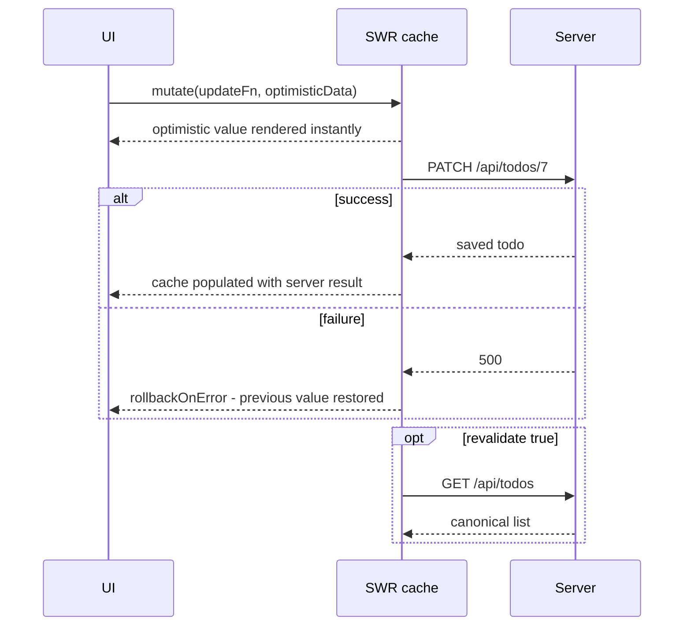

**`useSWRMutation` for forms:**

```tsx
import useSWRMutation from 'swr/mutation';

async function createProject(url: string, { arg }: { arg: { name: string } }) {
  const res = await fetch(url, { method: 'POST', headers: { 'Content-Type': 'application/json' }, body: JSON.stringify(arg) });
  if (!res.ok) throw new Error(`HTTP ${res.status}`);
  return res.json() as Promise<Project>;
}

function NewProjectForm() {
  const { trigger, isMutating, error } = useSWRMutation('/api/projects', createProject);
  // On success, SWR revalidates the '/api/projects' key by default (revalidate: true).
  // populateCache defaults to false here, because a POST response is usually not the list.
  return (
    <form action={async (fd) => { await trigger({ name: String(fd.get('name')) }); }}>
      <input name="name" required />
      <button disabled={isMutating}>Create</button>
      {error && <p role="alert">{error.message}</p>}
    </form>
  );
}
```

**Mutating many keys:** the global `mutate` accepts a **filter function**: `mutate((key) => typeof key === 'string' && key.startsWith('/api/projects'))` revalidates every matching key — SWR's equivalent of prefix invalidation. The filter receives the original key (string or array). Keys created by `useSWRInfinite` and `useSWRSubscription` are excluded from filter matching — revalidate those through their own hooks' `mutate`.

> `useSWRMutation` doesn't start until `trigger` is called and doesn't share state between hook instances — unlike `useSWR`. Deeper patterns: [Optimistic UI Updates](./optimistic-ui-updates.md).

---

### Section 9: Pagination and Infinite Loading

**Page numbers:** each page is a separate key; `keepPreviousData` avoids flashing empty states.

```tsx
const { data, isLoading } = useSWR(`/api/projects?page=${page}`, fetcher, { keepPreviousData: true });
```

**Infinite / "load more":** `useSWRInfinite` from `swr/infinite` stores an array of pages:

```tsx
import useSWRInfinite from 'swr/infinite';

const getKey = (pageIndex: number, previousPage: FeedPage | null) => {
  if (previousPage && !previousPage.nextCursor) return null;           // reached the end
  if (pageIndex === 0) return '/api/feed?limit=20';
  return `/api/feed?limit=20&cursor=${previousPage!.nextCursor}`;
};

function Feed() {
  const { data, size, setSize, isValidating } = useSWRInfinite<FeedPage>(getKey, fetcher, {
    revalidateFirstPage: true,   // default: refresh page 1 when loading more
    persistSize: false,          // default: reset to 1 page when the first page's key changes
  });
  const items = data?.flatMap((p) => p.items) ?? [];
  const hasMore = !!data?.[data.length - 1]?.nextCursor;
  return (
    <>
      {items.map((p) => <Post key={p.id} post={p} />)}
      {hasMore && <button onClick={() => setSize(size + 1)} disabled={isValidating}>Load more</button>}
    </>
  );
}
```

```mermaid
flowchart LR
    G0["getKey(0, null)"] --> K0["/api/feed?limit=20"]
    K0 --> P0["page 0 → nextCursor c20"]
    P0 --> G1["getKey(1, page0)"] --> K1["/api/feed?cursor=c20"]
    K1 --> P1["page 1 → nextCursor c40"]
    P1 --> G2["getKey(2, page1)"] --> K2["/api/feed?cursor=c40"]
    K2 --> P2["page 2 → nextCursor null"]
    P2 --> END["getKey(3, page2) returns null → stop"]
```

Other options: `initialSize`, `revalidateAll` (refetch every page on revalidation), `parallel` (fetch pages in parallel when keys don't depend on the previous page). See [Pagination & Infinite Scroll](./pagination-and-infinite-scroll.md).

---

### Section 10: Subscriptions, Immutable Data and Preloading

```tsx
// Real-time: push data into the SWR cache from a subscription (swr/subscription)
import useSWRSubscription from 'swr/subscription';

function Price({ symbol }: { symbol: string }) {
  const { data, error } = useSWRSubscription(['prices', symbol], ([, s], { next }) => {
    const ws = new WebSocket(`wss://stream.example.com/prices/${s}`);
    ws.onmessage = (e) => next(null, JSON.parse(e.data));
    ws.onerror = () => next(new Error('Price stream failed'));
    return () => ws.close();                 // called when no component uses the key any more
  });
  return <span>{error ? '—' : data?.price}</span>;
}
```

```tsx
// Data that never changes: no focus/reconnect/stale revalidation
import useSWRImmutable from 'swr/immutable';
const { data: countries } = useSWRImmutable('/api/countries', fetcher);

// Start fetching before render (e.g. on hover or at module load)
import { preload } from 'swr';
<Link href="/reports" onMouseEnter={() => preload('/api/reports', fetcher)}>Reports</Link>;
```

| Hook | Import | Purpose |
|---|---|---|
| `useSWR` | `swr` | Read + auto revalidation |
| `useSWRImmutable` | `swr/immutable` | Read once; no automatic revalidation |
| `useSWRInfinite` | `swr/infinite` | Paginated arrays of pages |
| `useSWRMutation` | `swr/mutation` | Manually triggered remote writes |
| `useSWRSubscription` | `swr/subscription` | Push-based data (WebSocket, SSE, Firestore-style listeners) |

For choosing between polling, SSE and WebSockets, see [WebSockets & SSE & Long Polling](../01-web-fundamentals/websockets-sse-long-polling.md) and [Real-Time Data Sync](./real-time-data-sync.md).

---

### Section 11: SSR, Server Components and Fallback Data

SWR hooks run in **Client Components** only. Server-fetched data is handed to them as **fallback**:

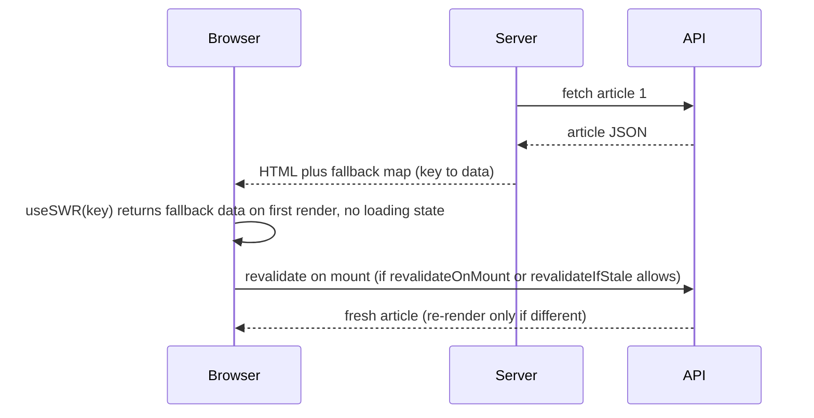

```tsx
// Next.js App Router — app/articles/[id]/page.tsx (Server Component)
import { SWRConfig, unstable_serialize } from 'swr';
import { Article } from './article'; // 'use client' component using useSWR(['/api/article', id])

export default async function Page({ params }: { params: Promise<{ id: string }> }) {
  const { id } = await params;
  const article = await getArticle(id);
  return (
    <SWRConfig value={{ fallback: { [unstable_serialize(['/api/article', id])]: article } }}>
      <Article id={id} />
    </SWRConfig>
  );
}
```

- `fallbackData` (per hook) or `fallback` (in `SWRConfig`, keyed by the serialized key) seed the first render. Fallback data is **not** considered "loaded" for `isLoading`, and SWR may still revalidate it on mount.
- For data that's only rendered on the server and never refetched on the client, you don't need SWR — render it in a Server Component.
- To avoid an immediate refetch after SSR, set `revalidateOnMount: false` (or `revalidateIfStale: false`) for that hook, accepting that freshness then depends on focus/reconnect/interval triggers.
- Next.js `params` became a Promise in recent versions (as above); check the version you use.

---

## SWR vs TanStack Query

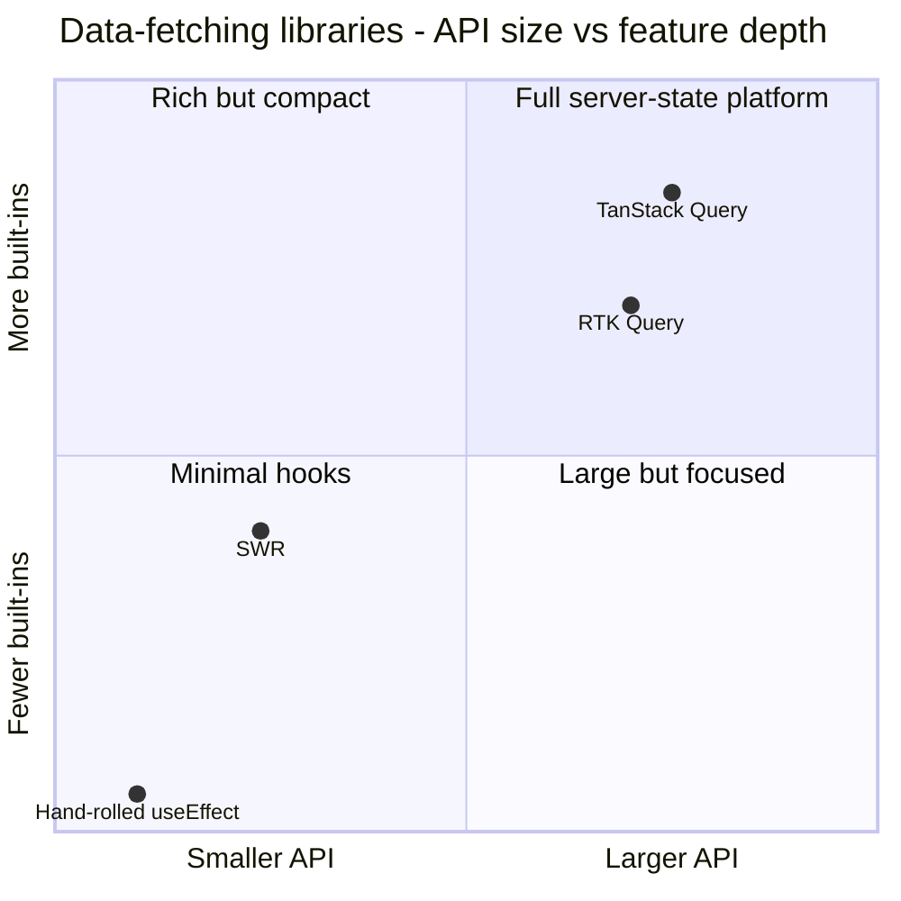

| Aspect | **SWR 2.x** | **TanStack Query v5** |
|---|---|---|
| Philosophy | Minimal, "revalidate on every trigger", deduping window | Configurable freshness (`staleTime`), cache lifecycle (`gcTime`) |
| Freshness control | `dedupingInterval`, per-trigger switches, `useSWRImmutable` | `staleTime` per query (+ `'static'`), per-trigger options |
| Cache eviction | None by default (global `Map`) | Automatic GC of unused queries (`gcTime`) |
| Keys | String / array / object; fetcher gets the key | Array `queryKey`; `queryFn` gets a context (`signal`, `pageParam`) |
| Request cancellation | Not built in — no `AbortSignal` passed to the fetcher | `signal` passed to `queryFn`; `cancelQueries` |
| Invalidation | `mutate(key)` or `mutate(filterFn)` | `invalidateQueries` with prefix/predicate filters |
| Mutations | `mutate` with `optimisticData`/`rollbackOnError`; `useSWRMutation` | `useMutation` with lifecycle callbacks, `scope`, `useMutationState` |
| Infinite | `useSWRInfinite` (`getKey`, `size`) | `useInfiniteQuery` (`initialPageParam`, `getNextPageParam`, `maxPages`) |
| Subscriptions | `useSWRSubscription` | Manual (`setQueryData` from a socket), experimental `streamedQuery` |
| Offline | Basic (pauses retries when offline via `isOnline`) | `networkMode`, paused + persisted mutations, persisters |
| SSR | `fallback` / `fallbackData` | `dehydrate` / `HydrationBoundary`, streaming pending queries |
| Devtools | Community tools | Official devtools |
| Frameworks | React (community ports elsewhere) | React, Vue, Svelte, Solid, Angular (experimental) |

**Choose SWR** for read-heavy React apps that want a tiny API and good defaults (dashboards, content sites with some live data, Next.js apps). **Choose TanStack Query** when you need fine freshness control, complex mutations/optimistic flows, offline, cancellation, devtools or non-React frameworks. Both are far better than hand-rolled effects; both can sit on top of good HTTP caching.

---

## The Pattern Beyond React

Stale-while-revalidate is a pattern, not a library. How other stacks express it:

| Stack | How |
|---|---|
| **Vue** | TanStack Vue Query (`staleTime`), Nuxt `useFetch`/`useAsyncData` with cached data + `refresh()`, or `swrv` (a community SWR port) |
| **Angular** | TanStack Angular Query (experimental package); or RxJS: emit the cached value first (`startWith`/`concat`), then the HTTP result; `shareReplay` for dedupe |
| **Svelte / SvelteKit** | TanStack Svelte Query; SvelteKit `load` + `invalidate()`; HTTP `Cache-Control` on `+server.ts` endpoints |
| **Next.js (server)** | ISR / `revalidate` for pages and data — server-side SWR |
| **Android** | Repository observes a Room table (`Flow`) — UI renders cached rows immediately, a refresh job updates the table and the `Flow` emits again |
| **iOS** | Render cached models (SwiftData / Core Data / on-disk cache) immediately, then refresh with `URLSession` and update the `@Observable` model |
| **Any stack** | Show cached → fetch → compare → update; dedupe in-flight requests by key |

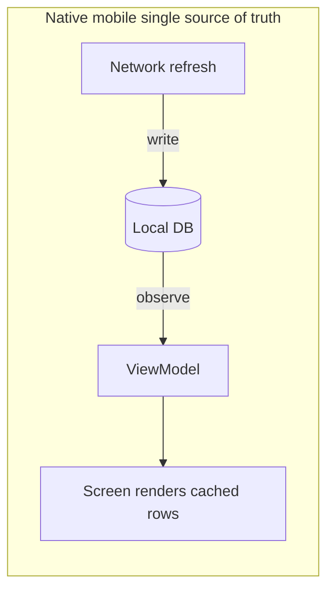

A minimal framework-free implementation shows the core of every SWR library:

```typescript
type Entry<T> = { data?: T; promise?: Promise<T>; ts: number; subs: Set<(d: T) => void> };
const cache = new Map<string, Entry<unknown>>();

export function swr<T>(key: string, fetcher: () => Promise<T>, onData: (d: T) => void, dedupeMs = 2000) {
  const e = (cache.get(key) ?? { ts: 0, subs: new Set() }) as Entry<T>;
  cache.set(key, e as Entry<unknown>);
  e.subs.add(onData);
  if (e.data !== undefined) onData(e.data);                  // 1. stale, instantly

  const recent = Date.now() - e.ts < dedupeMs;
  if (!e.promise && !recent) {                                // 2. dedupe
    e.ts = Date.now();
    e.promise = fetcher()
      .then((fresh) => {
        if (JSON.stringify(fresh) !== JSON.stringify(e.data)) { // 3. compare (naive)
          e.data = fresh;
          e.subs.forEach((s) => s(fresh));                    // 4. notify subscribers
        }
        return fresh;
      })
      .finally(() => { e.promise = undefined; });
  }
  return () => e.subs.delete(onData);                         // unsubscribe
}
```

---

## Real-World Examples

**Example 1 — HTTP headers for a public listing API (Express):**
```javascript
app.get('/api/products', async (req, res) => {
  // Browser: fresh 30 s, then serve stale for up to 5 min while refreshing
  // CDN: fresh 5 min, then serve stale for up to 10 min while refreshing; stale for 1 day on origin errors
  res.set('Cache-Control', 'public, max-age=30, stale-while-revalidate=300');
  res.set('CDN-Cache-Control', 'max-age=300, stale-while-revalidate=600, stale-if-error=86400');
  res.json(await getProducts()); // Express adds an ETag → background revalidations are cheap 304s
});

app.get('/api/me/balance', requireAuth, async (req, res) => {
  res.set('Cache-Control', 'private, no-cache'); // stale = wrong: always revalidate
  res.json(await getBalance(req.user.id));
});
```

**Example 2 — A typed data layer of custom hooks (BAD → GOOD):**
```tsx
// ❌ BAD: keys and fetchers scattered; '/api/user' vs '/api/user/' create two cache entries
const { data } = useSWR('/api/user/', (u) => fetch(u).then((r) => r.json()));

// ✅ GOOD: one hook per resource; consistent keys; errors thrown for non-2xx
export function useUser() {
  return useSWR<User>('/api/user');            // fetcher comes from <SWRConfig value={{ fetcher }}>
}
export function useProjects(status: 'open' | 'done') {
  return useSWR<Project[]>(['/api/projects', status], ([url, s]) => getJSON(`${url}?status=${s}`));
}
```

**Example 3 — Like button with optimistic update and rollback:**
```tsx
function LikeButton({ postId }: { postId: string }) {
  const key = `/api/posts/${postId}`;
  const { data: post, mutate } = useSWR<Post>(key);

  const toggleLike = () =>
    mutate(
      api.post<Post>(`${key}/like`, { liked: !post!.liked }),          // promise → resolved value populates cache
      {
        optimisticData: (cur) => cur && { ...cur, liked: !cur.liked, likes: cur.likes + (cur.liked ? -1 : 1) },
        rollbackOnError: true,
        revalidate: false,
      },
    ).catch(() => toast.error('Could not save your like'));

  return (
    <button aria-pressed={post?.liked} onClick={toggleLike}>
      ♥ {post?.likes}
    </button>
  );
}
```

**Example 4 — Invalidate a family of keys after a bulk action:**
```tsx
const { mutate } = useSWRConfig();

async function archiveSelected(ids: string[]) {
  await api.post('/api/projects/archive', { ids });
  // Revalidate every cached project list and detail
  await mutate((key) => typeof key === 'string' && key.startsWith('/api/projects'));
  // Array keys: match on the first element
  await mutate((key) => Array.isArray(key) && key[0] === '/api/projects');
}
```

**Example 5 — Dashboard polling that respects hidden tabs:**
```tsx
function LiveOrders() {
  const { data, error, isValidating } = useSWR<OrderStats>('/api/orders/stats', {
    refreshInterval: 15_000,     // poll every 15 s while visible
    refreshWhenHidden: false,    // default — stop in background tabs
    dedupingInterval: 10_000,    // focus right after a poll won't refetch
  });
  return <StatsPanel stats={data} stale={!!error} updating={isValidating} />;
}
```

**Example 6 — Test isolation with a fresh cache:**
```tsx
import { render, screen } from '@testing-library/react';
import { SWRConfig } from 'swr';

function renderWithSWR(ui: React.ReactElement) {
  return render(
    <SWRConfig value={{ provider: () => new Map(), dedupingInterval: 0, shouldRetryOnError: false }}>
      {ui}
    </SWRConfig>,
  );
}

test('renders the user', async () => {
  server.use(http.get('/api/user', () => HttpResponse.json({ name: 'Ada' }))); // MSW
  renderWithSWR(<Profile />);
  expect(await screen.findByText(/Ada/)).toBeInTheDocument();
});
```

---

## Key Points Summary

| Concept | One-Line Explanation |
|---|---|
| **Stale-while-revalidate** | Serve cached data now, refresh in the background, update when fresh arrives |
| **RFC 5861** | Defined `stale-while-revalidate` and `stale-if-error` for HTTP `Cache-Control` |
| **HTTP / CDN SWR** | Makes the *next* response fresh; the current one stays stale |
| **App-level SWR** | Updates the *current* UI in place when fresh data arrives |
| **Service Worker SWR** | Workbox `StaleWhileRevalidate`; use `waitUntil` for the background update |
| **SWR library** | Vercel's React hooks: `useSWR(key, fetcher)` → `data`, `error`, `isLoading`, `isValidating`, `mutate` |
| **Revalidation triggers** | Mount, focus (throttled), reconnect, interval, `mutate` |
| **`dedupingInterval`** | Identical keys within 2 s share one request |
| **Conditional fetching** | Falsy key = don't fetch; function key that throws = wait for dependency |
| **`mutate` + `optimisticData`** | Instant UI with automatic rollback on error |
| **`useSWRMutation`** | Manually triggered remote writes; revalidates the key afterwards |
| **`useSWRInfinite`** | `getKey(pageIndex, previousPage)`; `size`/`setSize` |
| **`fallback`** | Seed SWR with server-fetched data for SSR/RSC |
| **SWR vs TanStack Query** | Small and simple vs configurable freshness, GC, cancellation, offline |

---

## Test Your Understanding

**Q1 (Basic):**
A response has `Cache-Control: max-age=60, stale-while-revalidate=120`. The user requests it again at 30 s, 90 s and 200 s after it was generated. What happens each time?

<details>
<summary>Answer</summary>

- **30 s:** fresh (age < 60) → served from cache, **no request**.
- **90 s:** stale but within the SWR window (60–180 s) → the **stale copy is served immediately** and the cache revalidates in the background (a conditional request; often a 304). The user sees the old content this time; the next request gets the refreshed copy.
- **200 s:** beyond 60 + 120 = 180 s → the cache must **revalidate before using it**; the user waits for the round trip (cheap if the server answers 304).
</details>

**Q2 (Application):**
Three components on one page call `useSWR('/api/user', fetcher)`. How many requests are made on page load, and what happens when the user switches tabs and comes back 10 seconds later?

<details>
<summary>Answer</summary>

**One** request on load: all three hooks share the key, and calls within `dedupingInterval` (2 s by default) join the same request. All three components render the same cached data.

On return after 10 s, `revalidateOnFocus` fires (focus/visibility, throttled to at most once per 5 s). The deduping window has passed, so SWR makes **one** background request, keeps showing the cached user meanwhile (`isValidating` is true, `isLoading` stays false), and re-renders the three components only if the deep comparison says the data changed.
</details>

**Q3 (Tricky):**
You set `Cache-Control: max-age=0, stale-while-revalidate=86400` on your SPA's `index.html` to "make it instant". After a deploy, some users see a blank page. Why?

<details>
<summary>Answer</summary>

With HTTP-level SWR, the browser serves the **stale `index.html`** immediately and only fetches the new one in the background — for the *next* load. That stale HTML references the **old hashed JS/CSS files**. If the deploy deleted those old assets (or the server returns `index.html` for missing paths), the scripts fail and the page is blank. Even when old assets still exist, users run the previous version for one more load.

Fix: serve HTML with `no-cache` + ETag (always revalidate, cheap 304s), keep old hashed assets for a while after deploys, and use SWR on data endpoints and non-critical resources instead of the document. If you need instant HTML, cache it at the **CDN** with purge-on-deploy rather than in browsers.
</details>

**Q4 (Tricky):**
A search box uses `useSWR(['/api/search', q], fetcher)`. Users report results "jumping" — a slow response for an older query sometimes appears after the newer one. Does SWR prevent this race, and what else should you do?

<details>
<summary>Answer</summary>

SWR caches **per key**, so the response for the old `q` is stored under the old key and the hook renders the data for the **current** key — the classic "overwrite with the wrong result" race doesn't happen. But if the UI uses `keepPreviousData: true`, the previous key's data is shown while the new key loads, which looks like jumping; and every keystroke still triggers a request.

Do: **debounce** the input before it becomes part of the key (e.g. 250 ms), use `keepPreviousData` deliberately with a visual "updating" state, and set a minimum query length (`q.length >= 2 ? key : null`). SWR doesn't pass an `AbortSignal` to the fetcher, so obsolete requests aren't cancelled automatically — wire an `AbortController` yourself or use TanStack Query (which passes `signal`) if cancellation matters for server load. See [Debouncing & Throttling](../04-performance-engineering/debouncing-and-throttling.md).
</details>

**Q5 (Application):**
A Server Component fetches an article and passes it to a Client Component that uses `useSWR`. The page renders correctly from the server, then makes an identical request right after hydration. Is that a bug? How do you control it?

<details>
<summary>Answer</summary>

It's SWR's default: fallback data is treated as a starting value, not as "loaded" data, and `revalidateIfStale`/`revalidateOnMount` revalidate on mount. It guarantees freshness at the cost of one extra request.

If the server data is fresh enough, set `revalidateOnMount: false` (or `revalidateIfStale: false`) on that hook so it relies on focus/reconnect/interval triggers instead. Also make sure the fallback key matches exactly — use `unstable_serialize` for array keys — otherwise SWR won't find the fallback and will show a loading state. If the client never needs to refresh the article, drop SWR and render it in the Server Component only.
</details>

**Q6 (System design):**
Design the caching for a news site's homepage: an article list (public, updates every few minutes), per-user "saved articles", and breaking-news alerts that must appear within seconds. Use stale-while-revalidate where it fits.

<details>
<summary>Answer</summary>

- **HTML:** `Cache-Control: no-cache` + ETag for browsers; at the CDN, a short TTL with `stale-while-revalidate` (e.g. `CDN-Cache-Control: max-age=60, stale-while-revalidate=300`) plus purge on publish — fast TTFB, never stuck on an old build.
- **Article list API (public):** `public, max-age=30, stale-while-revalidate=300` and a CDN TTL with `stale-if-error` so the edge absorbs traffic spikes and survives origin hiccups. On the client, `useSWR('/api/articles')` shows cached data instantly and revalidates on focus; a `refreshInterval` of 60 s while visible keeps an open tab current.
- **Saved articles (per user):** `private, no-cache` + ETag at HTTP level (never at the CDN). Client: `useSWR('/api/me/saved')`; saving uses `mutate` with `optimisticData` + `rollbackOnError`, then the list key is revalidated.
- **Breaking news:** SWR polling is too slow or too expensive at scale — use **SSE** (or WebSocket) via `useSWRSubscription` pushing into the cache, with a polling fallback for clients where the stream fails.
- **Offline / repeat visits:** optional Service Worker with Workbox `StaleWhileRevalidate` for article JSON and images; `NetworkFirst` (not SWR) for HTML.
</details>

---

## Cheat Sheet

**Key Definitions:**
- **Stale-while-revalidate (pattern):** Return cached data immediately, refresh it in the background, update when it arrives
- **`stale-while-revalidate=N`:** `Cache-Control` extension allowing caches to serve stale responses for N s past expiry while revalidating
- **`stale-if-error=N`:** Serve stale for N s past expiry if the origin errors — mainly a CDN feature
- **SWR (library):** Vercel's React hooks for data fetching built on this pattern
- **Revalidation:** Re-fetching data for a key to confirm or replace the cached value
- **Deduping interval:** Window in which identical key requests share one fetch
- **Fallback data:** Initial data for a key, typically from SSR, used until real data loads

**Quick Reference:**
```text
HTTP
  Cache-Control: max-age=60, stale-while-revalidate=300      browser + CDN (public data)
  CDN-Cache-Control: max-age=300, stale-while-revalidate=600, stale-if-error=86400
  HTML → no-cache + ETag (not SWR in browsers)    per-user → private, no-cache    sensitive → no-store
  Support: Chrome 75+, Firefox 68+, Safari 14+ (stale-while-revalidate)

Service Worker (Workbox)
  new StaleWhileRevalidate({ cacheName, plugins: [CacheableResponsePlugin, ExpirationPlugin] })

SWR library (2.x)
  const { data, error, isLoading, isValidating, mutate } = useSWR(key, fetcher, options)
  key: string | array | object | null (skip) | () => key (throws → wait)
  defaults: revalidateOnFocus ✓ · revalidateOnReconnect ✓ · revalidateIfStale ✓ · dedupingInterval 2 s
            focusThrottleInterval 5 s · refreshInterval 0 · retries with exponential backoff
  global:   <SWRConfig value={{ fetcher, onError, provider, fallback, use: [middleware] }}>
  write:    mutate(data | promise | fn, { optimisticData, rollbackOnError, populateCache, revalidate })
            useSWRMutation(key, (key, { arg }) => …) → trigger, isMutating, reset
  many:     mutate((key) => match(key))
  lists:    useSWRInfinite(getKey, fetcher) → data[], size, setSize
  other:    useSWRImmutable · useSWRSubscription · preload(key, fetcher)
  SSR:      fallback: { [unstable_serialize(key)]: data } · revalidateOnMount: false to skip refetch
```

**Common Mistakes to Avoid:**

| Mistake | Why Wrong | Fix |
|---|---|---|
| `stale-while-revalidate` on `index.html` | Users get stale HTML pointing to old assets for one more load | `no-cache` + ETag for HTML; SWR at the CDN with purge |
| `public` + SWR on per-user responses | CDN may serve one user's stale data to another | `private, no-cache` |
| Fetcher that doesn't throw on 4xx/5xx | Error bodies cached as `data` | `if (!res.ok) throw` |
| Inconsistent keys (`/api/user` vs `/api/user/`) | Two cache entries, double requests, out-of-sync UI | Custom hooks per resource |
| Full-page spinner on `isValidating` | Every focus revalidation blanks the screen | `isLoading` for first load; subtle indicator for `isValidating` |
| Revalidating expensive endpoints on every focus | Load spikes when users switch tabs | Raise `dedupingInterval`, disable `revalidateOnFocus`, or `useSWRImmutable` |
| Expecting SWR to cancel obsolete requests | No `AbortSignal` is passed to the fetcher | Debounce keys; wire your own `AbortController`; or TanStack Query |
| Unbounded `errorRetryCount` on 404s | Retries forever for missing resources | Custom `onErrorRetry` that stops on 404 / caps attempts |
| Persisting the SWR cache to `localStorage` with private data | Readable by any script on the origin, survives logout | Persist only public data; clear on logout |
| Service Worker SWR without `waitUntil` | Browser may kill the SW before the cache update finishes | `event.waitUntil(updatePromise)` |
| SWR for data where stale = wrong (balances, checkout stock) | Users act on outdated numbers | Revalidate before use (`no-cache`), show freshness |

---

## References & Further Reading

**Core docs**
- SWR: [Getting Started](https://swr.vercel.app/docs/getting-started) · [API options](https://swr.vercel.app/docs/api) · [Revalidation](https://swr.vercel.app/docs/revalidation)
- SWR: [Mutation & Revalidation](https://swr.vercel.app/docs/mutation) · [Pagination](https://swr.vercel.app/docs/pagination) · [Subscription](https://swr.vercel.app/docs/subscription)
- SWR: [Conditional Fetching](https://swr.vercel.app/docs/conditional-fetching) · [Arguments](https://swr.vercel.app/docs/arguments) · [Cache](https://swr.vercel.app/docs/advanced/cache) · [Middleware](https://swr.vercel.app/docs/middleware)
- SWR: [Server Rendering and Prerendering (fallback)](https://swr.vercel.app/docs/with-nextjs) · [Prefetching](https://swr.vercel.app/docs/prefetching)
- MDN: [`Cache-Control` — `stale-while-revalidate`](https://developer.mozilla.org/en-US/docs/Web/HTTP/Reference/Headers/Cache-Control#stale-while-revalidate)
- web.dev: [Keeping things fresh with stale-while-revalidate](https://web.dev/articles/stale-while-revalidate)

**Service Workers**
- Chrome for Developers: [Workbox strategies (`StaleWhileRevalidate`)](https://developer.chrome.com/docs/workbox/modules/workbox-strategies)
- Chrome for Developers: [workbox-broadcast-update](https://developer.chrome.com/docs/workbox/modules/workbox-broadcast-update)
- web.dev: [The Offline Cookbook](https://web.dev/articles/offline-cookbook) (see the stale-while-revalidate recipe)

**Specs**
- IETF: [RFC 5861 — HTTP Cache-Control Extensions for Stale Content](https://www.rfc-editor.org/rfc/rfc5861)
- IETF: [RFC 9111 — HTTP Caching](https://www.rfc-editor.org/rfc/rfc9111) · [RFC 9213 — Targeted Cache-Control (`CDN-Cache-Control`)](https://www.rfc-editor.org/rfc/rfc9213)

**Comparisons and deep dives**
- TanStack Query: [Comparison with SWR, RTK Query, Apollo](https://tanstack.com/query/latest/docs/framework/react/comparison)
- Source: [vercel/swr on GitHub](https://github.com/vercel/swr)
- Android Developers: [Offline-first data layer](https://developer.android.com/topic/architecture/data-layer/offline-first)

---

> **Previous Topic:** [React Query / TanStack Query](./react-query-tanstack-query.md)
> — The configurable server-state cache: staleTime, gcTime, mutations and SSR hydration

> **Next Topic:** [GraphQL Client (Apollo, urql)](./graphql-client-apollo-urql.md)
> — Normalized caches, fragments and how GraphQL clients keep many views of one entity in sync

*Saved on: 2026-11-06 | Repo: Frontend System Design Learning Notes*
