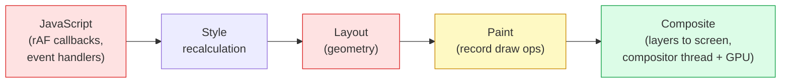
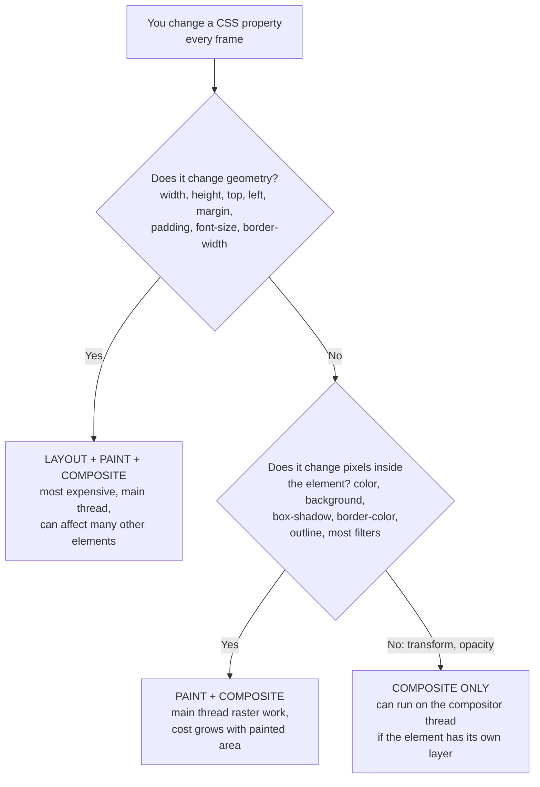
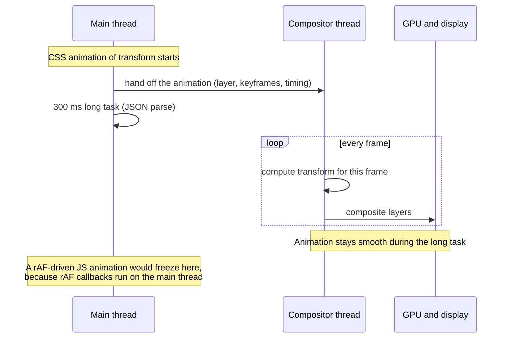
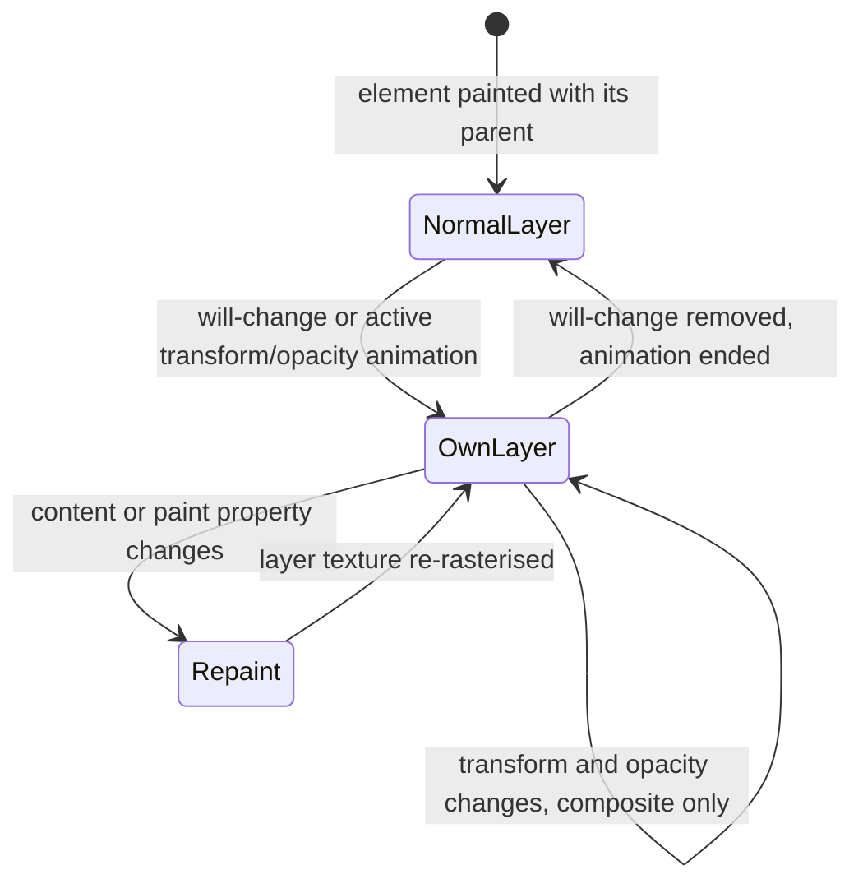
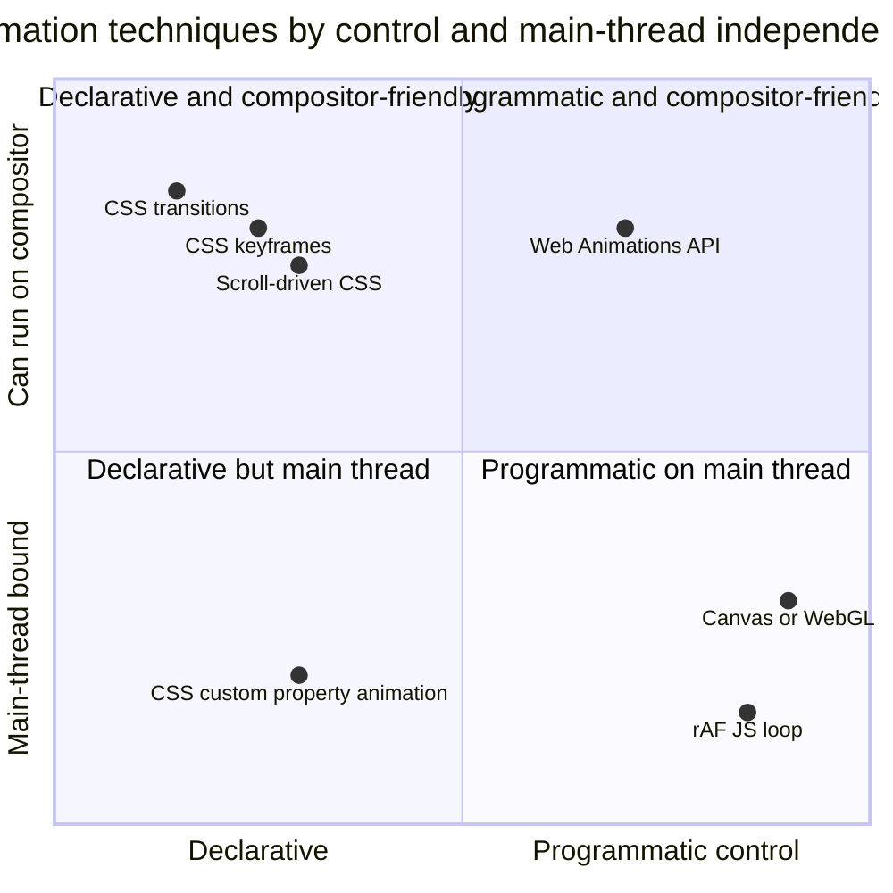
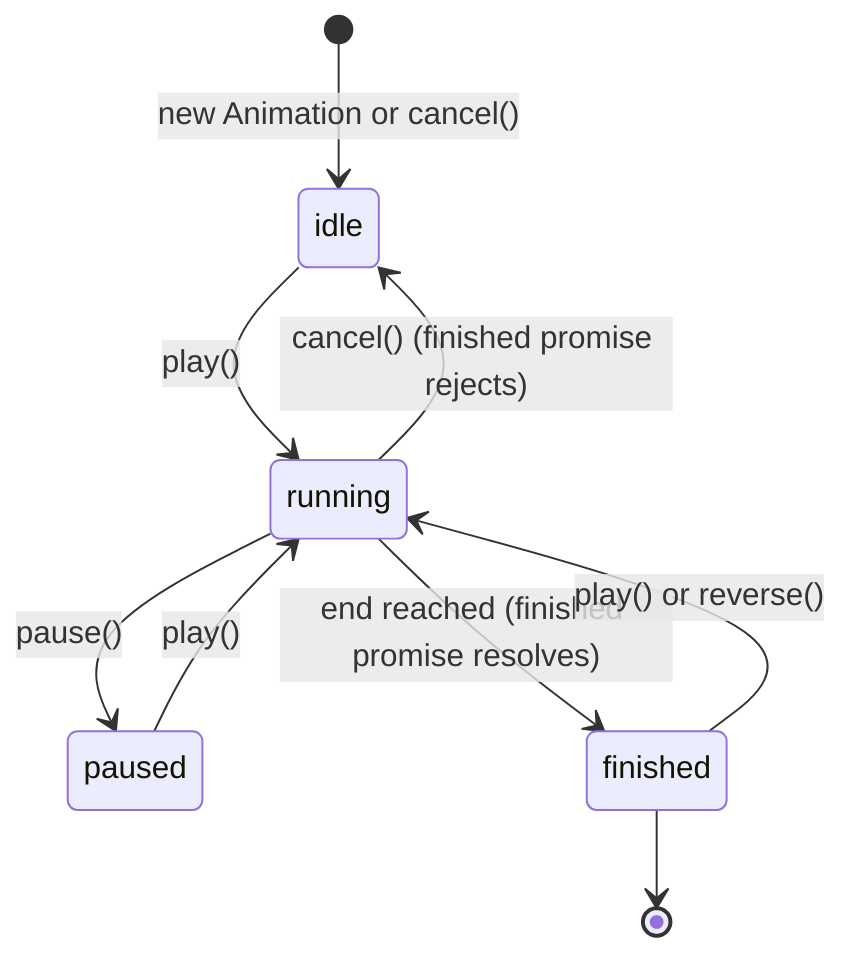
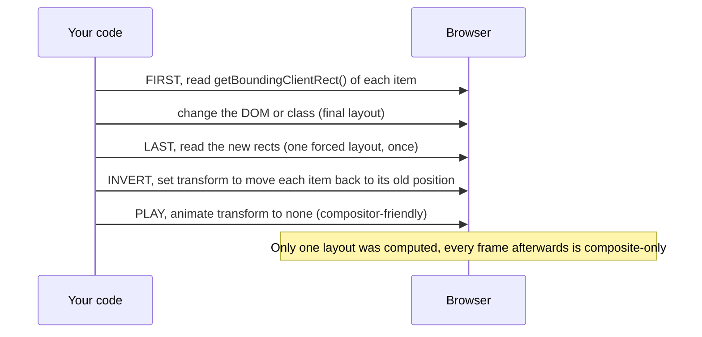
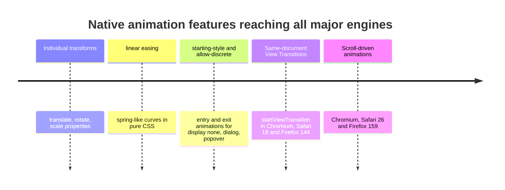
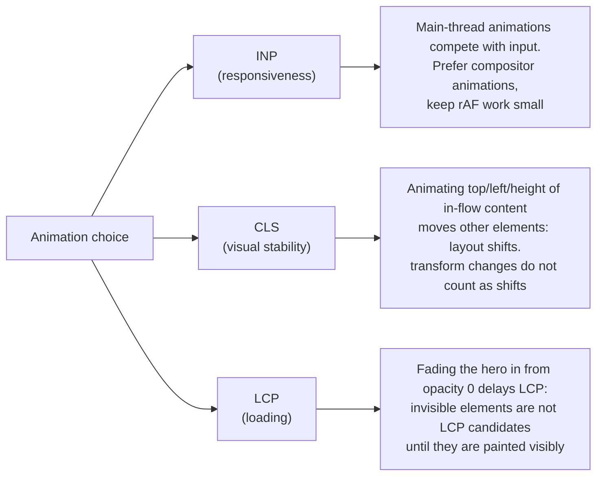
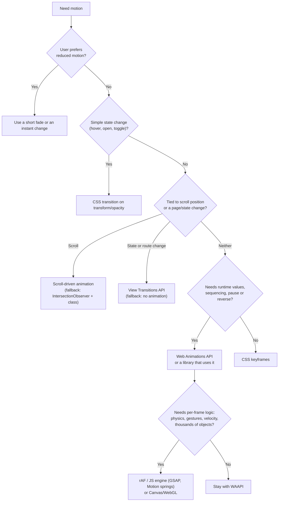

# Animation Performance (CSS vs JS)

> **Date:** 2026-11-06 · **Last updated:** 2026-11-06
> **Category:** Frontend System Design
> **Sub-Topic:** Performance Engineering / Runtime Performance (animation and rendering)
> **Level:** Intermediate · **Reading time:** ~32 min
> **Informs:** animation technology per use case (CSS transitions/keyframes, Web Animations API, rAF/JS libraries, canvas/WebGL), compositor-friendly property choice, will-change and layer budget, scroll-driven animations and View Transitions adoption, prefers-reduced-motion policy, animation impact on INP/CLS/LCP, motion library choice per framework

> **Pre-requisite:** [Critical Rendering Path](../01-web-fundamentals/critical-rendering-path.md) (style, layout, paint, composite) and [JavaScript Runtime & Event Loop](../01-web-fundamentals/javascript-runtime-event-loop.md) (frames, `requestAnimationFrame`, long tasks).
> This note answers one practical question: **how do you make motion smooth on every device without hurting responsiveness or accessibility?** Spoiler: the real split is not "CSS vs JS", it's **main thread vs compositor**.

**Previous:** [Memory Leaks in Frontend Apps](./memory-leaks-in-frontend-apps.md) · **Next:** [Atomic Design Methodology](../05-design-systems-and-components/atomic-design-methodology.md)

---

## Table of Contents

1. [ELI5 — Simple Explanation](#eli5--simple-explanation)
2. [Section 1: The Frame Budget](#section-1-the-frame-budget)
3. [Section 2: What Each Property Costs](#section-2-what-each-property-costs)
4. [Section 3: The Compositor Thread](#section-3-the-compositor-thread)
5. [Section 4: Layers and will-change](#section-4-layers-and-will-change)
6. [Section 5: The Four Ways to Animate](#section-5-the-four-ways-to-animate)
7. [Section 6: Web Animations API (WAAPI)](#section-6-web-animations-api-waapi)
8. [Section 7: JS Animation Done Right: rAF, Batching and FLIP](#section-7-js-animation-done-right-raf-batching-and-flip)
9. [Section 8: Modern CSS: Scroll-Driven Animations, View Transitions, Entry and Exit](#section-8-modern-css-scroll-driven-animations-view-transitions-entry-and-exit)
10. [Section 9: Animations and Core Web Vitals](#section-9-animations-and-core-web-vitals)
11. [Section 10: Reduced Motion and Accessibility](#section-10-reduced-motion-and-accessibility)
12. [Section 11: Frameworks, Libraries and Native Platforms](#section-11-frameworks-libraries-and-native-platforms)
13. [Section 12: Measuring Animation Performance](#section-12-measuring-animation-performance)
14. [Decision Matrix](#decision-matrix)
15. [Real-World Examples](#real-world-examples)
16. [Key Points Summary](#key-points-summary)
17. [Test Your Understanding (with answers)](#test-your-understanding)
18. [Cheat Sheet](#cheat-sheet)
19. [References & Further Reading](#references--further-reading)

---

## ELI5 — Simple Explanation

Imagine making a **flip-book cartoon**.

- **Redrawing the whole page** for every frame (moving a character by changing the layout of the scene) is slow: you have to measure, sketch, ink and colour again. That is animating `width`, `top` or `margin`: **layout + paint every frame**.
- **Recolouring** a character without moving anything (changing `background-color`) is cheaper but you still repaint.
- **Sliding a transparent sticker** over a finished background (changing `transform` or `opacity`) is almost free: nothing is redrawn, the sticker just moves. A helper (the **compositor**) can slide stickers even while the main artist is busy doing something else.
- It doesn't matter whether **you** (JavaScript) or **a printed instruction sheet** (CSS) tell the helper what to do. What matters is whether you're asking for **redrawing** or just **sliding stickers**, and whether the main artist must personally handle every frame.

> **Animate `transform` and `opacity`, let the browser run the animation (CSS or the Web Animations API), and use frame-by-frame JS only when you need physics, gestures or logic per frame. Always respect reduced-motion preferences.**

---

## Core Concept — Step by Step

### Section 1: The Frame Budget

Displays refresh at 60 Hz, 90 Hz, 120 Hz or more. To look smooth, the browser must produce a new frame every refresh:

```text
60 Hz   → 16.7 ms per frame
90 Hz   → 11.1 ms per frame
120 Hz  →  8.3 ms per frame
```

That budget is shared between your JavaScript **and** the browser's own work (style, layout, paint, compositing). If a frame isn't ready in time, it is **dropped** and the motion stutters (jank).



Every animation frame re-enters this pipeline **at the first stage the change affects**. The later it enters, the cheaper the frame. See [Critical Rendering Path](../01-web-fundamentals/critical-rendering-path.md) and [How Browsers Work](../01-web-fundamentals/how-browsers-work.md) for the pipeline itself.

---

### Section 2: What Each Property Costs



| Tier | Typical properties | Per-frame work | Use for |
|---|---|---|---|
| **Composite-only** | `transform` (and individual `translate`, `rotate`, `scale`), `opacity` | Move/blend an existing layer | Almost all UI motion: slide, fade, scale, rotate, parallax |
| **Paint** | `color`, `background-color`, `box-shadow`, `border-color`, `outline`, `filter` (engine-dependent), `clip-path` (engine-dependent) | Repaint the element's area, then composite | Short hover/focus colour changes; avoid on large areas |
| **Layout** | `width`, `height`, `top`/`left`/`right`/`bottom`, `margin`, `padding`, `font-size`, `inset`, `grid-template-*` | Recompute geometry for the element (and often its siblings/ancestors), repaint, composite | Avoid for continuous animation; fake it with `transform` (FLIP) |

**Equivalents that move work to the compositor:**

| Instead of animating… | Animate… |
|---|---|
| `left` / `top` | `transform: translate(x, y)` or `translate: x y` |
| `width` / `height` (growing a card) | `transform: scale()` (with FLIP for content, Section 7) |
| `box-shadow` intensity | `opacity` of a pseudo-element that already has the final shadow |
| `background-color` of a full-screen overlay | `opacity` of an overlay layer with that colour |
| `visibility`/`display` toggles | `opacity` + `@starting-style` / `transition-behavior: allow-discrete` (Section 8) |

> Engines differ in detail, and they change over time (some Chromium versions can composite `filter`, `background-color` or `clip-path` animations in specific cases). Older lookup tables such as CSS Triggers are **out of date**. The portable rule is still: **`transform` and `opacity` are the cheap ones everywhere**. Confirm anything else with a profile.

---

### Section 3: The Compositor Thread

Modern browsers split rendering across threads. The **main thread** runs JS, style, layout and paint. The **compositor thread** takes already-painted layers and positions/blends them, often with GPU help. Scrolling and compositable animations can keep running there **even when the main thread is blocked**.



What can run on the compositor (in practice):
- **CSS transitions and `@keyframes` animations** of `transform`/`opacity`.
- **Web Animations API** (`element.animate()`) of the same properties: WAAPI uses the same engine as CSS animations.
- **Scroll-driven animations** (`animation-timeline: scroll()` / `view()`) of compositable properties in engines that support off-main-thread scroll timelines.
- **Scrolling** itself (unless non-passive wheel/touch listeners force the browser to wait for JS; use `{ passive: true }`).

What cannot:
- Anything driven by **`requestAnimationFrame`** or timers: your callback runs on the main thread every frame.
- Animations of **layout or paint** properties, and of **CSS custom properties** (`@property`): they need style recalculation on the main thread each frame.
- Anything when the element needs to be **repainted** each frame (e.g. its content changes).

---

### Section 4: Layers and will-change

To move something on the compositor, the browser gives it its **own compositing layer** (a separate texture). Browsers promote elements automatically when a compositable animation starts. `will-change` asks for promotion **in advance**:

```css
.drawer { will-change: transform; }        /* promoted before the first frame: no first-frame hitch */
```



Layers are **not free**:

| Cost | Why |
|---|---|
| **GPU / memory** | Each layer is a texture roughly `width × height × 4 bytes` (more on high-DPR screens). Hundreds of layers can exhaust GPU memory on phones |
| **Layer explosion** | Elements that overlap a promoted layer may also need their own layers to keep correct stacking ("implicit compositing") |
| **Text rendering** | Some engines change text anti-aliasing on promoted layers |
| **Stacking context** | `will-change: transform` creates a stacking context and a containing block for fixed-position descendants, which can change layout |

Rules:
- Use `will-change` **sparingly and temporarily**: add it just before an animation (e.g. on `pointerenter` or when a menu is about to open), remove it after. MDN describes it as a last resort for existing performance problems.
- Never `* { will-change: transform; }`. The `translateZ(0)` / `translate3d(0,0,0)` "GPU hack" is the same idea from before `will-change` existed; prefer `will-change`.
- Inspect layers with **DevTools → Layers** and **Rendering → Layer borders**.

---

### Section 5: The Four Ways to Animate



| Technique | Strengths | Weaknesses | Best for |
|---|---|---|---|
| **CSS transitions** | Simplest, state-driven (`:hover`, class toggles), compositor-eligible | Only A → B; limited sequencing; no physics | Hover/focus, open/close, toggles |
| **CSS `@keyframes`** | Multi-step, looping, compositor-eligible, no JS | Static values; hard to compute dynamically | Spinners, skeleton shimmer, attention cues |
| **Web Animations API** (`element.animate()`) | Same engine as CSS (compositor-eligible) **plus** JS control: pause, reverse, seek, `playbackRate`, `finished` promise, dynamic keyframes | More code than CSS; no built-in springs (approximate with `linear()` easing) | Dynamic values, orchestration, interruptible UI motion |
| **JS per frame** (`requestAnimationFrame` loop, most JS libraries' engines) | Anything: physics, gestures, velocity, interpolating any value, canvas | Runs on the main thread: **blocked by long tasks**; risk of layout thrashing | Drag/gesture follow, spring physics, games, data viz, canvas/WebGL |

> **"CSS vs JS" is the wrong framing.** A JS call to `element.animate({ transform: [...] })` is as smooth as CSS. A CSS animation of `height` is as janky as a JS one. Ask: *which properties?* and *does every frame need the main thread?*

---

### Section 6: Web Animations API (WAAPI)



```typescript
const panel = document.querySelector<HTMLElement>('.panel')!;
const reduce = matchMedia('(prefers-reduced-motion: reduce)').matches;

const anim = panel.animate(
  [
    { transform: 'translateY(16px)', opacity: 0 },
    { transform: 'translateY(0)', opacity: 1 },
  ],
  { duration: reduce ? 0 : 240, easing: 'cubic-bezier(.2, .8, .2, 1)', fill: 'both' },
);

await anim.finished;          // resolves when done; rejects if cancelled
anim.commitStyles();          // write the final values to the inline style...
anim.cancel();                // ...then drop the animation so it doesn't keep a fill effect alive

// Control at runtime
anim.pause(); anim.reverse(); anim.playbackRate = 2; anim.currentTime = 100;
document.getAnimations().forEach((a) => a.finish());   // e.g. finish everything before a route change
```

Facts worth knowing:
- WAAPI and CSS animations share one model: `document.getAnimations()` returns CSS animations/transitions too, so you can pause or inspect CSS-defined animations from JS.
- `fill: 'forwards'` keeps an animation alive to hold its final value. Many fill-forwards animations can accumulate; browsers auto-remove replaced animations, but prefer `commitStyles()` + `cancel()` for long-lived pages.
- `composite: 'add'` / `'accumulate'` (and CSS `animation-composition`) let multiple animations combine on the same property instead of overriding each other.
- Spring-like easing without JS physics: CSS `linear()` easing can encode a sampled spring curve (supported in all current engines).

---

### Section 7: JS Animation Done Right: rAF, Batching and FLIP

When you do need per-frame JS (gestures, physics, canvas):

1. **Use `requestAnimationFrame`**, never `setInterval`. rAF is aligned to the display refresh and paused in background tabs.
2. **Animate with time, not frame count**: compute the position from elapsed time so 60 Hz and 120 Hz screens move at the same speed.
3. **Write only `transform`/`opacity`** from the loop.
4. **Never read layout after writing** in the same frame (`offsetTop`, `getBoundingClientRect()` after a style write forces synchronous layout: "layout thrashing"). Read first, then write.
5. **Keep the frame's JS short**: leave most of the budget to the browser.

```typescript
// Time-based rAF loop writing only transform
function slide(el: HTMLElement, from: number, to: number, duration = 300) {
  const start = performance.now();
  const step = (now: number) => {
    const t = Math.min(1, (now - start) / duration);
    const eased = 1 - Math.pow(1 - t, 3);                 // easeOutCubic
    el.style.transform = `translateX(${from + (to - from) * eased}px)`;
    if (t < 1) requestAnimationFrame(step);
  };
  requestAnimationFrame(step);
}
```

**FLIP (First, Last, Invert, Play)** turns an expensive layout animation (reordering a list, expanding a card) into a cheap transform animation:



```typescript
function flip(container: HTMLElement, mutate: () => void) {
  const items = [...container.children] as HTMLElement[];
  const first = new Map(items.map((el) => [el, el.getBoundingClientRect()]));   // F
  mutate();                                                                       // DOM change
  for (const el of container.children as HTMLCollectionOf<HTMLElement>) {
    const a = first.get(el); if (!a) continue;
    const b = el.getBoundingClientRect();                                         // L
    const dx = a.left - b.left, dy = a.top - b.top;
    if (!dx && !dy) continue;
    el.animate(                                                                   // I + P
      [{ transform: `translate(${dx}px, ${dy}px)` }, { transform: 'none' }],
      { duration: 250, easing: 'ease-out' },
    );
  }
}
```

FLIP is built into several tools: Vue's `<TransitionGroup>` move transitions, Svelte's `animate:flip`, Motion's `layout` prop, and the View Transitions API (Section 8) does a similar snapshot-and-animate trick natively.

---

### Section 8: Modern CSS: Scroll-Driven Animations, View Transitions, Entry and Exit

Several things that used to require JS are now native CSS. Support has moved quickly; check MDN before relying on any of them, and use `@supports` fallbacks.



**Scroll-driven animations** replace scroll listeners for progress bars, reveals and parallax:

```css
/* Reading progress bar: no JS, no scroll listener */
.progress {
  position: fixed; inset: 0 0 auto 0; height: 4px;
  transform-origin: 0 50%;
  animation: grow linear both;
  animation-timeline: scroll(root block);
}
@keyframes grow { from { transform: scaleX(0); } to { transform: scaleX(1); } }

/* Reveal each card as it enters the viewport */
.card {
  animation: reveal linear both;
  animation-timeline: view();
  animation-range: entry 0% cover 30%;
}
@keyframes reveal { from { opacity: 0; transform: translateY(24px); } to { opacity: 1; transform: none; } }

@supports not (animation-timeline: view()) {
  .card { animation: none; }            /* or fall back to IntersectionObserver + a class */
}
```

**View Transitions** animate between two DOM states (or two pages) by snapshotting old and new states:

```typescript
// Same-document (SPA) view transition with a fallback
function navigate(update: () => void) {
  if (!document.startViewTransition || matchMedia('(prefers-reduced-motion: reduce)').matches) {
    update();
    return;
  }
  document.startViewTransition(() => update());   // the callback may also return a Promise
}
```

```css
/* Give the hero image the same name on both states so it morphs between them */
.thumb.is-active, .detail-hero { view-transition-name: hero; }
::view-transition-old(root), ::view-transition-new(root) { animation-duration: 200ms; }

/* Cross-document (MPA) transitions: opt in on both pages */
@view-transition { navigation: auto; }
```

| Feature | Status (late 2026, per MDN compat data) |
|---|---|
| Same-document View Transitions (`startViewTransition`) | Chromium 111+, Safari 18+, Firefox 144+ |
| Cross-document View Transitions (`@view-transition`) | Chromium 126+, Safari 18.2+, **not yet Firefox** |
| Scroll-driven animations (`animation-timeline`) | Chromium 115+, Safari 26+, Firefox 159+ |
| `@starting-style` | Chromium 117+, Firefox 129+, Safari 17.5+ |
| `transition-behavior: allow-discrete` | Chromium 117+, Safari 17.4+, Firefox 129+ (partial) |
| `interpolate-size` / `calc-size()` (animate to `height: auto`) | **Chromium only** (129+) |

**Entry and exit animations** for elements that toggle `display` (dialogs, popovers, toasts):

```css
.toast {
  opacity: 1; transform: none;
  transition: opacity .2s, transform .2s, display .2s allow-discrete;   /* add overlay … allow-discrete for top-layer dialogs/popovers */
}
.toast[hidden] { display: none; opacity: 0; transform: translateY(8px); }
@starting-style { .toast { opacity: 0; transform: translateY(8px); } }   /* the "from" state on first render */
```

> View transition snapshots are animated mostly with `transform`/`opacity`, but **capturing** the old and new states and running your update callback happen on the main thread. Keep the update fast, and avoid naming hundreds of elements with `view-transition-name`.

---

### Section 9: Animations and Core Web Vitals



- **CLS:** web.dev's CLS definition excludes `transform` changes from layout shifts, and shifts within 500 ms of a discrete user input are also excluded. An auto-playing banner that animates its `height` and pushes content down **does** count. See [Core Web Vitals](./core-web-vitals-lcp-inp-cls.md).
- **INP:** an interaction's next paint waits for main-thread work. Heavy rAF animations, scroll handlers or animation libraries doing per-frame layout reads add to input delay and processing time.
- **LCP:** don't hide the LCP element behind an entrance animation (`opacity: 0` → `1` after JS loads). If you want motion, animate **secondary** elements or use a transform-only entrance that keeps the hero visible.
- **Battery and thermal:** infinite animations (spinners, background loops) cost power even when nobody looks. Pause off-screen ones (IntersectionObserver + `animation-play-state`). Hidden tabs don't render frames and rAF callbacks stop, but timer-driven JS loops can keep using CPU, so stop them on `visibilitychange`.

---

### Section 10: Reduced Motion and Accessibility

Some users get dizzy, nauseous or distracted by motion (vestibular disorders, migraines, ADHD). Operating systems expose a **Reduce Motion** setting, and browsers surface it as `prefers-reduced-motion` (supported in all current engines).

```css
/* Strategy 1: motion is opt-in (safest default) */
@media (prefers-reduced-motion: no-preference) {
  .card { transition: transform .3s ease; }
  .card:hover { transform: translateY(-4px); }
}

/* Strategy 2: reduce, don't remove: swap big movement for a short fade */
@media (prefers-reduced-motion: reduce) {
  .page-enter { animation: fade .15s ease both; }
  * { scroll-behavior: auto !important; }
}
```

```typescript
// JS: respect it and react to changes while the page is open
const mq = matchMedia('(prefers-reduced-motion: reduce)');
let reduceMotion = mq.matches;
mq.addEventListener('change', (e) => { reduceMotion = e.matches; });
```

| WCAG 2.2 criterion | Level | What it requires |
|---|---|---|
| 2.2.2 Pause, Stop, Hide | A | Auto-starting moving/blinking/scrolling content lasting more than 5 seconds (alongside other content) needs a way to pause, stop or hide it |
| 2.3.1 Three Flashes or Below Threshold | A | Nothing flashes more than three times per second (above the thresholds) |
| 2.3.3 Animation from Interactions | AAA | Motion triggered by interaction can be disabled unless essential |

Reduced motion means **less movement**, not **no feedback**: keep opacity/colour changes and instant state changes so users still understand what happened. Carousels and auto-playing video need visible pause controls regardless of the media query.

---

### Section 11: Frameworks, Libraries and Native Platforms

| Stack | Built-in / common tools | Performance notes |
|---|---|---|
| **React** | **Motion** (formerly Framer Motion; `motion/react`), React Spring, GSAP via `useGSAP`; CSS Modules/Tailwind for CSS transitions | Motion can use WAAPI for compositor-friendly values and falls back to its JS engine; animating through React state on every frame causes re-renders, so use the library's motion values / refs. React also has an experimental `<ViewTransition>` component (experimental channel at the time of writing; check react.dev) |
| **Vue** | `<Transition>` / `<TransitionGroup>` (CSS classes like `v-enter-from`, `v-leave-to`; move transitions use FLIP) | Pure CSS under the hood when you use classes; JS hooks available for WAAPI/GSAP |
| **Angular** | Native CSS with `animate.enter` / `animate.leave` in recent versions; the older `@angular/animations` package has been deprecated in recent releases | Check angular.dev for your version's guidance; prefer CSS-class-based animations |
| **Svelte** | `transition:`, `in:`/`out:`, `animate:flip`, `svelte/motion` (`Tween`, `Spring`) | Built-in transitions that provide a `css` function run as native CSS/Web Animations rather than per-frame JS, so transform/opacity transitions stay compositor-friendly |
| **Any framework** | GSAP (free for all uses since 2025, including its former paid plugins; check the license), Anime.js, Lottie / dotLottie (designer-made vector animations), Rive | GSAP and similar engines are rAF-based (main thread) but highly optimised; Lottie on SVG can be heavy for complex files, so test on low-end devices or use a canvas renderer |
| **Canvas / WebGL** | PixiJS, three.js, raw Canvas 2D | Thousands of moving objects belong here, not in the DOM; consider `OffscreenCanvas` in a worker ([Web Workers for Heavy Computation](./web-workers-for-heavy-computation.md)) |

**Native platforms use the same idea** (keep animations off the thread that runs your app logic):

| Platform | Smooth path | Notes |
|---|---|---|
| iOS | Core Animation (`UIView.animate`, SwiftUI `withAnimation`) | Animations are rendered by the system's render server, outside your app's main thread |
| Android | Jetpack Compose `animate*AsState`, `graphicsLayer { }` for transform/alpha; `ViewPropertyAnimator` for Views | Reading animated values in `graphicsLayer`/draw lambdas skips recomposition and layout |
| Flutter | Implicit (`AnimatedOpacity`, `AnimatedContainer`) and explicit (`AnimationController`, `FadeTransition`) animations | Flutter's docs advise against animating the `Opacity` widget directly; prefer `AnimatedOpacity`/`FadeTransition`, and isolate repaints with `RepaintBoundary` |
| React Native | `Animated` with `useNativeDriver: true` (transform/opacity only), Reanimated (worklets on the UI thread) | JS-driven animations stutter when the JS thread is busy, the same lesson as the web's main thread |

---

### Section 12: Measuring Animation Performance

| Tool | What it shows |
|---|---|
| **DevTools → Performance** | Frames track (dropped/partial frames), main-thread work per frame, Layout/Paint events, the compositor and GPU tracks |
| **Rendering tab** | **Paint flashing** (green = repaint), **Layout shift regions**, **Layer borders**, **Frame rendering stats** |
| **Animations panel** (Chrome/Edge) | Inspect, slow down and scrub CSS/WAAPI animations |
| **Layers panel** | Which elements have layers, why, and their memory |
| **Long Animation Frames API** (Chromium) | Field data on frames over 50 ms, with script attribution |
| **CPU throttling + a real low-end Android phone** | Your fast laptop hides jank that users see |

```typescript
// Field: report long animation frames (Chromium) with the scripts that caused them
if (PerformanceObserver.supportedEntryTypes?.includes('long-animation-frame')) {
  new PerformanceObserver((list) => {
    for (const entry of list.getEntries()) {
      sendToRUM({ duration: entry.duration, scripts: (entry as any).scripts?.map((s: any) => s.sourceURL) });
    }
  }).observe({ type: 'long-animation-frame', buffered: true });
}
```

**What good looks like in a profile:** during the animation, frames are produced on time, the main thread is mostly idle, and there are **no purple Layout or green Paint blocks per frame** (for transform/opacity animations).

---

## Decision Matrix



| Use case | Recommended approach |
|---|---|
| Button hover, menu open, modal fade | CSS transition (`transform`, `opacity`) |
| Loading spinner, skeleton shimmer | CSS keyframes on `transform`/`opacity` (shimmer: animate a gradient layer's `transform`, not `background-position`) |
| List reorder, card expand | FLIP via WAAPI, `<TransitionGroup>`, `animate:flip`, or Motion `layout` |
| Page or route transitions | View Transitions API with fallback |
| Reading progress, reveal on scroll, parallax | Scroll-driven animations; fallback to IntersectionObserver |
| Drag, swipe, pull-to-refresh, spring physics | rAF-based JS (library), writing only `transform` |
| Data visualisation with thousands of marks | Canvas/WebGL, possibly in a worker |
| Accordion to `height: auto` | `interpolate-size` where supported (Chromium), otherwise accept a short layout animation on a small subtree, or animate `transform`/`opacity` of the content instead |
| Designer-made illustrations | Lottie/dotLottie or Rive, tested on low-end devices |

---

## Real-World Examples

**Example 1 — BAD → GOOD: a sliding drawer:**
```css
/* ❌ BAD: animates `left` → layout + paint on every frame, main thread only */
.drawer { position: fixed; top: 0; left: -320px; width: 320px; transition: left .3s; }
.drawer.open { left: 0; }

/* ✅ GOOD: animates transform → composite-only, can run on the compositor */
.drawer {
  position: fixed; top: 0; left: 0; width: 320px;
  transform: translateX(-100%);
  transition: transform .3s cubic-bezier(.2, .8, .2, 1);
}
.drawer.open { transform: none; }
@media (prefers-reduced-motion: reduce) { .drawer { transition-duration: 0s; } }
```

**Example 2 — BAD → GOOD: a JS-driven progress animation:**
```javascript
// ❌ BAD: setInterval + width → not frame-aligned, layout every tick, runs in background tabs
let w = 0;
const id = setInterval(() => { bar.style.width = `${++w}%`; if (w >= 100) clearInterval(id); }, 16);

// ✅ GOOD: WAAPI on transform → compositor-eligible, controllable, awaitable
bar.style.transformOrigin = '0 50%';
const anim = bar.animate([{ transform: 'scaleX(0)' }, { transform: 'scaleX(1)' }],
                         { duration: 1600, easing: 'linear', fill: 'forwards' });
await anim.finished;
```

**Example 3 — React: compositor-friendly motion without re-rendering every frame:**
```tsx
import { motion, useReducedMotion } from 'motion/react';

export function Toast({ open, children }: { open: boolean; children: React.ReactNode }) {
  const reduce = useReducedMotion();
  return (
    <motion.div
      role="status"
      initial={false}
      animate={open ? { opacity: 1, y: 0 } : { opacity: 0, y: reduce ? 0 : 12 }}
      transition={{ duration: reduce ? 0.1 : 0.25 }}
      style={{ pointerEvents: open ? 'auto' : 'none' }}
    >
      {children}
    </motion.div>
  );
}

// ❌ Anti-pattern: driving animation through React state on every frame
// useEffect(() => { const id = requestAnimationFrame(() => setX(x + 1)); return () => cancelAnimationFrame(id); }, [x]);
// → a full component re-render per frame; use a ref + style.transform, WAAPI, or a motion library's values.
```

**Example 4 — Vue, Angular and Svelte entry/exit:**
```html
<!-- Vue: <Transition> applies classes; CSS does the animation -->
<Transition name="fade-up"><p v-if="show">Saved</p></Transition>
<style>
.fade-up-enter-active, .fade-up-leave-active { transition: opacity .2s, transform .2s; }
.fade-up-enter-from, .fade-up-leave-to { opacity: 0; transform: translateY(8px); }
</style>

<!-- Svelte: built-in transitions run as native CSS/Web Animations, not per-frame JS -->
<script>import { fly } from 'svelte/transition';</script>
{#if show}<p transition:fly={{ y: 8, duration: 200 }}>Saved</p>{/if}

<!-- Angular (recent versions): animate.enter / animate.leave apply CSS classes -->
@if (show) { <p animate.enter="fade-up-in" animate.leave="fade-up-out">Saved</p> }
```

**Example 5 — Pause off-screen infinite animations to save CPU and battery:**
```typescript
const io = new IntersectionObserver((entries) => {
  for (const e of entries) {
    (e.target as HTMLElement).style.animationPlayState = e.isIntersecting ? 'running' : 'paused';
  }
});
document.querySelectorAll<HTMLElement>('.looping-illustration').forEach((el) => io.observe(el));
// Remember io.disconnect() when the component unmounts (see Memory Leaks in Frontend Apps)
```

---

## Key Points Summary

| Concept | One-Line Explanation |
|---|---|
| **Frame budget** | 16.7 ms at 60 Hz, 8.3 ms at 120 Hz, shared by your JS and the browser |
| **Pipeline entry point** | Layout properties cost layout + paint + composite; paint properties cost paint + composite; transform/opacity cost composite only |
| **Compositor thread** | Runs compositable CSS/WAAPI animations and scrolling even when the main thread is busy |
| **CSS vs JS** | The real split is compositor vs main thread; WAAPI is JS with CSS-level performance |
| **rAF** | The right tool for per-frame JS, but it runs on the main thread and stops during long tasks |
| **Layout thrashing** | Reading layout after writing styles forces synchronous layout; read first, then write |
| **FLIP** | Measure, change, invert with transform, play: turns layout animations into transform animations |
| **will-change** | Pre-promotes a layer; costs GPU memory; use temporarily and sparingly |
| **Scroll-driven animations** | `animation-timeline: scroll()/view()` replaces scroll listeners; now in all major engines |
| **View Transitions** | Native state/page transitions; same-document widely supported, cross-document not yet in Firefox |
| **Entry/exit** | `@starting-style` + `transition-behavior: allow-discrete` animate `display: none` toggles |
| **Web Vitals** | Transform changes aren't layout shifts; hidden LCP elements delay LCP; main-thread animation hurts INP |
| **Reduced motion** | Honour `prefers-reduced-motion`; reduce movement but keep feedback; pause controls for auto-play |
| **Native parallels** | Core Animation, Compose `graphicsLayer`, Flutter `FadeTransition`, RN `useNativeDriver` / Reanimated |

---

## Test Your Understanding

**Q1 (Basic):**
Why is animating `transform: translateX()` usually smoother than animating `left`, even though both move the element?

<details>
<summary>Answer</summary>

`left` is a **layout** property: every frame the browser must recompute geometry (possibly for other elements too), repaint, and composite, all on the **main thread**. `transform` doesn't affect layout or the element's painted pixels; the already-painted layer is just moved at the **composite** stage, which can run on the **compositor thread**. That makes each frame far cheaper and lets the animation continue even if JavaScript is busy.
</details>

**Q2 (Application):**
Your team's landing page uses a rAF-based JS library to animate a hero carousel. On mid-range Android phones the carousel stutters whenever analytics and A/B testing scripts load. What's happening and what would you change?

<details>
<summary>Answer</summary>

rAF callbacks run on the **main thread**. When third-party scripts execute long tasks, the rAF callbacks can't run, so frames are dropped. Fixes:

- Animate with **CSS transitions/keyframes or WAAPI** on `transform`/`opacity` so the compositor keeps the animation running during long tasks.
- Reduce and defer the third-party work (load after interaction or idle, break up long tasks).
- Make sure the carousel isn't animating layout properties or reading layout every frame.
- Pause it when off-screen and honour `prefers-reduced-motion`; per WCAG 2.2.2 an auto-advancing carousel needs a pause control.
- Ensure the hero (often the LCP element) is visible immediately rather than faded in.
</details>

**Q3 (Application):**
You need to animate a list when items are re-sorted. Animating `top` for each item is janky. Describe a better approach and how frameworks provide it.

<details>
<summary>Answer</summary>

Use **FLIP**: record each item's rect (First), apply the new order (Last, one layout), compute the delta and set a `transform` that puts each item back where it was (Invert), then animate the transform to `none` (Play) with WAAPI or a CSS transition. Every animation frame is then composite-only.

Framework equivalents: Vue `<TransitionGroup>` move classes, Svelte `animate:flip`, Motion's `layout` prop in React, and the View Transitions API with `view-transition-name` on each item (mind the cost of naming many elements).
</details>

**Q4 (Tricky):**
A developer adds `will-change: transform` to every card in a 500-item grid "to make animations faster". Scrolling gets worse on phones. Why?

<details>
<summary>Answer</summary>

`will-change: transform` promotes each element to its **own compositing layer**. 500 layers means 500 textures in GPU memory (larger on high-DPR screens), more compositing work per frame, and possibly implicit promotion of overlapping elements (layer explosion). On memory-constrained phones this slows compositing or forces the browser to fall back to slower paths. It also creates a stacking context and containing block per card, which can change layout.

Fix: remove the blanket rule; let the browser promote elements when an animation actually runs, or add `will-change` just before a specific element animates (e.g. on hover/pointerdown) and remove it afterwards.
</details>

**Q5 (Tricky):**
Is a CSS animation always better than a JavaScript animation?

<details>
<summary>Answer</summary>

No. A CSS animation of `height`, `width`, `box-shadow` or a CSS custom property still runs on the main thread with layout/paint every frame. Conversely, a JS call to `element.animate()` on `transform`/`opacity` gets the same compositor treatment as CSS. And some motion **requires** per-frame JS: physics-based springs that respond to velocity, gesture-following, canvas/WebGL scenes.

The real questions are: which **properties** are animated (composite vs paint vs layout), does each frame need **main-thread** work, and do you need runtime **control** (pause, reverse, interrupt)? Choose CSS for declarative state changes, WAAPI for controllable compositor-friendly motion, and rAF/JS for per-frame logic.
</details>

**Q6 (System design):**
You're defining the motion system for a design system used by web (React, Vue, Angular) and native apps. What do you standardise?

<details>
<summary>Answer</summary>

- **Motion tokens**: durations (e.g. short/medium/long), easings (including `linear()` spring approximations), distances, all exported as CSS custom properties and platform constants ([Design Tokens](../05-design-systems-and-components/design-tokens.md)).
- **Allowed properties**: transform and opacity by default; layout-property animation only by exception with review.
- **Patterns**: enter/exit (with `@starting-style` or framework transition components), list reorder (FLIP), page transitions (View Transitions with fallback), scroll-linked effects (scroll-driven animations with fallback).
- **Reduced motion policy**: every pattern defines its reduced variant (fade or instant), driven by `prefers-reduced-motion` and an in-app setting; auto-playing motion has pause controls (WCAG 2.2.2).
- **Implementation per platform**: CSS/WAAPI primitives on the web, wrapper components per framework (React Motion or CSS, Vue `<Transition>`, Angular `animate.enter/leave`, Svelte transitions), and native equivalents (Core Animation/SwiftUI, Compose, Flutter, RN Reanimated) using the same tokens.
- **Performance budget and QA**: no dropped frames on a reference low-end Android device, no layout/paint per frame for standard patterns, Storybook stories with an animation-performance checklist, LoAF/INP monitoring in production.
- **Web Vitals guardrails**: never hide the LCP element behind an entrance animation; no animations that shift layout without user input.
</details>

---

## Cheat Sheet

**Key Definitions:**
- **Compositor thread:** composes painted layers into frames; can run transform/opacity animations and scrolling independently of the main thread.
- **Layer promotion:** giving an element its own GPU texture so it can be moved/blended without repaint.
- **Layout thrashing:** interleaving style writes and layout reads, forcing repeated synchronous layout.
- **FLIP:** First, Last, Invert, Play: animate layout changes using transforms.
- **WAAPI:** `element.animate()`, the JS interface to the same animation engine that runs CSS animations.
- **Scroll-driven animation:** a CSS animation whose progress follows scroll position (`animation-timeline`).

**Quick Reference:**
```text
Cheap (composite)      transform, translate, rotate, scale, opacity
Medium (paint)         color, background-color, box-shadow, border-color, outline, (often) filter, clip-path
Expensive (layout)     width, height, top, left, right, bottom, margin, padding, font-size, inset

Frame budget           60 Hz 16.7 ms · 90 Hz 11.1 ms · 120 Hz 8.3 ms
Simple state change    CSS transition
Multi-step / loop      CSS @keyframes
Dynamic + control      element.animate(keyframes, { duration, easing, fill })  →  await anim.finished
Per-frame logic        requestAnimationFrame(time-based), write transform only, read-then-write
Reorder / expand       FLIP (WAAPI) · Vue TransitionGroup · Svelte animate:flip · Motion layout
Scroll-linked          animation-timeline: scroll() | view();  animation-range: entry 0% cover 30%
Route/state change     document.startViewTransition(update);  @view-transition { navigation: auto; }
Enter/exit display     @starting-style { … }  +  transition: …, display .2s allow-discrete
Layer hint             will-change: transform  (temporary, few elements)
Reduced motion         @media (prefers-reduced-motion: reduce) { … }   matchMedia(...).addEventListener('change')
DevTools               Performance (frames) · Rendering (paint flashing, layer borders) · Animations · Layers
```

**Common Mistakes to Avoid:**

| Mistake | Why Wrong | Fix |
|---|---|---|
| Animating `left`/`top`/`width`/`height` | Layout + paint every frame on the main thread | `transform` (and FLIP for size/position changes) |
| `setInterval` for animation | Not frame-aligned; runs in background tabs | `requestAnimationFrame`, CSS or WAAPI |
| Frame-count-based JS animation | Runs twice as fast on 120 Hz screens | Compute from elapsed time |
| Reading `offsetHeight`/`getBoundingClientRect()` after writes in a loop | Forced synchronous layout per iteration | Batch reads, then writes |
| Driving animation through framework state each frame | Re-render per frame | Refs + `style.transform`, WAAPI, or motion library values |
| Blanket `will-change` / `translateZ(0)` | GPU memory, layer explosion | Promote only what is about to animate, then remove |
| Animating `box-shadow` on hover across a big grid | Large repaints | Fade a pseudo-element's `opacity` that holds the shadow |
| Fading in the LCP hero from `opacity: 0` | Delays LCP | Keep the hero visible; animate secondary elements |
| Auto-playing carousels without pause | WCAG 2.2.2 failure, distracting | Pause/stop controls; respect reduced motion |
| Ignoring `prefers-reduced-motion` | Can make users physically unwell | Provide reduced variants (fade or instant) |
| Using new CSS features without fallbacks | Breaks or does nothing in some engines | `@supports`, feature detection, progressive enhancement |
| Many `view-transition-name`s on long lists | Capture and snapshot cost on the main thread | Name only the elements that need to morph |
| Testing only on a fast laptop | Hides jank users see | CPU throttling + a real low-end Android device |

---

## References & Further Reading

**Core docs**
- MDN: [CSS and JavaScript animation performance](https://developer.mozilla.org/en-US/docs/Web/Performance/CSS_JavaScript_animation_performance)
- MDN: [Web Animations API](https://developer.mozilla.org/en-US/docs/Web/API/Web_Animations_API) · [`Element.animate()`](https://developer.mozilla.org/en-US/docs/Web/API/Element/animate)
- MDN: [`will-change`](https://developer.mozilla.org/en-US/docs/Web/CSS/will-change) · [`prefers-reduced-motion`](https://developer.mozilla.org/en-US/docs/Web/CSS/@media/prefers-reduced-motion)
- MDN: [CSS scroll-driven animations](https://developer.mozilla.org/en-US/docs/Web/CSS/CSS_scroll-driven_animations) · [View Transition API](https://developer.mozilla.org/en-US/docs/Web/API/View_Transition_API)
- MDN: [`@starting-style`](https://developer.mozilla.org/en-US/docs/Web/CSS/@starting-style) · [`transition-behavior`](https://developer.mozilla.org/en-US/docs/Web/CSS/transition-behavior) · [`linear()` easing](https://developer.mozilla.org/en-US/docs/Web/CSS/easing-function/linear)

**web.dev / Chrome**
- web.dev: [How to create high-performance CSS animations](https://web.dev/articles/animations-guide)
- web.dev: [Why are some animations slow?](https://web.dev/articles/animations-overview)
- web.dev: [Stick to compositor-only properties and manage layer count](https://web.dev/articles/stick-to-compositor-only-properties-and-manage-layer-count)
- web.dev: [Avoid large, complex layouts and layout thrashing](https://web.dev/articles/avoid-large-complex-layouts-and-layout-thrashing)
- web.dev: [Cumulative Layout Shift (CLS)](https://web.dev/articles/cls) · [Largest Contentful Paint (LCP)](https://web.dev/articles/lcp)
- Chrome for Developers: [Smooth transitions with the View Transition API](https://developer.chrome.com/docs/web-platform/view-transitions)
- Chrome for Developers: [Animate elements on scroll with scroll-driven animations](https://developer.chrome.com/docs/css-ui/scroll-driven-animations)
- Chrome for Developers: [Long Animation Frames API](https://developer.chrome.com/docs/web-platform/long-animation-frames)

**Specs and accessibility**
- W3C: [Web Animations](https://www.w3.org/TR/web-animations-1/) · [Scroll-driven Animations](https://www.w3.org/TR/scroll-animations-1/) · [CSS View Transitions Module Level 1](https://www.w3.org/TR/css-view-transitions-1/)
- W3C WAI: [Understanding SC 2.2.2 Pause, Stop, Hide](https://www.w3.org/WAI/WCAG22/Understanding/pause-stop-hide.html) · [Understanding SC 2.3.3 Animation from Interactions](https://www.w3.org/WAI/WCAG22/Understanding/animation-from-interactions.html)

**Frameworks and libraries**
- Vue: [Transition](https://vuejs.org/guide/built-ins/transition.html) · [TransitionGroup](https://vuejs.org/guide/built-ins/transition-group.html)
- Angular: [Animations guide](https://angular.dev/guide/animations)
- Svelte: [`transition:`](https://svelte.dev/docs/svelte/transition) · [`animate:`](https://svelte.dev/docs/svelte/animate)
- [Motion](https://motion.dev/) · [GSAP](https://gsap.com/)
- React Native: [Animations (`useNativeDriver`)](https://reactnative.dev/docs/animations) · Flutter: [Performance best practices](https://docs.flutter.dev/perf/best-practices)

**Deep dives**
- Paul Lewis: [FLIP Your Animations](https://aerotwist.com/blog/flip-your-animations/)

---

> **Previous Topic:** [Memory Leaks in Frontend Apps](./memory-leaks-in-frontend-apps.md)
> — Finding and fixing memory that stays reachable after it's no longer needed

> **Next Topic:** [Atomic Design Methodology](../05-design-systems-and-components/atomic-design-methodology.md)
> — Phase 5 begins: structuring a design system from atoms to pages

*Saved on: 2026-11-06 | Repo: Frontend System Design Learning Notes*
