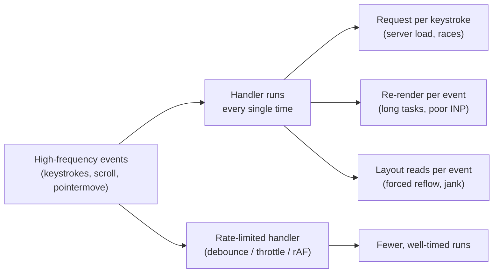
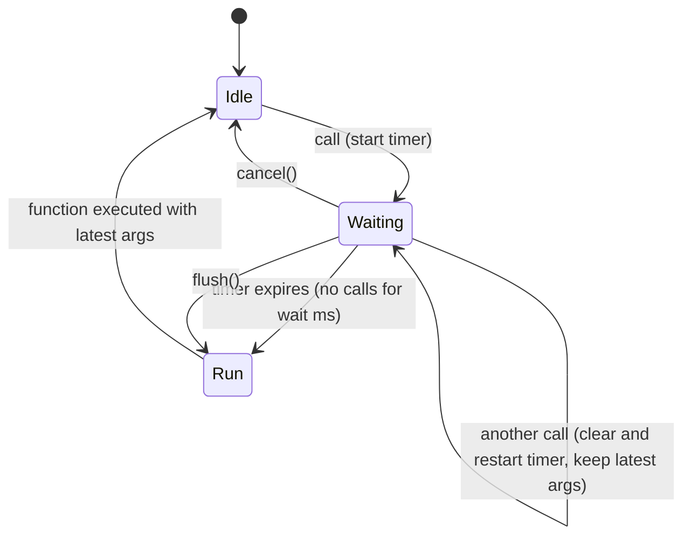
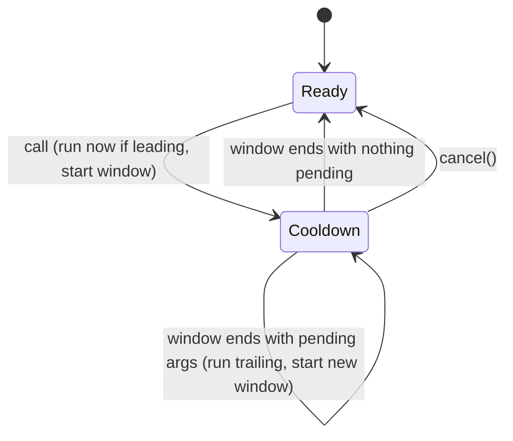
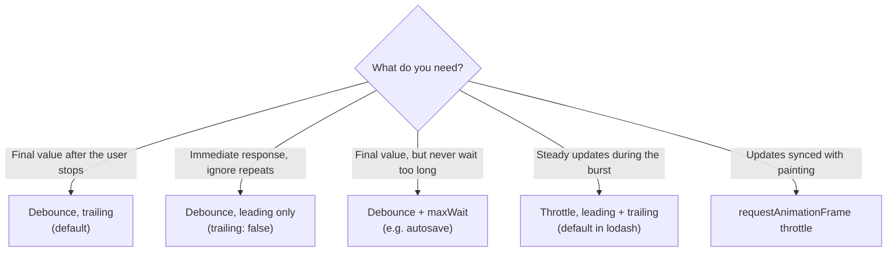
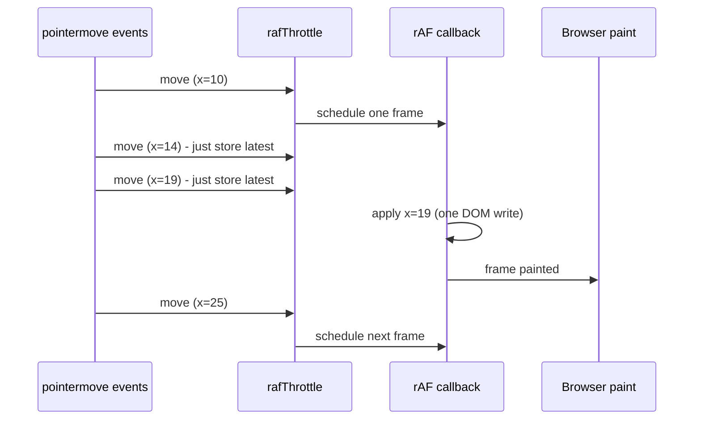
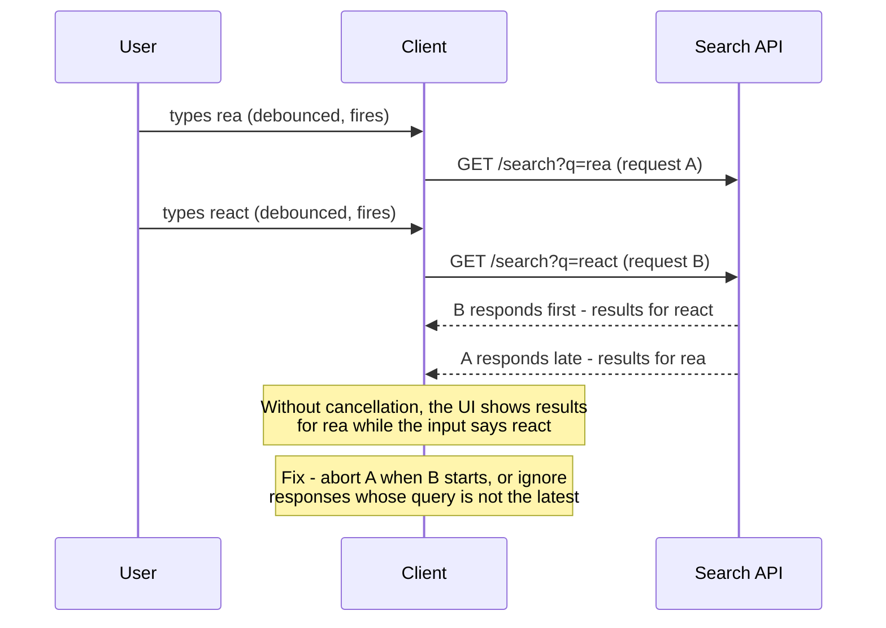
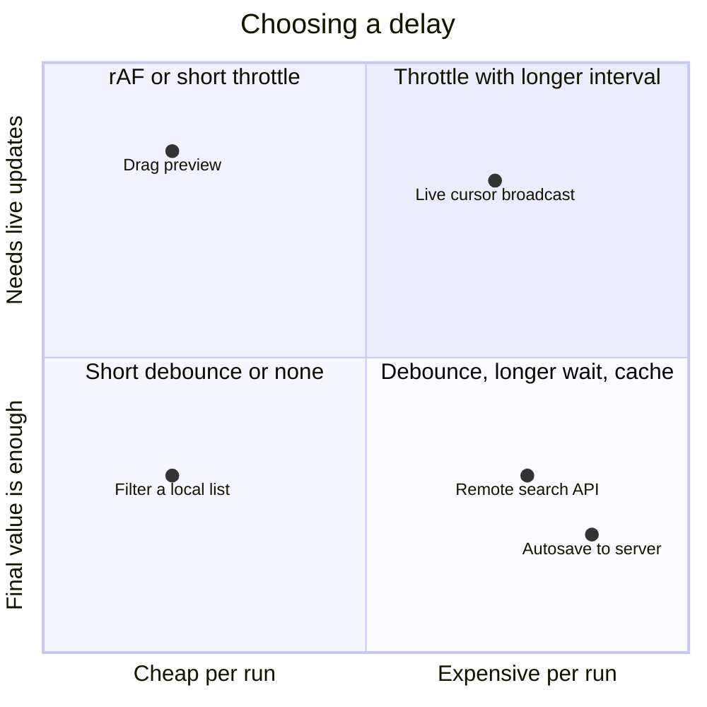
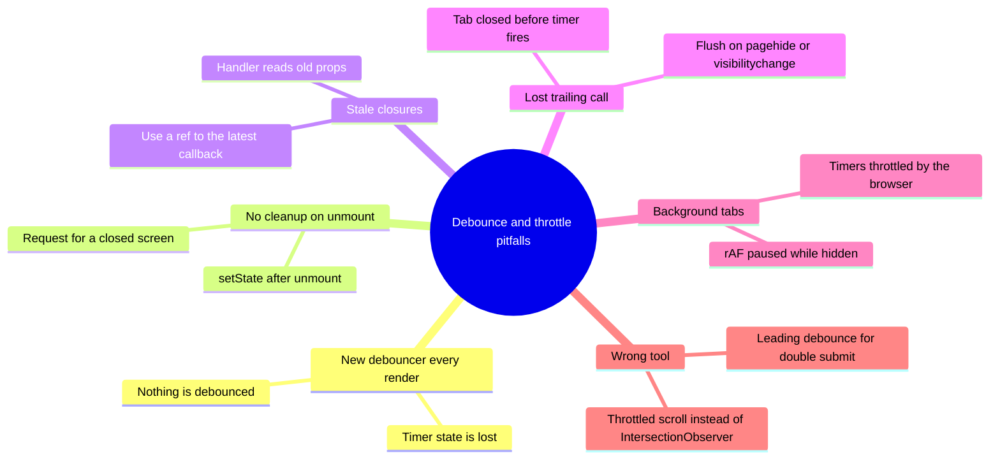
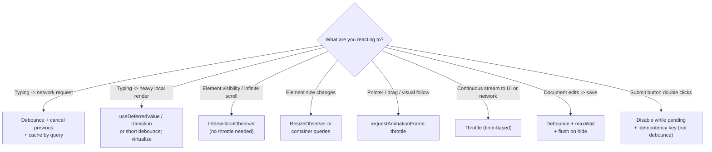

```mermaid
gantt
    title Six events 80 ms apart, wait = 300 ms
    dateFormat x
    axisFormat %L
    section Raw events
    keystroke 1 :milestone, 0, 0
    keystroke 2 :milestone, 80, 0
    keystroke 3 :milestone, 160, 0
    keystroke 4 :milestone, 240, 0
    keystroke 5 :milestone, 320, 0
    keystroke 6 :milestone, 400, 0
    section Debounce (trailing)
    timer keeps resetting :active, 0, 400
    quiet period :400, 700
    runs once :crit, milestone, 700, 0
    section Throttle (leading + trailing)
    run 1 (leading) :crit, milestone, 0, 0
    window 1 :0, 300
    run 2 (trailing) :crit, milestone, 300, 0
    window 2 :300, 600
    run 3 (trailing) :crit, milestone, 600, 0
```

# Debouncing & Throttling

> **Date:** 2026-11-06 · **Last updated:** 2026-11-06
> **Category:** Frontend System Design
> **Sub-Topic:** Performance Engineering / Runtime Performance
> **Level:** Beginner · **Reading time:** ~25 min
> **Informs:** search-as-you-type and autocomplete request strategy, autosave design, scroll/resize/pointer handling, rAF batching, request cancellation and race conditions, client-side rate limiting, INP of high-frequency events, framework hooks and RxJS operators

> **Pre-requisite:** [JavaScript Runtime & Event Loop](../01-web-fundamentals/javascript-runtime-event-loop.md) (timers, tasks, `requestAnimationFrame`) and [Web APIs (Intersection Observer, ResizeObserver)](../01-web-fundamentals/web-apis-intersection-observer-resizeobserver.md) (often a better tool than a throttled listener).
> This note covers **how to control how often code runs** in response to bursts of events — and when a different tool is the right answer.

**Previous:** [React Performance (memo, useMemo, useCallback)](./react-performance-memo-usememo-usecallback.md) · **Next:** [Web Workers for Heavy Computation](./web-workers-for-heavy-computation.md)

---

## Table of Contents

1. [ELI5 — Simple Explanation](#eli5--simple-explanation)
2. [Section 1: The Problem — Events Fire Faster Than You Need](#section-1-the-problem--events-fire-faster-than-you-need)
3. [Section 2: Debounce — Wait for Quiet](#section-2-debounce--wait-for-quiet)
4. [Section 3: Throttle — At Most Once per Interval](#section-3-throttle--at-most-once-per-interval)
5. [Section 4: Leading, Trailing and maxWait](#section-4-leading-trailing-and-maxwait)
6. [Section 5: Frame-Based Throttling with `requestAnimationFrame`](#section-5-frame-based-throttling-with-requestanimationframe)
7. [Section 6: Debounce Is Not Enough — Races, Cancellation and Caching](#section-6-debounce-is-not-enough--races-cancellation-and-caching)
8. [Section 7: Better Tools for Common Cases](#section-7-better-tools-for-common-cases)
9. [Section 8: Choosing the Delay, UX and Accessibility](#section-8-choosing-the-delay-ux-and-accessibility)
10. [Section 9: Pitfalls — Lifecycles, Background Tabs and Lost Work](#section-9-pitfalls--lifecycles-background-tabs-and-lost-work)
11. [Framework Comparison](#framework-comparison)
12. [Decision Matrix](#decision-matrix)
13. [Real-World Examples](#real-world-examples)
14. [Key Points Summary](#key-points-summary)
15. [Test Your Understanding (with answers)](#test-your-understanding)
16. [Cheat Sheet](#cheat-sheet)
17. [References & Further Reading](#references--further-reading)

---

## ELI5 — Simple Explanation

- **Debounce = an elevator door.** Every time someone walks in, the door waits again. It only closes (runs) once people **stop arriving** for a few seconds.
- **Throttle = a bus timetable.** A bus leaves **every 10 minutes** no matter how many people show up. Some people wait, but buses leave at a steady, predictable rate.
- **`requestAnimationFrame` throttling = a film camera.** It takes one picture per frame; whatever happened between frames is captured in that one picture.

> **Debounce runs once after the burst ends; throttle runs at a steady maximum rate during the burst. Pick by asking: "Do I need the final value, or regular updates while it's happening?"**

---

## Core Concept — Step by Step

### Section 1: The Problem — Events Fire Faster Than You Need

Some events fire **many times per second**: `input` (every keystroke), `scroll`, `wheel`, `pointermove`, `resize`, WebSocket messages, editor `change` events. Doing expensive work on each one (a network request, a re-render of a big list, a layout read) wastes CPU, network and server capacity — and blocks the main thread, hurting [INP](./core-web-vitals-lcp-inp-cls.md).



Same burst of 6 keystrokes, 80 ms apart, with a 300 ms wait:

```text
time (ms)      0    80   160  240  320  400                700
raw events     ●    ●    ●    ●    ●    ●
debounce       ·    ·    ·    ·    ·    ·  (quiet 300 ms) → ● runs once at 700 with the LAST value
throttle       ●              ●(300)              ●(600)     leading at 0, trailing at 300 and 600
leading deb.   ●    ·    ·    ·    ·    ·                    runs at the start of the burst only
```



---

### Section 2: Debounce — Wait for Quiet

**Debounce** delays a function until **`wait` ms have passed without a new call**. Each new call **resets the timer**. Only the **last** call's arguments are used.



**Use debounce when you only care about the final state:**
- Search-as-you-type / autocomplete requests (see [Design an Autocomplete / Typeahead](../11-system-design-cases/design-an-autocomplete-typeahead.md))
- Validating a field after the user stops typing (e.g. "username available?")
- Autosave of a draft (with `maxWait`, Section 4)
- Recomputing a layout after a resize **finishes** (if you really need JS for it)
- Announcing "12 results" to screen readers once, not per keystroke

**Downside:** if the events never stop (continuous scrolling, a user who types non-stop), a pure trailing debounce **never runs**. That's what `maxWait` or throttling is for.

---

### Section 3: Throttle — At Most Once per Interval

**Throttle** guarantees the function runs **at most once every `wait` ms**, at a steady rate while events keep coming.



**Use throttle when you need regular updates during the activity:**
- Updating a "reading progress" indicator or sticky header **state** while scrolling
- Sending pointer positions for live cursors in collaboration apps (e.g. every 50–100 ms)
- Polling-style updates from a fast data stream into the UI (e.g. stock ticks → one UI update per interval)
- Analytics for continuous actions (scroll depth milestones)
- Rate-limiting a "Load more" trigger that might fire repeatedly

| | Debounce | Throttle |
|---|---|---|
| Runs | Once, after the burst | Repeatedly, at most every `wait` ms |
| Uses | Final value | Latest value at each interval |
| During continuous activity | May never run (without `maxWait`) | Runs regularly |
| Typical use | Search, validation, autosave | Scroll/progress UI, live cursors, streams |
| Latency to first run | `wait` ms (trailing) or 0 (leading) | 0 (leading) |

---

### Section 4: Leading, Trailing and maxWait

Both techniques have **edges**: run at the **start** of a burst (leading), at the **end** (trailing), or both.



| Option | Meaning | Lodash default |
|---|---|---|
| `leading` | Invoke on the first call of a burst | `debounce`: `false` · `throttle`: `true` |
| `trailing` | Invoke after the burst / window with the latest args | `true` for both |
| `maxWait` (debounce) | Maximum time the function may be delayed — forces a run during continuous calls | not set |
| `.cancel()` | Drop the pending call | — |
| `.flush()` | Run the pending call **now** | — |

Notes:
- In lodash, **`throttle` is implemented as a `debounce` with `maxWait = wait`** — they are two ends of the same idea.
- With `leading: true, trailing: true`, the trailing call only happens if the function was called **again** during the wait.
- **Leading-only debounce is not a double-submit fix.** A slow request may still be in flight after the wait. For submit buttons, **disable while pending** and make the server endpoint **idempotent** (idempotency key).

---

### Section 5: Frame-Based Throttling with `requestAnimationFrame`

For anything that **changes what's on screen** (dragging, following the pointer, scroll-linked visuals), the natural rate is **once per frame**. A time-based throttle of 16 ms drifts out of sync with the display; `requestAnimationFrame` runs **right before the next paint**, at the display's refresh rate, and pauses in background tabs.



```text
Event-time throttle (wait=16):   may run twice in one frame or skip a frame → visible jitter
rAF throttle:                    exactly one update per painted frame, synced with the display
```

Notes:
- Browsers already coalesce some continuous input (Chromium aligns events like `pointermove` with animation frames). Apps that need **every** point (drawing, handwriting) read `PointerEvent.getCoalescedEvents()` inside the handler.
- Keep the rAF callback **write-only** where possible: read layout first, then write, to avoid [layout thrashing](../01-web-fundamentals/dom-and-virtual-dom.md).
- Prefer **CSS** for scroll-linked effects where possible (`position: sticky`, CSS scroll-driven animations where supported) — see [Animation Performance (CSS vs JS)](./animation-performance-css-vs-js.md).

---

### Section 6: Debounce Is Not Enough — Races, Cancellation and Caching

Debouncing reduces **how many** requests start. It doesn't guarantee they **finish in order**.



A robust search-as-you-type pipeline:

```text
input event
  → update the input value immediately (never debounce the visible text)
  → normalize (trim, lowercase) and skip if unchanged / too short
  → debounce (~200–400 ms; tune)
  → look up a client cache keyed by query (instant results for repeats and Backspace)
  → cancel the previous in-flight request (AbortController / switchMap / query-key change)
  → fetch, render, announce result count (debounced) to assistive tech
```

| Tool | Solves |
|---|---|
| **Debounce** | Too many requests while typing |
| **`AbortController`** | Stale in-flight requests (and wasted bandwidth) |
| **Latest-only guard** (compare a request id / query) | Out-of-order responses, when you can't abort |
| **Client cache** (TanStack Query, SWR, Map) | Repeated queries, Backspace to a previous query |
| **`switchMap`** (RxJS) | Debounce + cancel previous in one operator chain |
| **Server rate limiting** (`429` + `Retry-After`) | Abusive or buggy clients — client-side throttling is a courtesy, not protection |

---

### Section 7: Better Tools for Common Cases

Many "throttle the scroll/resize listener" patterns pre-date modern APIs. Prefer the API that does the job **without** running your code on every event.

| Old pattern | Better tool | Why |
|---|---|---|
| Throttled `scroll` listener to detect "element is visible" / infinite scroll | **`IntersectionObserver`** | Browser computes intersections asynchronously; no layout reads in your handler |
| Throttled `resize` listener to measure an element | **`ResizeObserver`** | Fires on element size changes (not just window), batched per frame |
| Throttled `resize` to switch layouts | **CSS media/container queries** | Zero JS |
| Throttled scroll to animate a header | **`position: sticky`**, CSS scroll-driven animations | Runs off the main thread where supported |
| Debouncing to keep typing responsive while a list re-renders | **`useDeferredValue` / `startTransition`** (React) | Interruptible background render, no fixed delay — but does **not** reduce network requests |
| Throttling heavy computation | **Web Worker** | The work itself moves off the main thread — see [Web Workers for Heavy Computation](./web-workers-for-heavy-computation.md) |
| Debouncing background work | **`requestIdleCallback`** / `scheduler.postTask` / `scheduler.yield()` | Run when idle or at a lower priority (support varies: `requestIdleCallback` isn't in stable Safari; `scheduler.yield()` is in Chromium and Firefox, not Safari — check MDN) |

Also: register `scroll`, `wheel` and `touchmove` listeners as **`{ passive: true }`** when they don't call `preventDefault()`, so scrolling never waits for your JS.

---

### Section 8: Choosing the Delay, UX and Accessibility

There's no universal number. Use response-time guidance (about **0.1 s** feels instantaneous, about **1 s** keeps the user's flow — Nielsen Norman Group) and tune with real users and real latency.



| Use case | Typical approach (starting points to tune) |
|---|---|
| Local filter of a few hundred items | No debounce; if rendering is slow, `useDeferredValue` / virtualization |
| Remote search / autocomplete | Debounce a few hundred ms + cache + cancel; show a loading hint |
| Field validation against server | Debounce on input, **validate on blur** too |
| Autosave | Debounce ~1 s + `maxWait` a few seconds + flush on page hide |
| Live cursors / presence | Throttle 50–100 ms (network), interpolate on receivers |
| Drag, resize handles, pointer-following UI | `requestAnimationFrame` |
| Scroll progress bar | rAF, or CSS scroll-driven animation |

**UX rules:**
- **Never debounce the input's displayed value** — only the expensive work derived from it. Lagging text feels broken.
- Show **pending state** (spinner, "Searching…", dimmed stale results) so the delay feels intentional.
- On **Enter** or **blur**, **flush** immediately — the user has signalled they're done.
- **Accessibility:** debounce live-region announcements ("12 results") so screen readers aren't flooded on every keystroke; keep keyboard handling (arrow keys in a listbox) **un-throttled**.

---

### Section 9: Pitfalls — Lifecycles, Background Tabs and Lost Work



| Pitfall | Explanation | Fix |
|---|---|---|
| **Debouncer created during render** | In React/Vue setup re-runs, `debounce(fn)` inside the component body creates a **new** timer each render, so calls never coalesce | Create once (`useMemo`/`useRef`, module scope, Vue `setup` runs once) |
| **No cleanup** | A pending timer fires after unmount/navigation | `cancel()` in cleanup (`useEffect` return, `onUnmounted`, `DestroyRef`) |
| **Stale closure** | The debounced function captured old props/state | Keep a ref to the latest callback; or pass values as arguments |
| **Lost autosave** | User closes the tab during the wait | `flush()` on `visibilitychange` (hidden) / `pagehide`; send with `fetch(..., { keepalive: true })` or `navigator.sendBeacon` |
| **Background tab timers** | Browsers throttle timers in hidden tabs (and Chromium throttles long chains of timers more aggressively), and rAF stops while hidden | Don't rely on precise timing in background tabs; flush on hide; resume on `visibilitychange` |
| **`this` binding** | Wrapping a method loses `this` | Arrow functions or `.bind` before wrapping |
| **Testing with real timers** | Slow, flaky tests | Fake timers (`vi.useFakeTimers()`, `jest.useFakeTimers()`) and `advanceTimersByTime` |

---

## Framework Comparison

| Stack | Debounce / throttle tools | Notes |
|---|---|---|
| **Vanilla / any** | `lodash-es` `debounce`/`throttle` (with `cancel`, `flush`, `maxWait`), small custom helpers, TanStack Pacer (framework-agnostic; check its current stability) | Import per-function to keep bundles small |
| **React** | `use-debounce` (`useDebounce`, `useDebouncedCallback`), a custom `useDebouncedValue` hook, `useDeferredValue` / `useTransition` for render priority | Create debouncers once; cancel on unmount; with TanStack Query, put the **debounced** value in the query key |
| **Vue 3 / Nuxt** | VueUse: `useDebounceFn`, `useThrottleFn`, `refDebounced`, `refThrottled`, `watchDebounced`, `watchThrottled` | `setup` runs once per instance, so a debouncer created there is stable |
| **Angular** | RxJS: `debounceTime`, `throttleTime`, `auditTime`, `sampleTime`, plus `distinctUntilChanged` and `switchMap`; bridge signals with `toObservable`/`toSignal` | `switchMap` cancels the previous HTTP request automatically |
| **Svelte 5** | Plain helpers or `$effect` with a timeout and cleanup | The `$effect` teardown clears the pending timer |
| **React Native** | Same JS helpers; `ScrollView`/`FlatList` `scrollEventThrottle` controls scroll event frequency | Debounce search inputs the same way as on the web |
| **iOS (Swift)** | Combine `.debounce(for:scheduler:)`, `.throttle(for:scheduler:latest:)` | Swift Concurrency libraries offer async-sequence equivalents |
| **Android (Kotlin)** | Flow `debounce()`, `sample()` | Typical pattern: `searchQuery.debounce(300).distinctUntilChanged().flatMapLatest { … }` |

**RxJS operator mapping:**

| Operator | Behaves like |
|---|---|
| `debounceTime(ms)` | Trailing debounce |
| `throttleTime(ms)` | Leading throttle (configurable `{ leading, trailing }`) |
| `auditTime(ms)` | Trailing throttle — emits the latest value at the end of each window |
| `sampleTime(ms)` | Emits the latest value on a fixed clock, if any arrived |
| `animationFrameScheduler` | Frame-aligned scheduling (rAF equivalent) |

---

## Decision Matrix



| Scenario | Choose | Why |
|---|---|---|
| Autocomplete | Debounce + abort + cache | Final query matters; avoid races |
| Username availability check | Debounce + validate on blur | Final value; flush when the user leaves the field |
| Infinite scroll trigger | IntersectionObserver | No per-scroll JS |
| Scroll-linked progress bar | rAF or CSS scroll-driven animation | Visual, per-frame |
| Live cursors in a whiteboard | Throttle 50–100 ms | Steady network rate |
| Window resize → chart redraw | ResizeObserver on the container + rAF | Batches per frame, measures the right element |
| Autosave in an editor | Debounce + `maxWait` + flush on hide | Saves during long typing sessions and before leaving |
| "Pay" button | Disable + idempotency key | Debounce can't stop a second click after the wait |

---

## Real-World Examples

**Example 1 — A typed `debounce` with leading/trailing, `cancel` and `flush`:**
```typescript
export function debounce<A extends unknown[]>(
  fn: (...args: A) => void,
  wait: number,
  { leading = false, trailing = true } = {},
) {
  let timer: ReturnType<typeof setTimeout> | undefined;
  let lastArgs: A | undefined;

  const invoke = () => {
    if (!lastArgs) return;
    const args = lastArgs;
    lastArgs = undefined;
    fn(...args);
  };

  function debounced(...args: A) {
    const startOfBurst = timer === undefined;
    lastArgs = args;
    if (timer !== undefined) clearTimeout(timer);
    if (leading && startOfBurst) invoke();       // run immediately on the first call
    timer = setTimeout(() => {
      timer = undefined;
      if (trailing) invoke();                     // runs only if there were calls after the leading one
      lastArgs = undefined;
    }, wait);
  }

  debounced.cancel = () => {
    clearTimeout(timer);
    timer = undefined;
    lastArgs = undefined;
  };

  debounced.flush = () => {
    if (timer === undefined) return;
    clearTimeout(timer);
    timer = undefined;
    invoke();
  };

  return debounced;
}
```

**Example 2 — A typed `throttle` (leading + trailing) and a `rafThrottle`:**
```typescript
export function throttle<A extends unknown[]>(
  fn: (...args: A) => void,
  wait: number,
  { leading = true, trailing = true } = {},
) {
  let timer: ReturnType<typeof setTimeout> | undefined;
  let pending: A | undefined;

  const startWindow = () => {
    timer = setTimeout(() => {
      if (trailing && pending) {
        const args = pending;
        pending = undefined;
        fn(...args);
        startWindow();            // the trailing run opens a new window
      } else {
        timer = undefined;
        pending = undefined;
      }
    }, wait);
  };

  function throttled(...args: A) {
    if (timer === undefined) {
      if (leading) fn(...args);
      else pending = args;
      startWindow();
    } else {
      pending = args;             // keep only the latest call
    }
  }

  throttled.cancel = () => {
    clearTimeout(timer);
    timer = undefined;
    pending = undefined;
  };

  return throttled;
}

// One run per painted frame, always with the latest arguments
export function rafThrottle<A extends unknown[]>(fn: (...args: A) => void) {
  let frame = 0;
  let latest: A;
  const throttled = (...args: A) => {
    latest = args;
    if (frame) return;
    frame = requestAnimationFrame(() => {
      frame = 0;
      fn(...latest);
    });
  };
  throttled.cancel = () => {
    cancelAnimationFrame(frame);
    frame = 0;
  };
  return throttled;
}

// Usage: dragging a panel
const panel = document.querySelector<HTMLElement>('#panel')!;
const move = rafThrottle((x: number, y: number) => {
  panel.style.transform = `translate(${x}px, ${y}px)`;   // compositor-friendly write
});
window.addEventListener('pointermove', (e) => move(e.clientX, e.clientY), { passive: true });
```

**Example 3 — React: debouncing inside a component (BAD → GOOD):**
```tsx
import { useEffect, useLayoutEffect, useMemo, useRef, useState } from 'react';
import { debounce } from './debounce';

// ❌ BAD: a NEW debounced function is created on every render,
// so each keystroke gets its own timer → one request per keystroke (just delayed)
function SearchBad() {
  const [q, setQ] = useState('');
  const search = debounce((value: string) => fetch(`/api/search?q=${encodeURIComponent(value)}`), 300);
  return <input value={q} onChange={(e) => { setQ(e.target.value); search(e.target.value); }} />;
}

// ✅ GOOD: create the debouncer once, always call the latest callback, cancel on unmount
export function useDebouncedCallback<A extends unknown[]>(cb: (...args: A) => void, wait: number) {
  const cbRef = useRef(cb);
  useLayoutEffect(() => {
    cbRef.current = cb;                                     // latest props/state, no stale closure
  });
  const debounced = useMemo(() => debounce((...args: A) => cbRef.current(...args), wait), [wait]);
  useEffect(() => () => debounced.cancel(), [debounced]);   // no calls after unmount
  return debounced;
}

function SearchGood({ onResults }: { onResults: (r: unknown) => void }) {
  const [q, setQ] = useState('');
  const search = useDebouncedCallback(async (value: string) => {
    const res = await fetch(`/api/search?q=${encodeURIComponent(value)}`);
    onResults(await res.json());
  }, 300);
  return (
    <input
      value={q}                                             // the visible value updates immediately
      onChange={(e) => { setQ(e.target.value); search(e.target.value); }}
      onKeyDown={(e) => { if (e.key === 'Enter') search.flush(); }}
    />
  );
}
```

**Example 4 — React: search-as-you-type with a debounced value, cancellation and caching (TanStack Query):**
```tsx
import { useEffect, useState } from 'react';
import { keepPreviousData, useQuery } from '@tanstack/react-query';

function useDebouncedValue<T>(value: T, delay: number): T {
  const [debounced, setDebounced] = useState(value);
  useEffect(() => {
    const id = setTimeout(() => setDebounced(value), delay);
    return () => clearTimeout(id);          // every new value resets the timer
  }, [value, delay]);
  return debounced;
}

type Hit = { id: string; title: string };

export function ProductSearch() {
  const [input, setInput] = useState('');
  const query = useDebouncedValue(input.trim().toLowerCase(), 300);

  const { data = [], isFetching } = useQuery({
    queryKey: ['search', query],            // cached per query: Backspace is instant
    queryFn: async ({ signal }) => {
      // Consuming `signal` lets TanStack Query abort the request when the key changes
      const res = await fetch(`/api/search?q=${encodeURIComponent(query)}`, { signal });
      if (!res.ok) throw new Error(`Search failed: ${res.status}`);
      return (await res.json()) as Hit[];
    },
    enabled: query.length >= 2,
    placeholderData: keepPreviousData,      // keep old results visible while fetching
    staleTime: 30_000,
  });

  return (
    <div>
      <input value={input} onChange={(e) => setInput(e.target.value)} aria-label="Search products" />
      <p role="status" aria-live="polite">{isFetching ? 'Searching…' : `${data.length} results`}</p>
      <ul style={{ opacity: isFetching ? 0.6 : 1 }}>
        {data.map((h) => <li key={h.id}>{h.title}</li>)}
      </ul>
    </div>
  );
}
```

**Example 5 — Autosave with `maxWait` and flush before the page goes away:**
```typescript
import { debounce } from 'lodash-es';

type Doc = { id: string; body: string };

const save = (doc: Doc) =>
  fetch(`/api/docs/${doc.id}`, {
    method: 'PUT',
    headers: { 'Content-Type': 'application/json' },
    body: JSON.stringify(doc),
    keepalive: true,                     // lets the request outlive the page if it is closing
  });

// Save 1 s after the user pauses, but at least every 5 s during non-stop typing
const autosave = debounce(save, 1000, { maxWait: 5000 });

export function onEditorChange(doc: Doc) {
  autosave(doc);
}

// The last pending save must not be lost when the tab is hidden or closed
document.addEventListener('visibilitychange', () => {
  if (document.visibilityState === 'hidden') autosave.flush();
});
window.addEventListener('pagehide', () => autosave.flush());
```
> `keepalive` requests have a body size limit (shared across in-flight keepalive requests); large documents should save incrementally. See MDN for `fetch` `keepalive`.

**Example 6 — Angular: signals + RxJS (`switchMap` cancels stale requests):**
```typescript
import { Component, inject, signal } from '@angular/core';
import { HttpClient } from '@angular/common/http';
import { toObservable, toSignal } from '@angular/core/rxjs-interop';
import { catchError, debounceTime, distinctUntilChanged, map, of, switchMap } from 'rxjs';

type Hit = { id: string; title: string };

@Component({
  selector: 'app-search',
  template: `
    <input [value]="query()" (input)="query.set($any($event.target).value)" aria-label="Search" />
    <ul>
      @for (h of results(); track h.id) { <li>{{ h.title }}</li> }
    </ul>
  `,
})
export class SearchComponent {
  private http = inject(HttpClient);
  query = signal('');

  results = toSignal(
    toObservable(this.query).pipe(
      map((q) => q.trim().toLowerCase()),
      debounceTime(300),
      distinctUntilChanged(),
      switchMap((q) =>                 // unsubscribing from the old request cancels it
        q.length < 2
          ? of([] as Hit[])
          : this.http.get<Hit[]>('/api/search', { params: { q } }).pipe(catchError(() => of([] as Hit[]))),
      ),
    ),
    { initialValue: [] as Hit[] },
  );
}
```

**Example 7 — Vue (VueUse) and Svelte 5:**
```html
<!-- Vue 3 -->
<script setup lang="ts">
import { ref } from 'vue';
import { refDebounced, useThrottleFn } from '@vueuse/core';

const query = ref('');
const debouncedQuery = refDebounced(query, 300);   // use in a watcher or query key

const onScroll = useThrottleFn(() => {
  // update reading progress at most every 100 ms
}, 100);
</script>

<template>
  <input v-model="query" aria-label="Search" />
  <div class="article" @scroll.passive="onScroll">…</div>
</template>
```
```html
<!-- Svelte 5 -->
<script lang="ts">
  let query = $state('');
  let debounced = $state('');

  $effect(() => {
    const q = query;                              // tracked dependency
    const id = setTimeout(() => (debounced = q), 300);
    return () => clearTimeout(id);                // teardown resets the timer on each change
  });
</script>

<input bind:value={query} aria-label="Search" />
<p>Searching for: {debounced}</p>
```

**Example 8 — Testing with fake timers (Vitest):**
```typescript
import { afterEach, beforeEach, expect, it, vi } from 'vitest';
import { debounce } from './debounce';

beforeEach(() => vi.useFakeTimers());
afterEach(() => vi.useRealTimers());

it('runs once with the last arguments after the burst', () => {
  const fn = vi.fn();
  const d = debounce(fn, 300);
  d('r'); d('re'); d('rea');
  vi.advanceTimersByTime(299);
  expect(fn).not.toHaveBeenCalled();
  vi.advanceTimersByTime(1);
  expect(fn).toHaveBeenCalledTimes(1);
  expect(fn).toHaveBeenCalledWith('rea');
});
```

---

## Key Points Summary

| Concept | One-Line Explanation |
|---|---|
| **Debounce** | Run once after calls stop for `wait` ms, with the last arguments |
| **Throttle** | Run at most once per `wait` ms during continuous calls |
| **Leading / trailing** | Run at the start of a burst, at the end, or both |
| **`maxWait`** | Upper bound on how long a debounce may postpone — guarantees periodic runs |
| **`cancel` / `flush`** | Drop the pending call / run it now (on unmount, Enter, page hide) |
| **rAF throttle** | One update per painted frame for visual work |
| **Races** | Debounce doesn't order responses — abort or ignore stale ones |
| **Cache by query** | Repeated or backspaced queries return instantly |
| **Better APIs** | IntersectionObserver, ResizeObserver, CSS, passive listeners, transitions, workers |
| **Never debounce the visible input** | Only the expensive work derived from it |
| **Double submit** | Disable while pending + idempotency, not debounce |
| **Lifecycle** | Create debouncers once, cancel on unmount, flush on page hide |

---

## Test Your Understanding

**Q1 (Basic):**
A user types "react" (5 keystrokes, 120 ms apart, at t = 0, 120, 240, 360, 480 ms) into a search box. How many requests are sent with (a) no rate limiting, (b) a 300 ms trailing debounce, (c) a 300 ms throttle with leading and trailing edges?

<details>
<summary>Answer</summary>

(a) **5** — one per keystroke.

(b) **1** — keystrokes arrive every 120 ms (< 300 ms), so the timer keeps resetting. It fires once, 300 ms after the last keystroke (t = 780 ms), with "react".

(c) **3** — t = 0: leading run with "r". Calls at 120 and 240 are remembered; the window ends at 300 → trailing run with "rea" and a new window to 600. Calls at 360 and 480 → trailing run at 600 with "react". Throttle sends **intermediate** queries ("r", "rea") nobody asked for, which is why **debounce** is the right fit for search, while throttle fits continuous updates like progress bars or live cursors.
</details>

**Q2 (Application):**
Your autocomplete uses a 300 ms debounce, yet users sometimes see results for an older query than what's in the input. Why, and how do you fix it?

<details>
<summary>Answer</summary>

Debounce reduces the number of requests, but two requests can still overlap: if the user pauses (request A fires), types more and pauses again (request B fires), A may **respond after B** because of network/server variance. The UI then renders A's stale results. Fixes: **abort** the previous request with `AbortController` when a new one starts (or use `switchMap` / a query library whose key change cancels the old request), or track the latest query and **ignore** responses that don't match it. Add a **cache keyed by query** so repeated queries are instant.
</details>

**Q3 (Tricky):**
In a React component, a developer writes `const save = debounce(saveDraft, 1000)` in the component body. Saves still happen on every keystroke (just 1 s late). Why?

<details>
<summary>Answer</summary>

Every keystroke updates state → the component **re-renders** → a **new** `debounce` wrapper with its **own timer** is created. Each keystroke calls a different debouncer, so nothing is ever cleared or coalesced; each one fires 1 s later. Fix: create the debounced function **once** (`useMemo`/`useRef`, or module scope), point it at the latest callback through a ref to avoid stale closures, and `cancel()` (or `flush()`) it on unmount. In Vue, `setup` runs once, so creating it there is fine; in Angular, RxJS pipelines are created once per component instance.
</details>

**Q4 (Tricky):**
A teammate proposes "debounce the Pay button with `leading: true` so double clicks don't charge twice." What's wrong with that?

<details>
<summary>Answer</summary>

A leading debounce only ignores clicks **within** the wait window. If the payment request takes longer than the window (slow network), a second click after the window starts a **second payment**. It also does nothing about retries, multiple tabs or replayed requests. Correct approach: **disable the button (and show progress) while the request is pending**, and send an **idempotency key** so the server processes a given payment once no matter how many times it's received. Debounce is a UX/perf tool, not a correctness guarantee.
</details>

**Q5 (Application):**
You need to (a) load more items when the user reaches the end of a feed, (b) update a "% read" progress bar while scrolling, and (c) redraw a chart when its container changes size. Which technique for each?

<details>
<summary>Answer</summary>

(a) **IntersectionObserver** on a sentinel element near the end — no scroll handler, no throttling, no layout reads (see [Pagination & Infinite Scroll](../03-state-and-data/pagination-and-infinite-scroll.md)). (b) A **passive** scroll listener throttled with **`requestAnimationFrame`** (one update per frame) — or a **CSS scroll-driven animation** where supported, which needs no JS. (c) **ResizeObserver** on the chart container (it fires for element size changes, not just window resizes, and is batched per frame); debounce the expensive redraw if it's very heavy, or redraw in rAF.
</details>

**Q6 (System design):**
Design the client-side event handling for a collaborative whiteboard: local drawing, broadcasting your cursor to others, and saving the board.

<details>
<summary>Answer</summary>

- **Local drawing:** handle `pointermove`, read **`getCoalescedEvents()`** to capture every point for smooth strokes, and render once per frame with **rAF** (canvas). Don't throttle the input capture — only the rendering.
- **Cursor broadcast:** **throttle** to a steady network rate (e.g. every 50–100 ms) with trailing edge so the final position is sent; receivers **interpolate** between positions so cursors look smooth. Pause when the tab is hidden.
- **Stroke sync:** send operations as they complete (pointerup), or batch ops per frame/interval over a WebSocket (see [Real-Time Data Sync](../03-state-and-data/real-time-data-sync.md)).
- **Saving:** **debounce + `maxWait`** for snapshots, plus `flush()` on `visibilitychange`/`pagehide` with `keepalive`; the server should accept idempotent, versioned saves.
- **Server:** enforce **rate limits** (`429` + `Retry-After`) because client throttling can be bypassed.
</details>

---

## Cheat Sheet

**Key Definitions:**
- **Debounce:** Postpone until `wait` ms of silence; run once with the last arguments
- **Throttle:** Run at most once per `wait` ms
- **Leading edge:** Run on the first call of a burst
- **Trailing edge:** Run after the burst/window with the latest arguments
- **`maxWait`:** Longest a debounced call may be postponed
- **rAF throttle:** Coalesce calls into one per animation frame
- **`AbortController`:** Cancels an in-flight `fetch`

**Quick Reference:**
```text
Final value matters (search, validation, autosave)   → debounce (trailing)
Steady updates during activity (progress, cursors)   → throttle (leading + trailing)
Visual updates following input (drag, pointer)       → requestAnimationFrame
Never stop typing but must save                      → debounce + maxWait
Visibility / infinite scroll                         → IntersectionObserver (no throttle)
Element size changes                                  → ResizeObserver / container queries
Typing → slow render (React)                          → useDeferredValue / startTransition
Heavy computation                                     → Web Worker
Double submit                                         → disable while pending + idempotency key

Search pipeline: update input now → normalize → debounce → cache → abort previous → fetch → announce
Lifecycle:       create once · cancel on unmount · flush on Enter / blur / pagehide
Listeners:       { passive: true } for scroll / wheel / touchmove
lodash defaults: debounce {leading:false, trailing:true} · throttle {leading:true, trailing:true}
RxJS:            debounceTime · throttleTime · auditTime · sampleTime · switchMap
Vue:             useDebounceFn · useThrottleFn · refDebounced · watchDebounced
Native:          Combine .debounce/.throttle · Kotlin Flow debounce()/sample()
```

**Common Mistakes to Avoid:**

| Mistake | Why Wrong | Fix |
|---|---|---|
| Creating the debouncer inside render | New timer per render → nothing coalesces | `useMemo`/`useRef`, module scope, or `setup` |
| Debouncing the input's displayed value | Typing feels laggy and broken | Update the value immediately; debounce derived work |
| Debounce without cancellation | Out-of-order responses show stale results | `AbortController` / `switchMap` / latest-only guard |
| No cleanup on unmount | Calls fire after the component is gone | `cancel()` in cleanup |
| Pure debounce for continuous activity | Never fires while the user keeps going | `maxWait` or throttle |
| Losing the trailing autosave | Tab closed during the wait | `flush()` on `visibilitychange`/`pagehide` + `keepalive` |
| `setTimeout(16)` throttling for visuals | Out of sync with frames → jitter | `requestAnimationFrame` |
| Throttled scroll listener for visibility | Main-thread work and layout reads per event | IntersectionObserver |
| Leading debounce as double-submit protection | Fails when the request outlasts the window | Disable while pending + idempotency key |
| Throttling keyboard navigation | Arrow keys feel unresponsive, a11y issue | Never rate-limit direct keyboard handling |
| Announcing results on every keystroke | Screen reader floods | Debounce live-region updates |
| Trusting client throttling for protection | Clients can be modified | Server-side rate limiting (`429`, `Retry-After`) |

---

## References & Further Reading

**Core docs**
- MDN: [Debounce (glossary)](https://developer.mozilla.org/en-US/docs/Glossary/Debounce) · [Throttle (glossary)](https://developer.mozilla.org/en-US/docs/Glossary/Throttle)
- MDN: [`requestAnimationFrame`](https://developer.mozilla.org/en-US/docs/Web/API/Window/requestAnimationFrame) · [`PointerEvent.getCoalescedEvents()`](https://developer.mozilla.org/en-US/docs/Web/API/PointerEvent/getCoalescedEvents)
- MDN: [`AbortController`](https://developer.mozilla.org/en-US/docs/Web/API/AbortController) · [`fetch` `keepalive`](https://developer.mozilla.org/en-US/docs/Web/API/RequestInit#keepalive) · [`EventTarget.addEventListener` (passive)](https://developer.mozilla.org/en-US/docs/Web/API/EventTarget/addEventListener#passive)
- MDN: [`setTimeout` — reasons for delays longer than specified](https://developer.mozilla.org/en-US/docs/Web/API/Window/setTimeout#reasons_for_delays_longer_than_specified)
- MDN: [`requestIdleCallback`](https://developer.mozilla.org/en-US/docs/Web/API/Window/requestIdleCallback) · [`Scheduler.yield()`](https://developer.mozilla.org/en-US/docs/Web/API/Scheduler/yield)
- web.dev: [Optimize long tasks](https://web.dev/articles/optimize-long-tasks) · [Optimize INP](https://web.dev/articles/optimize-inp)

**Libraries & framework docs**
- Lodash: [`debounce`](https://lodash.com/docs/#debounce) · [`throttle`](https://lodash.com/docs/#throttle)
- RxJS: [`debounceTime`](https://rxjs.dev/api/operators/debounceTime) · [`throttleTime`](https://rxjs.dev/api/operators/throttleTime) · [`auditTime`](https://rxjs.dev/api/operators/auditTime) · [`switchMap`](https://rxjs.dev/api/operators/switchMap)
- VueUse: [`useDebounceFn`](https://vueuse.org/shared/useDebounceFn/) · [`useThrottleFn`](https://vueuse.org/shared/useThrottleFn/)
- Angular: [RxJS interop with signals](https://angular.dev/ecosystem/rxjs-interop)
- React: [`useDeferredValue`](https://react.dev/reference/react/useDeferredValue) · TanStack Query: [Query cancellation](https://tanstack.com/query/latest/docs/framework/react/guides/query-cancellation)
- React Native: [`ScrollView` `scrollEventThrottle`](https://reactnative.dev/docs/scrollview#scrolleventthrottle)
- Kotlin: [`Flow.debounce`](https://kotlinlang.org/api/kotlinx.coroutines/kotlinx-coroutines-core/kotlinx.coroutines.flow/debounce.html) · Apple: [Combine `debounce(for:scheduler:options:)`](https://developer.apple.com/documentation/combine/publisher/debounce(for:scheduler:options:))

**Deep dives**
- CSS-Tricks: [Debouncing and Throttling Explained Through Examples](https://css-tricks.com/debouncing-throttling-explained-examples/)
- Nielsen Norman Group: [Response Times: The 3 Important Limits](https://www.nngroup.com/articles/response-times-3-important-limits/)

---

> **Previous Topic:** [React Performance (memo, useMemo, useCallback)](./react-performance-memo-usememo-usecallback.md)
> — Avoiding unnecessary re-renders and expensive recalculations in React

> **Next Topic:** [Web Workers for Heavy Computation](./web-workers-for-heavy-computation.md)
> — Moving CPU-heavy work off the main thread

*Saved on: 2026-11-06 | Repo: Frontend System Design Learning Notes*
