# Font Loading Strategies

> **Date:** 2026-11-06 · **Last updated:** 2026-11-06
> **Category:** Frontend System Design
> **Sub-Topic:** Performance Engineering / Loading Performance (web fonts)
> **Level:** Intermediate · **Reading time:** ~26 min
> **Informs:** font-display policy per font role, self-hosting vs third-party font services, font preloading, subsetting and unicode-range for i18n, variable vs static fonts, fallback metric overrides (CLS), text LCP, font caching headers

> **Pre-requisite:** [Critical Rendering Path](../01-web-fundamentals/critical-rendering-path.md) (render-blocking CSS) and [Browser Caching Strategies](../01-web-fundamentals/browser-caching-strategies.md) (hashed assets, cache partitioning).
> This note covers how web fonts are discovered, downloaded and swapped in — and how to keep them from hiding text or shifting the layout.

**Previous:** [Image Optimization](./image-optimization.md) · **Next:** [Prefetching & Preloading](./prefetching-and-preloading.md)

---

## Table of Contents

1. [ELI5 — Simple Explanation](#eli5--simple-explanation)
2. [Section 1: How a Web Font Gets Loaded](#section-1-how-a-web-font-gets-loaded)
3. [Section 2: FOIT, FOUT and the Font Display Timeline](#section-2-foit-fout-and-the-font-display-timeline)
4. [Section 3: `font-display` Values](#section-3-font-display-values)
5. [Section 4: Formats, Compression and Variable Fonts](#section-4-formats-compression-and-variable-fonts)
6. [Section 5: Subsetting and `unicode-range`](#section-5-subsetting-and-unicode-range)
7. [Section 6: Self-Hosting vs Font Services](#section-6-self-hosting-vs-font-services)
8. [Section 7: Preload, Preconnect and Priority](#section-7-preload-preconnect-and-priority)
9. [Section 8: Fallback Metric Overrides — Killing Font CLS](#section-8-fallback-metric-overrides--killing-font-cls)
10. [Section 9: The CSS Font Loading API](#section-9-the-css-font-loading-api)
11. [Section 10: System Fonts, `local()` and Icon Fonts](#section-10-system-fonts-local-and-icon-fonts)
12. [Section 11: Caching and Measuring](#section-11-caching-and-measuring)
13. [Decision Matrix](#decision-matrix)
14. [Framework Comparison](#framework-comparison)
15. [Real-World Examples](#real-world-examples)
16. [Key Points Summary](#key-points-summary)
17. [Test Your Understanding](#test-your-understanding)
18. [Cheat Sheet](#cheat-sheet)
19. [References & Further Reading](#references--further-reading)

---

## ELI5 — Simple Explanation

Imagine a restaurant that prints its menu in a fancy custom typeface, and the printer is across town.

- **Waiting for the fancy menus (FOIT):** guests sit at empty tables and see **nothing** to read until the courier arrives. If he's late, they stare at blank paper.
- **Handing out plain photocopies first (FOUT):** guests read a plain menu right away. When the fancy ones arrive, the waiter swaps them — and everyone loses their place for a second because the lines wrap differently.
- **Plain photocopies cut to the same size (metric-matched fallback):** the swap is barely noticeable because every line sits in the same place.
- **"If it's not here in a moment, forget it" (`font-display: optional`):** if the courier isn't at the door when guests sit down, they keep the plain menu for this visit. The fancy menus go in the cupboard (cache) for next time.
- **Ordering the courier before guests arrive (`preload`):** the restaurant calls the printer as soon as the booking comes in, not when the guest asks to read.

> **Show text immediately, make the fallback look like the real font, and fetch the real font early — or decide it isn't worth waiting for.**

---

## Core Concept — Step by Step

### Section 1: How a Web Font Gets Loaded

Fonts are **late-discovered** resources. The browser can't know it needs `inter.woff2` until it has the HTML, the CSS, the CSSOM, the DOM, and has **matched a style to visible text** that uses that `font-family`.

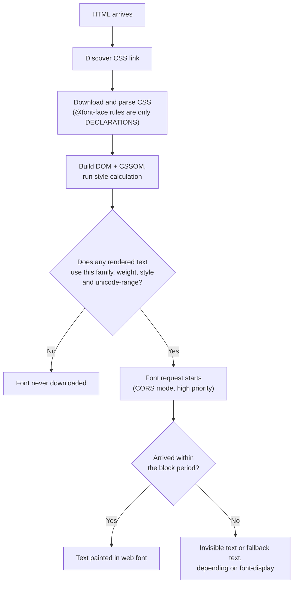

Two important consequences:
- **`@font-face` is lazy.** Declaring ten weights costs nothing; *using* them does. A bold weight referenced by one footer link is still a full download.
- **Discovery is deep in the waterfall.** Without help, the font request starts only after the CSS has downloaded and the page's style has been computed — often hundreds of milliseconds after the HTML.

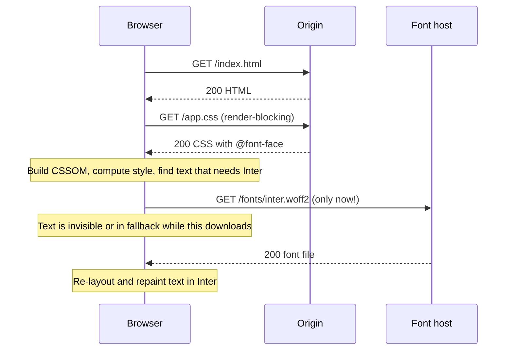

> **Font requests always use CORS** (anonymous mode), even same-origin. A font on another origin needs `Access-Control-Allow-Origin` on the response, and a `preload` for it needs the `crossorigin` attribute — see [CORS & Same-Origin Policy](../01-web-fundamentals/cors-and-same-origin-policy.md).

| Term | Meaning |
|---|---|
| **Font face** | One `@font-face` rule: a family name + weight/style/stretch range + `src` list |
| **Fallback font** | The next family in `font-family` that is available (usually a system font) |
| **Font swap** | Re-rendering text in the web font after it loads — may reflow the layout |
| **Late discovery** | Resource only found after CSS + style calculation, not by the HTML preload scanner |

---

### Section 2: FOIT, FOUT and the Font Display Timeline

When text needs a font that hasn't loaded yet, the browser has two choices: hide the text, or draw it in a fallback.

| Acronym | Meaning | User sees |
|---|---|---|
| **FOIT** | Flash of **Invisible** Text | Blank space where text should be, until the font loads or a timeout fires |
| **FOUT** | Flash of **Unstyled** Text | Text in a fallback font, then a swap to the web font |
| **FOFT** | Flash of **Faux** Text | Roman (regular) loads first; bold/italic are synthesized by the browser until their files arrive (a deliberate two-stage strategy) |

The CSS Fonts spec models every font face with a **font display timeline** of three periods, starting when the browser first tries to use the face:

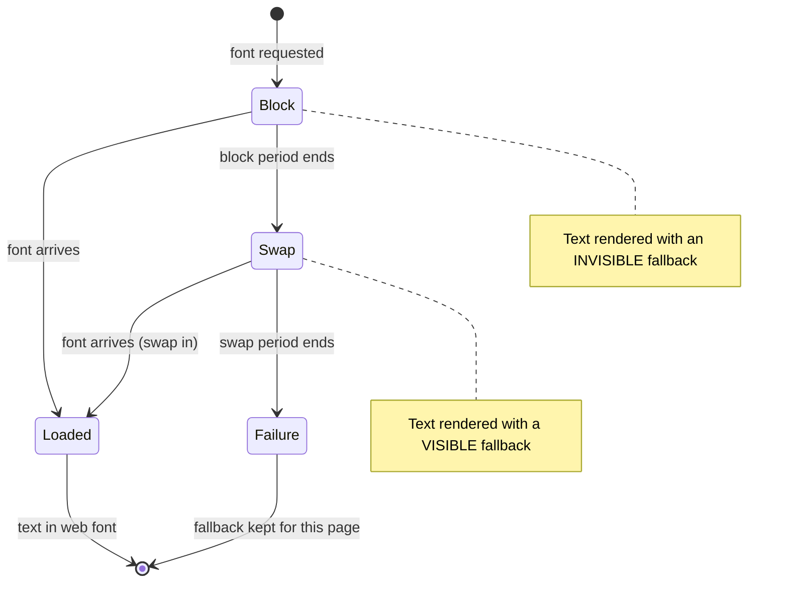

| Period | Text is drawn with | If the font arrives |
|---|---|---|
| **Block** | Invisible fallback (space is reserved) | Used immediately |
| **Swap** | Visible fallback | Swapped in (FOUT) |
| **Failure** | Visible fallback | **Not** used for this page (still cached for later) |

`font-display` simply picks the length of each period.

---

### Section 3: `font-display` Values

```css
@font-face {
  font-family: "Inter";
  src: url("/fonts/inter-var.3f9a1c.woff2") format("woff2");
  font-weight: 100 900;
  font-display: swap; /* auto | block | swap | fallback | optional */
}
```

Recommended durations from the [CSS Fonts Module Level 4](https://www.w3.org/TR/css-fonts-4/#font-display-desc) spec (browsers may vary):

| Value | Block period | Swap period | Behavior |
|---|---|---|---|
| `auto` | UA-defined | UA-defined | In current major browsers this behaves roughly like `block` |
| `block` | Short (~3 s recommended) | Infinite | FOIT up to ~3 s, then fallback, then swap whenever the font arrives |
| `swap` | Extremely small (≤ 100 ms recommended) | Infinite | Text shows almost immediately in fallback; swaps whenever the font arrives |
| `fallback` | Extremely small (~100 ms) | Short (~3 s recommended) | Swap only if the font arrives within ~3 s; otherwise keep fallback |
| `optional` | Extremely small (~100 ms) | **None** | Use the font only if it's (almost) immediately available; the browser may also skip downloading it on slow connections |

```mermaid
gantt
    title Font display timeline (ms from first use)
    dateFormat x
    axisFormat %L
    section block
    Invisible text            :b1, 0, 3000
    Visible fallback, swap ok :b2, 3000, 6000
    section swap
    Invisible text            :s1, 0, 100
    Visible fallback, swap ok :s2, 100, 6000
    section fallback
    Invisible text            :f1, 0, 100
    Visible fallback, swap ok :f2, 100, 3000
    Fallback forever          :crit, f3, 3000, 6000
    section optional
    Invisible text            :o1, 0, 100
    Fallback forever          :crit, o2, 100, 6000
```

**How each value affects Core Web Vitals** (see [Core Web Vitals (LCP, INP, CLS)](./core-web-vitals-lcp-inp-cls.md)):

| Value | LCP when text is the LCP element | CLS risk | Best for |
|---|---|---|---|
| `block` | Bad — text may be invisible for seconds | Low-medium | Icon fonts (where fallback glyphs are meaningless) |
| `swap` | Good — fallback text can be the LCP | **High** unless fallback metrics are matched (Section 8) | Body/brand text with a metric-matched fallback |
| `fallback` | Good | Medium (swap only in the first ~3 s) | Body text when you want to avoid late swaps |
| `optional` | Good | **Lowest** — no late swap | Body text where performance beats brand fidelity; repeat visitors get the font from cache |

> **Chromium detail:** when an `optional` font is also **preloaded**, Chromium may briefly hold the first render (up to the ~100 ms block period) so a fast font can be used without any swap. Other engines differ — test in each.

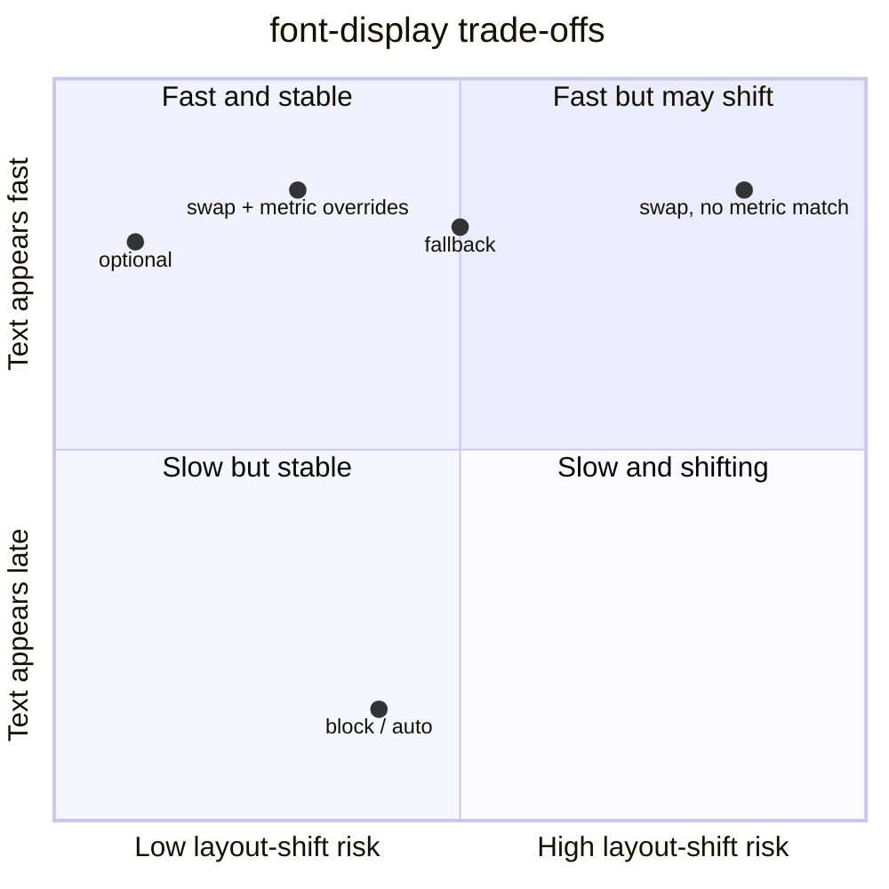

---

### Section 4: Formats, Compression and Variable Fonts

| Format | Status in 2026 | Use it? |
|---|---|---|
| **WOFF2** | Supported by every current browser; Brotli-based compression | ✅ **The only format you need** for the web |
| WOFF (1) | Supported, but larger than WOFF2 | Only for very old browsers you must support |
| TTF / OTF | Supported, uncompressed (or server-compressed) | ❌ Not for delivery |
| EOT | Legacy Internet Explorer only | ❌ Remove |
| SVG fonts | Removed from most browsers | ❌ Remove |

```css
/* ❌ Legacy "bulletproof" syntax — the extra formats are dead weight in CSS */
src: url("f.eot?#iefix") format("embedded-opentype"),
     url("f.woff2") format("woff2"), url("f.woff") format("woff"),
     url("f.ttf") format("truetype"), url("f.svg#f") format("svg");

/* ✅ Modern */
src: url("/fonts/f.8b2e44.woff2") format("woff2");
```

> Don't apply gzip/Brotli at the server to `.woff2` files — they're already compressed.

**Variable fonts** put a continuous design space (weight, width, slant, optical size, custom axes) into **one file**:

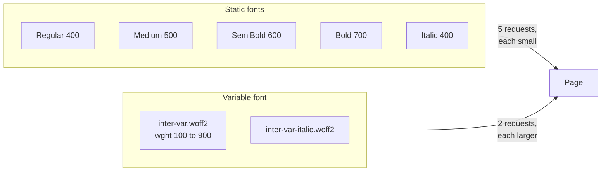

| | Static files | Variable font |
|---|---|---|
| Requests | One per weight/style used | Usually one (or two with italics) |
| Bytes | Smaller **if you use 1–2 weights** | Smaller **if you use 3+ weights** (rough rule — measure your font) |
| Design freedom | Fixed weights only | Any value: `font-weight: 550`, animated axes, `font-optical-sizing` |
| Caching | Each weight cached separately | One file covers everything |

```css
@font-face {
  font-family: "Inter";
  src: url("/fonts/inter-var.woff2") format("woff2");
  font-weight: 100 900;   /* a RANGE declares a variable face */
  font-style: normal;
  font-display: swap;
}
h1 { font-weight: 750; }  /* any value inside the range */
```

> All current browsers support variable fonts, so a plain `format("woff2")` source is enough. The newer `tech(variations)` keyword lets a browser skip sources it can't render, but a browser that can't parse `tech()` may drop the whole `src` descriptor — only use it if you've checked [MDN compat](https://developer.mozilla.org/en-US/docs/Web/CSS/@font-face/src) for your support matrix.

---

### Section 5: Subsetting and `unicode-range`

Most font files contain thousands of glyphs (Latin, Cyrillic, Greek, Vietnamese, symbols…). A page in English needs a small fraction of them.

**Subsetting** = generating a smaller file with only the glyphs (and OpenType features) you need. **`unicode-range`** = telling the browser which code points a face covers, so it downloads a slice **only if the page actually contains those characters**.

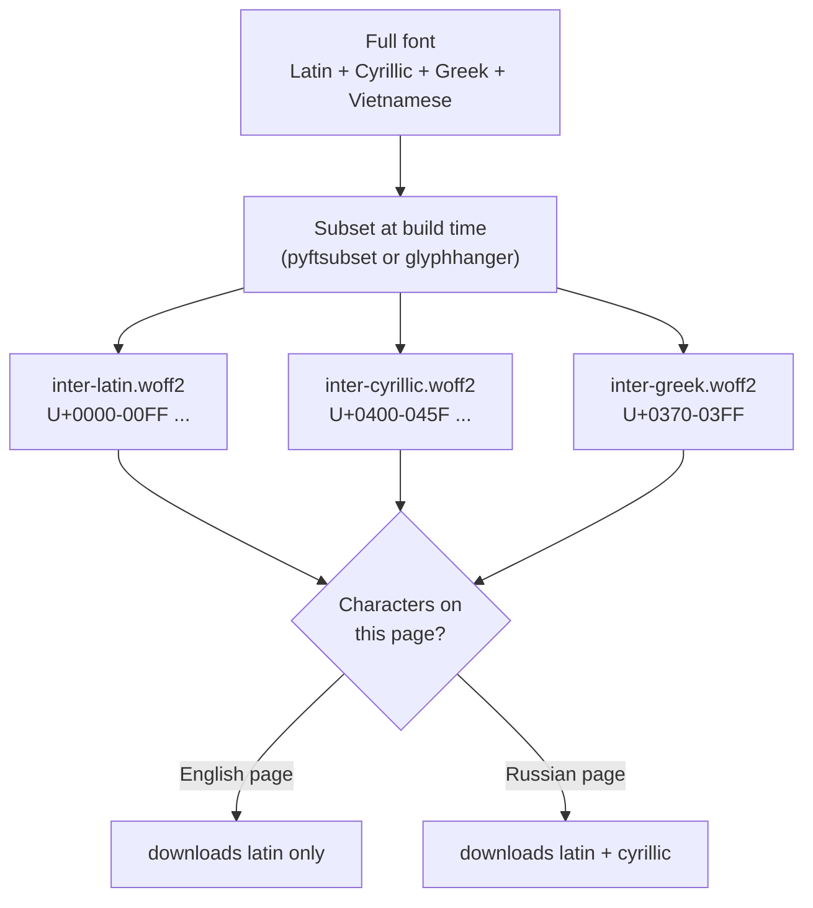

```css
/* Same family, split by script — the browser picks slices per character */
@font-face {
  font-family: "Inter";
  src: url("/fonts/inter-latin.woff2") format("woff2");
  unicode-range: U+0000-00FF, U+0131, U+0152-0153, U+02BB-02BC, U+02C6, U+02DA, U+02DC,
                 U+2000-206F, U+20AC, U+2122, U+2191, U+2193, U+2212, U+2215, U+FEFF, U+FFFD;
  font-display: swap;
}
@font-face {
  font-family: "Inter";
  src: url("/fonts/inter-cyrillic.woff2") format("woff2");
  unicode-range: U+0400-045F, U+0490-0491, U+04B0-04B1, U+2116;
  font-display: swap;
}
```

**Subsetting rules of thumb:**
- Subset **by script** (Latin, Cyrillic…) with `unicode-range`, not by "the letters on my homepage" — user-generated content, names and translations will contain characters you didn't predict, and missing glyphs fall back to another font mid-word.
- Keep OpenType features you use (`kern`, `liga`, tabular numbers `tnum`) — subsetters can strip them.
- **CJK fonts** contain tens of thousands of glyphs. Google Fonts splits them into many small `unicode-range` slices so a page only fetches the slices it uses. For self-hosting, consider the **system font** for CJK body text — see [Internationalization (i18n) Architecture](../06-accessibility-and-i18n/internationalization-i18n-architecture.md).
- Check the font's **license** allows subsetting and self-hosting (most open-source fonts under the SIL Open Font License do; commercial licenses vary).

---

### Section 6: Self-Hosting vs Font Services

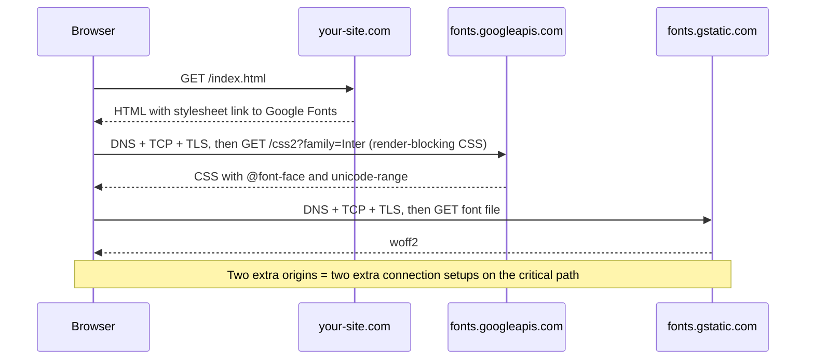

| | Third-party service (Google Fonts, Adobe Fonts, Bunny Fonts…) | Self-hosted (same origin / your CDN) |
|---|---|---|
| Connections | 1–2 extra origins (DNS + TCP + TLS each) | Reuses the existing connection (HTTP/2/3) |
| Cross-site cache benefit | **None** — HTTP caches are partitioned by top-level site | None needed |
| Render-blocking CSS | The service's CSS blocks rendering from another origin | Inline `@font-face` in your own CSS |
| Preloading | Hard — file URLs are chosen by the service and may change | Easy — you know the exact hashed URL |
| Caching control | The service's headers | Your own (`immutable`, 1 year) |
| Privacy | The user's IP and Referer go to a third party (EU privacy rulings, e.g. a 2022 Munich court decision, have treated this as a GDPR issue) | No third party |
| Effort | Copy one `<link>` | Download, subset, version, serve |
| Updates / slicing | Automatic, well-tuned `unicode-range` slices | You manage them (tools like Fontsource do it for you) |

> **Default recommendation:** **self-host** WOFF2 files from your own origin, with hashed names and long-lived caching. Frameworks make this nearly free (Section "Framework Comparison"). The old argument "users already have Google Fonts cached" stopped being true when browsers partitioned their caches — see [Browser Caching Strategies](../01-web-fundamentals/browser-caching-strategies.md#section-11-cache-partitioning).

If you must use a service, at minimum:

```html
<!-- Connect early to the font-file origin (crossorigin because font fetches use CORS) -->
<link rel="preconnect" href="https://fonts.gstatic.com" crossorigin>
<link rel="preconnect" href="https://fonts.googleapis.com">
<!-- Load only the families/weights you use, and ask for display=swap -->
<link rel="stylesheet" href="https://fonts.googleapis.com/css2?family=Inter:wght@400;600&display=swap">
```

---

### Section 7: Preload, Preconnect and Priority

`<link rel="preload">` moves the font request from "after CSS + style calc" to "as soon as the HTML `<head>` is parsed":

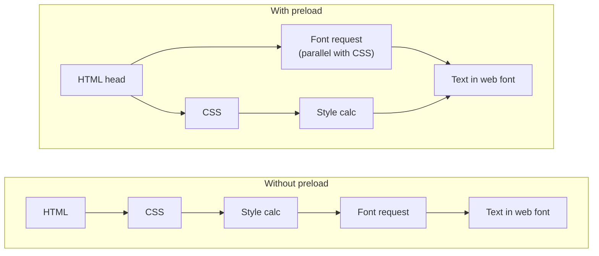

```html
<link rel="preload" href="/fonts/inter-var.3f9a1c.woff2" as="font" type="font/woff2" crossorigin>
```

| Attribute | Why |
|---|---|
| `as="font"` | Sets the right priority and `Accept`, and lets the browser match the later request to the preloaded response |
| `type="font/woff2"` | Browsers that don't support the type skip the download |
| `crossorigin` | **Required even for same-origin fonts.** Font requests use CORS; a preload without `crossorigin` is a non-CORS request that doesn't match, so the font downloads **twice** |
| `href` | Must be the **exact** URL used in `@font-face` (including hash and query) |

**Preload discipline:**
- Preload only the **1–2 fonts used above the fold** (usually the body regular and maybe a heading weight). Every preload competes for bandwidth with CSS and the LCP image.
- Chrome DevTools warns when a preloaded resource isn't used within a few seconds of load — a sign the URL doesn't match or the font isn't needed.
- Don't preload fonts behind `unicode-range` slices the page may not use.
- Preload is pointless for `font-display: optional` fonts **unless** you want them on the first view (Section 3's Chromium note).
- Can be sent as an HTTP `Link` header or via **`103 Early Hints`** so the font request starts before the HTML is even ready (browser support for preload in Early Hints varies — see [Prefetching & Preloading](./prefetching-and-preloading.md)).

**Inline the `@font-face` rules** in a `<style>` in the `<head>` (or in your main CSS) — never behind a CSS `@import`, which adds yet another sequential round trip.

---

### Section 8: Fallback Metric Overrides — Killing Font CLS

A swap causes layout shift because the fallback and web font have **different metrics**: glyph widths (so lines wrap differently) and ascent/descent/line gap (so line boxes are taller or shorter).

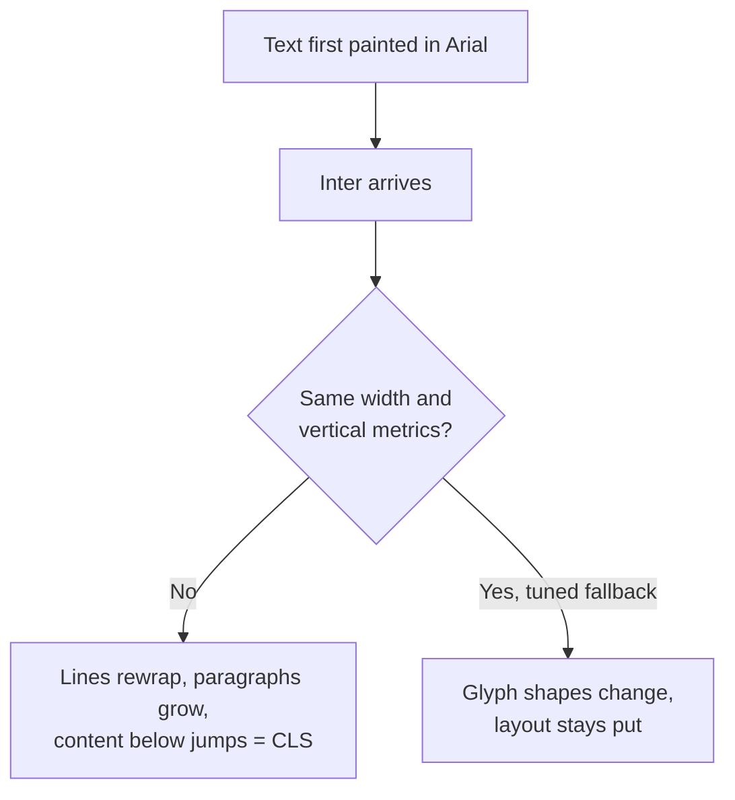

The fix: declare a **fallback face** built from a local system font, with descriptors that stretch it to match the web font's metrics:

```css
/* 1. The real web font */
@font-face {
  font-family: "Inter";
  src: url("/fonts/inter-var.woff2") format("woff2");
  font-weight: 100 900;
  font-display: swap;
}

/* 2. A metric-matched fallback built from a local font.
      Numbers are EXAMPLES — generate them for your font with a tool. */
@font-face {
  font-family: "Inter Fallback";
  src: local("Arial");
  size-adjust: 107%;        /* scale glyph widths to match average width */
  ascent-override: 90%;     /* match the line box above the baseline */
  descent-override: 22%;    /* ... below the baseline */
  line-gap-override: 0%;
}

body { font-family: "Inter", "Inter Fallback", sans-serif; }
```

| Descriptor | Adjusts | Support (check MDN) |
|---|---|---|
| `size-adjust` | Scales glyph outlines and metrics by a percentage | Chromium, Firefox, Safari 17+ |
| `ascent-override` / `descent-override` / `line-gap-override` | Vertical metrics used for line box height | Chromium, Firefox; **not in stable Safari at the time of writing** |
| `font-size-adjust` (a property, not a descriptor) | Keeps the x-height consistent across fallback fonts | Firefox, Safari, recent Chromium |

**Don't hand-tune** — generate the values:
- **Next.js `next/font`** computes and injects a fallback with `size-adjust` automatically.
- **Nuxt Fonts** (`@nuxt/fonts`) and **Fontaine** (unjs) generate fallback faces for Nuxt/Vite projects.
- **Capsize** (`@capsizecss/core` / `@capsizecss/metrics`) gives metrics and can build fallback font-face CSS for any stack.

> Metric overrides only make **layout** match. Glyph shapes still change at swap time — that's acceptable; the measured CLS is what matters.

---

### Section 9: The CSS Font Loading API

`document.fonts` (a `FontFaceSet`) lets JavaScript load fonts and react when they're ready — supported in every current browser.

```javascript
// Wait for all fonts used so far (e.g. before measuring text or drawing on canvas)
await document.fonts.ready;

// Load a specific face and check whether it's available
await document.fonts.load('600 1em Inter');
document.fonts.check('600 1em Inter'); // true once loaded

// Create a font face from JS (e.g. a font only an editor needs)
const mono = new FontFace('JetBrains Mono', 'url(/fonts/jbmono.woff2) format("woff2")', {
  weight: '400', display: 'swap',
});
document.fonts.add(await mono.load());
```

**Two-stage loading (FOFT)** — get the regular weight in fast, then the rest in one repaint:

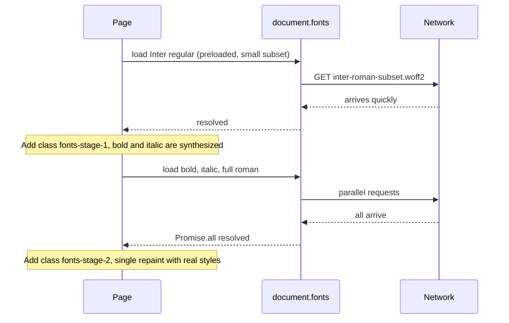

When to reach for the API:
- **Canvas / WebGL / charts** — text drawn before the font loads is drawn in the fallback forever. Await `document.fonts.load(...)` first.
- **Text measurement** (virtualized lists measuring row heights, truncation logic) — measure after `document.fonts.ready`, or re-measure on the `loadingdone` event.
- **Grouping repaints** (FOFT) on content-heavy sites with many weights.

For ordinary UI text, plain CSS (`font-display` + preload + metric overrides) is enough — no JS needed.

---

### Section 10: System Fonts, `local()` and Icon Fonts

**The fastest web font is no web font.** A system font stack costs zero bytes and never shifts:

```css
body {
  font-family: system-ui, -apple-system, "Segoe UI", Roboto, "Helvetica Neue", Arial,
               "Noto Sans", sans-serif, "Apple Color Emoji", "Segoe UI Emoji";
}
code { font-family: ui-monospace, "SF Mono", Menlo, Consolas, "Liberation Mono", monospace; }
```

Trade-off: the UI looks slightly different per OS (San Francisco on Apple, Segoe UI on Windows, Roboto on Android). Many product UIs (dashboards, admin tools) accept this; marketing pages often don't.

**`src: local("Inter")` first?** It can skip a download if the user has the font installed, but:
- the installed version may differ from yours (different metrics, missing glyphs);
- browsers restrict which local fonts pages can see (to reduce fingerprinting), so it often won't match anyway.
Use `local()` for **fallback faces** built from known system fonts (Section 8), not to "save" a download of your brand font.

**Icon fonts are an outdated pattern.** Status: still found in legacy code (older Font Awesome setups, custom IcoMoon builds) but no longer recommended.

| Problem with icon fonts | Modern alternative |
|---|---|
| Invisible or wrong glyphs (boxes, ligature words) during load | **Inline SVG** components or an SVG sprite (`<use href="#icon">`) |
| Screen readers may announce private-use characters | SVG with `aria-hidden="true"` or a proper `<title>` / `aria-label` |
| Whole font downloaded for a few icons | Tree-shaken SVG icon packages (e.g. per-icon imports) |
| Blurry/misaligned at some sizes, single color only | Crisp vectors, multi-color, CSS-styleable |

---

### Section 11: Caching and Measuring

**Caching** — fonts change rarely and should be versioned like any static asset:

```http
GET /fonts/inter-var.3f9a1c.woff2

HTTP/2 200
content-type: font/woff2
cache-control: public, max-age=31536000, immutable
access-control-allow-origin: *        (only needed when the font is on another origin)
```

- Hashed filename + `immutable` (see [Browser Caching Strategies](../01-web-fundamentals/browser-caching-strategies.md)).
- Serve with `Content-Type: font/woff2`.
- A Service Worker can precache the 1–2 critical fonts so repeat visits never block on them ([Service Workers & Web Workers](../01-web-fundamentals/service-workers-and-web-workers.md)).
- `font-display: optional` relies on this: the first visit may show the fallback, every later visit gets the font from cache instantly.

**Measuring:**

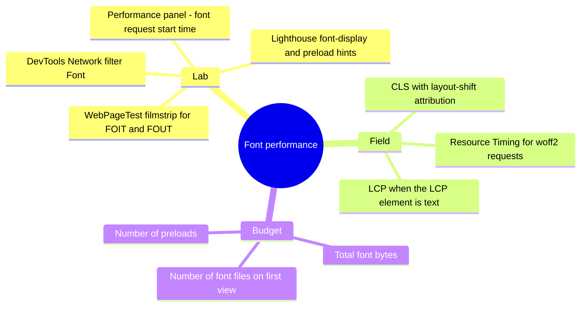

- **CLS attribution:** the `web-vitals` library's attribution build reports which element shifted; a paragraph or heading shifting right after a font request completes points to the swap.
- **LCP:** if the LCP element is a heading, LCP can't be earlier than the moment that text is painted — `block`/`auto` fonts push LCP back by the block period.
- Add font bytes and file counts to your [Performance Budgets](./performance-budgets.md).

---

## Decision Matrix

| Font role | `font-display` | Preload? | Fallback |
|---|---|---|---|
| Body text, performance-first product UI | `optional` (or a system font stack) | Optional (helps the first view in Chromium) | Metric-matched |
| Body text, brand-critical marketing page | `swap` | ✅ the regular weight | **Metric-matched** (mandatory to avoid CLS) |
| Headings in a display/brand font | `swap` or `fallback` | ✅ if above the fold | Metric-matched |
| Rare weights/styles (italic, bold in footer) | `swap` | ❌ | Synthesized or normal fallback |
| Icon font (legacy) | `block` | ✅ | — (migrate to SVG) |
| Code editor / monospaced data grid | `swap` + JS re-measure on load | Only on pages that need it | Metric-matched monospace |
| CJK or very large glyph sets | `swap` with `unicode-range` slices, or system font | ❌ | System font |

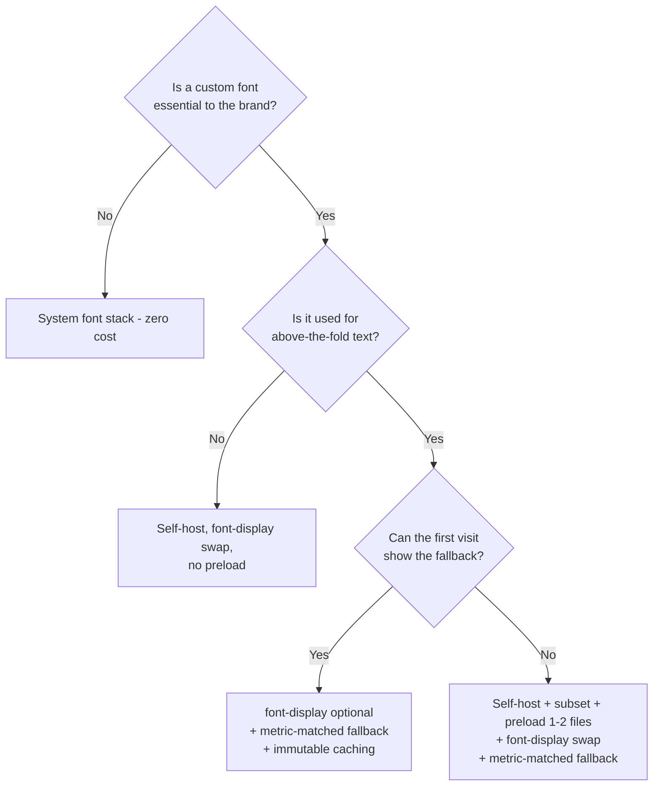

---

## Framework Comparison

| Stack | Recommended approach | What it does for you |
|---|---|---|
| **Next.js (React)** | `next/font/google` or `next/font/local` | Downloads Google Fonts **at build time** and self-hosts them, adds preload for used subsets, generates a `size-adjust` fallback, no requests to Google at runtime |
| **Nuxt (Vue)** | `@nuxt/fonts` module | Resolves fonts from providers or local files, self-hosts them, generates metric-matched fallbacks |
| **Vite (React, Vue, Svelte, Solid)** | **Fontsource** npm packages (`@fontsource-variable/inter`) + optional Fontaine plugin | Self-hosted WOFF2 with `unicode-range` slices, versioned through npm, hashed by the bundler |
| **SvelteKit** | Fontsource or files in `static/` + manual preload in `app.html` | No built-in font module — use Vite tools |
| **Angular** | Self-host, or keep the Google Fonts `<link>` with the CLI's **font inlining** (`optimization.fonts.inline`, on by default in production builds) | Inlines the provider's CSS into `index.html`, removing one render-blocking request (font files still come from the provider) |
| **Astro** | Fontsource, local files, or Astro's fonts API (check the docs for its current status) | Self-hosting and preload helpers |
| **iOS / Android native** | Bundle fonts in the app (iOS `UIAppFonts` in Info.plist; Android `res/font`) or Android downloadable fonts | No network on the critical path; same metric concerns when falling back |

---

## Real-World Examples

**Example 1 — Self-hosted variable font, done right (plain HTML/CSS, any framework):**
```html
<!doctype html>
<html lang="en">
<head>
  <meta charset="utf-8">
  <!-- Preload ONLY the critical file, with crossorigin, exact URL -->
  <link rel="preload" href="/fonts/inter-latin-var.3f9a1c.woff2" as="font" type="font/woff2" crossorigin>
  <style>
    @font-face {
      font-family: "Inter";
      src: url("/fonts/inter-latin-var.3f9a1c.woff2") format("woff2");
      font-weight: 100 900;
      font-style: normal;
      font-display: swap;
      unicode-range: U+0000-00FF, U+0131, U+0152-0153, U+2000-206F, U+20AC, U+2122, U+FEFF, U+FFFD;
    }
    /* Values generated with a metrics tool for Inter vs Arial (example numbers) */
    @font-face {
      font-family: "Inter Fallback";
      src: local("Arial");
      size-adjust: 107%;
      ascent-override: 90%;
      descent-override: 22%;
      line-gap-override: 0%;
    }
    body { font-family: "Inter", "Inter Fallback", system-ui, sans-serif; }
  </style>
  <link rel="stylesheet" href="/assets/app.8b2e44.css">
</head>
<body>…</body>
</html>
```

**Example 2 — Next.js App Router with `next/font` (React/TypeScript):**
```tsx
// app/layout.tsx
import { Inter, JetBrains_Mono } from 'next/font/google';
import type { ReactNode } from 'react';

// Downloaded at build time and served from your own domain
const inter = Inter({
  subsets: ['latin'],     // only these subsets are preloaded
  display: 'swap',
  variable: '--font-sans',
});

const mono = JetBrains_Mono({
  subsets: ['latin'],
  display: 'swap',
  preload: false,         // only used on a few pages: don't preload everywhere
  variable: '--font-mono',
});

export default function RootLayout({ children }: { children: ReactNode }) {
  return (
    <html lang="en" className={`${inter.variable} ${mono.variable}`}>
      <body>{children}</body>
    </html>
  );
}
```
```css
/* globals.css — the CSS variables hold the family plus a generated fallback */
body { font-family: var(--font-sans), system-ui, sans-serif; }
code { font-family: var(--font-mono), ui-monospace, monospace; }
```

**Example 3 — Vite + Fontsource (React, Vue and Svelte are identical):**
```bash
npm install @fontsource-variable/inter
```
```typescript
// main.ts — importing the package CSS registers @font-face rules with unicode-range slices;
// Vite copies the .woff2 files into dist/assets with content hashes
import '@fontsource-variable/inter';
```
```css
/* app.css */
body { font-family: "Inter Variable", system-ui, sans-serif; }
```
> Fontsource doesn't add `preload` for you. For the critical slice, import the file URL (Vite supports `?url` imports) and add a `<link rel="preload" … crossorigin>` in `index.html` or via your framework's head manager.

**Example 4 — Subsetting at build time:**
```bash
# fonttools (Python): keep Basic Latin + Latin-1 + common punctuation, output WOFF2
pip install fonttools brotli
pyftsubset Inter-Variable.ttf \
  --unicodes="U+0000-00FF,U+0131,U+0152-0153,U+2000-206F,U+20AC,U+2122,U+FEFF,U+FFFD" \
  --layout-features="kern,liga,calt,tnum" \
  --flavor=woff2 \
  --output-file=inter-latin-var.woff2

# glyphhanger (Node): crawl pages to report the characters they use, then subset
npx glyphhanger https://example.com --spider --subset=Inter-Variable.ttf --formats=woff2
```

**Example 5 — Third-party CSS via `@import` (BAD → GOOD):**
```css
/* ❌ BAD: app.css must download before the browser even sees this import,
   then the Google CSS, then the font — three sequential round trips, two extra origins */
@import url("https://fonts.googleapis.com/css2?family=Inter:wght@100..900");
body { font-family: Inter, sans-serif; }   /* no display parameter → default ≈ block (FOIT) */
```
```css
/* ✅ GOOD: self-hosted, declared directly, swap + metric-matched fallback */
@font-face {
  font-family: "Inter";
  src: url("/fonts/inter-var.3f9a1c.woff2") format("woff2");
  font-weight: 100 900;
  font-display: swap;
}
body { font-family: "Inter", "Inter Fallback", sans-serif; }
```

**Example 6 — Canvas chart that waits for its font:**
```typescript
async function drawChart(canvas: HTMLCanvasElement, labels: string[]) {
  // Without this, labels drawn before the font loads stay in the fallback font forever
  await document.fonts.load('500 12px Inter');
  const ctx = canvas.getContext('2d');
  if (!ctx) return;
  ctx.font = '500 12px Inter, sans-serif';
  labels.forEach((label, i) => ctx.fillText(label, 10, 20 + i * 18));
}
```

**Example 7 — Headers for self-hosted fonts (nginx):**
```nginx
location /fonts/ {
    types { font/woff2 woff2; }
    add_header Cache-Control "public, max-age=31536000, immutable" always;
    # Only needed when another origin (e.g. app.example.com using cdn.example.com) loads them:
    add_header Access-Control-Allow-Origin "https://app.example.com" always;
    add_header Vary "Origin" always;
    gzip off;   # woff2 is already compressed
}
```

---

## Key Points Summary

| Concept | One-Line Explanation |
|---|---|
| **Late discovery** | Fonts are found only after CSS + style calc — preload the critical ones |
| **Lazy `@font-face`** | Declared faces download only when rendered text uses them |
| **FOIT / FOUT / FOFT** | Invisible text / fallback-then-swap / regular-first two-stage loading |
| **Block → swap → failure** | The font display timeline every face goes through |
| **`font-display: swap`** | Fallback text almost immediately, swap whenever the font arrives |
| **`font-display: optional`** | Use the font only if it's ready almost immediately — no late swap, lowest CLS |
| **WOFF2** | The only delivery format you need |
| **Variable fonts** | One file for a weight range; wins when you use several weights |
| **`unicode-range`** | Browser downloads a slice only if the page uses its characters |
| **Self-hosting** | Avoids extra origins; caches are partitioned so third-party "shared cache" is gone |
| **Preload + `crossorigin`** | Required even same-origin, or the font downloads twice |
| **Metric overrides** | `size-adjust`, `ascent-override`… make the fallback occupy the same space |
| **CSS Font Loading API** | `document.fonts.load/ready` for canvas, measurement and grouped repaints |
| **Icon fonts** | Outdated — use SVG |

---

## Test Your Understanding

**Q1 (Basic):**
What is the difference between `font-display: swap` and `font-display: optional`, and how does each affect LCP and CLS?

<details>
<summary>Answer</summary>

Both have an extremely small **block period** (~100 ms), so text appears almost immediately in a fallback font — good for LCP when the LCP element is text.

- `swap` has an **infinite swap period**: whenever the web font arrives, even seconds later, text re-renders in it. If the fallback has different metrics, lines rewrap and content below moves → **CLS**. That's why `swap` should be paired with a metric-matched fallback.
- `optional` has **no swap period**: if the font isn't ready in that first moment, the fallback is used for the rest of the page's life. No late swap → minimal CLS. The font still gets cached, so repeat visits use it. Browsers may also skip downloading it on slow connections.
</details>

**Q2 (Application):**
You add `<link rel="preload" href="/fonts/inter.woff2" as="font">` but the Network panel shows `inter.woff2` downloaded twice, plus a console warning that a preloaded resource wasn't used. Why?

<details>
<summary>Answer</summary>

The preload has no **`crossorigin`** attribute. Font loads from `@font-face` always use **CORS mode** (anonymous credentials), even for same-origin URLs. A preload without `crossorigin` is made in no-CORS mode, so its response doesn't match the later CORS request: the browser fetches the font again and reports the preload as unused.

Fix: `<link rel="preload" href="/fonts/inter.woff2" as="font" type="font/woff2" crossorigin>`. Also make sure `href` is byte-for-byte the same URL as in `@font-face` (same hash, same query string).
</details>

**Q3 (Tricky):**
A team switches a blog from `font-display: block` to `swap`. LCP improves, but CLS gets worse and now fails the "good" threshold on mobile. Nothing else changed. Explain and fix without going back to `block`.

<details>
<summary>Answer</summary>

With `block`, text stayed invisible (space reserved) until the font arrived, then rendered once. With `swap`, the article is first painted in the fallback (e.g. Arial), which has different average glyph width and vertical metrics. When the web font arrives, paragraphs rewrap — a long article can grow or shrink by several lines — and everything below jumps. Those shifts happen without user input, so they count as CLS.

Fixes, in order:
1. Add a **metric-matched fallback** `@font-face` (`src: local("Arial")` + `size-adjust`, `ascent-override`, `descent-override`, `line-gap-override`), generated with a tool (Capsize, Fontaine, or `next/font` which does it automatically). Remember the vertical overrides aren't in stable Safari, so `size-adjust` does most of the work there.
2. **Preload** the body font so it usually arrives before or soon after first paint.
3. If brand fidelity on first view isn't critical, use `font-display: optional` for body text.
</details>

**Q4 (Application):**
A PM wants to keep Google Fonts via `<link>` "because it's on a fast CDN and users already have it cached." What's wrong with this argument, and what would you propose for a React + Vite app and for an Angular app?

<details>
<summary>Answer</summary>

1. **The shared cache is gone.** Browsers partition the HTTP cache by top-level site, so a font cached while visiting another site isn't reused on yours.
2. **Extra origins on the critical path:** `fonts.googleapis.com` (render-blocking CSS) and `fonts.gstatic.com` (files) each need DNS + TCP + TLS before anything is fetched, and the font URL can't be discovered until the CSS arrives.
3. **Privacy:** visitors' IP addresses go to a third party, which some EU rulings have treated as a GDPR issue.

Proposal:
- **React + Vite:** install the **Fontsource** package for the family, import it once, preload the critical Latin slice, and add a metric-matched fallback (Fontaine or Capsize). Files are self-hosted, hashed and cached `immutable`.
- **Angular:** best is the same self-hosting approach (Fontsource or files in `assets/` with `@font-face` in global styles). If they keep the Google `<link>`, the Angular CLI's **font inlining** at least removes the render-blocking CSS request; add `preconnect` to `fonts.gstatic.com` with `crossorigin` and `&display=swap`.
</details>

**Q5 (Tricky):**
A charting component draws axis labels on `<canvas>` with `ctx.font = '12px Inter'`. On a first visit, labels are in Times/Arial and stay that way, even after the page's HTML text switches to Inter. Why, and how do you fix it?

<details>
<summary>Answer</summary>

Canvas text is **rasterized at the moment `fillText` runs**. If Inter isn't loaded yet, the canvas uses a fallback, and those pixels never change — there's no "swap" for canvas, unlike DOM text, which the browser re-lays out automatically. Also, simply setting `ctx.font` doesn't necessarily trigger the font download if no DOM text uses that face yet.

Fix: `await document.fonts.load('12px Inter')` (or `document.fonts.ready`) before drawing, and/or redraw on the `document.fonts` `loadingdone` event. The same applies to WebGL text atlases, SVG-to-image exports and any JS that **measures** text (virtualized row heights, truncation).
</details>

**Q6 (System design):**
You're designing the typography loading strategy for a global e-commerce site (English, German, Russian, Japanese, Arabic) with a custom brand font for Latin and Cyrillic. Core Web Vitals must be "good" at p75 on mobile. Describe your approach.

<details>
<summary>Answer</summary>

- **Self-host** the brand font as **WOFF2**, as a variable font if more than ~2 weights are used, with **content-hashed** filenames and `Cache-Control: public, max-age=31536000, immutable`.
- **Split by script with `unicode-range`**: Latin (EN/DE) and Cyrillic (RU) slices. English/German pages never download Cyrillic.
- **Japanese and Arabic**: the brand font doesn't cover them. Use high-quality **system fonts** (or a carefully sliced web font only if branding demands it), set per-locale stacks via `:lang(ja)` / `:lang(ar)`. Huge CJK files on the critical path would wreck LCP. Coordinate with the [i18n architecture](../06-accessibility-and-i18n/internationalization-i18n-architecture.md) and [RTL layout](../06-accessibility-and-i18n/rtl-layout-support.md) work.
- **Preload** only the Latin (or Cyrillic, per locale) regular slice used above the fold — choose it server-side by locale.
- `font-display: swap` for headings + body with **metric-matched fallbacks** (generated, not hand-tuned); consider `optional` for body text on product listing pages where speed matters most.
- **Inline `@font-face`** in the HTML head (no `@import`), send the preload via `103 Early Hints` where the CDN supports it.
- Measure: CLS attribution and LCP element type in RUM, font bytes in the performance budget, and lab filmstrips on slow mobile profiles.
</details>

---

## Cheat Sheet

**Key Definitions:**
- **FOIT:** text hidden while the font loads (block period)
- **FOUT:** fallback text shown, then swapped to the web font
- **FOFT:** regular weight first, other styles in a second grouped repaint
- **Font display timeline:** block period → swap period → failure period
- **`unicode-range`:** code points a face covers; unused slices are never downloaded
- **Metric overrides:** `size-adjust`, `ascent-override`, `descent-override`, `line-gap-override` on a fallback face
- **Variable font:** one file with continuous axes (weight, width, slant, optical size)

**Quick Reference:**
```text
Format         → WOFF2 only, format("woff2"), no gzip on top
Hosting        → self-host on your origin, hashed names, public, max-age=31536000, immutable
Declare        → @font-face in <head> or main CSS, never behind @import
Preload        → 1-2 critical files: <link rel=preload as=font type=font/woff2 crossorigin>
Display        → body: swap + metric-matched fallback, or optional
                 icons (legacy): block
Fallback       → @font-face { src: local("Arial"); size-adjust; ascent/descent/line-gap-override }
Subset         → by script with unicode-range (pyftsubset, glyphhanger, Fontsource)
Weights        → 3+ weights → variable font; 1-2 → static files
Canvas/measure → await document.fonts.load('600 16px Inter') before drawing or measuring
Cross-origin   → Access-Control-Allow-Origin on font responses (+ Vary: Origin if dynamic)
Frameworks     → next/font, @nuxt/fonts, Fontsource + Fontaine (Vite), Angular font inlining
```

**Common Mistakes to Avoid:**

| Mistake | Why Wrong | Fix |
|---|---|---|
| Preload without `crossorigin` | Fonts are CORS requests; mismatch → double download | Always add `crossorigin` |
| Preloading every weight | Steals bandwidth from CSS and the LCP image | Preload 1–2 above-the-fold files |
| No `font-display` | Default `auto` ≈ `block` → invisible text up to ~3 s | `swap` or `optional` |
| `swap` with an unmatched fallback | Reflow when the font arrives → CLS | Generated metric-override fallback |
| Google Fonts via CSS `@import` | Three sequential round trips, two extra origins | Self-host, declare `@font-face` directly |
| Shipping TTF/EOT/SVG fonts | Larger or dead formats | WOFF2 only |
| Full-glyph font files | Downloads scripts the page never uses | Subset + `unicode-range` |
| Subsetting to "homepage characters" | User content shows missing glyphs from another font | Subset by script |
| Drawing canvas text before the font loads | Canvas never re-renders | `await document.fonts.load()` |
| Icon fonts | FOIT boxes, a11y issues, whole font for few icons | Inline SVG / sprites |
| Unversioned font URLs with long TTL | Can't ship font updates | Content hash + `immutable` |
| Five static weights of the same family | Five requests | One variable font |

---

## References & Further Reading

**Core docs**
- MDN: [`@font-face`](https://developer.mozilla.org/en-US/docs/Web/CSS/@font-face)
- MDN: [`font-display`](https://developer.mozilla.org/en-US/docs/Web/CSS/@font-face/font-display)
- MDN: [`unicode-range`](https://developer.mozilla.org/en-US/docs/Web/CSS/@font-face/unicode-range) · [`size-adjust`](https://developer.mozilla.org/en-US/docs/Web/CSS/@font-face/size-adjust) · [`ascent-override`](https://developer.mozilla.org/en-US/docs/Web/CSS/@font-face/ascent-override)
- MDN: [CSS Font Loading API](https://developer.mozilla.org/en-US/docs/Web/API/CSS_Font_Loading_API)
- MDN: [Variable fonts guide](https://developer.mozilla.org/en-US/docs/Web/CSS/CSS_fonts/Variable_fonts_guide)
- MDN: [`rel=preload`](https://developer.mozilla.org/en-US/docs/Web/HTML/Reference/Attributes/rel/preload)
- web.dev: [Optimize web fonts](https://web.dev/learn/performance/optimize-web-fonts)
- web.dev: [Best practices for fonts](https://web.dev/articles/font-best-practices)
- Chrome for Developers: [Improved font fallbacks](https://developer.chrome.com/blog/font-fallbacks)
- web.dev: [Prevent layout shifting and flashes of invisible text by preloading optional fonts](https://web.dev/articles/preload-optional-fonts)

**Specs**
- W3C: [CSS Fonts Module Level 4 — `font-display` and the font display timeline](https://www.w3.org/TR/css-fonts-4/#font-display-desc)
- W3C: [CSS Font Loading Module Level 3](https://www.w3.org/TR/css-font-loading-3/)
- W3C: [WOFF File Format 2.0](https://www.w3.org/TR/WOFF2/)

**Framework docs**
- Next.js: [Font optimization (`next/font`)](https://nextjs.org/docs/app/getting-started/fonts)
- Nuxt: [Nuxt Fonts](https://fonts.nuxt.com/)
- Fontsource: [Documentation](https://fontsource.org/docs/getting-started/introduction)
- Angular: [Font inlining (workspace config)](https://angular.dev/reference/configs/workspace-config#fonts-optimization-options)
- Capsize: [Capsize — flipping how we define typography in CSS](https://seek-oss.github.io/capsize/)

**Deep dives**
- Zach Leatherman: [A Comprehensive Guide to Font Loading Strategies](https://www.zachleat.com/web/comprehensive-webfonts/)
- fonttools: [`pyftsubset` documentation](https://fonttools.readthedocs.io/en/latest/subset/index.html)
- Zach Leatherman: [glyphhanger](https://github.com/zachleat/glyphhanger)

---

> **Previous Topic:** [Image Optimization](./image-optimization.md)
> — Formats, responsive images and priority for the heaviest bytes on most pages

> **Next Topic:** [Prefetching & Preloading](./prefetching-and-preloading.md)
> — Resource hints, Early Hints and speculative navigation

*Saved on: 2026-11-06 | Repo: Frontend System Design Learning Notes*
