# JavaScript Bundle Optimization

> **Date:** 2026-11-06 · **Last updated:** 2026-11-06
> **Category:** Frontend System Design
> **Sub-Topic:** Performance Engineering / Loading Performance (JavaScript cost)
> **Level:** Intermediate · **Reading time:** ~28 min
> **Informs:** JS budget per route, dependency selection and replacement, browser targets and polyfill policy, chunking and long-term caching, minification and Brotli/zstd compression, script loading attributes, third-party script governance, hydration cost and "less JS" architectures, bundle-size checks in CI

> **Pre-requisite:** [Module Bundling & Build Systems](../02-rendering-and-architecture/module-bundling-and-build-systems.md), [Code Splitting & Lazy Loading](./code-splitting-and-lazy-loading.md) and [Tree Shaking & Dead Code Elimination](./tree-shaking-and-dead-code-elimination.md).
> Those notes cover *how* to split and shake. This one is the **end-to-end playbook**: measure what you ship, remove and replace what you can, then make the rest cheaper to download, parse and run.

**Previous:** [Prefetching & Preloading](./prefetching-and-preloading.md) · **Next:** [Virtual Scrolling & Windowing](./virtual-scrolling-and-windowing.md)

---

## Table of Contents

1. [ELI5 — Simple Explanation](#eli5--simple-explanation)
2. [Section 1: Why JavaScript Is the Most Expensive Byte](#section-1-why-javascript-is-the-most-expensive-byte)
3. [Section 2: Measure Before You Optimize](#section-2-measure-before-you-optimize)
4. [Section 3: The Optimization Ladder](#section-3-the-optimization-ladder)
5. [Section 4: Dependency Diet](#section-4-dependency-diet)
6. [Section 5: Tree-Shakable Imports and Barrel Files](#section-5-tree-shakable-imports-and-barrel-files)
7. [Section 6: Chunking for Load and Cache](#section-6-chunking-for-load-and-cache)
8. [Section 7: Browser Targets and Polyfills](#section-7-browser-targets-and-polyfills)
9. [Section 8: Minification and Compression](#section-8-minification-and-compression)
10. [Section 9: Loading and Executing Scripts](#section-9-loading-and-executing-scripts)
11. [Section 10: Third-Party Scripts](#section-10-third-party-scripts)
12. [Section 11: Ship Less JS by Architecture](#section-11-ship-less-js-by-architecture)
13. [Section 12: Guarding the Budget in CI](#section-12-guarding-the-budget-in-ci)
14. [Framework Comparison](#framework-comparison)
15. [Real-World Examples](#real-world-examples)
16. [Key Points Summary](#key-points-summary)
17. [Test Your Understanding](#test-your-understanding)
18. [Cheat Sheet](#cheat-sheet)
19. [References & Further Reading](#references--further-reading)

---

## ELI5 — Simple Explanation

You're moving house, and the moving truck is your user's phone.

- **Every box costs twice:** once to carry it in (download), and again to **unpack and assemble** it (parse, compile, run). A 100 KB photo is a framed picture you hang up; 100 KB of JavaScript is flat-pack furniture with instructions.
- **Throw things out first** (unused code, dead features) — no packing trick beats not moving it.
- **Swap heavy things for light ones** (a 70 kg oak wardrobe → a built-in closet the house already has = native browser APIs).
- **Pack only the rooms you'll use tonight** (code splitting); the garage boxes come later.
- **Vacuum-pack** what's left (minify + Brotli).
- **Label boxes so they never need re-packing** (content-hashed filenames → cached forever).
- **Don't let the neighbours drop their boxes in your truck** (third-party scripts).

> **The fastest JavaScript is the JavaScript you don't ship. Measure it, delete it, replace it, split it, shrink it, cache it — in that order.**

---

## Core Concept — Step by Step

### Section 1: Why JavaScript Is the Most Expensive Byte

An image of the same transfer size is downloaded and **decoded** (often off the main thread). JavaScript must be **downloaded, decompressed, parsed, compiled and executed** — mostly on the **main thread** that also handles input and rendering. Then frameworks often **hydrate**: re-run component code to attach event handlers to server-rendered HTML.


**What each phase is sensitive to:**

| Phase | Driven by | Hurts |
|---|---|---|
| Download | **Compressed** size, number of round trips, priority | FCP/LCP when scripts block rendering, slow networks |
| Parse + compile | **Uncompressed** size (a 100 KB gzip file can be several hundred KB of source) | Main-thread time, especially on low-end CPUs |
| Execute | What module top-level code *does* (side effects, large object literals, init work) | TBT, INP during load |
| Hydrate | Number and complexity of components on the page | INP, time until clicks work |

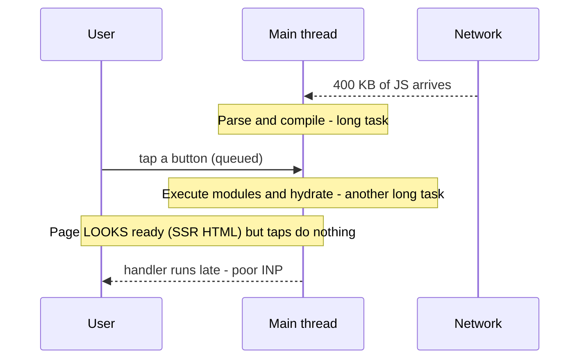

> **Engines help but don't erase the cost.** V8 and other engines parse lazily, stream-compile scripts off the main thread while downloading, and **cache compiled code** for repeat visits. These shrink the cost; they don't make 2 MB of JS cheap on a mid-range phone. See [JavaScript Runtime & Event Loop](../01-web-fundamentals/javascript-runtime-event-loop.md) for long tasks.

---

### Section 2: Measure Before You Optimize

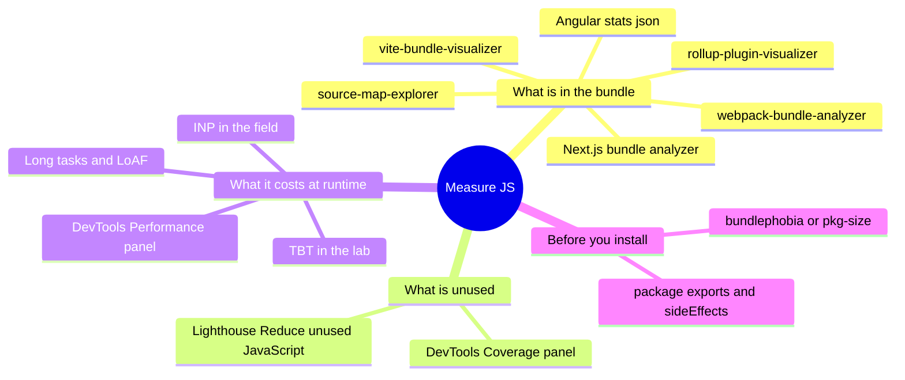

| Question | Tool | Look at |
|---|---|---|
| Which modules make up each chunk? | Bundle visualizer (treemap) | Biggest rectangles; duplicates; whole libraries for one function |
| How much of the shipped code runs on this page? | Chrome DevTools **Coverage** (Ctrl/Cmd+Shift+P → "Coverage") | Unused bytes per file — candidates for splitting or removal |
| How long does JS block the main thread? | **Performance** panel, Lighthouse **TBT**, "Reduce JavaScript execution time" | Long "Evaluate Script" / "Compile" tasks, hydration tasks |
| Does it hurt real users? | RUM: **INP**, LCP, Long Animation Frames | p75 on mobile — see [Core Web Vitals](./core-web-vitals-lcp-inp-cls.md) |
| What will this dependency cost? | bundlephobia / pkg-size, the package's `exports` and `sideEffects` | Minified + compressed size, tree-shakability |

**Sizes to report — always say which one:**

```text
source size        what you wrote (irrelevant to users)
minified size      after minification ≈ what the engine must parse
compressed size    gzip / Brotli / zstd ≈ what crosses the network
```

> Measure on a **production build** with real targets. Dev builds include HMR clients, warnings and unminified code — their numbers are meaningless for this.

---

### Section 3: The Optimization Ladder

Work **top-down** — each rung is usually cheaper and more effective than the one below it.

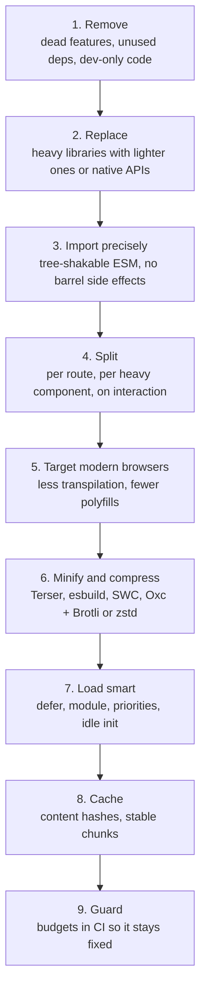

| Rung | Saves | Note |
|---|---|---|
| Remove / Replace | Download **and** parse **and** execute | Biggest wins live here |
| Split | Initial-route bytes and work (moves cost to later) | See [Code Splitting & Lazy Loading](./code-splitting-and-lazy-loading.md) |
| Modern targets | Transpilation bloat + polyfills | The gain depends on how old your previous targets were — compare both builds in the treemap |
| Minify | Parse + download | Bundlers do it by default in production |
| Compress | **Download only** — parse cost unchanged | Don't confuse a smaller transfer with less work |
| Load smart | When the cost is paid | Doesn't reduce the total |
| Cache | Repeat-visit download | Parse/compile still needed (engine code cache helps) |

---

### Section 4: Dependency Diet

Dependencies are usually the largest part of a bundle, and the easiest to fix with one PR.

**Common swaps** (check current sizes on bundlephobia/pkg-size — they change between versions):

| Heavy pattern | Problem | Lighter option |
|---|---|---|
| **Moment.js** | Large, mutable API, locales bundled; the Moment team describes it as a **legacy project in maintenance mode** | `Intl.DateTimeFormat` / `Intl.RelativeTimeFormat`, **date-fns** (tree-shakable), **Day.js**, Luxon; **Temporal** is shipping in Chromium and Firefox (Safari in progress) — polyfill or wait for Baseline |
| `import _ from 'lodash'` | Pulls the whole CommonJS build | Native methods (`structuredClone`, `Object.groupBy`, `Array.prototype.at`…), or per-method `lodash-es` imports |
| `uuid` for random IDs | Extra dependency | `crypto.randomUUID()` (secure contexts) |
| `classnames` | Fine, but larger than needed | `clsx` |
| Full icon packs (`import * as Icons`) | Thousands of icons bundled | Per-icon imports / SVG components |
| Heavy component libraries for one widget | Whole library + styles + its own deps | Headless primitives, or native `<dialog>`, the `popover` attribute, the `details` element |
| Full `core-js` / `@babel/polyfill` import | Polyfills for features every target already has | Usage-based polyfills for your real targets (Section 7) |
| Rich-text editors, charting, maps, PDF | Legitimately large | Keep — but **lazy-load** on the route or interaction that needs them |
| `axios` vs `fetch` | Small difference for most apps | Use `fetch` if you don't need interceptors; it's not a big win alone |

**Duplicates and versions:**

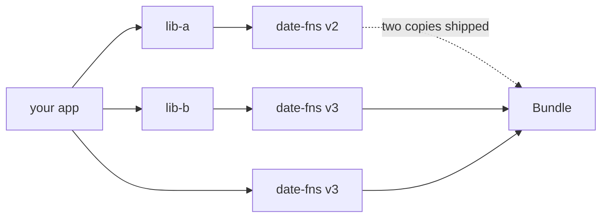

```bash
npm ls date-fns            # who depends on which version
npm dedupe                 # collapse compatible versions
npm explain react          # why is this package installed?
# pnpm: pnpm why <pkg> · overrides in package.json ("pnpm": { "overrides": {...} })
# yarn: yarn why <pkg> · "resolutions"
```

- **Two copies of React** (or Vue, or a state library) break hooks/context at runtime *and* double the size — configure `resolve.dedupe` (Vite) or `resolve.alias` (webpack) in monorepos, and keep framework packages as **peerDependencies** in internal libraries.
- **Check the package's `exports` field and `sideEffects` flag** before adopting it — CJS-only packages and packages with side effects can't be tree-shaken well ([Tree Shaking & Dead Code Elimination](./tree-shaking-and-dead-code-elimination.md)).
- **Dev-only code** (debug panels, mock servers, `why-did-you-render`) must sit behind a build-time constant so the minifier drops it (Example 5).

---

### Section 5: Tree-Shakable Imports and Barrel Files

A short recap — the full mechanics are in [Tree Shaking & Dead Code Elimination](./tree-shaking-and-dead-code-elimination.md).

```typescript
// ❌ Namespace/default import of a CJS build — the bundler must keep everything
import _ from 'lodash';
_.debounce(fn, 300);

// ✅ Named import from an ESM build — unused exports can be dropped
import { debounce } from 'lodash-es';
```

**Barrel files** (`index.ts` re-exporting a whole folder) are the most common accidental bloat in app code:

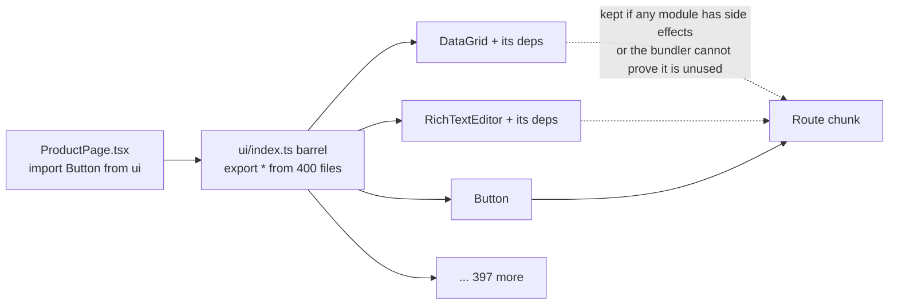

Fixes: import from the specific file (`ui/button`), mark the package `"sideEffects": false` (or list the files that do have side effects, like CSS), or use framework helpers such as Next.js `experimental.optimizePackageImports`, which rewrites barrel imports for listed packages. Barrels also slow down dev servers and tests, because every import loads the whole folder.

---

### Section 6: Chunking for Load and Cache

How code is grouped into files affects **what loads first** and **what survives a deploy in the cache**.

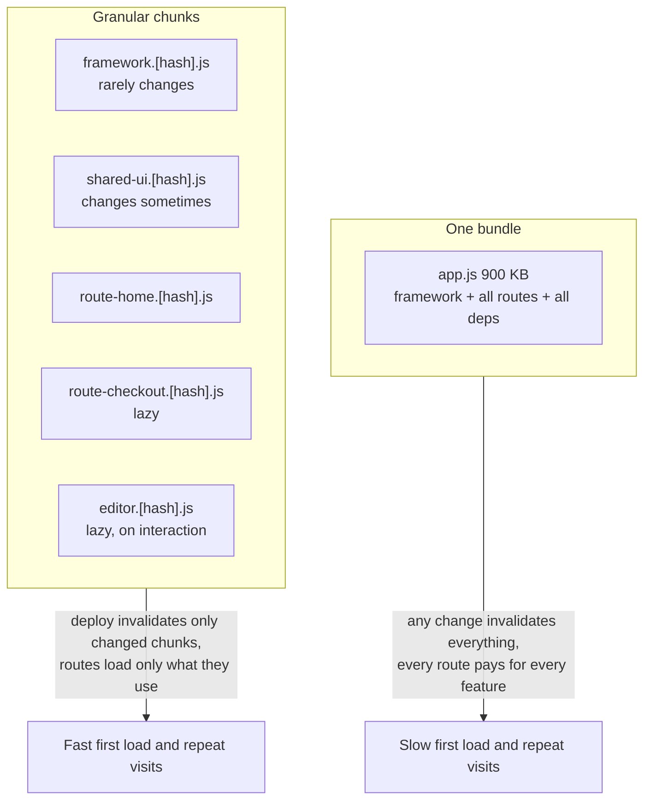

| Concern | Guidance |
|---|---|
| **Initial route** | Contains only what the first view needs; everything else via `import()` |
| **Framework/vendor chunk** | Separate chunk for slow-changing code (React/Vue/Angular runtime) → stays cached across app deploys |
| **Granularity** | Don't put *all* `node_modules` into one vendor chunk — a route that uses a big chart library shouldn't make every route download it. Modern defaults (webpack `splitChunks`, Next.js, Vite/Rollup) already split by sharing |
| **Too many tiny chunks** | HTTP/2 and HTTP/3 multiplexing make dozens of requests fine, but hundreds of tiny files add overhead and lose compression efficiency — let the bundler merge small shared modules |
| **Hash stability** | Use `[contenthash]`; avoid changes that cascade into every chunk (e.g. a runtime/manifest embedded in the vendor chunk) |
| **Import waterfalls** | Lazy chunks that import other lazy chunks → serial round trips; flatten or `modulepreload` ([Prefetching & Preloading](./prefetching-and-preloading.md#section-5-modulepreload)) |

---

### Section 7: Browser Targets and Polyfills

Transpiling modern syntax down to old JavaScript **adds code**: helpers for classes, async/await state machines, spread, optional chaining, and polyfills for missing built-ins. Every current evergreen browser supports ES2020+ syntax natively.

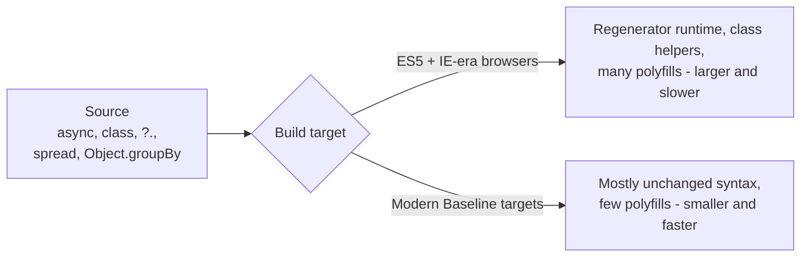

**Set targets deliberately:**

```text
# .browserslistrc — read by Babel, Autoprefixer, SWC, Lightning CSS and others
defaults and fully supports es6-module
not dead
```

- **Vite** defaults to a modern browser target (see `build.target` in the Vite docs for the current default); `@vitejs/plugin-legacy` exists if you truly need older browsers.
- **Babel `@babel/preset-env`** with `useBuiltIns: 'usage'` + `corejs` injects only the polyfills your code uses **and** your targets lack.
- **Angular CLI** reads `.browserslistrc` and only supports browsers in its documented support policy.
- **Next.js** compiles for a modern browserslist by default and includes only a small set of polyfills.

**The `module`/`nomodule` pattern** (ship a modern bundle with `<script type="module">` and a legacy one with `nomodule`) solved this when old browsers were common. Today most apps simply **target modern browsers** and drop the legacy bundle; keep the pattern only if your analytics show real traffic from browsers without ES module support.

**Never load polyfills from a third-party CDN at runtime.** In 2024 the `polyfill.io` domain changed ownership and began serving malicious code to sites that embedded it. Bundle the polyfills you need, self-host them, and use **[Subresource Integrity](../07-security/subresource-integrity-sri.md)** for any script you must load from another origin.

---

### Section 8: Minification and Compression

**Minification** removes whitespace/comments, shortens local names, folds constants and removes unreachable code. It reduces both download and parse size.

| Minifier | Used by | Notes |
|---|---|---|
| **Terser** | webpack default (via TerserPlugin), many Rollup setups | Mature, highly configurable, slower |
| **esbuild** | Vite's default JS minifier (Rollup-based Vite), Angular's esbuild builder | Very fast; slightly less aggressive than Terser in some cases |
| **SWC** | Next.js | Rust, fast, Terser-compatible options |
| **Oxc minifier** | Rolldown-based tooling | Newer Rust toolchain — check maturity for your stack |

Useful build-time switches:

```typescript
// Replace at build time so the minifier can delete dead branches
if (import.meta.env.DEV) { enableDebugPanel(); }      // Vite: removed from production
if (process.env.NODE_ENV !== 'production') { warn(); } // webpack/Next.js: removed from production
```

**Compression** shrinks bytes on the wire only. Text assets (JS, CSS, HTML, JSON, SVG) compress very well.

| Encoding | Support | How to use |
|---|---|---|
| **gzip** | Universal | Baseline fallback |
| **Brotli** (`br`) | All current browsers (HTTPS) | **Pre-compress** static assets at the highest level at build time; dynamic responses at a moderate level |
| **Zstandard** (`zstd`) | Chromium and Firefox, Safari in recent versions — check MDN | Fast to compress — attractive for **dynamic** responses at CDNs; similar ratios to Brotli at comparable settings |
| **Compression dictionaries** (`dcb`/`dcz`) | Chromium only, experimental | Compress a new version of a file using the **previous version as a dictionary** — deploys then download only the diff. Promising for frequently deployed bundles; treat as progressive enhancement |

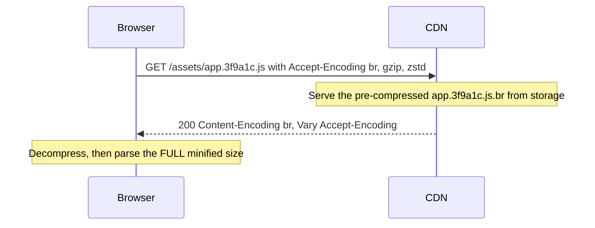

> Check that **compression is actually on** for JS (`curl -sI -H 'Accept-Encoding: br' URL`), that responses carry `Vary: Accept-Encoding`, and that you **don't compress already-compressed formats** (WOFF2, images, video).

---

### Section 9: Loading and Executing Scripts

How a script tag is written decides whether it blocks parsing and when it runs.

```mermaid
gantt
    title Script loading behaviour (relative time)
    dateFormat x
    axisFormat %L
    section plain script
    HTML parsing         :p1, 0, 300
    Download (parser blocked) :crit, p2, 300, 700
    Execute (parser blocked)  :crit, p3, 700, 900
    HTML parsing resumes :p4, 900, 1200
    section defer or module
    HTML parsing         :d1, 0, 1000
    Download in parallel :d2, 300, 700
    Execute after parsing, in order :d3, 1000, 1200
    section async
    HTML parsing         :a1, 0, 700
    Download in parallel :a2, 300, 700
    Execute as soon as ready :crit, a3, 700, 900
    HTML parsing resumes :a4, 900, 1100
```

| Attribute | Blocks parser? | Execution order | Use for |
|---|---|---|---|
| (none) in `<head>` | **Yes** — download + execute | Document order | Almost never; tiny inline config at most |
| `defer` | No | After parsing, **in document order**, before `DOMContentLoaded` | Classic app scripts |
| `type="module"` | No (deferred by default) | After parsing, in order | Modern bundles — the default for Vite and others |
| `async` | Only while executing | **Whenever downloaded** — no ordering | Independent scripts (analytics) |
| `type="module" async` | Only while executing | When the module graph is ready | Independent modules |

**Execution cost tactics:**
- **Do less at module top level.** Code that runs on import (building big lookup tables, registering everything, eager singletons) runs during load. Make it lazy.
- **Defer non-critical initialization** (analytics, chat, feature tours) until after the page is interactive: `requestIdleCallback` (with a `setTimeout` fallback — not in Safari), `scheduler.postTask` with `background` priority where supported, or on first interaction.
- **Break up long tasks** during hydration/initialization with yielding ([JavaScript Runtime & Event Loop](../01-web-fundamentals/javascript-runtime-event-loop.md#section-10-blocking-the-main-thread-and-how-to-stop)).
- **Move CPU-heavy work off the main thread** — parsing, diffing, crypto, image processing → [Web Workers for Heavy Computation](./web-workers-for-heavy-computation.md).

---

### Section 10: Third-Party Scripts

Tag managers, analytics, A/B testing, chat, ads and embeds often add more JavaScript than the app itself — and you don't control their size, updates or main-thread work.

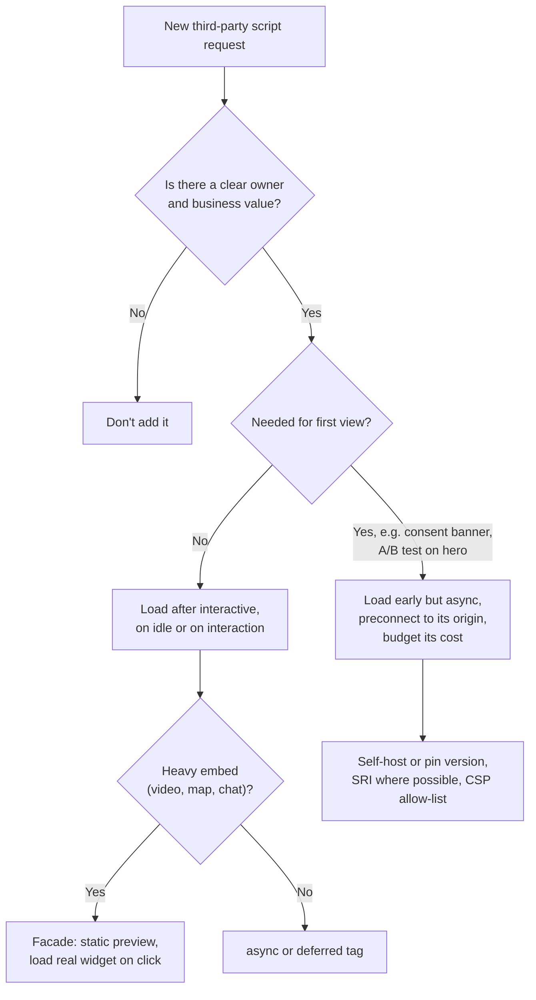

| Technique | Example |
|---|---|
| **Facades** | Show a thumbnail + play button; load the YouTube/Vimeo player only on click (e.g. `lite-youtube-embed`) |
| **Load on interaction** | Chat widget script loads when the user clicks "Help" |
| **Framework script components** | Next.js `<Script strategy="afterInteractive" \| "lazyOnload" \| "worker">`; Nuxt Scripts (`@nuxt/scripts`) |
| **Run in a worker** | Partytown relocates some third-party scripts to a Web Worker — works for many analytics tags but not all; test carefully and check its current status |
| **Govern** | Inventory of tags with owners; review in the tag manager; performance budget includes third parties ([Performance Budgets](./performance-budgets.md)) |
| **Secure** | CSP allow-lists, SRI for pinned files — see [Content Security Policy (CSP)](../07-security/content-security-policy-csp.md) |

---

### Section 11: Ship Less JS by Architecture

The biggest reductions come from **not sending component code to the browser at all**.


| Approach | Examples | JS shipped |
|---|---|---|
| **CSR** | Vite SPA | All components for the route |
| **SSR + hydration** | Classic Next.js Pages Router, Nuxt, SvelteKit, Angular SSR | All components for the route (HTML arrives earlier) |
| **Islands** | Astro, Fresh, Eleventy + islands | Only interactive islands — see [Island Architecture](../02-rendering-and-architecture/island-architecture.md) |
| **React Server Components** | Next.js App Router, other RSC frameworks | Only `'use client'` components and their deps — see [Streaming SSR & React Server Components](../02-rendering-and-architecture/streaming-ssr-and-react-server-components.md) |
| **Incremental/deferred hydration** | Angular `@defer` with hydrate triggers, Nuxt lazy hydration, React `Suspense` boundaries | Code for below-the-fold sections loads later |
| **Resumability** | Qwik | Event handlers fetched on interaction |

**Use the platform instead of libraries:** `<dialog>` and the Popover API for modals/menus, the `details` element for disclosure, CSS scroll-snap for carousels, CSS transitions/animations and View Transitions for motion, `Intl` for formatting, `URLPattern`/`URLSearchParams` for routing helpers (check support for each on MDN).

**Native mobile:** React Native ships JavaScript too — the **Hermes** engine precompiles it to bytecode at build time, which cuts parse cost at startup; Flutter and native apps have binary-size budgets with the same "remove, replace, split" logic (deferred components / on-demand modules).

---

### Section 12: Guarding the Budget in CI

Bundles grow one innocent PR at a time. Make growth **visible and blocking**.

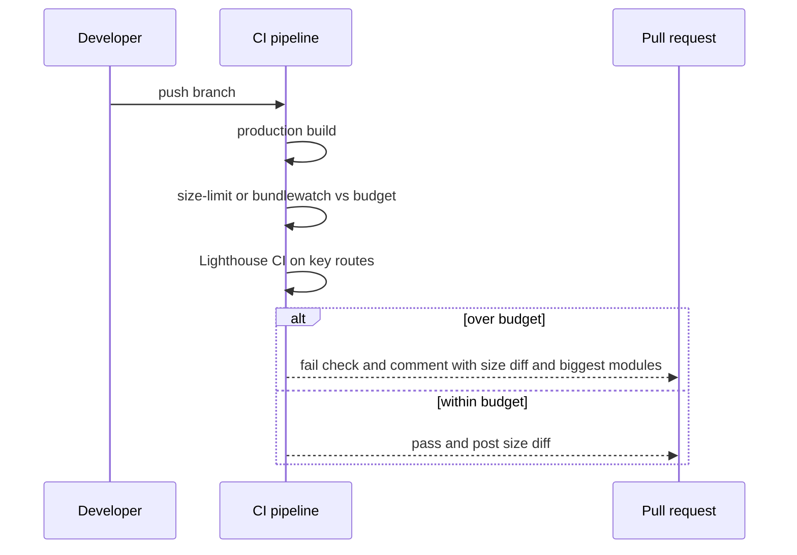

| Tool | Checks |
|---|---|
| **size-limit** | Compressed size (and optionally execution time) of entry points/chunks against limits |
| **bundlewatch** | Per-file size vs baseline, PR comments |
| **Angular CLI budgets** | Built in: `budgets` in `angular.json` warn/error on initial bundle and component style sizes |
| **Lighthouse CI** | TBT, LCP and resource-size assertions on real routes |
| **webpack `performance.hints`** | Warn/error when assets exceed a size |
| **Relative-ci / Statoscope / bundle stats diff** | Module-level diff between builds |

Budget the **initial JS per route** (compressed and uncompressed), not just total bytes. How to set numbers: [Performance Budgets](./performance-budgets.md).

---

## Framework Comparison

| Stack | Built-in help | Things to watch |
|---|---|---|
| **React + Next.js** | Automatic route splitting, RSC (zero-JS server components), `next/dynamic`, `optimizePackageImports`, SWC minify, `@next/bundle-analyzer`, `<Script strategy>` | `'use client'` at a high level pulls whole subtrees into the client bundle |
| **React + Vite** | Rollup/Rolldown splitting, `modulepreload`, esbuild/Oxc minify, modern target | Manual route-level `lazy()`; barrel files in shared UI packages |
| **Vue + Nuxt** | Route splitting, `Lazy` component prefix, lazy hydration options, `nuxi analyze`, Nuxt Scripts | Large auto-imported libraries; plugins that run on every page |
| **Angular** | Lazy routes, standalone components, `@defer` blocks, esbuild-based builder, **budgets in `angular.json`**, `ng build --stats-json` | Eagerly provided services/modules pulling in heavy deps; zone.js cost (zoneless change detection is now available) |
| **Svelte / SvelteKit** | Compiler output with a small runtime, automatic route splitting | Component code size grows per component — very large apps still need splitting |
| **Solid / Qwik / Astro** | Fine-grained runtime (Solid), resumability (Qwik), islands (Astro) | Third-party React/Vue islands inside Astro still ship their framework runtime |
| **React Native** | Hermes bytecode precompilation, Metro inline requires / lazy loading | Large JS bundles slow startup on low-end Android |

---

## Real-World Examples

**Example 1 — Vite: visualize, then split deliberately:**
```typescript
// vite.config.ts
import { defineConfig } from 'vite';
import react from '@vitejs/plugin-react';
import { visualizer } from 'rollup-plugin-visualizer';

export default defineConfig({
  plugins: [
    react(),
    // Writes stats.html with a treemap of every chunk (gzip/brotli sizes)
    visualizer({ filename: 'stats.html', gzipSize: true, brotliSize: true }),
  ],
  build: {
    sourcemap: 'hidden',          // for source-map-explorer and error tracking, not served to users
    rollupOptions: {
      output: {
        // Keep the slow-changing framework in its own long-cached chunk.
        // (Rollup-based Vite. Rolldown-based Vite uses a different chunking option — check the docs.)
        manualChunks(id) {
          if (/node_modules[\\/](react|react-dom|scheduler)[\\/]/.test(id)) return 'framework';
        },
      },
    },
  },
});
```
```bash
npx vite build && open stats.html          # or: npx vite-bundle-visualizer
npx source-map-explorer 'dist/assets/*.js' # needs the hidden source maps
```

**Example 2 — webpack: granular vendor splitting and a size warning:**
```javascript
// webpack.config.js (production)
module.exports = {
  mode: 'production',
  output: { filename: '[name].[contenthash].js', chunkFilename: '[name].[contenthash].js' },
  optimization: {
    runtimeChunk: 'single',              // keep the manifest out of vendor chunks (hash stability)
    moduleIds: 'deterministic',
    splitChunks: {
      chunks: 'all',
      cacheGroups: {
        framework: {
          test: /[\\/]node_modules[\\/](react|react-dom|scheduler)[\\/]/,
          name: 'framework',
          priority: 40,
        },
        // other node_modules are split by the default rules (shared between chunks)
      },
    },
  },
  performance: { hints: 'error', maxEntrypointSize: 170_000, maxAssetSize: 250_000 }, // bytes, uncompressed
};
```

**Example 3 — Dependency swaps (BAD → GOOD):**
```typescript
// ❌ BAD: whole libraries for small jobs
import moment from 'moment';
import _ from 'lodash';
import { v4 as uuid } from 'uuid';

const label = moment(order.date).format('D MMM YYYY');
const byStatus = _.groupBy(orders, 'status');
const copy = _.cloneDeep(state);
const id = uuid();

// ✅ GOOD: the platform already has these
const label2 = new Intl.DateTimeFormat('en-GB', { day: 'numeric', month: 'short', year: 'numeric' })
  .format(new Date(order.date));
const byStatus2 = Object.groupBy(orders, (o) => o.status);   // Baseline 2024 — check your targets
const copy2 = structuredClone(state);
const id2 = crypto.randomUUID();                              // requires a secure context (HTTPS)
```

**Example 4 — Barrel imports (BAD → GOOD) and Next.js help:**
```typescript
// ❌ BAD: pulls the whole design-system barrel into the route chunk
import { Button } from '@acme/ui';

// ✅ GOOD: deep import from the specific entry (if the package exposes it in "exports")
import { Button } from '@acme/ui/button';
```
```javascript
// next.config.js — let Next.js rewrite barrel imports for listed packages
module.exports = {
  experimental: { optimizePackageImports: ['@acme/ui', 'lucide-react'] },
};
```
```json
{
  "name": "@acme/ui",
  "sideEffects": ["**/*.css"],
  "exports": {
    ".": "./dist/index.js",
    "./button": "./dist/button.js"
  }
}
```

**Example 5 — Dev-only code that disappears in production:**
```tsx
import { lazy, Suspense } from 'react';

// import.meta.env.DEV is replaced with `false` in production builds,
// so the minifier removes the branch AND the dynamic import never becomes a chunk
const DevTools = import.meta.env.DEV
  ? lazy(() => import('./dev/DevToolsPanel'))
  : () => null;

export function App() {
  return (
    <>
      <Routes />
      <Suspense fallback={null}><DevTools /></Suspense>
    </>
  );
}
```

**Example 6 — Third-party: load on idle or on interaction:**
```typescript
// Analytics after the page is interactive (requestIdleCallback is not in Safari → fallback)
const whenIdle = (cb: () => void) =>
  'requestIdleCallback' in window ? requestIdleCallback(cb, { timeout: 3000 }) : setTimeout(cb, 2000);

whenIdle(() => import('./analytics').then((m) => m.init()));

// Chat widget only when the user asks for help
helpButton.addEventListener('click', async () => {
  const { openChat } = await import('./chat-widget');   // its own chunk
  openChat();
}, { once: true });
```
```tsx
// Next.js equivalent for an external tag
import Script from 'next/script';
<Script src="https://widget.chat.example/loader.js" strategy="lazyOnload" />;
```

**Example 7 — Budget in CI with size-limit:**
```json
[
  { "name": "initial JS (home route)", "path": "dist/assets/index-*.js", "limit": "120 kB" },
  { "name": "framework chunk", "path": "dist/assets/framework-*.js", "limit": "50 kB" },
  { "name": "checkout route", "path": "dist/assets/Checkout-*.js", "limit": "60 kB" }
]
```
```yaml
# .github/workflows/size.yml
name: size
on: pull_request
jobs:
  size:
    runs-on: ubuntu-latest
    steps:
      - uses: actions/checkout@v4
      - uses: actions/setup-node@v4
        with: { node-version: 22, cache: npm }
      - run: npm ci
      - run: npm run build
      - run: npx size-limit        # exits non-zero when a limit (compressed size) is exceeded
```
> Example limits only — derive yours from your audience's devices and networks ([Performance Budgets](./performance-budgets.md)).

**Example 8 — Serve pre-compressed bundles (nginx):**
```nginx
# Build step writes app.3f9a1c.js, app.3f9a1c.js.br and app.3f9a1c.js.gz
location /assets/ {
    gzip_static on;          # built-in module: serves .gz if the client accepts gzip
    brotli_static on;        # requires the ngx_brotli module
    add_header Cache-Control "public, max-age=31536000, immutable" always;
    add_header Vary "Accept-Encoding" always;
}
```

---

## Key Points Summary

| Concept | One-Line Explanation |
|---|---|
| **JS cost** | Download + decompress + parse + compile + execute + hydrate — mostly on the main thread |
| **Compressed vs minified size** | Compressed = network cost; minified = parse cost — report both |
| **Measure first** | Treemap for contents, Coverage for unused code, Performance panel for main-thread time |
| **Optimization ladder** | Remove → replace → import precisely → split → target → minify → compress → load smart → cache → guard |
| **Dependency diet** | Biggest wins: replace heavy libs with native APIs or lighter, tree-shakable ones |
| **Duplicates** | Two versions of a package = double bytes (and broken React/Vue context) |
| **Barrel files** | Re-export folders can drag unrelated modules into a route |
| **Chunking** | Small initial route chunk, stable framework chunk, lazy heavy features |
| **Modern targets** | Less transpilation and fewer polyfills; drop `nomodule` legacy bundles unless data says otherwise |
| **Polyfill CDNs** | Never load runtime polyfills from a third-party domain (polyfill.io, 2024) |
| **Brotli / zstd** | Pre-compress static assets; compression only reduces transfer, not parse |
| **defer / module / async** | Never parser-blocking; `defer`/`module` keep order, `async` doesn't |
| **Third parties** | Govern, defer, facade, or move to a worker |
| **Architecture** | Islands, RSC, deferred hydration — don't ship component code that never runs on the client |
| **CI budgets** | size-limit, bundlewatch, Angular budgets, Lighthouse CI keep wins from eroding |

---

## Test Your Understanding

**Q1 (Basic):**
Two files have the same 150 KB compressed transfer size: a JPEG and a JavaScript bundle. Why is the JS bundle usually much worse for page performance?

<details>
<summary>Answer</summary>

After downloading, the image only needs to be **decoded** (often off the main thread) and painted. The JS must be **decompressed to its full size** (often several times larger), **parsed, compiled and executed** — mostly on the **main thread** — and then a framework may **hydrate**, running component code again. That main-thread work delays interactivity and causes long tasks, which hurt TBT in the lab and INP in the field. Compression makes both transfers equal; it does nothing for the JS's parse and execution cost.
</details>

**Q2 (Application):**
Your Coverage panel shows 68 % of the home page's JS is unused on load, and the treemap shows `moment` with all locales, a chart library and a rich-text editor in the main chunk. What do you do, in order?

<details>
<summary>Answer</summary>

1. **Replace** `moment` with `Intl.DateTimeFormat` or a tree-shakable library like date-fns (Moment is in maintenance mode, and its locales are bundled unless excluded).
2. **Split** the chart library and rich-text editor into **lazy chunks** loaded by the routes or interactions that use them (`import()` / `React.lazy` / `defineAsyncComponent` / Angular `@defer`), and check no barrel import is pulling them in.
3. Re-run the treemap and Coverage. Some "unused" code is legitimately needed later (event handlers), so don't chase 0 %.
4. Add a **size budget** in CI for the home route so the regression can't come back.
Minification and compression come after these — they can't remove code that shouldn't be there.
</details>

**Q3 (Tricky):**
After switching from Terser to a faster minifier and enabling Brotli, the team reports "bundle 35 % smaller", but TBT and INP on mid-range Android didn't move. Why?

<details>
<summary>Answer</summary>

The 35 % is almost certainly the **compressed (transfer) size**. Brotli reduces bytes on the network, but the browser decompresses before parsing, so **parse, compile and execution work are unchanged**. Changing minifiers changes the minified size only slightly. TBT and INP are driven by **main-thread work**: how much code is parsed and executed during load, and hydration cost. To move them: remove or replace code, lazy-load features not needed for the first interaction, reduce top-level module work, break up long hydration tasks, or ship less component JS (islands, server components, deferred hydration).
</details>

**Q4 (Application):**
A monorepo app has two copies of React in the production bundle and a "Invalid hook call" error appears only in one route. How did this happen and how do you fix it?

<details>
<summary>Answer</summary>

An internal package (e.g. `@acme/ui`) declared `react` as a regular **dependency** (or got its own nested copy through a version mismatch), so the bundler resolved two different React modules. Components from that package use their own React instance, whose hooks dispatcher isn't the one rendering the tree → "Invalid hook call", plus roughly double the framework bytes.

Fix: make `react`/`react-dom` **peerDependencies** in internal packages, align versions, run `npm ls react` / `pnpm why react` to confirm a single copy, and add `resolve.dedupe: ['react', 'react-dom']` (Vite) or an alias (webpack) as a guard. Add a CI check that fails if the treemap shows duplicates.
</details>

**Q5 (Tricky):**
A team still builds an ES5 bundle with full `core-js` for "maximum compatibility" and loads extra polyfills from a public polyfill CDN. What are the costs and risks, and what do you propose?

<details>
<summary>Answer</summary>

Costs: ES5 output adds transpilation helpers (regenerator, class helpers) and **every** user downloads polyfills for features their browser already has — more bytes to download **and** parse. Risks: loading code at runtime from a third-party domain gives that domain full control over your page; in 2024 the `polyfill.io` domain changed ownership and served malicious code to sites embedding it.

Proposal: set an explicit **browserslist** based on real analytics (e.g. `defaults` + ES module support), build a modern bundle, use **usage-based** polyfills (`useBuiltIns: 'usage'`) bundled and self-hosted, and remove the external polyfill script. Only keep a legacy `nomodule` build if analytics show meaningful traffic from browsers that need it.
</details>

**Q6 (System design):**
You own the frontend platform for a large e-commerce site (React, SSR) with 30 teams contributing. Initial JS on product pages has grown steadily, and INP at p75 on mobile is "needs improvement". Design a program to bring it down and keep it down.

<details>
<summary>Answer</summary>

**Measure and attribute**
- A per-route treemap in CI with module → owning-team mapping (CODEOWNERS). RUM for INP/LCP with Long Animation Frames attribution, so scripts can be tied to teams and third parties.

**Quick wins**
- Dependency audit: replace heavy date, utility and icon libraries; dedupe versions; fix barrel imports in the shared UI package (`sideEffects`, deep entry points).
- Lazy-load below-the-fold widgets (reviews, recommendations, Q&A) on viewport, and modals/editors on interaction.
- Third-party governance: an inventory with owners, facades for video/chat, analytics loaded on idle, a hard budget for tag-manager payload.

**Structural**
- Move toward **less hydration**: server components or islands for static product content, deferred hydration for below-the-fold sections, so only interactive parts ship JS.
- Modern browser targets with usage-based polyfills. A stable framework chunk and content hashes for repeat-visit caching. Brotli pre-compression at the CDN.
- Break up long hydration and initialization tasks (yielding, deferred init).

**Keep it down**
- **Budgets in CI per route** (size-limit / bundlewatch + Lighthouse CI TBT) that fail PRs and comment with diffs.
- A "new dependency" review step (size, ESM, `sideEffects`, license).
- A dashboard of initial JS per route and INP per route, reviewed regularly. See [Performance Budgets](./performance-budgets.md).
</details>

---

## Cheat Sheet

**Key Definitions:**
- **Minified size:** bytes after minification — roughly what the engine parses
- **Compressed size:** bytes after gzip/Brotli/zstd — what crosses the network
- **Unused JS:** code downloaded but not executed for the current page (Coverage panel)
- **Barrel file:** an `index` module re-exporting many modules
- **Browser target:** the set of browsers your build compiles for (browserslist / `build.target`)
- **Usage-based polyfills:** only polyfills your code uses *and* your targets lack
- **Facade:** a lightweight static stand-in that loads the real widget on interaction
- **Hydration:** re-running component code on the client to attach interactivity to server HTML

**Quick Reference:**
```text
Measure      → treemap (visualizer / bundle-analyzer / source-map-explorer) + Coverage + Performance panel
Order        → remove → replace → precise imports → split → modern target → minify → compress → load → cache → guard
Deps         → npm ls / pnpm why · dedupe · peerDependencies for frameworks · check exports + sideEffects
Native first → Intl, structuredClone, Object.groupBy, crypto.randomUUID, dialog, popover, details
Imports      → named ESM imports · avoid barrels or mark sideEffects · optimizePackageImports (Next.js)
Chunks       → small initial route · framework chunk · lazy heavy features · [contenthash] · runtimeChunk
Targets      → explicit browserslist · usage-based polyfills · no runtime polyfill CDNs
Minify       → Terser / esbuild / SWC / Oxc · import.meta.env.DEV / NODE_ENV dead branches
Compress     → Brotli pre-compressed static · gzip fallback · zstd for dynamic (check support) · Vary: Accept-Encoding
Script tags  → type=module or defer · async only for independent scripts · never parser-blocking
Execution    → little top-level work · idle/interaction init · yield in long tasks · workers for CPU work
Third party  → owner + budget · facade · lazyOnload · SRI + CSP
Architecture → islands · server components · deferred hydration · resumability
CI           → size-limit / bundlewatch / Angular budgets / Lighthouse CI per route
```

**Common Mistakes to Avoid:**

| Mistake | Why Wrong | Fix |
|---|---|---|
| Measuring the dev build | Includes HMR and unminified code | Analyze production builds |
| Reporting only compressed size | Hides parse/execute cost | Report minified + compressed, plus main-thread time |
| Optimizing compression before removing code | Smaller transfer, same CPU work | Remove/replace/split first |
| `import _ from 'lodash'` / `import * as Icons` | Pulls whole libraries | Named ESM imports, per-icon imports, native APIs |
| Shared UI barrel without `sideEffects` | Unrelated components leak into routes | Deep imports or `"sideEffects"` list |
| One giant vendor chunk | Every route downloads every dependency | Granular/shared splitting + framework chunk |
| Transpiling to ES5 by default | Bloat for every modern browser | Explicit modern browserslist |
| Loading polyfills from a third-party CDN | Supply-chain risk (polyfill.io) | Bundle and self-host |
| Parser-blocking `<script>` in `<head>` | Delays first render | `type="module"` / `defer` |
| `async` for scripts that depend on each other | Random execution order | `defer` or modules |
| Heavy work at module top level | Runs during load, long tasks | Lazy init, idle callbacks |
| Unmanaged third-party tags | Often larger than the app, unpredictable | Inventory, budgets, facades, deferral |
| Two copies of React/Vue | Double bytes and runtime errors | peerDependencies + dedupe |
| No CI guard | Size creeps back up | size-limit / bundlewatch / budgets |

---

## References & Further Reading

**Core docs**
- web.dev: [Reduce JavaScript payloads with code splitting](https://web.dev/articles/reduce-javascript-payloads-with-code-splitting)
- web.dev: [Remove unused code](https://web.dev/articles/remove-unused-code)
- web.dev: [Minify and compress network payloads](https://web.dev/articles/reduce-network-payloads-using-text-compression)
- web.dev: [Efficiently load third-party JavaScript](https://web.dev/articles/efficiently-load-third-party-javascript)
- web.dev: [Optimize long tasks](https://web.dev/articles/optimize-long-tasks)
- web.dev: [Publish, ship, and install modern JavaScript for faster applications](https://web.dev/articles/publish-modern-javascript)
- Chrome DevTools: [Coverage panel — find unused JavaScript and CSS](https://developer.chrome.com/docs/devtools/coverage)
- MDN: [`<script>`: `defer`, `async`, `type="module"`](https://developer.mozilla.org/en-US/docs/Web/HTML/Reference/Elements/script)
- MDN: [`Content-Encoding`](https://developer.mozilla.org/en-US/docs/Web/HTTP/Reference/Headers/Content-Encoding)
- MDN: [Compression dictionary transport](https://developer.mozilla.org/en-US/docs/Web/HTTP/Guides/Compression_dictionary_transport)

**Engine internals**
- V8: [The cost of JavaScript in 2019](https://v8.dev/blog/cost-of-javascript-2019)
- V8: [Code caching for JavaScript developers](https://v8.dev/blog/code-caching-for-devs)

**Tooling docs**
- Vite: [Building for production](https://vite.dev/guide/build) · [`build.target`](https://vite.dev/config/build-options#build-target)
- webpack: [`SplitChunksPlugin`](https://webpack.js.org/plugins/split-chunks-plugin/) · [`performance` hints](https://webpack.js.org/configuration/performance/)
- Next.js: [Package bundling (`optimizePackageImports`, bundle analyzer)](https://nextjs.org/docs/app/guides/package-bundling) · [`<Script>` component](https://nextjs.org/docs/app/api-reference/components/script)
- Angular: [Configuring size budgets](https://angular.dev/tools/cli/build#configuring-size-budgets) · [Deferrable views](https://angular.dev/guide/templates/defer)
- Nuxt: [`nuxi analyze`](https://nuxt.com/docs/api/commands/analyze)
- Babel: [`@babel/preset-env` — `useBuiltIns`](https://babeljs.io/docs/babel-preset-env#usebuiltins)
- browserslist: [Queries](https://github.com/browserslist/browserslist#queries)
- size-limit: [README](https://github.com/ai/size-limit)
- Moment.js: [Project status](https://momentjs.com/docs/#/-project-status/)

**Security**
- Cloudflare blog: [Automatically replacing polyfill.io links with Cloudflare's mirror](https://blog.cloudflare.com/automatically-replacing-polyfill-io-links-with-cloudflares-mirror-for-a-safer-internet/)

---

> **Previous Topic:** [Prefetching & Preloading](./prefetching-and-preloading.md)
> — Resource hints, Early Hints and speculative navigation

> **Next Topic:** [Virtual Scrolling & Windowing](./virtual-scrolling-and-windowing.md)
> — Runtime performance begins: rendering only what is on screen

*Saved on: 2026-11-06 | Repo: Frontend System Design Learning Notes*
