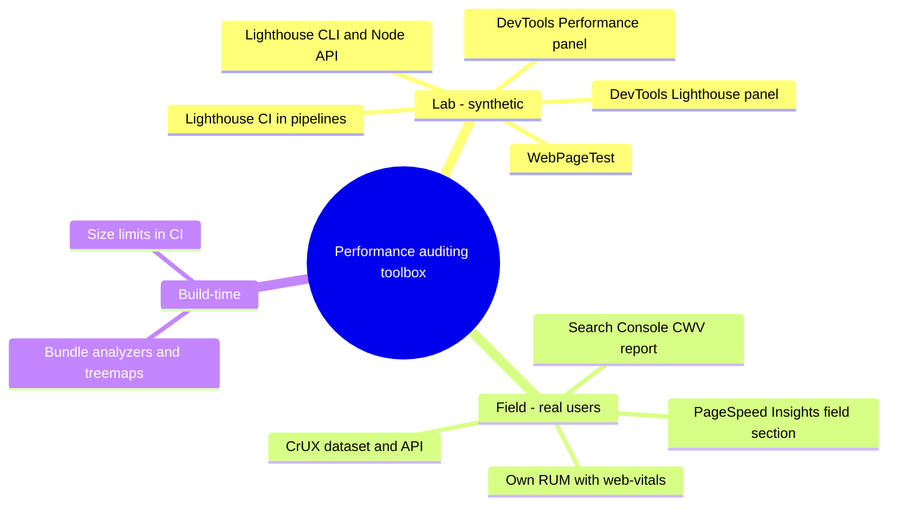
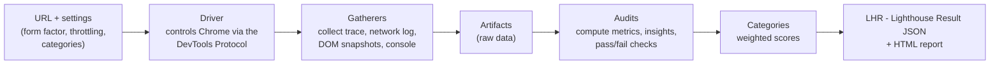
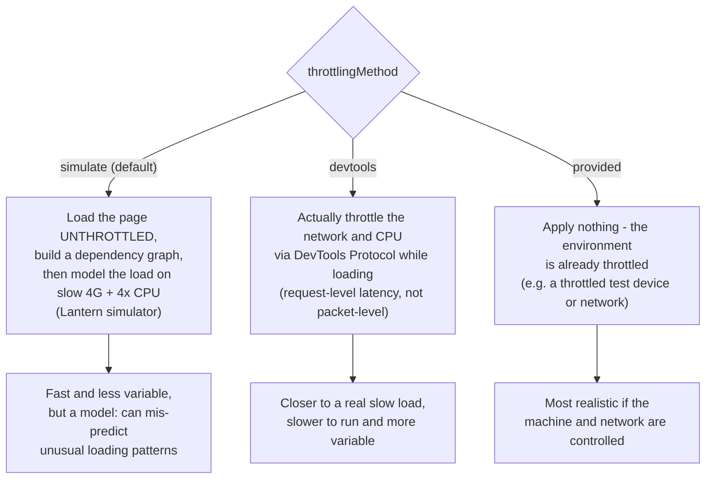
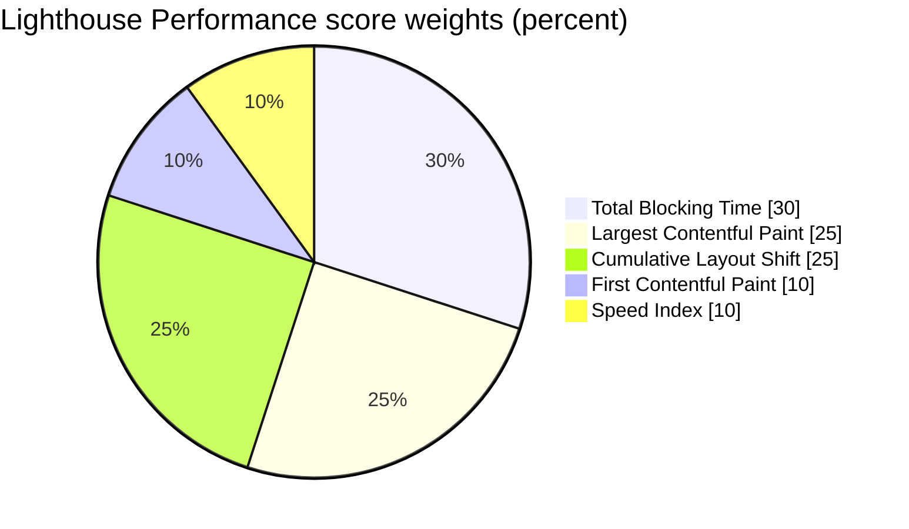
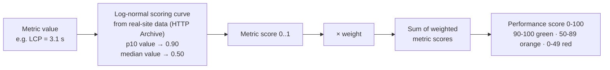
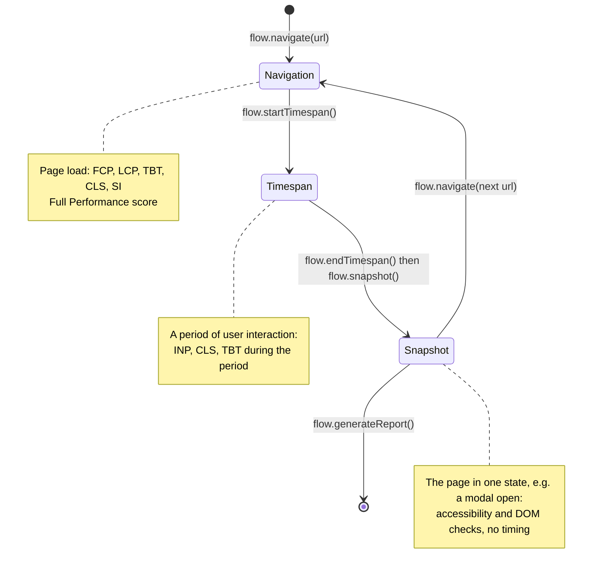
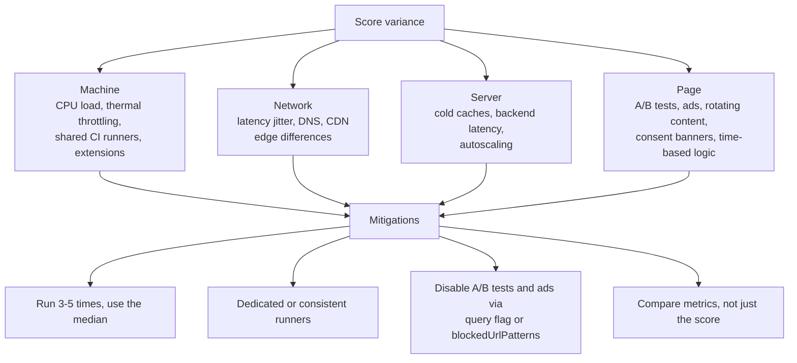
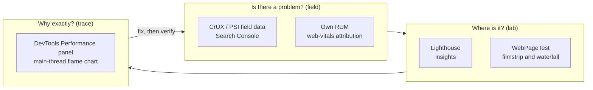
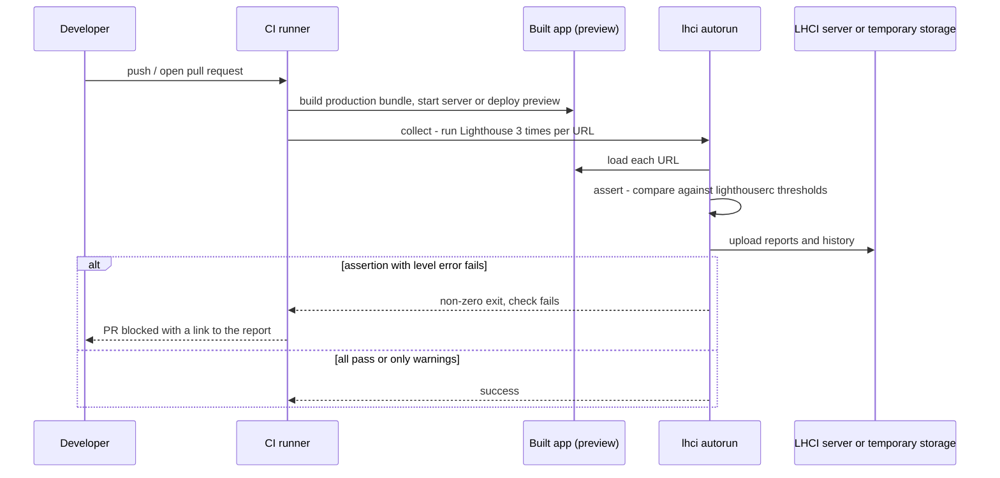
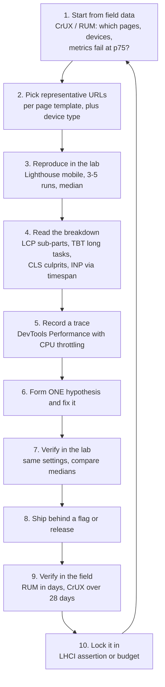

# Lighthouse & Performance Auditing

> **Date:** 2026-11-06 · **Last updated:** 2026-11-06
> **Category:** Frontend System Design
> **Sub-Topic:** Performance Engineering / Performance Metrics
> **Level:** Intermediate · **Reading time:** ~28 min
> **Informs:** lab testing setup (device, network, throttling), CI performance gates (Lighthouse CI assertions), regression triage workflow, choosing between Lighthouse, DevTools, WebPageTest and RUM, interpreting the Performance score vs Core Web Vitals

> **Pre-requisite:** [Core Web Vitals (LCP, INP, CLS)](./core-web-vitals-lcp-inp-cls.md) (what the metrics mean, field vs lab) and [Critical Rendering Path](../01-web-fundamentals/critical-rendering-path.md).
> This note covers the **lab side**: how to audit a page reproducibly, read the results correctly and stop regressions in CI.

**Previous:** [Core Web Vitals (LCP, INP, CLS)](./core-web-vitals-lcp-inp-cls.md) · **Next:** [Performance Budgets](./performance-budgets.md)

---

## Table of Contents

1. [ELI5 — Simple Explanation](#eli5--simple-explanation)
2. [Section 1: What Lighthouse Is](#section-1-what-lighthouse-is)
3. [Section 2: How a Lighthouse Run Works](#section-2-how-a-lighthouse-run-works)
4. [Section 3: Throttling and Device Emulation](#section-3-throttling-and-device-emulation)
5. [Section 4: The Performance Score](#section-4-the-performance-score)
6. [Section 5: Insights and Diagnostics](#section-5-insights-and-diagnostics)
7. [Section 6: Navigation, Timespan and Snapshot Modes](#section-6-navigation-timespan-and-snapshot-modes)
8. [Section 7: Where to Run Lighthouse](#section-7-where-to-run-lighthouse)
9. [Section 8: Variability — Why Scores Jump](#section-8-variability--why-scores-jump)
10. [Section 9: Beyond Lighthouse — DevTools, WebPageTest, CrUX](#section-9-beyond-lighthouse--devtools-webpagetest-crux)
11. [Section 10: Lighthouse CI](#section-10-lighthouse-ci)
12. [Section 11: A Repeatable Auditing Workflow](#section-11-a-repeatable-auditing-workflow)
13. [Framework and Platform Notes](#framework-and-platform-notes)
14. [Real-World Examples](#real-world-examples)
15. [Key Points Summary](#key-points-summary)
16. [Test Your Understanding](#test-your-understanding)
17. [Cheat Sheet](#cheat-sheet)
18. [References & Further Reading](#references--further-reading)

---

## ELI5 — Simple Explanation

Think of a **car inspection**:

- **Lighthouse** is the inspection station. It drives your car (page) around a **fixed test track** (an emulated mid-range phone on a slow 4G network) and prints a report card with scores and a list of things to fix.
- Because the track is always the same, you can compare this week's car to last week's. That is its strength: **reproducible** results.
- But the test track is not the road your customers drive on. Real drivers have different cars, roads and traffic. For that you need **field data**: reports from real trips (CrUX, your RUM).
- **Lighthouse CI** is a rule that every new car model must pass inspection before it leaves the factory, so bad changes never reach customers.

> **Lighthouse is a reproducible lab test that explains *why* a page is slow and catches regressions before release; real-user data decides *whether* it is slow for your users.**

---

## Core Concept — Step by Step

### Section 1: What Lighthouse Is

**Lighthouse** is Google's open-source, automated auditing tool for web pages. It loads a page in Chrome under controlled conditions, records a trace, and runs a set of **audits** grouped into **categories**.

| Category | What it checks | Score display |
|---|---|---|
| **Performance** | Lab metrics (FCP, LCP, TBT, CLS, Speed Index) + insights and diagnostics | 0–100, weighted metrics |
| **Accessibility** | Automated checks built on axe-core (names, contrast, ARIA, landmarks) | 0–100, weighted audits |
| **Best Practices** | HTTPS, console errors, deprecated APIs, image aspect ratios, security headers | 0–100 |
| **SEO** | Crawlability basics: title, meta description, `robots`, link text, `hreflang`, canonical | 0–100 |
| **Agentic Browsing** (recent 13.x releases) | Whether AI agents can use the site: accessibility tree, `llms.txt`, WebMCP tool registration, CLS | Shown as a fraction (passed/total). New: check whether your channel (CLI, DevTools, PSI) shows it |

> **Removed:** the **PWA** category was removed in Lighthouse 12 (2024). The old `budget.json` "performance budgets" audit is no longer part of Lighthouse itself; Lighthouse CI still accepts a budgets file and converts it into assertions (see [Performance Budgets](./performance-budgets.md)).



---

### Section 2: How a Lighthouse Run Works



Key consequences:

- The output is a JSON file (**LHR**) you can store, diff and assert on. The HTML report is just a renderer for that JSON.
- **Gathering and auditing are separate phases** (`-G` gather mode, `-A` audit mode in the CLI). You can re-run audits on saved artifacts without reloading the page.
- By default a run **clears the origin's storage** (Cache Storage, service workers) to simulate a first visit. A "cold" load is the default; repeat-visit behaviour needs a custom setup (`--disable-storage-reset`).

---

### Section 3: Throttling and Device Emulation

Lighthouse's default (mobile) profile emulates a **mid-range Android phone** (Moto G Power screen size and user agent) on a **slow 4G** connection with a **4× CPU slowdown**.

| Setting | Mobile default | Desktop preset (`--preset=desktop`) |
|---|---|---|
| Screen | 412 × 823, DPR 1.75 | 1350 × 940, DPR 1 |
| Network (simulated) | 150 ms RTT, ~1.6 Mbps throughput | Much faster (low latency, high throughput) |
| CPU | 4× slowdown | No slowdown |
| Scoring curves | Mobile thresholds | Stricter desktop thresholds |

There are three **throttling methods**:



> **Why the default is simulated:** a real throttled load takes long and varies a lot. Simulation runs quickly and is more repeatable. But it is an *estimate*: when a lab result looks impossible (for example LCP much worse than any trace you can record), re-run with `--throttling-method=devtools` and record a real trace in the DevTools Performance panel.

---

### Section 4: The Performance Score

The Performance score is **not** Core Web Vitals. It is a weighted average of five **lab** metrics (Lighthouse 10+; weights verified in the Lighthouse 13 default config):



How a metric value becomes a score:



Control points from the Lighthouse 13 source (metric value that earns a 0.90 score / a 0.50 score):

| Metric | Weight | Mobile 0.90 at | Mobile 0.50 at | Desktop 0.90 at | Desktop 0.50 at |
|---|---|---|---|---|---|
| **FCP** | 10% | 1.8 s | 3.0 s | 0.93 s | 1.6 s |
| **Speed Index** | 10% | 3.4 s | 5.8 s | 1.3 s | 2.3 s |
| **LCP** | 25% | 2.5 s | 4.0 s | 1.2 s | 2.4 s |
| **TBT** | 30% | 200 ms | 600 ms | 150 ms | 350 ms |
| **CLS** | 25% | 0.10 | 0.25 | 0.10 | 0.25 |

Things that surprise people:

- **INP has weight 0.** A normal navigation run has no user interaction, so Lighthouse cannot measure INP during a page load. **TBT is the stand-in** and has the biggest weight.
- **The curve is non-linear.** Near 100 you need large metric improvements for small score gains; in the middle of the curve small improvements move the score a lot. Don't chase 100.
- **A 95 score does not mean you pass Core Web Vitals,** and a 60 doesn't mean you fail. Field data decides that.
- Use the [Lighthouse scoring calculator](https://googlechrome.github.io/lighthouse/scorecalc/) to see how each metric moves the score.

---

### Section 5: Insights and Diagnostics

Below the metrics, the report lists what to fix. Lighthouse 13 moved most performance advice to **insights** shared with the Chrome DevTools Performance panel (the same analysis engine), so the advice is consistent across both tools.

| Insight (Lighthouse 13 ID) | What it tells you | Metric it helps |
|---|---|---|
| `lcp-breakdown-insight` | LCP split into TTFB, load delay, load duration, render delay | LCP |
| `lcp-discovery-insight` | Whether the LCP image is discoverable in HTML, lazy-loaded, has `fetchpriority=high` | LCP |
| `render-blocking-insight` | CSS/JS blocking the first render | FCP, LCP |
| `document-latency-insight` | Redirects, slow server response, missing compression for the HTML | TTFB, FCP |
| `network-dependency-tree-insight` | Chains of requests that delay critical resources; preconnect hints | FCP, LCP |
| `image-delivery-insight` | Oversized, poorly compressed or old-format images | LCP |
| `font-display-insight` | Fonts that block text rendering | FCP, CLS |
| `cls-culprits-insight` | Elements and causes of layout shifts (unsized images, web fonts, injected content) | CLS |
| `inp-breakdown-insight` | Input delay / processing / presentation (timespan mode) | INP |
| `forced-reflow-insight` | JS reading layout after writing styles | INP, TBT |
| `dom-size-insight` | Large DOM making style/layout expensive | INP, TBT |
| `third-parties-insight` | Main-thread time and bytes by third party | TBT, INP |
| `legacy-javascript-insight`, `duplicated-javascript-insight` | Polyfills for modern browsers, the same module bundled twice | TBT |
| `cache-insight` | Static assets with short cache lifetimes | Repeat visits |

**Diagnostics** that remain as classic audits include `unused-javascript`, `unused-css-rules`, `bootup-time`, `mainthread-work-breakdown`, `long-tasks`, `total-byte-weight`, `unsized-images`, `non-composited-animations` and `bf-cache`.

> Insights and diagnostics **don't change the score directly**; only the five metrics do. They tell you *where* the metric time comes from. Fixing an item with large "estimated savings" usually helps, but savings estimates are model outputs, not guarantees.

---

### Section 6: Navigation, Timespan and Snapshot Modes

Lighthouse has three modes; a scripted sequence of them is called a **user flow**.



| Mode | Measures | Use for |
|---|---|---|
| **Navigation** | A page load (cold by default) | Landing pages, SSR/SSG output, LCP regressions |
| **Timespan** | Everything during a time window you control | INP and CLS of interactions: add to cart, open filters, type in search, SPA route changes |
| **Snapshot** | One DOM state | Accessibility of a modal, menu or form in its open state |

All three are available in the DevTools Lighthouse panel and through the Node API (`startFlow`) driven by Puppeteer (Example 3).

---

### Section 7: Where to Run Lighthouse

| Where | How | Good for | Watch out for |
|---|---|---|---|
| **Chrome DevTools → Lighthouse panel** | Built in | Quick local checks, user flows | Extensions, other tabs and your fast machine affect results; use a clean profile/incognito |
| **PageSpeed Insights** (pagespeed.web.dev) | Web UI or API | Field data (CrUX) **plus** a Lighthouse lab run from Google's servers | Lab run uses Google's location and hardware; public URLs only |
| **Node CLI** (`npx lighthouse`) | Command line | Scripted audits, saved JSON, custom configs | Run on a quiet machine; pin the Chrome version in CI |
| **Node API + Puppeteer** | `lighthouse()` / `startFlow()` | Logged-in pages, user flows, custom steps | You maintain the scripts |
| **Lighthouse CI** (`@lhci/cli`) | In your pipeline | Regression gates per PR, history server | Needs stable runners and multiple runs |
| **Third-party monitors** (built on Lighthouse) | SaaS | Scheduled synthetic monitoring | Know which throttling and location they use |

---

### Section 8: Variability — Why Scores Jump

Run Lighthouse five times on the same URL and you'll get five different numbers. Common causes:



Practical rules:

1. **Never compare single runs.** Use the median of at least 3 runs (Lighthouse CI does 3 by default).
2. **Compare like with like:** same Lighthouse/Chrome version, same machine type, same throttling method, same URL and state.
3. **Assert on metrics with tolerance**, not on "score must equal 97".
4. **CI runners are noisy.** Shared cloud runners can have very different CPU speed. Lighthouse reports a `benchmarkIndex` for the host CPU; large changes in it explain sudden shifts.
5. **Simulated throttling reduces variance** (that's one reason it's the default) but can't remove server-side variance.

---

### Section 9: Beyond Lighthouse — DevTools, WebPageTest, CrUX



| Tool | Best at |
|---|---|
| **DevTools Performance panel** | The ground truth trace: flame chart of every task, layout and paint; **live metrics** (local LCP, CLS and INP while you interact) with a comparison to CrUX field data; the same **insights** as Lighthouse; CPU and network throttling; annotating and sharing traces |
| **DevTools Network panel + Coverage tab** | Request waterfall, priorities, cache status; unused bytes of JS/CSS |
| **WebPageTest** | Real browsers on many locations and connection types, filmstrip and video, request waterfall with connection views, repeat-view testing, scripted multi-step tests, side-by-side comparisons |
| **CrUX** (BigQuery, API, History API, CrUX Vis) | Field p75 by origin and URL, trends over months, device and connection breakdown — Chrome users only |
| **Search Console Core Web Vitals report** | Groups of similar URLs failing CWV, validated fixes |
| **RUM (your own)** | Any segment you want (route, release, country, logged in), all browsers that support the APIs, attribution for debugging |

---

### Section 10: Lighthouse CI

**Lighthouse CI (LHCI)** runs Lighthouse in your pipeline, **asserts** on the results and optionally **uploads** reports for history and diffs.



The three commands that `lhci autorun` combines:

| Step | Does | Key options |
|---|---|---|
| `collect` | Runs Lighthouse N times per URL | `url`, `staticDistDir`, `startServerCommand`, `numberOfRuns` (default 3), `settings` (e.g. `preset: 'desktop'`), `puppeteerScript` for login |
| `assert` | Checks results | `preset` (`lighthouse:recommended`, `lighthouse:all`, `lighthouse:no-pwa`), `assertions`, `budgetsFile`, `aggregationMethod` (`optimistic` default, `median`, `pessimistic`, `median-run`) |
| `upload` | Stores reports | `target: 'temporary-public-storage'` (public links that expire), `'lhci'` (self-hosted LHCI server), `'filesystem'` |

Assertion levels are `off`, `warn` and `error`; only `error` fails the build. Assertions can target categories (`categories:performance`), audits (`largest-contentful-paint`, `total-blocking-time`) or resource summaries (`resource-summary:script:size`).

> **Treat the median, not one run.** With the default `optimistic` aggregation, a `maxNumericValue` assertion uses the **best** of the runs. That avoids flaky failures but can hide a real regression that only some runs show. `median` is a common middle ground for gating on metrics.

---

### Section 11: A Repeatable Auditing Workflow



Questions to ask before auditing (useful in an interview):

1. Which **page templates** drive the business (landing, product, checkout, search)? Audit templates, not every URL.
2. Which **device class** is the slowest quarter of users on? Use that for the lab profile.
3. **Cold or warm?** First visit (default) vs repeat visit (service worker, HTTP cache) can differ a lot.
4. **Logged in or out?** Personalized pages need a Puppeteer login script.
5. Are **third parties** (tags, A/B tests, chat) loaded in the test the way they are in production?

---

## Framework and Platform Notes

| Stack | Auditing tips |
|---|---|
| **React / Next.js** | Always audit a **production build** (`next build && next start`), never `next dev` (unminified, dev-only checks, on-demand compilation). Use `@next/bundle-analyzer` or the Lighthouse treemap for JS cost. Audit both static and dynamic routes |
| **Vue / Nuxt** | `nuxi build` + `nuxi preview`; `nuxi analyze` for bundle composition |
| **Angular** | `ng build` (production configuration is the default) then serve `dist/`; the CLI's own `budgets` setting complements LHCI (next note) |
| **Svelte / SvelteKit** | `vite build` + `vite preview`; a Rollup/Vite visualizer plugin for bundle composition |
| **SPA (any)** | A navigation run only covers the first load. Use **timespan** mode for client-side route changes and interactions; use `isSinglePageApplication` with `staticDistDir` in LHCI |
| **Native mobile** | Lighthouse doesn't apply. Android: Macrobenchmark, Perfetto traces and Android vitals; iOS: Xcode Instruments and MetricKit. WebViews can be inspected with remote debugging and audited like web pages |

---

## Real-World Examples

**Example 1 — CLI audit of a production build:**
```bash
# Mobile (default), performance only, HTML report
npx lighthouse https://staging.shop.example/product/42 \
  --only-categories=performance \
  --output=html --output=json \
  --output-path=./reports/product \
  --chrome-flags="--headless=new"

# Desktop preset
npx lighthouse https://staging.shop.example/ --preset=desktop --view

# Real (DevTools) throttling instead of simulation, to double-check a surprising result
npx lighthouse https://staging.shop.example/ --throttling-method=devtools
```

**Example 2 — Lighthouse CI config (`lighthouserc.json`):**
```json
{
  "ci": {
    "collect": {
      "startServerCommand": "npm run start",
      "url": ["http://localhost:3000/", "http://localhost:3000/product/42"],
      "numberOfRuns": 3
    },
    "assert": {
      "preset": "lighthouse:recommended",
      "assertions": {
        "categories:performance": ["error", { "minScore": 0.85, "aggregationMethod": "median-run" }],
        "largest-contentful-paint": ["error", { "maxNumericValue": 2500, "aggregationMethod": "median" }],
        "total-blocking-time": ["error", { "maxNumericValue": 200, "aggregationMethod": "median" }],
        "cumulative-layout-shift": ["error", { "maxNumericValue": 0.1, "aggregationMethod": "median" }],
        "resource-summary:script:size": ["warn", { "maxNumericValue": 350000 }],
        "unused-javascript": "off"
      }
    },
    "upload": { "target": "temporary-public-storage" }
  }
}
```

```yaml
# .github/workflows/lighthouse.yml
name: Lighthouse CI
on: [pull_request]
jobs:
  lhci:
    runs-on: ubuntu-latest
    steps:
      - uses: actions/checkout@v4
      - uses: actions/setup-node@v4
        with: { node-version: 22 }
      - run: npm ci && npm run build
      - run: npx @lhci/cli autorun
        env:
          LHCI_GITHUB_APP_TOKEN: ${{ secrets.LHCI_GITHUB_APP_TOKEN }}
```

**Example 3 — User flow: measure INP of "add to cart" with Puppeteer:**
```typescript
import fs from 'node:fs';
import puppeteer from 'puppeteer';
import { startFlow } from 'lighthouse';

const browser = await puppeteer.launch();
const page = await browser.newPage();
const flow = await startFlow(page, { name: 'Product to cart' });

await flow.navigate('https://staging.shop.example/product/42');   // cold load: LCP, TBT, CLS

await flow.startTimespan({ name: 'Choose size and add to cart' }); // interactions: INP, CLS
await page.click('[data-test="size-m"]');
await page.click('[data-test="add-to-cart"]');
await page.waitForSelector('[data-test="cart-count"]');
await flow.endTimespan();

await flow.snapshot({ name: 'Cart drawer open' });                // a11y of the open drawer

fs.writeFileSync('flow-report.html', await flow.generateReport());
await browser.close();
```

**Example 4 — Query field data from the CrUX API (to pick what to audit):**
```typescript
// POST https://chromeuxreport.googleapis.com/v1/records:queryRecord?key=API_KEY
const res = await fetch(
  `https://chromeuxreport.googleapis.com/v1/records:queryRecord?key=${process.env.CRUX_KEY}`,
  {
    method: 'POST',
    headers: { 'Content-Type': 'application/json' },
    body: JSON.stringify({
      url: 'https://shop.example/product/42',     // or { origin: 'https://shop.example' }
      formFactor: 'PHONE',
      metrics: ['largest_contentful_paint', 'interaction_to_next_paint', 'cumulative_layout_shift'],
    }),
  },
);
const { record } = await res.json();
console.log(record.metrics.largest_contentful_paint.percentiles.p75);
// 404 = not enough Chrome traffic for this URL; fall back to the origin or your own RUM
```

**Example 5 — BAD vs GOOD audit practice:**
```text
❌ BAD:  "I ran Lighthouse once on my laptop against npm run dev, got 62, then 78 after my change. Fixed!"
         - dev build, one run each, fast laptop, extensions on, no metric comparison

✅ GOOD: "Production build on the CI runner type, mobile preset, 5 runs each.
          Median LCP 3.4 s → 2.6 s, TBT 380 → 210 ms, CLS unchanged.
          lcp-discovery-insight no longer flags the hero image.
          Will confirm with RUM p75 next week and add an LHCI assertion on LCP."
```

---

## Key Points Summary

| Concept | One-Line Explanation |
|---|---|
| **Lighthouse** | Open-source lab auditing tool: loads a page in Chrome, gathers artifacts, runs audits, scores categories |
| **Categories** | Performance, Accessibility, Best Practices, SEO (+ Agentic Browsing in recent 13.x); PWA removed in v12 |
| **Default profile** | Emulated mid-range phone, slow 4G (150 ms RTT, ~1.6 Mbps), 4× CPU slowdown |
| **Simulated throttling** | Default; loads fast then models a slow load (Lantern) — repeatable but an estimate |
| **Performance score** | TBT 30% + LCP 25% + CLS 25% + FCP 10% + SI 10%, on log-normal curves |
| **INP in Lighthouse** | Weight 0 in navigation mode; measure it with timespan user flows; TBT is the proxy |
| **Insights** | Lighthouse 13's diagnostics shared with DevTools — explain where metric time goes |
| **User flows** | Navigation, timespan and snapshot modes, scriptable with Puppeteer |
| **Variability** | Run 3–5 times, use the median, same machine and versions, compare metrics |
| **Lighthouse CI** | collect → assert → upload; `error` assertions fail the build |
| **PageSpeed Insights** | CrUX field data + a Lighthouse lab run in one page |
| **DevTools Performance panel** | The trace: flame chart, live CWV, insights — for root cause |

---

## Test Your Understanding

**Q1 (Basic):**
What are the five metrics in the Lighthouse Performance score and their weights? Why is INP not one of them?

<details>
<summary>Answer</summary>

**TBT 30%, LCP 25%, CLS 25%, FCP 10%, Speed Index 10%.** INP needs real user interactions, and a navigation run just loads the page without interacting, so there is nothing to measure. Lighthouse uses **TBT** (main-thread blocking during load) as a lab proxy instead. To measure INP in the lab, use a **timespan** user flow that performs the interaction.
</details>

**Q2 (Application):**
Your PR's Lighthouse score dropped from 92 to 81 in CI, but nobody touched performance-related code. How do you decide whether it's a real regression?

<details>
<summary>Answer</summary>

1. **Look at metrics, not the score.** Which metric moved, and by how much? A TBT change on a noisy runner looks very different from an LCP jump with a new insight flag.
2. **Check the run count and aggregation.** One run proves nothing; compare medians of 3–5 runs.
3. **Check environment changes:** a new Chrome/Lighthouse version, a different runner CPU (`benchmarkIndex` in the LHR), a backend that was slow at that moment, an A/B test or ad that loaded.
4. **Re-run the base commit on the same runner.** If it also scores 81, it's the environment.
5. If the regression reproduces, diff the two LHRs (LHCI server shows a diff), look at new requests, bundle size (`resource-summary`), and insights, then record a trace.
</details>

**Q3 (Tricky):**
PageSpeed Insights shows a lab Performance score of 98 but the field section says the page **fails** Core Web Vitals on mobile because of INP. Explain the contradiction.

<details>
<summary>Answer</summary>

The two sections measure different things. The **lab** score is one simulated cold load with no interactions; INP has weight 0 and TBT during load was low. The **field** section is CrUX: real Chrome users over 28 days, p75, including **every interaction** over the whole visit. Users may be clicking heavy filters, opening menus that re-render large trees, or interacting while third-party scripts run. None of that happens in the lab load.

Next step: use RUM with `web-vitals/attribution` to find which interactions are slow, then reproduce them in a Lighthouse **timespan** or the DevTools Performance panel.
</details>

**Q4 (Tricky):**
Lighthouse reports an LCP of 6 s with simulated throttling, but a DevTools Performance trace with 4× CPU and slow 4G shows about 3 s. Which do you trust?

<details>
<summary>Answer</summary>

Neither is "the truth" for users; field data is. But the gap tells you something: **simulated throttling is a model** (Lantern) built from an unthrottled load's dependency graph. It can mis-estimate pages with unusual patterns: many requests started by JS, service workers, long server think time, or priorities the model handles differently.

Re-run Lighthouse with `--throttling-method=devtools` and compare. If real throttling agrees with the trace, the simulation is mis-predicting this page. Still, look at what the simulation sees as the critical path (for example a late-discovered LCP image), because that is often a real, if exaggerated, problem. Confirm with RUM.
</details>

**Q5 (Application):**
You need to audit a checkout page that needs login and has an address form whose autocomplete feels sluggish. Which Lighthouse features do you use?

<details>
<summary>Answer</summary>

- A **Puppeteer script** to log in (in a user flow, or LHCI's `puppeteerScript`), so Lighthouse runs with the session cookies.
- **Navigation** step for the checkout page load (LCP, TBT, CLS).
- **Timespan** step while typing in the address field and selecting a suggestion, to measure **INP** and see `inp-breakdown-insight` and long tasks.
- **Snapshot** step with the suggestions list open, to check accessibility (labels, ARIA for the combobox).
- Then record the same interaction in the **DevTools Performance panel** for the flame chart, and verify with RUM that real users' INP improves.
</details>

**Q6 (System design):**
Design a performance-auditing setup for a company with 40 frontend engineers and a Next.js e-commerce site. What runs where, and what blocks a merge?

<details>
<summary>Answer</summary>

- **Per PR (blocking):** build the production bundle, deploy a preview, run **Lighthouse CI** (mobile, 3–5 runs, `median` aggregation) on one URL per key template (home, category, product, cart). `error` assertions on LCP, TBT, CLS and JS size (`resource-summary:script:size`). Everything else is `warn`. Upload to a self-hosted **LHCI server** for history and diffs.
- **Per PR (non-blocking):** bundle-size diff comment (Next.js bundle analyzer or a size-limit tool), so reviewers see added kilobytes.
- **Nightly:** WebPageTest or scripted Lighthouse user flows (login → product → add to cart → checkout) on dedicated, consistent machines; compare to the previous night.
- **Production:** RUM with `web-vitals/attribution`, p75 per route and device, alerts on regressions after releases; weekly CrUX/Search Console check.
- **Process:** the regression workflow (field → lab → trace → fix → verify), an owner per page template, and a review step for new third-party scripts. Keep thresholds realistic and tighten them over time, because flaky gates get disabled.
</details>

---

## Cheat Sheet

**Key Definitions:**
- **Lighthouse:** Open-source lab auditing tool (CLI, Node API, DevTools, PSI).
- **LHR:** Lighthouse Result, the JSON output of a run.
- **Simulated throttling (Lantern):** Model a slow load from a fast one; default.
- **DevTools throttling:** Actually slow down network requests and CPU during the run.
- **User flow:** A scripted sequence of navigation, timespan and snapshot steps.
- **LHCI:** Lighthouse CI — collect, assert, upload in your pipeline.
- **PSI:** PageSpeed Insights — CrUX field data + a Lighthouse lab run.
- **benchmarkIndex:** Lighthouse's measure of host CPU speed, used to explain variance.

**Quick Reference:**
```text
Score weights:      TBT 30 · LCP 25 · CLS 25 · FCP 10 · SI 10   (INP 0 → use timespan)
Score colors:       90-100 green · 50-89 orange · 0-49 red
Mobile profile:     Moto G Power screen, slow 4G (150 ms RTT, ~1.6 Mbps), 4x CPU
Throttling:         simulate (default) | devtools (real) | provided (none)
Modes:              navigation (load) · timespan (interactions, INP) · snapshot (state, a11y)

CLI:   npx lighthouse <url> --only-categories=performance --preset=desktop --output=json --view
       --throttling-method=devtools   --disable-storage-reset   --blocked-url-patterns=<pattern>
LHCI:  npx @lhci/cli autorun   (collect → assert → upload)
       assert levels: off | warn | error ; aggregation: optimistic (default) | median | pessimistic | median-run
       targets: categories:performance · largest-contentful-paint · resource-summary:script:size

Workflow: field (CrUX/RUM) → pick templates → lab x3-5 median → insights → trace → fix one thing
          → verify lab → verify field → lock with assertion/budget
```

**Common Mistakes to Avoid:**

| Mistake | Why Wrong | Fix |
|---|---|---|
| Auditing the dev server | Unminified, dev-only code paths, on-demand compilation | Audit a production build |
| Comparing single runs | Run-to-run variance is large | Median of 3–5 runs, same environment |
| Treating the score as CWV | Lab score ≠ field p75 assessment | Use CrUX/RUM to judge CWV |
| Chasing 100 | Non-linear curve; diminishing returns | Target metric thresholds that matter to users |
| Ignoring INP because Lighthouse shows no INP | Navigation runs can't measure it | Timespan flows + RUM attribution |
| Auditing with extensions enabled | Extensions inject scripts and use CPU | Incognito/clean profile, or CLI |
| Hard `error` gates on the score with `optimistic` aggregation | Either flaky or hides regressions | `error` on key metrics with `median`; `warn` elsewhere |
| Auditing only the home page | Templates differ (product, search, checkout) | One URL per key template |
| Testing only logged-out pages | Logged-in pages often have the heaviest JS | Puppeteer login script |
| Trusting "estimated savings" as promises | They are model estimates | Fix, then measure |
| Still expecting the PWA category or `budget.json` in Lighthouse | Removed from Lighthouse core | Use LHCI assertions/budgets file, separate PWA checks |

---

## References & Further Reading

**Lighthouse docs**
- Chrome for Developers: [Introduction to Lighthouse](https://developer.chrome.com/docs/lighthouse/overview)
- Chrome for Developers: [Lighthouse performance scoring](https://developer.chrome.com/docs/lighthouse/performance/performance-scoring)
- Lighthouse scoring calculator: [scorecalc](https://googlechrome.github.io/lighthouse/scorecalc/)
- GitHub: [GoogleChrome/lighthouse](https://github.com/GoogleChrome/lighthouse) · [User flows docs](https://github.com/GoogleChrome/lighthouse/blob/main/docs/user-flows.md) · [Throttling docs](https://github.com/GoogleChrome/lighthouse/blob/main/docs/throttling.md) · [Score variability](https://github.com/GoogleChrome/lighthouse/blob/main/docs/variability.md)
- GitHub: [GoogleChrome/lighthouse-ci](https://github.com/GoogleChrome/lighthouse-ci) · [Configuration reference](https://github.com/GoogleChrome/lighthouse-ci/blob/main/docs/configuration.md)

**DevTools and field data**
- Chrome for Developers: [Performance panel: analyze your website's performance](https://developer.chrome.com/docs/devtools/performance)
- Chrome for Developers: [Chrome UX Report (CrUX)](https://developer.chrome.com/docs/crux) · [CrUX API](https://developer.chrome.com/docs/crux/api)
- Google for Developers: [About PageSpeed Insights](https://developers.google.com/speed/docs/insights/v5/about)
- web.dev: [Why lab and field data can be different](https://web.dev/articles/lab-and-field-data-differences)

**Other tools**
- [WebPageTest documentation](https://docs.webpagetest.org/)
- Next.js: [Optimizing package bundling (bundle analyzer)](https://nextjs.org/docs/app/guides/package-bundling)
- Android Developers: [Macrobenchmark overview](https://developer.android.com/topic/performance/benchmarking/macrobenchmark-overview)

---

> **Previous Topic:** [Core Web Vitals (LCP, INP, CLS)](./core-web-vitals-lcp-inp-cls.md)
> — The field metrics that define "fast" for real users

> **Next Topic:** [Performance Budgets](./performance-budgets.md)
> — Turning audit results into enforceable limits on size, timing and score

*Saved on: 2026-11-06 | Repo: Frontend System Design Learning Notes*
