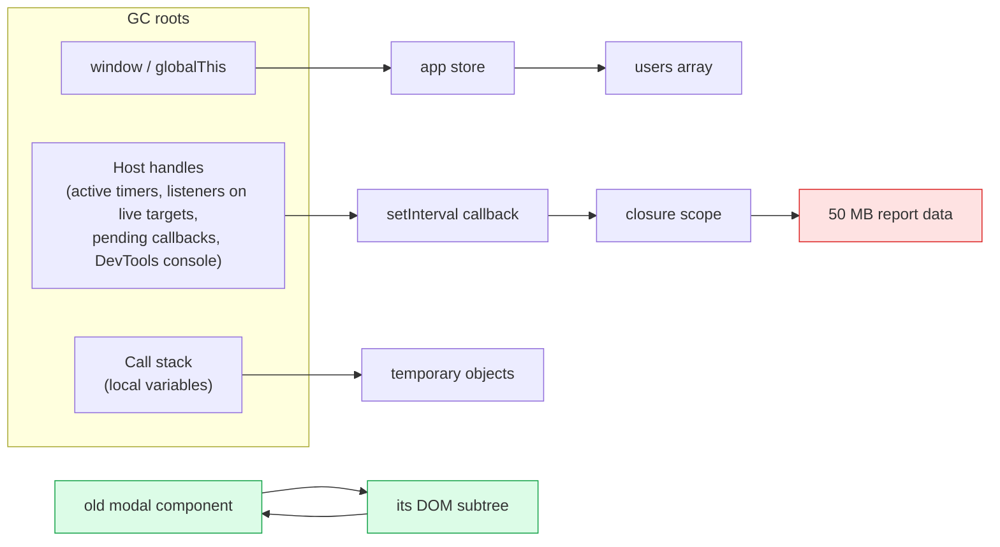
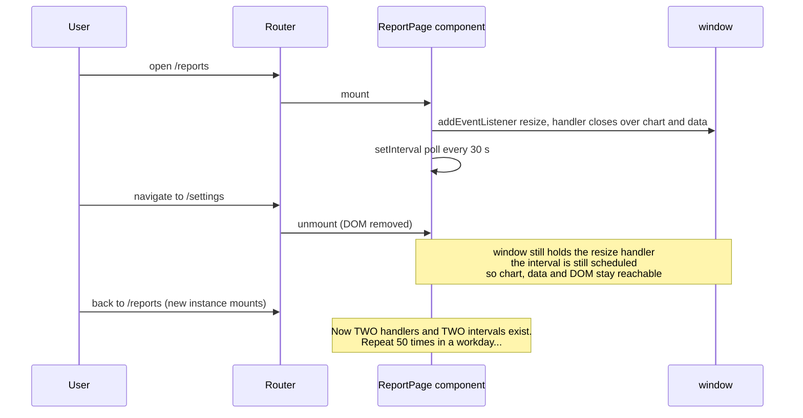
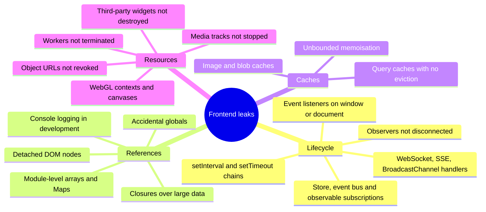
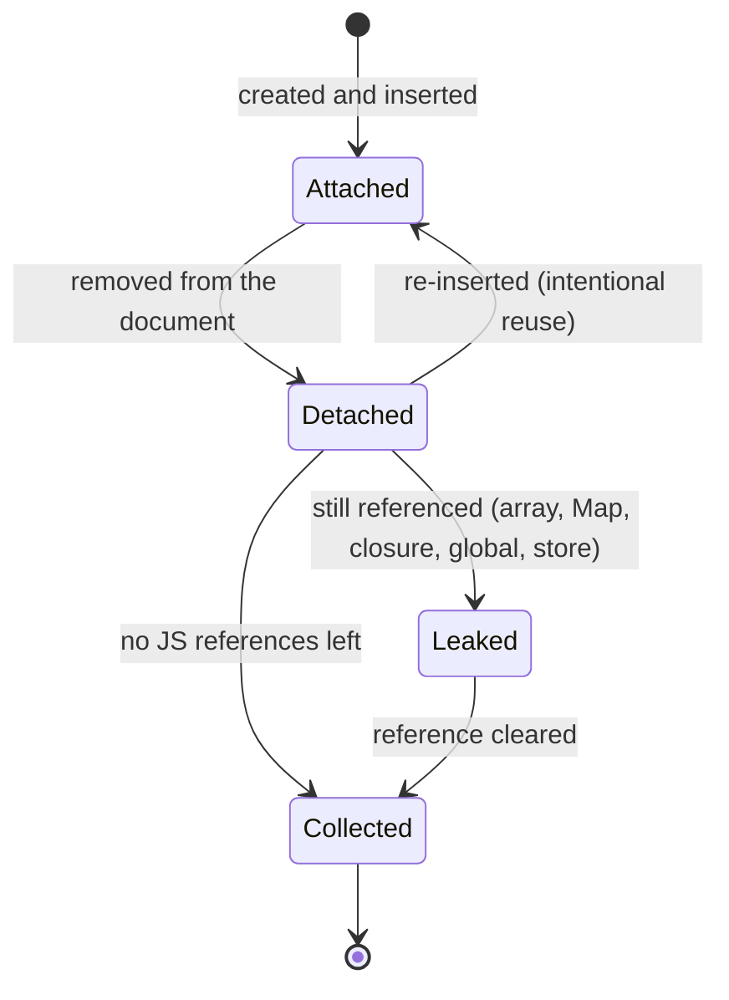
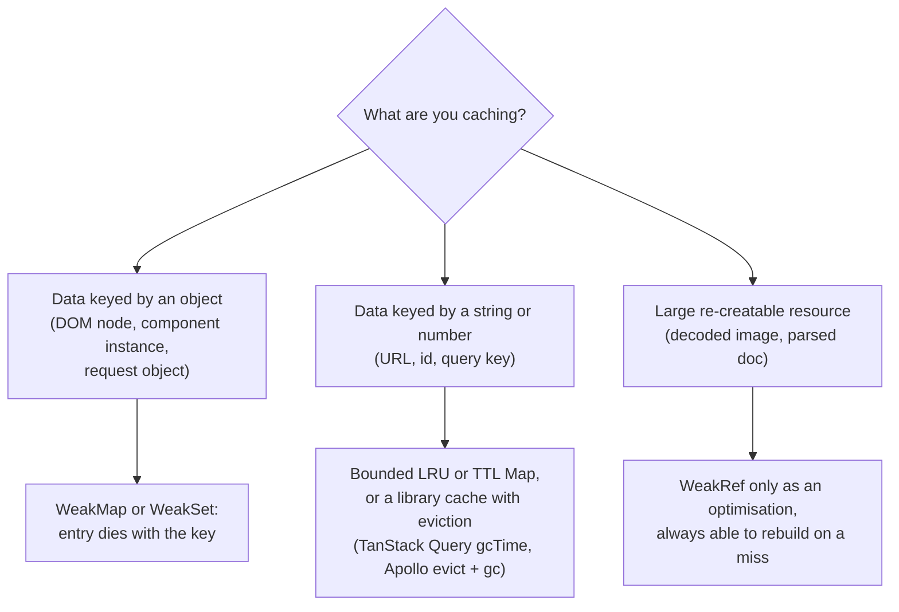
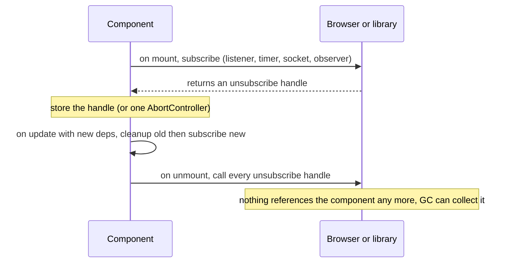
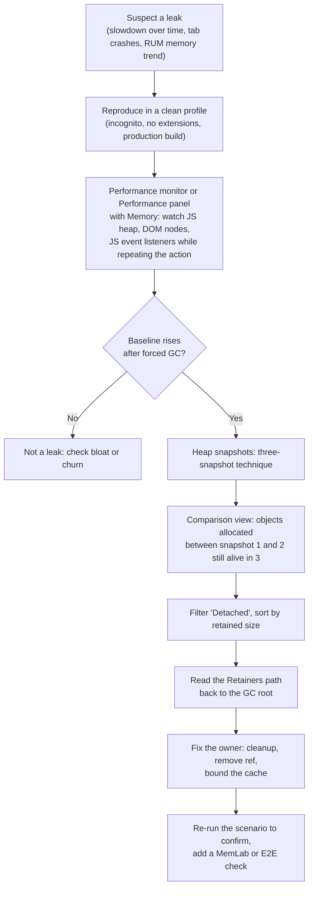
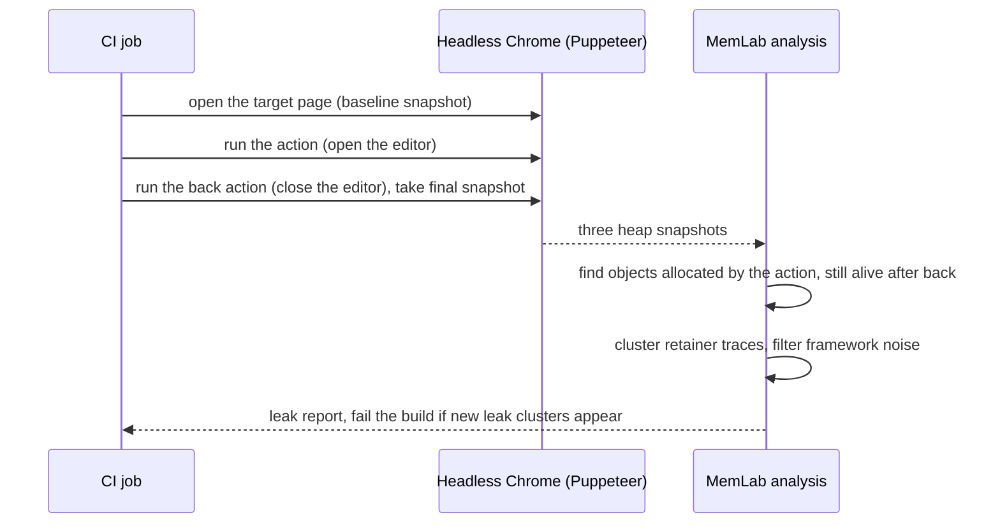
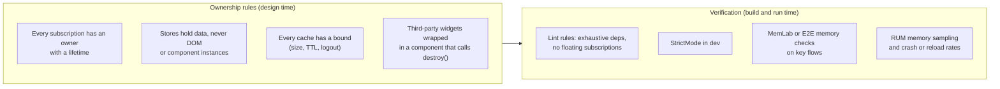

# Memory Leaks in Frontend Apps

> **Date:** 2026-11-06 · **Last updated:** 2026-11-06
> **Category:** Frontend System Design
> **Sub-Topic:** Performance Engineering / Runtime Performance (memory)
> **Level:** Intermediate · **Reading time:** ~32 min
> **Informs:** component lifecycle and cleanup contracts, subscription/listener/timer ownership, bounded client caches (LRU/TTL, gcTime), long-lived SPA sessions and dashboards, third-party widget teardown, leak testing in CI (MemLab), memory monitoring in RUM

> **Pre-requisite:** [JavaScript Runtime & Event Loop](../01-web-fundamentals/javascript-runtime-event-loop.md) (heap, garbage collection, timers) and [DOM & Virtual DOM](../01-web-fundamentals/dom-and-virtual-dom.md) (how frameworks create and remove nodes).
> This note explains **why memory that should be freed isn't**, the leak patterns that recur in every framework, and a repeatable workflow to find and prevent them.

**Previous:** [Web Workers for Heavy Computation](./web-workers-for-heavy-computation.md) · **Next:** [Animation Performance (CSS vs JS)](./animation-performance-css-vs-js.md)

---

## Table of Contents

1. [ELI5 — Simple Explanation](#eli5--simple-explanation)
2. [Section 1: How the Browser Frees Memory](#section-1-how-the-browser-frees-memory)
3. [Section 2: Leak vs Bloat vs Churn](#section-2-leak-vs-bloat-vs-churn)
4. [Section 3: Why SPAs Leak More Than Multi-Page Sites](#section-3-why-spas-leak-more-than-multi-page-sites)
5. [Section 4: The Leak Catalogue](#section-4-the-leak-catalogue)
6. [Section 5: Detached DOM Nodes](#section-5-detached-dom-nodes)
7. [Section 6: Closures That Hold Too Much](#section-6-closures-that-hold-too-much)
8. [Section 7: Unbounded Caches and Weak References](#section-7-unbounded-caches-and-weak-references)
9. [Section 8: Cleanup in Every Framework](#section-8-cleanup-in-every-framework)
10. [Section 9: Non-JS Resources: Blobs, Media, Canvas, Workers](#section-9-non-js-resources-blobs-media-canvas-workers)
11. [Section 10: Finding Leaks with DevTools](#section-10-finding-leaks-with-devtools)
12. [Section 11: Automated Leak Testing and Production Monitoring](#section-11-automated-leak-testing-and-production-monitoring)
13. [System Design Angle](#system-design-angle)
14. [Real-World Examples](#real-world-examples)
15. [Key Points Summary](#key-points-summary)
16. [Test Your Understanding (with answers)](#test-your-understanding)
17. [Cheat Sheet](#cheat-sheet)
18. [References & Further Reading](#references--further-reading)

---

## ELI5 — Simple Explanation

Think of a **hotel with a cleaning crew** (the garbage collector).

- The crew only cleans rooms whose **keys have been returned**. If a guest checked out but **still has a key in their pocket**, the crew assumes the room is in use and never cleans it.
- A **memory leak** is exactly that: your app is done with something (a closed modal, an old page, a finished chart), but **some reference still points to it** — a timer, an event listener on `window`, a cache entry, a global variable. The crew can't clean it.
- One forgotten key is harmless. But a dashboard left open for a whole workday, opening and closing the same modal 500 times, keeps **500 rooms locked**. Eventually the hotel is full: the page slows down, then the phone's browser kills the tab.

> **Garbage collection frees what is unreachable, not what is unused. A leak is anything you no longer need that is still reachable — so every subscription you start needs an owner who ends it.**

---

## Core Concept — Step by Step

### Section 1: How the Browser Frees Memory

JavaScript engines use **tracing garbage collection** (mark-and-sweep, generational in V8, SpiderMonkey and JavaScriptCore). Starting from **roots**, the collector marks everything it can reach; everything else is freed. Circular references are fine: a cycle that nothing reaches is collected.



- **Green** (old modal and its subtree): a cycle, but **unreachable** from any root, so it is collected.
- **Red** (50 MB report): the user closed the report, but an **interval callback** still closes over it. Reachable, so never collected. That is a leak.

Key facts:
- GC timing is **non-deterministic**. Memory going up for a while is normal; the question is whether it **comes back down after a GC**.
- **Shallow size** = the object's own bytes. **Retained size** = everything that would be freed if this object were freed. Leaks are hunted by **retained size**.
- Engines run most GC work incrementally and concurrently, but a large, growing heap still means **longer and more frequent GC work**, which can cause jank.

---

### Section 2: Leak vs Bloat vs Churn

Not every memory problem is a leak. Diagnose which one you have:

```text
LEAK  (grows with every repetition, never returns)
heap ▲                                         ╱
     │                              ╱‾‾‾‾‾‾‾‾‾╱
     │                   ╱‾‾‾‾‾‾‾‾‾╱
     │        ╱‾‾‾‾‾‾‾‾‾╱
     └──────────────────────────────────────────► repeat: open modal → close modal

HEALTHY / CHURN  (sawtooth: allocate, then GC drops back to a stable baseline)
heap ▲    ╱|   ╱|   ╱|   ╱|   ╱|
     │   ╱ |  ╱ |  ╱ |  ╱ |  ╱ |
     │  ╱  | ╱  | ╱  | ╱  | ╱  |
     └──────────────────────────────────────────► time

BLOAT  (flat but too high: you are keeping too much on purpose)
heap ▲ ‾‾‾‾‾‾‾‾‾‾‾‾‾‾‾‾‾‾‾‾‾‾‾‾‾‾‾‾‾‾‾‾‾‾‾‾‾‾‾
     └──────────────────────────────────────────► time
```

| Problem | Symptom | Typical cause | Fix |
|---|---|---|---|
| **Leak** | Baseline rises with each repeated action | Forgotten listener/timer/subscription, detached DOM, unbounded cache | Find the retainer, add cleanup |
| **Bloat** | High but stable usage | Huge DOM, whole datasets in memory, giant bundles, unvirtualised lists | Virtualise, paginate, keep data in a worker or server |
| **Churn** | Steep sawtooth, frequent GC, jank during interaction | Allocating many short-lived objects per frame (e.g. new arrays every `mousemove`) | Reuse objects, avoid allocation in hot paths |

---

### Section 3: Why SPAs Leak More Than Multi-Page Sites

A full page navigation discards the whole document and its JS heap. A **single-page app never does**: every route change, modal and widget lives in the same heap for the whole session.



Leaks matter most for:
- **Long-lived apps**: dashboards, email/chat clients, trading screens, kiosks, admin tools left open for hours or days.
- **Low-memory devices**: mobile browsers kill or reload background (and sometimes foreground) tabs under memory pressure. Users experience it as "the page reloaded and I lost my form".
- **Embedded webviews** (React Native WebView, Capacitor, Electron) where one process may host the app for a very long time.

---

### Section 4: The Leak Catalogue



| # | Pattern | What keeps it alive | Fix |
|---|---|---|---|
| 1 | **Listener on a long-lived target** (`window`, `document`, `body`, a global event bus) | The target's listener list holds the handler, and the handler's closure holds component state/DOM | Remove in cleanup, or `addEventListener(type, fn, { signal })` and `abort()` |
| 2 | **Timers** (`setInterval`, recursive `setTimeout`, `requestAnimationFrame` loops) | The browser keeps scheduled callbacks (and their closures) alive | `clearInterval` / `clearTimeout` / `cancelAnimationFrame` on teardown |
| 3 | **Subscriptions** (Redux `store.subscribe`, RxJS, Zustand/Jotai `subscribe`, Firebase/GraphQL subscriptions, WebSocket `onmessage`) | The publisher's subscriber list | Call the returned unsubscribe / `.unsubscribe()` / `close()` |
| 4 | **Observers** (`ResizeObserver`, `IntersectionObserver`, `MutationObserver`, `PerformanceObserver`) | An active observer keeps its callback and whatever it closes over | `observer.disconnect()` |
| 5 | **Accidental globals** (`leaked = []` without a declaration in sloppy mode, `window.debugData = ...`) | `window` is a root | ES modules/strict mode, linting, no debug globals in production |
| 6 | **Module-level collections** (`const cache = new Map()` at file scope) | The module lives for the whole session | Bound it (LRU/TTL), clear on logout/route change, or scope it to a component |
| 7 | **Detached DOM nodes** (Section 5) | A JS reference to a removed node retains its whole subtree | Null out refs, keep DOM refs inside components only |
| 8 | **Closures over big data** (Section 6) | A long-lived function's scope | Capture only what you need; release big objects explicitly |
| 9 | **Pending async work after unmount** (in-flight `fetch`, long `await` chains) | The promise chain holds closures until it settles | `AbortController` on unmount; it's usually temporary, but polls and retries can make it permanent |
| 10 | **`console.log(obj)` with DevTools open** | The console keeps logged objects for inspection | Don't diagnose memory with DevTools logging enabled; strip logs in production |
| 11 | **Third-party instances** (charts, maps, editors, video players, carousels) | The library's internal registries, listeners and timers | Call the library's `destroy()` / `dispose()` / `remove()` on unmount |

---

### Section 5: Detached DOM Nodes

A **detached node** has been removed from the document but is **still referenced from JavaScript**. Because every node points to its parent and children, holding **one** node can keep the **entire removed subtree** alive, plus anything those nodes reference (listeners, data in closures, framework fiber/vnode objects).



```javascript
// ❌ BAD: a module-level registry keeps every row element forever
const rowsById = new Map();
function renderRow(item) {
  const tr = document.createElement('tr');
  tr.textContent = item.name;
  rowsById.set(item.id, tr);              // never deleted when the table re-renders
  return tr;
}

// ✅ GOOD: delete on removal, or key by the element so the entry dies with it
const metaByRow = new WeakMap();           // element -> metadata, held weakly
function renderRowGood(item) {
  const tr = document.createElement('tr');
  tr.textContent = item.name;
  metaByRow.set(tr, { id: item.id });     // when tr is unreachable, the entry can be collected
  return tr;
}
```

**Where detached nodes typically come from:**
- Storing DOM elements in **arrays/Maps/stores** (including Redux/Pinia/NgRx state, which should hold **data, not DOM**).
- **Refs captured in closures** that outlive the component (`resize` handlers, timers, global callbacks).
- Libraries that cache nodes (tooltips, virtual list item pools) without a `destroy()` call.
- Old patterns that keep a `lastFocusedElement` or `previousModal` reference in a global.

> Modern browsers collect removed elements together with their listeners when nothing else references them. You do **not** need to remove listeners from elements you are deleting, as long as no outside reference keeps those elements (or the handlers) alive. Listeners on **long-lived targets** (`window`, `document`) are the ones that leak.

---

### Section 6: Closures That Hold Too Much

A closure keeps its **outer scope's variables** alive for as long as the function itself is reachable. Engines such as V8 store captured variables in a **context object shared by all closures created in that scope**, so a variable captured by *one* closure can be retained by a *different*, long-lived closure from the same scope.

```javascript
// ❌ BAD: the long-lived handler shares a scope with code that captured `report`
function openReport(report /* 50 MB */) {
  const summary = summarize(report);
  const logSize = () => console.log(report.rows.length);   // captures `report`
  logSize();
  window.addEventListener('resize', () => layout(summary)); // shares the scope that holds `report`
}                                                           // and is never removed

// ✅ GOOD: compute what you need in a separate function, capture only small values, own the listener
function openReportGood(report, signal) {
  const summary = summarize(report);                        // report is only a parameter here
  window.addEventListener('resize', () => layout(summary), { signal }); // removed when signal aborts
}
```

Closure leaks show up in heap snapshots as a `(closure)` or `system / Context` entry in the **retainers** chain. The fix is almost always **ownership**: remove the long-lived reference (listener, timer, global callback) and the whole scope becomes collectable.

---

### Section 7: Unbounded Caches and Weak References

Caching is intentional retention, so it must be **bounded**.



| Tool | Use for | Caveats |
|---|---|---|
| **`WeakMap` / `WeakSet`** | Metadata attached to objects you don't own (DOM nodes, instances) | Keys must be objects (or non-registered symbols); not iterable, no `size` |
| **`WeakRef`** | Optional caches of big, re-creatable objects | `deref()` may return `undefined` at any time; don't build correctness on it |
| **`FinalizationRegistry`** | Best-effort cleanup hints (e.g. free a WASM allocation) | Callbacks may run late or **never**; MDN advises avoiding it where possible |
| **LRU / TTL map** | String-keyed caches (API results, computed values) | Choose a max size and/or max age; clear on logout |
| **Library caches** | TanStack Query (`gcTime`, default 5 minutes for inactive queries), SWR, Apollo (`cache.evict` + `cache.gc()`), RTK Query (`keepUnusedDataFor`) | Infinite `gcTime`/`staleTime` across thousands of keys becomes bloat |

```typescript
// A tiny LRU: Map preserves insertion order, so the first key is the least recently used
export class LRU<K, V> {
  private map = new Map<K, V>();
  constructor(private max = 500) {}
  get(key: K) {
    if (!this.map.has(key)) return undefined;
    const v = this.map.get(key)!;
    this.map.delete(key); this.map.set(key, v);   // move to most-recent
    return v;
  }
  set(key: K, value: V) {
    this.map.delete(key);
    this.map.set(key, value);
    if (this.map.size > this.max) this.map.delete(this.map.keys().next().value!);
  }
  clear() { this.map.clear(); }
}
```

> **Logout is a memory event too.** Clear app caches, stores, query caches and module-level maps on sign-out, both for memory and for privacy on shared devices. See [Data Normalization & Caching](../03-state-and-data/data-normalization-and-caching.md) and [React Query / TanStack Query](../03-state-and-data/react-query-tanstack-query.md).

---

### Section 8: Cleanup in Every Framework

Every framework gives you a **teardown hook**. The rule is the same everywhere: **whoever starts something owns stopping it.**



| Framework | Teardown hook | Built-in help |
|---|---|---|
| **React** | `useEffect(() => { ...; return cleanup }, deps)` | StrictMode in development mounts, unmounts and re-mounts components to expose missing cleanup. `useSyncExternalStore` handles subscribe/unsubscribe for external stores |
| **Vue 3** | `onUnmounted` / `onBeforeUnmount`, `onScopeDispose`; `watchEffect(onCleanup => ...)` | Watchers and computeds created **synchronously** in `setup` stop automatically on unmount; ones created asynchronously (after an `await`, in a `setTimeout`) must be stopped manually |
| **Angular** | `DestroyRef.onDestroy()`, `ngOnDestroy` | `takeUntilDestroyed()` (from `@angular/core/rxjs-interop`), the `async` pipe and signals-based `effect()` clean up with their injection context |
| **Svelte 5** | `$effect(() => { ...; return teardown })`, `onDestroy` | `$store` auto-subscriptions are unsubscribed automatically |
| **Solid** | `onCleanup` | Cleanup runs before each re-run of an effect and on disposal |
| **Lit / Web Components** | `disconnectedCallback` | Reactive controllers have `hostDisconnected` |

**One `AbortController` per lifetime** is the cleanest universal pattern: listeners take `{ signal }` (supported in all current engines), `fetch` takes `signal`, and many libraries accept one.

```typescript
// React: one controller cleans up everything this effect started
useEffect(() => {
  const ctrl = new AbortController();
  const { signal } = ctrl;
  window.addEventListener('resize', onResize, { signal });
  document.addEventListener('keydown', onKey, { signal });
  fetch(`/api/report/${id}`, { signal }).then((r) => r.json()).then(setData).catch(() => {});
  const timer = setInterval(poll, 30_000);
  const ro = new ResizeObserver(onBoxResize); ro.observe(boxRef.current!);
  return () => { ctrl.abort(); clearInterval(timer); ro.disconnect(); };
}, [id]);
```

> React 18 removed the "Can't perform a React state update on an unmounted component" warning: setting state after unmount is a no-op, and the warning mostly produced false positives. The real leak is the **subscription** that keeps calling `setState`, not the call itself.

**Native platforms have the same problem in different clothes:**

| Platform | Classic leak | Prevention / tooling |
|---|---|---|
| iOS (Swift, ARC) | **Retain cycles**: a closure or delegate strongly captures `self` | `[weak self]` in escaping closures, `weak` delegates; Xcode Memory Graph Debugger, Instruments (Leaks, Allocations) |
| Android (Kotlin) | Long-lived objects (singletons, statics, background jobs) holding an `Activity`/`View` context | Lifecycle-aware scopes (`viewModelScope`, `lifecycleScope`, `repeatOnLifecycle`); LeakCanary |
| Flutter | Controllers and stream subscriptions never disposed | `dispose()` for `AnimationController`, `TextEditingController`; `subscription.cancel()`; DevTools Memory view |
| React Native | Native event subscriptions left registered | Call `.remove()` on the subscription returned by `addEventListener`/`addListener` in effect cleanup |

---

### Section 9: Non-JS Resources: Blobs, Media, Canvas, Workers

Some leaks barely show in the JS heap because the memory lives in the browser's native side (decoders, GPU, media pipeline). They still count against the tab's memory.

| Resource | Leak | Release |
|---|---|---|
| `URL.createObjectURL(blob)` | The blob stays alive until revoked or the document unloads | `URL.revokeObjectURL(url)` once the image/video has loaded or on unmount |
| `getUserMedia()` stream | Camera/mic stays on (indicator light), memory held | `stream.getTracks().forEach(t => t.stop())` |
| `ImageBitmap` / `VideoFrame` | Decoded pixel memory | `bitmap.close()`, `frame.close()` |
| WebGL / WebGPU | GPU buffers, textures; browsers cap active WebGL contexts and drop the oldest | Delete buffers/textures; dispose the library renderer (e.g. three.js `dispose()`); `WEBGL_lose_context` |
| `<canvas>` elements | Large backing stores held by detached canvases | Remove references; shrink width/height to 0 if you pool them |
| `Worker` | Each worker has its own heap | `worker.terminate()` (see [Web Workers for Heavy Computation](./web-workers-for-heavy-computation.md)) |
| `WebSocket` / `EventSource` / `BroadcastChannel` | Open connection plus handlers | `close()`; reconnect on `pageshow` if needed (bfcache friendliness) |
| `AudioContext` | Audio graph and thread | `audioContext.close()` |

---

### Section 10: Finding Leaks with DevTools



**The three-snapshot technique** (Chrome/Edge Memory panel; Firefox and Safari have equivalent tools):

```text
1. Load the page, perform the action once (warm up lazy code and caches).
2. Take Snapshot 1.                      (taking a snapshot runs a GC first)
3. Perform the action N times, returning to the same state (open + close the modal 10×).
4. Take Snapshot 2.
5. Perform the action N more times.  Take Snapshot 3.
6. In Snapshot 3, view "Objects allocated between Snapshot 1 and Snapshot 2".
   Anything still alive that scales with N (10 or 20 instances of the same thing) is a leak candidate.
7. Select one → Retainers pane → follow the path to the root (window, a listener, a timer, a Map).
```

| Tool | Best for |
|---|---|
| **Performance monitor** (Chrome/Edge DevTools) | Live counters: JS heap size, DOM nodes, JS event listeners, documents |
| **Performance panel + Memory checkbox** | Heap and node counts over a recorded interaction; spot sawtooth vs staircase |
| **Memory → Heap snapshot** | What is alive and **why** (retainers, retained size, `Detached` filter) |
| **Memory → Allocations on timeline** | Which code allocated objects that survived |
| **Memory → Allocation sampling** | Low-overhead view of which functions allocate most (churn) |
| **Firefox DevTools Memory** | Snapshots, dominators view, allocation stacks |
| **Safari Web Inspector Timelines** | JavaScript allocations and memory timeline |
| **`queryObjects(Constructor)`** (Chrome console) | Count live instances of a class quickly |

Reading a snapshot:
- **Distance** = hops from a GC root. **Retained size** = what you'd free by removing this object.
- Names in parentheses are internal: `(closure)`, `(array)`, `(string)`, `system / Context` (closure scope).
- Framework internals show up in retainer chains (e.g. React fibers via `__reactFiber$...` properties on DOM nodes, Vue component instances). Follow the chain past them to **your** code.
- Development builds and framework devtools extensions retain extra objects. **Confirm leaks in a production build** without extensions.

---

### Section 11: Automated Leak Testing and Production Monitoring



- **[MemLab](https://facebook.github.io/memlab/)** (open source, by Meta): you describe a scenario (`url`, `action`, `back`); it drives Chrome via Puppeteer, takes heap snapshots and reports leaked objects grouped by retainer trace. Good for "open/close" flows in CI.
- **Playwright/Puppeteer** checks: repeat a flow N times and assert that DOM node count or `queryObjects` counts return to baseline (use Chrome DevTools Protocol metrics).
- **In production**:
  - `performance.measureUserAgentSpecificMemory()` returns an estimate of the page's memory, **Chromium only**, and only on **cross-origin isolated** pages. Sample it occasionally (it is asynchronous and may take a while to resolve).
  - `performance.memory` is a **non-standard, deprecated** Chromium API; don't build on it.
  - Watch proxy signals in RUM: session length vs. long-task rate, crash/reload rates on mobile, error reports mentioning out-of-memory.

---

## System Design Angle



Design decisions this topic drives:

| Decision | Leak-resistant choice |
|---|---|
| Where real-time subscriptions live | One shared connection manager (ref-counted subscribe/unsubscribe), not one socket per component |
| How components use global events | Through a hook/composable/service that registers and removes listeners for you |
| Client cache policy | Explicit eviction (`gcTime`, LRU, TTL), cleared on logout and tenant switch |
| Long lists and feeds | Virtualisation and windowing so off-screen items are unmounted ([Virtual Scrolling & Windowing](./virtual-scrolling-and-windowing.md)) |
| Micro-frontends | Each remote exposes `mount`/`unmount` and must release globals, listeners and styles on unmount ([Micro-Frontends Architecture](../02-rendering-and-architecture/micro-frontends-architecture.md)) |
| Very long sessions (kiosk, trading, ops dashboards) | Budget memory, test multi-hour soak scenarios, consider a periodic soft reload at a safe moment as a last-resort safety net |

---

## Real-World Examples

**Example 1 — BAD → GOOD: a chart widget that leaks on every route change (React):**
```tsx
// ❌ BAD: no cleanup. Each mount adds a window listener, an interval and a chart instance.
function SalesChart({ data }: { data: Point[] }) {
  const el = useRef<HTMLDivElement>(null);
  useEffect(() => {
    const chart = createChart(el.current!, data);             // third-party library
    window.addEventListener('resize', () => chart.resize());
    setInterval(() => fetchLatest().then((d) => chart.update(d)), 10_000);
  }, [data]);
  return <div ref={el} />;
}

// ✅ GOOD: every resource started in the effect is released by its cleanup
function SalesChartFixed({ data }: { data: Point[] }) {
  const el = useRef<HTMLDivElement>(null);
  useEffect(() => {
    const ctrl = new AbortController();
    const chart = createChart(el.current!, data);
    window.addEventListener('resize', () => chart.resize(), { signal: ctrl.signal });
    const timer = setInterval(() => {
      fetchLatest({ signal: ctrl.signal }).then((d) => chart.update(d)).catch(() => {});
    }, 10_000);
    return () => { ctrl.abort(); clearInterval(timer); chart.destroy(); };
  }, [data]);
  return <div ref={el} />;
}
```

**Example 2 — Vue, Angular and Svelte versions of the same cleanup:**
```typescript
// Vue 3 (<script setup lang="ts">)
const el = ref<HTMLElement | null>(null);
let chart: Chart | undefined;
const ctrl = new AbortController();
onMounted(() => {
  chart = createChart(el.value!, props.data);
  window.addEventListener('resize', () => chart?.resize(), { signal: ctrl.signal });
});
onBeforeUnmount(() => { ctrl.abort(); chart?.destroy(); });

// Angular (standalone component)
export class SalesChartComponent {
  private destroyRef = inject(DestroyRef);
  private host = inject(ElementRef<HTMLElement>);
  constructor() {
    afterNextRender(() => {
      const chart = createChart(this.host.nativeElement, this.data());
      interval(10_000).pipe(
        switchMap(() => this.api.latest()),
        takeUntilDestroyed(this.destroyRef),
      ).subscribe((d) => chart.update(d));
      this.destroyRef.onDestroy(() => chart.destroy());
    });
  }
}

// Svelte 5
// $effect(() => {
//   const chart = createChart(node, data);
//   const id = setInterval(() => fetchLatest().then((d) => chart.update(d)), 10_000);
//   return () => { clearInterval(id); chart.destroy(); };
// });
```

**Example 3 — Ref-counted shared subscription instead of one socket per component:**
```typescript
// One WebSocket per channel no matter how many components listen; closed when the last one leaves
const channels = new Map<string, { ws: WebSocket; listeners: Set<(msg: unknown) => void> }>();

export function subscribe(channel: string, fn: (msg: unknown) => void): () => void {
  let entry = channels.get(channel);
  if (!entry) {
    const ws = new WebSocket(`wss://example.com/ws/${channel}`);
    entry = { ws, listeners: new Set() };
    ws.onmessage = (e) => entry!.listeners.forEach((l) => l(JSON.parse(e.data)));
    channels.set(channel, entry);
  }
  entry.listeners.add(fn);
  return () => {                                  // the caller's cleanup calls this
    entry!.listeners.delete(fn);
    if (entry!.listeners.size === 0) { entry!.ws.close(); channels.delete(channel); }
  };
}

// React usage: the unsubscribe function IS the effect cleanup
useEffect(() => subscribe('prices', setPrice), []);
```

**Example 4 — Object URLs for image previews:**
```tsx
// ❌ BAD: a new blob URL per file selection, never revoked → blobs stay in memory
const preview = URL.createObjectURL(file);

// ✅ GOOD: revoke when the preview changes or the component unmounts
function Preview({ file }: { file: File }) {
  const [url, setUrl] = useState<string>();
  useEffect(() => {
    const u = URL.createObjectURL(file);
    setUrl(u);
    return () => URL.revokeObjectURL(u);
  }, [file]);
  return url ?  : null;
}
```

**Example 5 — A MemLab scenario for CI:**
```javascript
// memlab/scenarios/editor.js — run with: npx memlab run --scenario memlab/scenarios/editor.js
module.exports = {
  url: () => 'http://localhost:4173/projects/demo',
  action: async (page) => {                       // open the heavy feature
    await page.click('[data-testid="open-editor"]');
    await page.waitForSelector('[data-testid="editor-ready"]');
  },
  back: async (page) => {                         // return to the starting state
    await page.click('[data-testid="close-editor"]');
    await page.waitForSelector('[data-testid="editor-ready"]', { hidden: true });
  },
};
```

---

## Key Points Summary

| Concept | One-Line Explanation |
|---|---|
| **Reachability** | GC frees unreachable objects; reachable-but-unneeded memory is a leak |
| **Retained size** | Memory freed if an object goes away; hunt leaks by this, not shallow size |
| **Leak vs bloat vs churn** | Rising baseline vs high flat usage vs heavy allocation with frequent GC |
| **SPAs** | One heap for the whole session, so small per-navigation leaks accumulate |
| **Long-lived targets** | Listeners on `window`/`document`/buses leak; listeners on deleted elements don't |
| **Timers and subscriptions** | Anything you start, you stop: `clear*`, `unsubscribe`, `disconnect`, `close` |
| **Detached DOM** | Removed nodes kept alive by JS references, often with their whole subtree |
| **Closures** | Long-lived callbacks keep their scope alive; capture small values only |
| **Bounded caches** | LRU/TTL/`gcTime`; clear on logout; WeakMap for object-keyed metadata |
| **AbortController** | One controller per lifetime cleans listeners and fetches with one `abort()` |
| **Framework hooks** | `useEffect` cleanup, `onUnmounted`/`onScopeDispose`, `DestroyRef`/`takeUntilDestroyed`, `$effect` teardown |
| **Native resources** | Revoke object URLs, stop media tracks, close bitmaps, dispose WebGL, terminate workers |
| **Three-snapshot technique** | Repeat the action, compare snapshots, follow retainers to the owner |
| **Automation** | MemLab or E2E node/instance counts on key flows; RUM sampling in production |

---

## Test Your Understanding

**Q1 (Basic):**
JavaScript has a garbage collector. How can a JS app still leak memory?

<details>
<summary>Answer</summary>

The garbage collector frees **unreachable** objects. It cannot know what your app **no longer needs**. If any path from a GC root (globals, the stack, active timers, listeners on live targets, pending callbacks) still reaches an object, it is kept. A leak is therefore memory that is **logically dead but still reachable**: a forgotten interval whose closure holds a big object, a listener on `window` that references an unmounted component, an ever-growing module-level `Map`, or a detached DOM subtree stored in an array.
</details>

**Q2 (Application):**
In a React app, each time users open and close a "Report" route, JS heap grows by roughly the same amount and never returns, even after forcing GC. Outline how you'd find the cause.

<details>
<summary>Answer</summary>

1. Reproduce in a **production build**, incognito, no extensions.
2. Warm up (open/close once), take **Snapshot 1**, open/close the route 10 times, **Snapshot 2**, 10 more times, **Snapshot 3**.
3. In Snapshot 3 view objects allocated between 1 and 2; look for things whose counts scale with the repetitions (10 or 20 chart instances, `Detached <div>` trees, closures).
4. Filter by `Detached`, sort by **retained size**, open the **Retainers** pane and follow the path to the root: typically a `window` listener, an interval, a store subscription, or a library registry.
5. Fix the owner (effect cleanup, `chart.destroy()`, unsubscribe), re-run the scenario to confirm, and add a MemLab or E2E check for that route.
</details>

**Q3 (Application):**
Your Vue component starts a watcher inside a `setTimeout` in `setup()`, and an Angular component subscribes to an RxJS `interval` in `ngOnInit`. Which leaks and how do you fix each?

<details>
<summary>Answer</summary>

- **Vue:** watchers created **synchronously** in `setup` are bound to the component and stop on unmount. One created **asynchronously** (inside `setTimeout` or after an `await`) is not bound to the instance and keeps running. Fix: keep the stop handle (`const stop = watch(...)`) and call it in `onUnmounted`, or create it synchronously.
- **Angular:** `interval()` never completes, so the subscription lives forever and keeps the component alive. Fix: `pipe(takeUntilDestroyed(this.destroyRef))`, use the `async` pipe in the template, or unsubscribe in `ngOnDestroy`.
</details>

**Q4 (Tricky):**
A teammate says: "We must remove every event listener before removing an element, otherwise it leaks." True?

<details>
<summary>Answer</summary>

Mostly **false** in modern browsers. If an element is removed and **nothing else references it**, the element and its listeners are collected together; the listener only references the element's handler, and the handler only matters if something outside still reaches it. (Old Internet Explorer had cyclic DOM/JS leaks, which is where the advice came from.)

What **does** leak: listeners on **long-lived targets** (`window`, `document`, a global event bus, a parent that stays mounted), because those targets keep the handler alive and the handler's closure keeps your component, data and DOM alive. Also, a removed element that is still stored in an array/Map/closure leaks regardless of listeners.
</details>

**Q5 (Tricky):**
Should you use `WeakRef` and `FinalizationRegistry` to fix a cache that grows without limit?

<details>
<summary>Answer</summary>

Generally **no**. `WeakRef` targets can disappear at any time (or survive much longer than you expect), and `FinalizationRegistry` callbacks may run late or **never**; MDN recommends avoiding them where possible. They make behaviour depend on GC timing, which differs across engines and devices.

Fix the cache with a **policy**: an LRU with a max size, a TTL, eviction on logout/route change, or a library's built-in eviction (TanStack Query `gcTime`, Apollo `cache.evict` + `cache.gc()`). Use `WeakMap` when the cache is **keyed by objects** whose lifetime should govern the entry (e.g. per-DOM-node metadata). `WeakRef` is acceptable only as an optional optimisation where a miss is always safe to rebuild.
</details>

**Q6 (System design):**
You're designing an operations dashboard that stays open 12+ hours on wall screens: live WebSocket updates, 20 widgets, charts, and periodic route rotation. What memory-related design decisions do you make?

<details>
<summary>Answer</summary>

- **Ownership**: each widget is a component that creates resources on mount and releases them on unmount (charts `destroy()`, observers `disconnect()`, timers cleared, one `AbortController` per widget lifetime).
- **One connection manager**: a single WebSocket with ref-counted channel subscriptions; widgets subscribe/unsubscribe through a hook/service, never directly.
- **Bounded data**: ring buffers for time series (keep the last N points), LRU/TTL for lookups, `gcTime` on query caches; the store holds data, never DOM nodes.
- **Rendering**: virtualise long tables; avoid allocating new arrays on every message (batch updates per animation frame) to limit churn.
- **Testing**: a soak test (hours of simulated messages and route rotation) watching heap, DOM node and listener counts; MemLab scenarios for open/close of each widget in CI.
- **Monitoring**: `measureUserAgentSpecificMemory()` sampling if the page can be cross-origin isolated, plus crash/reload tracking; alert on upward trends.
- **Safety net**: a scheduled soft reload at a quiet moment (with state restored from storage) as a last resort, not a substitute for fixing leaks.
</details>

---

## Cheat Sheet

**Key Definitions:**
- **Memory leak:** memory the app no longer needs that is still reachable from a GC root.
- **GC root:** a starting point for reachability (globals, stack, host-held callbacks such as timers and listeners).
- **Retainer:** an object holding a reference that keeps another object alive.
- **Retained size:** total memory freed if an object were collected.
- **Detached DOM node:** removed from the document but still referenced from JS.
- **Churn:** many short-lived allocations causing frequent GC (not a leak, still a performance problem).

**Quick Reference:**
```text
Started it? Stop it.
  addEventListener          → removeEventListener  |  { signal } + controller.abort()
  setInterval / setTimeout  → clearInterval / clearTimeout
  requestAnimationFrame     → cancelAnimationFrame
  subscribe()               → unsubscribe() / returned function
  new XObserver()           → observer.disconnect()
  new WebSocket/EventSource → close()
  URL.createObjectURL       → URL.revokeObjectURL
  getUserMedia stream       → track.stop() for every track
  new Worker                → worker.terminate()
  chart/map/editor instance → instance.destroy() / dispose() / remove()

Framework hooks
  React     useEffect(() => { ...; return cleanup }, deps)
  Vue       onUnmounted / onScopeDispose / watch stop handle
  Angular   takeUntilDestroyed(), DestroyRef.onDestroy, async pipe
  Svelte    $effect(() => { ...; return teardown }), onDestroy
  Solid     onCleanup

Find it
  Performance monitor → heap, DOM nodes, listeners rising after GC?
  3 heap snapshots → "allocated between 1 and 2" → filter Detached → Retainers
  Production build, incognito, no extensions, DevTools console logging off
```

**Common Mistakes to Avoid:**

| Mistake | Why Wrong | Fix |
|---|---|---|
| Effects with no cleanup | Listeners, timers, subscriptions accumulate per mount | Return a cleanup; use one `AbortController` |
| Storing DOM nodes or component instances in global stores/Maps | Keeps detached subtrees alive | Store data/ids; use `WeakMap` for node metadata |
| Unbounded module-level caches | Grow for the whole session | LRU/TTL, clear on logout |
| Not calling `destroy()` on third-party widgets | Library registries, listeners and timers stay alive | Wrap the widget; destroy on unmount |
| Assuming high memory = leak | It may be bloat or normal caching | Check whether the baseline returns after GC |
| Diagnosing in dev mode with extensions | Dev builds and extensions retain extra objects | Production build, incognito |
| Logging big objects to the console | DevTools keeps logged objects alive | Remove logs; close DevTools console when measuring |
| Relying on `FinalizationRegistry` for cleanup | Callbacks may never run | Explicit dispose methods |
| Forgetting object URLs, media tracks, bitmaps | Native memory and devices stay held | `revokeObjectURL`, `track.stop()`, `close()` |
| One WebSocket per component | Connections and handlers multiply | Shared, ref-counted connection manager |
| Asynchronously created Vue watchers | Not bound to the component, never stopped | Create synchronously or stop manually |
| Treating React's removed "unmounted setState" warning as the leak | The call is a no-op; the subscription is the leak | Unsubscribe in cleanup |

---

## References & Further Reading

**Core docs**
- MDN: [Memory management](https://developer.mozilla.org/en-US/docs/Web/JavaScript/Guide/Memory_management)
- MDN: [`WeakMap`](https://developer.mozilla.org/en-US/docs/Web/JavaScript/Reference/Global_Objects/WeakMap) · [`WeakRef`](https://developer.mozilla.org/en-US/docs/Web/JavaScript/Reference/Global_Objects/WeakRef) · [`FinalizationRegistry`](https://developer.mozilla.org/en-US/docs/Web/JavaScript/Reference/Global_Objects/FinalizationRegistry)
- MDN: [`EventTarget.addEventListener()` (the `signal` option)](https://developer.mozilla.org/en-US/docs/Web/API/EventTarget/addEventListener) · [`AbortController`](https://developer.mozilla.org/en-US/docs/Web/API/AbortController)
- MDN: [`URL.revokeObjectURL()`](https://developer.mozilla.org/en-US/docs/Web/API/URL/revokeObjectURL_static) · [`Performance.measureUserAgentSpecificMemory()`](https://developer.mozilla.org/en-US/docs/Web/API/Performance/measureUserAgentSpecificMemory)

**DevTools**
- Chrome for Developers: [Fix memory problems](https://developer.chrome.com/docs/devtools/memory-problems)
- Chrome for Developers: [Memory terminology](https://developer.chrome.com/docs/devtools/memory-problems/memory-101)
- Chrome for Developers: [Record heap snapshots](https://developer.chrome.com/docs/devtools/memory-problems/heap-snapshots)
- Firefox Source Docs: [Memory tool](https://firefox-source-docs.mozilla.org/devtools-user/memory/index.html)
- web.dev: [Monitor your web page's total memory usage with `measureUserAgentSpecificMemory()`](https://web.dev/articles/monitor-total-page-memory-usage)

**Frameworks**
- React: [Synchronizing with Effects (cleanup and StrictMode)](https://react.dev/learn/synchronizing-with-effects)
- Vue: [Watchers: stopping a watcher](https://vuejs.org/guide/essentials/watchers.html#stopping-a-watcher)
- Angular: [`DestroyRef`](https://angular.dev/api/core/DestroyRef) · [`takeUntilDestroyed`](https://angular.dev/api/core/rxjs-interop/takeUntilDestroyed)
- Svelte: [`$effect`](https://svelte.dev/docs/svelte/$effect)
- TanStack Query: [Caching examples (`gcTime`)](https://tanstack.com/query/latest/docs/framework/react/guides/caching)

**Tools and native platforms**
- [MemLab](https://facebook.github.io/memlab/) (Meta) · [LeakCanary](https://square.github.io/leakcanary/) (Android)
- Flutter: [Use the Memory view](https://docs.flutter.dev/tools/devtools/memory)

**Engine internals**
- V8: [Trash talk: the Orinoco garbage collector](https://v8.dev/blog/trash-talk)

---

> **Previous Topic:** [Web Workers for Heavy Computation](./web-workers-for-heavy-computation.md)
> — Moving CPU-heavy work off the main thread without moving huge data

> **Next Topic:** [Animation Performance (CSS vs JS)](./animation-performance-css-vs-js.md)
> — Which properties are cheap to animate, and when CSS, WAAPI or JS wins

*Saved on: 2026-11-06 | Repo: Frontend System Design Learning Notes*
