# Prefetching & Preloading

> **Date:** 2026-11-06 · **Last updated:** 2026-11-06
> **Category:** Frontend System Design
> **Sub-Topic:** Performance Engineering / Loading Performance (resource hints & speculative loading)
> **Level:** Intermediate · **Reading time:** ~28 min
> **Informs:** resource-hint strategy (preconnect, preload, modulepreload, prefetch), LCP resource discovery and fetchpriority, 103 Early Hints at the CDN, route and data prefetching in SPA routers, Speculation Rules prerendering for MPAs, bandwidth and server-load budgets for speculation, analytics on prerendered pages

> **Pre-requisite:** [Critical Rendering Path](../01-web-fundamentals/critical-rendering-path.md) (preload scanner, render-blocking resources) and [TCP/TLS Handshake](../01-web-fundamentals/tcp-tls-handshake.md) (what a connection costs).
> This note covers how to tell the browser about resources **before it would find them**, and how to load the **next page** before the user asks for it.

**Previous:** [Font Loading Strategies](./font-loading-strategies.md) · **Next:** [JavaScript Bundle Optimization](./javascript-bundle-optimization.md)

---

## Table of Contents

1. [ELI5 — Simple Explanation](#eli5--simple-explanation)
2. [Section 1: The Hint Family at a Glance](#section-1-the-hint-family-at-a-glance)
3. [Section 2: Discovery — What the Browser Finds by Itself](#section-2-discovery--what-the-browser-finds-by-itself)
4. [Section 3: `dns-prefetch` and `preconnect`](#section-3-dns-prefetch-and-preconnect)
5. [Section 4: `preload`](#section-4-preload)
6. [Section 5: `modulepreload`](#section-5-modulepreload)
7. [Section 6: Fetch Priority](#section-6-fetch-priority)
8. [Section 7: 103 Early Hints](#section-7-103-early-hints)
9. [Section 8: `prefetch` — Resources for the Next Page](#section-8-prefetch--resources-for-the-next-page)
10. [Section 9: Speculation Rules — Prefetch and Prerender Whole Pages](#section-9-speculation-rules--prefetch-and-prerender-whole-pages)
11. [Section 10: Prefetching in SPA Routers and Data Layers](#section-10-prefetching-in-spa-routers-and-data-layers)
12. [Section 11: Costs, Guardrails and Measurement](#section-11-costs-guardrails-and-measurement)
13. [Decision Matrix](#decision-matrix)
14. [Framework Comparison](#framework-comparison)
15. [Real-World Examples](#real-world-examples)
16. [Key Points Summary](#key-points-summary)
17. [Test Your Understanding](#test-your-understanding)
18. [Cheat Sheet](#cheat-sheet)
19. [References & Further Reading](#references--further-reading)

---

## ELI5 — Simple Explanation

You're cooking dinner for guests.

- **`dns-prefetch`** = looking up the shop's address before you need anything from it.
- **`preconnect`** = driving to the shop and parking at the door, so when you know what you need you just walk in.
- **`preload`** = "I definitely need eggs for **tonight's** recipe, and I'll only notice on page 3 of the recipe — buy them **now**."
- **`fetchpriority="high"`** = telling the shopper "eggs first, napkins later".
- **`103 Early Hints`** = the restaurant texts the shopper the main ingredients while the chef is still writing the full menu.
- **`prefetch`** = buying bread for **tomorrow's breakfast** when the shop is quiet — useful if you do have breakfast; wasted if you don't.
- **Prerender** = cooking tomorrow's breakfast tonight and keeping it warm. Instant if eaten, expensive if not.

> **Preload what *this* page certainly needs but finds late; prefetch or prerender what the *next* page probably needs — and only when the guess is good enough to pay for.**

---

## Core Concept — Step by Step

### Section 1: The Hint Family at a Glance

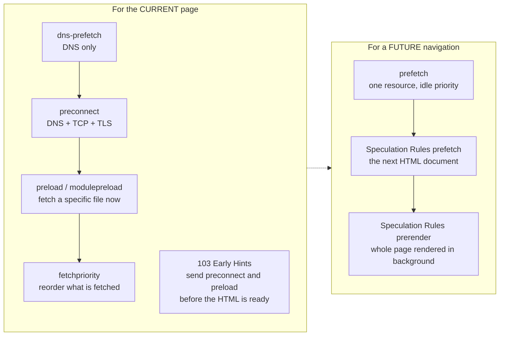

| Hint | Work done ahead of time | Scope | Mandatory for the browser? | Main risk |
|---|---|---|---|---|
| `dns-prefetch` | DNS lookup | Current page | Hint | Almost none |
| `preconnect` | DNS + TCP + TLS | Current page | Hint | Wasted sockets/CPU if unused |
| `preload` | Fetch one file at a set priority | **Current page** | **Mandatory fetch** | Steals bandwidth from critical files; double download if attributes mismatch |
| `modulepreload` | Fetch (+ optionally parse/compile) an ES module | Current page | Hint-like, high priority | Same as preload |
| `fetchpriority` | Changes relative priority | Current page | Hint | Making everything "high" = nothing is |
| `103 Early Hints` | Server-sent `preconnect`/`preload` before the final response | Current navigation | Hint | Hinting resources the page won't use |
| `prefetch` | Fetch one file at lowest priority into the HTTP cache | Next navigation | Hint | Wasted bytes |
| Speculation Rules `prefetch` | Fetch the next **document** | Next navigation | Hint | Server load, wasted bytes |
| Speculation Rules `prerender` | Fetch **and render** the next page (runs its JS) | Next navigation | Hint | Most expensive: CPU, memory, side effects |
| `<link rel="prerender">` | **Deprecated** — Chrome turned it into a no-render "NoState Prefetch" | — | — | Use Speculation Rules instead |

---

### Section 2: Discovery — What the Browser Finds by Itself

While the HTML parser is blocked (e.g. on a synchronous script), the browser's **preload scanner** reads ahead in the raw HTML and starts fetching resources it can see in markup: `<link rel=stylesheet>`, `<script src>`, ``. Anything **not in the initial HTML markup** is invisible to it.

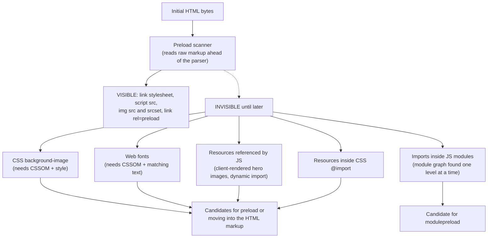

> **Rule:** the best fix for late discovery is usually to **put the resource in the HTML** (a real `` for the hero instead of a CSS background, server-rendered markup instead of client-rendered). Preload is the fallback when that isn't possible. See [Client-Side Rendering (CSR)](../02-rendering-and-architecture/client-side-rendering-csr.md) for why CSR hides the LCP image from the preload scanner.

---

### Section 3: `dns-prefetch` and `preconnect`

A request to a **new origin** costs DNS + TCP + TLS before a single byte flows (QUIC combines transport and TLS for HTTP/3 — see [HTTP/1.1 vs HTTP/2 vs HTTP/3](../01-web-fundamentals/http1-vs-http2-vs-http3.md)).

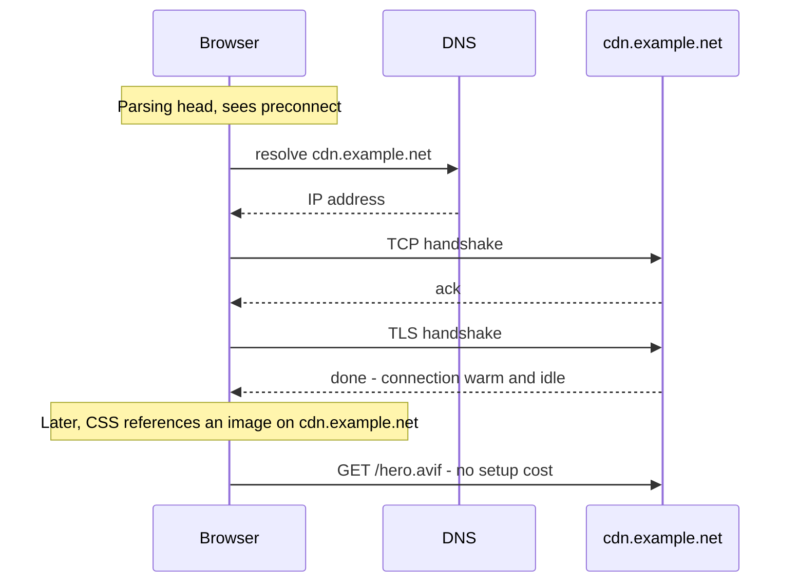

```html
<!-- Full warm-up for an origin you will DEFINITELY use soon -->
<link rel="preconnect" href="https://cdn.example.net">
<!-- Fonts and other CORS fetches use a separate (anonymous) connection: add crossorigin -->
<link rel="preconnect" href="https://fonts.example.net" crossorigin>
<!-- Cheap fallback for origins you MIGHT use (and for browsers without preconnect) -->
<link rel="dns-prefetch" href="https://analytics.example.org">
```

| | `dns-prefetch` | `preconnect` |
|---|---|---|
| Does | DNS only | DNS + TCP + TLS |
| Cost if unused | Negligible | A socket + TLS CPU on both sides; idle connections are closed after a short time |
| Use for | Many "maybe" origins | **2–4** "definitely, soon" origins (LCP image CDN, font host, API) |

**Gotchas:**
- **`crossorigin` must match the later request.** Browsers keep credentialed and anonymous (CORS) connections in separate pools; a `preconnect` without `crossorigin` won't be reused by a font fetch.
- **Don't preconnect to your own origin** — the connection already exists.
- Preconnecting to many origins competes with the critical ones. Better still: **reduce origins** (self-host fonts, proxy third parties through your CDN).

---

### Section 4: `preload`

`preload` tells the browser: "this page **will** need this file — fetch it now, at the priority its type deserves." It **only downloads**; it doesn't execute a script or apply a stylesheet.

```html
<!-- LCP hero image declared in CSS or rendered by JS -->
<link rel="preload" as="image" href="/img/hero-1200.avif"
      imagesrcset="/img/hero-600.avif 600w, /img/hero-1200.avif 1200w"
      imagesizes="100vw" fetchpriority="high">

<!-- Critical web font (crossorigin is REQUIRED, even same-origin) -->
<link rel="preload" as="font" type="font/woff2" href="/fonts/inter.3f9a1c.woff2" crossorigin>

<!-- Late-discovered script (classic script; for ES modules use modulepreload) -->
<link rel="preload" as="script" href="/js/checkout-widget.8b2e44.js">

<!-- JSON the app will fetch on boot (must match mode/credentials of the later fetch) -->
<link rel="preload" as="fetch" href="/api/bootstrap" crossorigin="use-credentials">
```

The `as` value matters:

| `as` | Used for | Why it's required |
|---|---|---|
| `style` | CSS | Correct priority, `Accept` header, CSP checks |
| `script` | Classic scripts | Same |
| `font` | Fonts (+ `crossorigin`) | Fonts are CORS requests |
| `image` | Images (+ `imagesrcset`/`imagesizes` for responsive) | Picks the right candidate like an `` would |
| `fetch` | `fetch()`/XHR targets | Lets the later `fetch()` reuse the response |
| `track`, `audio`, `video`, `document`, `worker` … | Less common | Support varies — check MDN |

**How preloads go wrong:**

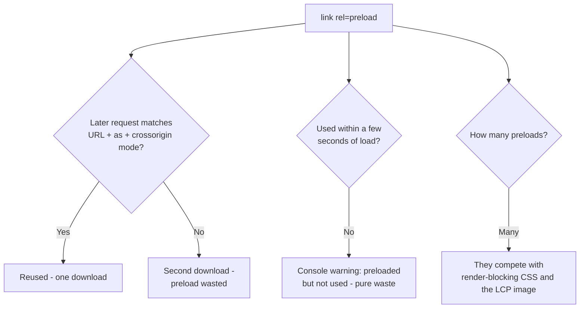

- **Preload is mandatory, not a hint.** The browser always fetches it — so a stale preload left in a template downloads on every page view.
- **Mismatch = double fetch.** Different URL (query, hash), missing `as`, missing/mismatched `crossorigin`, or a responsive image preloaded without matching `imagesrcset`/`imagesizes`.
- **Preload ≠ priority bump for everything.** Preloading 10 files mostly reorders the queue in ways that can **delay** the HTML's own CSS.
- **Preload as an HTTP header** works too, and is what CDNs turn into Early Hints:

```http
Link: </fonts/inter.3f9a1c.woff2>; rel=preload; as=font; type="font/woff2"; crossorigin
```

---

### Section 5: `modulepreload`

ES modules are discovered **one level at a time**: the browser fetches `main.js`, parses it, finds `import './router.js'`, fetches that, parses it, finds the next import… a waterfall.

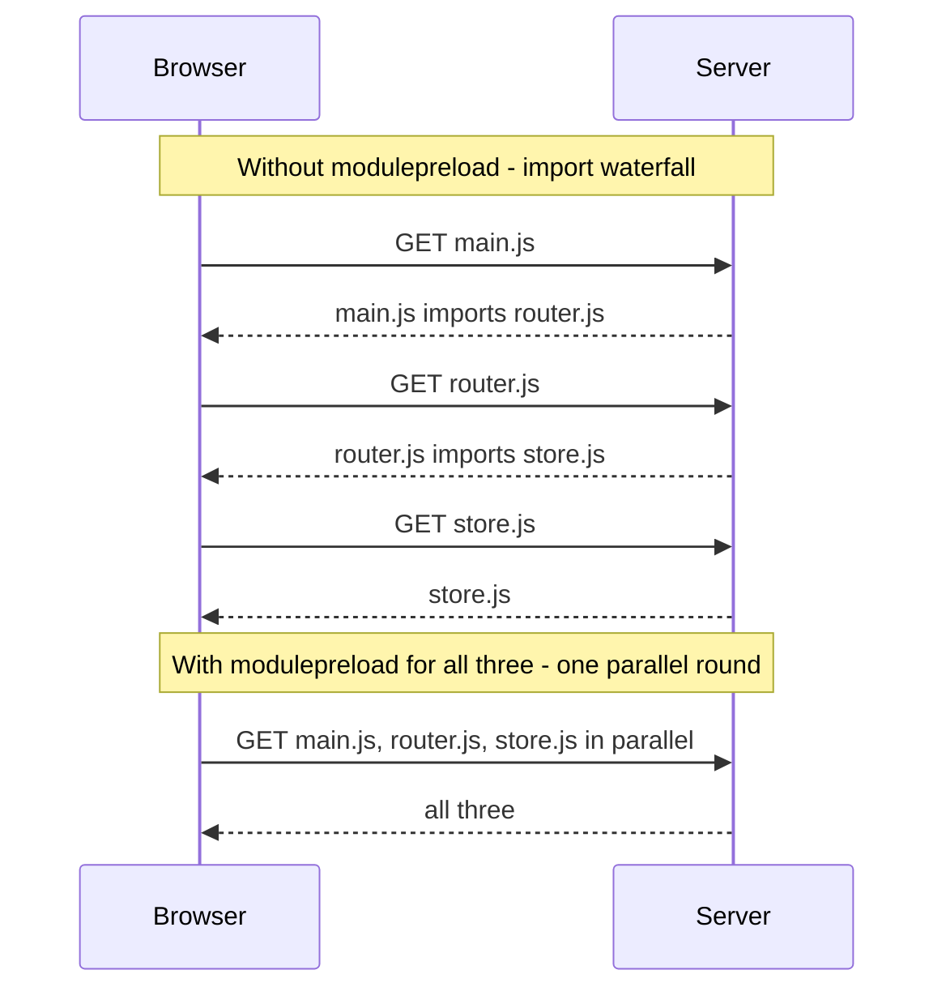

```html
<script type="module" src="/assets/main.3f9a1c.js"></script>
<link rel="modulepreload" href="/assets/router.8b2e44.js">
<link rel="modulepreload" href="/assets/store.91cd02.js">
```

| | `preload as=script` | `modulepreload` |
|---|---|---|
| Request mode | Classic (no-CORS by default) | **CORS**, like real module scripts — matches by default |
| After download | Stays in the preload cache | Browser **may** also parse/compile it and put it in the **module map** |
| Dependencies | Not touched | Browsers may fetch its static imports too (implementation-dependent — list them explicitly) |
| Support | All current browsers | All current browsers (Chromium, Firefox 115+, Safari 17+) |

**Bundlers do this for you:** Vite injects `modulepreload` links for an entry's static imports, and when you call `import()` it preloads that chunk's **dependencies in parallel** with the chunk itself (Vite's `build.modulePreload` option). Rollup/webpack apps that ship many small modules benefit most. See [Code Splitting & Lazy Loading](./code-splitting-and-lazy-loading.md).

---

### Section 6: Fetch Priority

Browsers assign each request a priority (e.g. CSS and fonts high, images low until known to be in the viewport, async scripts low). `fetchpriority` lets you **nudge** that ranking. Supported in Chromium, Firefox 132+ and Safari 17.2+.

```html
<!-- The LCP image: don't wait for layout to discover it's in the viewport -->


<!-- Carousel slides 2..n: below the fold or hidden — push them down -->


<!-- A non-critical async script -->
<script src="/js/chat-widget.js" async fetchpriority="low"></script>
```

```javascript
// fetch() takes a priority too
const suggestions = await fetch('/api/suggest?q=lap', { priority: 'high' });
fetch('/api/recommendations', { priority: 'low' }); // background warm-up, must not compete
```

| Use `fetchpriority="high"` on | Use `fetchpriority="low"` on |
|---|---|
| The **LCP image** (one!) | Off-screen carousel slides, below-the-fold images that aren't lazy |
| A preload for the LCP image | Non-critical `async` scripts (chat, analytics) |
| A user-initiated `fetch()` the UI is waiting on | Background `fetch()` (prefetching, logging) |

> **Never `loading="lazy"` on the LCP image** — lazy-loading delays it until layout. Use `fetchpriority="high"` instead. See [Image Optimization](./image-optimization.md).

---

### Section 7: 103 Early Hints

For a dynamic HTML page, the server may spend **hundreds of milliseconds** generating the response (DB queries, SSR). During that **server think-time** the browser is idle. **`103 Early Hints`** is an informational response the server (or CDN) sends **immediately**, carrying `Link` headers, before the final `200`.

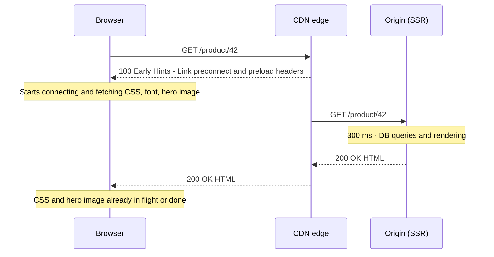

```http
HTTP/2 103
link: </assets/app.8b2e44.css>; rel=preload; as=style
link: <https://images.example.net>; rel=preconnect

HTTP/2 200
content-type: text/html
link: </assets/app.8b2e44.css>; rel=preload; as=style
…
```

**What you need to know:**
- Works for **top-level navigations** only, and only over **HTTP/2 or HTTP/3** in browsers.
- Browser support differs (check MDN): Chromium honors `preconnect` and `preload`; Firefox supports both in recent versions; **Safari honors `preconnect` only** at the time of writing.
- Most useful when **server think-time is long** and the critical resources are **stable** (CSS bundle, font, hero image host). Useless for static HTML served instantly from a CDN cache.
- Some CDNs (e.g. Cloudflare) can generate Early Hints automatically from `Link` headers they've seen on previous `200` responses. Node.js exposes `response.writeEarlyHints()`.
- Hint only what the page will **definitely** use — the final response might be a redirect or an error.

---

### Section 8: `prefetch` — Resources for the Next Page

`<link rel="prefetch">` fetches a resource at the **lowest priority**, when the browser is idle, and stores it in the **HTTP cache** for a **future navigation**.

```html
<!-- On the cart page: the checkout bundle is very likely next -->
<link rel="prefetch" href="/assets/checkout.7d1e9b.js">
```

| Property | Detail |
|---|---|
| Priority | Lowest — must not compete with the current page |
| Storage | HTTP cache — so the response must be **cacheable** to be useful later (hashed assets are ideal) |
| Execution | None — download only |
| Support | Chromium and Firefox; **Safari doesn't enable it by default** (behind a setting) |
| Requires | Secure context (HTTPS) in current browsers |
| Partitioning | Cache partitioning means prefetching **another site's** resources rarely helps (see [Browser Caching Strategies](../01-web-fundamentals/browser-caching-strategies.md#section-11-cache-partitioning)) |

Use it for **subresources** of a likely next page (JS chunks, CSS). For the **next HTML document** itself, use Speculation Rules (Section 9) in browsers that support it, or a router-level prefetch in SPAs (Section 10).

> **Bundler magic comments:** webpack supports `import(/* webpackPrefetch: true */ './Checkout')` (emits `rel=prefetch` once the parent chunk loads) and `webpackPreload` (rarely right — it competes with the current page).

---

### Section 9: Speculation Rules — Prefetch and Prerender Whole Pages

The **Speculation Rules API** is a JSON configuration that tells the browser which (mostly same-site) **navigations** to prefetch (fetch the document) or **prerender** (fetch, run JS, and render it in an invisible tab), and **when**.

**Status (verify on MDN before relying on it):** shipped in **Chromium-based browsers** (Chrome, Edge, Opera). Firefox has started implementing `prefetch`; Safari has it behind a setting. Unsupported browsers ignore the script entirely, so it's a safe **progressive enhancement**.

```html
<script type="speculationrules">
{
  "prerender": [{
    "where": {
      "and": [
        { "href_matches": "/*" },
        { "not": { "href_matches": "/logout" } },
        { "not": { "href_matches": "/cart/*" } },
        { "not": { "selector_matches": ".no-prerender, [rel~=nofollow]" } }
      ]
    },
    "eagerness": "moderate"
  }],
  "prefetch": [{
    "urls": ["/products", "/deals"],
    "eagerness": "eager"
  }]
}
</script>
```

| Key | Meaning |
|---|---|
| `prefetch` / `prerender` | Action — prefetch only fetches the HTML document (not its subresources); prerender also loads subresources, runs scripts and renders |
| `urls` | **List rules**: explicit URLs |
| `where` | **Document rules**: match links on the page by `href_matches` (URL pattern) or `selector_matches` (CSS) |
| `eagerness` | When to act (below) |
| `Speculation-Rules` header | Alternative delivery: an HTTP header pointing to a JSON file (useful when you can't edit HTML, e.g. from a CDN) |

**Eagerness** (Chromium's current heuristics — they are tuned over time, check the docs):

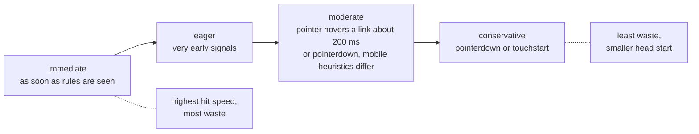

- `urls` list rules default to `immediate`; `where` document rules default to `conservative`.
- Chrome caps how many speculations each eagerness level can keep alive at once (moderate/conservative use a small first-in-first-out limit), and **skips speculation** under Data Saver, Energy Saver, low memory, or when disabled in settings.

**The prerender lifecycle:**

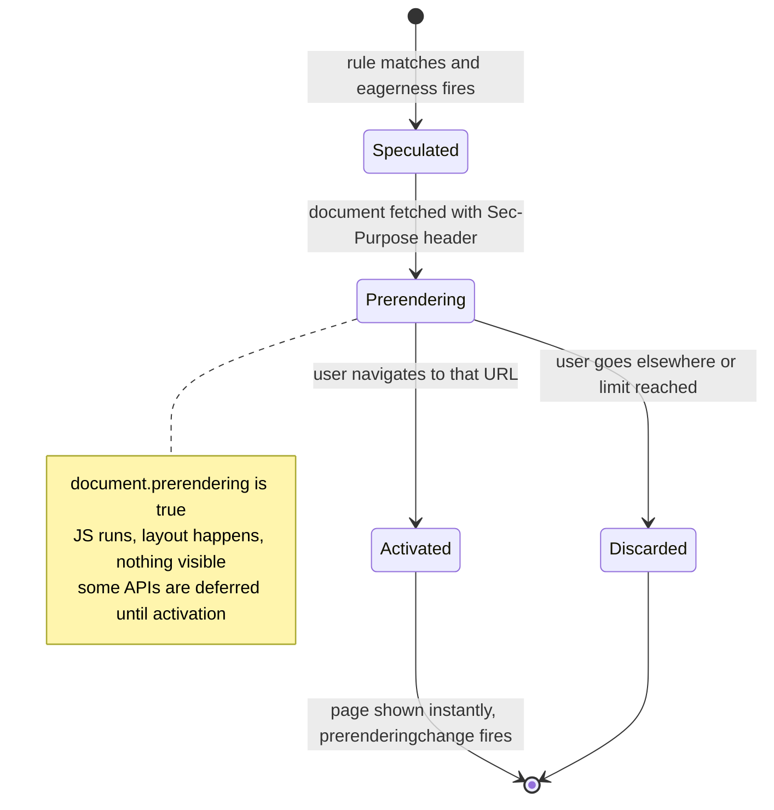

**Prerender-safe pages** — the page's JS runs **before the user sees it** (and maybe never):
- **Analytics:** don't count a page view until activation. Check `document.prerendering` and listen for `prerenderingchange` (most major analytics providers handle this already — verify yours).
- **Side effects:** never prerender URLs whose `GET` changes state (logout, "add to cart" links, one-time tokens). Exclude them in rules.
- **Metrics:** measure timings relative to `activationStart` (`PerformanceNavigationTiming.activationStart`); `web-vitals` does this for you.
- **Server:** the request carries `Sec-Purpose: prefetch` (with `prerender` added for prerenders) — you can log it, or return a non-2xx response to decline speculation under load.
- **Query-string variants:** the `No-Vary-Search` response header (Chromium) lets a prefetched `/search?q=x&utm_source=y` be reused for `/search?q=x`.

---

### Section 10: Prefetching in SPA Routers and Data Layers

In an SPA there's no new document to prefetch — the "next page" is a **JS chunk + data**. Routers prefetch both.

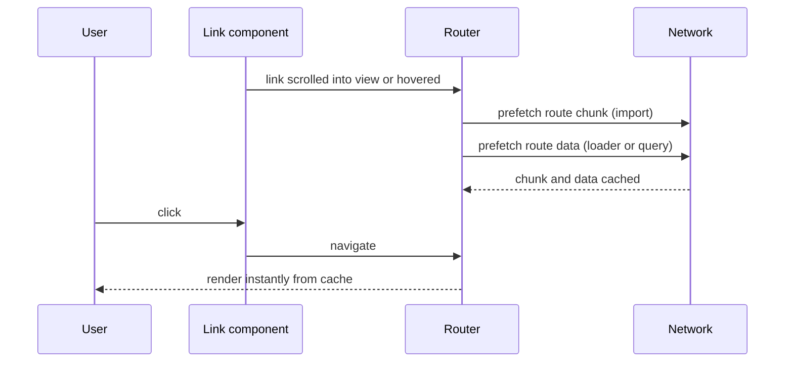

| Framework | Default behavior | Knobs |
|---|---|---|
| **Next.js (App Router)** | `<Link>` prefetches routes when they enter the viewport, **in production only**. Static routes are prefetched fully; dynamic routes prefetch up to the nearest `loading.js` boundary (details have changed between versions — check the docs) | `prefetch={false \| true}`, `router.prefetch(href)` |
| **React Router (framework mode) / Remix** | No prefetch by default | `<Link prefetch="intent" \| "render" \| "viewport" \| "none">` adds `<link rel=prefetch>` for chunks and data |
| **TanStack Router** | Configurable | `defaultPreload: 'intent'`, `<Link preload="intent">`, loader caching with `staleTime` |
| **Nuxt (Vue)** | `<NuxtLink>` prefetches components/payload when links become visible | `prefetch`, `prefetchOn: { visibility, interaction }`, `noPrefetch` |
| **Vue Router (plain)** | None built in | Call the lazy route's `import()` on hover, or use bundler prefetch hints |
| **SvelteKit** | Project template sets `data-sveltekit-preload-data="hover"` on `<body>` | `data-sveltekit-preload-data`, `data-sveltekit-preload-code` (`eager`, `viewport`, `hover`, `tap`), `preloadData()` |
| **Angular** | Lazy routes load on navigation | `withPreloading(PreloadAllModules)` or a custom `PreloadingStrategy`; `@defer (on viewport; prefetch on idle)` for deferrable views |
| **Astro** | Opt-in `prefetch` config | `data-astro-prefetch="hover" \| "tap" \| "viewport" \| "load"`; can use Speculation Rules for prerendering (check the docs for status) |
| **Native mobile** | — | Warm the next screen's data on intent (e.g. on row press-in), cache images ahead with the platform image loader |

**Data prefetching** with a server-state library — see [React Query / TanStack Query](../03-state-and-data/react-query-tanstack-query.md):

```tsx
const queryClient = useQueryClient();
const prefetch = () =>
  queryClient.prefetchQuery({
    queryKey: ['product', id],
    queryFn: () => getProduct(id),
    staleTime: 60_000, // don't refetch immediately on navigation
  });

<Link to={`/product/${id}`} onMouseEnter={prefetch} onFocus={prefetch}>{name}</Link>;
```

> Prefetch on **`onFocus`** as well as hover — keyboard users deserve the same speed, and touch devices have no hover.

---

### Section 11: Costs, Guardrails and Measurement

Every speculative byte is a bet. Losing bets cost the user's data plan and battery, and your servers.

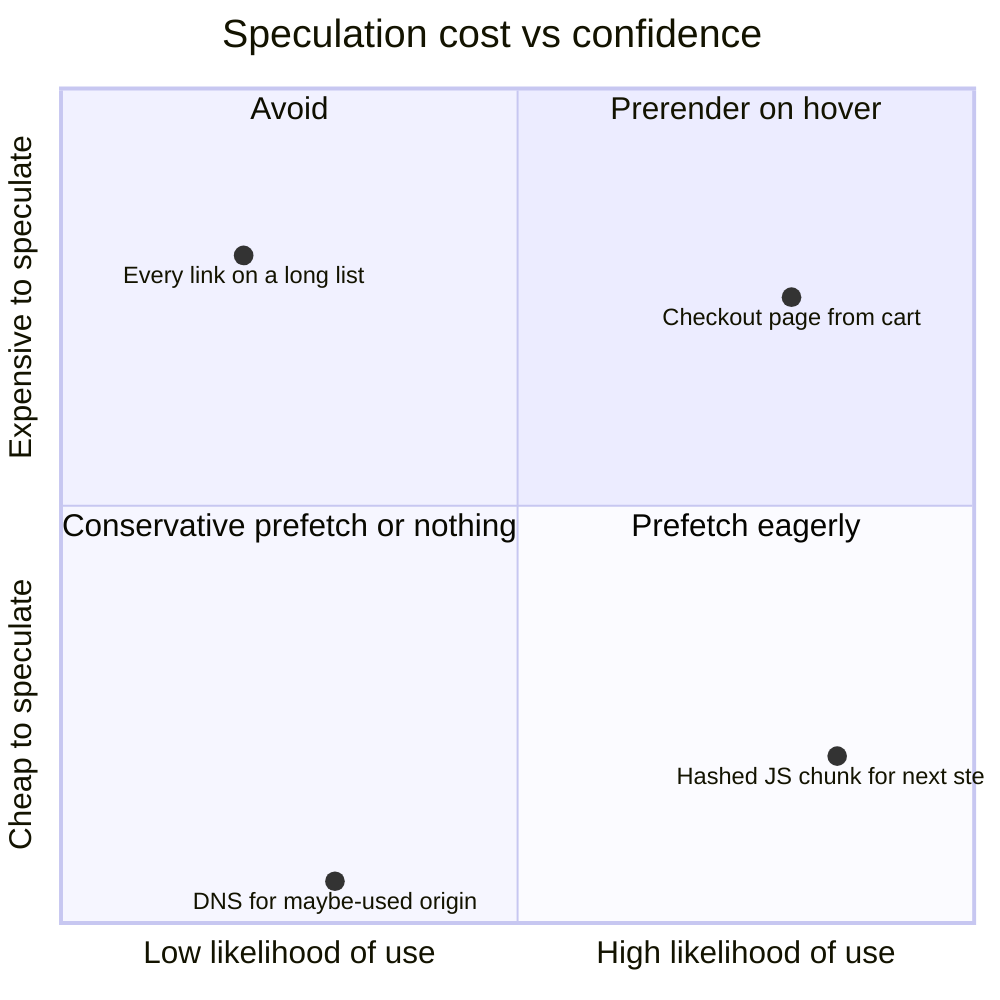

**Guardrails:**
- **Respect data-saving signals.** `Save-Data` request header and `navigator.connection.saveData` (Chromium only) — skip speculative work when set. Browsers also self-limit speculation (Section 9).
- **Only speculate idempotent GETs** with no side effects.
- **Cacheability matters:** a `<link rel=prefetch>`'d resource with `no-store` can't be reused from the HTTP cache. Hashed assets with `immutable` are ideal.
- **Server capacity:** eager prefetching multiplies HTML requests. Return `503` (or ignore requests with `Sec-Purpose`) when overloaded.
- **Privacy:** prefetching cross-site links leaks intent to third parties. Chromium restricts cross-site speculation (for example, cross-site prefetch only when the user has no cookies for the destination, and prerender only same-site) — keep speculation **same-site** unless you've checked the current rules.
- **Measure the hit rate:** log speculation (server side via `Sec-Purpose`, client side via `activationStart > 0` or Resource Timing) and compare with actual navigations. A low hit rate with high byte cost means your eagerness is too aggressive.

**What to measure:**

| Metric | Shows |
|---|---|
| LCP and TTFB on navigations that **were** speculated vs not | Real benefit |
| `PerformanceNavigationTiming.activationStart` | Whether the page was prerendered (> 0) |
| Unused-preload console warnings / Lighthouse audits | Wasted preloads |
| Server logs with `Sec-Purpose` | Speculation volume and hit rate |
| Total transferred bytes per session | Cost to users |

---

## Decision Matrix

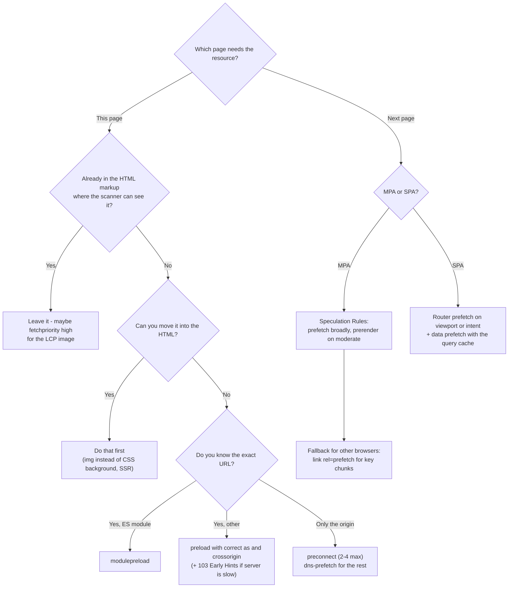

| Situation | Use |
|---|---|
| Hero image set as CSS background or rendered by JS | `preload as=image` + `fetchpriority="high"` (better: real `` in HTML) |
| Hero `` already in HTML | `fetchpriority="high"`, no preload needed |
| Critical web font | `preload as=font type=font/woff2 crossorigin` (see [Font Loading Strategies](./font-loading-strategies.md)) |
| Images on a third-party CDN | `preconnect` to that origin |
| Analytics / tag manager origins | `dns-prefetch` (or nothing) |
| ES module graph for the entry | `modulepreload` (your bundler emits it) |
| SSR page with slow server think-time | `103 Early Hints` with `preload`/`preconnect` |
| Next step of a funnel (cart → checkout) | Speculation Rules `prerender` (moderate) or router prefetch |
| Content site with many internal links | Speculation Rules `prefetch` with document rules, `conservative`/`moderate` |
| Link to logout / state-changing GET | **Exclude** from any speculation |

---

## Framework Comparison

| Stack | Preload / priority | Next-page speculation |
|---|---|---|
| **Next.js** | `next/font` preloads fonts; `next/image` with `priority`/`preload` emits preload + `fetchpriority=high` (prop names have changed across versions — check the docs); `ReactDOM.preload()`/`preconnect()` | `<Link>` viewport prefetch (production) |
| **React 19 (any framework)** | `preload`, `preinit`, `preconnect`, `prefetchDNS`, `preloadModule`, `preinitModule` from `react-dom` emit hints from components, deduplicated | Router-dependent |
| **Vite** | Emits `modulepreload` for entries and dynamic-import dependencies | Manual (`<link rel=prefetch>`, router hooks) |
| **Nuxt** | `useHead({ link: [...] })`, Nuxt Image `preload` | `<NuxtLink>` visibility prefetch |
| **SvelteKit** | `<svelte:head>` links; Vite modulepreload | `data-sveltekit-preload-data` / `-code` |
| **Angular** | `NgOptimizedImage` with `priority` sets `fetchpriority=high` and warns about missing preconnects; can generate preload links for priority images in SSR | Router `PreloadingStrategy`, `@defer` prefetch triggers |
| **Astro** | `<link>` in layouts | `prefetch` config, Speculation Rules-based prerender option |
| **MPA / CMS** | Template `<link>` tags, CDN Early Hints | Speculation Rules (WordPress core ships it by default in recent versions) |

---

## Real-World Examples

**Example 1 — A product page `<head>` with the right hints (and nothing more):**
```html
<head>
  <meta charset="utf-8">
  <!-- 1. Warm up the one third-party origin that hosts the hero image -->
  <link rel="preconnect" href="https://images.shop.example">

  <!-- 2. Critical CSS file (also visible to the scanner, so no preload needed) -->
  <link rel="stylesheet" href="/assets/app.8b2e44.css">

  <!-- 3. One critical font -->
  <link rel="preload" href="/fonts/inter.3f9a1c.woff2" as="font" type="font/woff2" crossorigin>

  <!-- 4. Entry module + its first-level dependencies (bundler-generated) -->
  <script type="module" src="/assets/main.91cd02.js"></script>
  <link rel="modulepreload" href="/assets/vendor-react.4a7b10.js">

  <!-- 5. Speculate the most common next step -->
  <script type="speculationrules">
  { "prerender": [{ "where": { "href_matches": "/cart" }, "eagerness": "moderate" }] }
  </script>
</head>
<body>
  <!-- LCP image is a real  in the HTML: scanner finds it; just raise its priority -->
  
</body>
```

**Example 2 — Over-hinting (BAD → GOOD):**
```html
<!-- ❌ BAD -->
<link rel="preconnect" href="https://www.googletagmanager.com">
<link rel="preconnect" href="https://connect.facebook.net">
<link rel="preconnect" href="https://widget.chat.example">
<link rel="preconnect" href="https://fonts.gstatic.com">            <!-- missing crossorigin -->
<link rel="preload" href="/fonts/inter.woff2" as="font">           <!-- missing crossorigin → double fetch -->
<link rel="preload" href="/img/footer-logo.svg" as="image">         <!-- not critical -->
<link rel="preload" href="/js/everything.js" as="script">           <!-- already a script tag below -->
                   <!-- lazy LCP image -->

<!-- ✅ GOOD -->
<link rel="preconnect" href="https://fonts.gstatic.com" crossorigin>
<link rel="dns-prefetch" href="https://www.googletagmanager.com">
<link rel="preload" href="/fonts/inter.woff2" as="font" type="font/woff2" crossorigin>

```

**Example 3 — Early Hints from Node.js (Express):**
```javascript
import express from 'express';

const app = express();
const CRITICAL_LINKS = [
  '</assets/app.8b2e44.css>; rel=preload; as=style',
  '</fonts/inter.3f9a1c.woff2>; rel=preload; as=font; type="font/woff2"; crossorigin',
  '<https://images.shop.example>; rel=preconnect',
];

app.get('/product/:id', async (req, res) => {
  // Sent immediately — the browser starts fetching while we query the DB
  res.writeEarlyHints({ link: CRITICAL_LINKS });

  const product = await db.products.find(req.params.id);   // slow
  res.set('Link', CRITICAL_LINKS.join(', '));               // CDNs can learn hints from this
  res.send(renderProductPage(product));
});
```

**Example 4 — Prerender-aware analytics:**
```typescript
function whenActivated(callback: () => void) {
  // document.prerendering is Chromium-only; elsewhere it's undefined → run now
  if ((document as Document & { prerendering?: boolean }).prerendering) {
    document.addEventListener('prerenderingchange', () => callback(), { once: true });
  } else {
    callback();
  }
}

whenActivated(() => analytics.track('page_view', { path: location.pathname }));

// Was this navigation prerendered? (activationStart > 0)
const [nav] = performance.getEntriesByType('navigation') as PerformanceNavigationTiming[];
const wasPrerendered = ((nav as PerformanceNavigationTiming & { activationStart?: number })?.activationStart ?? 0) > 0;
```

**Example 5 — Router prefetch across frameworks:**
```tsx
// React Router (framework mode)
<Link to="/checkout" prefetch="intent">Checkout</Link>

// Next.js — imperative prefetch when a step is clearly next (client component)
import { useEffect } from 'react';
import { useRouter } from 'next/navigation';
function CartSummary({ cartItems }: { cartItems: number }) {
  const router = useRouter();
  useEffect(() => { if (cartItems > 0) router.prefetch('/checkout'); }, [cartItems, router]);
  return <Link href="/checkout">Checkout ({cartItems})</Link>;
}
```
```html
<!-- SvelteKit: preload code when visible, data on hover -->
<a href="/checkout" data-sveltekit-preload-code="viewport" data-sveltekit-preload-data="hover">Checkout</a>

<!-- Nuxt: prefetch on interaction instead of visibility -->
<NuxtLink to="/checkout" :prefetch-on="{ interaction: true }">Checkout</NuxtLink>
```
```typescript
// Angular: preload lazy routes after the app is stable
import { provideRouter, withPreloading, PreloadAllModules } from '@angular/router';
export const appConfig = { providers: [provideRouter(routes, withPreloading(PreloadAllModules))] };
```
```html
<!-- Angular deferrable view: fetch the code on idle, render when it enters the viewport -->
@defer (on viewport; prefetch on idle) {
  <app-reviews [productId]="id" />
} @placeholder {
  <div class="reviews-skeleton"></div>
}
```

**Example 6 — Skip speculation for data-saver users:**
```typescript
const conn = (navigator as Navigator & { connection?: { saveData?: boolean; effectiveType?: string } }).connection;
const shouldSpeculate = !(conn?.saveData || conn?.effectiveType === 'slow-2g' || conn?.effectiveType === '2g');

if (shouldSpeculate && HTMLScriptElement.supports?.('speculationrules')) {
  const s = document.createElement('script');
  s.type = 'speculationrules';
  s.textContent = JSON.stringify({
    prefetch: [{ where: { href_matches: '/blog/*' }, eagerness: 'moderate' }],
  });
  document.head.append(s);
}
```

---

## Key Points Summary

| Concept | One-Line Explanation |
|---|---|
| **Preload scanner** | Reads raw HTML ahead of the parser; can't see CSS/JS-referenced resources |
| **`dns-prefetch`** | DNS only — cheap hint for "maybe" origins |
| **`preconnect`** | DNS + TCP + TLS for 2–4 "definitely" origins; `crossorigin` must match |
| **`preload`** | Mandatory fetch of a late-discovered resource for **this** page |
| **`as` + `crossorigin`** | Must match the real request or the file downloads twice |
| **`modulepreload`** | Flattens the ES module import waterfall |
| **`fetchpriority`** | Nudges priority — `high` for the LCP image, `low` for off-screen work |
| **103 Early Hints** | Send hints during server think-time; Safari honors only preconnect |
| **`prefetch`** | Lowest-priority fetch into the HTTP cache for the next navigation |
| **Speculation Rules** | JSON rules to prefetch/prerender next pages — Chromium today, progressive elsewhere |
| **Eagerness** | immediate → eager → moderate (hover) → conservative (pointerdown) |
| **`document.prerendering`** | Defer analytics and side effects until activation |
| **Router prefetch** | SPAs prefetch route chunks + data on viewport or intent |
| **Guardrails** | Save-Data, idempotent GETs only, cacheable responses, measure hit rate |

---

## Test Your Understanding

**Q1 (Basic):**
What's the difference between `preload` and `prefetch`? Give one correct use of each.

<details>
<summary>Answer</summary>

- **`preload`** is for the **current page**: a mandatory, appropriately prioritized fetch of a resource the page **will** use but the browser would discover late. Example: the critical WOFF2 font referenced only from CSS, or an LCP hero image set as a CSS background.
- **`prefetch`** is for a **future navigation**: a lowest-priority, idle-time fetch stored in the HTTP cache. Example: on the cart page, prefetch the hashed `checkout.[hash].js` chunk.

Using preload for next-page resources steals bandwidth from the current page; using prefetch for current-page resources makes them arrive too late.
</details>

**Q2 (Application):**
Lighthouse says "Largest Contentful Paint image was lazily loaded" and "Preload the LCP image". The hero is rendered by a client-side React component after data loads. What do you change, in order of preference?

<details>
<summary>Answer</summary>

1. **Make the image discoverable in the HTML**: render the hero server-side (SSR/SSG/streaming) so a real `` with `src`/`srcset` is in the initial markup — the preload scanner then finds it immediately.
2. Remove `loading="lazy"` from it and add **`fetchpriority="high"`** plus `width`/`height`.
3. If the URL is known on the server but the markup can't move, add `<link rel="preload" as="image" imagesrcset=… imagesizes=… fetchpriority="high">` — matching the ``'s `srcset`/`sizes` so it isn't fetched twice — and consider sending it via **103 Early Hints**.
4. If the image is on another origin, `preconnect` to it.

Preloading an image whose URL depends on client-side data fetching isn't possible — that's why moving rendering to the server is the first fix.
</details>

**Q3 (Tricky):**
A developer adds `<link rel="preload" href="/fonts/brand.woff2" as="font" type="font/woff2">` and `<link rel="preconnect" href="https://fonts.cdn.example">`. The Network panel shows the font fetched twice and the CDN font request still paying for a TLS handshake. Explain both.

<details>
<summary>Answer</summary>

Both are **CORS-mode mismatches**. Font requests from `@font-face` are always CORS (anonymous) requests.

- The preload lacks `crossorigin`, so it's a no-CORS request. The later CORS request for the same URL can't reuse it → second download (and a "preloaded but not used" warning).
- Browsers keep separate connection pools for credentialed and anonymous requests. The `preconnect` without `crossorigin` warmed a credentialed-mode connection; the font's anonymous request needs a different one → new handshake.

Fix: add `crossorigin` to both.
</details>

**Q4 (Application):**
Your content site (an MPA built with a CMS) wants "instant" article navigation. Design a speculation strategy and list what must be audited before turning it on.

<details>
<summary>Answer</summary>

Strategy:
- Add **Speculation Rules** document rules: `prefetch` all same-site article links at `moderate` (hover/pointerdown), and `prerender` at `conservative` or for the 1–2 most likely links (e.g. "next article") at `moderate`.
- Exclude `/logout`, `/wp-admin/*`, cart/action URLs, and links marked `.no-prerender` or `rel=nofollow`.
- For browsers without support, nothing breaks; optionally add `<link rel=prefetch>` for the next article's critical assets.

Audit first:
- **Analytics and ads**: page views/impressions must wait for activation (`document.prerendering` / `prerenderingchange`).
- **Side-effectful GETs**: anything that changes state on GET must be excluded or fixed.
- **Server capacity**: watch request volume by `Sec-Purpose`; be ready to decline speculative requests under load.
- **Personalization**: content rendered at speculation time must still be correct at activation (cart count, login state) — refresh it on `prerenderingchange`.
- **Measure**: LCP of activated prerenders vs normal navigations, hit rate, and extra bytes.
</details>

**Q5 (Tricky):**
An SSR app sends `103 Early Hints` with `preload` for its CSS and hero image. Chrome users see an improvement, Safari users don't. Is something broken?

<details>
<summary>Answer</summary>

Probably not. Browser support for Early Hints differs: at the time of writing Safari honors **`preconnect`** hints from a `103` response but **not `preload`**. Chrome honors both, and Early Hints only work over HTTP/2+ for top-level navigations.

To help Safari, include `preconnect` hints for critical third-party origins in the `103`, and keep the resources discoverable in the final HTML (`<link rel=stylesheet>`, real ``). Check MDN's compatibility table for the current state.
</details>

**Q6 (System design):**
Design the loading-hint strategy for a multi-step checkout SPA (cart → shipping → payment → confirmation) built with React and TanStack Query, where the payment step loads a third-party payment SDK.

<details>
<summary>Answer</summary>

- **Code:** each step is a lazy route chunk. On the cart page, prefetch the shipping chunk on viewport/intent of the "Checkout" button (router `prefetch="intent"` or `import()` on hover/focus).
- **Data:** `queryClient.prefetchQuery` for shipping options and saved addresses when the user shows intent, with a `staleTime` so navigation doesn't refetch immediately.
- **Payment SDK:** it's on another origin. On the shipping step, `preconnect` (with `crossorigin` if the SDK is loaded in CORS mode) to the payment origin, and `prefetch` the SDK script if its URL is stable and cacheable — never execute third-party code early without need. Respect the provider's integration rules (some require loading from their URL on the payment page only).
- **Don't** prerender or prefetch confirmation/order-placing endpoints — they have side effects.
- **Priorities:** user-blocking fetches (`priority: 'high'`) for the current step's submit; low priority for prefetches.
- **Guardrails:** skip speculative work when `saveData` is on; measure step-transition INP/latency and prefetch hit rate.
</details>

---

## Cheat Sheet

**Key Definitions:**
- **Preload scanner:** secondary HTML parser that fetches resources visible in markup early
- **Resource hint:** `dns-prefetch`, `preconnect`, `prefetch` (and historically `prerender`) — the browser may ignore them
- **Preload:** mandatory early fetch for the current page (`as` required)
- **Modulepreload:** early fetch (and optional compile) of an ES module
- **Fetch Priority:** `fetchpriority` attribute / `fetch(…, { priority })`
- **Early Hints:** `103` response carrying `Link` headers before the final response
- **Speculation Rules:** JSON rules for prefetching/prerendering next documents, with eagerness levels

**Quick Reference:**
```text
DNS only, maybe-used origin       → <link rel=dns-prefetch href=https://x.example>
Warm connection, 2-4 origins      → <link rel=preconnect href=https://x.example [crossorigin]>
Late-found file for THIS page     → <link rel=preload href=… as=style|script|font|image|fetch [crossorigin]>
Font                              → as=font type=font/woff2 crossorigin   (always crossorigin)
Responsive LCP image              → as=image imagesrcset=… imagesizes=… fetchpriority=high
ES module graph                   → <link rel=modulepreload href=…>   (bundlers emit these)
Priority                          → fetchpriority=high on the LCP img, low on off-screen / async extras
Slow SSR                          → 103 Early Hints with preconnect + preload (Safari: preconnect only)
Next-page chunk                   → <link rel=prefetch href=…>   (not in Safari by default)
Next-page document (MPA)          → <script type=speculationrules> prefetch / prerender + eagerness
SPA next route                    → router prefetch (viewport / intent) + query prefetch with staleTime
Prerendered page                  → defer analytics until prerenderingchange, measure from activationStart
Never                             → lazy-load the LCP image · speculate side-effect GETs · preload everything
```

**Common Mistakes to Avoid:**

| Mistake | Why Wrong | Fix |
|---|---|---|
| Preload without `as` | Wrong priority, can't be matched → double fetch | Always set `as` |
| Font preload/preconnect without `crossorigin` | CORS-mode mismatch → double fetch / cold connection | Add `crossorigin` |
| Preloading many files | Competes with render-blocking CSS and the LCP image | Preload only late-discovered critical files |
| Preloading what's already in the HTML | No gain, possible reprioritization | Use `fetchpriority` instead |
| `loading="lazy"` on the LCP image | Delays it until layout | `fetchpriority="high"`, no lazy |
| Preconnecting to 6+ origins | Wasted sockets/CPU, contention | 2–4 preconnects, `dns-prefetch` for the rest |
| Using `<link rel=prerender>` | Deprecated; Chrome does NoState Prefetch instead | Speculation Rules |
| Prerendering pages with side-effect GETs | Logs users out / mutates state | Exclude via `where` rules |
| Counting page views during prerender | Inflated analytics | Wait for `prerenderingchange` |
| Eager speculation for every link | Data cost and server load with low hit rate | `moderate`/`conservative`, measure hit rate |
| Prefetching uncacheable responses | Can't be reused later | Cacheable, hashed assets |
| Ignoring Save-Data | Burns users' limited data | Skip speculation when set |
| Responsive image preload without `imagesrcset` | Preloads the wrong candidate → two downloads | Mirror `srcset`/`sizes` |

---

## References & Further Reading

**Core docs**
- MDN: [`rel=preload`](https://developer.mozilla.org/en-US/docs/Web/HTML/Reference/Attributes/rel/preload) · [`rel=modulepreload`](https://developer.mozilla.org/en-US/docs/Web/HTML/Reference/Attributes/rel/modulepreload) · [`rel=prefetch`](https://developer.mozilla.org/en-US/docs/Web/HTML/Reference/Attributes/rel/prefetch) · [`rel=preconnect`](https://developer.mozilla.org/en-US/docs/Web/HTML/Reference/Attributes/rel/preconnect) · [`rel=dns-prefetch`](https://developer.mozilla.org/en-US/docs/Web/HTML/Reference/Attributes/rel/dns-prefetch)
- MDN: [`fetchpriority`](https://developer.mozilla.org/en-US/docs/Web/HTML/Reference/Attributes/fetchpriority)
- MDN: [`103 Early Hints`](https://developer.mozilla.org/en-US/docs/Web/HTTP/Reference/Status/103)
- MDN: [Speculation Rules API](https://developer.mozilla.org/en-US/docs/Web/API/Speculation_Rules_API) · [`<script type="speculationrules">`](https://developer.mozilla.org/en-US/docs/Web/HTML/Reference/Elements/script/type/speculationrules)
- MDN: [Speculative loading guide](https://developer.mozilla.org/en-US/docs/Web/Performance/Guides/Speculative_loading)
- web.dev: [Preload critical assets](https://web.dev/articles/preload-critical-assets)
- web.dev: [Establish network connections early](https://web.dev/articles/preconnect-and-dns-prefetch)
- web.dev: [Optimize resource loading with the Fetch Priority API](https://web.dev/articles/fetch-priority)
- web.dev: [Prefetch resources to speed up future navigations](https://web.dev/articles/link-prefetch)
- web.dev: [Don't fight the browser preload scanner](https://web.dev/articles/preload-scanner)

**Chrome for Developers**
- [Prerender pages in Chrome for instant page navigations](https://developer.chrome.com/docs/web-platform/prerender-pages)
- [Faster page loads using server think-time with Early Hints](https://developer.chrome.com/docs/web-platform/early-hints)
- [Guide to implementing speculation rules for more complex sites](https://developer.chrome.com/docs/web-platform/implementing-speculation-rules)
- [Debugging speculation rules](https://developer.chrome.com/docs/devtools/application/debugging-speculation-rules)

**Specs**
- WHATWG HTML: [Link types](https://html.spec.whatwg.org/multipage/links.html#linkTypes)
- WICG: [Speculation Rules](https://wicg.github.io/nav-speculation/speculation-rules.html) · [Prerendering revamped](https://wicg.github.io/nav-speculation/prerendering.html)
- IETF: [RFC 8297 — An HTTP Status Code for Indicating Hints (103)](https://www.rfc-editor.org/rfc/rfc8297)
- WHATWG Fetch: [Request priority](https://fetch.spec.whatwg.org/#request-priority)

**Framework docs**
- Next.js: [Linking and navigating — prefetching](https://nextjs.org/docs/app/getting-started/linking-and-navigating)
- React: [Resource preloading APIs (`preload`, `preconnect`, …)](https://react.dev/reference/react-dom#resource-preloading-apis)
- React Router: [`<Link prefetch>`](https://reactrouter.com/api/components/Link)
- SvelteKit: [Link options](https://svelte.dev/docs/kit/link-options)
- Nuxt: [`<NuxtLink>`](https://nuxt.com/docs/api/components/nuxt-link)
- Angular: [Router preloading](https://angular.dev/guide/routing/customizing-route-behavior) · [Deferrable views](https://angular.dev/guide/templates/defer)
- Vite: [`build.modulePreload`](https://vite.dev/config/build-options#build-modulepreload)

---

> **Previous Topic:** [Font Loading Strategies](./font-loading-strategies.md)
> — Getting web fonts on screen without invisible text or layout shifts

> **Next Topic:** [JavaScript Bundle Optimization](./javascript-bundle-optimization.md)
> — Shipping less JavaScript and making what remains cheaper to load and run

*Saved on: 2026-11-06 | Repo: Frontend System Design Learning Notes*
