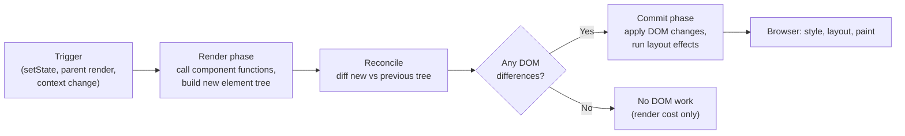
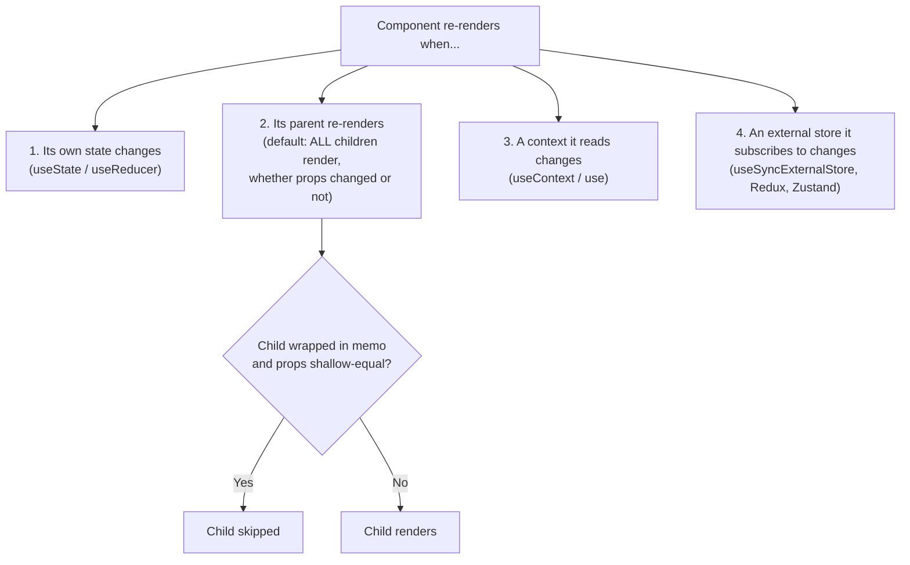
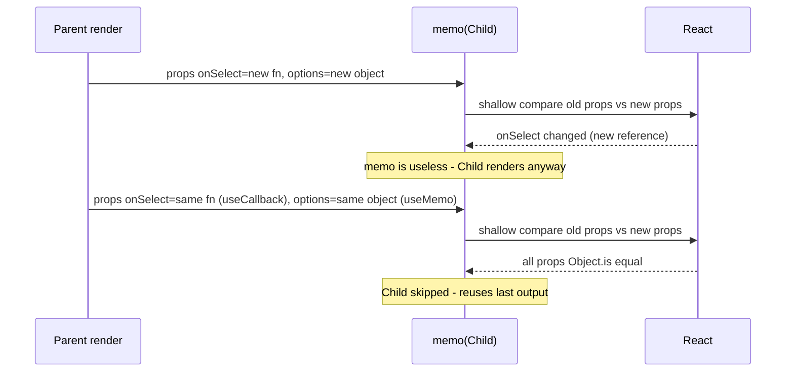
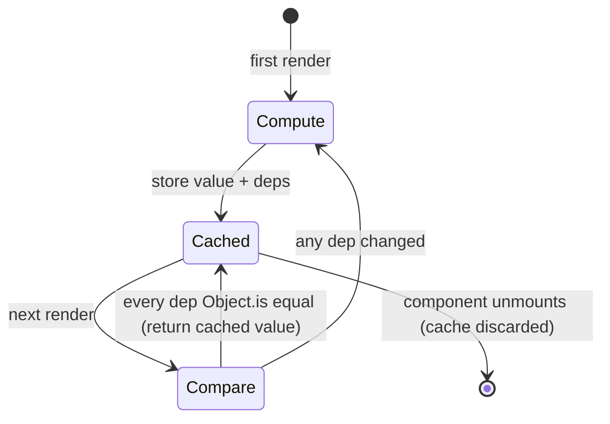
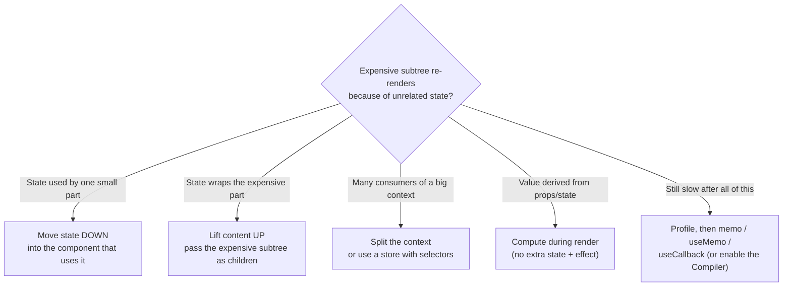
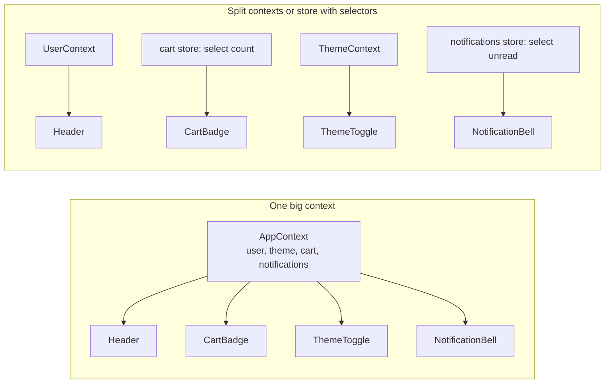
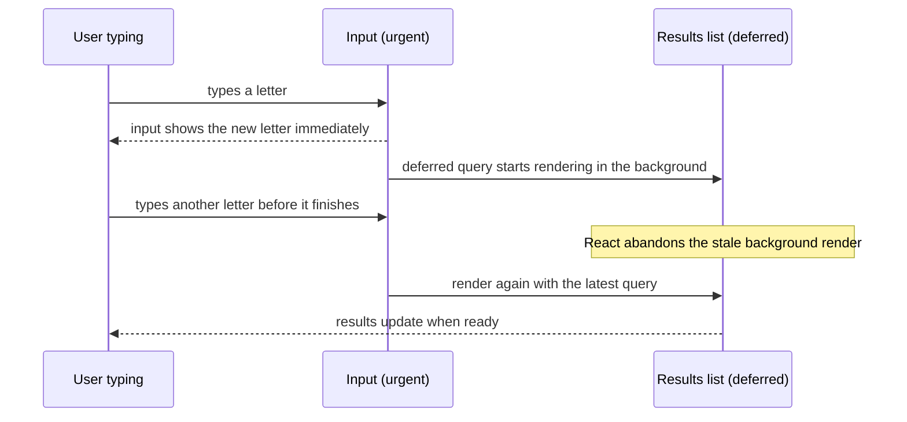
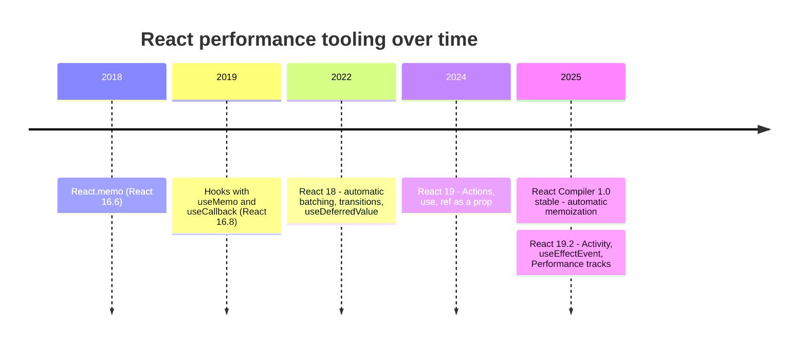
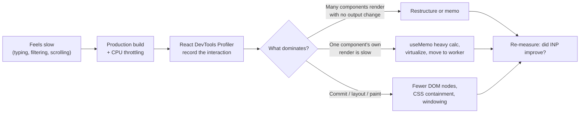
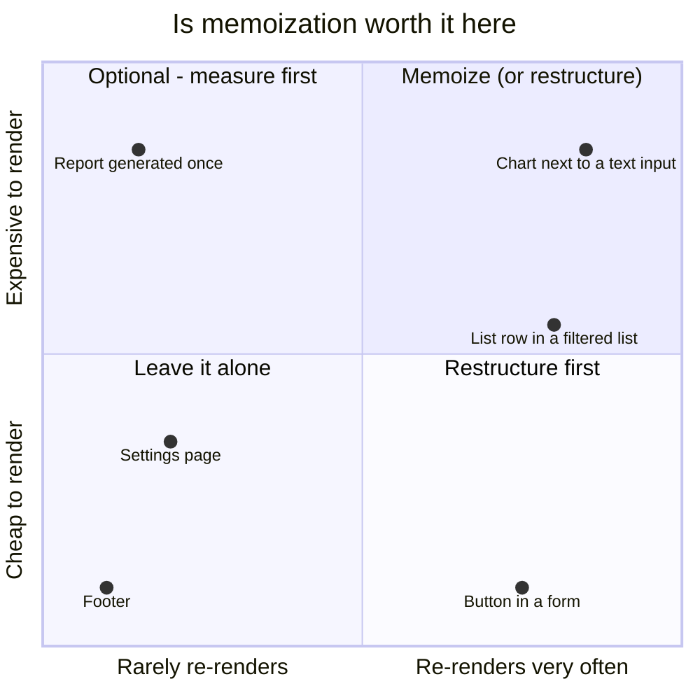

# React Performance (memo, useMemo, useCallback)

> **Date:** 2026-11-06 · **Last updated:** 2026-11-06
> **Category:** Frontend System Design
> **Sub-Topic:** Performance Engineering / Runtime Performance
> **Level:** Intermediate · **Reading time:** ~30 min
> **Informs:** when to memoize vs restructure components, React Compiler adoption, context and store design (selectors, split contexts), INP of typing and filtering, list row rendering cost, profiling workflow, equivalent strategies in Vue/Angular/Svelte

> **Pre-requisite:** [DOM & Virtual DOM](../01-web-fundamentals/dom-and-virtual-dom.md) (reconciliation) and [Client State Management Patterns](../03-state-and-data/client-state-management-patterns.md) (where state lives).
> This note explains **why React components re-render, what `memo`/`useMemo`/`useCallback` really do, when they help, when they hurt — and how the React Compiler changes the picture.**

**Previous:** [Virtual Scrolling & Windowing](./virtual-scrolling-and-windowing.md) · **Next:** [Debouncing & Throttling](./debouncing-and-throttling.md)

---

## Table of Contents

1. [ELI5 — Simple Explanation](#eli5--simple-explanation)
2. [Section 1: What a Re-render Really Is](#section-1-what-a-re-render-really-is)
3. [Section 2: Why Components Re-render](#section-2-why-components-re-render)
4. [Section 3: Referential Equality — The Root of the Problem](#section-3-referential-equality--the-root-of-the-problem)
5. [Section 4: `React.memo`](#section-4-reactmemo)
6. [Section 5: `useMemo`](#section-5-usememo)
7. [Section 6: `useCallback`](#section-6-usecallback)
8. [Section 7: Fix the Structure Before You Memoize](#section-7-fix-the-structure-before-you-memoize)
9. [Section 8: Context and Store Re-renders](#section-8-context-and-store-re-renders)
10. [Section 9: Responsiveness — `useTransition` and `useDeferredValue`](#section-9-responsiveness--usetransition-and-usedeferredvalue)
11. [Section 10: The React Compiler](#section-10-the-react-compiler)
12. [Section 11: Measuring — Profiler and DevTools](#section-11-measuring--profiler-and-devtools)
13. [Framework Comparison](#framework-comparison)
14. [Decision Matrix](#decision-matrix)
15. [Real-World Examples](#real-world-examples)
16. [Key Points Summary](#key-points-summary)
17. [Test Your Understanding (with answers)](#test-your-understanding)
18. [Cheat Sheet](#cheat-sheet)
19. [References & Further Reading](#references--further-reading)

---

## ELI5 — Simple Explanation

Imagine a **restaurant kitchen** where the head chef shouts every time an order changes.

- When the chef shouts, **every cook re-checks their station** — even the ones whose dish didn't change. That's a **re-render**: React asks every child component "what should you look like now?"
- **`React.memo`** is a cook who first looks at the ticket: *"Same ingredients as last time? Then I'll just hand over the plate I already made."*
- **`useMemo`** is a cook who keeps a **pre-made sauce** in the fridge and only remakes it when the recipe's ingredients change.
- **`useCallback`** is keeping **the same labelled tool** on the hook instead of buying an identical new one each time — so the cook who checks "is this the same tool?" says *yes*.
- But checking tickets takes time too. For a 10-second sandwich, **just make the sandwich** — checking costs more than it saves.
- The **React Compiler** is a kitchen manager who reads all the recipes in advance and puts the fridge, labels and ticket checks exactly where they pay off — automatically.

> **Re-renders are normal and usually cheap. Memoize only what profiling proves is slow — and prefer restructuring (or the React Compiler) over sprinkling `memo` everywhere.**

---

## Core Concept — Step by Step

### Section 1: What a Re-render Really Is

A **render** in React means *calling your component function* to get new JSX. It is **not** a DOM update. React then **reconciles** (diffs) the new tree against the old one and **commits** only the real differences to the DOM.



| Phase | Cost driver | Memoization helps? |
|---|---|---|
| **Render** | Number of components called × work inside each (loops, formatting, sorting) | ✅ `memo` skips subtrees, `useMemo` skips heavy calculations |
| **Reconcile** | Size of the new element tree | ✅ indirectly — skipped subtrees aren't diffed |
| **Commit** | Number of actual DOM changes | ❌ these changes are needed anyway |
| **Browser rendering** | Layout/paint of changed nodes | ❌ (see [Virtual Scrolling & Windowing](./virtual-scrolling-and-windowing.md), CSS containment) |

> A wasted render = a render whose output produced **no DOM change**. It's only a problem when there are **many** of them or each one is **expensive** — typically while typing, dragging, scrolling or animating, where it hurts [INP](./core-web-vitals-lcp-inp-cls.md).

---

### Section 2: Why Components Re-render



Key facts:
- **Props changing is not the trigger** — a parent render is. Without `memo`, children render even with identical props.
- **Setting state to the same value** (by `Object.is`) lets React bail out; it may still call the component once before bailing out, but children aren't re-rendered.
- **`memo` does not block** re-renders caused by the component's **own state** or **context it reads**.
- State updates are **batched** (React 18+ batches inside promises, timeouts and native handlers too), so three `setState` calls in one event cause one render.

---

### Section 3: Referential Equality — The Root of the Problem

React compares props, dependency arrays and context values with **`Object.is`**. Primitives compare by value; **objects, arrays and functions compare by reference** — and every render creates *new* ones.

```text
Render 1:  const style = { color: 'red' }      → reference #A1
           const onClick = () => save(id)      → reference #F1
Render 2:  const style = { color: 'red' }      → reference #A2   (#A1 !== #A2)
           const onClick = () => save(id)      → reference #F2   (#F1 !== #F2)

Object.is(1, 1)                 → true
Object.is('a', 'a')             → true
Object.is({ x: 1 }, { x: 1 })   → false   ← new object every render
Object.is(fn, fn)               → true only if it is the SAME function instance
```



This is why the three tools come **as a set**: `memo` on the child only works if the parent keeps prop references stable with `useMemo`/`useCallback` (or the values are primitives).

---

### Section 4: `React.memo`

```tsx
const Row = memo(function Row({ item, onSelect }: RowProps) {
  return <li onClick={() => onSelect(item.id)}>{item.label}</li>;
});

// Optional custom comparison: return true when props are "equal" (skip render)
const Chart = memo(ChartImpl, (prev, next) => prev.data.version === next.data.version);
```

| Fact | Detail |
|---|---|
| **What it does** | Skips re-rendering a component when its parent re-renders **and** every prop is `Object.is`-equal to last time |
| **Comparison** | Shallow, per prop. Optional `arePropsEqual(prev, next)` for custom logic |
| **Doesn't block** | The component's own state updates, context changes, store subscriptions |
| **`children` prop** | JSX children are **new objects every render** → `memo` on a component that receives `children` rarely helps unless the parent memoizes them |
| **Custom comparator risk** | Ignoring a function prop in `arePropsEqual` can leave the child calling a **stale closure** |
| **Cost** | A shallow comparison per render + keeping the previous props in memory — small, but not zero |

**Good candidates:** list rows, chart/table cells, heavy visualizations, components that re-render often with the same props (e.g. sibling of a fast-changing input).

---

### Section 5: `useMemo`

```tsx
const visible = useMemo(
  () => products.filter((p) => matches(p, query)).sort(byPrice), // calculation
  [products, query],                                             // dependencies
);
```



Two legitimate uses:
1. **Skip an expensive calculation** (filtering/sorting thousands of items, building a big derived structure, parsing).
2. **Keep a stable reference** for an object/array passed to a `memo` child or used as an effect dependency.

What it is **not**:
- **Not a semantic guarantee.** React's docs say to rely on it only as a performance optimization — code must still be correct if the cache is discarded.
- **Not free.** Allocating the deps array and comparing it on every render costs something. For `a + b` or a 20-item `map`, plain code is faster and clearer.
- **Not for side effects** — use event handlers or `useEffect`.

> **How expensive is "expensive"?** React's docs suggest wrapping the calculation in `console.time` / `console.timeEnd`; if it adds up to a significant amount (their example threshold is around 1 ms or more), memoizing may make sense. Measure with CPU throttling, in a production build.

**In development with Strict Mode,** React calls the calculation **twice** to help find impure code — so don't measure performance in dev mode.

---

### Section 6: `useCallback`

```tsx
const handleSelect = useCallback((id: string) => {
  setSelected(id);
}, []); // setState functions are already stable

// Exactly equivalent to:
const handleSelect2 = useMemo(() => (id: string) => setSelected(id), []);
```

`useCallback` **doesn't make functions faster to create**. It returns the **same function instance** across renders until a dependency changes. That only matters when someone **compares** the function:

| Situation | `useCallback` useful? |
|---|---|
| Passed to a `memo` child | ✅ otherwise the child's `memo` is defeated |
| Used in a `useEffect`/`useMemo` dependency array | ✅ otherwise the effect re-runs every render |
| Returned from a custom hook other code may depend on | ✅ consumers can put it in deps safely |
| Passed to a plain DOM element (`<button onClick>`) | ❌ DOM elements don't compare props |
| Passed to a non-memoized child | ❌ the child re-renders anyway |

**Stale closures:** a callback memoized with missing dependencies keeps reading **old** state. Fix with correct deps, the **functional updater** (`setCount(c => c + 1)`), a ref, or `useEffectEvent` (stable since React 19.2) for functions called from effects.

---

### Section 7: Fix the Structure Before You Memoize

Most wasted renders come from **state living too high** in the tree. Restructuring removes them with **no memoization at all**.



| Technique | Before | After |
|---|---|---|
| **Move state down** | `App` holds `hoverIndex`; the whole page re-renders on hover | `hoverIndex` lives inside `Menu`; only `Menu` re-renders |
| **Lift content up (children)** | `<ScrollTracker>` holds scroll state and renders `<HeavyPage/>` inside itself | `<ScrollTracker><HeavyPage/></ScrollTracker>` — `HeavyPage` element is created by the parent, so it's the **same element** when `ScrollTracker` re-renders, and React skips it |
| **Derive, don't sync** | `useState` + `useEffect` to copy filtered list into state → 2 renders | Compute in render (wrapped in `useMemo` if heavy) |
| **Keys** | `key={index}` in reorderable lists | Stable ids — avoids remounts and wrong state reuse |
| **Uncontrolled inputs** | Every keystroke updates parent state | Form libraries / `defaultValue` + read on submit, where suitable |

---

### Section 8: Context and Store Re-renders

Every component that reads a context **re-renders when the context value changes** — `memo` can't stop it. Two classic mistakes:

```tsx
// ❌ New object every render → every consumer re-renders on every Provider render
<AuthContext.Provider value={{ user, login, logout }}>

// ✅ Stable value (the React Compiler would do this for you)
const value = useMemo(() => ({ user, login, logout }), [user, login, logout]);
<AuthContext.Provider value={value}>
```



| Problem | Fix |
|---|---|
| Unstable Provider `value` | `useMemo` the value (or let the Compiler do it) |
| One context for unrelated data | Split by **update frequency** (rarely changing auth vs. frequently changing cart) |
| Many consumers need a tiny slice of a big, fast-changing object | Use an external store with **selectors** (Zustand, Redux `useSelector`, Jotai atoms, `useSyncExternalStore`) — only components whose selected slice changed re-render. See [Zustand, Jotai & Recoil](../03-state-and-data/zustand-jotai-recoil.md) and [Redux & Redux Toolkit](../03-state-and-data/redux-and-redux-toolkit.md) |
| Selector returns a new object each time | Return primitives, use a shallow-equality helper (`useShallow` in Zustand, `shallowEqual` in Redux) or memoized selectors |
| Server data in context | Use a server-state cache ([React Query / TanStack Query](../03-state-and-data/react-query-tanstack-query.md)) with per-query subscriptions |

---

### Section 9: Responsiveness — `useTransition` and `useDeferredValue`

Sometimes the work is **necessary** but shouldn't block typing or clicking. These APIs don't reduce work; they **reprioritize** it so urgent updates (the input) commit first and the expensive update can be interrupted.



| API | Use when | Notes |
|---|---|---|
| `useDeferredValue(value)` | You receive a fast-changing value and render something expensive from it | Pair with `memo` on the expensive child so it can actually skip renders with the old value |
| `useTransition()` / `startTransition` | You trigger the update yourself (tab switch, filter click) | Gives `isPending` for a subtle loading indicator |
| Debounce / throttle | You want **fewer** updates or fewer network requests | See [Debouncing & Throttling](./debouncing-and-throttling.md) |
| Web Worker | The computation itself takes too long for the main thread | See [Web Workers for Heavy Computation](./web-workers-for-heavy-computation.md) |

---

### Section 10: The React Compiler

The **React Compiler** (stable 1.0 since October 2025) is a **build-time** tool (a Babel plugin, with integrations for Vite, Next.js, Expo/Metro and others) that analyzes components and hooks and **inserts memoization automatically** — often more granularly than hand-written `useMemo`, including memoizing JSX and values after early returns.



| Aspect | Detail |
|---|---|
| **What it does** | Caches values, callbacks and JSX inside components/hooks so unchanged parts are reused, and children get stable props |
| **Requirements** | Code must follow the **Rules of React** (pure render, no mutation of props/state, hooks rules). Components that break them are **skipped**, not miscompiled |
| **React versions** | Targets React 19; React 17/18 are supported via the `react-compiler-runtime` package and a `target` option — check the docs |
| **Opt out** | `'use no memo'` directive at the top of a component/function (an escape hatch, meant to be temporary) |
| **Gradual adoption** | Compile only some directories, or use `compilationMode: 'annotation'` with `'use memo'` |
| **Linting** | The compiler's diagnostics are exposed through `eslint-plugin-react-hooks` rules — enable them even before adopting the compiler |
| **Manual memo after adoption** | Existing `useMemo`/`useCallback` keep working; for new code the docs recommend relying on the compiler and using manual memoization only as an escape hatch (e.g. to keep an effect dependency stable) |
| **What it can't fix** | Context design, state placement, huge lists, expensive work that must run anyway, network waterfalls |

> **System design takeaway:** in a React 19 codebase with the compiler enabled, "should I add `useCallback` here?" mostly disappears. Architecture decisions — state colocation, store selectors, virtualization, workers — still matter just as much.

---

### Section 11: Measuring — Profiler and DevTools



| Tool | What it shows |
|---|---|
| **React DevTools → Profiler** | Each commit, which components rendered, how long, and **why** (enable "Record why each component rendered") |
| **React DevTools → "Highlight updates when components render"** | Flashes components as they re-render — quick visual check |
| **Chrome DevTools Performance panel** | Long tasks, layout/paint; React 19.2 adds React-specific **Performance tracks** (Scheduler, Components) in supporting builds |
| **`<Profiler id onRender>`** | Programmatic timing (`actualDuration`, `baseDuration`) per subtree; needs a profiling build in production |
| **Field data (RUM / `web-vitals`)** | Real INP from users — the number to improve. See [Core Web Vitals](./core-web-vitals-lcp-inp-cls.md) |

> **Never profile a development build.** Dev mode adds warnings, double-invokes renders in Strict Mode and skips optimizations, so its timings are misleading.

---

## Framework Comparison

React re-renders **component functions top-down** and relies on memoization to skip work. Most other frameworks track dependencies at a finer grain, so the equivalent tools look different.

| Framework | Default update model | "memo" equivalents |
|---|---|---|
| **React** | Parent render → children render; diff the element tree | `memo`, `useMemo`, `useCallback`, React Compiler, external stores with selectors |
| **Vue 3** | Reactive dependency tracking per component; a component re-renders only when reactive data **it used** changes | `computed()` (cached derived values), `v-memo` (skip parts of a template), `v-once`, `shallowRef`/`shallowReactive`, keep props stable |
| **Angular** | Change detection over the component tree; signals give fine-grained tracking | `ChangeDetectionStrategy.OnPush`, **signals** + `computed()`, pure pipes, `@for` with `track`, `@defer`; zoneless change detection in recent versions (see [angular.dev](https://angular.dev/guide/zoneless)) |
| **Svelte 5** | Compiled, fine-grained reactivity (runes) — updates the exact DOM nodes that depend on changed state | `$derived` (memoized derived state); no component-level memo needed |
| **Solid / Preact Signals** | Fine-grained signals; components run once | `createMemo` / `computed` |
| **React Native** | Same React model | Same tools; especially important for `FlatList` `renderItem` rows and keeping props to native views stable |

> Fine-grained frameworks still have expensive work: big derived computations, huge lists and layout cost. Their `computed`/`$derived` play the role of `useMemo`; virtualization and workers apply everywhere.

---

## Decision Matrix



| Situation | Do this |
|---|---|
| Typing in an input re-renders a heavy sibling chart | Move input state down, or `memo(Chart)` + stable props; `useDeferredValue` if the chart must follow the input |
| Filtering/sorting 5,000 items on every render | `useMemo` keyed on the data and the filter; worker if it still takes too long |
| 1,000-row list re-renders when one row is selected | `memo(Row)` + stable callbacks + pass primitives (`isSelected` boolean); virtualize |
| Context value object rebuilt every render | `useMemo` the value; split contexts by update frequency |
| Function passed to `<button onClick>` | Nothing — plain inline function is fine |
| New React 19 project | Enable the React Compiler and its lint rules; write plain code |
| Cheap component, rarely renders | Nothing — memo adds cost and noise |

---

## Real-World Examples

**Example 1 — The full set working together (BAD → GOOD):**
```tsx
import { memo, useCallback, useMemo, useState, type CSSProperties } from 'react';

type Product = { id: string; name: string; price: number };

// ❌ BAD: memo(Row) is defeated — new `onToggle` and `style` every render,
// and the filter + sort re-runs on every keystroke of an unrelated field
function ProductListBad({ products }: { products: Product[] }) {
  const [query, setQuery] = useState('');
  const [note, setNote] = useState('');
  const [selected, setSelected] = useState<Set<string>>(new Set());

  const visible = products
    .filter((p) => p.name.toLowerCase().includes(query.toLowerCase()))
    .sort((a, b) => a.price - b.price);

  return (
    <>
      <input value={query} onChange={(e) => setQuery(e.target.value)} />
      <textarea value={note} onChange={(e) => setNote(e.target.value)} />
      {visible.map((p) => (
        <Row
          key={p.id}
          product={p}
          isSelected={selected.has(p.id)}
          style={{ padding: 8 }}
          onToggle={() => setSelected((s) => toggle(s, p.id))}
        />
      ))}
    </>
  );
}

// ✅ GOOD: stable props + memoized derived data
function ProductList({ products }: { products: Product[] }) {
  const [query, setQuery] = useState('');
  const [note, setNote] = useState('');
  const [selected, setSelected] = useState<Set<string>>(new Set());

  const visible = useMemo(() => {
    const q = query.toLowerCase();
    return products.filter((p) => p.name.toLowerCase().includes(q)).sort((a, b) => a.price - b.price);
  }, [products, query]); // typing in `note` no longer re-filters

  const onToggle = useCallback((id: string) => setSelected((s) => toggle(s, id)), []);

  return (
    <>
      <input value={query} onChange={(e) => setQuery(e.target.value)} />
      <textarea value={note} onChange={(e) => setNote(e.target.value)} />
      {visible.map((p) => (
        <Row key={p.id} product={p} isSelected={selected.has(p.id)} onToggle={onToggle} />
      ))}
    </>
  );
}

const rowStyle = { padding: 8 }; // module-level constant: stable forever

const Row = memo(function Row({ product, isSelected, onToggle, style = rowStyle }: {
  product: Product; isSelected: boolean; onToggle: (id: string) => void; style?: CSSProperties;
}) {
  return (
    <label style={style}>
      <input type="checkbox" checked={isSelected} onChange={() => onToggle(product.id)} />
      {product.name} — {product.price}
    </label>
  );
});

function toggle(set: Set<string>, id: string) {
  const next = new Set(set);
  if (next.has(id)) next.delete(id);
  else next.add(id);
  return next;
}
```
> Even better: move `note` into its own component (state colocation) so typing in it doesn't render `ProductList` at all.

**Example 2 — "Lift content up": no memo needed:**
```tsx
import { useState, type ReactNode } from 'react';

// ❌ BAD: every mousemove re-renders ExpensiveDashboard
function TrackerBad() {
  const [pos, setPos] = useState({ x: 0, y: 0 });
  return (
    <div onMouseMove={(e) => setPos({ x: e.clientX, y: e.clientY })}>
      <Cursor pos={pos} />
      <ExpensiveDashboard />
    </div>
  );
}

// ✅ GOOD: the dashboard element is created by the parent and passed as children,
// so it is the same element when Tracker re-renders and React skips it
function Tracker({ children }: { children: ReactNode }) {
  const [pos, setPos] = useState({ x: 0, y: 0 });
  return (
    <div onMouseMove={(e) => setPos({ x: e.clientX, y: e.clientY })}>
      <Cursor pos={pos} />
      {children}
    </div>
  );
}

export function Page() {
  return (
    <Tracker>
      <ExpensiveDashboard />
    </Tracker>
  );
}

declare function Cursor(props: { pos: { x: number; y: number } }): ReactNode;
declare function ExpensiveDashboard(): ReactNode;
```

**Example 3 — Stable context value and split contexts:**
```tsx
import { createContext, useCallback, useContext, useMemo, useState, type ReactNode } from 'react';

type User = { id: string; name: string } | null;
const UserContext = createContext<User>(null);
const AuthActionsContext = createContext<{ login: (u: User) => void; logout: () => void } | null>(null);

export function AuthProvider({ children }: { children: ReactNode }) {
  const [user, setUser] = useState<User>(null);
  const login = useCallback((u: User) => setUser(u), []);
  const logout = useCallback(() => setUser(null), []);
  const actions = useMemo(() => ({ login, logout }), [login, logout]); // never changes

  return (
    <AuthActionsContext.Provider value={actions}>
      <UserContext.Provider value={user}>{children}</UserContext.Provider>
    </AuthActionsContext.Provider>
  );
}

// Components that only call logout() don't re-render when the user changes
export const useAuthActions = () => useContext(AuthActionsContext)!;
export const useUser = () => useContext(UserContext);
```

**Example 4 — Keep typing responsive with `useDeferredValue`:**
```tsx
import { memo, useDeferredValue, useMemo, useState } from 'react';

export function Search({ items }: { items: string[] }) {
  const [query, setQuery] = useState('');
  const deferredQuery = useDeferredValue(query); // lags behind while the list renders
  const isStale = query !== deferredQuery;

  return (
    <>
      <input value={query} onChange={(e) => setQuery(e.target.value)} aria-label="Search" />
      <div style={{ opacity: isStale ? 0.6 : 1 }}>
        <Results items={items} query={deferredQuery} />
      </div>
    </>
  );
}

// memo is what lets React skip re-rendering Results with the old deferredQuery
const Results = memo(function Results({ items, query }: { items: string[]; query: string }) {
  const matches = useMemo(() => items.filter((i) => i.includes(query)), [items, query]);
  return <ul>{matches.slice(0, 500).map((m) => <li key={m}>{m}</li>)}</ul>;
});
```

**Example 5 — Enabling the React Compiler:**
```typescript
// vite.config.ts
import { defineConfig } from 'vite';
import react from '@vitejs/plugin-react';

export default defineConfig({
  plugins: [
    react({
      babel: { plugins: ['babel-plugin-react-compiler'] }, // run it first in the Babel pipeline
    }),
  ],
});
```
```typescript
// next.config.ts — recent Next.js versions expose a reactCompiler option
// (earlier versions had it under `experimental`; check the Next.js docs for yours)
import type { NextConfig } from 'next';
const nextConfig: NextConfig = { reactCompiler: true };
export default nextConfig;
```
```tsx
// Escape hatch while you fix a component that breaks the Rules of React
function LegacyWidget() {
  'use no memo';
  // ...
  return null;
}
```

**Example 6 — Programmatic measurement with `<Profiler>`:**
```tsx
import { Profiler, type ProfilerOnRenderCallback, type ReactNode } from 'react';

const onRender: ProfilerOnRenderCallback = (id, phase, actualDuration, baseDuration) => {
  // actualDuration: time spent rendering this commit; baseDuration: estimated time without memoization
  if (actualDuration > 16) console.warn(`[${id}] ${phase} took ${actualDuration.toFixed(1)}ms (base ${baseDuration.toFixed(1)}ms)`);
};

export function App() {
  return (
    <Profiler id="ProductList" onRender={onRender}>
      <ProductListContainer />
    </Profiler>
  );
}

declare function ProductListContainer(): ReactNode;
```

**Example 7 — The same ideas in Vue, Angular and Svelte:**
```html
<!-- Vue 3: computed caches; v-memo skips re-rendering a row unless its deps change -->
<script setup lang="ts">
import { computed, ref } from 'vue';
const props = defineProps<{ products: { id: string; name: string }[] }>();
const query = ref('');
const selectedId = ref<string | null>(null);
const visible = computed(() => props.products.filter((p) => p.name.includes(query.value)));
</script>

<template>
  <input v-model="query" />
  <div v-for="p in visible" :key="p.id" v-memo="[p.id === selectedId]" @click="selectedId = p.id">
    {{ p.name }}
  </div>
</template>
```
```typescript
// Angular: OnPush + signals + computed (memoized derived value)
import { ChangeDetectionStrategy, Component, computed, input, signal } from '@angular/core';

@Component({
  selector: 'app-product-list',
  changeDetection: ChangeDetectionStrategy.OnPush,
  template: `
    <input [value]="query()" (input)="query.set($any($event.target).value)" />
    @for (p of visible(); track p.id) { <div>{{ p.name }}</div> }
  `,
})
export class ProductListComponent {
  products = input.required<{ id: string; name: string }[]>();
  query = signal('');
  visible = computed(() => this.products().filter((p) => p.name.includes(this.query())));
}
```
```html
<!-- Svelte 5: $derived is memoized; only dependent DOM nodes update -->
<script lang="ts">
  let { products }: { products: { id: string; name: string }[] } = $props();
  let query = $state('');
  const visible = $derived(products.filter((p) => p.name.includes(query)));
</script>

<input bind:value={query} />
{#each visible as p (p.id)}<div>{p.name}</div>{/each}
```

---

## Key Points Summary

| Concept | One-Line Explanation |
|---|---|
| **Render ≠ DOM update** | Rendering calls your function; only diffs are committed to the DOM |
| **Re-render triggers** | Own state, parent render, context change, external store change |
| **Referential equality** | Objects/functions are new every render; React compares with `Object.is` |
| **`React.memo`** | Skips a child's render when all props are shallow-equal |
| **`useMemo`** | Caches a computed value until dependencies change |
| **`useCallback`** | Caches a function instance — only useful when something compares it |
| **The set** | `memo` on the child only works with stable props from the parent |
| **Structure first** | Move state down, lift content up, split contexts, derive in render |
| **Context** | All consumers re-render on value change; `memo` can't stop that |
| **Selectors** | External stores re-render only components whose slice changed |
| **`useDeferredValue` / transitions** | Keep input responsive; don't reduce total work |
| **React Compiler** | Build-time automatic memoization for code that follows the Rules of React |
| **Measure** | Production build + Profiler + INP field data; never trust dev timings |

---

## Test Your Understanding

**Q1 (Basic):**
`<Child />` is wrapped in `React.memo` and receives `options={{ sort: 'asc' }}` from its parent. Every time the parent re-renders, `Child` re-renders too. Why, and what are two fixes?

<details>
<summary>Answer</summary>

`memo` compares props with `Object.is`. The inline object literal `{ sort: 'asc' }` is a **new object on every parent render**, so the comparison fails and the child renders. Fixes: (1) hoist the object to a **module-level constant** if it never changes, or (2) wrap it in **`useMemo`** in the parent if it depends on props/state. Passing **primitives** (`sort="asc"`) instead of objects also works. With the React Compiler enabled, the parent's object would be memoized automatically.
</details>

**Q2 (Application):**
A dashboard has a search input at the top and a heavy chart below. Typing feels laggy. The input state lives in the `Dashboard` component, which renders both. List three solutions in order of preference.

<details>
<summary>Answer</summary>

1. **Move state down:** extract `<SearchBox>` with its own `query` state. If the chart doesn't depend on the query, typing no longer re-renders `Dashboard` or the chart — no memoization needed.
2. If the chart **does** depend on the query: `useDeferredValue(query)` and pass the deferred value to a **`memo`-wrapped** chart, so the input updates immediately and the chart renders in an interruptible background render. Also `useMemo` any heavy data transformation.
3. If the chart must update less often or the transformation is very heavy: **debounce** the query (fewer updates) or move computation to a **Web Worker**.

Plain `memo(Chart)` alone fails if the chart receives a prop that changes on every keystroke.
</details>

**Q3 (Tricky):**
A developer wraps every component in `memo` and every function in `useCallback` "for performance". The app gets slightly slower and harder to maintain. Explain why.

<details>
<summary>Answer</summary>

Memoization has costs: each `memo` does a prop comparison on every parent render, each `useMemo`/`useCallback` allocates a dependency array and compares it, and cached values stay in memory. When components are cheap, or props change on every render anyway (e.g. `children`, inline objects), those comparisons are **pure overhead** — they never skip work. Wrong dependency arrays also introduce **stale-closure bugs**. The right approach: profile, fix structure (state colocation, children pattern, split contexts), memoize only hot spots — or enable the **React Compiler**, which inserts memoization consistently and correctly without manual noise.
</details>

**Q4 (Tricky):**
A component wrapped in `memo` still re-renders when an unrelated part of a context changes, even though none of its props changed. Why doesn't `memo` help, and what should you do?

<details>
<summary>Answer</summary>

`memo` only skips renders caused by the **parent**. A component that calls `useContext` re-renders whenever the context **value** changes (by `Object.is`), regardless of `memo` and regardless of which field it reads. Fixes: **split the context** by concern/update frequency; make sure the Provider's `value` is stable (`useMemo`); or move fast-changing data into an **external store with selectors** (Zustand, Redux, Jotai, `useSyncExternalStore`) so the component subscribes only to the slice it reads. Another option is to read the context in a thin wrapper and pass only the needed primitive to a `memo` child.
</details>

**Q5 (System design):**
You're the tech lead for a large React 19 codebase (200+ engineers). Code review discussions about `useCallback` are endless and inconsistent. What's your performance strategy?

<details>
<summary>Answer</summary>

- **Adopt the React Compiler** incrementally (directory by directory or `annotation` mode), after enabling its **lint rules** (shipped through `eslint-plugin-react-hooks`) to find Rules-of-React violations. Stop requiring manual `useMemo`/`useCallback` in new code; keep them only as documented escape hatches (e.g. stable effect dependencies).
- **Architecture guidelines** that the compiler can't provide: state colocation, server state in a query cache, client state in stores with selectors, contexts split by update frequency, virtualization for long lists, workers for heavy computation.
- **Measurement:** performance budgets for INP in RUM, React Profiler / Performance tracks for investigations, interaction tests for hot flows. Decide with data, not opinions.
- **Training:** the Rules of React (pure renders, no mutation) matter more than memo APIs — they're what lets the compiler work.
</details>

**Q6 (Application):**
Is `useCallback` useful here? `<button onClick={useCallback(() => setOpen(true), [])}>Open</button>`. And here: `useEffect(() => { subscribe(onMessage) ... }, [onMessage])` where `onMessage` is defined in the component body?

<details>
<summary>Answer</summary>

**Button: no.** A DOM element doesn't compare its props — the new function is simply attached; `useCallback` only adds overhead. (Calling hooks inline inside JSX is also fragile — keep hooks at the top level of the component.)

**Effect: yes, something is needed.** Without a stable `onMessage`, the dependency changes every render, so the effect unsubscribes and resubscribes on every render. Options: `useCallback` with correct dependencies; move the function **inside** the effect; or, if the function needs the latest props/state but shouldn't re-trigger the effect, use **`useEffectEvent`** (stable in React 19.2) for the handler.
</details>

---

## Cheat Sheet

**Key Definitions:**
- **Render:** Calling a component function to produce elements (not a DOM update)
- **Commit:** Applying the diff to the DOM
- **Wasted render:** A render whose output didn't change the DOM
- **`memo(Component, arePropsEqual?)`:** Skip render if props are shallow-equal
- **`useMemo(fn, deps)`:** Cache a computed value
- **`useCallback(fn, deps)`:** Cache a function instance (`useMemo(() => fn, deps)`)
- **React Compiler:** Build-time plugin that memoizes automatically for code that follows the Rules of React
- **`useDeferredValue` / `useTransition`:** Mark updates as non-urgent so urgent ones stay responsive

**Quick Reference:**
```text
Re-render triggers:  own state · parent render · context value change · store subscription
Comparison:          Object.is — primitives by value, objects/functions by reference

Before memoizing:    1. move state down   2. pass expensive JSX as children
                     3. split contexts / use selectors   4. derive in render, no state+effect sync
memo(Child)          → only with stable props (primitives, useMemo objects, useCallback fns)
useMemo              → heavy calc (measured) OR stable reference for memo child / effect deps
useCallback          → fn passed to memo child, used in deps, or returned from a custom hook
Not needed           → handlers on DOM elements, cheap components, props that change anyway
Context value        → useMemo it; split by update frequency
Typing lag           → state down → useDeferredValue + memo → debounce → worker
React 19 project     → React Compiler + eslint-plugin-react-hooks rules; 'use no memo' escape hatch
Measure              → production/profiling build, CPU throttle, React Profiler, INP in RUM

Vue: computed, v-memo, v-once, shallowRef      Angular: OnPush, signals, computed, pure pipes
Svelte 5: $derived                             Solid: createMemo
```

**Common Mistakes to Avoid:**

| Mistake | Why Wrong | Fix |
|---|---|---|
| `memo` child with inline object/function props | New reference every render defeats `memo` | `useMemo`/`useCallback`, hoist constants, pass primitives |
| Memoizing everything | Comparison overhead, noise, stale-closure risk | Profile first; restructure; or use the Compiler |
| Missing dependencies in `useCallback`/`useMemo` | Stale values, subtle bugs | Lint rules (`react-hooks/exhaustive-deps`), functional updaters, `useEffectEvent` |
| `useMemo` for trivial calculations | Costs more than recomputing | Plain expressions |
| Relying on `useMemo` for correctness | React may discard the cache | Code must work without it |
| Unstable context `value` | All consumers re-render every Provider render | `useMemo` the value, split contexts |
| Expecting `memo` to stop context re-renders | `memo` only checks props | Selectors / split context |
| Copying derived data into state with an effect | Extra render, sync bugs | Compute during render |
| Profiling in development mode | Strict Mode double renders, dev-only checks | Production/profiling build |
| `key={index}` on reorderable lists | Wrong state reuse, extra remounts | Stable ids |
| Custom `arePropsEqual` ignoring callbacks | Child calls stale closures | Compare all props that affect behavior |
| Treating `useDeferredValue` as debounce | It doesn't reduce updates or requests | Debounce/throttle for fewer requests |

---

## References & Further Reading

**Core docs (react.dev)**
- [`memo`](https://react.dev/reference/react/memo) · [`useMemo`](https://react.dev/reference/react/useMemo) · [`useCallback`](https://react.dev/reference/react/useCallback)
- [`useDeferredValue`](https://react.dev/reference/react/useDeferredValue) · [`useTransition`](https://react.dev/reference/react/useTransition) · [`useEffectEvent`](https://react.dev/reference/react/useEffectEvent)
- [`<Profiler>`](https://react.dev/reference/react/Profiler) · [Rules of React](https://react.dev/reference/rules)
- [React Compiler](https://react.dev/learn/react-compiler) · [You Might Not Need an Effect](https://react.dev/learn/you-might-not-need-an-effect)
- [Render and Commit](https://react.dev/learn/render-and-commit) · [Preserving and Resetting State](https://react.dev/learn/preserving-and-resetting-state)

**Other frameworks**
- Vue: [Performance](https://vuejs.org/guide/best-practices/performance.html) · [`v-memo`](https://vuejs.org/api/built-in-directives.html#v-memo) · [Computed properties](https://vuejs.org/guide/essentials/computed.html)
- Angular: [Skipping component subtrees (OnPush)](https://angular.dev/best-practices/skipping-subtrees) · [Signals](https://angular.dev/guide/signals) · [Zoneless](https://angular.dev/guide/zoneless)
- Svelte: [`$derived`](https://svelte.dev/docs/svelte/$derived)

**Deep dives**
- Dan Abramov: [Before You memo()](https://overreacted.io/before-you-memo/)
- Kent C. Dodds: [When to useMemo and useCallback](https://kentcdodds.com/blog/usememo-and-usecallback)
- Josh W. Comeau: [Understanding useMemo and useCallback](https://www.joshwcomeau.com/react/usememo-and-usecallback/)
- web.dev: [Interaction to Next Paint (INP)](https://web.dev/articles/inp) · [Optimize INP](https://web.dev/articles/optimize-inp)

---

> **Previous Topic:** [Virtual Scrolling & Windowing](./virtual-scrolling-and-windowing.md)
> — Rendering only the visible rows of huge lists

> **Next Topic:** [Debouncing & Throttling](./debouncing-and-throttling.md)
> — Limiting how often expensive handlers and requests run

*Saved on: 2026-11-06 | Repo: Frontend System Design Learning Notes*
