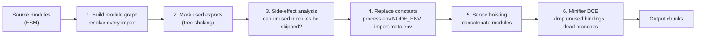
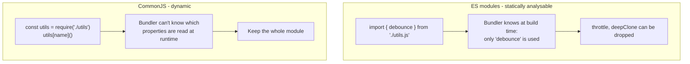
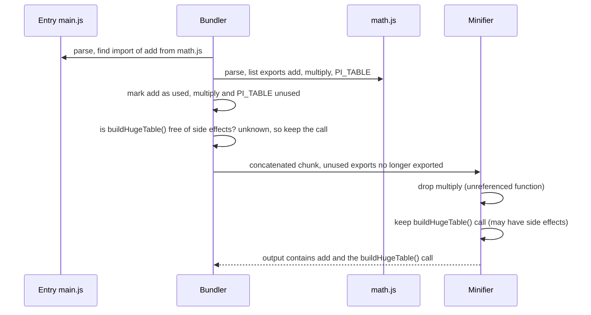
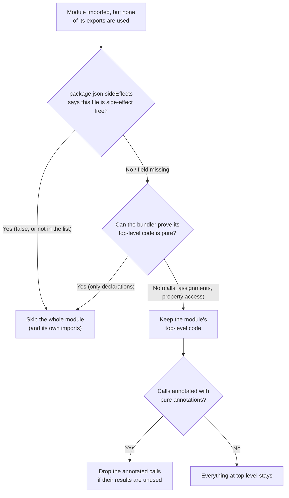
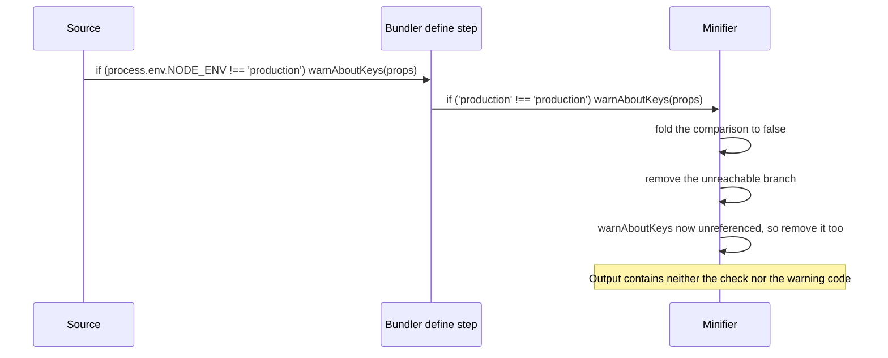
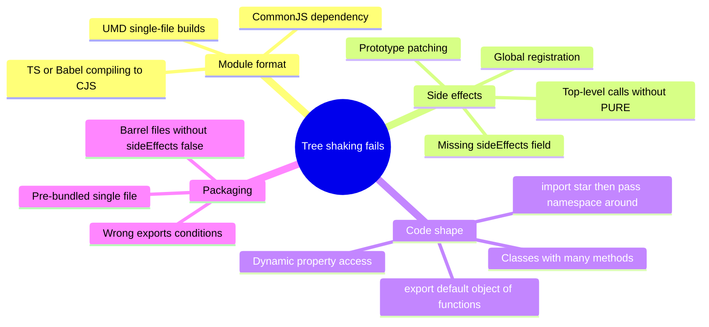
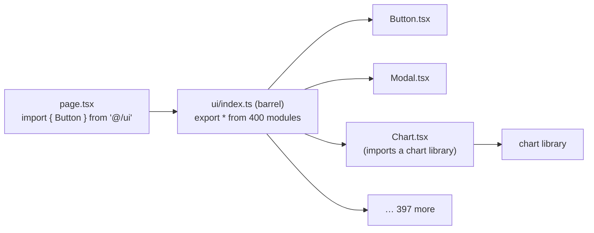
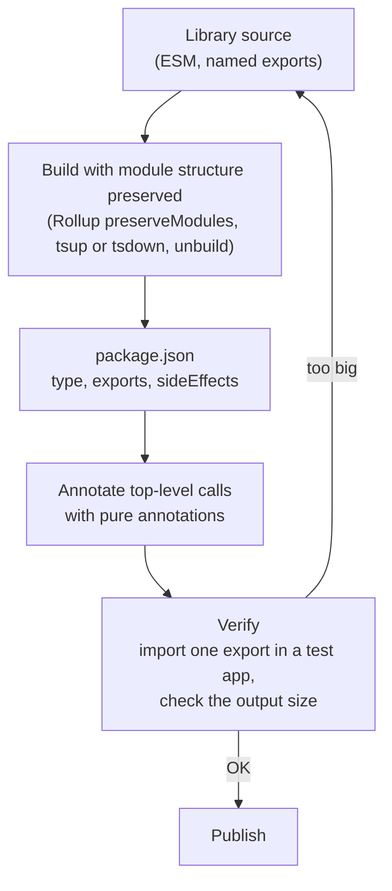

# Tree Shaking & Dead Code Elimination

> **Date:** 2026-11-06 · **Last updated:** 2026-11-06
> **Category:** Frontend System Design
> **Sub-Topic:** Performance Engineering / Loading Performance
> **Level:** Intermediate · **Reading time:** ~28 min
> **Informs:** dependency selection (ESM vs CommonJS, per-function imports), library packaging (`exports`, `sideEffects`, pure annotations), barrel-file policy, build-time flags and `NODE_ENV` stripping, bundler and minifier configuration, unused-code audits in CI, initial JS budget

> **Pre-requisite:** [Module Bundling & Build Systems](../02-rendering-and-architecture/module-bundling-and-build-systems.md) (module formats, the bundling pipeline) and [Code Splitting & Lazy Loading](./code-splitting-and-lazy-loading.md).
> Code splitting decides **when** code loads; this note is about making sure code nobody uses **never ships at all**.

**Previous:** [Code Splitting & Lazy Loading](./code-splitting-and-lazy-loading.md) · **Next:** [Image Optimization](./image-optimization.md)

---

## Table of Contents

1. [ELI5 — Simple Explanation](#eli5--simple-explanation)
2. [Section 1: Three Ways to Remove Code](#section-1-three-ways-to-remove-code)
3. [Section 2: Why ES Modules Make Tree Shaking Possible](#section-2-why-es-modules-make-tree-shaking-possible)
4. [Section 3: How a Bundler Shakes the Tree](#section-3-how-a-bundler-shakes-the-tree)
5. [Section 4: Side Effects — the Hard Part](#section-4-side-effects--the-hard-part)
6. [Section 5: Dead Code Elimination in the Minifier](#section-5-dead-code-elimination-in-the-minifier)
7. [Section 6: What Breaks Tree Shaking](#section-6-what-breaks-tree-shaking)
8. [Section 7: Barrel Files](#section-7-barrel-files)
9. [Section 8: Writing Tree-Shakable Libraries](#section-8-writing-tree-shakable-libraries)
10. [Section 9: Beyond JavaScript — CSS, Dependencies and Files](#section-9-beyond-javascript--css-dependencies-and-files)
11. [Section 10: Frameworks and Native Platforms](#section-10-frameworks-and-native-platforms)
12. [Section 11: Verifying What Was Removed](#section-11-verifying-what-was-removed)
13. [Bundler Comparison](#bundler-comparison)
14. [Real-World Examples](#real-world-examples)
15. [Key Points Summary](#key-points-summary)
16. [Test Your Understanding](#test-your-understanding)
17. [Cheat Sheet](#cheat-sheet)
18. [References & Further Reading](#references--further-reading)

---

## ELI5 — Simple Explanation

You're packing for a weekend trip and your wardrobe is a **toolbox with 200 tools**. You only need a screwdriver.

- **Without tree shaking** you carry the whole toolbox, because "you imported the toolbox".
- **Tree shaking** is like a friend who looks at your plans, sees you only ever mention the screwdriver, and packs just that.
- But some tools are **booby-trapped**: picking them up (just importing them) *does something* — rings a bell, switches on a light. Your friend can't leave those behind unless the label says **"safe to leave: no side effects"**. That label is the `sideEffects` flag and the `/*#__PURE__*/` comment.
- **Dead code elimination** is crossing out the pages of your itinerary that can never happen: "If it's 1995, visit the video shop" — it's not 1995, so that whole paragraph goes.

> **Only code that is provably unused AND provably harmless to remove can be dropped. Your job is to make both facts easy for the tools to prove.**

---

## Core Concept — Step by Step

### Section 1: Three Ways to Remove Code

The words get mixed up, so pin them down first:

| Technique | Granularity | Done by | Question it answers |
|---|---|---|---|
| **Tree shaking** (unused export elimination) | Exports and whole modules across the module graph | Bundler (webpack, Rollup, Rolldown, esbuild, Rspack, Turbopack, Parcel) | "Does anybody import this export?" |
| **Dead code elimination (DCE)** | Statements, branches, expressions inside a module or chunk | Minifier (Terser, esbuild, SWC, Oxc) and bundlers that analyse statements | "Can this code ever run, or does its result matter?" |
| **Build-time constant folding** | Branches guarded by known constants | Bundler `define` + minifier | "Is this `if` always false in production?" |



The term *tree shaking* was popularised by Rollup: instead of starting with everything and deleting, the bundler starts from the **entry points** and includes only what is reachable — "live code inclusion".

---

### Section 2: Why ES Modules Make Tree Shaking Possible

ES module `import`/`export` declarations are **static**: they appear only at the top level, use string-literal specifiers, and can be analysed without running the code. CommonJS `require()` is an ordinary function call that can happen anywhere, with any computed value.



| ESM property | Why it helps |
|---|---|
| Top-level-only `import`/`export` | The dependency graph is known before execution |
| String-literal specifiers | Resolution happens at build time |
| Named bindings | Usage is tracked **per export**, not per module |
| Live, read-only bindings | Importers can't reassign exports, so analysis stays valid |

> **CommonJS is not entirely hopeless:** webpack 5 can tree-shake some simple CommonJS patterns (such as `exports.foo = …`), and other bundlers have partial heuristics. But support is limited and fragile — if bundle size matters, depend on packages that ship **ESM**.

**Your own compiler settings can sabotage this.** If TypeScript or Babel converts your `import`/`export` to CommonJS *before* the bundler sees it, tree shaking is lost:
- **TypeScript:** for bundled apps use `"module": "esnext"` or `"preserve"` with `"moduleResolution": "bundler"` — not `"commonjs"`.
- **Babel:** `@babel/preset-env` with `modules: "auto"` (the default) leaves ESM alone when the caller (babel-loader, Rollup plugin) supports it; never force `modules: "commonjs"` for browser bundles.

---

### Section 3: How a Bundler Shakes the Tree

Take this module graph:

```javascript
// math.js
export function add(a, b) { return a + b; }
export function multiply(a, b) { return a * b; }
export const PI_TABLE = buildHugeTable(); // top-level call!

// main.js
import { add } from './math.js';
console.log(add(2, 3));
```



The surprising result: `multiply` disappears, but **`buildHugeTable()` still runs** — and pulls in everything it references — because the tools can't prove the call is harmless. The fix is a pure annotation (Section 4):

```javascript
export const PI_TABLE = /*#__PURE__*/ buildHugeTable();
```

**How the big bundlers implement it:**

| Bundler | Mechanism |
|---|---|
| **Rollup / Rolldown** | Builds an AST-level graph and includes only statements reachable from entries (statement-level analysis); scope-hoists everything into one scope per chunk |
| **webpack / Rspack** | In `mode: 'production'`: `optimization.usedExports` marks unused exports, `innerGraph` tracks usage inside modules, `sideEffects` skips side-effect-free modules, `concatenateModules` scope-hoists, then Terser (or SWC in Rspack) removes the dead code |
| **esbuild** | Tree shaking is on when bundling; honours `sideEffects` and pure annotations; also does its own minification |
| **Turbopack / Parcel** | Perform export-level tree shaking in production builds; check each tool's docs for edge cases |

---

### Section 4: Side Effects — the Hard Part

A **side effect** is anything a module or expression does besides computing its exports: writing to `window`, registering a custom element, patching a prototype, injecting CSS, logging, starting a timer. A bundler may drop code only if it is sure no side effect is lost.



**Three tools to communicate "safe to remove":**

| Tool | Scope | Example |
|---|---|---|
| `"sideEffects": false` in package.json | Every file in the package | `{ "sideEffects": false }` |
| `"sideEffects": [globs]` | Lists the files that **do** have side effects | `{ "sideEffects": ["*.css", "./src/polyfills.js"] }` |
| `/*#__PURE__*/` (or `/* @__PURE__ */`) | One call or `new` expression | `export const Btn = /*#__PURE__*/ styled('button')({...})` |
| `/*#__NO_SIDE_EFFECTS__*/` | A function declaration: every call to it is pure | Supported by Rollup, esbuild and others — check your toolchain |

**The `sideEffects` flag was introduced by webpack** and is now honoured by Rollup (through `@rollup/plugin-node-resolve`), Vite/Rolldown, esbuild, Parcel and Rspack. It is a **promise from the package author** — if it's wrong, the bundler silently drops code that mattered.

> **Classic bug:** a package sets `"sideEffects": false` but also does `import './styles.css'` inside a component. The CSS import has no used exports, the package claims it is side-effect free, so the bundler **drops the stylesheet**. Fix: `"sideEffects": ["**/*.css"]`.

Things that count as side effects (and keep code alive):

```text
window.myLib = …                         global assignment
Array.prototype.last = …                 prototype patching (polyfills)
customElements.define('x-btn', XBtn)     registration
import './styles.css'                    CSS injection
console.log(…) at top level              I/O
const x = createStore()                  any call the tool can't prove pure
obj.prop                                 a property read can trigger a getter — some tools assume this is a side effect
```

---

### Section 5: Dead Code Elimination in the Minifier

Minifiers remove code that can never run or whose result is never used. Combined with **compile-time constants**, this is how frameworks strip development-only code.



| Constant | Where it comes from | Typical use |
|---|---|---|
| `process.env.NODE_ENV` | webpack sets it from `mode`; Vite, Next.js, esbuild `define` replace it | React, Redux and many libraries strip warnings and dev checks |
| `import.meta.env.DEV` / `.PROD` / `.MODE` | Vite | App-level dev tooling, debug panels |
| `__DEV__` | Custom `define`, React Native / Metro | Dev-only code paths |
| `__VUE_OPTIONS_API__`, `__VUE_PROD_DEVTOOLS__` | Vue's compile-time feature flags | Dropping Options API support or prod devtools |
| Your own flags | `define: { __FEATURE_X__: 'false' }` | Build-time feature flags, per-tenant builds |

What minifiers typically remove:
- Unreachable branches: `if (false) { … }`, code after `return`/`throw`
- Unused local variables and functions (when they have no side effects)
- Unused results of pure expressions
- Calls you explicitly allow: esbuild `drop: ['console', 'debugger']`, Terser `compress.drop_console` / `pure_funcs`

> **Runtime feature flags are not dead code.** `if (flags.newCheckout)` from a remote config can't be removed at build time — both branches ship. If one branch is large, put it behind a dynamic `import()` (see [Code Splitting & Lazy Loading](./code-splitting-and-lazy-loading.md)).

---

### Section 6: What Breaks Tree Shaking



| Pattern | Why it defeats tree shaking | Better |
|---|---|---|
| `import _ from 'lodash'` | `lodash` is CommonJS; the whole library ships | `import debounce from 'lodash-es/debounce'` or `import { debounce } from 'lodash-es'` — or native JS |
| `export default { formatDate, formatMoney, … }` | An object is used as a whole; individual properties aren't tracked | Named exports: `export function formatDate…` |
| `class Utils { static a(){} static b(){} … }` | Class members are generally not removed individually | Separate exported functions |
| `import * as icons from './icons'; icons[name]` | Dynamic property access means every export may be used | Import the specific icons, or a lazy map of `import()` per icon |
| Passing a namespace object around (`register(utils)`) | Its properties can be read anywhere | Pass the functions you need |
| Top-level `const store = createStore()` | Call assumed side-effectful | `/*#__PURE__*/` or create lazily in a function |
| Library published as one pre-bundled CJS/UMD file | Nothing left to analyse per export | Prefer packages with ESM builds and `exports` maps |
| TypeScript `enum` in libraries | Compiles to an IIFE that mutates an object; not every bundler can drop it (esbuild inlines enums it can see) | `as const` objects or string-literal unions |
| `moment` with all locales | Locales are loaded via dynamic `require`, and its API is a single mutable object; the project is in maintenance mode | `date-fns`, Day.js, Luxon, or native `Intl` |

> Static named imports — `import { a } from 'lib'` vs `import * as lib from 'lib'` — are **both** tree-shakable as long as you only access properties statically (`lib.a`). What breaks it is computed access (`lib[name]`) or letting the namespace object escape.

---

### Section 7: Barrel Files

A **barrel** is an `index.ts` that re-exports everything from a folder: `export * from './Button'; export * from './Modal'; …`. It's convenient (`import { Button } from '@/ui'`) but costly.



| Environment | What happens with a barrel import |
|---|---|
| **Production bundle, `sideEffects: false`** | Bundler can skip the unused re-exported modules — usually fine |
| **Production bundle, no `sideEffects` info** | Every module behind the barrel may be kept because its top-level code *might* matter |
| **Dev server (unbundled ESM, e.g. Vite dev)** | The browser requests **every** module the barrel references → slow page loads and HMR |
| **Tests (Jest/Vitest)** | Every test that imports from the barrel loads and transforms all of it → slow test runs |
| **Circular imports** | Barrels make cycles easy to create, which can cause `undefined` at import time |

Mitigations:
- Import from the specific file in app code (`@/ui/Button`) and enforce it with a lint rule (e.g. `no-restricted-imports`).
- Mark your packages `"sideEffects": false` (with exceptions for CSS).
- **Next.js** `experimental.optimizePackageImports` (on by default for a list of popular packages) rewrites barrel imports to direct module imports.
- Libraries: publish per-component entry points through the `exports` map (`"./button": "./dist/button.js"`).

---

### Section 8: Writing Tree-Shakable Libraries

If you publish a design system or utility package, its consumers can only shake what you let them.



```json
{
  "name": "@acme/ui",
  "type": "module",
  "exports": {
    ".": { "types": "./dist/index.d.ts", "import": "./dist/index.js" },
    "./button": { "types": "./dist/button.d.ts", "import": "./dist/button.js" },
    "./styles.css": "./dist/styles.css"
  },
  "sideEffects": ["**/*.css"],
  "files": ["dist"]
}
```

Checklist:
- Ship **ESM** (an `import` condition in `exports`). Dual ESM/CJS packages are still common; make sure bundlers resolve the ESM build.
- **Preserve modules** (one output file per source file) rather than one big bundle — finer granularity, better shaking, and better caching for consumers.
- Declare `sideEffects` **accurately**; list CSS and polyfill files.
- Avoid top-level work: no global registration, no eager singletons, no prototype patching — or isolate them in explicitly side-effectful entry points (`@acme/ui/register`).
- Mark factory calls at the top level with `/*#__PURE__*/` (CSS-in-JS `styled()`, `forwardRef`, `createContext` wrappers — many compilers add these automatically).
- Validate the package with tools such as `publint` and "Are The Types Wrong?", and measure a single-export import with a size tool.

---

### Section 9: Beyond JavaScript — CSS, Dependencies and Files

| Kind of dead code | Tooling |
|---|---|
| **Unused CSS rules** | Utility frameworks generate only the classes they find in your source (Tailwind scans content files); CSS Modules and component-scoped CSS keep styles next to their component, so unused components take their CSS with them; PurgeCSS for legacy global stylesheets (careful with dynamically built class names) |
| **Unused dependencies** | `knip`, `depcheck` find packages in `package.json` that no code imports |
| **Unused files and exports in your repo** | `knip`; TypeScript `noUnusedLocals` / `noUnusedParameters`; ESLint `no-unused-vars` |
| **Unused polyfills** | Target modern browsers with `browserslist`; use `core-js` with `useBuiltIns: 'usage'` only if you need polyfills at all |
| **Unused locales / timezone data** | Load per locale with `import()`; prefer `Intl` APIs built into the browser |
| **Unused icons** | Import individual icons, not the whole set; or use an SVG sprite generated from the icons actually referenced |

> Tree shaking only works inside the module graph. A dependency nobody imports never reaches the bundle anyway — but it still slows installs, CI and security audits, so prune it.

---

### Section 10: Frameworks and Native Platforms

| Stack | How unused code is removed |
|---|---|
| **React** | Production builds strip dev warnings via `process.env.NODE_ENV`; the core library itself isn't split into tree-shakable features, so the win comes from your own code and dependencies |
| **Next.js** | Tree shaking + `optimizePackageImports`; Server Components keep server-only code out of the client bundle entirely; `server-only` package makes accidental client imports fail the build |
| **Vue 3** | Designed for tree shaking: global APIs are named exports (`nextTick`, `Transition`, `KeepAlive`), so unused built-ins drop out; compile-time flags such as `__VUE_OPTIONS_API__: false` remove Options API support |
| **Angular** | Ivy compiles components to tree-shakable code; `@Injectable({ providedIn: 'root' })` providers are dropped when unused; standalone components avoid pulling whole NgModules; the CLI's esbuild-based builder does the shaking and minification |
| **Svelte / SolidJS** | Compilers emit only the runtime helpers a component actually uses, so the framework cost scales with features used |
| **Astro / islands** | Components without a `client:*` directive ship **no** JavaScript at all |
| **React Native (Metro)** | Metro historically doesn't tree-shake; Expo has added experimental tree shaking for production bundles — check the Expo docs for current status. Hermes bytecode and inline requires reduce startup cost instead |
| **Android** | **R8** (successor to ProGuard) shrinks code: removes unused classes and members, then optimises and obfuscates; keep rules protect reflection targets |
| **iOS** | The linker's dead stripping removes unreferenced code in release builds; Swift whole-module optimisation helps the compiler remove unused code |
| **Flutter** | Release builds tree-shake Dart code and, by default, unused icon font glyphs |

---

### Section 11: Verifying What Was Removed

Never assume tree shaking works — check the output.

| Method | What to look for |
|---|---|
| **Bundle visualiser** (`rollup-plugin-visualizer`, `webpack-bundle-analyzer`, `source-map-explorer`, Statoscope) | Whole libraries where you use one function; duplicates of the same package |
| **Single-import test** | Build a tiny entry that imports one export; the output should be roughly that function's size |
| **Search the output** | `grep` the built chunk for a function you think is gone |
| **webpack stats** | `optimizationBailout` reasons explain why modules couldn't be concatenated |
| **DevTools Coverage panel** | Bytes loaded vs executed — unused code that survived the build |
| **Size budgets in CI** (`size-limit` and similar) | A PR that accidentally imports a whole library fails the check — see [Performance Budgets](./performance-budgets.md) |
| **Package metadata** | Bundlephobia / pkg-size style tools show whether a package is ESM and side-effect free |

---

## Bundler Comparison

| | Rollup / Rolldown (Vite) | webpack | Rspack | esbuild | Turbopack |
|---|---|---|---|---|---|
| **Tree shaking granularity** | Statement-level | Export-level + inner graph | webpack-compatible | Statement/export-level | Export-level |
| **Reads `sideEffects`** | Yes (Rollup via node-resolve plugin) | Yes (`optimization.sideEffects`) | Yes | Yes | Yes |
| **Pure annotations** | Yes, plus `__NO_SIDE_EFFECTS__` | Via Terser | Via SWC minifier | Yes, plus `__NO_SIDE_EFFECTS__` | Via SWC minifier |
| **Scope hoisting** | Always | `concatenateModules` in production | Yes | Yes | Yes |
| **CommonJS shaking** | Limited (via commonjs plugin conversion) | Some patterns | Some patterns | Limited | Limited |
| **Key config** | `treeshake` options, `output.preserveModules` | `mode: 'production'`, `optimization.*` | Same as webpack | `--bundle`, `--tree-shaking`, `--drop`, `--pure` | Next.js config |

Exact capabilities change between versions — confirm in each tool's documentation.

---

## Real-World Examples

**Example 1 — Utility imports (BAD → GOOD):**
```typescript
// ❌ BAD: CommonJS lodash — the whole library ends up in the bundle
import _ from 'lodash';
const onResize = _.debounce(update, 200);

// ✅ GOOD: ESM build + named import — only debounce and its helpers ship
import { debounce } from 'lodash-es';
const onResize2 = debounce(update, 200);

// ✅ OFTEN BEST: no dependency at all
function debounceNative<T extends unknown[]>(fn: (...args: T) => void, ms: number) {
  let id: ReturnType<typeof setTimeout> | undefined;
  return (...args: T) => {
    clearTimeout(id);
    id = setTimeout(() => fn(...args), ms);
  };
}
```

**Example 2 — Shape your modules for shaking:**
```typescript
// ❌ BAD: default-exported object — importing it keeps every function
export default {
  formatDate: (d: Date) => d.toISOString(),
  formatMoney: (n: number) => n.toFixed(2),
  formatBytes: (n: number) => `${n} B`,
};

// ✅ GOOD: named exports — unused ones are dropped
export const formatDate = (d: Date) => d.toISOString();
export const formatMoney = (n: number) => n.toFixed(2);
export const formatBytes = (n: number) => `${n} B`;

// ❌ BAD: TypeScript enum (IIFE that mutates an object)
export enum Status { Idle = 'idle', Loading = 'loading' }

// ✅ GOOD: const object + union type — plain data, trivially shakable
export const Status2 = { Idle: 'idle', Loading: 'loading' } as const;
export type Status2 = (typeof Status2)[keyof typeof Status2];
```

**Example 3 — Pure annotations for top-level factories:**
```typescript
import styled from '@emotion/styled';
import { createContext } from 'react';

// Without the annotation, an unused Button still survives: styled() might have side effects.
export const Button = /*#__PURE__*/ styled.button`
  padding: 0.5rem 1rem;
`;

export const ThemeContext = /*#__PURE__*/ createContext('light');

// Function-level annotation: every call to createIcon is considered pure (Rollup, esbuild, …)
/*#__NO_SIDE_EFFECTS__*/
export function createIcon(path: string) {
  return { path };
}
export const CloseIcon = createIcon('M6 6l12 12M18 6L6 18');
```

**Example 4 — Build-time flags (Vite and webpack):**
```typescript
// vite.config.ts
import { defineConfig } from 'vite';

export default defineConfig({
  define: {
    __ENABLE_DEBUG_PANEL__: JSON.stringify(false),
    __VUE_OPTIONS_API__: JSON.stringify(false), // Vue projects using only the Composition API
  },
  esbuild: {
    drop: ['debugger'],
    pure: ['console.log'], // remove console.log calls whose results are unused
  },
});

// app code
declare const __ENABLE_DEBUG_PANEL__: boolean;
if (__ENABLE_DEBUG_PANEL__) {
  // becomes if (false) { … } and is removed by the minifier
  import('./debug-panel').then((m) => m.mount());
}
if (import.meta.env.DEV) {
  console.info('dev only'); // removed in production builds
}
```

```javascript
// webpack.config.js — production mode enables the whole pipeline
module.exports = {
  mode: 'production', // usedExports, sideEffects, concatenateModules, minimize (Terser)
  optimization: {
    // shown explicitly; these are already on in production mode
    usedExports: true,
    sideEffects: true,
    concatenateModules: true,
    minimize: true,
  },
};
```

> Option names for the minifier step differ between Vite versions (esbuild-based vs Rolldown/Oxc-based builds) — check the Vite build docs for your version.

**Example 5 — `package.json` for an app or internal package:**
```json
{
  "name": "@acme/web",
  "private": true,
  "type": "module",
  "sideEffects": ["**/*.css", "./src/polyfills.ts", "./src/instrumentation.ts"]
}
```

**Example 6 — TypeScript config that preserves ESM for the bundler:**
```json
{
  "compilerOptions": {
    "target": "ES2022",
    "module": "ESNext",
    "moduleResolution": "bundler",
    "verbatimModuleSyntax": true,
    "isolatedModules": true,
    "noUnusedLocals": true,
    "noEmit": true
  }
}
```

**Example 7 — Icons: whole set vs individual imports:**
```tsx
// ❌ BAD: dynamic lookup into a namespace — every icon is kept
import * as Icons from 'some-icon-lib';
export const Icon = ({ name }: { name: keyof typeof Icons }) => {
  const C = Icons[name] as React.ComponentType;
  return <C />;
};

// ✅ GOOD: static imports of the icons you use
import { Search, X } from 'some-icon-lib';
export const SearchBar = () => (
  <div>
    <Search aria-hidden="true" />
    <button type="button" aria-label="Clear">
      <X aria-hidden="true" />
    </button>
  </div>
);
```

**Example 8 — Finding unused code and dependencies in CI:**
```bash
# Unused files, exports and dependencies across the repo
npx knip

# Visualise what is in the production bundle (Vite/Rollup)
npx vite-bundle-visualizer

# Check a single built chunk for something you expected to be removed
grep -c "warnAboutDeprecatedLifecycles" dist/assets/*.js
```

---

## Key Points Summary

| Concept | One-Line Explanation |
|---|---|
| **Tree shaking** | Bundler keeps only exports reachable from the entry points |
| **Dead code elimination** | Minifier removes unreachable branches and unused, side-effect-free code |
| **ES modules** | Static `import`/`export` make per-export usage analysable at build time |
| **CommonJS** | Dynamic `require` — little or no tree shaking; prefer ESM packages |
| **Side effect** | Anything code does besides producing exports — keeps code alive |
| **`sideEffects` field** | Package-level promise that files can be skipped if unused |
| **`/*#__PURE__*/`** | Marks one call as removable if its result is unused |
| **`/*#__NO_SIDE_EFFECTS__*/`** | Marks a function so every call to it is treated as pure |
| **Constant folding** | `define`d constants turn dev-only branches into `if (false)` |
| **Scope hoisting** | Concatenating modules into one scope enables more DCE |
| **Barrel files** | Re-export hubs that slow dev/tests and can defeat shaking without `sideEffects` |
| **Library packaging** | ESM, preserved modules, accurate `sideEffects`, `exports` map |
| **Verification** | Visualiser, single-import test, Coverage panel, CI size budgets |

---

## Test Your Understanding

**Q1 (Basic):**
What's the difference between tree shaking and dead code elimination, and why does tree shaking need ES modules?

<details>
<summary>Answer</summary>

**Tree shaking** works across the module graph: the bundler starts from the entry points and keeps only the exports (and modules) that are actually imported and used. **Dead code elimination** works inside the code: the minifier removes branches that can't run and expressions whose results are unused and free of side effects.

Tree shaking needs **ES modules** because `import`/`export` are static — top-level only, with literal specifiers and named bindings — so the bundler can tell at build time exactly which exports each module uses. CommonJS `require()` is a runtime call whose argument and property access can be computed, so the bundler usually has to keep the whole module.
</details>

**Q2 (Application):**
You import one 1 KB function from an internal utilities package, but the bundle analyser shows the whole 80 KB package in your main chunk. List the likely causes and how you'd check each.

<details>
<summary>Answer</summary>

1. **The package is compiled to CommonJS** (its `tsconfig` has `"module": "commonjs"`, or Babel converts modules) → check `dist/` for `require`/`exports.`; fix by emitting ESM.
2. **No `sideEffects` field** and top-level code in its modules (e.g. `const registry = createRegistry()`) → add `"sideEffects": false` (listing CSS/polyfills) and `/*#__PURE__*/` annotations.
3. **Default-exported object or class** of utilities → switch to named exports.
4. **Barrel with `export *`** plus side-effectful modules behind it → import from the specific file or fix `sideEffects`.
5. **Your import style**: `import * as utils` with `utils[name]` dynamic access → import named functions.
6. **Resolution picks the wrong build** (the `exports` map resolves to the CJS entry) → check the `import` condition.

Verify each fix with a single-import test build and the visualiser.
</details>

**Q3 (Tricky):**
A component library sets `"sideEffects": false`. After upgrading, buttons render unstyled in production but look fine in development. Why?

<details>
<summary>Answer</summary>

The components do `import './Button.css'`. That import has no used bindings, and the package told the bundler that **no** file has side effects — so in the production build the bundler legally skips the CSS module. In development the dev server usually doesn't tree-shake, so the CSS still loads, which hides the bug.

Fix: declare CSS as side-effectful — `"sideEffects": ["**/*.css"]` — or have consumers import a stylesheet explicitly. The general lesson: `sideEffects` is a **promise**; if it's wrong, the bundler silently removes code that mattered.
</details>

**Q4 (Tricky):**
Why might this module still contain `heavyInit` in the production bundle even though nobody imports `config`?

```javascript
export const config = heavyInit();
export function used() { return 1; }
```

<details>
<summary>Answer</summary>

`heavyInit()` is a **top-level call**. Unless the tools can prove it's pure, they must assume it might have side effects (write a global, register something, log), so the call — and everything `heavyInit` references — must stay, even though the `config` binding is unused.

Fixes: annotate the call (`export const config = /*#__PURE__*/ heavyInit();`), annotate the function with `/*#__NO_SIDE_EFFECTS__*/`, or make it lazy (`export const getConfig = () => heavyInit();`). Marking the whole package `"sideEffects": false` lets the bundler skip the module only when **none** of its exports are used — here `used` is imported, so the module is included and the top-level call stays unless it's annotated.
</details>

**Q5 (System design):**
You own a design system used by 30 product teams. Bundle-size complaints are growing. What packaging and governance changes do you make?

<details>
<summary>Answer</summary>

- **Packaging:** publish ESM with an `exports` map, **preserve modules** (one file per component), per-component subpath exports (`@acme/ui/button`), accurate `"sideEffects": ["**/*.css"]`, and `/*#__PURE__*/` on top-level factories (`styled`, `forwardRef`, `createContext`).
- **API shape:** named exports only, no default-exported objects or utility classes, no global registration or theme singletons at import time; heavy pieces (date picker, rich editor, charts) as separate entry points that consumers lazy-load.
- **Dependencies:** avoid CommonJS-only and monolithic deps; prefer `Intl` over date/number libraries where possible.
- **Verification:** a CI job that builds a fixture app importing one component and fails if its size exceeds a budget; visualiser reports per release; `publint` on every publish.
- **Consumer guidance:** document direct imports, provide a lint rule, and note that Next.js's `optimizePackageImports` can be configured for the package.
</details>

**Q6 (Application):**
Your React app logs dev warnings in production and the React bundle is much larger than expected. What's wrong?

<details>
<summary>Answer</summary>

`process.env.NODE_ENV` is not being replaced with `"production"` at build time, so React's development build (with warnings, extra checks and helpful messages) is shipped, and the `if (process.env.NODE_ENV !== 'production')` branches can't be folded away.

Fix: build in production mode — webpack `mode: 'production'`, `vite build` (which sets it), `next build` — or set the `define` replacement explicitly for custom esbuild/Rollup setups. Then verify with a search of the output for a known dev-only warning string.
</details>

---

## Cheat Sheet

**Key Definitions:**
- **Tree shaking:** Removing unused exports/modules by analysing the static ES module graph from entry points
- **Dead code elimination:** Minifier-level removal of unreachable or unused, side-effect-free code
- **Side effect:** Observable work done by evaluating code (global writes, registration, CSS injection, I/O)
- **`sideEffects`:** package.json field — `false` or a list of files that do have side effects
- **Pure annotation:** `/*#__PURE__*/` before a call; `/*#__NO_SIDE_EFFECTS__*/` before a function declaration
- **Scope hoisting:** Concatenating modules into one scope, enabling more cross-module DCE
- **Barrel file:** An index module that re-exports many modules
- **Constant folding:** Replacing known constants at build time so branches become statically dead

**Quick Reference:**
```text
Prerequisite          → ESM all the way to the bundler (TS module: esnext/preserve, Babel modules: auto)
Imports               → named imports; no computed access on namespaces; no default-exported objects
Dependencies          → prefer ESM packages (lodash-es, date-fns); avoid monolithic CJS (lodash, moment)
package.json          → "type": "module", "exports" with "import", "sideEffects": ["**/*.css"]
Top-level calls       → /*#__PURE__*/ call()  ·  /*#__NO_SIDE_EFFECTS__*/ function f() {}
Prod mode             → webpack mode: 'production' · vite build · next build (NODE_ENV = production)
Build-time flags      → define: { __FLAG__: 'false' } → if (false) {...} removed
Runtime flags         → not removable; lazy-load big branches with import()
Barrels               → import from the file; Next.js optimizePackageImports; sideEffects false
Libraries             → preserveModules, per-component subpath exports, publint
Verify                → visualiser · single-import fixture · grep the output · Coverage panel · size-limit in CI
Repo hygiene          → knip (unused files/exports/deps), noUnusedLocals
```

**Common Mistakes to Avoid:**

| Mistake | Why Wrong | Fix |
|---|---|---|
| Compiling app code to CommonJS before bundling | Bundler can't analyse `require` → no shaking | TS `module: esnext`/`preserve`; Babel `modules: 'auto'` |
| `import _ from 'lodash'` | CJS build ships entirely | `lodash-es` named imports or native code |
| `"sideEffects": false` with CSS imports inside | Production build drops styles | `"sideEffects": ["**/*.css"]` |
| No `sideEffects` field in your packages | Unused modules kept "just in case" | Add it, accurately |
| Top-level factory calls without annotations | Calls assumed side-effectful | `/*#__PURE__*/` or lazy creation |
| `export default { …many functions }` | Object used as a whole | Named exports |
| Dynamic lookups like `Icons[name]` | Every export might be used | Static imports or a map of `import()` loaders |
| Big barrels in app code | Slow dev server and tests; risk of shipping extra code | Direct file imports + lint rule |
| Shipping a pre-bundled single-file library | Consumers can't shake it | Preserve modules, ESM build |
| Forgetting production mode / `NODE_ENV` | Dev builds of React and libraries ship | Production build or explicit `define` |
| Expecting runtime flags to be stripped | Both branches ship | Build-time `define`, or `import()` the big branch |
| Assuming it works without checking | Silent regressions | Visualiser + CI size budgets |

---

## References & Further Reading

**Core docs**
- MDN: [Tree shaking (glossary)](https://developer.mozilla.org/en-US/docs/Glossary/Tree_shaking)
- MDN: [JavaScript modules](https://developer.mozilla.org/en-US/docs/Web/JavaScript/Guide/Modules)
- web.dev: [Reduce JavaScript payloads with tree shaking](https://web.dev/articles/reduce-javascript-payloads-with-tree-shaking)
- web.dev: [Remove unused code](https://web.dev/articles/remove-unused-code)

**Bundlers & minifiers**
- webpack: [Tree Shaking guide](https://webpack.js.org/guides/tree-shaking/) · [`optimization` options](https://webpack.js.org/configuration/optimization/)
- Rollup: [`treeshake` options](https://rollupjs.org/configuration-options/#treeshake) · [`output.preserveModules`](https://rollupjs.org/configuration-options/#output-preservemodules)
- esbuild: [Tree shaking](https://esbuild.github.io/api/#tree-shaking) · [Pure annotations](https://esbuild.github.io/api/#ignore-annotations) · [Drop](https://esbuild.github.io/api/#drop)
- Vite: [Shared options — `define`](https://vite.dev/config/shared-options.html#define) · [Env variables and modes](https://vite.dev/guide/env-and-mode.html)
- Terser: [Compress options](https://terser.org/docs/options/#compress-options)
- JavaScript annotations proposal: [`#__PURE__` and `#__NO_SIDE_EFFECTS__`](https://github.com/javascript-compiler-hints/compiler-notations-spec)

**Frameworks & tooling**
- Next.js: [`optimizePackageImports`](https://nextjs.org/docs/app/api-reference/config/next-config-js/optimizePackageImports)
- Vue: [Compile-time flags](https://vuejs.org/api/compile-time-flags.html)
- Angular: [Tree-shakable providers / dependency injection](https://angular.dev/guide/di/creating-injectable-service)
- TypeScript: [`moduleResolution: bundler` and module options](https://www.typescriptlang.org/docs/handbook/modules/reference.html)
- Knip: [Find unused files, dependencies and exports](https://knip.dev/)
- publint: [Lint your package exports](https://publint.dev/)

**Native**
- Android: [Enable app optimization with R8](https://developer.android.com/topic/performance/app-optimization/enable-app-optimization)

**Specs**
- ECMAScript: [Modules](https://tc39.es/ecma262/#sec-modules)

**Deep dives**
- Rich Harris: [Tree-shaking versus dead code elimination](https://medium.com/@Rich_Harris/tree-shaking-versus-dead-code-elimination-d3765df85c80)
- Marvin Hagemeister: [Speeding up the JavaScript ecosystem — The barrel file debacle](https://marvinh.dev/blog/speeding-up-javascript-ecosystem-part-7/)

---

> **Previous Topic:** [Code Splitting & Lazy Loading](./code-splitting-and-lazy-loading.md)
> — Deciding when each chunk of code loads

> **Next Topic:** [Image Optimization](./image-optimization.md)
> — Usually the largest bytes on the page: formats, sizing, lazy loading and priority

*Saved on: 2026-11-06 | Repo: Frontend System Design Learning Notes*
