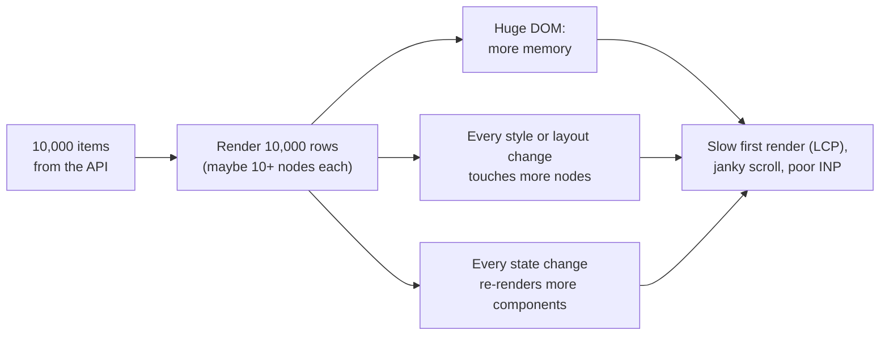
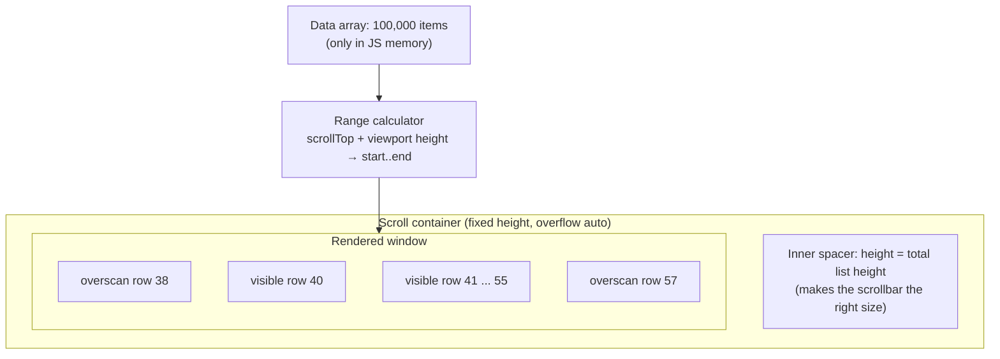
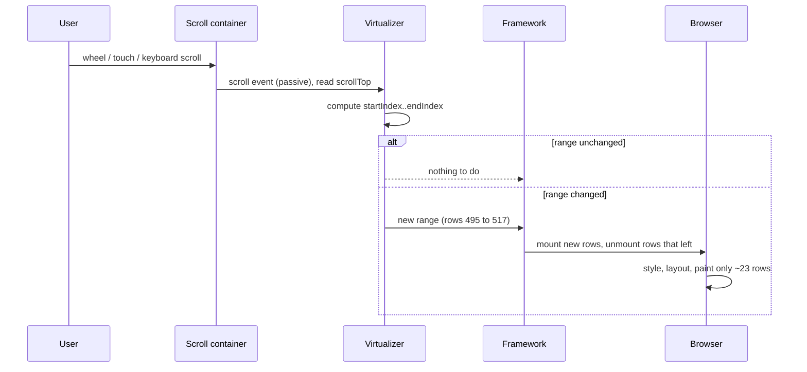
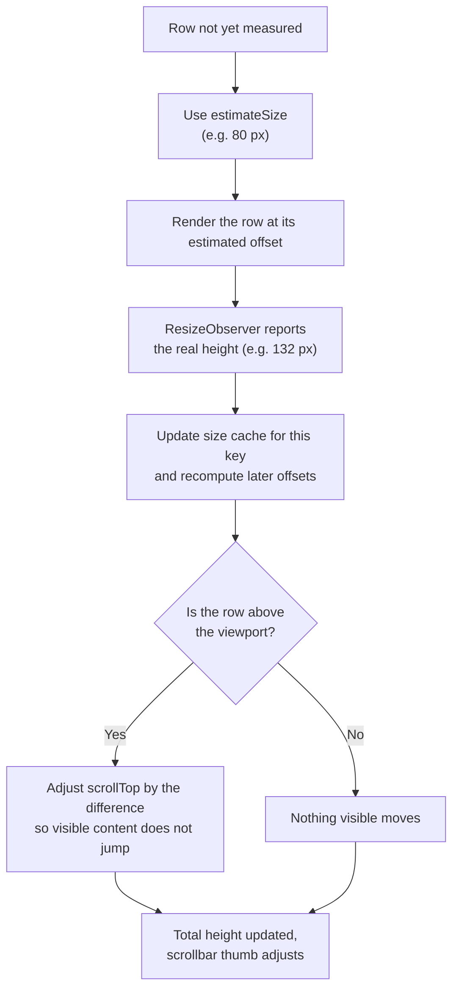
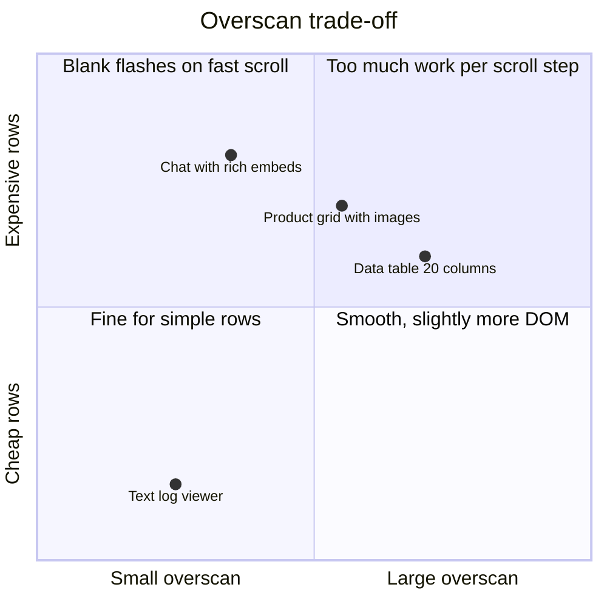
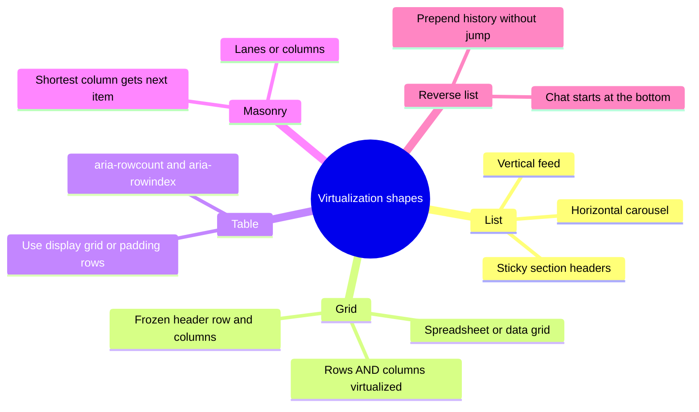
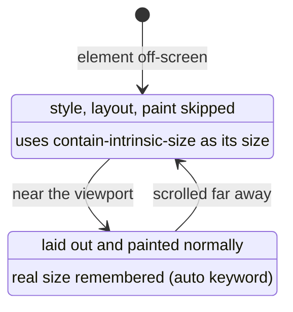
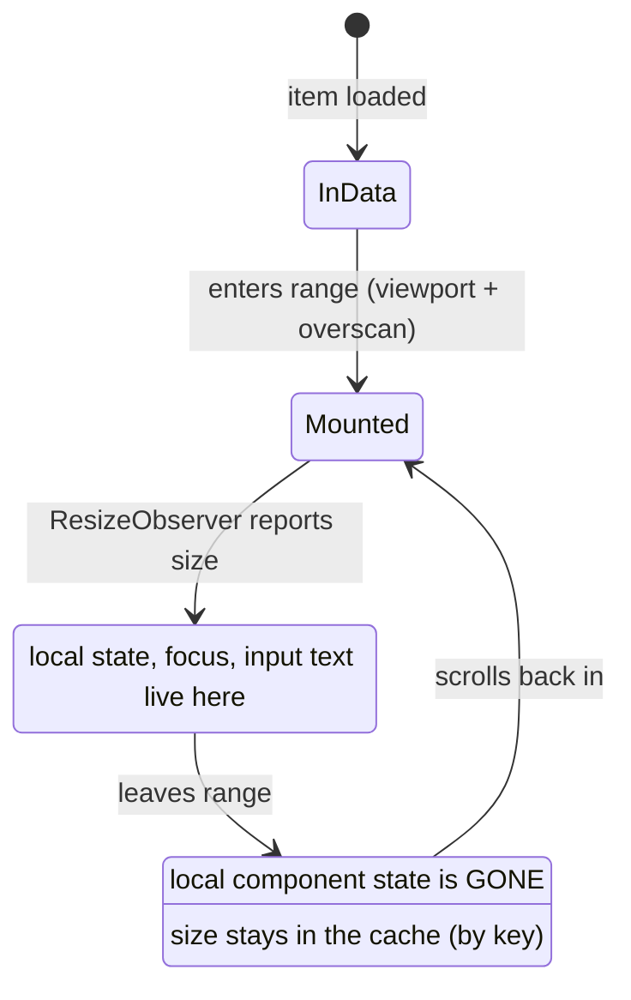
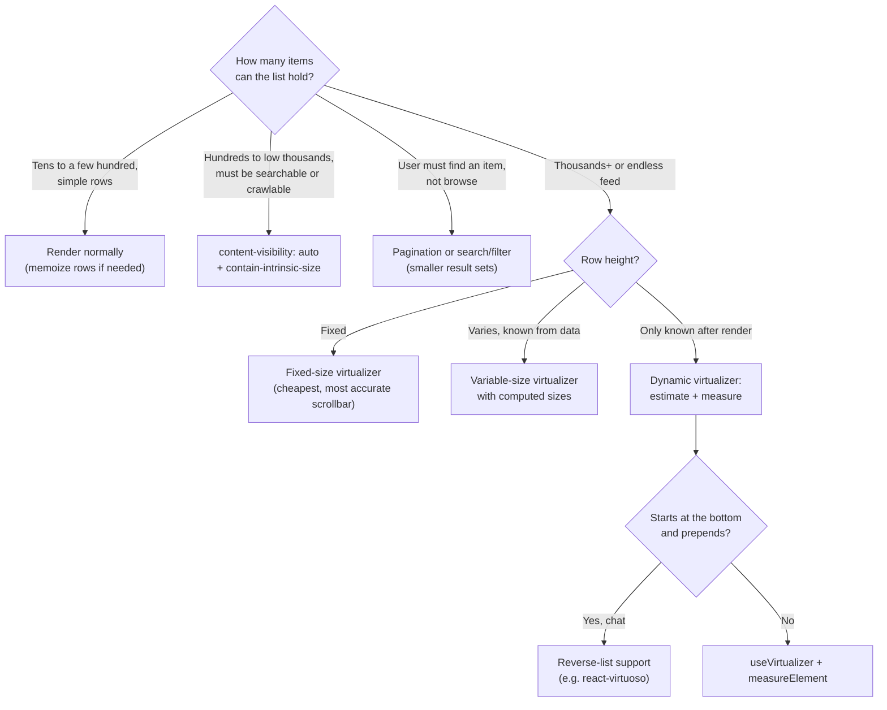

# Virtual Scrolling & Windowing

> **Date:** 2026-11-06 · **Last updated:** 2026-11-06
> **Category:** Frontend System Design
> **Sub-Topic:** Performance Engineering / Runtime Performance
> **Level:** Intermediate · **Reading time:** ~28 min
> **Informs:** list virtualization vs pagination vs content-visibility, DOM size budget, fixed vs measured row heights, overscan, scroll restoration, accessibility of long lists and grids, find-in-page trade-offs, table/grid/chat/feed architecture

> **Pre-requisite:** [DOM & Virtual DOM](../01-web-fundamentals/dom-and-virtual-dom.md) (what DOM nodes cost) and [Pagination & Infinite Scroll](../03-state-and-data/pagination-and-infinite-scroll.md) (how the data arrives).
> This note covers **how to render only what is visible** — the math, the libraries for every stack, CSS `content-visibility`, and the accessibility price you pay.

**Previous:** [JavaScript Bundle Optimization](./javascript-bundle-optimization.md) · **Next:** [React Performance (memo, useMemo, useCallback)](./react-performance-memo-usememo-usecallback.md)

---

## Table of Contents

1. [ELI5 — Simple Explanation](#eli5--simple-explanation)
2. [Section 1: Why Long Lists Are Slow](#section-1-why-long-lists-are-slow)
3. [Section 2: The Windowing Idea](#section-2-the-windowing-idea)
4. [Section 3: The Math for Fixed-Height Rows](#section-3-the-math-for-fixed-height-rows)
5. [Section 4: Variable and Dynamic Heights](#section-4-variable-and-dynamic-heights)
6. [Section 5: Overscan, Fast Scrolling and Blank Flashes](#section-5-overscan-fast-scrolling-and-blank-flashes)
7. [Section 6: Positioning Strategies and Scroll Containers](#section-6-positioning-strategies-and-scroll-containers)
8. [Section 7: Grids, Tables, Masonry and Reverse Lists](#section-7-grids-tables-masonry-and-reverse-lists)
9. [Section 8: CSS `content-visibility` — Virtualization Without JS](#section-8-css-content-visibility--virtualization-without-js)
10. [Section 9: Accessibility, Find-in-Page and SEO](#section-9-accessibility-find-in-page-and-seo)
11. [Section 10: State, Keys, Focus and Scroll Restoration](#section-10-state-keys-focus-and-scroll-restoration)
12. [Framework Comparison](#framework-comparison)
13. [Decision Matrix](#decision-matrix)
14. [Real-World Examples](#real-world-examples)
15. [Key Points Summary](#key-points-summary)
16. [Test Your Understanding (with answers)](#test-your-understanding)
17. [Cheat Sheet](#cheat-sheet)
18. [References & Further Reading](#references--further-reading)

---

## ELI5 — Simple Explanation

Imagine a **theatre play set in a city with 10,000 buildings**.

- Building all 10,000 buildings on stage is impossible — the stage collapses (that's rendering 10,000 DOM rows).
- Instead, the crew builds **only the few buildings the audience can see through the curtain opening** (the **viewport**), plus one or two just off-stage in case the scene moves (the **overscan**).
- When the scene slides left, the crew **takes down** the buildings that left the view and **puts up** the ones that are coming in. The audience never notices.
- A **painted backdrop** of the right length makes the stage *feel* as long as the whole city (the **spacer** that keeps the scrollbar honest).

> **Windowing renders a constant number of rows no matter how long the list is — the DOM cost depends on the viewport size, not on the data size.**

---

## Core Concept — Step by Step

### Section 1: Why Long Lists Are Slow

Every DOM element costs **memory**, **style recalculation**, **layout**, **paint** and, in a framework, **component instances + reconciliation work**. Those costs grow with the number of elements, while the user only ever looks at the 10–30 rows on screen.



| Cost | Grows with | Where you see it |
|---|---|---|
| **Initial render** | Number of rows × components per row | Long task on mount, late LCP |
| **Memory** | DOM nodes + JS objects + listeners | Tab crashes on low-end mobile |
| **Style / layout** | Nodes affected by a change | Slow resize, theme toggle, filter |
| **Re-render** | Components subscribed to changing state | Poor INP when typing in a filter box |
| **Hydration (SSR)** | Server-rendered rows the client must hydrate | Slow time-to-interactive |

Lighthouse flags an **excessive DOM size** audit; treat its thresholds as a hint, not a hard rule — see [Lighthouse: Avoid an excessive DOM size](https://developer.chrome.com/docs/lighthouse/performance/dom-size). The number that matters is what your **interaction and scroll profiling** shows on a mid-range phone.

> **Rule of thumb:** a few hundred simple rows are usually fine. Thousands, unbounded infinite feeds, or rows with heavy content (images, charts, editors) are where windowing pays off. Measure before and after.

---

### Section 2: The Windowing Idea

**Windowing** (also called **list virtualization**) keeps the full data in memory but renders only the rows that intersect the viewport, plus a small buffer.



| Term | Meaning |
|---|---|
| **Viewport** | The visible area of the scroll container |
| **Window / range** | Indexes currently rendered: `startIndex..endIndex` |
| **Overscan** | Extra rows rendered above and below the viewport to hide blank flashes |
| **Spacer / total size** | An element sized to the full list height so the scrollbar and `scrollTop` behave as if all rows existed |
| **Offset** | The pixel position (`start`) where a given row is drawn |
| **Estimate** | A guessed row size used before a row has been measured |
| **Measurement** | The real row size, read after render (usually with `ResizeObserver`) |

**Windowing vs "virtual scrolling":** the two terms are used interchangeably. Strictly, some engines go further and **fake the scrollbar itself** (e.g. canvas-based spreadsheets that draw cells and translate wheel/touch input), which is needed when content is larger than browsers allow an element to be. See [Design a Spreadsheet (Google Sheets)](../11-system-design-cases/design-a-spreadsheet-google-sheets.md).

**Two separate problems** (from [Pagination & Infinite Scroll](../03-state-and-data/pagination-and-infinite-scroll.md)): *pagination* limits **how much data you fetch**; *virtualization* limits **how much of it you render**. An infinite feed needs both.

---

### Section 3: The Math for Fixed-Height Rows

When every row has the same height, the range is pure arithmetic — **O(1)** per scroll.

```text
rowHeight      = 48 px
count          = 100,000
viewportHeight = 600 px
scrollTop      = 24,000 px

totalHeight    = count × rowHeight                       = 4,800,000 px
firstVisible   = floor(scrollTop / rowHeight)            = 500
lastVisible    = floor((scrollTop + viewportHeight - 1) / rowHeight) = 512
overscan       = 5
startIndex     = max(0, firstVisible - overscan)         = 495
endIndex       = min(count - 1, lastVisible + overscan)  = 517
rowTop(i)      = i × rowHeight                           → row 495 at 23,760 px
rendered rows  = 23   (instead of 100,000)
```



Good virtualizers **only trigger a re-render when the range changes**, not on every scroll event, and they read layout (`scrollTop`, sizes) without interleaving writes, to avoid [layout thrashing](../01-web-fundamentals/dom-and-virtual-dom.md).

---

### Section 4: Variable and Dynamic Heights

Real rows wrap text, contain images, or expand. There are three levels of difficulty:

| Case | Example | How offsets are known |
|---|---|---|
| **Fixed** | Contacts list, log viewer with one line per entry | `i × rowHeight` |
| **Variable, known up front** | Rows whose height you can compute from data (e.g. section headers 32 px, items 56 px) | Precompute a **prefix-sum** array of offsets |
| **Dynamic, known only after render** | Chat messages, social posts, comments | **Estimate**, render, **measure**, correct |

For variable heights the virtualizer keeps an array of offsets and **binary-searches** it for `scrollTop`:

```text
sizes   = [56, 32, 56, 120, 56, ...]
offsets = [0, 56, 88, 144, 264, ...]    // offsets[i] = sum of sizes before i
start   = binarySearch(offsets, scrollTop)   // O(log n)
total   = offsets[n-1] + sizes[n-1]
```

**Dynamic measurement loop:**



**Practical rules for dynamic heights:**
- **Estimate close to the real average** — a wild estimate makes the scrollbar thumb jump and dragging it inaccurate.
- **Cache measurements by stable key** (item id), not by index, so inserts at the top don't scramble the cache.
- **Give images explicit dimensions** (`width`/`height` or `aspect-ratio`) so the first measurement is already right. A row that grows when its image loads causes a second correction (and potential CLS).
- **Scroll anchoring:** the browser's CSS scroll anchoring (`overflow-anchor`) helps ordinary flow content, but virtualizers usually do their own scroll compensation (step G above). Don't rely on CSS anchoring alone for a virtual list.

---

### Section 5: Overscan, Fast Scrolling and Blank Flashes

Scrolling happens on the **compositor**, often off the main thread. If the main thread is busy rendering rows, the user can scroll into an area that hasn't been rendered yet and briefly see **blank space**.



Techniques against blank flashes:

| Technique | What it does |
|---|---|
| **Overscan** | Render N extra rows (or px) beyond the viewport. Typical defaults are small (a few rows); raise it for slow rows, lower it for heavy rows |
| **Cheap rows while scrolling** | Many libraries expose an `isScrolling` flag — render a lightweight placeholder (no charts, no avatars) until scrolling stops |
| **Lighter row components** | Memoize rows ([React Performance](./react-performance-memo-usememo-usecallback.md)), avoid context subscriptions per row, flatten markup |
| **Skeleton placeholders** | For rows whose data hasn't loaded yet (infinite loader) |
| **CSS containment** | `contain: content` (or `layout paint`) on rows limits how far layout/paint changes spread |
| **Don't block the main thread** | Heavy filtering/sorting of the full dataset belongs in a worker ([Web Workers for Heavy Computation](./web-workers-for-heavy-computation.md)) |

---

### Section 6: Positioning Strategies and Scroll Containers

There are two common ways to place the window inside the spacer:

```text
A. Absolute rows (most libraries)                 B. Padding / spacer rows
┌─ scroll container (overflow:auto) ─┐            ┌─ scroll container ──────────────┐
│ ┌─ inner (height: totalSize, rel) ┐│            │ <div style="height:23760px"/>   │ ← top spacer
│ │  row 495  translateY(23760px)   ││            │ row 495                          │
│ │  row 496  translateY(23808px)   ││            │ row 496 ... row 517  (normal flow)│
│ │  ...                            ││            │ <div style="height:N px"/>       │ ← bottom spacer
│ └─────────────────────────────────┘│            └──────────────────────────────────┘
└────────────────────────────────────┘
+ rows never reflow each other                    + works for <table> rows, sticky, normal flow
+ transform is cheap to change                    − spacer heights change → layout of the window
− rows must be out of normal flow                 − harder with dynamic heights
```

**Which element scrolls?**

| Scroll element | When | Notes |
|---|---|---|
| **A container `div`** (`height` + `overflow: auto`) | Panels, sidebars, data tables | The container needs a definite height — a common bug is a container that grows to fit and never scrolls |
| **The window / document** | Feeds, search results, full-page lists | Use a window virtualizer (`useWindowVirtualizer`, `useWindow`-style options) and account for content above the list (`scrollMargin`) |
| **Horizontal** | Carousels, timelines, wide grids | Same math on `scrollLeft` / widths |

Use **passive** scroll listeners (libraries do) so the browser never waits for your handler before scrolling. Read [Web APIs (Intersection Observer, ResizeObserver)](../01-web-fundamentals/web-apis-intersection-observer-resizeobserver.md) for the observers virtualizers rely on.

> **Browser size limits:** browsers cap how tall an element can be (the limit differs per browser and is in the millions of pixels). A list of tens of millions of fixed rows can exceed it. Engines that must support that scale the scroll position or fake the scrollbar entirely.

---

### Section 7: Grids, Tables, Masonry and Reverse Lists



| Shape | Key difficulty | Approach |
|---|---|---|
| **2D grid** (spreadsheet, data grid) | Thousands of columns too | Virtualize **both** axes; render frozen headers outside the scrolled area |
| **`<table>`** | Absolutely positioned `<tr>` breaks table layout | Use padding rows (spacer `<tr>`), or switch to `display: grid` with `role="grid"` (the TanStack Table + Virtual examples do this) |
| **Sticky group headers** | A header's row may have been unmounted | Keep the active header index always rendered (most libraries support a "range extractor" or sticky option) |
| **Masonry / multi-column** | Item position depends on previous columns | Lane-based virtualizers (e.g. TanStack Virtual `lanes`) |
| **Chat (reverse)** | Starts at the bottom; older messages are **prepended** | Keep the scroll anchored to the last visible message when prepending; libraries like react-virtuoso have first-class support. See [Design a Chat Application UI](../11-system-design-cases/design-a-chat-application-ui.md) |
| **Infinite + virtual** | Unknown total count | Render `count = loaded + 1` with a loader row; when the loader row enters the range, fetch the next page |

---

### Section 8: CSS `content-visibility` — Virtualization Without JS

`content-visibility: auto` tells the browser it may **skip style, layout and paint** for an element's contents while it is off-screen. The elements **stay in the DOM** — so the cost of creating them remains, but the rendering cost of off-screen sections drops.

```css
.feed-item {
  content-visibility: auto;
  /* Placeholder size while skipped; 'auto' remembers the last rendered size */
  contain-intrinsic-size: auto 320px;
}
```



| | JS windowing | `content-visibility: auto` |
|---|---|---|
| DOM nodes | Only the window | **All** of them |
| Initial creation cost (JS + DOM) | Small | Full |
| Off-screen style/layout/paint | None (not rendered) | Skipped |
| Find-in-page, anchors, accessibility tree | ❌ only rendered rows | ✅ content remains searchable and accessible (it is in the DOM) |
| Scale | Millions of rows | Hundreds to low thousands of sections |
| Code needed | Library + layout constraints | Two CSS lines |

**Support (MDN browser-compat-data, late 2026):** `content-visibility` is in Chrome/Edge 85+, Firefox 125+ and Safari 18+. Safari 18.x shipped `auto` as a **partial** implementation (skipped content not findable via find-in-page); full `auto` support is listed from Safari 26. Treat it as progressive enhancement — browsers without it simply render everything.

> **Best fit:** long article pages, documentation, comment threads and feeds of a few hundred items — where keeping everything in the DOM (for SEO, find-in-page, accessibility) matters more than raw node count.

---

### Section 9: Accessibility, Find-in-Page and SEO

Unrendered rows **do not exist** for anything that reads the DOM.

| Concern | Problem | Mitigation |
|---|---|---|
| **Screen readers** | They can't announce "item 3 of 10,000" — only rendered items exist | Lists: `aria-setsize` + `aria-posinset` on each item. Grids/tables: `aria-rowcount` on the grid + `aria-rowindex` on each row (and `aria-colcount`/`aria-colindex` for 2D) |
| **Keyboard focus** | The focused row can be **unmounted** when it scrolls out → focus falls to `<body>` | Use roving `tabindex` driven by an **active index**, keep the active row rendered (pin it in the range), and `scrollToIndex` on arrow keys |
| **Find-in-page (Ctrl/Cmd+F)** | Only rendered text is searchable | Provide an in-app search/filter; or use `content-visibility` / pagination where browser search matters |
| **Anchors / deep links** | `#comment-123` has no element yet | Resolve id → index, call `scrollToIndex`, then focus |
| **Print** | Prints only the window | Provide a print view or export |
| **SEO** | Crawlers see only the first window | Server-render the first page with real links; use paginated URLs for crawlable listings (see [Pagination & Infinite Scroll](../03-state-and-data/pagination-and-infinite-scroll.md)) |
| **Reduced motion** | Smooth `scrollToIndex` animations | Respect `prefers-reduced-motion` |

```html
<!-- A virtualized list that still communicates its full size -->
<ul aria-label="Search results" role="list">
  <li aria-setsize="10000" aria-posinset="496">…</li>
  <li aria-setsize="10000" aria-posinset="497">…</li>
</ul>

<!-- A virtualized grid -->
<div role="grid" aria-rowcount="10001" aria-colcount="12">
  <div role="row" aria-rowindex="1">…header cells…</div>
  <div role="row" aria-rowindex="497">…</div>
</div>
```

> `aria-setsize="-1"` means "total unknown" — useful for endless feeds. Screen reader support for these attributes varies; test with real assistive technology (see [Screen Reader Testing](../06-accessibility-and-i18n/screen-reader-testing.md)).

---

### Section 10: State, Keys, Focus and Scroll Restoration

Because rows mount and unmount constantly, **any state inside a row is lost** when it scrolls out of the window.



| Concern | Rule |
|---|---|
| **Keys** | Use the item's stable id (`getItemKey` / `trackBy` / `key-field`), never the index — otherwise inserts reuse the wrong row component and the size cache misaligns |
| **Row state** | Lift expanded/selected/draft state **out of the row** into a store keyed by id |
| **Inputs in rows** | An editing row must stay mounted (pin it) or persist its draft externally |
| **Recycling vs remounting** | React-based libraries mount/unmount components. Some (vue-virtual-scroller `RecycleScroller`, native `RecyclerView`/`UICollectionView`, FlashList) **reuse** row views with new data — faster, but stale local state leaks if rows hold it |
| **Scroll restoration** | Browsers can't restore a scroll position into rows that don't exist yet. Save the **first visible index + offset** (or the list's scroll offset and the size cache) and restore with `scrollToIndex`/`scrollToOffset` after data is back |

---

## Framework Comparison

| Stack | Common choices | Notes |
|---|---|---|
| **React** | **TanStack Virtual** (`useVirtualizer`, `useWindowVirtualizer`), **react-virtuoso**, **react-window** | TanStack Virtual is headless (you own markup). react-virtuoso handles dynamic heights, reverse/chat and grouped lists out of the box. react-window v2 (2025) replaced `FixedSizeList`/`VariableSizeList` with a new `List`/`Grid` API — check its README when upgrading. `react-virtualized` is legacy |
| **Vue / Nuxt** | **vue-virtual-scroller** (`RecycleScroller`, `DynamicScroller`), VueUse `useVirtualList`, `@tanstack/vue-virtual` | `RecycleScroller` reuses DOM views |
| **Angular** | **CDK** `<cdk-virtual-scroll-viewport>` + `*cdkVirtualFor` | Built-in fixed-size strategy (`itemSize`); an `autosize` strategy lives in `@angular/cdk-experimental`. Use the `*cdkVirtualFor` directive (the built-in `@for` block doesn't virtualize) |
| **Svelte / SvelteKit** | `@tanstack/svelte-virtual`, community libraries | Same headless model as React |
| **Solid / Lit / vanilla** | `@tanstack/solid-virtual`, `@lit-labs/virtualizer`, `@tanstack/virtual-core` | Lit's virtualizer is a labs package |
| **React Native** | **`FlatList`** / `SectionList` (virtualized by default), **Shopify FlashList** | `FlatList` windows by `windowSize` (in viewport heights) and benefits from `getItemLayout` for fixed rows; FlashList recycles views |
| **iOS** | `UITableView` / `UICollectionView` (cell reuse via `dequeueReusableCell`), SwiftUI `List`, `LazyVStack` | Recycling is built into the platform |
| **Android** | `RecyclerView` (ViewHolder recycling), Jetpack Compose `LazyColumn` / `LazyVerticalGrid` | Same idea, built in |

---

## Decision Matrix



| Situation | Choose | Why |
|---|---|---|
| 50 settings rows | Plain rendering | Virtualization adds complexity and a11y cost for no gain |
| 500 docs sections on one page | `content-visibility: auto` | Keeps find-in-page, anchors and SEO |
| 100k-row log viewer, monospace | Fixed-height virtualizer | O(1) math, exact scrollbar |
| Social feed with images, endless | Infinite query + dynamic virtualizer | Unbounded DOM otherwise |
| Chat history | Reverse dynamic list | Bottom-anchored, prepend history |
| Spreadsheet, 10k × 200 cells | 2D virtualization, maybe canvas | Columns need windowing too |
| Searchable e-commerce catalogue | Paginated URLs + filters | Crawlable, shareable, users find items faster |

---

## Real-World Examples

**Example 1 — The problem (BAD) and a fixed-height virtual list (GOOD) with TanStack Virtual:**
```tsx
import { useRef } from 'react';
import { useVirtualizer } from '@tanstack/react-virtual';

type LogLine = { id: string; ts: string; message: string };

// ❌ BAD: 100,000 <div>s mounted at once — slow mount, heavy memory, janky filters
export function LogViewerNaive({ lines }: { lines: LogLine[] }) {
  return (
    <div style={{ height: 600, overflow: 'auto' }}>
      {lines.map((l) => (
        <div key={l.id} className="log-line">{l.ts} {l.message}</div>
      ))}
    </div>
  );
}

// ✅ GOOD: only ~25 rows exist in the DOM at any time
export function LogViewer({ lines }: { lines: LogLine[] }) {
  const parentRef = useRef<HTMLDivElement>(null);

  const virtualizer = useVirtualizer({
    count: lines.length,
    getScrollElement: () => parentRef.current,
    estimateSize: () => 24,             // fixed row height in px
    overscan: 8,
    getItemKey: (index) => lines[index].id,
  });

  return (
    <div ref={parentRef} style={{ height: 600, overflow: 'auto', contain: 'strict' }}>
      <div style={{ height: virtualizer.getTotalSize(), position: 'relative', width: '100%' }}>
        {virtualizer.getVirtualItems().map((item) => {
          const line = lines[item.index];
          return (
            <div
              key={item.key}
              className="log-line"
              style={{
                position: 'absolute',
                top: 0,
                left: 0,
                width: '100%',
                height: item.size,
                transform: `translateY(${item.start}px)`,
              }}
            >
              {line.ts} {line.message}
            </div>
          );
        })}
      </div>
    </div>
  );
}
```

**Example 2 — Dynamic heights, window scrolling and infinite loading:**
```tsx
import { useEffect } from 'react';
import { useWindowVirtualizer } from '@tanstack/react-virtual';
import { useInfiniteQuery } from '@tanstack/react-query';

type Post = { id: string; author: string; body: string };
type Page = { items: Post[]; nextCursor: string | null };

export function Feed() {
  const { data, fetchNextPage, hasNextPage, isFetchingNextPage } = useInfiniteQuery({
    queryKey: ['feed'],
    queryFn: ({ pageParam }) =>
      fetch(`/api/feed?cursor=${pageParam ?? ''}`).then((r) => r.json() as Promise<Page>),
    initialPageParam: null as string | null,
    getNextPageParam: (last) => last.nextCursor,
  });

  const posts = data?.pages.flatMap((p) => p.items) ?? [];

  const virtualizer = useWindowVirtualizer({
    count: hasNextPage ? posts.length + 1 : posts.length, // +1 = loader row
    estimateSize: () => 180,                               // close to the average post height
    overscan: 4,
    getItemKey: (i) => posts[i]?.id ?? 'loader',
  });

  const items = virtualizer.getVirtualItems();
  const last = items[items.length - 1];

  // When the loader row enters the window, fetch the next page
  useEffect(() => {
    if (last && last.index >= posts.length - 1 && hasNextPage && !isFetchingNextPage) {
      fetchNextPage();
    }
  }, [last?.index, posts.length, hasNextPage, isFetchingNextPage, fetchNextPage]);

  return (
    <div role="feed" aria-busy={isFetchingNextPage} style={{ height: virtualizer.getTotalSize(), position: 'relative' }}>
      {items.map((item) => {
        const post = posts[item.index];
        return (
          <article
            key={item.key}
            data-index={item.index}              // required by measureElement
            ref={virtualizer.measureElement}     // measured with ResizeObserver
            aria-posinset={item.index + 1}
            aria-setsize={hasNextPage ? -1 : posts.length}
            style={{ position: 'absolute', top: 0, left: 0, width: '100%', transform: `translateY(${item.start}px)` }}
          >
            {post ? <PostCard post={post} /> : <p>Loading more…</p>}
          </article>
        );
      })}
    </div>
  );
}

function PostCard({ post }: { post: Post }) {
  return (<><h3>{post.author}</h3><p>{post.body}</p></>);
}
```
> If the list sits below other page content, pass `scrollMargin` (the list's offset from the top of the document) so window-based offsets line up. Check the [TanStack Virtual docs](https://tanstack.com/virtual/latest/docs/introduction) for the current option names.

**Example 3 — Angular CDK virtual scroll:**
```typescript
import { Component, input } from '@angular/core';
import { ScrollingModule } from '@angular/cdk/scrolling';

type Contact = { id: string; name: string };

@Component({
  selector: 'app-contacts',
  imports: [ScrollingModule],
  template: `
    <cdk-virtual-scroll-viewport itemSize="56" minBufferPx="400" maxBufferPx="800" class="viewport">
      <div *cdkVirtualFor="let c of contacts(); trackBy: trackById" class="row">{{ c.name }}</div>
    </cdk-virtual-scroll-viewport>
  `,
  styles: [`.viewport { height: 600px; } .row { height: 56px; }`],
})
export class ContactsComponent {
  contacts = input.required<Contact[]>();
  trackById = (_: number, c: Contact) => c.id;
}
```

**Example 4 — Vue with vue-virtual-scroller:**
```html
<script setup lang="ts">
import { RecycleScroller } from 'vue-virtual-scroller';
import 'vue-virtual-scroller/dist/vue-virtual-scroller.css';

defineProps<{ users: { id: string; name: string }[] }>();
</script>

<template>
  <!-- RecycleScroller reuses row DOM nodes: keep row state outside the row -->
  <RecycleScroller class="scroller" :items="users" :item-size="48" key-field="id" v-slot="{ item }">
    <div class="user">{{ item.name }}</div>
  </RecycleScroller>
</template>

<style scoped>
.scroller { height: 600px; }
</style>
```

**Example 5 — React Native FlatList tuned for a fixed-height list:**
```tsx
import { FlatList, Text } from 'react-native';

const ROW = 56;

export function Contacts({ data }: { data: { id: string; name: string }[] }) {
  return (
    <FlatList
      data={data}
      keyExtractor={(c) => c.id}
      renderItem={({ item }) => <Text style={{ height: ROW }}>{item.name}</Text>}
      getItemLayout={(_, index) => ({ length: ROW, offset: ROW * index, index })} // skips measurement
      initialNumToRender={15}
      windowSize={7}           // rendered area in viewport heights (default is larger)
    />
  );
}
```

**Example 6 — No-JS alternative for a long article or comment thread:**
```css
/* Each section keeps its DOM (searchable, accessible) but skips rendering while off-screen */
.comment-thread > .comment {
  content-visibility: auto;
  contain-intrinsic-size: auto 160px; /* placeholder size; real size remembered after first render */
}
```

**Example 7 — Keyboard navigation that survives unmounting:**
```tsx
import { useState, type KeyboardEvent } from 'react';
import type { Virtualizer } from '@tanstack/react-virtual';

export function useRovingIndex(virtualizer: Virtualizer<HTMLDivElement, Element>, count: number) {
  const [active, setActive] = useState(0);

  const onKeyDown = (e: KeyboardEvent) => {
    const delta = e.key === 'ArrowDown' ? 1 : e.key === 'ArrowUp' ? -1 : 0;
    if (!delta) return;
    e.preventDefault();
    const next = Math.min(count - 1, Math.max(0, active + delta));
    setActive(next);
    virtualizer.scrollToIndex(next, { align: 'auto' }); // render it before focusing
  };

  // The row whose index === active gets tabIndex={0} and is focused in an effect;
  // all other rows get tabIndex={-1}. Focus follows the index, not a DOM node.
  return { active, onKeyDown };
}
```

---

## Key Points Summary

| Concept | One-Line Explanation |
|---|---|
| **Windowing / virtualization** | Render only rows in the viewport plus a buffer; DOM size stays constant |
| **Spacer / total size** | Full-height inner element that keeps the scrollbar and `scrollTop` honest |
| **Fixed-height math** | `start = floor(scrollTop / rowHeight)` — O(1) and exact |
| **Variable heights** | Prefix-sum offsets + binary search — O(log n) |
| **Dynamic heights** | Estimate, render, measure with ResizeObserver, correct offsets and scroll |
| **Overscan** | Extra rows to hide blank flashes during fast scrolling |
| **Stable keys** | Key rows and size caches by item id, never by index |
| **Row state** | Lives outside the row — rows are unmounted or recycled |
| **`content-visibility: auto`** | Browser skips off-screen rendering but keeps DOM — searchable and accessible |
| **Accessibility** | `aria-setsize`/`aria-posinset` (lists), `aria-rowcount`/`aria-rowindex` (grids), focus by index |
| **Find-in-page / SEO** | Lost for unrendered rows — provide in-app search and paginated URLs |
| **Native platforms** | `RecyclerView`, `UICollectionView`, `LazyColumn`, `FlatList` do this by default |

---

## Test Your Understanding

**Q1 (Basic):**
A list of 20,000 fixed 40 px rows sits in a 640 px tall container with an overscan of 4. The user has scrolled to `scrollTop = 8,000`. Which indexes are rendered, how many rows is that, and how tall is the spacer?

<details>
<summary>Answer</summary>

First visible = floor(8000 / 40) = **200**. Last visible = floor((8000 + 640 − 1) / 40) = **215**. With overscan 4: **196..219** → **24 rows** in the DOM. The spacer is 20,000 × 40 = **800,000 px**, so the scrollbar thumb has the size and position it would have if every row existed. The point: DOM size depends on viewport ÷ row height + overscan, not on the list length.
</details>

**Q2 (Application):**
You're building a Slack-style message list: messages have wildly different heights (code blocks, images), new ones arrive at the bottom and older ones load at the top. What virtualization setup do you need and what can go wrong?

<details>
<summary>Answer</summary>

A **dynamic-height, reverse (bottom-anchored) virtual list**:
- Estimate a size, then **measure** each message (ResizeObserver) and cache sizes **by message id**.
- When **prepending** history, keep the scroll position anchored to the message the user is reading (adjust `scrollTop` by the height added above). Without that, the content jumps.
- When a new message arrives, **stick to the bottom only if the user was already at the bottom**; otherwise show a "new messages" pill.
- Give images fixed dimensions/aspect ratios so measurements don't change after load.
- Keep the composer and any message being edited outside the virtualized range or pinned.

Libraries like react-virtuoso provide reverse lists and prepend handling; with TanStack Virtual you implement the anchoring yourself. Also: `role="log"` or `role="feed"` semantics and in-app search, since find-in-page won't see unrendered history.
</details>

**Q3 (Tricky):**
After virtualizing a settings list, a QA engineer reports: "Ctrl+F can't find options, and when I Tab through the list, focus jumps to the top of the page." Explain both bugs and the fix.

<details>
<summary>Answer</summary>

Both come from rows **not existing in the DOM**:
- **Find-in-page** searches only rendered text. Off-screen options aren't there.
- **Focus loss:** the focused row scrolled out of the range and was **unmounted**; the browser moves focus to `<body>`, so the next Tab starts from the top.

Fixes: a settings list is short — **don't virtualize it** (or use `content-visibility: auto`, which keeps the DOM, so find-in-page and the accessibility tree still work in supporting browsers). If virtualization is really needed (huge lists), use a **roving tabindex driven by an active index**, keep the active row pinned in the rendered range, `scrollToIndex` on arrow keys, and provide an in-app search box.
</details>

**Q4 (Tricky):**
Your virtual product grid shows the scrollbar thumb jumping and the content "shaking" while scrolling up, but not down. Rows contain images. Why, and how do you fix it?

<details>
<summary>Answer</summary>

The rows have **dynamic heights** and the **estimate is wrong**. When scrolling **up**, rows above the viewport are rendered and measured for the first time; their real height differs from the estimate, so everything below shifts and the total height changes — the thumb moves and visible content jumps unless the virtualizer compensates `scrollTop`. Images that load **after** the first measurement make it worse (a second correction).

Fixes: give images explicit `width`/`height` or `aspect-ratio` so the first measurement is correct; set `estimateSize` close to the real average; cache sizes by item id; use a virtualizer that adjusts scroll position for size changes above the viewport; and if rows can have a known height (fixed card sizes), use **fixed** sizing — it eliminates the problem.
</details>

**Q5 (System design):**
Design the rendering of a log viewer that must handle up to 5 million lines streamed over a WebSocket, with filter-as-you-type and "follow tail" mode.

<details>
<summary>Answer</summary>

- **Fixed-height rows** (monospace, one line per row, horizontal scroll or truncation) → O(1) range math and an exact scrollbar.
- **Data in a worker or a compact structure**: store lines in a ring buffer / typed arrays rather than millions of objects; run filtering in a **Web Worker** that returns matching indexes, so typing stays responsive (good INP).
- **Batch incoming lines** per animation frame instead of re-rendering per WebSocket message.
- **Follow tail**: auto-scroll to the end only while the user is at the bottom; pause when they scroll up.
- **Browser height limit**: 5M × 18 px = 90M px, which exceeds what browsers allow for an element — so scale the scroll position, page the buffer (show a window of, say, the last N lines with "load older"), or fake the scrollbar.
- Provide **in-app search** (Ctrl+F won't work), copy/export for selected ranges, and `role="log"` semantics with care not to spam screen readers.
</details>

**Q6 (Application):**
A documentation site renders a 600-section API reference on one page. Product wants it faster, but SEO and browser find-in-page must keep working. JS virtualization or something else?

<details>
<summary>Answer</summary>

**`content-visibility: auto` + `contain-intrinsic-size: auto <estimate>`** on each section. All sections stay in the DOM and in the server-rendered HTML (crawlable, linkable via `#anchors`, findable by Ctrl+F in browsers with full support), but the browser skips style/layout/paint for off-screen sections, which cuts initial rendering work. JS virtualization would remove content from the DOM, breaking SEO, anchors and find-in-page. If the page is still too big, split it into multiple routes. Check support: older Safari 18.x had a partial implementation where skipped content wasn't findable; it's progressive enhancement elsewhere.
</details>

---

## Cheat Sheet

**Key Definitions:**
- **Windowing / list virtualization:** Rendering only the items that intersect the viewport plus overscan
- **Overscan:** Extra items rendered outside the viewport to avoid blank areas
- **Spacer (total size):** Element sized to the full list to keep the scrollbar correct
- **Estimate / measure:** Guessed size before render, real size after (ResizeObserver)
- **Recycling:** Reusing row views with new data instead of unmounting/mounting
- **`content-visibility: auto`:** CSS that skips rendering off-screen content while keeping it in the DOM
- **`contain-intrinsic-size`:** Placeholder size for skipped content (`auto` remembers the last real size)

**Quick Reference:**
```text
Fixed rows:    start = floor(scrollTop / h) - overscan
               end   = floor((scrollTop + viewportH - 1) / h) + overscan
               total = count × h
Variable rows: offsets = prefix sums; start = binarySearch(offsets, scrollTop)
Dynamic rows:  estimateSize → render → measureElement (ResizeObserver) → correct offsets + scrollTop

Container needs: definite height + overflow:auto  (or use a window virtualizer + scrollMargin)
Row style:       position:absolute; top:0; transform:translateY(start)  (or spacer padding rows)
Keys:            stable item id for React key AND the size cache
A11y:            lists → aria-setsize / aria-posinset   grids → aria-rowcount / aria-rowindex
Focus:           roving tabindex by index; scrollToIndex before focusing
No-JS option:    content-visibility:auto; contain-intrinsic-size:auto 300px

React: TanStack Virtual · react-virtuoso · react-window      Vue: vue-virtual-scroller · VueUse
Angular: CDK cdk-virtual-scroll-viewport + *cdkVirtualFor   Svelte/Solid: TanStack adapters
RN: FlatList (getItemLayout, windowSize) · FlashList         iOS: UICollectionView  Android: RecyclerView / LazyColumn
```

**Common Mistakes to Avoid:**

| Mistake | Why Wrong | Fix |
|---|---|---|
| Virtualizing a 50-row list | Adds complexity, breaks find-in-page and focus for no gain | Render normally; measure first |
| Scroll container without a definite height | It grows to fit, never scrolls, so everything renders | Set `height`/`max-height` + `overflow: auto`, or use a window virtualizer |
| Using the index as key | Inserts reuse the wrong component; size cache misaligns | Stable item id |
| State inside rows | Lost on unmount, leaks between rows with recycling | Store by id outside the row |
| Bad `estimateSize` | Thumb jumps, content shakes when scrolling up | Estimate near the average; prefer fixed heights |
| Images without dimensions | Size changes after measurement → correction + CLS | `width`/`height` or `aspect-ratio` |
| Heavy rows with tiny overscan | Blank flashes on fast scroll | Lighter rows, `isScrolling` placeholders, tune overscan |
| Absolutely positioned `<tr>` | Breaks table layout | Padding rows or `display: grid` with `role="grid"` |
| No ARIA size info | Screen readers announce only the rendered count | `aria-setsize`/`aria-posinset` or `aria-rowcount`/`aria-rowindex` |
| Focus tied to a DOM node | Unmounted row → focus jumps to `<body>` | Roving tabindex by index, pin the active row |
| Relying on native scroll restoration | Rows aren't there yet on Back | Save first visible index/offset; `scrollToIndex` after data loads |
| Virtualizing SEO-critical content | Crawlers see only the first window | SSR + paginated URLs, or `content-visibility` |

---

## References & Further Reading

**Core docs**
- web.dev: [Virtualize large lists with react-window](https://web.dev/articles/virtualize-long-lists-react-window) (written for react-window v1; concepts still apply)
- web.dev: [content-visibility: the new CSS property that boosts your rendering performance](https://web.dev/articles/content-visibility)
- MDN: [`content-visibility`](https://developer.mozilla.org/en-US/docs/Web/CSS/content-visibility) · [`contain-intrinsic-size`](https://developer.mozilla.org/en-US/docs/Web/CSS/contain-intrinsic-size) · [`contain`](https://developer.mozilla.org/en-US/docs/Web/CSS/contain) · [`overflow-anchor`](https://developer.mozilla.org/en-US/docs/Web/CSS/overflow-anchor)
- MDN: [`aria-setsize`](https://developer.mozilla.org/en-US/docs/Web/Accessibility/ARIA/Reference/Attributes/aria-setsize) · [`aria-rowcount`](https://developer.mozilla.org/en-US/docs/Web/Accessibility/ARIA/Reference/Attributes/aria-rowcount) · [`feed` role](https://developer.mozilla.org/en-US/docs/Web/Accessibility/ARIA/Reference/Roles/feed_role)
- Chrome for Developers: [Lighthouse — Avoid an excessive DOM size](https://developer.chrome.com/docs/lighthouse/performance/dom-size)

**Libraries**
- [TanStack Virtual](https://tanstack.com/virtual/latest/docs/introduction) (React, Vue, Svelte, Solid, Angular, vanilla)
- [react-virtuoso](https://virtuoso.dev/) · [react-window](https://github.com/bvaughn/react-window)
- [vue-virtual-scroller](https://github.com/Akryum/vue-virtual-scroller) · VueUse: [`useVirtualList`](https://vueuse.org/core/useVirtualList/)
- Angular CDK: [Scrolling](https://material.angular.dev/cdk/scrolling/overview)
- Lit: [`@lit-labs/virtualizer`](https://github.com/lit/lit/tree/main/packages/labs/virtualizer)

**Native**
- React Native: [`FlatList`](https://reactnative.dev/docs/flatlist) · [Optimizing FlatList configuration](https://reactnative.dev/docs/optimizing-flatlist-configuration) · Shopify [FlashList](https://shopify.github.io/flash-list/)
- Android: [Create dynamic lists with RecyclerView](https://developer.android.com/develop/ui/views/layout/recyclerview) · [Lists and grids in Compose](https://developer.android.com/develop/ui/compose/lists)
- Apple: [`UICollectionView`](https://developer.apple.com/documentation/uikit/uicollectionview)

**Specs**
- W3C: [CSS Containment Module Level 2 (`content-visibility`)](https://www.w3.org/TR/css-contain-2/)
- W3C: [WAI-ARIA 1.2](https://www.w3.org/TR/wai-aria-1.2/) · [ARIA APG — Grid pattern](https://www.w3.org/WAI/ARIA/apg/patterns/grid/)

---

> **Previous Topic:** [JavaScript Bundle Optimization](./javascript-bundle-optimization.md)
> — Shipping less JavaScript so pages load and respond faster

> **Next Topic:** [React Performance (memo, useMemo, useCallback)](./react-performance-memo-usememo-usecallback.md)
> — Avoiding unnecessary re-renders and expensive recalculations in React

*Saved on: 2026-11-06 | Repo: Frontend System Design Learning Notes*
