# Web Workers for Heavy Computation

> **Date:** 2026-11-06 · **Last updated:** 2026-11-06
> **Category:** Frontend System Design
> **Sub-Topic:** Performance Engineering / Runtime Performance (off-main-thread computation)
> **Level:** Advanced · **Reading time:** ~35 min
> **Informs:** what to move off the main thread (INP, long tasks), worker topology (one-shot vs stateful vs pool), message protocol and cancellation design, data format across threads (clone vs transfer vs SharedArrayBuffer), COOP/COEP headers for shared memory and WASM threads, bundler/framework worker setup

> **Pre-requisite:** [Service Workers & Web Workers](../01-web-fundamentals/service-workers-and-web-workers.md) (worker types, `postMessage`, structured clone, transferables, Comlink, OffscreenCanvas) and [JavaScript Runtime & Event Loop](../01-web-fundamentals/javascript-runtime-event-loop.md) (tasks, long tasks, yielding).
> That note explains **what** a Web Worker is. This one is about **engineering heavy computation with workers in production**: deciding when it pays off, designing the protocol, cancelling stale work, pooling, shared memory, WebAssembly, and wiring it into every major framework.

**Previous:** [Debouncing & Throttling](./debouncing-and-throttling.md) · **Next:** [Memory Leaks in Frontend Apps](./memory-leaks-in-frontend-apps.md)

---

## Table of Contents

1. [ELI5 — Simple Explanation](#eli5--simple-explanation)
2. [Section 1: Is It Heavy Enough? The Main-Thread Budget](#section-1-is-it-heavy-enough-the-main-thread-budget)
3. [Section 2: The Cost Model of Offloading](#section-2-the-cost-model-of-offloading)
4. [Section 3: Worker Topologies](#section-3-worker-topologies)
5. [Section 4: Designing the Message Protocol](#section-4-designing-the-message-protocol)
6. [Section 5: Progress, Cancellation and Latest-Wins](#section-5-progress-cancellation-and-latest-wins)
7. [Section 6: Moving Data Efficiently](#section-6-moving-data-efficiently)
8. [Section 7: SharedArrayBuffer, Atomics and Cross-Origin Isolation](#section-7-sharedarraybuffer-atomics-and-cross-origin-isolation)
9. [Section 8: Worker Pools and Parallelism](#section-8-worker-pools-and-parallelism)
10. [Section 9: WebAssembly in Workers](#section-9-webassembly-in-workers)
11. [Section 10: Bundlers, Frameworks and Native Platforms](#section-10-bundlers-frameworks-and-native-platforms)
12. [Section 11: Errors, Lifecycle, Security and Debugging](#section-11-errors-lifecycle-security-and-debugging)
13. [Decision Matrix](#decision-matrix)
14. [Real-World Examples](#real-world-examples)
15. [Key Points Summary](#key-points-summary)
16. [Test Your Understanding (with answers)](#test-your-understanding)
17. [Cheat Sheet](#cheat-sheet)
18. [References & Further Reading](#references--further-reading)

---

## ELI5 — Simple Explanation

Imagine a **restaurant with one waiter** who also has to cook.

- While the waiter is chopping 40 kg of onions, nobody gets seated, nobody gets water, nobody gets the bill. The restaurant looks **frozen** (that is a long task blocking the main thread).
- So you hire a **cook in the back kitchen** (a Web Worker). The cook can't walk into the dining room (no DOM), but can chop all day without blocking the waiter.
- The waiter and the cook talk through a **hatch** (`postMessage`). Passing a photocopy of a recipe is easy (structured clone). Passing **the whole 40 kg sack of onions** through the hatch is slow; instead you **hand over the sack itself** (transfer), or better, **keep the onions in the kitchen** and only send back the finished plate.
- If customers change their order, the waiter shouts "**cancel table 4**" through the hatch. The cook only hears it **between onions** (between chunks), so the cook should pause and listen now and then.
- On a busy night you hire **several cooks** (a worker pool), but not more cooks than you have stoves (CPU cores).

> **Workers keep the waiter free. They pay off only when the cooking is long and the hatch traffic is small: move computation, not data.**

---

## Core Concept — Step by Step

### Section 1: Is It Heavy Enough? The Main-Thread Budget

The main thread runs your JS **and** handles input, style, layout and paint. Any task over **50 ms** is a **long task** and delays the next interaction, which hurts **INP** (good INP is 200 ms or less at the 75th percentile). See [Core Web Vitals](./core-web-vitals-lcp-inp-cls.md).

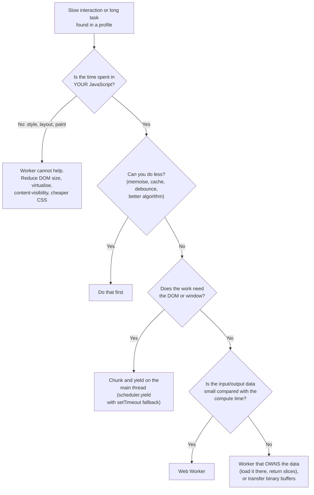

**Good candidates** (pure computation, no DOM):

| Workload | Why it's a fit |
|---|---|
| Parsing big files (CSV, JSON, XML, Markdown, source code) | CPU-bound, input arrives as a `File`/`Blob`/`ArrayBuffer` that can be read **in the worker** |
| Search indexing and fuzzy matching over large lists | Index lives in the worker; queries and top-N results are tiny |
| Sorting, filtering, aggregating, pivoting big datasets | Same: keep the dataset in the worker, return the visible page |
| Image, audio, video processing | Binary buffers transfer at zero copy; `OffscreenCanvas`, `ImageBitmap`, WebCodecs work in workers |
| Diffing, syntax highlighting, linting, formatting | Editors such as Monaco run language services in workers |
| Crypto, compression, hashing | Often WebAssembly or `crypto.subtle`, both usable in workers |
| Geometry, physics, map tile decoding, layout of large graphs | Map libraries such as MapLibre GL JS decode tiles in workers |
| Expensive state reducers or CRDT merges | State can live in the worker (see Section 3) |

**Poor candidates:** anything dominated by **DOM work** (rendering 10,000 rows), tiny computations (the messaging overhead dominates), and work that needs synchronous answers inside an event handler (e.g. `event.preventDefault()` decisions).

> Measure first. A Performance-panel profile tells you whether the time is in **Scripting** (worker candidate) or in **Rendering/Painting** (worker can't help).

---

### Section 2: The Cost Model of Offloading

Moving work to a worker is **not free**. The main thread still pays to **serialise** the input, **deserialise** the result and **apply** it to the UI.

```mermaid
gantt
    title One offloaded job, illustrative timeline (not a benchmark)
    dateFormat x
    axisFormat %L
    section Main thread
    Serialise input (structured clone)   :m1, 0, 15
    Free for input and paint             :m2, 15, 215
    Deserialise result                   :m3, 215, 230
    Apply result to DOM                  :m4, 230, 250
    section Worker thread
    Deserialise input                    :w1, 15, 30
    Heavy computation                    :w2, 30, 200
    Serialise result                     :w3, 200, 215
```

```text
Main-thread cost WITH a worker  ≈  clone(input) + clone(result) + apply(result)
Main-thread cost WITHOUT        ≈  compute + apply(result)

Offload pays off when:   compute  >>  clone(input) + clone(result)
One-time costs:          worker startup (script fetch + parse + init), WASM compile, memory per worker
```

Ways to shrink each term:

| Term | How to make it small |
|---|---|
| `clone(input)` | Send a `File`/`Blob` handle (cheap) instead of its text; **transfer** `ArrayBuffer`s; or let the worker `fetch()`/read IndexedDB itself |
| `compute` | Better algorithm, WebAssembly, split across a pool |
| `clone(result)` | Return only what the UI shows (top 50 rows, aggregates), or transfer binary |
| `apply(result)` | Virtualise, batch DOM writes, keep React/Vue updates small |
| Startup | Create the worker **early or on first intent** (hover, route enter) and **reuse** it |

> The structured clone is **synchronous** on the sending thread and grows with the size and complexity of the object graph. Sending a large array of objects **from** the main thread can itself be a long task. This is the number-one reason "we moved it to a worker and INP didn't improve".

---

### Section 3: Worker Topologies

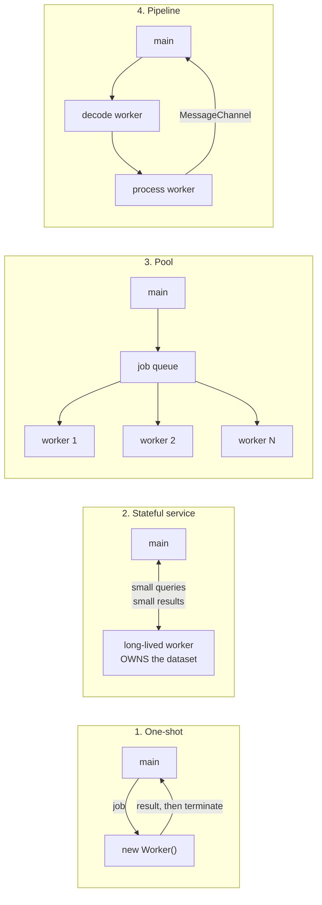

| Topology | Use when | Watch out for |
|---|---|---|
| **One-shot** (create, run, terminate) | Rare, big jobs (export a report) | Startup cost every time; fine if jobs are rare |
| **Stateful service** (one long-lived worker owning data) | Search, filtering, analytics dashboards, editors | Worker memory is part of your page's memory; design an explicit `dispose` |
| **Pool** (N identical workers + queue) | Many **independent** jobs: thumbnails, per-file hashing, tile decoding | More workers = more memory; size to cores; don't pool tiny jobs |
| **Pipeline** (workers wired with `MessageChannel`) | Streaming stages (decode, transform, encode) | Back-pressure; use streams where possible (`ReadableStream` is transferable in most current browsers — check MDN) |
| **Off-main-thread architecture** (app state + business logic in a worker, UI thread renders) | Very heavy apps (editors, design tools, games) | Every read of state is async; more complex architecture |

The **stateful service** is the most valuable pattern in typical product UIs:

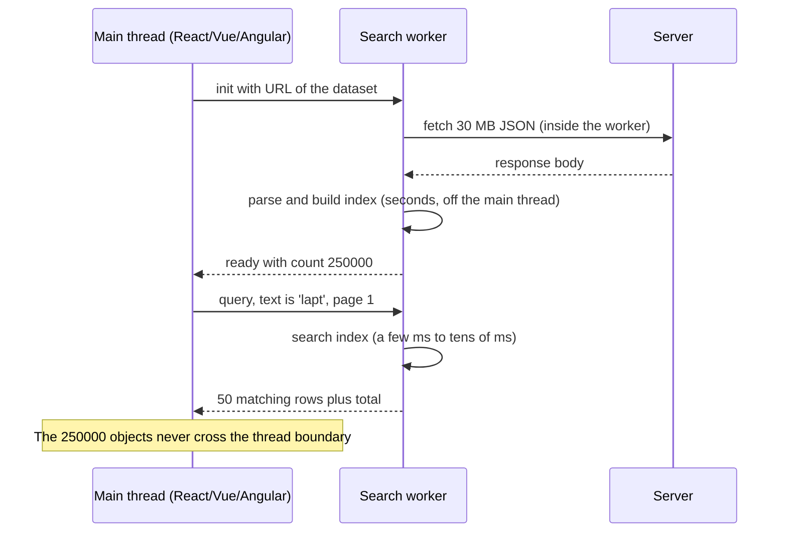

---

### Section 4: Designing the Message Protocol

Raw `onmessage` handlers turn into an unmaintainable `switch`. Treat the worker as a **remote service** with a typed contract.

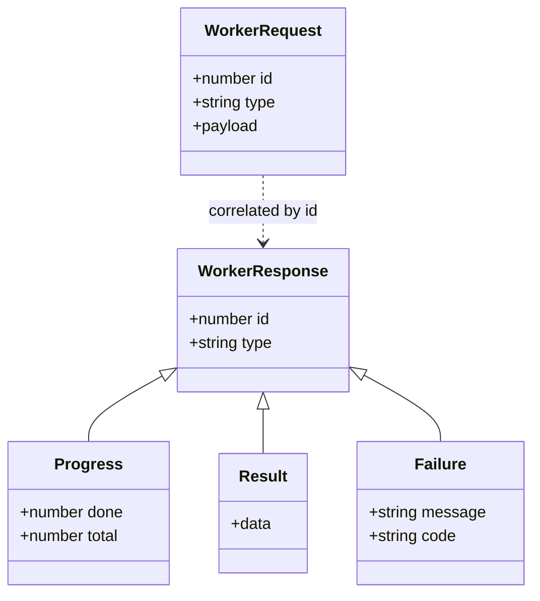

```typescript
// protocol.ts — shared by main thread and worker
export type Req =
  | { id: number; type: 'load'; url: string }
  | { id: number; type: 'query'; text: string; offset: number; limit: number }
  | { id: number; type: 'cancel'; target: number };

export type Res =
  | { id: number; type: 'progress'; done: number; total: number }
  | { id: number; type: 'result'; data: unknown }
  | { id: number; type: 'error'; message: string; code: 'CANCELLED' | 'FAILED' };
```

```typescript
// worker-client.ts — Promise-based RPC with request ids
import type { Req, Res } from './protocol';

type Pending = { resolve: (v: unknown) => void; reject: (e: Error) => void; onProgress?: (d: number, t: number) => void };
type DistributiveOmit<T, K extends PropertyKey> = T extends unknown ? Omit<T, K> : never;

export class WorkerClient {
  private nextId = 1;
  private pending = new Map<number, Pending>();

  constructor(private worker: Worker) {
    worker.addEventListener('message', (e: MessageEvent<Res>) => {
      const msg = e.data;
      const p = this.pending.get(msg.id);
      if (!p) return;                                       // late reply for a cancelled request
      if (msg.type === 'progress') return p.onProgress?.(msg.done, msg.total);
      this.pending.delete(msg.id);
      if (msg.type === 'result') p.resolve(msg.data);
      else p.reject(Object.assign(new Error(msg.message), { code: msg.code }));
    });
    worker.addEventListener('error', (e) => {                // uncaught error inside the worker
      for (const p of this.pending.values()) p.reject(new Error(e.message));
      this.pending.clear();
    });
  }

  call<T>(req: DistributiveOmit<Req, 'id'>, opts: { signal?: AbortSignal; transfer?: Transferable[];
    onProgress?: Pending['onProgress'] } = {}): Promise<T> {
    const id = this.nextId++;
    return new Promise<T>((resolve, reject) => {
      if (opts.signal?.aborted) return reject(opts.signal.reason);
      this.pending.set(id, { resolve: resolve as (v: unknown) => void, reject, onProgress: opts.onProgress });
      opts.signal?.addEventListener('abort', () => {
        this.worker.postMessage({ id: this.nextId++, type: 'cancel', target: id } satisfies Req);
        this.pending.delete(id);
        reject(opts.signal!.reason);                          // AbortSignal itself can't be posted
      }, { once: true });
      this.worker.postMessage({ ...req, id } as Req, opts.transfer ?? []);
    });
  }

  dispose() { this.worker.terminate(); this.pending.clear(); }
}
```

**Protocol rules that save you later:**

- Every request has an **id**; every reply carries it. Never rely on reply order.
- **Errors are data**: catch inside the worker and post `{ type: 'error' }`. An uncaught exception only surfaces as a generic `error` event on the `Worker`.
- **Version the protocol** if the worker can be cached separately from the page (e.g. a stale worker file served from a CDN after a deploy). Content-hashed worker URLs from your bundler avoid most of this.
- Prefer **[Comlink](https://github.com/GoogleChromeLabs/comlink)** when you don't need custom progress/cancel semantics: it generates this RPC layer with a `Proxy`. You still pay clone/transfer costs.

---

### Section 5: Progress, Cancellation and Latest-Wins

A worker has its **own event loop**. If it runs a synchronous loop for 4 seconds, **it cannot receive your `cancel` message until the loop ends**, because message delivery is a task on the worker's queue.

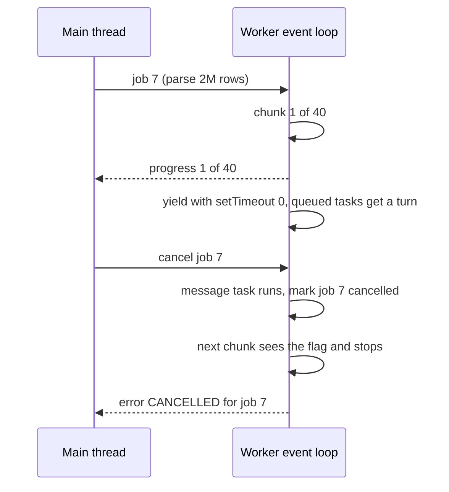

Three cancellation strategies:

| Strategy | How | Pros | Cons |
|---|---|---|---|
| **Cooperative (chunk + yield in the worker)** | Process in chunks, `await new Promise(r => setTimeout(r, 0))` between them, check a cancelled-set | Worker survives; can report progress | Slightly slower; you must design chunk boundaries |
| **Shared flag** | `SharedArrayBuffer` + `Atomics.load()` checked inside the hot loop, set from main | No yielding needed, instant | Requires **cross-origin isolation** (Section 7) |
| **Terminate and respawn** | `worker.terminate()` then `new Worker(...)` | Works for any code, even a stuck WASM loop | Loses worker state and warm caches; pays startup again |

```typescript
// parse.worker.ts — cooperative chunking with progress and cancellation
import type { Req, Res } from './protocol';

const cancelled = new Set<number>();
const post = (m: Res, transfer: Transferable[] = []) => self.postMessage(m, { transfer });
const yieldToWorkerLoop = () => new Promise<void>((r) => setTimeout(r, 0));

self.addEventListener('message', async (e: MessageEvent<Req>) => {
  const req = e.data;
  if (req.type === 'cancel') { cancelled.add(req.target); return; }
  if (req.type !== 'load') return;
  try {
    const text = await (await fetch(req.url)).text();       // the worker fetches; nothing big is cloned
    const lines = text.split('\n');
    const CHUNK = 20_000;
    const totals = new Float64Array(lines.length);
    for (let i = 0; i < lines.length; i += CHUNK) {
      if (cancelled.has(req.id)) { cancelled.delete(req.id); return post({ id: req.id, type: 'error', message: 'cancelled', code: 'CANCELLED' }); }
      for (let j = i; j < Math.min(i + CHUNK, lines.length); j++) totals[j] = Number(lines[j].split(',')[3]) || 0;
      post({ id: req.id, type: 'progress', done: Math.min(i + CHUNK, lines.length), total: lines.length });
      await yieldToWorkerLoop();                              // lets the cancel message be processed
    }
    post({ id: req.id, type: 'result', data: totals }, [totals.buffer]);  // zero-copy back
  } catch (err) {
    post({ id: req.id, type: 'error', message: String(err), code: 'FAILED' });
  }
});
```

**Latest-wins** (typeahead, filter-as-you-type): when a new query arrives, cancel the previous one, and on the main thread **ignore any reply whose id is not the latest**. Combine with [debouncing](./debouncing-and-throttling.md) on the input so you don't flood the worker.

> Throttle progress messages (e.g. one per chunk or one per animation frame). Thousands of tiny `progress` messages per second become their own main-thread load.

---

### Section 6: Moving Data Efficiently

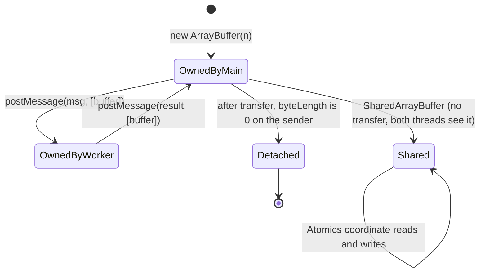

| Mechanism | Main-thread cost | Who can read it after | Requirements |
|---|---|---|---|
| **Structured clone** (default) | Proportional to size and graph complexity | Both, independent copies | None |
| **Transfer** (`[buffer]` / `{ transfer }`) | Near-constant: ownership moves, memory isn't copied | **Receiver only**; sender's buffer is detached | Transferable type: `ArrayBuffer`, `MessagePort`, `ImageBitmap`, `OffscreenCanvas`, streams, `VideoFrame`… |
| **`SharedArrayBuffer`** | None per message (the buffer is shared) | **Both, simultaneously** | `crossOriginIsolated === true` |
| **Handles, not bytes** | Tiny | Both | Send a `File`/`Blob` (cloned as a reference to the same data), a URL, or an IndexedDB key; the worker reads it |

**Choose a data shape that crosses cheaply.** An array of 1M objects is expensive to clone. The same data as **columns of typed arrays** transfers in O(1):

```typescript
// ❌ Array of objects: deep clone of 1,000,000 small objects
type Point = { x: number; y: number; value: number };
worker.postMessage({ points });                     // points: Point[]

// ✅ Struct of arrays: three buffers, transferred without copying
const n = points.length;
const xs = new Float64Array(n), ys = new Float64Array(n), vs = new Float64Array(n);
// ...fill once (or better: produce this layout in the worker in the first place)
worker.postMessage({ xs, ys, vs }, [xs.buffer, ys.buffer, vs.buffer]);
```

What structured clone does **not** carry: functions, DOM nodes, class prototypes (instances arrive as plain objects), `Symbol`s, `WeakMap`, Promises, `AbortSignal`. Full list in [Service Workers & Web Workers, Section 2](../01-web-fundamentals/service-workers-and-web-workers.md#section-2-dedicated-workers-postmessage-and-structured-clone).

---

### Section 7: SharedArrayBuffer, Atomics and Cross-Origin Isolation

`SharedArrayBuffer` (SAB) is memory that several threads see at once. Since the Spectre mitigations, browsers expose it **only on cross-origin isolated pages**:

```http
Cross-Origin-Opener-Policy: same-origin
Cross-Origin-Embedder-Policy: require-corp
```

`Cross-Origin-Embedder-Policy: credentialless` is an alternative that loads cross-origin no-CORS resources without credentials; it's supported in Chromium and Firefox but **not Safari** as of late 2026 (check MDN). Verify at runtime with `self.crossOriginIsolated`.

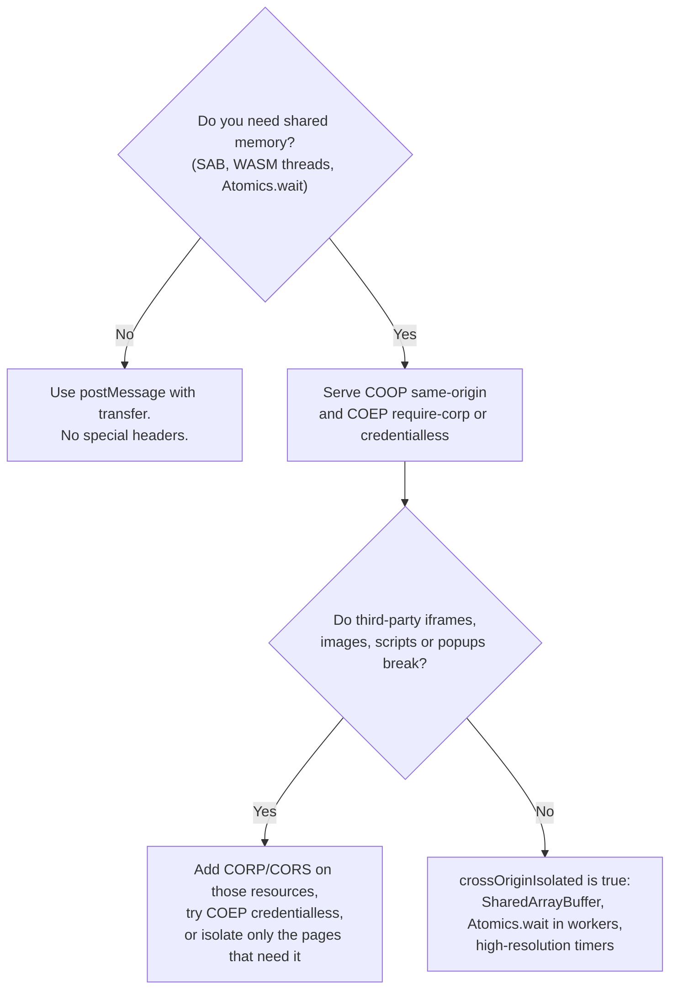

```typescript
// main.ts — a shared cancel flag and a shared progress counter
const ctrl = new Int32Array(new SharedArrayBuffer(8));   // [0] = cancel flag, [1] = rows done
worker.postMessage({ type: 'start', ctrl });              // the SAB is shared, not copied
cancelButton.onclick = () => Atomics.store(ctrl, 0, 1);
const tick = () => { progressBar.value = Atomics.load(ctrl, 1); requestAnimationFrame(tick); };
requestAnimationFrame(tick);

// worker.ts — tight synchronous loop that still notices cancellation instantly
self.onmessage = ({ data: { ctrl } }) => {
  for (let i = 0; i < rows.length; i++) {
    if ((i & 1023) === 0 && Atomics.load(ctrl, 0) === 1) return;   // check every 1024 rows
    process(rows[i]);
    if ((i & 1023) === 0) Atomics.store(ctrl, 1, i);
  }
};
```

Rules:
- `Atomics.wait()` **blocks**, so it is not allowed on the browser main thread; use it in workers. The main thread can use `Atomics.waitAsync()` (check MDN for current support).
- Shared memory brings back **data races**. Keep shared regions tiny (flags, counters, ring buffers) or use a single-writer design.
- COOP `same-origin` severs `window.opener` with cross-origin popups, which can break OAuth/payment popup flows. Test before enabling site-wide. See [CORS & Same-Origin Policy](../01-web-fundamentals/cors-and-same-origin-policy.md).

---

### Section 8: Worker Pools and Parallelism

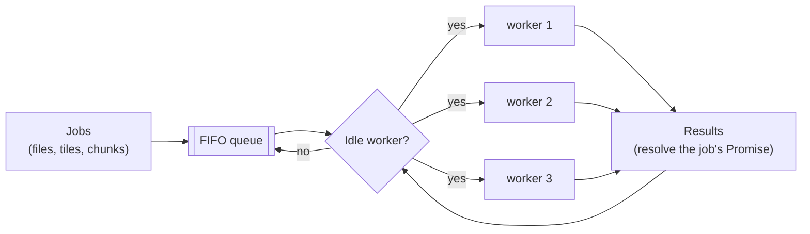

**Sizing:** `navigator.hardwareConcurrency` reports logical processors (also available in workers). Browsers may report a reduced value for fingerprinting protection, and mobile devices mix fast and efficiency cores, so treat it as an **upper bound**:

```text
poolSize = clamp(hardwareConcurrency - 1, 1, 4)     // leave a core for the main thread and the browser
```

The cap of 4 is a starting point, not a rule. Profile on a **low-end Android device**, since each worker has its own heap and startup cost.

**When parallelism helps:** the problem splits into independent pieces (per-file, per-tile, per-row-range) and each piece is big enough to amortise messaging. **When it doesn't:** sequential algorithms, jobs whose pieces need each other's results, or memory-bound work on devices with few cores.

Libraries: [`workerpool`](https://github.com/josdejong/workerpool) (browser and Node), or Comlink plus your own queue (Example 4). Many apps need only **one** long-lived worker.

---

### Section 9: WebAssembly in Workers

WebAssembly gives predictable, near-native speed for numeric code and lets you reuse C/C++/Rust/Go libraries (image codecs, SQLite, physics, PDF). **WASM does not move off the main thread by itself**: a 300 ms WASM call on the main thread is still a 300 ms long task. Run it **in a worker**.

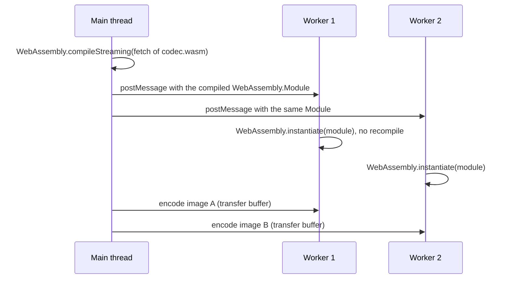

```typescript
// main.ts — compile once, share the compiled module with every worker
const module = await WebAssembly.compileStreaming(fetch('/codec.wasm'));
for (const w of workers) w.postMessage({ type: 'init', module });

// codec.worker.ts
let instance: WebAssembly.Instance;
self.onmessage = async ({ data }) => {
  if (data.type === 'init') instance = await WebAssembly.instantiate(data.module, { env: {} });
  // ...later messages call instance.exports.encode(...)
};
```

- **WASM threads** (pthreads in Emscripten, `wasm-bindgen-rayon` in Rust) are built on workers **plus `SharedArrayBuffer`**, so they need cross-origin isolation (Section 7).
- Copying into and out of WASM linear memory has a cost too; reuse buffers instead of allocating per call.
- Deep dive: [WebAssembly (WASM) in Frontend](../10-advanced-topics/webassembly-wasm-in-frontend.md).

---

### Section 10: Bundlers, Frameworks and Native Platforms

**The portable pattern.** Modern bundlers (Vite, webpack 5, Rspack, Parcel, esbuild-based tools) recognise this and emit a hashed worker bundle:

```typescript
const worker = new Worker(new URL('./heavy.worker.ts', import.meta.url), { type: 'module' });
```

Module workers (`type: 'module'`, real `import` statements inside the worker) are supported in all current engines (Firefox since 114, Safari since 15, Chromium since 80). Classic workers use `importScripts()` instead, which module workers don't have.

| Stack | How to create the worker | Gotchas |
|---|---|---|
| **Vite** (React, Vue, Svelte, Solid) | `new Worker(new URL(...), { type: 'module' })` or `import W from './x.worker?worker'` then `new W()` | `?worker&inline` inlines as a blob URL; set `worker.format` in config if needed |
| **webpack 5 / Rspack** | The `new URL(..., import.meta.url)` pattern | No `worker-loader` needed any more |
| **Next.js** | Same pattern, inside a **Client Component**, created in `useEffect` | There is no `Worker` on the server; never construct it during render. Check your Next.js version's docs for bundler support |
| **Nuxt / SvelteKit / Remix / Astro** | Same pattern, client-only code (`onMounted`, `onMount`, `useEffect`, `client:*` islands) | Guard SSR paths with `typeof Worker !== 'undefined'` |
| **Angular** | `ng generate web-worker <path>` scaffolds the worker and its `tsconfig.worker.json` | Angular's docs note that workers aren't available in server-side rendering; guard with `typeof Worker !== 'undefined'` |
| **Vanilla / no bundler** | `new Worker('/heavy.worker.js', { type: 'module' })` | Worker script must be **same-origin** (or a `blob:` URL) |

Framework lifecycle: **create on mount (or lazily), terminate on unmount**:

```tsx
// React
function useWorker(factory: () => Worker) {
  const ref = useRef<WorkerClient | null>(null);
  useEffect(() => {
    const client = new WorkerClient(factory());
    ref.current = client;
    return () => client.dispose();                 // StrictMode mounts twice in dev: this cleanup matters
  }, [factory]);                                   // pass a stable factory (module-level function)
  return ref;
}
```

```typescript
// Vue 3 composable
export function useWorker(factory: () => Worker) {
  const client = shallowRef<WorkerClient | null>(null);
  onMounted(() => { client.value = new WorkerClient(factory()); });
  onBeforeUnmount(() => client.value?.dispose());
  return client;
}

// Svelte 5 (in a component)
// $effect(() => { const c = new WorkerClient(factory()); client = c; return () => c.dispose(); });

// Angular service
// @Injectable({ providedIn: 'root' }) export class ReportWorker implements OnDestroy {
//   private client = typeof Worker !== 'undefined' ? new WorkerClient(new Worker(new URL('./report.worker', import.meta.url), { type: 'module' })) : null;
//   ngOnDestroy() { this.client?.dispose(); }
// }
```

**React-specific:** the worker result arrives as a message task; set state from it as usual. Pair heavy result updates with `startTransition` so typing stays responsive while a large result list re-renders.

**Native and cross-platform equivalents** (same idea: keep the UI thread free):

| Platform | Off-UI-thread computation |
|---|---|
| iOS (Swift) | Swift concurrency (`Task`, `async let`, actors, `Task.detached`) or Grand Central Dispatch background queues; UI updates on the `@MainActor` |
| Android (Kotlin) | Coroutines on `Dispatchers.Default` (CPU) / `Dispatchers.IO`; UI updates on `Dispatchers.Main`; `WorkManager` for deferrable background jobs |
| Flutter | **Isolates**: `Isolate.run()` or `compute()`; isolates share no memory, like Web Workers |
| React Native | No standard Web Worker API. Heavy work goes to **native modules** (Swift/Kotlin/C++ via JSI/TurboModules); community worklet/threading libraries exist (check their maintenance status) |
| Node.js (SSR, build tools) | `worker_threads` (same `postMessage`/transfer/`SharedArrayBuffer` model) |

---

### Section 11: Errors, Lifecycle, Security and Debugging

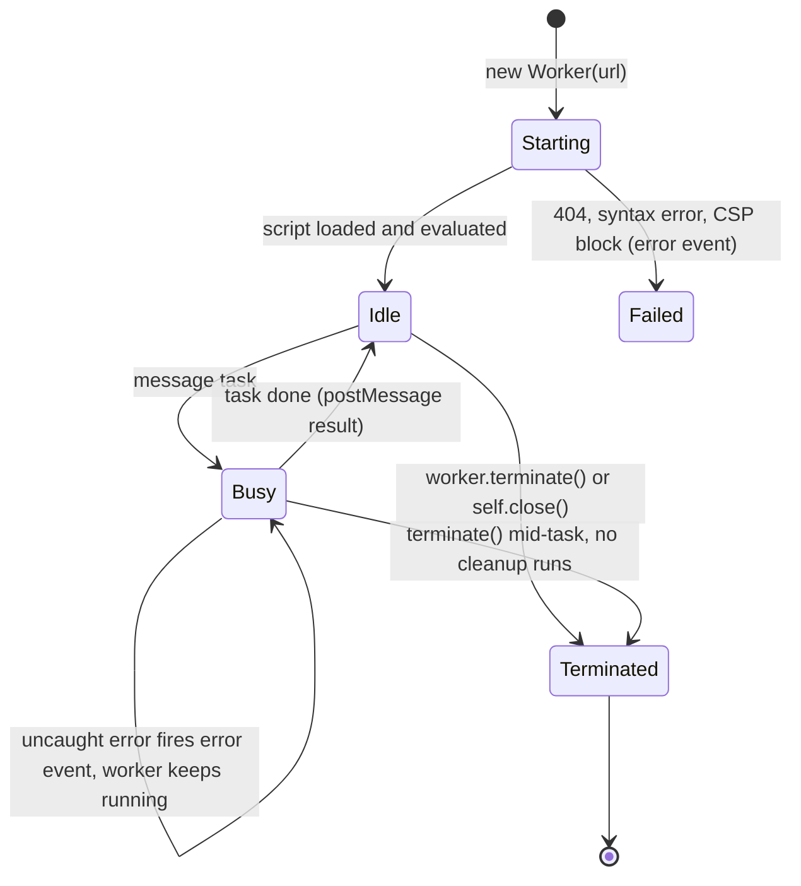

| Concern | What to know |
|---|---|
| **Uncaught errors** | Fire an `ErrorEvent` on the `Worker` object (`message`, `filename`, `lineno`). Call `e.preventDefault()` if you handle it. Async errors inside the worker should be caught there and posted as data |
| **`messageerror`** | Fires when a received message can't be deserialised |
| **`terminate()`** | Immediate. No `finally`, no flush. Persist anything important before you terminate |
| **Memory** | Each worker has its own heap. Terminate workers you no longer need; a forgotten worker is a [memory leak](./memory-leaks-in-frontend-apps.md) |
| **CSP** | Worker scripts are governed by `worker-src` (falls back to `child-src`, then `script-src`). `blob:` workers need `blob:` allowed. See [Content Security Policy](../07-security/content-security-policy-csp.md) |
| **Origin** | Worker scripts must be same-origin (or `blob:`/`data:` URLs with restrictions). Module workers can `import` cross-origin modules served with CORS |
| **Available APIs** | `fetch`, `WebSocket`, IndexedDB, Cache API, `crypto`, `OffscreenCanvas`, `createImageBitmap`, `performance`, timers, `structuredClone`. **Not:** DOM, `window`, `localStorage`, `sessionStorage` |
| **Debugging** | DevTools Sources lists each worker as its own context; the Performance panel shows worker threads as separate tracks; `performance.mark()` works inside workers |

---

## Decision Matrix

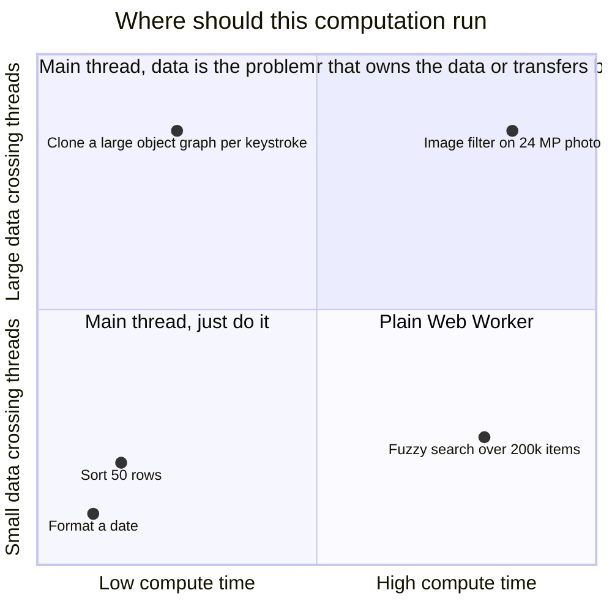

| Situation | Recommendation |
|---|---|
| Computation over 50 ms, no DOM, small input/output | Single long-lived Web Worker |
| Huge dataset queried repeatedly | **Stateful worker owns the data**; return pages/aggregates |
| Many independent big jobs | Pool sized to cores; queue; transfer buffers |
| Needs the DOM | Chunk + yield on the main thread; reduce DOM work |
| Numeric hot loop, existing C/Rust library | WebAssembly **inside** a worker |
| Need instant cancellation of a sync loop | SAB flag (with COOP/COEP) or terminate and respawn |
| Drawing charts/maps/canvases | `OffscreenCanvas` in a worker |
| Third-party scripts hurting INP | Not a compute worker problem: defer/limit them first (worker-proxy libraries exist but have compatibility trade-offs) |

---

## Real-World Examples

**Example 1 — BAD → GOOD: filtering a large table while typing (React + TypeScript):**
```tsx
// ❌ BAD: filters 200k rows on every keystroke on the main thread → long tasks, laggy input
function ProductTable({ rows }: { rows: Product[] }) {
  const [q, setQ] = useState('');
  const visible = rows.filter((r) => fuzzyMatch(r.name, q)).slice(0, 50);
  return <><input value={q} onChange={(e) => setQ(e.target.value)} /><Table rows={visible} /></>;
}

// ✅ GOOD: the worker owns the rows; the UI sends the query and gets 50 rows back (latest-wins)
const makeWorker = () => new Worker(new URL('./products.worker.ts', import.meta.url), { type: 'module' });

function ProductTableFast({ datasetUrl }: { datasetUrl: string }) {
  const client = useWorker(makeWorker);
  const [q, setQ] = useState('');
  const [visible, setVisible] = useState<Product[]>([]);
  const [ready, setReady] = useState(false);

  useEffect(() => {
    client.current?.call({ type: 'load', url: datasetUrl }).then(() => setReady(true));
  }, [client, datasetUrl]);

  useEffect(() => {
    if (!ready) return;
    const ctrl = new AbortController();
    const t = setTimeout(() => {                                      // light debounce
      client.current?.call<Product[]>({ type: 'query', text: q, offset: 0, limit: 50 }, { signal: ctrl.signal })
        .then((rows) => startTransition(() => setVisible(rows)))
        .catch((e) => { if (e?.name !== 'AbortError') throw e; });
    }, 120);
    return () => { clearTimeout(t); ctrl.abort(); };                  // the previous query is cancelled
  }, [q, ready, client]);

  return <><input value={q} onChange={(e) => setQ(e.target.value)} /><Table rows={visible} /></>;
}
```

**Example 2 — Read a user's file in the worker, not on the main thread:**
```typescript
// main.ts — a File is cloned as a cheap handle to the same data, not as its bytes
const importer = new Worker(new URL('./import.worker.ts', import.meta.url), { type: 'module' });
importer.onmessage = ({ data }) => {
  if (data.type === 'progress') bar.value = data.done / data.total;
  if (data.type === 'result') showSummary(data.rows);
};
input.addEventListener('change', () => {
  const file = input.files?.[0];
  if (file) importer.postMessage({ type: 'importFile', file });
});

// import.worker.ts — stream and parse incrementally; memory stays flat even for huge files
self.onmessage = async ({ data }: MessageEvent<{ type: 'importFile'; file: File }>) => {
  const { file } = data;
  const reader = file.stream().getReader();
  const decoder = new TextDecoder();
  let carry = '', bytes = 0, rows = 0, lastReport = 0;
  for (;;) {
    const { value, done } = await reader.read();
    if (done) break;
    bytes += value.byteLength;
    const lines = (carry + decoder.decode(value, { stream: true })).split('\n');
    carry = lines.pop() ?? '';
    rows += lines.length;                                   // parse/aggregate each line here
    if (performance.now() - lastReport > 100) {             // throttle progress messages
      self.postMessage({ type: 'progress', done: bytes, total: file.size });
      lastReport = performance.now();
    }
  }
  carry += decoder.decode();
  self.postMessage({ type: 'result', rows: rows + (carry ? 1 : 0) });
};
```

**Example 3 — Thumbnails with `OffscreenCanvas` and `ImageBitmap` (zero-copy both ways):**
```typescript
// thumb.worker.ts
self.onmessage = async ({ data: { id, file, size } }: MessageEvent<{ id: number; file: File; size: number }>) => {
  const bitmap = await createImageBitmap(file);                    // decode off the main thread
  const scale = size / Math.max(bitmap.width, bitmap.height);
  const canvas = new OffscreenCanvas(Math.round(bitmap.width * scale), Math.round(bitmap.height * scale));
  canvas.getContext('2d')!.drawImage(bitmap, 0, 0, canvas.width, canvas.height);
  bitmap.close();                                                  // free decoded pixels promptly
  const thumb = canvas.transferToImageBitmap();
  self.postMessage({ id, thumb }, [thumb]);                        // ImageBitmap is transferable
};

// main.ts — draw it with a bitmaprenderer context (no extra copy)
// ctx = canvasEl.getContext('bitmaprenderer'); ctx.transferFromImageBitmap(thumb);
```

**Example 4 — A minimal worker pool:**
```typescript
type Job = { msg: unknown; transfer: Transferable[]; resolve: (v: unknown) => void; reject: (e: Error) => void };

export class WorkerPool {
  private all: Worker[] = [];
  private idle: Worker[] = [];
  private queue: Job[] = [];

  constructor(create: () => Worker,
              size = Math.min(4, Math.max(1, (navigator.hardwareConcurrency || 2) - 1))) {
    for (let i = 0; i < size; i++) { const w = create(); this.all.push(w); this.idle.push(w); }
  }

  run<T>(msg: unknown, transfer: Transferable[] = []): Promise<T> {
    return new Promise<T>((resolve, reject) => {
      this.queue.push({ msg, transfer, resolve: resolve as (v: unknown) => void, reject });
      this.pump();
    });
  }

  private pump() {
    while (this.idle.length && this.queue.length) {
      const w = this.idle.pop()!;
      const job = this.queue.shift()!;
      const release = () => { w.onmessage = null; w.onerror = null; this.idle.push(w); this.pump(); };
      w.onmessage = (e) => { release(); job.resolve(e.data); };
      w.onerror = (e) => { e.preventDefault(); release(); job.reject(new Error(e.message)); };
      w.postMessage(job.msg, job.transfer);
    }
  }

  destroy() { this.all.forEach((w) => w.terminate()); this.queue.forEach((j) => j.reject(new Error('pool destroyed'))); }
}

// usage: hash 200 files in parallel without blocking the UI
const pool = new WorkerPool(() => new Worker(new URL('./hash.worker.ts', import.meta.url), { type: 'module' }));
const digests = await Promise.all(files.map((file) => pool.run<string>({ file })));
```

**Example 5 — Comlink when you just want "call a function over there":**
```typescript
// stats.worker.ts
import * as Comlink from 'comlink';
const api = {
  summarize(values: Float64Array) {
    let min = Infinity, max = -Infinity, sum = 0;
    for (const v of values) { if (v < min) min = v; if (v > max) max = v; sum += v; }
    return { min, max, mean: sum / values.length };
  },
};
export type StatsApi = typeof api;
Comlink.expose(api);

// main.ts
import * as Comlink from 'comlink';
import type { StatsApi } from './stats.worker';
const stats = Comlink.wrap<StatsApi>(new Worker(new URL('./stats.worker.ts', import.meta.url), { type: 'module' }));
const summary = await stats.summarize(Comlink.transfer(values, [values.buffer]));
```

---

## Key Points Summary

| Concept | One-Line Explanation |
|---|---|
| **When to use a worker** | CPU-bound JS over ~50 ms that doesn't need the DOM |
| **When not to** | Time is in style/layout/paint, the job is tiny, or the data crossing is huge |
| **Cost model** | Main thread still pays clone(input) + clone(result) + apply(result) |
| **Stateful worker** | Load and keep the dataset in the worker; exchange small queries and results |
| **Protocol** | Request ids, typed messages, errors as data, progress messages |
| **Cancellation** | Worker hears messages only between tasks: chunk + yield, SAB flag, or terminate |
| **Latest-wins** | Cancel stale jobs and ignore replies that aren't for the latest request |
| **Transfer** | Moves `ArrayBuffer`/`ImageBitmap`/streams without copying; sender is detached |
| **Struct of arrays** | Columns of typed arrays cross threads far cheaper than arrays of objects |
| **SharedArrayBuffer** | True shared memory; needs COOP + COEP (cross-origin isolation) |
| **Pool size** | About `hardwareConcurrency - 1`, capped, verified on low-end devices |
| **WASM** | Fast but still blocking; run it in a worker, compile once, share the Module |
| **Bundlers** | `new Worker(new URL('./x.ts', import.meta.url), { type: 'module' })` |
| **SSR frameworks** | Create workers only on the client, terminate on unmount |
| **Native equivalents** | Swift concurrency/GCD, Kotlin coroutines, Flutter isolates, RN native modules |

---

## Test Your Understanding

**Q1 (Basic):**
Your profile shows a 400 ms task when a user clicks "Apply filters". 300 ms of it is "Recalculate Style" and "Layout". Will moving the filter function into a Web Worker fix INP?

<details>
<summary>Answer</summary>

Mostly **no**. Only the JavaScript part (about 100 ms) can move to a worker. Style and layout are main-thread rendering work caused by the DOM update, and workers have no DOM. The fix for the 300 ms is to **change less DOM**: virtualise the list, avoid layout-triggering properties, use `content-visibility`, or reduce the number of nodes. Moving the 100 ms filter to a worker is still worthwhile if it can run without blocking, but the profile shows rendering is the bigger problem. Always classify time as Scripting vs Rendering before choosing workers.
</details>

**Q2 (Application):**
A team moved JSON parsing of a 50 MB response into a worker, then posted the parsed array of 300k objects back. Typing still lags while it loads. Explain and fix.

<details>
<summary>Answer</summary>

Posting the parsed array back means the worker **serialises** 300k objects and the main thread **deserialises** them in one message task, which is itself a long task. Then rendering them is expensive too.

Fix: make the worker **own** the data. Have it `fetch` and parse the response itself, keep the array there, and expose `query(filter, page)` returning only the visible rows plus totals. If bulk numeric data must cross, use typed-array columns and **transfer** the buffers. Virtualise the table on the main thread.
</details>

**Q3 (Application):**
Design cancellation for a worker that runs a 5-second synchronous optimisation loop when the user changes a slider repeatedly.

<details>
<summary>Answer</summary>

The worker can't process a `cancel` message while the loop runs, because message delivery is a task on the worker's own event loop. Options:

1. **Chunk + yield inside the worker**: run the loop in slices (e.g. 10-20 ms), `await` a `setTimeout(0)` between slices, and check a cancelled-set keyed by request id. The worker stays alive and can send progress.
2. **SharedArrayBuffer flag**: if the page is cross-origin isolated, the main thread does `Atomics.store(flag, 0, 1)` and the loop checks `Atomics.load` every N iterations. Cancellation is near-instant without restructuring the loop.
3. **Terminate and respawn**: simplest for third-party or WASM code you can't modify, but you lose warm state and pay startup again.

Add **latest-wins** on the main thread (ignore replies whose id isn't the newest) and **debounce/throttle** the slider so you don't start dozens of jobs.
</details>

**Q4 (Tricky):**
You enabled `SharedArrayBuffer` by adding COOP and COEP headers. The next day, "Sign in with a provider" popups and an embedded video player break. Why, and what are your options?

<details>
<summary>Answer</summary>

`Cross-Origin-Opener-Policy: same-origin` puts the page in its own browsing context group, so a cross-origin popup **loses `window.opener`**, and `postMessage` back to the opener fails. That breaks many popup-based OAuth/payment flows. `Cross-Origin-Embedder-Policy: require-corp` blocks cross-origin resources (including iframes) that don't opt in with CORP or CORS, which breaks third-party embeds.

Options: use redirect-based sign-in instead of popups; ask third parties to send `Cross-Origin-Resource-Policy` or serve with CORS; try `COEP: credentialless` (Chromium and Firefox, not Safari); or apply isolation **only on the routes that need shared memory** (e.g. the editor page) and leave the rest of the site unisolated. And ask whether you need SAB at all: transfer-based messaging often suffices.
</details>

**Q5 (Tricky):**
A developer adds a worker pool sized to `navigator.hardwareConcurrency` (it reports 8 on their laptop) and creates the pool at app startup on every page. What can go wrong?

<details>
<summary>Answer</summary>

- **Memory and startup**: 8 workers each with their own heap and script evaluation, created even on pages that never use them. On low-end phones this costs memory and battery, and the startup work competes with page load.
- **Oversubscription**: using all logical cores leaves none for the main thread, the compositor and the browser's own threads, which can make the UI **less** responsive.
- **Unreliable number**: `hardwareConcurrency` may be reduced for privacy, and big.LITTLE mobile CPUs have efficiency cores that are much slower.

Better: create the pool **lazily** on first use, cap it (e.g. `hardwareConcurrency - 1`, max ~4 as a starting point), measure on low-end devices, and terminate it when the feature unmounts. Many apps only need one long-lived worker.
</details>

**Q6 (System design):**
You're designing a browser-based analytics dashboard: users upload CSVs up to 500 MB, then slice, filter and chart the data interactively. Describe the threading architecture.

<details>
<summary>Answer</summary>

- **Ingestion worker (stateful)**: receives the `File` handle (cheap clone), streams it with `file.stream()` + `TextDecoderStream`, parses incrementally into **columnar typed arrays**, reports progress at most once per chunk, supports cancel via chunk + yield.
- **Storage**: optionally persist columns to IndexedDB/OPFS from the worker so a reload doesn't re-parse.
- **Query engine in the worker**: filter/group/aggregate runs where the data lives; the main thread sends small query objects and gets back aggregates or a page of rows. For heavier SQL-like workloads, a WASM engine running **inside** the worker (e.g. SQLite or DuckDB compiled to WASM) is an option.
- **Charts**: either send small aggregated series to a main-thread chart, or render with `OffscreenCanvas` in a worker for very dense plots.
- **UI thread**: virtualised table, `startTransition` for result updates, debounced filter inputs, latest-wins request ids.
- **Parallelism**: only if profiling shows a single worker is saturated; split by row range across a small pool, then merge partial aggregates.
- **Headers**: only enable COOP/COEP if you adopt WASM threads or SAB; weigh the third-party breakage.
- **Measure**: INP and long tasks in the field (RUM), worker job durations with `performance.mark` inside the worker.
</details>

---

## Cheat Sheet

**Key Definitions:**
- **Long task:** any main-thread task over 50 ms. Workers remove *JS* long tasks, not rendering work.
- **Structured clone:** default deep copy for `postMessage`; synchronous on the sender; cost grows with data size.
- **Transfer:** hand over ownership of a transferable (e.g. `ArrayBuffer`) without copying; the sender's copy is detached.
- **SharedArrayBuffer:** memory visible to several threads; requires cross-origin isolation (COOP + COEP).
- **Stateful worker:** a long-lived worker that owns a dataset and answers small queries.
- **Latest-wins:** cancel or ignore every in-flight request except the newest.

**Quick Reference:**
```text
Create (bundlers)   new Worker(new URL('./x.worker.ts', import.meta.url), { type: 'module' })
Send + transfer     worker.postMessage(msg, [buf])   or   worker.postMessage(msg, { transfer: [buf] })
Reply               self.postMessage(result, [result.buffer])
Kill                worker.terminate()  (from outside)   self.close()  (from inside)
Errors              worker 'error' (uncaught), 'messageerror' (can't deserialise); post errors as data
Yield in worker     await new Promise(r => setTimeout(r, 0))   so cancel messages can run
Isolation headers   Cross-Origin-Opener-Policy: same-origin
                    Cross-Origin-Embedder-Policy: require-corp   (or credentialless: Chromium/Firefox)
Check               self.crossOriginIsolated === true
Pool size           clamp(navigator.hardwareConcurrency - 1, 1, ~4), then measure
WASM                compileStreaming once on main, postMessage the Module, instantiate in each worker
Angular             ng generate web-worker <path>
Vite                import W from './x?worker'   ->   new W()
Flutter / iOS / Android   Isolate.run / Swift Task + actors / Kotlin Dispatchers.Default
```

**Common Mistakes to Avoid:**

| Mistake | Why Wrong | Fix |
|---|---|---|
| Moving work to a worker without profiling | Time may be in style/layout/paint, which workers can't touch | Classify Scripting vs Rendering first |
| Posting huge object graphs back and forth | Clone cost lands on the main thread as a long task | Keep data in the worker; return slices; transfer buffers |
| Running a long sync loop and expecting `cancel` to work | Messages are tasks; they wait until the loop ends | Chunk + yield, SAB flag, or terminate |
| Ignoring stale replies | Old results overwrite newer ones | Request ids + latest-wins |
| Creating a new worker per keystroke or per job | Startup cost every time, memory churn | Long-lived worker or pool |
| Pool sized to all cores, created eagerly | Oversubscription, memory, battery | Lazy, capped pool; measure on low-end devices |
| Running WASM on the main thread "because it's fast" | A long WASM call is still a long task | Run WASM inside a worker |
| Constructing a `Worker` during SSR render | `Worker` doesn't exist on the server | Create in `useEffect`/`onMounted`/`onMount`; guard with `typeof Worker` |
| Never terminating workers | Each worker keeps its own heap alive | Terminate on unmount/dispose |
| Enabling COOP/COEP site-wide without testing | Breaks popups (OAuth/payments) and third-party embeds | Isolate only routes that need SAB; test integrations |
| Flooding the main thread with progress messages | Thousands of message tasks per second | Throttle progress to per chunk or per frame |
| Letting worker exceptions vanish | Only a generic `error` event surfaces | try/catch in the worker; post typed error messages |

---

## References & Further Reading

**Core docs**
- MDN: [Using Web Workers](https://developer.mozilla.org/en-US/docs/Web/API/Web_Workers_API/Using_web_workers)
- MDN: [`Worker()` constructor](https://developer.mozilla.org/en-US/docs/Web/API/Worker/Worker) · [`Worker.postMessage()`](https://developer.mozilla.org/en-US/docs/Web/API/Worker/postMessage) · [`Worker.terminate()`](https://developer.mozilla.org/en-US/docs/Web/API/Worker/terminate)
- MDN: [Transferable objects](https://developer.mozilla.org/en-US/docs/Web/API/Web_Workers_API/Transferable_objects) · [The structured clone algorithm](https://developer.mozilla.org/en-US/docs/Web/API/Web_Workers_API/Structured_clone_algorithm)
- MDN: [`SharedArrayBuffer` (security requirements)](https://developer.mozilla.org/en-US/docs/Web/JavaScript/Reference/Global_Objects/SharedArrayBuffer) · [`Atomics`](https://developer.mozilla.org/en-US/docs/Web/JavaScript/Reference/Global_Objects/Atomics) · [`crossOriginIsolated`](https://developer.mozilla.org/en-US/docs/Web/API/Window/crossOriginIsolated)
- MDN: [`OffscreenCanvas`](https://developer.mozilla.org/en-US/docs/Web/API/OffscreenCanvas) · [`navigator.hardwareConcurrency`](https://developer.mozilla.org/en-US/docs/Web/API/Navigator/hardwareConcurrency)
- MDN: [CSP `worker-src`](https://developer.mozilla.org/en-US/docs/Web/HTTP/Reference/Headers/Content-Security-Policy/worker-src)

**web.dev / Chrome**
- web.dev: [Use web workers to run JavaScript off the browser's main thread](https://web.dev/articles/off-main-thread)
- web.dev: [Making your website "cross-origin isolated" using COOP and COEP](https://web.dev/articles/coop-coep)
- web.dev: [Optimize long tasks](https://web.dev/articles/optimize-long-tasks) · [Interaction to Next Paint](https://web.dev/articles/inp)

**Specs**
- WHATWG HTML Standard: [Web workers](https://html.spec.whatwg.org/multipage/workers.html)
- WHATWG HTML Standard: [Safe passing of structured data](https://html.spec.whatwg.org/multipage/structured-data.html)

**Frameworks and tooling**
- Vite: [Web Workers](https://vite.dev/guide/features.html#web-workers)
- webpack: [Web Workers guide](https://webpack.js.org/guides/web-workers/)
- Angular: [Background processing using web workers](https://angular.dev/ecosystem/web-workers)
- [Comlink](https://github.com/GoogleChromeLabs/comlink) · [workerpool](https://github.com/josdejong/workerpool)

**Native platforms**
- Flutter: [Concurrency and isolates](https://docs.flutter.dev/perf/isolates)
- Android: [Kotlin coroutines on Android](https://developer.android.com/kotlin/coroutines)
- Swift: [Concurrency (The Swift Programming Language)](https://docs.swift.org/swift-book/documentation/the-swift-programming-language/concurrency/)
- Node.js: [`worker_threads`](https://nodejs.org/api/worker_threads.html)

**Deep dives**
- Surma: [When should you be using Web Workers?](https://surma.dev/things/when-workers/)

---

> **Previous Topic:** [Debouncing & Throttling](./debouncing-and-throttling.md)
> — Rate-limiting event handlers so the main thread does less work

> **Next Topic:** [Memory Leaks in Frontend Apps](./memory-leaks-in-frontend-apps.md)
> — Finding and fixing memory that stays reachable after it's no longer needed

*Saved on: 2026-11-06 | Repo: Frontend System Design Learning Notes*
