# Atomic Design Methodology

> **Date:** 2026-11-06 · **Last updated:** 2026-11-06
> **Category:** Frontend System Design
> **Sub-Topic:** Design Systems & Components / Design System
> **Level:** Beginner · **Reading time:** ~25 min
> **Informs:** component granularity and layering, design-system folder and package structure, Storybook and Figma library taxonomy, where data and state enter the component tree, testing strategy per layer, shared vocabulary between design and engineering

> **Pre-requisite:** [Component Architecture & Design Systems](../02-rendering-and-architecture/component-architecture-and-design-systems.md) (layers, composition, what a design system contains) and [DOM & Virtual DOM](../01-web-fundamentals/dom-and-virtual-dom.md) (what components render into).
> This note covers **Atomic Design**: Brad Frost's five-level mental model for building interfaces from small parts, how it maps onto real code in every major framework, and where it stops being useful.

**Previous:** [Animation Performance (CSS vs JS)](../04-performance-engineering/animation-performance-css-vs-js.md) · **Next:** [Design Tokens](./design-tokens.md)

---

## Table of Contents

1. [ELI5 — Simple Explanation](#eli5--simple-explanation)
2. [Section 1: Where Atomic Design Comes From](#section-1-where-atomic-design-comes-from)
3. [Section 2: The Five Stages](#section-2-the-five-stages)
4. [Section 3: Atoms](#section-3-atoms)
5. [Section 4: Molecules](#section-4-molecules)
6. [Section 5: Organisms](#section-5-organisms)
7. [Section 6: Templates](#section-6-templates)
8. [Section 7: Pages](#section-7-pages)
9. [Section 8: The Dependency Rule and Classification](#section-8-the-dependency-rule-and-classification)
10. [Section 9: Mapping Atomic Design to Code and Frameworks](#section-9-mapping-atomic-design-to-code-and-frameworks)
11. [Section 10: Where Data and State Enter](#section-10-where-data-and-state-enter)
12. [Section 11: The Atomic Workflow — Design, Docs and Tests](#section-11-the-atomic-workflow--design-docs-and-tests)
13. [Section 12: Criticisms, Limits and Alternatives](#section-12-criticisms-limits-and-alternatives)
14. [System Design Angle](#system-design-angle)
15. [Real-World Examples](#real-world-examples)
16. [Key Points Summary](#key-points-summary)
17. [Test Your Understanding (with answers)](#test-your-understanding)
18. [Cheat Sheet](#cheat-sheet)
19. [References & Further Reading](#references--further-reading)

---

## ELI5 — Simple Explanation

Think of **building with a kitchen**:

- **Atoms** are the raw ingredients: flour, eggs, salt. Useful, but you wouldn't serve a bowl of flour.
- **Molecules** are simple preparations that do one job: a batter, a dressing. A few ingredients working together.
- **Organisms** are full dishes: a lasagne made of pasta sheets, sauce and cheese layers. You can recognise them on their own.
- **Templates** are the **menu layout**: "starter here, main here, dessert here", with blank spaces where dishes go.
- **Pages** are **tonight's real menu**, with real dishes in every slot. This is where you notice the dessert description is too long for its space, or the vegetarian option is missing.

The cook can jump between levels at any moment: tasting tonight's menu (page) might make you change the salt (atom).

> **Atomic Design is a vocabulary for building UIs from the smallest parts up, while always checking those parts in real, full-page context. It's a mental model, not a folder structure you must copy.**

---

## Core Concept — Step by Step

### Section 1: Where Atomic Design Comes From

Brad Frost introduced Atomic Design in a 2013 blog post and expanded it into the book *Atomic Design* (2016), which is free to read online. It borrows the chemistry metaphor: matter is built from atoms, which bond into molecules, which form larger organisms.

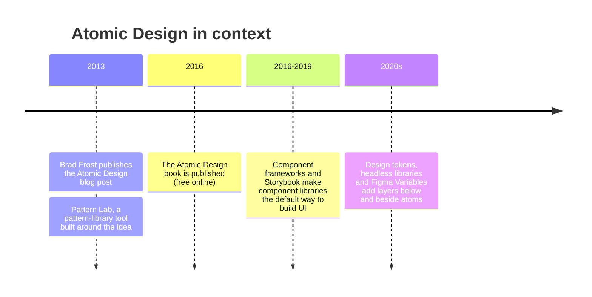

The problem it solved: teams were designing **pages** (one mock-up per screen) while engineers were building **components**. Atomic Design gave both sides one shared vocabulary for "the small reusable parts" and "the screens built from them", and argued that you should design the **system** that produces the pages, not each page in isolation.

Two points from the original material are often forgotten:

| Point | What it means in practice |
|---|---|
| **It's a mental model, not a linear process** | You don't finish all atoms before starting molecules. You move between levels constantly; the pages often reveal that an atom is wrong |
| **The names are optional** | Frost's own material encourages teams to use whatever labels work for them. The idea that matters is "parts and wholes, viewed at the same time" |

---

### Section 2: The Five Stages

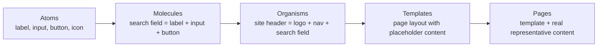

| Stage | Definition (paraphrasing the book) | Abstract or concrete? | Typical examples |
|---|---|---|---|
| **Atoms** | Basic building blocks that can't be broken down further without losing their meaning | Most abstract | `Button`, `Input`, `Label`, `Icon`, `Avatar`, `Text` |
| **Molecules** | Simple groups of atoms working together as a unit with one job | Abstract | `SearchField`, `FormField` (label + input + help text + error), `MenuItem` |
| **Organisms** | Relatively complex, distinct sections of an interface, made of molecules, atoms and other organisms | Getting concrete | `SiteHeader`, `ProductGrid`, `CommentThread`, `CheckoutForm` |
| **Templates** | Page-level layouts that place organisms and show the **content structure** | Concrete structure, placeholder content | `ProductDetailTemplate`, `DashboardLayout` |
| **Pages** | Specific instances of templates with **real representative content** | Most concrete | "Product page for a book with 3 reviews", "Empty cart" |

The first three stages are **things you build**. The last two are about **context**: templates show how parts are arranged, and pages show whether the system holds up with real content.

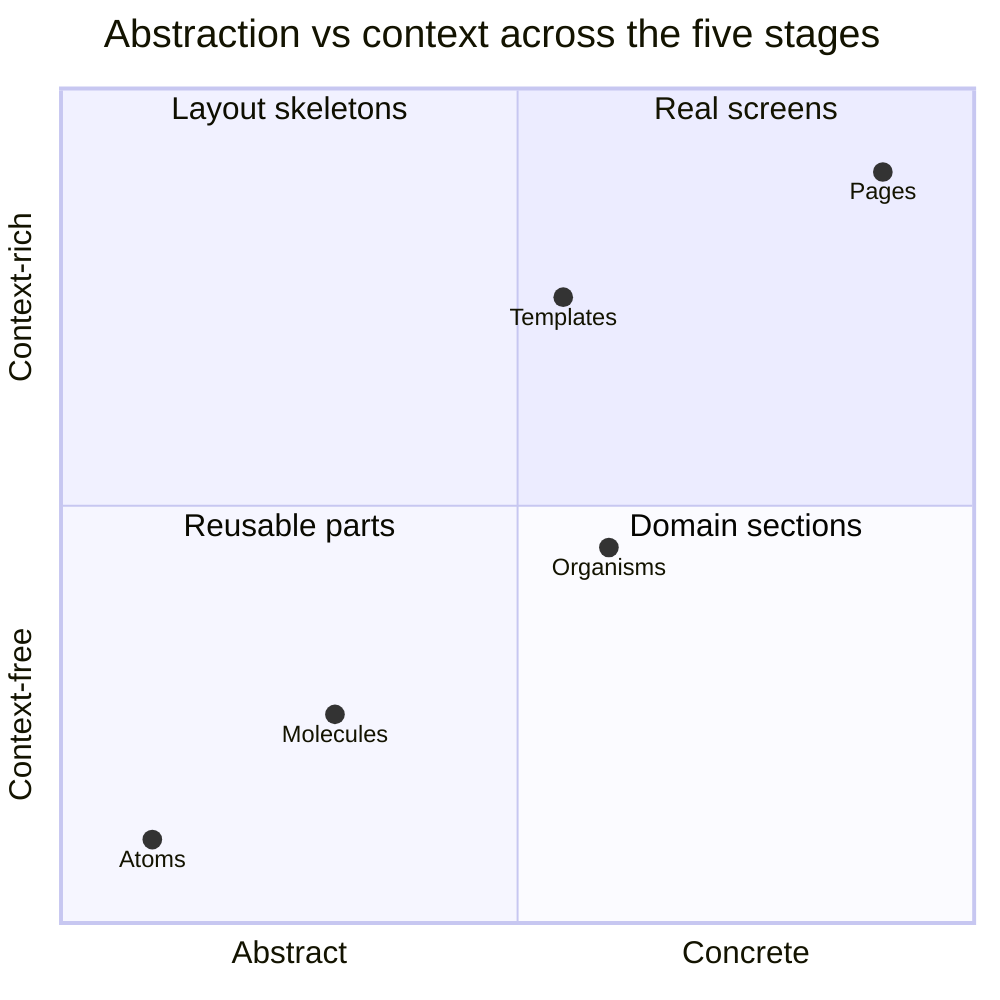

---

### Section 3: Atoms

Atoms are the smallest **functional** UI pieces. In HTML terms they are often a single styled element: a `<button>`, an `<input>`, a `<label>`, an icon.

| Good atom | Not an atom |
|---|---|
| `Button` with `variant` and `size` | `SubmitOrderButton` that knows about the cart (that's domain logic) |
| `Input` that forwards native attributes | `EmailInputWithValidation` (that's a molecule: input + error message) |
| `Icon name="search"` | A full `Toolbar` |
| `Text` / `Heading` with typographic scale | A paragraph with hard-coded marketing copy |

**Rules for atoms:**
- **No domain knowledge.** An atom never imports a store, an API client or a feature module.
- **Pass native attributes through.** An `Input` atom must still accept `id`, `name`, `autoComplete`, `aria-*`, and `ref`, or every molecule built on it fights the API.
- **Accessible on its own.** Focus styles, disabled states, minimum target size and contrast belong here, once, for everyone.
- **Styled with tokens, not raw values.** The original 2013 post also listed colour palettes, fonts and animations as atoms. Today those decisions are usually expressed as **design tokens**, a layer *below* atoms (see [Design Tokens](./design-tokens.md)). Some teams call that layer "sub-atomic", "ions" or "quarks"; the label doesn't matter.

> An atom in isolation is often not very useful (a lone label means little). That's fine; it earns its keep by being reused everywhere.

---

### Section 4: Molecules

A molecule is a **small group of atoms with a single responsibility**. The book's classic example is a search form: a label, an input and a button. Together they gain a purpose none had alone.

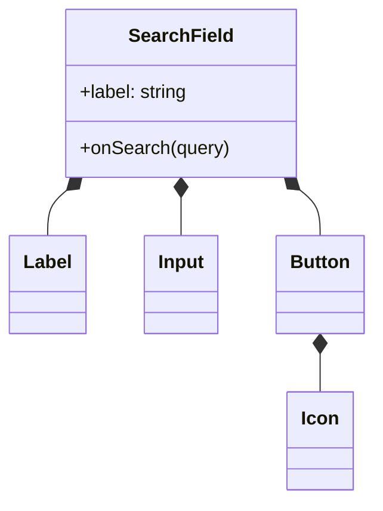

**Single responsibility** is the test. `FormField` (label + control + description + error message, wired together with `id`, `aria-describedby` and `aria-invalid`) is a strong molecule: it does one job, and doing it right once fixes accessibility across every form.

```text
Molecule checklist
  ✅ Built from atoms (maybe other small molecules)
  ✅ Does ONE thing (search, pick a date, show a field with its error)
  ✅ Still has no business data — it takes values and callbacks as props
  ❌ If you need the word "and" to describe it, it's probably an organism
```

---

### Section 5: Organisms

Organisms are **distinct sections of an interface**: a header, a product grid, a comment thread, a checkout summary. They combine molecules and atoms, and they can contain **other organisms** (a `ProductGrid` contains many `ProductCard` organisms).

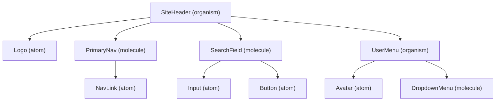

Organisms are where **domain vocabulary** usually appears: `ProductCard`, `OrderSummary`, `InvoiceTable`. That raises the design question Atomic Design itself doesn't answer: **is an organism allowed to fetch data?** Section 10 covers it.

Two kinds of organisms are worth separating:

| Kind | Example | Lives in |
|---|---|---|
| **Generic organism** (domain-free) | `DataTable`, `Modal`, `Tabs`, `EmptyState` | The design system package |
| **Domain organism** | `ProductCard`, `CartSummary`, `CommentThread` | The product app, in a feature folder |

Most design systems stop at generic organisms. Domain organisms belong to the product, because their API follows the product's data model.

---

### Section 6: Templates

Templates are **page-level layouts** that place organisms into a structure. They focus on the **content skeleton**: what goes where, how long a title can be, how many items a list shows, how the layout responds to the viewport. They use **placeholder content**, not real data.

```text
┌──────────────────────── ProductDetailTemplate ────────────────────────┐
│ [SiteHeader]                                                          │
├───────────────────────────────┬───────────────────────────────────────┤
│ [ImageGallery]                │ [ProductTitle: up to ~80 chars]       │
│  1 to 8 images, 4:3           │ [PriceBlock]  [RatingSummary]         │
│                               │ [VariantPicker]  [AddToCart]          │
├───────────────────────────────┴───────────────────────────────────────┤
│ [Tabs: Description | Specs | Reviews (0 to n)]                        │
├───────────────────────────────────────────────────────────────────────┤
│ [RelatedProducts: 0 to 12 cards]                                      │
│ [SiteFooter]                                                          │
└───────────────────────────────────────────────────────────────────────┘
```

**How templates map to frameworks today.** Every major meta-framework has a layout concept, and it's the closest code equivalent of an Atomic Design template:

| Framework | Template-like construct | Notes |
|---|---|---|
| **Next.js (App Router)** | `layout.tsx` (persists across navigations) | Next.js also has a special file literally named `template.tsx`, which **re-mounts** on every navigation. Different meaning from Atomic Design's "template" — don't confuse them |
| **React Router / Remix** | Layout routes rendering `<Outlet />` | Nested layouts per route segment |
| **Nuxt** | `layouts/` directory + `<NuxtLayout>` | Pages pick a layout with `definePageMeta({ layout })` |
| **Angular** | A layout component with `<router-outlet />` and child routes | Content projection for named regions |
| **SvelteKit** | `+layout.svelte` rendering `{@render children()}` | Layouts nest by folder |
| **SwiftUI / Jetpack Compose** | Container views / scaffold composables (`NavigationStack`, `Scaffold`) | Same idea: structure with slots for content |

A design-system template can also be a **slot-based layout component** (`<TwoColumnLayout sidebar={...} main={...} />`) that knows nothing about routing.

---

### Section 7: Pages

Pages are **specific instances of templates with real, representative content**. They are where the system gets **tested**: does the layout survive a 140-character product name, zero reviews, a German translation, a user with no avatar, an admin who sees extra buttons?

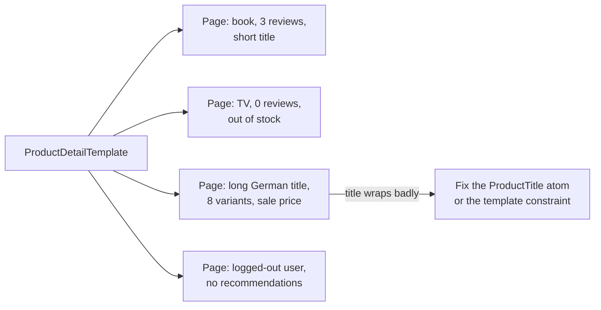

In Atomic Design, "page" means two things at once:
1. **In production:** the route the user visits, filled with live data.
2. **In the pattern library:** a fixture-driven story or demo page showing **variations** (empty, error, long content, permissions). These catch layout bugs before users do.

The second meaning is what most teams skip, and it's the most valuable. In Storybook terms, page stories with realistic fixtures (often mocked network responses, e.g. with Mock Service Worker) are the "pages" stage.

---

### Section 8: The Dependency Rule and Classification

The five levels are only useful if dependencies point **one way**: higher levels compose lower levels, never the reverse.

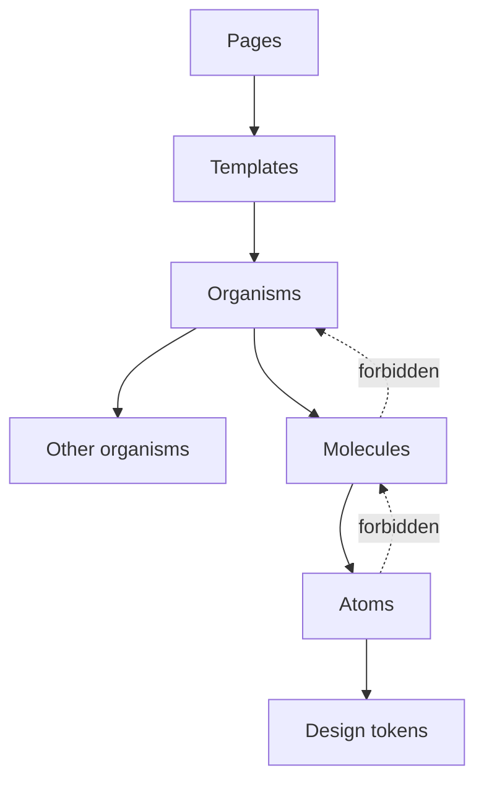

**Classifying a component** is the part teams argue about most. A simple decision flow avoids most of the debate:

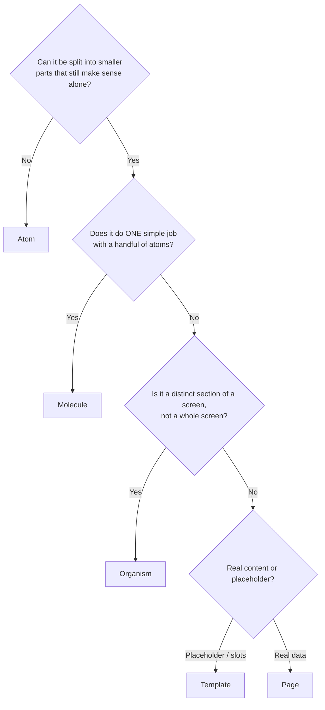

> **Don't spend a meeting on "molecule or organism?"** If two people disagree, pick one and move on. The dependency rule and the reuse boundary matter; the exact label doesn't. Teams often merge molecules and organisms into a single "components" or "patterns" level for this reason.

---

### Section 9: Mapping Atomic Design to Code and Frameworks

There are two common ways to put Atomic Design into a codebase:

**A. Folders by level** (popular in tutorials):

```text
src/components/
  atoms/       Button/  Input/  Icon/  Label/
  molecules/   FormField/  SearchField/
  organisms/   SiteHeader/  DataTable/
  templates/   ProductDetailTemplate/
src/pages/ (or app/ routes)
```

**B. Levels in the design system, features in the app** (more common in large products):

```text
packages/ds/                  ← atoms, molecules, generic organisms, layout templates
  src/button/  src/input/  src/form-field/  src/data-table/  src/layouts/
apps/shop/src/
  features/cart/             ← domain organisms (CartSummary, CartLineItem)
  features/product/          ← ProductCard, ProductGallery
  app/(shop)/product/[id]/   ← pages (routes with data loading)
```

| Approach | Pros | Cons |
|---|---|---|
| **Folders by level** | Easy to teach; mirrors the Storybook sidebar | Moving a component between levels changes its import path; domain code spreads across five folders; arguments about classification |
| **DS package + feature folders** | Domain code stays together; DS can be versioned and shared | The atomic levels become metadata (Storybook titles, docs) instead of paths |

The same model works in every framework because each one has components with inputs and content projection:

| Level | React | Vue 3 | Angular | Svelte 5 |
|---|---|---|---|---|
| Atom | Function component forwarding props and `ref` | SFC with `defineProps`, attribute fallthrough | Standalone component or attribute selector (`button[dsButton]`) | Component spreading `...rest` from `$props()` |
| Molecule | Component composing atoms | SFC composing atoms | Component importing atom components | Component composing atoms |
| Organism | Component, often with compound parts | SFC with slots | Component with `<ng-content>` | Component with snippets |
| Template | Layout component / route layout | Nuxt layout or slot layout | Layout component + `<router-outlet />` | `+layout.svelte` |
| Page | Route component | Nuxt page / route view | Routed component | `+page.svelte` |

**Native mobile:** the model transfers directly. SwiftUI views and Jetpack Compose composables compose small views into larger ones; React Native components follow the React column. What's shared across web and native is usually the **vocabulary and tokens**, not the component code.

---

### Section 10: Where Data and State Enter

Atomic Design describes **visual composition**. It says nothing about data fetching or state, so teams need an explicit rule. A common, defensible one:

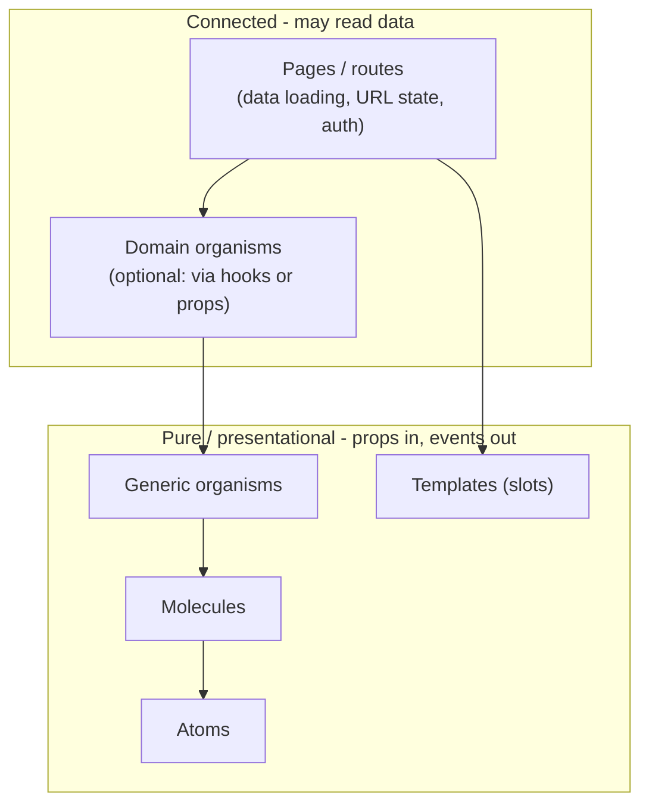

| Level | Local UI state (open, hover, input text) | Server data / global store |
|---|---|---|
| Atoms, molecules | ✅ Yes | ❌ Never |
| Generic organisms | ✅ Yes (e.g. sort column, open row) | ❌ Never; takes data as props |
| Domain organisms | ✅ Yes | ⚠️ Team choice: either receive data from the page, or call a feature hook (`useCart()`) |
| Templates | ⚠️ Layout state only | ❌ Never |
| Pages | ✅ | ✅ Data loading, URL and auth live here |

Why this split works:
- Everything below the page can be rendered in **Storybook with fixtures**, no backend needed.
- With **React Server Components**, the page (a server component) can fetch data and pass it into client organisms. Atoms and molecules that need interactivity become small `'use client'` leaves. See [Streaming SSR & RSC](../02-rendering-and-architecture/streaming-ssr-and-react-server-components.md).
- Server data caching stays in one place (see [Server State vs Client State](../03-state-and-data/server-state-vs-client-state.md)).

---

### Section 11: The Atomic Workflow — Design, Docs and Tests

Atomic Design changed **how teams work**, not just how they name things. Designers and engineers build the same parts in parallel, and the pattern library becomes the meeting point.

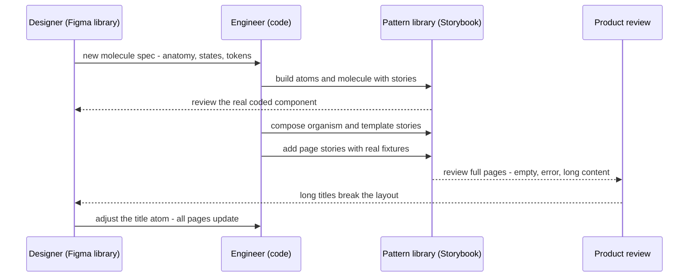

**Testing per level** (each level gets the cheapest test that catches its bugs):

| Level | Most useful tests |
|---|---|
| Atoms | Unit/interaction tests (keyboard, disabled, `aria-*` pass-through), automated a11y checks, visual snapshots per variant |
| Molecules | Interaction tests (label linked to input, error announced) |
| Organisms | Interaction tests with fixtures, visual regression in themes and RTL |
| Templates | Visual regression across viewport widths |
| Pages | Visual regression with realistic fixtures; end-to-end tests for critical flows |

The Storybook sidebar is a natural place to show the levels. See [Storybook & Component Documentation](./storybook-and-component-documentation.md).

---

### Section 12: Criticisms, Limits and Alternatives

Atomic Design is widely used and widely misused. The common problems:

| Criticism | What happens | Mitigation |
|---|---|---|
| **Classification debates** | Hours spent on "is a Card a molecule or organism?" | Merge middle levels; enforce only the dependency rule |
| **Granularity, not domain** | Feature code is spread across `atoms/`, `molecules/`, `organisms/`; changing "checkout" touches five folders | Use atomic levels inside the design system, feature folders in the app ([Feature-Sliced Design](../02-rendering-and-architecture/feature-sliced-design.md)) |
| **No guidance on data and state** | Atoms end up calling APIs | Explicit rule: data enters at pages (and optionally domain organisms) |
| **Chemistry names confuse non-designers** | New hires don't know what an "organism" is | Use plain names (primitives, patterns, sections, layouts) if they work better |
| **Over-abstraction** | Every `div` becomes an atom; wrapper components with no value | Create an atom only when it encodes a decision (tokens, a11y, behaviour) |
| **Seen as a linear process** | "Design all atoms first" delays real screens | Build pages early; let pages correct atoms |

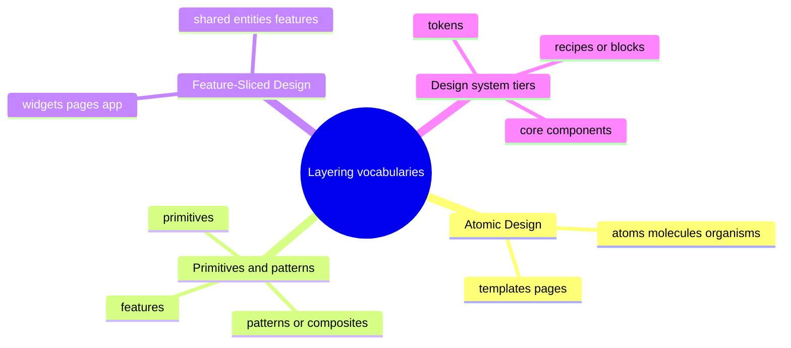

**How the vocabularies relate:**

| Atomic Design | Primitives/patterns layering | Feature-Sliced Design (approximate) |
|---|---|---|
| Atoms | Primitives | `shared/ui` |
| Molecules | Primitives / patterns | `shared/ui` |
| Organisms (generic) | Patterns | `shared/ui` or `widgets` |
| Organisms (domain) | Feature components | `entities` / `features` / `widgets` |
| Templates | Layouts | `app` / `pages` (layouts) |
| Pages | Pages / routes | `pages` |

They aren't competitors: Atomic Design describes **granularity** inside a UI library; FSD and feature folders describe **business boundaries** in an app. Large codebases often use both.

---

## System Design Angle

When a design question in an interview or review touches component structure, Atomic Design gives you a fast, shared vocabulary. Use it like this:

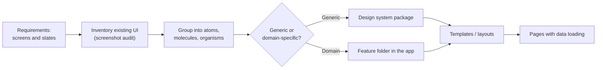

| Decision | Atomic Design informs it by... |
|---|---|
| **What goes in the shared library** | Atoms, molecules, generic organisms and layout templates; domain organisms stay in the app |
| **Where data fetching happens** | Pages (and optionally domain organisms); never atoms or molecules |
| **Storybook/Figma taxonomy** | One sidebar section per level, or per category with the level in docs |
| **Test pyramid** | Cheap unit tests at atoms, visual and E2E tests at pages |
| **Bundle size** | Small atoms and per-component entry points make tree-shaking effective; avoid one barrel file that pulls in every organism |
| **Accessibility ownership** | Atoms and molecules fix a11y once (labels, focus, contrast); pages own headings, landmarks and focus after navigation |

**Interface inventory** — a technique from the book worth using in any redesign: screenshot every button, input, card and header in the existing product, group them on one board, and count the variants. Seeing 14 slightly different button styles side by side is usually the strongest argument for a design system.

---

## Real-World Examples

**Example 1 — An atom that forwards everything (React + TypeScript, React 19):**
```tsx
// packages/ds/src/input/Input.tsx
import type { ComponentPropsWithRef } from 'react';
import { clsx } from 'clsx';
import styles from './Input.module.css';

export interface InputProps extends ComponentPropsWithRef<'input'> {
  size?: 'sm' | 'md';
  invalid?: boolean;
}

export function Input({ size = 'md', invalid = false, className, ...rest }: InputProps) {
  return (
    <input
      {...rest} // id, name, autoComplete, aria-*, ref (React 19) all pass through
      aria-invalid={invalid || undefined}
      className={clsx(styles.input, styles[size], invalid && styles.invalid, className)}
    />
  );
}
```

**Example 2 — A molecule that wires accessibility once (`FormField`):**
```tsx
// packages/ds/src/form-field/FormField.tsx
import { useId, type ReactElement, cloneElement } from 'react';
import { Label } from '../label/Label';
import { Text } from '../text/Text';

interface FormFieldProps {
  label: string;
  description?: string;
  error?: string;
  children: ReactElement<{ id?: string; 'aria-describedby'?: string; invalid?: boolean }>;
}

export function FormField({ label, description, error, children }: FormFieldProps) {
  const id = useId();
  const descId = description ? `${id}-desc` : undefined;
  const errId = error ? `${id}-err` : undefined;

  return (
    <div className="ds-form-field">
      <Label htmlFor={id}>{label}</Label>
      {description && <Text id={descId} tone="muted">{description}</Text>}
      {cloneElement(children, {
        id,
        invalid: Boolean(error),
        'aria-describedby': [descId, errId].filter(Boolean).join(' ') || undefined,
      })}
      {error && <Text id={errId} tone="danger" role="alert">{error}</Text>}
    </div>
  );
}

// usage
// <FormField label="Email" error={errors.email}><Input type="email" name="email" autoComplete="email" /></FormField>
```

> `cloneElement` is a legacy-but-supported React API; it's fine for a single child like this. For richer cases, a context-based compound component (`<Field.Label/>`, `<Field.Control/>`) is more flexible — see [Compound Component Pattern](./compound-component-pattern.md).

**Example 3 — Organism vs page: data stays at the top (BAD → GOOD):**
```tsx
// ❌ BAD: a generic organism fetches its own data, so it can't be reused or rendered in Storybook
export function ProductGrid() {
  const { data } = useQuery({ queryKey: ['products'], queryFn: fetchProducts });
  return <ul>{data?.map((p) => <ProductCard key={p.id} product={p} />)}</ul>;
}

// ✅ GOOD: the organism takes data and callbacks; the page owns loading
export function ProductGrid({ products, onAddToCart }: {
  products: Product[];
  onAddToCart: (id: string) => void;
}) {
  if (products.length === 0) return <EmptyState title="No products found" />;
  return (
    <ul className="product-grid">
      {products.map((p) => (
        <li key={p.id}><ProductCard product={p} onAddToCart={() => onAddToCart(p.id)} /></li>
      ))}
    </ul>
  );
}

// app/(shop)/category/[slug]/page.tsx (Next.js App Router, a Server Component)
export default async function CategoryPage({ params }: { params: Promise<{ slug: string }> }) {
  const { slug } = await params;
  const products = await getProducts(slug);   // data enters at the page
  return (
    <CategoryTemplate title={slug}>
      <ProductGridClient products={products} /> {/* 'use client' wrapper adds onAddToCart */}
    </CategoryTemplate>
  );
}
```

**Example 4 — A template as a slot-based layout in Vue, Svelte 5 and Angular:**
```html
<!-- Vue 3: ProductDetailTemplate.vue -->
<template>
  <div class="pdp">
    <slot name="header" />
    <section class="pdp__hero">
      <div class="pdp__gallery"><slot name="gallery" /></div>
      <div class="pdp__summary"><slot name="summary" /></div>
    </section>
    <slot name="details" />
    <slot name="related" />
  </div>
</template>
```

```html
<!-- Svelte 5: ProductDetailTemplate.svelte -->
<script lang="ts">
  import type { Snippet } from 'svelte';
  let { gallery, summary, details }: { gallery: Snippet; summary: Snippet; details?: Snippet } = $props();
</script>

<div class="pdp">
  <section class="pdp__hero">
    <div class="pdp__gallery">{@render gallery()}</div>
    <div class="pdp__summary">{@render summary()}</div>
  </section>
  {#if details}{@render details()}{/if}
</div>
```

```typescript
// Angular: product-detail-template.component.ts
import { Component } from '@angular/core';

@Component({
  selector: 'ds-product-detail-template',
  template: `
    <div class="pdp">
      <section class="pdp__hero">
        <div class="pdp__gallery"><ng-content select="[pdpGallery]" /></div>
        <div class="pdp__summary"><ng-content select="[pdpSummary]" /></div>
      </section>
      <ng-content />
    </div>
  `,
})
export class ProductDetailTemplateComponent {}
```

**Example 5 — Atomic levels as Storybook taxonomy, with a "page" story:**
```tsx
// ProductDetail.page.stories.tsx (Storybook CSF3)
import type { Meta, StoryObj } from '@storybook/react-vite'; // framework package; older setups import from @storybook/react
import { ProductDetailPage } from './ProductDetailPage';
import { bookWithReviews, tvOutOfStock, longGermanTitle } from './fixtures';

const meta = {
  title: 'Pages/Product detail',     // sidebar: Atoms / Molecules / Organisms / Templates / Pages
  component: ProductDetailPage,
  parameters: { layout: 'fullscreen' },
} satisfies Meta<typeof ProductDetailPage>;
export default meta;

type Story = StoryObj<typeof meta>;

export const Typical: Story = { args: { product: bookWithReviews } };
export const OutOfStockNoReviews: Story = { args: { product: tvOutOfStock } };
export const LongTranslatedTitle: Story = {
  args: { product: longGermanTitle },
  globals: { locale: 'de' },         // assumes a locale toolbar global set up in preview
};
```

> Storybook's exact import paths and features (`globals` per story, framework packages) change between major versions; check the Storybook docs for the version you use.

**Example 6 — Enforcing the dependency rule with ESLint (`eslint-plugin-boundaries`):**
```javascript
// eslint.config.js (flat config) — sketch; check the plugin docs for current option names
import boundaries from 'eslint-plugin-boundaries';

export default [
  {
    plugins: { boundaries },
    settings: {
      'boundaries/elements': [
        { type: 'atom',     pattern: 'src/components/atoms/*' },
        { type: 'molecule', pattern: 'src/components/molecules/*' },
        { type: 'organism', pattern: 'src/components/organisms/*' },
        { type: 'template', pattern: 'src/components/templates/*' },
        { type: 'page',     pattern: 'src/pages/*' },
      ],
    },
    rules: {
      'boundaries/element-types': ['error', {
        default: 'disallow',
        rules: [
          { from: 'molecule', allow: ['atom'] },
          { from: 'organism', allow: ['atom', 'molecule', 'organism'] },
          { from: 'template', allow: ['atom', 'molecule', 'organism'] },
          { from: 'page',     allow: ['atom', 'molecule', 'organism', 'template'] },
        ],
      }],
    },
  },
];
```

---

## Key Points Summary

| Concept | One-Line Explanation |
|---|---|
| **Atomic Design** | Brad Frost's five-stage mental model (2013 post, 2016 book) for building UIs from parts to pages |
| **Atoms** | Smallest functional pieces (`Button`, `Input`, `Icon`); no domain knowledge |
| **Molecules** | Small groups of atoms with one job (`SearchField`, `FormField`) |
| **Organisms** | Distinct interface sections (`SiteHeader`, `ProductGrid`); may contain other organisms |
| **Templates** | Page layouts with placeholder content that define content structure |
| **Pages** | Templates with real representative content; where the system is tested |
| **Not linear** | You move between levels constantly; pages correct atoms |
| **Dependency rule** | Higher levels compose lower ones, never the reverse |
| **Tokens below atoms** | Colours, type, spacing live as design tokens beneath the atom layer |
| **Data entry point** | Pages (and optionally domain organisms) load data; lower levels take props |
| **Generic vs domain organisms** | Generic ones go in the design system, domain ones stay in the app |
| **Labels are optional** | The parts-and-wholes idea matters more than the chemistry names |
| **Complements FSD** | Atomic = granularity inside a UI library; FSD = business boundaries in an app |

---

## Test Your Understanding

**Q1 (Basic):**
Name the five stages of Atomic Design in order and give one example of each for a news website.

<details>
<summary>Answer</summary>

1. **Atoms:** `Heading`, `Link`, `Image`, `Tag`, `Button`.
2. **Molecules:** `ArticleByline` (avatar + author link + date), `SearchField` (label + input + button).
3. **Organisms:** `ArticleCard` (image + headline + byline + tags), `SiteHeader`, `ArticleList`.
4. **Templates:** `ArticleTemplate` (header, hero image area, body column, related-articles rail, footer) with placeholder content and length limits.
5. **Pages:** a real article with a 120-character headline and no hero image; a live-blog article with 200 updates.

The order reflects composition (each level builds on the ones before), not a strict work order: you design and revise levels in parallel.
</details>

**Q2 (Application):**
Your team stores components in `atoms/`, `molecules/` and `organisms/`. The checkout feature now has files in all three folders, and every checkout change touches many directories. What would you change?

<details>
<summary>Answer</summary>

The folder structure is organised by **granularity**, but changes happen by **feature**. Keep atomic levels where they help, inside the **design system package** (atoms, molecules, generic organisms, layout templates), and organise the **app** by feature: `features/checkout/` holds `CheckoutForm`, `OrderSummary`, `PaymentMethodPicker`, their hooks and tests. Those domain organisms import DS components but live together. The atomic level becomes metadata (Storybook title, docs) instead of a path. Add a lint rule (e.g. `eslint-plugin-boundaries` or FSD rules) so features don't import each other's internals and the DS never imports features. This is the same split described in [Feature-Sliced Design](../02-rendering-and-architecture/feature-sliced-design.md).
</details>

**Q3 (Tricky):**
A teammate says, "Atomic Design means we must design every atom before starting any page." Is that right?

<details>
<summary>Answer</summary>

No. Frost describes Atomic Design as a **mental model**, and the book states explicitly that it is not a linear process. The point is to see **parts and wholes at the same time**. Pages with real content are what reveal problems in atoms ("the price atom can't show a sale price and a unit price together"). Building atoms in isolation first tends to produce components that fit no real screen. In practice you sketch pages and templates early, extract atoms and molecules from them, and iterate between levels.
</details>

**Q4 (Tricky):**
In a Next.js App Router project, a developer puts the Atomic Design "templates" into `template.tsx` files. Months later, users complain that a sidebar's scroll position and an open accordion reset on every navigation. What went wrong?

<details>
<summary>Answer</summary>

In Next.js, `template.tsx` is a **special file convention** that, unlike `layout.tsx`, creates a **new instance on every navigation**: its children's state is reset and effects re-run. The Atomic Design "template" (a page-level layout) maps to `layout.tsx` (which persists across navigations between its child routes) or to a plain layout component used by pages. The name collision caused the bug. Move the shared shell into `layout.tsx` and keep `template.tsx` only for cases that genuinely need re-mounting (for example, per-navigation enter animations or logging). Check the Next.js docs for the current behaviour of both files.
</details>

**Q5 (System design):**
You're starting a design system for a company with a marketing site, a customer web app and an admin tool. How would you use Atomic Design to decide what goes into the shared package and how to verify it works?

<details>
<summary>Answer</summary>

1. **Interface inventory:** screenshot buttons, inputs, cards, headers and tables across all three products; group them by level and count variants. This shows what's duplicated and gives the business case.
2. **Shared package:** tokens (below atoms), atoms (`Button`, `Input`, `Icon`, `Text`), molecules (`FormField`, `SearchField`), **generic** organisms (`DataTable`, `Dialog`, `Tabs`, `EmptyState`) built on a headless library, and slot-based layout templates. All are pure: props in, events out, no data fetching.
3. **Product apps:** domain organisms (`PricingTable`, `InvoiceList`) and pages live in each app's feature folders and load their own data.
4. **Verification:** Storybook with sections per level; interaction and automated a11y tests on atoms and molecules; visual regression for organisms and templates (themes, RTL, viewport widths); **page stories with realistic fixtures** for each product (empty, error, long content, permissions); E2E only for critical flows.
5. **Rules:** lint-enforced one-way dependencies, a promotion path ("rule of three") from product organism to DS organism, SemVer releases.
</details>

**Q6 (Application):**
Where should data fetching happen in an atomic component tree, and why? What changes with React Server Components?

<details>
<summary>Answer</summary>

Data should enter at the **page** level (the route), and optionally at **domain organisms** through feature hooks if the team agrees. Atoms, molecules, generic organisms and templates should only receive props and emit events. Reasons: they stay reusable across features, render in Storybook with fixtures (no backend), are easy to test, and server-state caching lives in one place.

With **React Server Components**, the page (a server component) can `await` data directly and pass plain serialisable props down. Interactive atoms and molecules (inputs, menus) become small `'use client'` components; non-interactive ones (`Text`, `Badge`, layout templates) can stay server components and ship no JS. The atomic dependency rule still holds; RSC just adds a "server vs client" dimension to each component. Vue/Nuxt, SvelteKit and Angular reach the same shape with route-level data loading (`useFetch`/`useAsyncData`, `load` functions, resolvers or route-level services) feeding presentational components.
</details>

---

## Cheat Sheet

**Key Definitions:**
- **Atom:** Smallest functional UI element; can't be split without losing meaning (`Button`, `Input`)
- **Molecule:** A few atoms doing one job together (`FormField`, `SearchField`)
- **Organism:** A distinct section of an interface, built from molecules, atoms and other organisms
- **Template:** A page-level layout showing content structure with placeholder content
- **Page:** A template filled with real representative content; tests the system
- **Interface inventory:** Screenshot audit of all existing UI parts, grouped by type
- **Pattern Lab:** Brad Frost's pattern-library tool built around Atomic Design

**Quick Reference:**
```text
Levels          tokens → atoms → molecules → organisms → templates → pages
Dependency      imports point DOWN only; organisms may contain organisms
Atom test       can't split further and still be useful; no domain knowledge; forwards native attrs
Molecule test   one job, a handful of atoms; still no business data
Organism        distinct screen section; generic → design system, domain → app feature folder
Template        layout + slots + content constraints (lengths, counts); placeholder content
Page            real content + edge cases: empty, error, long text, i18n, permissions
Data            pages (and optionally domain organisms) load data; everything else takes props
Frameworks      template ≈ Next layout.tsx (NOT template.tsx) | Nuxt layouts | +layout.svelte | layout component + router-outlet
Folders         DS package by component; app by feature; atomic level as Storybook metadata
Process         not linear — pages correct atoms; don't argue molecule vs organism
Tests           atoms: unit + a11y | organisms: interaction + visual | pages: visual + E2E
```

**Common Mistakes to Avoid:**

| Mistake | Why Wrong | Fix |
|---|---|---|
| Treating Atomic Design as a linear process | Atoms built without real screens rarely fit | Iterate across levels; build pages early |
| Long debates about molecule vs organism | Burns time, no user value | Enforce the dependency rule; merge middle levels if needed |
| Atoms that fetch data or read a store | Not reusable, can't render in Storybook | Data enters at pages (or domain organisms) |
| Atoms that swallow native attributes | Molecules can't set `id`, `aria-*`, `ref` | Spread `...rest` and forward `ref` |
| Domain organisms in the design system | DS API follows one product's data model | Keep domain organisms in the app |
| Folders only by level in a large app | Features scattered across five folders | DS by component, app by feature |
| Skipping the pages stage | Edge cases (long text, empty) found in production | Page stories with realistic fixtures |
| Hard-coding colours in atoms | Theming and rebrands need code changes | Use semantic design tokens |
| Wrapping every `div` in an "atom" | Abstraction without value, more indirection | Create atoms only when they encode a decision |
| Confusing Next.js `template.tsx` with Atomic templates | State resets on every navigation | Use `layout.tsx` or a layout component |

---

## References & Further Reading

**Core sources**
- Brad Frost: [Atomic Design (book, free online)](https://atomicdesign.bradfrost.com/)
- Brad Frost: [Atomic Design, Chapter 2 — Atomic Design Methodology](https://atomicdesign.bradfrost.com/chapter-2/)
- Brad Frost: [Atomic Design, Chapter 4 — The Atomic Workflow](https://atomicdesign.bradfrost.com/chapter-4/)
- Brad Frost: [Atomic Design (original 2013 blog post)](https://bradfrost.com/blog/post/atomic-web-design/)
- Brad Frost: [Interface Inventory](https://bradfrost.com/blog/post/interface-inventory/)
- [Pattern Lab](https://patternlab.io/)

**Framework docs (layouts and composition)**
- React: [Thinking in React](https://react.dev/learn/thinking-in-react) · [Passing props to a component](https://react.dev/learn/passing-props-to-a-component)
- Next.js: [Layouts and pages](https://nextjs.org/docs/app/getting-started/layouts-and-pages) · [`template.js` file convention](https://nextjs.org/docs/app/api-reference/file-conventions/template)
- Vue: [Slots](https://vuejs.org/guide/components/slots.html) · Nuxt: [Layouts](https://nuxt.com/docs/guide/directory-structure/layouts)
- Angular: [Content projection](https://angular.dev/guide/components/content-projection)
- SvelteKit: [Routing — `+layout`](https://svelte.dev/docs/kit/routing#layout) · Svelte: [Snippets](https://svelte.dev/docs/svelte/snippet)

**Tooling**
- Storybook: [Naming components and hierarchy](https://storybook.js.org/docs/writing-stories/naming-components-and-hierarchy)
- [eslint-plugin-boundaries](https://github.com/javierbrea/eslint-plugin-boundaries)
- Feature-Sliced Design: [Overview](https://feature-sliced.design/docs/get-started/overview)

**Related notes in this repo**
- [Component Architecture & Design Systems](../02-rendering-and-architecture/component-architecture-and-design-systems.md) · [Feature-Sliced Design](../02-rendering-and-architecture/feature-sliced-design.md) · [Design Tokens](./design-tokens.md) · [Component API Design](./component-api-design.md)

---

> **Previous Topic:** [Animation Performance (CSS vs JS)](../04-performance-engineering/animation-performance-css-vs-js.md)
> — Which properties animate cheaply and when JavaScript animation is worth it

> **Next Topic:** [Design Tokens](./design-tokens.md)
> — The layer below atoms: named design decisions shared by design tools, web and native code

*Saved on: 2026-11-06 | Repo: Frontend System Design Learning Notes*
