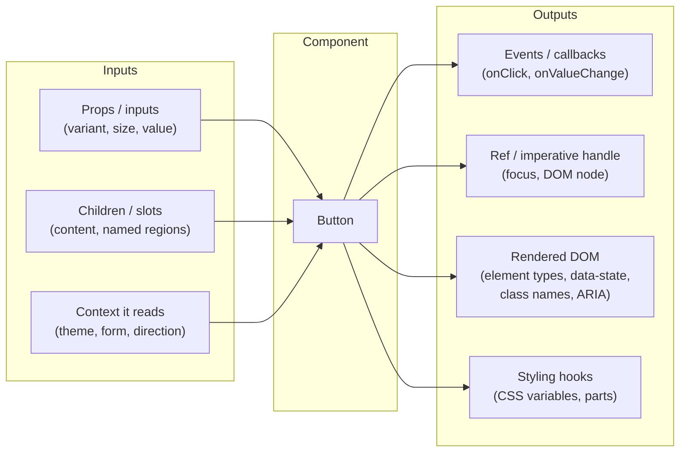
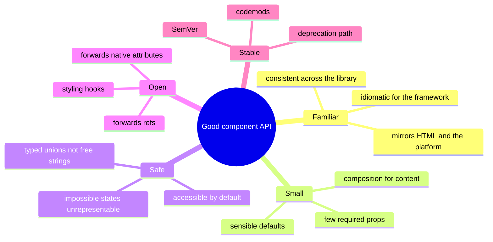
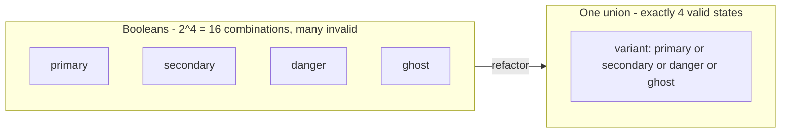
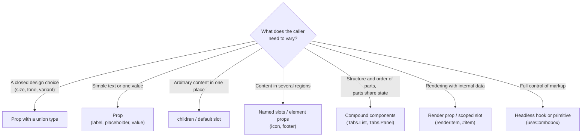
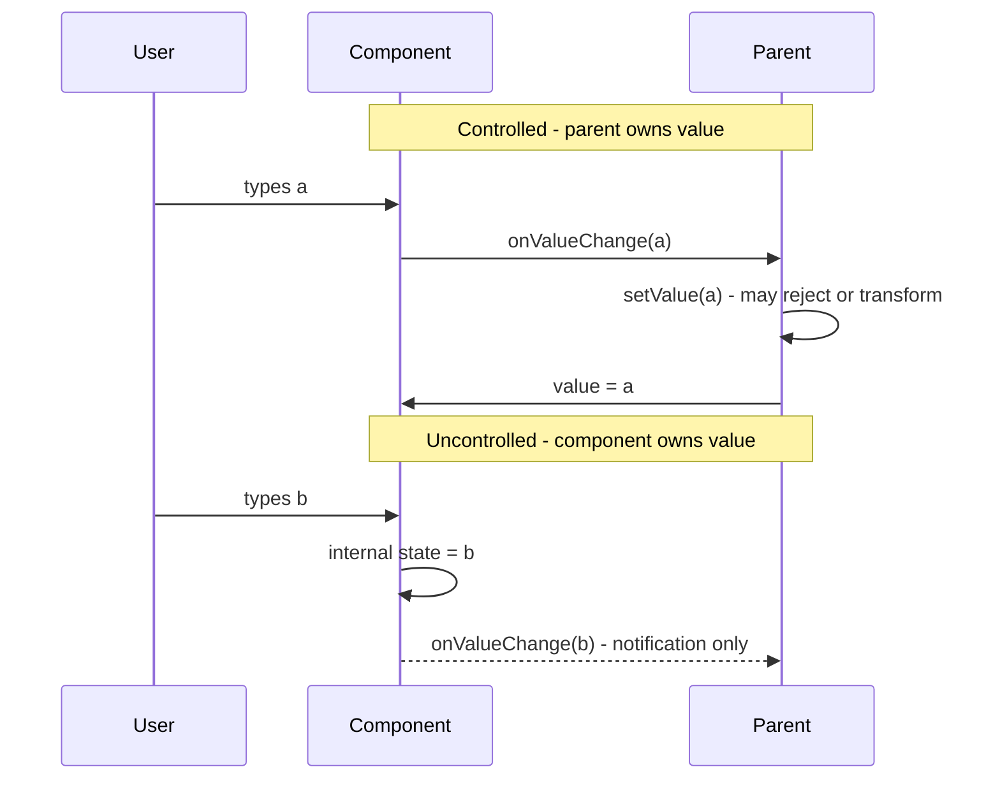
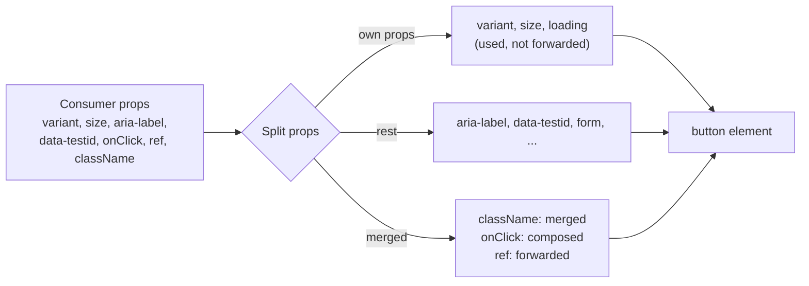
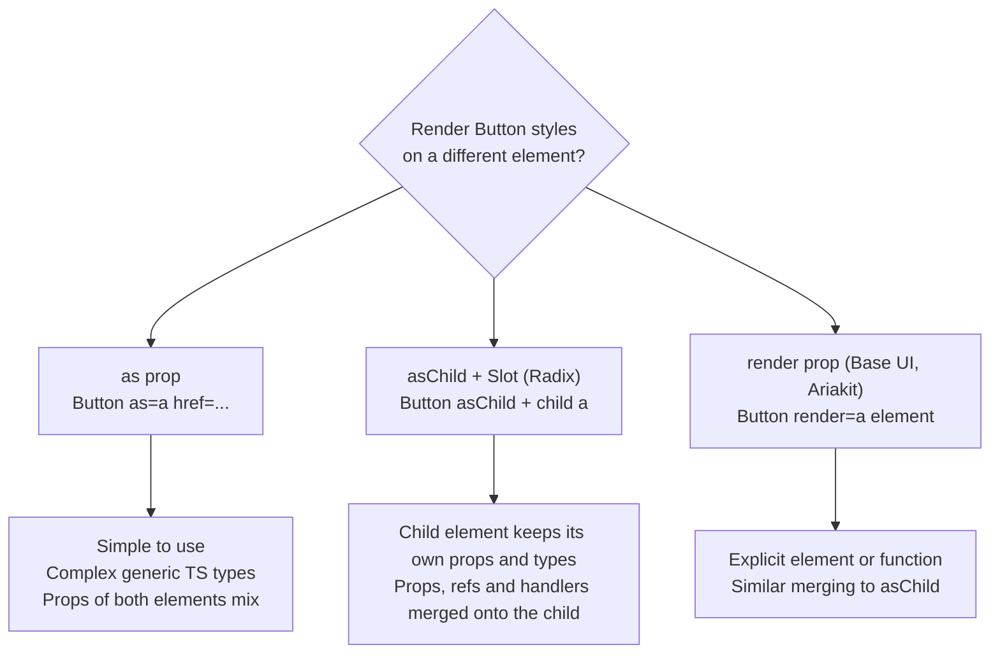
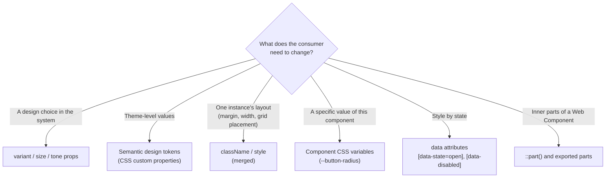
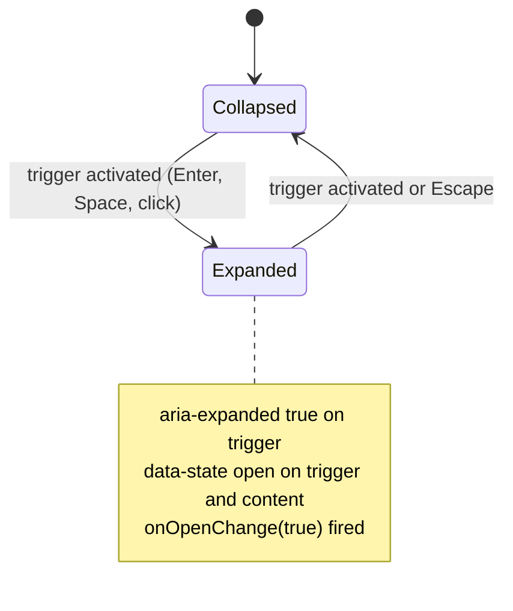
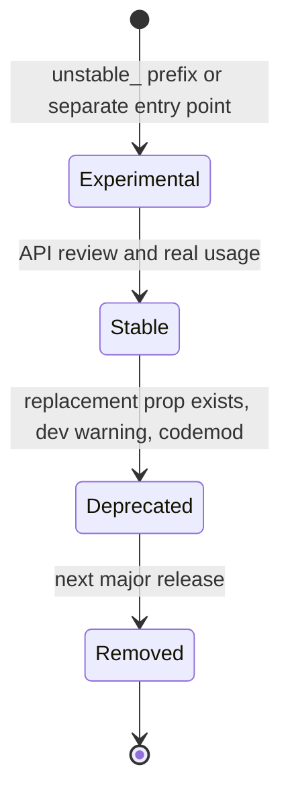

# Component API Design

> **Date:** 2026-11-06 · **Last updated:** 2026-11-06
> **Category:** Frontend System Design
> **Sub-Topic:** Design Systems & Components / Design System
> **Level:** Intermediate · **Reading time:** ~30 min
> **Informs:** prop naming and typing conventions, variants vs booleans, composition vs configuration, controlled vs uncontrolled support, native attribute and ref forwarding, polymorphism (`as` / `asChild`), styling hooks (className, CSS variables, data attributes), accessibility enforced by types, breaking-change policy and deprecation of props

> **Pre-requisite:** [Component Architecture & Design Systems](../02-rendering-and-architecture/component-architecture-and-design-systems.md) (layers and composition) and [Design Tokens](./design-tokens.md) (the styling contract components build on).
> This note is about the **public contract of a component**: the props, events, slots, refs and styling hooks other developers use. A good API makes the right thing easy and the wrong thing hard, and stays stable for years.

**Previous:** [Design Tokens](./design-tokens.md) · **Next:** [Compound Component Pattern](./compound-component-pattern.md)

---

## Table of Contents

1. [ELI5 — Simple Explanation](#eli5--simple-explanation)
2. [Section 1: What Counts as a Component's API](#section-1-what-counts-as-a-components-api)
3. [Section 2: Principles of a Good Component API](#section-2-principles-of-a-good-component-api)
4. [Section 3: Naming Props and Events](#section-3-naming-props-and-events)
5. [Section 4: Variants, Booleans and Impossible States](#section-4-variants-booleans-and-impossible-states)
6. [Section 5: Configuration vs Composition](#section-5-configuration-vs-composition)
7. [Section 6: Controlled, Uncontrolled and Controllable](#section-6-controlled-uncontrolled-and-controllable)
8. [Section 7: Extending Native Elements — Rest Props, Refs and Events](#section-7-extending-native-elements--rest-props-refs-and-events)
9. [Section 8: Polymorphism — `as`, `asChild` and `render`](#section-8-polymorphism--as-aschild-and-render)
10. [Section 9: The Styling API](#section-9-the-styling-api)
11. [Section 10: Accessibility as Part of the API](#section-10-accessibility-as-part-of-the-api)
12. [Section 11: Imperative APIs — Use Sparingly](#section-11-imperative-apis--use-sparingly)
13. [Section 12: Evolving an API Without Breaking Users](#section-12-evolving-an-api-without-breaking-users)
14. [Framework Comparison](#framework-comparison)
15. [Real-World Examples](#real-world-examples)
16. [Key Points Summary](#key-points-summary)
17. [Test Your Understanding (with answers)](#test-your-understanding)
18. [Cheat Sheet](#cheat-sheet)
19. [References & Further Reading](#references--further-reading)

---

## ELI5 — Simple Explanation

Think of a component as a **kitchen appliance**, and its API as the **buttons and sockets on the outside**.

- A good toaster has **a few obvious controls**: a lever, a dial for darkness. You don't need the manual.
- It uses **standard sockets** (it plugs into any wall, like a component that accepts normal HTML attributes).
- It makes mistakes **impossible**: you can't set "bagel mode" and "defrost mode" to fight each other if they're on one dial.
- It has **openings** where you put your own bread (slots and children). The toaster doesn't need a button for every kind of bread.
- Once thousands of people own it, the manufacturer **can't move the lever** to the other side without warning everyone (breaking changes).

> **A component API is a promise to every developer who uses it. Keep it small, consistent with the platform and the rest of your library, typed so wrong usage doesn't compile, open for composition, and change it only through a deprecation path.**

---

## Core Concept — Step by Step

### Section 1: What Counts as a Component's API

Developers usually think "API = props". In practice, **everything a consumer can observe or depend on** is part of the API.



| Surface | Why it's API | Example of an accidental breaking change |
|---|---|---|
| **Props and their defaults** | Consumers pass them and rely on defaults | Changing `size` default from `md` to `sm` |
| **Events / callbacks** | Consumers react to them | Firing `onChange` on every keystroke instead of on blur |
| **Children / slots** | Consumers compose content | Renaming a Vue named slot |
| **Ref target** | Consumers call `.focus()` or measure the node | Ref now points at a wrapper `div` instead of the `input` |
| **Rendered DOM structure** | Consumers style it, test it, query it | Wrapping the `<button>` in a `<span>` breaks `button > svg` selectors and tests |
| **Data attributes / ARIA** | Consumers style `[data-state="open"]`, tests query by role | Renaming `data-state` to `data-open` |
| **CSS custom properties / parts** | Consumers theme through them | Removing `--button-radius` |

> **Hyrum's Law** (from Google engineer Hyrum Wright): with enough users, every observable behaviour of a system will be depended on by somebody. Decide **deliberately** what's public, document it, and treat the rest as private.

---

### Section 2: Principles of a Good Component API



| Principle | Meaning | Example |
|---|---|---|
| **Follow the platform** | If HTML has a name for it, use that name | `disabled`, `required`, `name`, `value`, `type`, not `isInactive` |
| **Consistency beats local perfection** | Same concept, same name, everywhere in the library | If `Select` uses `onValueChange`, so do `Tabs`, `RadioGroup`, `Slider` |
| **Minimal required surface** | Everything optional has a good default | `<Button>Save</Button>` works with no other props |
| **Make invalid states unrepresentable** | Use unions and discriminated types | `variant="primary" \| "secondary"` instead of `primary` + `secondary` booleans |
| **Accessible by default** | The easy path produces accessible output | `IconButton` requires a `label`; `Dialog` wires `aria-labelledby` itself |
| **Open for extension** | Unknown needs are met by passing through attributes, refs, children | `...rest` spread onto the root element |
| **Configuration for design, composition for content** | Closed design choices as props; content as children/slots | `size="sm"` vs `<Card.Footer>…</Card.Footer>` |
| **Stable** | Changes go through deprecation and SemVer | Old prop works with a dev warning for one major |

---

### Section 3: Naming Props and Events

Names are the most visible part of the API. Pick conventions once, write them down, and lint for them.

| Kind | Convention | Examples | Notes |
|---|---|---|---|
| **Native attributes** | Exactly the HTML/DOM name | `disabled`, `readOnly`, `required`, `autoFocus`, `type` | React uses camelCase DOM names; Vue/Angular/Svelte templates use HTML names |
| **Boolean props** | Adjective or past participle; default `false` | `disabled`, `loading`, `open`, `checked`, `invalid` | Some libraries prefix with `is` (React Aria: `isDisabled`). Either works; mixing both doesn't |
| **Enumerations** | Noun naming the dimension | `variant`, `size`, `tone`, `orientation`, `align` | Values as string literal unions |
| **Values** | `value` + `defaultValue` (+ `open`/`defaultOpen`, `checked`/`defaultChecked`) | `value`, `defaultValue` | `default*` signals "uncontrolled initial value" |
| **Change events** | `on` + noun + `Change`, passing the **new value** | `onValueChange(value)`, `onOpenChange(open)` | Plain `onChange` on an input-like component should keep native event semantics, or users get confused |
| **Other events** | `on` + verb (React/Svelte); verb only for Vue emits and Angular outputs | `onSelect`, `onDismiss`; Vue `emit('select')`; Angular `select = output<Item>()` | Avoid `handleX` in public props — that's an implementation name |
| **Render slots** | Noun for the region | `icon`, `startAdornment`, `footer`, `empty` | Accept nodes/snippets/templates, not strings only |

**Event payloads:** pass **values**, not DOM events, for semantic events (`onValueChange("apple")`), and pass the native **event** for native-like events (`onClick(event)`). Mixing them under the same name (`onChange` sometimes gets an event, sometimes a value) is one of the most common API mistakes.

```text
Native-like events  → keep the native signature        onClick(event), onKeyDown(event), onChange(event) on <Input>
Semantic events     → new name, value-first payload     onValueChange(value, details?), onOpenChange(open)
```

---

### Section 4: Variants, Booleans and Impossible States

The "**boolean trap**": every new look becomes a boolean, and combinations multiply.



```tsx
// ❌ Booleans: <Button primary danger ghost> compiles; what does it look like?
interface BadButtonProps { primary?: boolean; secondary?: boolean; danger?: boolean; ghost?: boolean }

// ✅ Union: exactly one variant, autocomplete lists the options
interface ButtonProps { variant?: 'primary' | 'secondary' | 'danger' | 'ghost' }
```

**Discriminated unions** go further: some props only make sense together.

```tsx
// A link-or-button: href and onClick shouldn't both be required or both be allowed freely
type ActionProps =
  | { kind: 'link'; href: string; external?: boolean }
  | { kind: 'button'; onClick: () => void; type?: 'button' | 'submit' };

// An icon-only button MUST have an accessible name; a text button gets it from children
type IconButtonProps =
  | { icon: React.ReactNode; 'aria-label': string; children?: never }
  | { icon?: React.ReactNode; children: React.ReactNode; 'aria-label'?: string };
```

| Pattern | Use when | Example |
|---|---|---|
| **Boolean** | A true on/off that combines freely with everything | `disabled`, `loading`, `fullWidth` |
| **String union** | Mutually exclusive options of one dimension | `variant`, `size`, `orientation` |
| **Discriminated union** | Some props are only valid together | `kind: 'link'` requires `href` |
| **`never`** | Forbid a prop in one branch | `children?: never` for icon-only |

> In Vue, Angular and Svelte templates the type checking is weaker than in TSX, but the same API rules apply. Vue's `defineProps<T>()` with Volar/vue-tsc, Angular's strict template type checking and `svelte-check` all catch many invalid usages at build time.

---

### Section 5: Configuration vs Composition

The second big decision: does the caller **configure** the component with data, or **compose** it from parts?



| Approach | Example | Strength | Weakness |
|---|---|---|---|
| **Config (data in)** | `<Select options={[{ value, label }]} />` | Short, easy to validate, easy to render on the server | Every new need (icons, groups, descriptions) is a new prop |
| **Composition** | `<Select><Select.Item value="a">A</Select.Item></Select>` | New layouts need no library change | More verbose; harder to enforce structure |
| **Both** | `items` prop **and** `<Select.Item>` children | Simple cases short, complex cases possible | Two code paths to maintain and document |

A practical rule: **start with composition for anything structural** (dialogs, cards, menus, tabs), and **use configuration for closed design choices and for data-heavy components** where the data is already an array (tables, large lists with virtualisation). See [Compound Component Pattern](./compound-component-pattern.md) and [Headless UI / Renderless Components](./headless-ui-renderless-components.md).

---

### Section 6: Controlled, Uncontrolled and Controllable

Any component with a value (input, select, tabs, dialog `open`, accordion) must decide **who owns the state**.



| Mode | Props | Who owns state | Use when |
|---|---|---|---|
| **Controlled** | `value` + `onValueChange` | Parent | Validation as you type, syncing with URL/store, derived UI |
| **Uncontrolled** | `defaultValue` (+ optional `onValueChange`) | Component | Simple forms, native-like behaviour, fewer re-renders |
| **Controllable** (both) | Either of the above | Prop if provided, otherwise internal | **Default for design-system components** |

Rules for a controllable component:
- Decide mode by whether `value` is **`undefined`**, not falsy (`0`, `''` and `false` are valid controlled values).
- **Don't switch modes** during the component's life; warn in development if `value` goes from defined to `undefined` (React itself warns for native inputs).
- **Always call** `onValueChange` in both modes.
- Mirror the pattern for every stateful prop: `open/defaultOpen/onOpenChange`, `checked/defaultChecked/onCheckedChange`.

Framework equivalents of "controlled with two-way binding": Vue `v-model` (with `defineModel()` in Vue 3.4+), Angular `model()` signal inputs with `[(value)]` banana-in-a-box syntax, Svelte 5 `$bindable()` props with `bind:value`. They're all **sugar for value-down, event-up**. Deep dive: [Controlled vs Uncontrolled Components](./controlled-vs-uncontrolled-components.md).

---

### Section 7: Extending Native Elements — Rest Props, Refs and Events

A design-system `Button` is still a `<button>`. Consumers will need attributes you didn't think of: `form`, `name`, `aria-describedby`, `data-testid`, `onPointerDown`. **Don't enumerate them — forward them.**



| Concern | Rule | Why |
|---|---|---|
| **Rest props** | Spread unknown props onto the **root interactive element** | `aria-*`, `data-*`, `form`, `name` just work |
| **Type** | Extend the native element's props (`ComponentPropsWithRef<'button'>`) and `Omit` what you redefine | Autocomplete for every native attribute |
| **`ref`** | Forward to the same element as rest props | Focus management, measurement, third-party libs |
| **`className` / `style`** | **Merge** with your own, never replace | Consumers can add layout without losing your styles |
| **Event handlers** | **Compose**: call the consumer's handler, then yours unless `event.defaultPrevented` | Consumers can add behaviour or opt out of yours |
| **Spread order** | `{...rest}` **before** props you must control (`type`, `aria-busy`) — or after, if consumers should be able to override them; decide per prop | Avoid accidental overrides of safety defaults |

```tsx
// Compose event handlers: consumer first, internal behaviour unless prevented
export function composeEventHandlers<E extends { defaultPrevented: boolean }>(
  theirs?: (event: E) => void,
  ours?: (event: E) => void,
) {
  return (event: E) => {
    theirs?.(event);
    if (!event.defaultPrevented) ours?.(event);
  };
}
```

**React version note:** in React 19, function components receive `ref` as a normal prop. In React 18 and earlier you need `forwardRef`, which still works in 19. Vue forwards non-prop attributes automatically (**attribute fallthrough**, controllable with `inheritAttrs: false` + `v-bind="$attrs"`). Svelte 5 uses `let { a, b, ...rest } = $props()` and `{...rest}`. Angular commonly avoids the problem by using an **attribute selector** on the native element (`<button dsButton>`), so every native attribute already works.

---

### Section 8: Polymorphism — `as`, `asChild` and `render`

A "button" sometimes must be a link (`<a href>`), a router link, or a menu trigger. Three API styles exist:



```tsx
// as prop
<Button as="a" href="/pricing">See pricing</Button>

// asChild (Radix-style Slot): Button's props/styles are merged onto the single child
<Button asChild>
  <Link href="/pricing">See pricing</Link>
</Button>

// render prop (Base UI / Ariakit style)
<Button render={<Link href="/pricing" />}>See pricing</Button>
```

| | `as` | `asChild` | `render` |
|---|---|---|---|
| Used by | Many styled libraries (historically Chakra, styled-components) | Radix, shadcn/ui | Base UI, Ariakit |
| TypeScript | Generic polymorphic types; slow and complex | Each element types itself | Each element types itself |
| Router links | Pass the router `Link` component to `as` | Wrap the `Link` | Pass the `Link` element |
| Accessibility risk | `as="div"` silently loses button semantics | Child must be focusable/interactive | Same as `asChild` |

**Semantics first:** navigation is a **link** (`<a href>`); an action is a **button**. Polymorphism should let you render the **correct** element with shared styles, not let a `div` pretend to be a button. Vue uses `<component :is>`, Svelte 5 `<svelte:element this={tag}>`, and Angular attribute selectors (`a[dsButton]`, `button[dsButton]`) for the same purpose.

---

### Section 9: The Styling API

Consumers will need to adjust styles. Decide **which** adjustments you support and give each a stable hook.



| Hook | Example | Notes |
|---|---|---|
| **Variant props** | `variant="danger"` | The supported, designed options |
| **`className` / `style`** | `className="mt-4 w-full"` | For **layout** around the component; merge with `clsx`/`tailwind-merge` |
| **CSS custom properties** | `--button-radius`, `--dialog-width` | Documented per component; consumers set them without specificity fights |
| **Data attributes for state** | `data-state="open"`, `data-disabled`, `data-orientation` | Radix and many headless libs expose these; style with `[data-state="open"]` |
| **Cascade layers** | Library CSS in `@layer ds` | Unlayered app styles always win, no `!important` needed |
| **`::part()`** | `my-select::part(listbox)` | Web Components' public styling surface through Shadow DOM |

**Avoid** making internal class names (`.ds-btn__icon--left`) a styling API by accident; if consumers start overriding them, Hyrum's Law makes them public. Either document them or hash them (CSS Modules).

---

### Section 10: Accessibility as Part of the API

The API should make the accessible path the **default** and the inaccessible path **hard**.

| Technique | Example |
|---|---|
| **Require accessible names in types** | `IconButton` requires `aria-label` (or a `label` prop rendered visually hidden) |
| **Generate and wire IDs internally** | `FormField` links label, description and error with `useId()`; consumers don't manage IDs |
| **Correct element by default** | `Button` renders `<button type="button">` (HTML's default `type` is `submit` inside forms) |
| **Pass through `aria-*`** | `...rest` includes `aria-describedby`, `aria-controls` |
| **Expose state as ARIA, not only as styles** | `aria-pressed` on a toggle button, `aria-expanded` on a disclosure trigger |
| **Keyboard behaviour is not optional** | Tabs, menus, comboboxes follow the WAI-ARIA Authoring Practices patterns, not configurable off |
| **Warn in development** | Missing label on a `TextField` logs a dev-only warning |



---

### Section 11: Imperative APIs — Use Sparingly

Declarative props should cover almost everything. Some things are naturally **imperative**: focusing, scrolling into view, selecting text, playing media, measuring.

| Framework | How to expose methods |
|---|---|
| React | `useImperativeHandle(ref, () => ({ focus, scrollToItem }))` |
| Vue 3 | `defineExpose({ focus })` in `<script setup>`, accessed through a template ref |
| Angular | Public methods on the component class, accessed via `viewChild()` / `@ViewChild` |
| Svelte 5 | `export function focus() {}` from the component, accessed via `bind:this` |
| Web Components | Public methods on the element class |

Rules:
- Prefer forwarding the **DOM ref** (the consumer calls native `.focus()`) over inventing methods.
- Never expose imperative setters for **state** (`ref.current.open()`); use `open` / `onOpenChange` props so state stays declarative and serialisable.
- Keep the handle **small** and document it like props; it's public API too.

---

### Section 12: Evolving an API Without Breaking Users



| Change | SemVer |
|---|---|
| Add an optional prop, variant value, slot, event, CSS variable | Minor |
| Fix a bug that some users relied on | Patch, but announce it if behaviour visibly changes |
| Change a **default** value | **Major** (or minor behind an opt-in flag) |
| Rename/remove a prop, event, slot, data attribute or CSS variable | **Major** |
| Change the DOM structure consumers style or test against | **Major** (document it) |
| Add a **required** prop | **Major** |

**Deprecation toolkit:**
- `/** @deprecated Use variant="danger" instead. */` in the types (editors strike it through).
- A **dev-only** console warning, once per component type.
- Accept both old and new props during the deprecation window, mapping old → new internally.
- A **codemod** (jscodeshift, ts-morph, or ast-grep) that rewrites usages.
- A migration guide in the changelog.

**API review checklist** before a component goes stable: names match library conventions; required props minimal; defaults documented; controlled + uncontrolled supported where stateful; native attributes and ref forwarded; styling hooks listed; keyboard and ARIA behaviour documented; examples for every prop; types export public prop interfaces (`ButtonProps`) so consumers can wrap the component.

---

## Framework Comparison

| Concept | React | Vue 3 | Angular | Svelte 5 | Web Components |
|---|---|---|---|---|---|
| **Inputs** | props | `defineProps` | `input()`, `input.required()` | `$props()` | attributes + properties |
| **Outputs** | callback props | `defineEmits` / `emit` | `output()` | callback props | `CustomEvent` via `dispatchEvent` |
| **Two-way** | `value` + `onValueChange` | `v-model` / `defineModel()` | `model()` + `[(x)]` | `$bindable()` + `bind:` | property + event |
| **Content** | `children`, element props | default / named / scoped slots | `<ng-content select>`, `ng-template` | `children` + snippets | `<slot>` / named slots |
| **Pass-through attrs** | `...rest` | automatic fallthrough (`$attrs`) | attribute selectors, host bindings | `...rest` | attributes land on the host |
| **Ref / expose** | `ref` prop (19), `useImperativeHandle` | template ref + `defineExpose` | `viewChild()` | `bind:this` + exported functions | the element itself |
| **Shared state for parts** | Context | `provide` / `inject` | DI (inject parent) | `setContext` / `getContext` | context protocol or parent lookup |
| **Styling hooks** | `className`, CSS vars, data attrs | `class` fallthrough, CSS vars | host class bindings, CSS vars | `class`, `--css-prop` on components | `::part()`, CSS custom properties |

**Native mobile:** SwiftUI uses initialiser parameters, `@Binding` for two-way values, `@ViewBuilder` closures for content and **view modifiers** for styling; Jetpack Compose uses function parameters, a `value` + `onValueChange` pair (the same controlled pattern), `@Composable` lambda slots and a `Modifier` parameter as the conventional first optional argument. The principles in this note apply unchanged.

---

## Real-World Examples

**Example 1 — A well-typed `Button` (React 19 + TypeScript):**
```tsx
import type { ComponentPropsWithRef, ReactNode } from 'react';
import { clsx } from 'clsx';
import styles from './Button.module.css';

export interface ButtonProps extends Omit<ComponentPropsWithRef<'button'>, 'children'> {
  /** Visual style. Default: "primary". */
  variant?: 'primary' | 'secondary' | 'danger' | 'ghost';
  /** Control height and padding. Default: "md". */
  size?: 'sm' | 'md' | 'lg';
  /** Shows a spinner, sets aria-busy and blocks clicks. */
  loading?: boolean;
  /** Icon rendered before the label. Decorative: hidden from assistive tech. */
  startIcon?: ReactNode;
  children: ReactNode;
}

export function Button({
  variant = 'primary',
  size = 'md',
  loading = false,
  startIcon,
  type = 'button',            // safer than HTML's default "submit"
  disabled,
  className,
  children,
  ...rest                     // aria-*, data-*, form, name, onClick, ref ...
}: ButtonProps) {
  return (
    <button
      {...rest}
      type={type}
      disabled={disabled || loading}
      aria-busy={loading || undefined}
      data-variant={variant}
      data-size={size}
      className={clsx(styles.button, className)}
    >
      {startIcon && <span aria-hidden="true" className={styles.icon}>{startIcon}</span>}
      {children}
    </button>
  );
}
```

```css
/* Styles keyed off data attributes; consumers can target the same hooks */
@layer ds {
  .button { border-radius: var(--button-radius, var(--ds-radius-control)); }
  .button[data-variant="primary"] { background: var(--ds-semantic-action-primary-bg); }
  .button[data-variant="danger"]  { background: var(--ds-semantic-action-danger-bg); }
  .button[data-size="sm"] { min-block-size: 2rem; }
  .button[aria-busy="true"] { cursor: progress; }
}
```

**Example 2 — A controllable state hook, used by every stateful component:**
```tsx
import { useCallback, useRef, useState } from 'react';

export function useControllableState<T>({
  value,
  defaultValue,
  onChange,
}: {
  value?: T;
  defaultValue: T;
  onChange?: (next: T) => void;
}) {
  const [internal, setInternal] = useState(defaultValue);
  const isControlled = value !== undefined;            // undefined, not falsy
  const wasControlled = useRef(isControlled);

  if (process.env.NODE_ENV !== 'production' && wasControlled.current !== isControlled) {
    console.warn('A component switched between controlled and uncontrolled. Pick one for its lifetime.');
    wasControlled.current = isControlled;
  }

  const current = isControlled ? value : internal;
  const setValue = useCallback((next: T) => {
    if (!isControlled) setInternal(next);
    if (next !== current) onChange?.(next);
  }, [isControlled, current, onChange]);

  return [current, setValue] as const;
}

// usage inside a Disclosure component
export function Disclosure(props: { open?: boolean; defaultOpen?: boolean; onOpenChange?: (o: boolean) => void }) {
  const [open, setOpen] = useControllableState({
    value: props.open,
    defaultValue: props.defaultOpen ?? false,
    onChange: props.onOpenChange,
  });
  return <button type="button" aria-expanded={open} onClick={() => setOpen(!open)}>Details</button>;
}
```

> Bundlers replace `process.env.NODE_ENV` at build time in most React setups; in a plain Vite app without that define, use `import.meta.env.DEV`.

**Example 3 — Prop design BAD → GOOD:**
```tsx
// ❌ BAD: inconsistent names, booleans that conflict, strings instead of nodes, value/event confusion
<Modal
  isOpen={open}
  close={() => setOpen(false)}       // verb-only callback, no "on", not a state change event
  primary
  big
  headerText="Delete file?"           // only plain text; can't add an icon or link
  onChange={(e) => setOpen(e)}        // is e an event or a boolean?
  hideCloseBtn
/>

// ✅ GOOD: platform-like state pair, one union per dimension, composition for content
<Dialog open={open} onOpenChange={setOpen} size="lg">
  <Dialog.Content>
    <Dialog.Title>Delete file?</Dialog.Title>
    <Dialog.Description>This can't be undone.</Dialog.Description>
    <Dialog.Close asChild><Button variant="secondary">Cancel</Button></Dialog.Close>
    <Button variant="danger" onClick={remove}>Delete</Button>
  </Dialog.Content>
</Dialog>
```

**Example 4 — The same controllable `Toggle` in Vue, Angular and Svelte 5:**
```html
<!-- Vue 3: Toggle.vue — defineModel gives v-model support; works uncontrolled too -->
<script setup lang="ts">
const pressed = defineModel<boolean>('pressed', { default: false });
defineProps<{ size?: 'sm' | 'md' }>();
</script>
<template>
  <button type="button" :aria-pressed="pressed" @click="pressed = !pressed"><slot /></button>
</template>
<!-- usage: <Toggle v-model:pressed="bold">Bold</Toggle>  or  <Toggle>Bold</Toggle> -->
```

```typescript
// Angular: model() signal input enables [(pressed)] two-way binding
import { Component, input, model } from '@angular/core';

@Component({
  selector: 'button[dsToggle]',            // attribute selector: native button attrs just work
  host: {
    type: 'button',
    '[attr.aria-pressed]': 'pressed()',
    '[attr.data-size]': 'size()',
    '(click)': 'pressed.set(!pressed())',
  },
  template: `<ng-content />`,
})
export class ToggleComponent {
  pressed = model(false);
  size = input<'sm' | 'md'>('md');
}
// usage: <button dsToggle [(pressed)]="bold">Bold</button>
```

```html
<!-- Svelte 5: Toggle.svelte — $bindable enables bind:pressed; rest props forwarded -->
<script lang="ts">
  import type { Snippet } from 'svelte';
  import type { HTMLButtonAttributes } from 'svelte/elements';
  let {
    pressed = $bindable(false),
    children,
    ...rest
  }: { pressed?: boolean; children: Snippet } & HTMLButtonAttributes = $props();
</script>

<button {...rest} type="button" aria-pressed={pressed} onclick={() => (pressed = !pressed)}>
  {@render children()}
</button>
<!-- usage: <Toggle bind:pressed={bold}>Bold</Toggle> -->
```

**Example 5 — A simple `Slot` for `asChild` (how Radix-style merging works):**
```tsx
import { cloneElement, isValidElement, type ReactElement, type ReactNode } from 'react';
import { clsx } from 'clsx';

type AnyProps = Record<string, any>;

export function Slot({ children, ...slotProps }: AnyProps & { children?: ReactNode }) {
  if (!isValidElement(children)) return null;
  const child = children as ReactElement<AnyProps>;
  const merged: AnyProps = { ...slotProps, ...child.props };

  // merge className and compose handlers instead of letting one side win
  merged.className = clsx(slotProps.className, child.props.className);
  for (const key of Object.keys(slotProps)) {
    if (/^on[A-Z]/.test(key) && typeof child.props[key] === 'function') {
      merged[key] = (...args: unknown[]) => { child.props[key](...args); slotProps[key](...args); };
    }
  }
  return cloneElement(child, merged);   // ref merging omitted for brevity; real Slot merges refs too
}

// Button supports asChild by swapping the root element
export function LinkableButton({ asChild, ...props }: { asChild?: boolean } & AnyProps) {
  const Comp = asChild ? Slot : 'button';
  return <Comp {...props} className={clsx('ds-button', props.className)} />;
}
```

> In real projects use `@radix-ui/react-slot` (or your headless library's equivalent) rather than writing your own; ref merging and edge cases are subtle.

**Example 6 — Deprecating a prop without breaking anyone:**
```tsx
export interface AlertProps {
  tone?: 'info' | 'success' | 'warning' | 'danger';
  /** @deprecated Use `tone="danger"` instead. Removed in v6. */
  error?: boolean;
  children: React.ReactNode;
}

const warned = new Set<string>();
function deprecate(key: string, message: string) {
  if (process.env.NODE_ENV !== 'production' && !warned.has(key)) {
    warned.add(key);
    console.warn(`[ds] ${message}`);
  }
}

export function Alert({ tone, error, children }: AlertProps) {
  if (error !== undefined) deprecate('Alert.error', 'Alert: `error` is deprecated, use tone="danger".');
  const resolvedTone = tone ?? (error ? 'danger' : 'info');   // old prop still works
  return <div role={resolvedTone === 'danger' ? 'alert' : 'status'} data-tone={resolvedTone}>{children}</div>;
}
```

```bash
# Ship a codemod with the release (sketch with ast-grep; jscodeshift or ts-morph work too).
# Review the printed diff first, then add --update-all to apply it. Real codemods also cover
# self-closing tags and error={true}; test them on a copy of a consumer repo.
npx --package @ast-grep/cli ast-grep run --lang tsx   --pattern '<Alert error $$$REST>$$$BODY</Alert>'   --rewrite '<Alert tone="danger" $$$REST>$$$BODY</Alert>' src
```

---

## Key Points Summary

| Concept | One-Line Explanation |
|---|---|
| **Component API** | Everything consumers can observe: props, defaults, events, slots, ref, DOM, data attributes, CSS hooks |
| **Hyrum's Law** | Every observable behaviour will be depended on; decide what's public on purpose |
| **Follow the platform** | Reuse HTML names (`disabled`, `value`, `type`) and native event signatures |
| **Consistency** | One concept, one name across the whole library |
| **Unions over booleans** | `variant="danger"` instead of conflicting `primary`/`danger` flags |
| **Discriminated unions** | Make invalid prop combinations fail to compile |
| **Configuration vs composition** | Props for closed design choices; children/slots/compound parts for content and structure |
| **Controllable state** | Support `value`/`onValueChange` and `defaultValue`; decide by `undefined` |
| **Forward everything** | Rest props, ref, merged className, composed event handlers |
| **Polymorphism** | `as`, `asChild` or `render` to render the right element with shared styles |
| **Styling hooks** | Variants, className for layout, CSS variables, data attributes, cascade layers, `::part()` |
| **Accessible by default** | Types require labels; IDs and ARIA wired internally |
| **Imperative handle** | Only for focus/scroll/measure; never for state |
| **Deprecation path** | `@deprecated` + dev warning + both props work + codemod + removal in a major |

---

## Test Your Understanding

**Q1 (Basic):**
Why should a design-system `Button` default to `type="button"`, and why should it spread unknown props onto the `<button>`?

<details>
<summary>Answer</summary>

HTML's default `type` for a `<button>` inside a `<form>` is **`submit`**. A DS button used for "Cancel" or "Show details" inside a form would otherwise submit it unexpectedly. Defaulting to `type="button"` makes the safe behaviour the default; consumers opt in with `type="submit"`.

Spreading unknown props (`...rest`) means the button supports **every native attribute and event** without the library listing them: `aria-describedby`, `form`, `name`, `data-testid`, `onPointerDown`, and future attributes. Without it, consumers hit a wall the first time they need something the author didn't predict, and accessibility attributes in particular get lost.
</details>

**Q2 (Application):**
Your `Select` currently has `onChange` that sometimes receives a DOM event (single select) and sometimes an array of strings (multi select). Redesign the API.

<details>
<summary>Answer</summary>

Separate **native-like** and **semantic** events, and make the value type follow the mode with a discriminated union:

```tsx
type SelectProps =
  | { multiple?: false; value?: string; defaultValue?: string; onValueChange?: (value: string) => void }
  | { multiple: true; value?: string[]; defaultValue?: string[]; onValueChange?: (value: string[]) => void };
```

`onValueChange` always receives the **new value** with a type that matches `multiple`, so TypeScript prevents mixing. If the component renders a native `<select>`, `onChange` can still exist with the native event signature, but it's not the primary API. The names `value` / `defaultValue` / `onValueChange` match the rest of the library (Tabs, RadioGroup, Slider), and the component supports both controlled and uncontrolled use.
</details>

**Q3 (Tricky):**
A `TextField` checks `if (props.value) { /* controlled */ }`. Users report that clearing the field makes it behave strangely, and a numeric field ignores `0`. Why?

<details>
<summary>Answer</summary>

The mode check uses **truthiness**. `''` (empty string) and `0` are valid **controlled** values but are falsy, so when the parent sets `value=""` to clear the field, the component thinks it's **uncontrolled** and shows its stale internal state; `value={0}` is likewise ignored. The component also flips between modes during its life, which causes the jumping behaviour.

Fix: decide by `props.value !== undefined`, decide once (warn in development if it changes), and always call `onValueChange`. Consumers who want "empty" should pass `''`, not `undefined`. React's own native inputs follow the same rule and warn when an input switches from uncontrolled to controlled.
</details>

**Q4 (Tricky):**
You add a wrapper `<span class="ds-btn-inner">` inside every `Button` to fix an icon alignment bug, in a patch release. Several apps break. Nothing in the props changed. What happened, and what should you have done?

<details>
<summary>Answer</summary>

The **DOM structure is part of the API** (Hyrum's Law). Apps had CSS like `.ds-button > svg`, tests like `getByRole('button').firstChild`, analytics selectors and third-party scripts that relied on the old structure. The patch changed observable behaviour, so for those consumers it was a breaking change.

Better: (1) try to fix alignment without changing structure (flex/gap on the existing element); (2) if the structure must change, release it as a **major** or behind an opt-in flag, document it in the changelog, and give consumers stable hooks to depend on instead (`data-part="icon"`, CSS custom properties, `::part()` for Web Components); (3) document which parts of the DOM are public so future changes are predictable.
</details>

**Q5 (System design):**
You're defining API conventions for a new design system used by 20 teams in React, Vue and Angular. What would your conventions document contain?

<details>
<summary>Answer</summary>

1. **Naming:** native names for native concepts (`disabled`, `required`, `value`); one boolean style (no `is` prefix, or always `is`, never both); `variant`/`size`/`tone` as the standard enum names; `value`/`defaultValue`/`onValueChange` and `open`/`defaultOpen`/`onOpenChange` pairs everywhere; event payloads value-first for semantic events, native events for native-like ones.
2. **Types:** unions for enums, discriminated unions for dependent props, required accessible names for icon-only controls, exported `XProps` types.
3. **State:** every stateful component is controllable; mode decided by `undefined`; two-way binding via `v-model`/`defineModel`, `model()` and `bind:` mapped to the same pair.
4. **Composition:** structural components are compound (`Dialog.Title`, `Tabs.Panel`), with a matching slot/`ng-content` design for Vue and Angular; config props only for closed choices and data arrays.
5. **Extensibility:** rest props and refs forwarded to the root interactive element; `className` merged; handlers composed with `defaultPrevented` opt-out; polymorphism via one chosen mechanism (`asChild` in React, `<component :is>` in Vue, attribute selectors in Angular).
6. **Styling:** variants, documented CSS custom properties, `data-state`/`data-disabled` attributes, library CSS in a cascade layer; internal class names are private.
7. **Accessibility:** WAI-ARIA APG keyboard patterns, internal ID wiring, dev warnings for missing labels.
8. **Evolution:** SemVer rules (default change or DOM change = major), `@deprecated` + dev warnings + codemods, API review checklist before "stable", and a per-framework parity table so the three implementations stay aligned.
</details>

**Q6 (Application):**
When is an imperative API (`ref.current.open()`) acceptable, and what should you offer instead for opening a dialog?

<details>
<summary>Answer</summary>

Imperative handles are acceptable for **inherently imperative actions** that don't represent persistent state: focusing an element, scrolling a list to an item, selecting text, measuring size, playing media. Even then, forwarding the DOM ref (so the consumer calls native `.focus()`) is usually enough.

Opening a dialog **is state**: whether it's open should be visible to the parent, survive re-renders, be restorable from the URL and testable. Offer `open` + `onOpenChange` (controlled) and `defaultOpen` (uncontrolled), plus a `Dialog.Trigger` part for the common case. An `open()` method hides state inside the component, can't be driven by the URL or a store, and fights server rendering and time-travel debugging.
</details>

---

## Cheat Sheet

**Key Definitions:**
- **Component API:** Props, defaults, events, slots, ref, DOM structure, data attributes and styling hooks
- **Controlled / uncontrolled / controllable:** Parent owns value / component owns value / supports both
- **Discriminated union:** A TS union whose branches are told apart by a literal prop (`kind`)
- **Rest props:** Unknown props forwarded to the root element
- **Polymorphism:** Rendering a component's behaviour/styles on a different element (`as`, `asChild`, `render`)
- **Attribute fallthrough:** Vue's automatic forwarding of non-prop attributes to the root element
- **Hyrum's Law:** All observable behaviours of an API will be depended on by someone

**Quick Reference:**
```text
Names        native names for native things · variant/size/tone · value/defaultValue/onValueChange
             open/defaultOpen/onOpenChange · one boolean style (disabled OR isDisabled, not both)
Events       native-like → native signature (onClick(e)) · semantic → value-first (onValueChange(v))
Types        unions not booleans · discriminated unions for dependent props · never to forbid
State        controllable; controlled iff value !== undefined; never switch modes; always fire onChange
Native       extend ComponentPropsWithRef<'button'> · ...rest on root · forward ref · merge className
Handlers     compose: theirs(e); if (!e.defaultPrevented) ours(e)
Content      closed design choice → prop · content → children/slots · structure → compound parts
Polymorphic  as | asChild (Radix) | render (Base UI, Ariakit) · Vue :is · Svelte svelte:element · Angular a[dsX]
Styling      variants · className for layout · CSS vars · [data-state] · @layer ds · ::part()
A11y         type="button" default · required labels for icon-only · internal useId wiring · APG keyboard
Imperative   only focus/scroll/measure/media; state stays in props
Breaking     rename/remove/required prop/default change/DOM change/data-attr rename = MAJOR
Deprecate    @deprecated JSDoc → dev warning once → old prop mapped → codemod → remove in major
```

**Common Mistakes to Avoid:**

| Mistake | Why Wrong | Fix |
|---|---|---|
| Boolean per variant (`primary`, `danger`) | Conflicting combinations compile | One `variant` union |
| `onChange` with mixed payload types | Consumers can't rely on the argument | `onValueChange(value)`; keep `onChange` native |
| Controlled check by truthiness | `''`, `0`, `false` ignored | `value !== undefined` |
| Not spreading rest props | `aria-*`, `data-*`, `form` silently dropped | Extend native props, spread `...rest` |
| Replacing `className` instead of merging | Consumer's or library's styles lost | `clsx(ours, theirs)` |
| Overwriting consumer event handlers | Their analytics or logic never runs | Compose handlers |
| Default `type` left as HTML default | Buttons in forms submit unexpectedly | `type="button"` default |
| Strings for content props (`headerText`) | Can't add icons, links, formatting | Accept nodes / slots / compound parts |
| `ref.current.open()` for state | Hidden state, no URL/store control | `open` + `onOpenChange` |
| Changing DOM structure in a patch | Breaks consumers' CSS and tests | Treat as major; offer stable hooks |
| `as="div"` on a button | Loses keyboard and semantics | Polymorphism only between appropriate elements |
| Inconsistent names across components | Every component must be relearned | Written conventions + API review + lint |
| Removing props without notice | Upgrades break builds or behaviour | Deprecation window + codemod |

---

## References & Further Reading

**Framework docs**
- React: [Passing props to a component](https://react.dev/learn/passing-props-to-a-component) · [Sharing state between components (controlled vs uncontrolled)](https://react.dev/learn/sharing-state-between-components#controlled-and-uncontrolled-components) · [`useImperativeHandle`](https://react.dev/reference/react/useImperativeHandle) · [`ref` as a prop in React 19](https://react.dev/blog/2024/12/05/react-19#ref-as-a-prop)
- Vue: [Props](https://vuejs.org/guide/components/props.html) · [Component events](https://vuejs.org/guide/components/events.html) · [Component `v-model` / `defineModel`](https://vuejs.org/guide/components/v-model.html) · [Fallthrough attributes](https://vuejs.org/guide/components/attrs.html)
- Angular: [Inputs](https://angular.dev/guide/components/inputs) · [Outputs](https://angular.dev/guide/components/outputs) · [Two-way binding with `model()`](https://angular.dev/guide/templates/two-way-binding) · [Component selectors](https://angular.dev/guide/components/selectors)
- Svelte: [`$props`](https://svelte.dev/docs/svelte/$props) · [`$bindable`](https://svelte.dev/docs/svelte/$bindable) · [`<svelte:element>`](https://svelte.dev/docs/svelte/svelte-element)
- MDN: [`<button>` (including the `type` attribute)](https://developer.mozilla.org/en-US/docs/Web/HTML/Reference/Elements/button) · [`::part()`](https://developer.mozilla.org/en-US/docs/Web/CSS/::part) · [`@layer`](https://developer.mozilla.org/en-US/docs/Web/CSS/@layer)

**Libraries with well-documented APIs**
- Radix Primitives: [Composition (`asChild`)](https://www.radix-ui.com/primitives/docs/guides/composition) · [Styling (data attributes)](https://www.radix-ui.com/primitives/docs/guides/styling)
- Base UI: [Composition (`render` prop)](https://base-ui.com/react/handbook/composition)
- React Aria: [Documentation](https://react-spectrum.adobe.com/react-aria/)
- W3C WAI: [ARIA Authoring Practices Guide (APG) patterns](https://www.w3.org/WAI/ARIA/apg/patterns/)

**Deep dives**
- [Hyrum's Law](https://www.hyrumslaw.com/)
- Semantic Versioning: [semver.org](https://semver.org/)
- [ast-grep](https://ast-grep.github.io/) · [jscodeshift](https://github.com/facebook/jscodeshift) — codemod tools
- Related notes: [Compound Component Pattern](./compound-component-pattern.md) · [Controlled vs Uncontrolled Components](./controlled-vs-uncontrolled-components.md) · [Headless UI / Renderless Components](./headless-ui-renderless-components.md) · [Storybook & Component Documentation](./storybook-and-component-documentation.md)

---

> **Previous Topic:** [Design Tokens](./design-tokens.md)
> — The named design decisions that a component's styling API builds on

> **Next Topic:** [Compound Component Pattern](./compound-component-pattern.md)
> — Components made of cooperating parts that share implicit state (`Tabs`, `Tabs.List`, `Tabs.Panel`)

*Saved on: 2026-11-06 | Repo: Frontend System Design Learning Notes*
