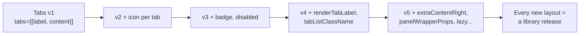
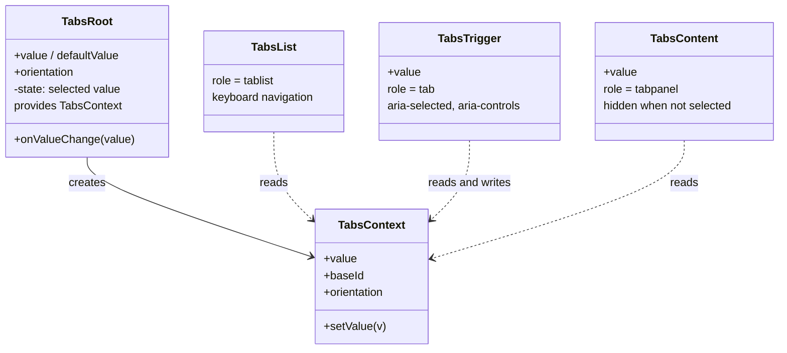
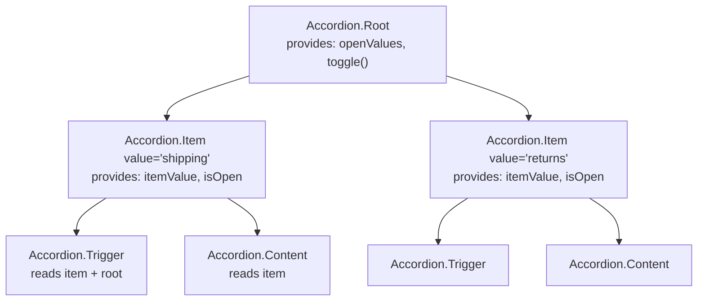
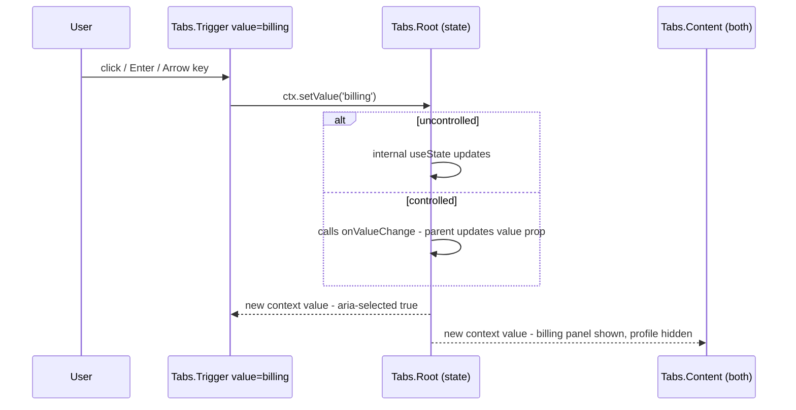
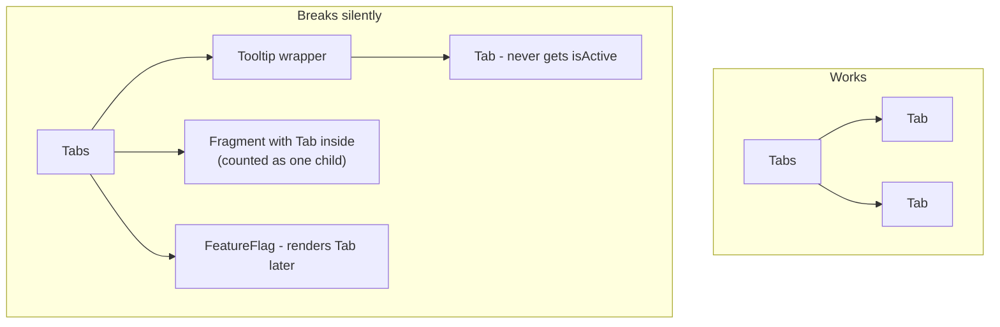
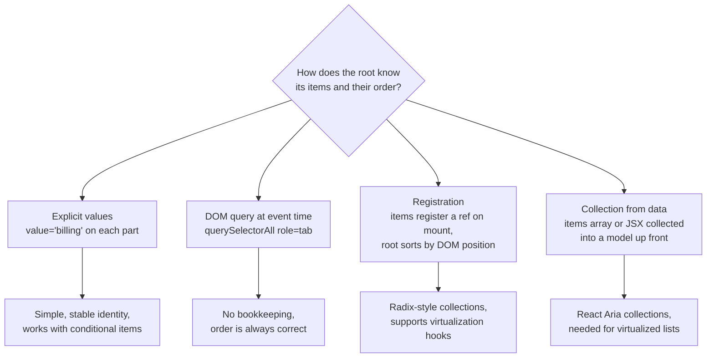
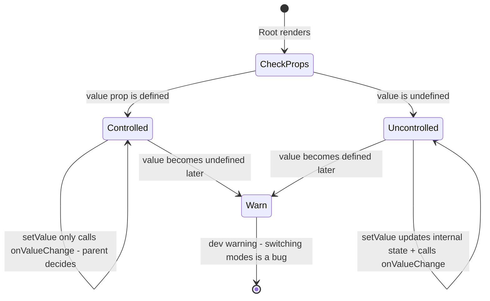
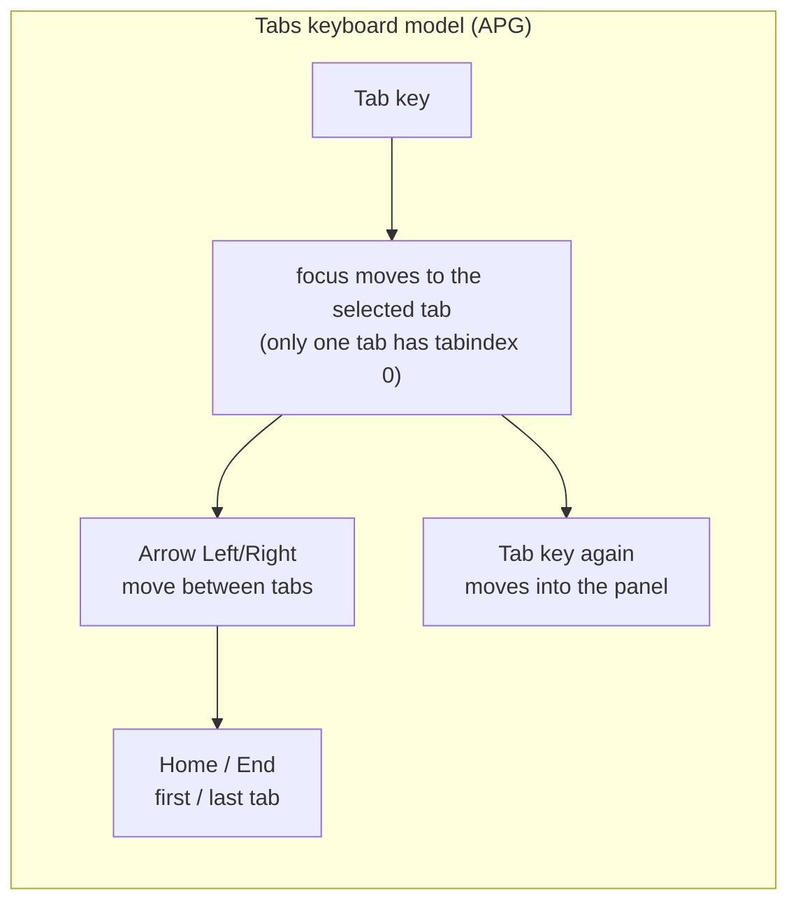
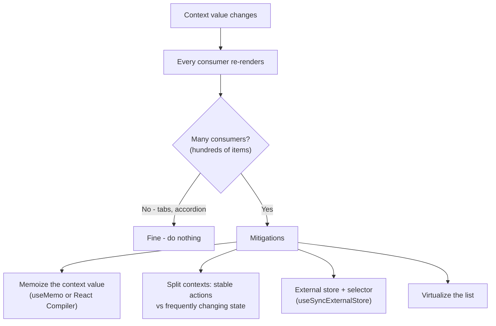
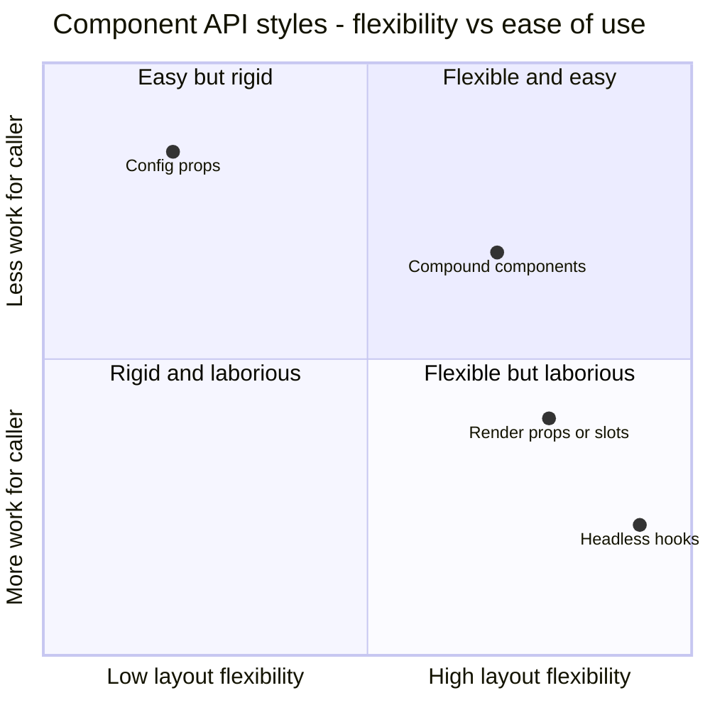

# Compound Component Pattern

> **Date:** 2026-11-06 · **Last updated:** 2026-11-06
> **Category:** Frontend System Design
> **Sub-Topic:** Design Systems & Components / Component Patterns
> **Level:** Intermediate · **Reading time:** ~26 min
> **Informs:** component API shape (composition vs configuration props), design-system primitives (Tabs, Select, Menu, Accordion, Dialog), implicit shared state via context / provide-inject / DI, ARIA pattern wiring, RSC client boundaries, tree-shaking of component parts

> **Pre-requisite:** [Component Architecture & Design Systems](../02-rendering-and-architecture/component-architecture-and-design-systems.md) (composition over configuration) and [Component API Design](./component-api-design.md) (props, naming, contracts).
> This note goes deep on one composition technique: a **family of components that share hidden state** — the way `<select>` and `<option>` work together in HTML.

**Previous:** [Component API Design](./component-api-design.md) · **Next:** [Headless UI / Renderless Components](./headless-ui-renderless-components.md)

---

## Table of Contents

1. [ELI5 — Simple Explanation](#eli5--simple-explanation)
2. [Section 1: The Problem — Prop Explosion](#section-1-the-problem--prop-explosion)
3. [Section 2: Anatomy of a Compound Component](#section-2-anatomy-of-a-compound-component)
4. [Section 3: Sharing State — Context, Not Cloning](#section-3-sharing-state--context-not-cloning)
5. [Section 4: The Legacy Approach — Children.map and cloneElement](#section-4-the-legacy-approach--childrenmap-and-cloneelement)
6. [Section 5: Exporting the Parts — Dot Notation vs Named Exports](#section-5-exporting-the-parts--dot-notation-vs-named-exports)
7. [Section 6: Items, Order and IDs — the Descendants Problem](#section-6-items-order-and-ids--the-descendants-problem)
8. [Section 7: Controlled, Uncontrolled and Events on the Root](#section-7-controlled-uncontrolled-and-events-on-the-root)
9. [Section 8: Accessibility — Compound Parts Map to ARIA Patterns](#section-8-accessibility--compound-parts-map-to-aria-patterns)
10. [Section 9: Performance and Server Components](#section-9-performance-and-server-components)
11. [Section 10: The Same Pattern in Vue, Angular, Svelte, Web Components and Native](#section-10-the-same-pattern-in-vue-angular-svelte-web-components-and-native)
12. [Section 11: When NOT to Use Compound Components](#section-11-when-not-to-use-compound-components)
13. [Decision Matrix — Which Composition Style?](#decision-matrix--which-composition-style)
14. [Real-World Examples](#real-world-examples)
15. [Key Points Summary](#key-points-summary)
16. [Test Your Understanding (with answers)](#test-your-understanding)
17. [Cheat Sheet](#cheat-sheet)
18. [References & Further Reading](#references--further-reading)

---

## ELI5 — Simple Explanation

Think of the HTML `<select>` element:

```html
<select name="size">
  <option value="s">Small</option>
  <option value="m" selected>Medium</option>
  <option value="l">Large</option>
</select>
```

- The **`<select>`** is the boss. It remembers **which option is chosen**, handles the keyboard, and opens the list.
- Each **`<option>`** only says "I exist, my value is `m`, my label is Medium". It never asks the boss for permission in code you can see — they just **know about each other**.
- You, the author, decide **how many options, in what order, with what text**. Nobody passes `options={[...]}` as a giant configuration object.

A compound component is exactly that, built by you: a **parent that owns the state** (`<Tabs>`) and **children that read and change it** (`<Tabs.Trigger>`, `<Tabs.Content>`), connected by an **invisible wire** (React context, Vue provide/inject, Angular DI, Svelte context).

Another picture: a **restaurant kitchen**. The head chef (root) holds the order ticket. The grill, salad and dessert stations (parts) each read the ticket and do their piece. The customer only arranges which stations exist — not how the ticket gets passed around.

> **One-line takeaway: a compound component is a small family of components that share hidden state through the parent, so the caller controls structure and content while the library controls behaviour.**

---

## Core Concept — Step by Step

### Section 1: The Problem — Prop Explosion

Components built by **configuration** start simple and then grow a flag for every request:



```tsx
// Configuration API — the library decides the structure
<Tabs
  tabs={[
    { id: 'profile', label: 'Profile', icon: <UserIcon />, content: <Profile /> },
    { id: 'billing', label: 'Billing', badge: 2, disabled: !isAdmin, content: <Billing /> },
  ]}
  tabListClassName="sticky top-0"
  renderTabLabel={(tab) => <span className="tab-label">{tab.label}</span>}
  extraContentRight={<HelpLink />}
/>
```

**Compound API** — the caller owns structure; the library owns behaviour:

```tsx
<Tabs.Root defaultValue="profile">
  <Tabs.List aria-label="Account settings" className="sticky top-0">
    <Tabs.Trigger value="profile"><UserIcon /> Profile</Tabs.Trigger>
    <Tabs.Trigger value="billing" disabled={!isAdmin}>Billing <Badge>2</Badge></Tabs.Trigger>
    <HelpLink /> {/* arbitrary content in between — no new prop needed */}
  </Tabs.List>
  <Tabs.Content value="profile"><Profile /></Tabs.Content>
  <Tabs.Content value="billing"><Billing /></Tabs.Content>
</Tabs.Root>
```

| Concern | Configuration (`tabs=[...]`) | Compound (`<Tabs.*>`) |
|---|---|---|
| Who decides markup and order | Library | Caller |
| Adding an icon / badge / wrapper | New prop + release | Just JSX |
| Styling one part | `xxxClassName` props per part | `className` on that part |
| Data-driven list from an API | ✅ Very easy | ✅ `items.map(...)` inside the parts |
| Discoverability | One props table | Need docs listing the parts |
| Risk | Prop explosion, escape-hatch props | Invalid combinations (a part outside its root) |

> HTML already works this way: `<table>/<tr>/<td>`, `<ul>/<li>`, `details`/`summary`, `<select>/<option>`, `<dl>/<dt>/<dd>`. Compound components bring that model to custom UI.

---

### Section 2: Anatomy of a Compound Component

Every compound component has the same three pieces:



| Piece | Job | Typical naming |
|---|---|---|
| **Root** | Owns state (controlled or uncontrolled), generates IDs, provides context. Often renders a wrapper element (or nothing) | `Tabs.Root`, `Accordion.Root`, `<Tabs>` |
| **Context** | The invisible wire: state + actions + IDs + config. **Private** — not exported to users | `TabsContext` |
| **Parts** | Each renders one element with the right role/ARIA, reads context, may write to it | `Tabs.List`, `Tabs.Trigger`, `Tabs.Content` |
| **Part-local context** (optional) | A nested context for item-level parts, e.g. `Accordion.Item` provides its own `value` to `Accordion.Trigger` inside it | `AccordionItemContext` |

**Nested contexts** are common: `Accordion.Root` → `Accordion.Item value="a"` → `Accordion.Trigger` (no `value` prop — it reads the item's context).



---

### Section 3: Sharing State — Context, Not Cloning

In modern React, parts talk to the root through **context**. It works at **any depth**, through wrappers, fragments and your own components.



```tsx
const TabsContext = createContext<TabsContextValue | null>(null);

function useTabsContext(part: string): TabsContextValue {
  const ctx = useContext(TabsContext);
  if (!ctx) throw new Error(`<Tabs.${part}> must be used inside <Tabs.Root>`);
  return ctx;
}
```

Three rules that keep this robust:
1. **Default the context to `null` and throw a helpful error** in the hook. A silent default (`{ value: '', setValue: () => {} }`) hides bugs where a part is rendered outside its root.
2. **Keep the context private.** Export the parts and, if needed, a hook for advanced users (`useTabs()`), not the raw context object — otherwise its shape becomes public API you can never change.
3. **Memoize the context value** (or use the React Compiler, which does this automatically) so consumers don't re-render when the root re-renders for unrelated reasons (Section 9).

> **React 19 note:** you can render `<TabsContext value={...}>` directly as a provider; `<TabsContext.Provider>` still works. `use(TabsContext)` can replace `useContext` and, unlike hooks, may be called conditionally. See [react.dev — createContext](https://react.dev/reference/react/createContext).

---

### Section 4: The Legacy Approach — Children.map and cloneElement

Older compound components (pre-hooks era, roughly 2016–2018) injected props by **walking direct children**:

```tsx
// ❌ Legacy: the root clones its direct children and injects props
function Tabs({ children }: { children: React.ReactNode }) {
  const [active, setActive] = useState(0);
  return (
    <div>
      {React.Children.map(children, (child, index) =>
        React.isValidElement(child)
          ? React.cloneElement(child, { isActive: index === active, onSelect: () => setActive(index) })
          : child
      )}
    </div>
  );
}
```



| Problem | Why |
|---|---|
| Only **direct** children are reached | Wrapping a `Tab` in a `Tooltip`, `div` or your own component hides it from `cloneElement` |
| Fragments count as **one** child | `Children.map` does not traverse into the fragment's children |
| Index-based identity | Conditionally rendered tabs shift indexes; state jumps to the wrong tab |
| Prop collisions | The injected `onSelect` silently overrides a prop the caller passed |
| Hidden data flow | Readers can't see where `isActive` comes from |

React's own docs now list `Children` and `cloneElement` under **Legacy React APIs** and say using them is uncommon and can lead to fragile code; they recommend **context**, **render props** or passing data explicitly instead.

> If you maintain a library built this way, migrate to context part by part — the public JSX usually doesn't change, which makes it a non-breaking refactor.

---

### Section 5: Exporting the Parts — Dot Notation vs Named Exports

Three common export styles:

```tsx
// A. Static properties (classic "dot notation")
function Tabs(props: RootProps) { /* ... */ }
Tabs.List = TabsList;
Tabs.Trigger = TabsTrigger;
Tabs.Content = TabsContent;
export { Tabs };
// usage: <Tabs><Tabs.List>...</Tabs.List></Tabs>

// B. Named exports + namespace import (Radix style)
export { Root, List, Trigger, Content };
// usage: import * as Tabs from './tabs'  →  <Tabs.Root><Tabs.List>...

// C. Flat, prefixed named exports (shadcn/ui and many design systems)
export { Tabs, TabsList, TabsTrigger, TabsContent };
// usage: <Tabs><TabsList><TabsTrigger value="a">...
```

| Style | Tree-shaking unused parts | RSC (server file uses the parts) | Autocomplete | Notes |
|---|---|---|---|---|
| **A. Static properties** | ❌ Parts are attached to one object, so bundlers keep them all | ⚠️ A Server Component can't "dot into" a client module reference — `Tabs.List` fails if `Tabs` comes from a `'use client'` file | Good | Fine for client-only apps; TypeScript needs `Object.assign` or explicit typing |
| **B. Named exports + `import * as`** | ✅ Each part is its own export | ✅ Each export is its own client reference | Good (`Tabs.` lists parts) | Radix Primitives, Ark UI, Bits UI use this namespace style |
| **C. Flat prefixed names** | ✅ | ✅ | Good (`Tabs` prefix) | Most explicit; slightly more imports |

TypeScript for style A without losing types:

```tsx
export const Tabs = Object.assign(TabsRoot, {
  List: TabsList,
  Trigger: TabsTrigger,
  Content: TabsContent,
});
```

> **RSC caveat:** in React Server Component frameworks (e.g. Next.js App Router), a Server Component that imports a component from a `'use client'` module gets a **reference**, not the function itself. Accessing a property on it (`Tabs.List`) is not supported. Prefer styles B or C for libraries that may be used from server files. See [Streaming SSR & React Server Components](../02-rendering-and-architecture/streaming-ssr-and-react-server-components.md).

---

### Section 6: Items, Order and IDs — the Descendants Problem

Context gives children access to the root. But some behaviour needs the **reverse**: the root needs to know **its items, in order** — for arrow-key navigation, typeahead, "select next", or `aria-setsize`/`aria-posinset`.



| Technique | How | Good for | Watch out |
|---|---|---|---|
| **Explicit `value` per part** | Trigger and content both get `value="billing"` | Tabs, accordion, radio group | Values must be unique; avoid array indexes |
| **DOM query on demand** | On `keydown`, `listRef.current.querySelectorAll('[role="tab"]:not([disabled])')` | Small lists (tabs, toolbars, menus) | Doesn't work for virtualized lists (most items aren't in the DOM) |
| **Registration (descendants)** | Each item registers a ref via context in an effect; the root keeps a map sorted with `compareDocumentPosition` | Menus, selects with typeahead | More code; re-sorting on insert |
| **Collection model** | Build an ordered collection from an `items` prop or by collecting JSX children up front | Large / virtualized listbox, grid, tree | Library-level complexity — adopt one (React Aria, Ark/Zag) |

**IDs for ARIA wiring.** A trigger and its panel reference each other (`aria-controls`, `aria-labelledby`). Generate a base ID once in the root with an SSR-safe ID API and derive part IDs from it:

| Framework | SSR-safe ID |
|---|---|
| React 18+ | `useId()` |
| Vue 3.5+ | `useId()` |
| Angular | No dedicated public ID API in core; Angular CDK / Material generate IDs internally. Check angular.dev and the CDK docs for the current recommendation |
| Svelte 5 | `$props.id()` (added in a 5.x minor; check svelte.dev) |

> Never use `Math.random()` for IDs in server-rendered components: the server and client generate different values and hydration mismatches.

---

### Section 7: Controlled, Uncontrolled and Events on the Root

The root is the single place where state lives, so it's also where **controlled/uncontrolled** support goes. Parts never take `value`/`onChange` for the shared state.



```tsx
// Same component, both modes
<Tabs.Root defaultValue="profile">…</Tabs.Root>                          // uncontrolled
<Tabs.Root value={tab} onValueChange={setTab}>…</Tabs.Root>               // controlled
<Tabs.Root value={searchParams.get('tab') ?? 'profile'} onValueChange={setTabInUrl}>…</Tabs.Root> // URL-driven
```

Naming conventions that libraries converge on (verify per library): `value` / `defaultValue` / `onValueChange` for selection, `open` / `defaultOpen` / `onOpenChange` for overlays. Full treatment in [Controlled vs Uncontrolled Components](./controlled-vs-uncontrolled-components.md).

---

### Section 8: Accessibility — Compound Parts Map to ARIA Patterns

The WAI-ARIA Authoring Practices describe widgets as **groups of roles** — exactly the shape of a compound component. Each part owns its role and attributes, so callers get correct semantics just by composing.

| Compound part | ARIA role / element | Attributes the part manages |
|---|---|---|
| `Tabs.List` | `tablist` | `aria-orientation`, `aria-label` (from caller) |
| `Tabs.Trigger` | `tab` (a `<button>`) | `aria-selected`, `aria-controls`, roving `tabindex` |
| `Tabs.Content` | `tabpanel` | `aria-labelledby`, `hidden`, `tabindex="0"` when it has no focusable content |
| `Accordion.Trigger` | `<button>` inside a heading | `aria-expanded`, `aria-controls` |
| `Menu.Content` / `Menu.Item` | `menu` / `menuitem` | Focus management, typeahead, `aria-disabled` |
| `Dialog.Title` / `Dialog.Description` | inside `dialog` | Wired to `aria-labelledby` / `aria-describedby` on the dialog |



**Accessibility responsibilities belong in the parts, not the caller:** if callers must remember `role="tab"` and `aria-controls`, they won't. A good compound API makes the accessible version the only version.

Deep dives: [ARIA Roles, States & Properties](../06-accessibility-and-i18n/aria-roles-states-and-properties.md) and [Keyboard Navigation & Focus Management](../06-accessibility-and-i18n/keyboard-navigation-and-focus-management.md).

---

### Section 9: Performance and Server Components

**Re-renders.** When the context value changes, **every** component that reads that context re-renders. For Tabs or Accordion that's a handful of parts — irrelevant. For a `Select` with 1,000 options or a data grid, it matters.



| Technique | Effect |
|---|---|
| `useMemo` on the context value | Consumers don't re-render when the root re-renders with the same state |
| **Split contexts** (`TabsStateContext` + `TabsActionsContext`) | Parts that only dispatch (e.g. a "Next" button) don't re-render on every state change |
| **Store + selector** | Each item subscribes to "am I selected?" only; one change re-renders two items, not all of them |
| `React.memo` on parts | Helps only if props are stable; context changes bypass `memo` |

**Server Components.** Parts that use context or event handlers must be **Client Components** (`'use client'`). But the **content** you pass into them can stay on the server:

```tsx
// page.tsx — a Server Component
import { Tabs, TabsList, TabsTrigger, TabsContent } from '@/components/ui/tabs'; // 'use client' module

export default async function AccountPage() {
  const invoices = await getInvoices(); // runs on the server
  return (
    <Tabs defaultValue="billing">
      <TabsList aria-label="Account">
        <TabsTrigger value="profile">Profile</TabsTrigger>
        <TabsTrigger value="billing">Billing</TabsTrigger>
      </TabsList>
      <TabsContent value="profile"><ProfileSummary /></TabsContent> {/* server-rendered children */}
      <TabsContent value="billing"><InvoiceTable invoices={invoices} /></TabsContent>
    </Tabs>
  );
}
```

Note the **flat named exports** (Section 5): `Tabs.List` would not work here because `Tabs` is a client reference inside a Server Component.

---

### Section 10: The Same Pattern in Vue, Angular, Svelte, Web Components and Native

The "invisible wire" exists in every component model:

| Stack | Root shares state with | Parts receive it with | Content insertion |
|---|---|---|---|
| **React** | `createContext` + provider | `useContext` / `use` | `children` |
| **Vue 3** | `provide(key, value)` with a typed `InjectionKey` | `inject(key)` | `<slot>` |
| **Angular** | The root component/directive **is** the injectable (or provides a token) | `inject(TabsRoot)` in the child, or `contentChildren()` queries in the parent | `<ng-content>` |
| **Svelte 5** | `setContext(key, obj)` with getters for reactive values | `getContext(key)` (newer versions also offer a typed `createContext` helper — check svelte.dev) | `children` / snippets |
| **Web Components (Lit)** | `@lit/context` provider (community context protocol), or the child finds the parent with `closest()` | `@consume` / `ContextConsumer` | `<slot>` |
| **SwiftUI** | `.environment(...)` / environment values, or the parent builds children via a `@ViewBuilder` | `@Environment` | ViewBuilder closures |
| **Jetpack Compose** | `CompositionLocalProvider`, or slot APIs with a receiver scope (e.g. `RowScope`) | `LocalX.current` / scope functions | Composable lambda slots |

**Angular specifics.** A child injecting its parent component (`inject(TabsComponent)`) works because element injectors follow the **template where the elements are declared**, so projected children can still see the root. Many Angular libraries (Angular CDK, Angular Material) use directives on native elements instead of wrapper components, which keeps the DOM clean: `<div cdkMenu><button cdkMenuItem>`.

**Vue specifics.** Use a `Symbol`-based `InjectionKey<T>` for type safety, and throw if `inject()` returns `undefined`. Libraries like Reka UI (formerly Radix Vue) ship compound parts (`TabsRoot`, `TabsList`, `TabsTrigger`, `TabsContent`) that mirror the React API.

---

### Section 11: When NOT to Use Compound Components

| Situation | Better choice | Why |
|---|---|---|
| A **closed** design decision (`size`, `variant`, `tone`) | A prop | Composition would let callers break the design system |
| A purely **data-driven** list (1,000 rows from an API, virtualized) | `items` prop + render function, or a collection API | The component needs the data up front to virtualize |
| A component with **one** visual layout and no sub-parts (`Avatar`, `Spinner`) | Plain props | Extra parts add API surface with no benefit |
| Logic reused across **very different** markup | A headless hook (`useTabs()`) | See [Headless UI / Renderless Components](./headless-ui-renderless-components.md) |
| Most teams just want "the standard one" | Ship both: a compound primitive **and** a pre-assembled convenience component | Easy default, escape hatch for the rest |

The **two-layer** approach is common in mature design systems:

```tsx
// Convenience wrapper — 90% of uses, one line
<SimpleTabs items={[{ value: 'a', label: 'Profile', content: <Profile /> }]} />

// It is built from the compound primitives — the escape hatch for the other 10%
export function SimpleTabs({ items, defaultValue = items[0]?.value }: SimpleTabsProps) {
  return (
    <Tabs.Root defaultValue={defaultValue}>
      <Tabs.List aria-label="Sections">
        {items.map((i) => <Tabs.Trigger key={i.value} value={i.value}>{i.label}</Tabs.Trigger>)}
      </Tabs.List>
      {items.map((i) => <Tabs.Content key={i.value} value={i.value}>{i.content}</Tabs.Content>)}
    </Tabs.Root>
  );
}
```

---

## Decision Matrix — Which Composition Style?



| Need | Pick | Example |
|---|---|---|
| Small fixed set of design choices | **Props** | `<Button variant="primary" size="sm">` |
| Several related parts, caller arranges them | **Compound components** | Tabs, Accordion, Select, Menu, Dialog, Card |
| Caller renders with internal data per item | **Render prop / scoped slot / snippet** | `renderOption={(opt, state) => …}` |
| Same behaviour, totally different markup or platform | **Headless hook / state machine** | `useCombobox()`, Zag.js machines |
| Most callers want a one-liner | **Convenience wrapper over compound parts** | `SimpleTabs items={...}` |

---

## Real-World Examples

**Example 1 — An accessible Tabs compound component (React 19 + TypeScript):**
```tsx
'use client';
import {
  createContext, useCallback, useContext, useId, useMemo, useRef, useState,
  type KeyboardEvent, type ReactNode,
} from 'react';

type Orientation = 'horizontal' | 'vertical';
type TabsContextValue = {
  value: string;
  setValue: (next: string) => void;
  baseId: string;
  orientation: Orientation;
};

const TabsContext = createContext<TabsContextValue | null>(null);

function useTabsContext(part: string) {
  const ctx = useContext(TabsContext);
  if (!ctx) throw new Error(`<Tabs.${part}> must be used inside <Tabs.Root>`);
  return ctx;
}

type RootProps = {
  value?: string;                     // controlled
  defaultValue?: string;              // uncontrolled (pass one of the two)
  onValueChange?: (value: string) => void;
  orientation?: Orientation;
  children: ReactNode;
};

export function Root({ value: valueProp, defaultValue = '', onValueChange, orientation = 'horizontal', children }: RootProps) {
  const [internal, setInternal] = useState(defaultValue);
  const isControlled = valueProp !== undefined;
  const value = isControlled ? valueProp : internal;
  const baseId = useId();

  const setValue = useCallback((next: string) => {
    if (!isControlled) setInternal(next);
    onValueChange?.(next);
  }, [isControlled, onValueChange]);

  const ctx = useMemo(() => ({ value, setValue, baseId, orientation }), [value, setValue, baseId, orientation]);

  // React 19: a context can be rendered directly as its provider
  return (
    <TabsContext value={ctx}>
      <div data-orientation={orientation}>{children}</div>
    </TabsContext>
  );
}

export function List({ children, 'aria-label': ariaLabel }: { children: ReactNode; 'aria-label': string }) {
  const { orientation } = useTabsContext('List');
  const ref = useRef<HTMLDivElement>(null);

  function onKeyDown(e: KeyboardEvent<HTMLDivElement>) {
    // DOM query keeps order correct even with wrappers or conditional tabs
    const tabs = Array.from(ref.current?.querySelectorAll<HTMLButtonElement>('[role="tab"]:not([disabled])') ?? []);
    const i = tabs.indexOf(document.activeElement as HTMLButtonElement);
    if (i === -1) return;
    const prevKey = orientation === 'horizontal' ? 'ArrowLeft' : 'ArrowUp';
    const nextKey = orientation === 'horizontal' ? 'ArrowRight' : 'ArrowDown';
    const target =
      e.key === nextKey ? (i + 1) % tabs.length :
      e.key === prevKey ? (i - 1 + tabs.length) % tabs.length :
      e.key === 'Home' ? 0 :
      e.key === 'End' ? tabs.length - 1 : null;
    if (target === null) return;
    e.preventDefault();
    tabs[target].focus();
    tabs[target].click(); // "automatic activation": focus selects the tab
  }

  return (
    <div ref={ref} role="tablist" aria-orientation={orientation} aria-label={ariaLabel} onKeyDown={onKeyDown}>
      {children}
    </div>
  );
}

export function Trigger({ value, disabled, children }: { value: string; disabled?: boolean; children: ReactNode }) {
  const ctx = useTabsContext('Trigger');
  const selected = ctx.value === value;
  return (
    <button
      type="button"
      role="tab"
      id={`${ctx.baseId}-tab-${value}`}
      aria-selected={selected}
      aria-controls={`${ctx.baseId}-panel-${value}`}
      tabIndex={selected ? 0 : -1} // roving tabindex: only the selected tab is in the Tab order
      disabled={disabled}
      data-state={selected ? 'active' : 'inactive'} // styling hook
      onClick={() => ctx.setValue(value)}
    >
      {children}
    </button>
  );
}

export function Content({ value, children }: { value: string; children: ReactNode }) {
  const ctx = useTabsContext('Content');
  const selected = ctx.value === value;
  return (
    <div
      role="tabpanel"
      id={`${ctx.baseId}-panel-${value}`}
      aria-labelledby={`${ctx.baseId}-tab-${value}`}
      hidden={!selected}
      tabIndex={0}
    >
      {selected ? children : null}
    </div>
  );
}
```

Usage (`import * as Tabs from './tabs'`):
```tsx
<Tabs.Root defaultValue="profile" onValueChange={(v) => analytics.track('tab_change', { tab: v })}>
  <Tabs.List aria-label="Account settings">
    <Tabs.Trigger value="profile">Profile</Tabs.Trigger>
    <Tabs.Trigger value="billing">Billing</Tabs.Trigger>
    <Tabs.Trigger value="danger" disabled>Danger zone</Tabs.Trigger>
  </Tabs.List>
  <Tabs.Content value="profile"><ProfileForm /></Tabs.Content>
  <Tabs.Content value="billing"><BillingForm /></Tabs.Content>
</Tabs.Root>
```

> In production, prefer a tested headless library (Radix, React Aria, Ark UI, Base UI) — they also handle RTL arrow-key direction, manual vs automatic activation, and edge cases this sketch skips.

**Example 2 — Consuming library compound components (Radix and React Aria):**
```tsx
// Radix Primitives — namespace import of named exports
import * as Accordion from '@radix-ui/react-accordion';

export function Faq() {
  return (
    <Accordion.Root type="single" collapsible defaultValue="shipping">
      <Accordion.Item value="shipping">
        <Accordion.Header>
          <Accordion.Trigger>How long does shipping take?</Accordion.Trigger>
        </Accordion.Header>
        <Accordion.Content>Usually 2–4 business days.</Accordion.Content>
      </Accordion.Item>
      <Accordion.Item value="returns">
        <Accordion.Header>
          <Accordion.Trigger>Can I return an item?</Accordion.Trigger>
        </Accordion.Header>
        <Accordion.Content>Yes, within 30 days.</Accordion.Content>
      </Accordion.Item>
    </Accordion.Root>
  );
}

// React Aria Components — flat named exports, `id` links Tab and TabPanel
import { Tabs, TabList, Tab, TabPanel } from 'react-aria-components';

export function Settings() {
  return (
    <Tabs defaultSelectedKey="profile">
      <TabList aria-label="Settings">
        <Tab id="profile">Profile</Tab>
        <Tab id="billing">Billing</Tab>
      </TabList>
      <TabPanel id="profile"><ProfileForm /></TabPanel>
      <TabPanel id="billing"><BillingForm /></TabPanel>
    </Tabs>
  );
}
```

**Example 3 — BAD → GOOD: from cloneElement to context:**
```tsx
// ❌ BAD: breaks as soon as a Step is wrapped or conditionally rendered
function Stepper({ children }: { children: ReactNode }) {
  const [current, setCurrent] = useState(0);
  return <ol>{Children.map(children, (child, i) =>
    isValidElement(child) ? cloneElement(child as ReactElement<StepProps>, { index: i, current, setCurrent }) : child
  )}</ol>;
}

// ✅ GOOD: context reaches Steps at any depth; identity is an explicit id, not an index
const StepperContext = createContext<{ current: string; go: (id: string) => void } | null>(null);

function Stepper({ initial, children }: { initial: string; children: ReactNode }) {
  const [current, setCurrent] = useState(initial);
  const ctx = useMemo(() => ({ current, go: setCurrent }), [current]);
  return <StepperContext value={ctx}><ol>{children}</ol></StepperContext>;
}

function Step({ id, children }: { id: string; children: ReactNode }) {
  const ctx = useContext(StepperContext);
  if (!ctx) throw new Error('<Step> must be inside <Stepper>');
  return <li aria-current={ctx.current === id ? 'step' : undefined}>{children}</li>;
}
```

**Example 4 — Vue 3 (`provide` / `inject` with a typed key):**
```typescript
// tabs-context.ts
import { inject, type InjectionKey, type Ref } from 'vue';

export interface TabsContext {
  active: Ref<string | undefined>;
  select: (value: string) => void;
}
export const TabsKey: InjectionKey<TabsContext> = Symbol('Tabs');

export function useTabsContext(part: string): TabsContext {
  const ctx = inject(TabsKey);
  if (!ctx) throw new Error(`<${part}> must be used inside <TabsRoot>`);
  return ctx;
}
```
```html
<!-- TabsRoot.vue -->
<script setup lang="ts">
import { provide } from 'vue';
import { TabsKey } from './tabs-context';

// v-model:value when the parent binds it (controlled); local state otherwise
const active = defineModel<string>('value');
provide(TabsKey, { active, select: (v) => { active.value = v; } });
</script>
<template><div><slot /></div></template>

<!-- TabsTrigger.vue -->
<script setup lang="ts">
import { computed } from 'vue';
import { useTabsContext } from './tabs-context';

const props = defineProps<{ value: string }>();
const ctx = useTabsContext('TabsTrigger');
const selected = computed(() => ctx.active.value === props.value);
</script>
<template>
  <button type="button" role="tab" :aria-selected="selected" :tabindex="selected ? 0 : -1" @click="ctx.select(props.value)">
    <slot />
  </button>
</template>
```

**Example 5 — Angular (child injects the parent; signals for state):**
```typescript
import { Component, computed, inject, input, model } from '@angular/core';

@Component({
  selector: 'app-tabs',
  template: `<ng-content />`,
})
export class TabsComponent {
  readonly value = model<string>(''); // supports [(value)] two-way binding
}

@Component({
  selector: 'app-tab-trigger',
  template: `
    <button type="button" role="tab"
      [attr.aria-selected]="selected()"
      [attr.tabindex]="selected() ? 0 : -1"
      (click)="tabs.value.set(value())">
      <ng-content />
    </button>`,
})
export class TabTriggerComponent {
  protected readonly tabs = inject(TabsComponent); // throws if used outside <app-tabs>
  readonly value = input.required<string>();
  protected readonly selected = computed(() => this.tabs.value() === this.value());
}

@Component({
  selector: 'app-tab-panel',
  // Don't wrap <ng-content> in @if - see the caveat below
  template: `<div role="tabpanel" [hidden]="!selected()"><ng-content /></div>`,
})
export class TabPanelComponent {
  private readonly tabs = inject(TabsComponent);
  readonly value = input.required<string>();
  protected readonly selected = computed(() => this.tabs.value() === this.value());
}
```
```html
<app-tabs [(value)]="currentTab">
  <app-tab-trigger value="profile">Profile</app-tab-trigger>
  <app-tab-trigger value="billing">Billing</app-tab-trigger>
  <app-tab-panel value="profile"><app-profile /></app-tab-panel>
  <app-tab-panel value="billing"><app-billing /></app-tab-panel>
</app-tabs>
```

> Angular caveat: Angular always instantiates content projected into `<ng-content>`, even when the placeholder is hidden or wrapped in `@if`, so the docs advise against conditional `<ng-content>`. For truly lazy panels, let the caller pass an `<ng-template>` and render it with `ngTemplateOutlet` only when selected.

**Example 6 — Svelte 5 (`setContext` with getters to keep reactivity):**
```html
<!-- Tabs.svelte -->
<script lang="ts">
  import { setContext, type Snippet } from 'svelte';
  let { value = $bindable(''), children }: { value?: string; children: Snippet } = $props();

  setContext('tabs', {
    get value() { return value; },          // getter: children always read the current value
    select: (v: string) => { value = v; },
  });
</script>
{@render children()}

<!-- TabTrigger.svelte -->
<script lang="ts">
  import { getContext, type Snippet } from 'svelte';
  let { value, children }: { value: string; children: Snippet } = $props();
  const tabs = getContext<{ readonly value: string; select: (v: string) => void }>('tabs');
  const selected = $derived(tabs.value === value);
</script>
<button type="button" role="tab" aria-selected={selected} tabindex={selected ? 0 : -1} onclick={() => tabs.select(value)}>
  {@render children()}
</button>
```

---

## Key Points Summary

| Concept | One-Line Explanation |
|---|---|
| **Compound component** | A root plus parts that share hidden state, like `<select>` and `<option>` |
| **Root** | Owns state (controlled or uncontrolled), IDs and config; provides context |
| **Parts** | Render one element each with the right role/ARIA; read and update shared state |
| **Context / provide-inject / DI** | The invisible wire; works at any depth, through wrappers |
| **`cloneElement` approach** | Legacy; only reaches direct children and breaks with wrappers and fragments |
| **Missing-root error** | Default context to `null` and throw a clear error from the part's hook |
| **Export style** | Named exports (namespace or prefixed) are tree-shakeable and RSC-safe; static properties aren't |
| **Descendants problem** | The root needs item order: explicit values, DOM query, registration or a collection model |
| **ARIA mapping** | Each part owns its role, so composition yields accessible markup by default |
| **Performance** | Context changes re-render every consumer; memoize, split contexts or use selectors for big lists |
| **RSC** | Parts are client components; content passed into them can stay on the server |
| **When not to use** | Closed design choices, single-layout widgets, huge data-driven virtualized lists |

---

## Test Your Understanding

**Q1 (Basic):**
What are the three building blocks of a compound component, and why should the context default to `null` instead of a dummy value?

<details>
<summary>Answer</summary>

A **root** that owns the shared state (and IDs, config), a private **context** (or provide/inject, DI token) that carries that state and its actions, and the **parts** that read or update it while each rendering one element.

Defaulting to `null` lets each part's hook detect "I was rendered outside my root" and **throw a clear error** (`<Tabs.Trigger> must be used inside <Tabs.Root>`). A dummy default (`{ value: '', setValue: () => {} }`) makes the part render normally but do nothing on click, which is a much harder bug to find.
</details>

**Q2 (Application):**
Your design system's `Select` has these props: `options`, `renderOption`, `groupBy`, `showSearch`, `searchPlaceholder`, `footer`, `optionClassName`, `iconPosition`. Product wants a "Create new…" item pinned at the bottom and options with avatars. Redesign the API.

<details>
<summary>Answer</summary>

Turn it into a compound component where the root owns selection, open state, typeahead and keyboard handling, and the caller arranges parts:

```tsx
<Select.Root value={assignee} onValueChange={setAssignee}>
  <Select.Trigger aria-label="Assignee"><Select.Value placeholder="Unassigned" /></Select.Trigger>
  <Select.Content>
    <Select.Group>
      <Select.Label>Team</Select.Label>
      {users.map((u) => (
        <Select.Item key={u.id} value={u.id}><Avatar src={u.avatar} /> {u.name}</Select.Item>
      ))}
    </Select.Group>
    <Select.Separator />
    <Select.Item value="__create">Create new…</Select.Item>
  </Select.Content>
</Select.Root>
```

Avatars, groups, pinned items and footers are now **just JSX**; `renderOption`, `groupBy`, `footer` and `optionClassName` disappear. Keep a few **closed** props (`size`, `variant`). If the list can be huge, the root also needs a **collection model** for virtualization, which is a reason to build on React Aria / Ark UI / Radix rather than from scratch. Optionally keep a `SimpleSelect options={...}` convenience wrapper for the common case.
</details>

**Q3 (Tricky):**
A teammate's `Tabs` uses `Children.map` + `cloneElement`. It works in Storybook, but in the app a tab wrapped in `<Tooltip>` never highlights, and a tab behind a feature flag makes the wrong panel open. Explain both bugs.

<details>
<summary>Answer</summary>

`Children.map` only sees **direct children**. With `<Tooltip><Tab/></Tooltip>`, the direct child is the `Tooltip`, so the injected `isActive`/`onSelect` props land on the Tooltip, not the Tab: the Tab never highlights.

The feature-flag bug comes from **index-based identity**: when the flagged tab isn't rendered, every later tab's index shifts by one, so "index 2 is active" now points at a different tab, and panels matched by index no longer line up.

Fix: share state through **context** (reaches any depth) and identify tabs by an explicit **`value`**, not their position. React's docs list `Children` and `cloneElement` as legacy APIs for exactly these fragility reasons.
</details>

**Q4 (Tricky):**
Your library exports `Tabs` with static properties (`Tabs.List = TabsList`). A Next.js App Router user writes `<Tabs.List>` in a Server Component and gets an error, and your bundle analyzer shows `TabsContent` included on pages that never use it. What's going on?

<details>
<summary>Answer</summary>

Two separate consequences of attaching parts as properties of one object:

1. **RSC:** the Server Component imports `Tabs` from a `'use client'` module, so it receives a **client reference**, not the actual function. React doesn't support accessing properties on that reference (you can't "dot into" a client module from the server), so `Tabs.List` fails.
2. **Tree-shaking:** bundlers remove unused **exports**, but `Tabs.Content` isn't an export — it's a property assignment on `Tabs`, which the bundler must keep whenever `Tabs` is used.

Fix: export each part as a **named export** (`export { Root, List, Trigger, Content }`, consumed with `import * as Tabs`) or as flat prefixed names (`TabsList`, `TabsTrigger`). Both are tree-shakeable and each part becomes its own client reference.
</details>

**Q5 (Application):**
How would you implement arrow-key navigation in a `Menu` compound component where items can be wrapped in other components, conditionally rendered, and there may be 5,000 items in a virtualized list?

<details>
<summary>Answer</summary>

The root needs the **ordered list of items** (the descendants problem). For a small, non-virtualized menu, querying the DOM on `keydown` (`querySelectorAll('[role="menuitem"]:not([aria-disabled="true"])')`) is simple and always in the correct order, regardless of wrappers or conditionals. Registration (each item registers a ref via context; the root sorts by `compareDocumentPosition`) also works.

With **5,000 virtualized items**, most items aren't in the DOM, so both of those break. You need a **collection model** built from data: the root gets an `items` array (or collects JSX into a model up front), keeps focus as a **key** rather than a DOM node, scrolls the virtualizer to that key, and uses `aria-activedescendant` or moves focus once the item mounts. That's significant library work, so adopt one that supports it (e.g. React Aria collections with virtualization, or Ark UI / Zag for other frameworks).
</details>

**Q6 (System design):**
You're designing the component layer of a design system used by React (some Next.js App Router apps), Vue and Angular teams. How do you apply the compound pattern consistently?

<details>
<summary>Answer</summary>

- **Shared contract, framework-native wiring.** Document each widget's parts (`Root`, `List`, `Trigger`, `Content`), their roles/ARIA, and the `value`/`defaultValue`/`onValueChange` convention once. Implement with each stack's wire: React context, Vue `provide`/`inject` with `InjectionKey`, Angular DI (`inject(Parent)`) or directive-based parts, Svelte context if needed.
- **Behaviour from a headless layer.** Use a headless library per stack (Radix / React Aria / Base UI, Reka UI, Angular CDK / Angular Aria) or a framework-agnostic state machine (Zag.js via Ark UI) so keyboard and ARIA behaviour are identical everywhere. See [Headless UI](./headless-ui-renderless-components.md).
- **RSC-safe exports** in React: named exports, parts marked `'use client'`, server content passed as children.
- **Two layers:** compound primitives plus convenience wrappers for common cases.
- **Tokens for styling, `data-state` attributes** (`data-state="active"`) as styling hooks so CSS doesn't depend on internal state.
- **Quality gates:** each part's ARIA tested with axe and keyboard tests, plus docs listing the anatomy (Storybook).
</details>

---

## Cheat Sheet

**Key Definitions:**
- **Compound component:** A root and a set of parts that share implicit state and are composed by the caller
- **Root:** The part that owns state, IDs and configuration and provides them to the parts
- **Part:** A sub-component rendering one element with its role, reading/writing shared state
- **Implicit state:** State the caller never passes manually between parts (it flows through context/DI)
- **Descendants problem:** The root needing to know its items and their order
- **Convenience wrapper:** A pre-assembled component built on top of compound parts for the common case

**Quick Reference:**
```text
Shape:        Root (state + context) → Parts (role + ARIA + read/write)
Wire:         React createContext/useContext · Vue provide/inject · Angular inject(Parent) · Svelte set/getContext
Guard:        context default null → part hook throws "must be used inside <Root>"
State:        value/defaultValue/onValueChange on the ROOT only; open/defaultOpen/onOpenChange for overlays
Identity:     explicit value per item — never array index
Order:        DOM query (small) · registration + compareDocumentPosition · collection model (virtualized)
IDs:          useId() (React, Vue 3.5+) · $props.id() (Svelte 5) → derive aria-controls / aria-labelledby
Exports:      named (import * as X) or prefixed (XList) → tree-shakeable, RSC-safe; avoid X.Part = ... in libraries
Perf:         memoize context value · split state/actions contexts · selectors for large lists
Styling:      data-state="active|inactive|open|closed" attributes on parts
Legacy:       Children.map + cloneElement → only direct children; migrate to context
```

**Common Mistakes to Avoid:**

| Mistake | Why Wrong | Fix |
|---|---|---|
| Injecting props with `cloneElement` | Breaks with wrappers, fragments and conditional children | Share state through context |
| Index-based item identity | Conditional items shift indexes → wrong selection | Explicit `value` / `id` per item |
| Exporting the raw context | Its shape becomes public API forever | Export parts and an optional hook only |
| Silent default context | Parts outside the root render but do nothing | `null` default + thrown error |
| Static-property parts in a shared library | Not tree-shakeable; fails when dotted from a Server Component | Named or prefixed exports |
| `value`/`onChange` on each part | Duplicated, conflicting state | Single source of truth on the root |
| Leaving ARIA to the caller | Callers forget roles and `aria-controls` | Each part sets its own role and attributes |
| `Math.random()` IDs | Hydration mismatch in SSR | `useId()` / framework ID API |
| Compound API for `size`/`variant` choices | Lets callers break the design system | Closed props for design decisions |
| Unmemoized context value with many items | Every item re-renders on every root render | `useMemo`, split contexts or selector store |

---

## References & Further Reading

**Core docs**
- React: [Passing Data Deeply with Context](https://react.dev/learn/passing-data-deeply-with-context)
- React: [`createContext`](https://react.dev/reference/react/createContext) · [`useContext`](https://react.dev/reference/react/useContext) · [`use`](https://react.dev/reference/react/use) · [`useId`](https://react.dev/reference/react/useId)
- React: [`cloneElement` (legacy) and its alternatives](https://react.dev/reference/react/cloneElement) · [`Children` (legacy)](https://react.dev/reference/react/Children)
- Vue: [Provide / Inject](https://vuejs.org/guide/components/provide-inject.html) · [Component v-model (`defineModel`)](https://vuejs.org/guide/components/v-model.html)
- Angular: [Hierarchical dependency injection](https://angular.dev/guide/di/hierarchical-dependency-injection) · [Content projection](https://angular.dev/guide/components/content-projection)
- Svelte: [Context](https://svelte.dev/docs/svelte/context)
- Lit: [Context](https://lit.dev/docs/data/context/)
- Android: [Locally scoped data with CompositionLocal](https://developer.android.com/develop/ui/compose/compositionlocal)

**Accessibility**
- W3C WAI-ARIA APG: [Tabs pattern](https://www.w3.org/WAI/ARIA/apg/patterns/tabs/) · [Accordion pattern](https://www.w3.org/WAI/ARIA/apg/patterns/accordion/) · [Developing a keyboard interface (roving tabindex)](https://www.w3.org/WAI/ARIA/apg/practices/keyboard-interface/)

**Libraries using the pattern**
- Radix Primitives: [Tabs](https://www.radix-ui.com/primitives/docs/components/tabs) · [Composition guide](https://www.radix-ui.com/primitives/docs/guides/composition)
- React Aria Components: [Tabs](https://react-spectrum.adobe.com/react-aria/Tabs.html)
- Reka UI (Vue): [Documentation](https://reka-ui.com/)
- Ark UI: [Documentation](https://ark-ui.com/)

**Deep dives**
- Kent C. Dodds: [Compound Components with React Hooks](https://kentcdodds.com/blog/compound-components-with-react-hooks)
- patterns.dev: [Compound Pattern](https://www.patterns.dev/react/compound-pattern)

---

> **Previous Topic:** [Component API Design](./component-api-design.md)
> — Designing props, naming and contracts for reusable components

> **Next Topic:** [Headless UI / Renderless Components](./headless-ui-renderless-components.md)
> — Shipping behaviour, state and accessibility without any markup or styles

*Saved on: 2026-11-06 | Repo: Frontend System Design Learning Notes*
