# CSS Architecture (CSS-in-JS, Tailwind, CSS Modules)

> **Date:** 2026-11-06 · **Last updated:** 2026-11-06
> **Category:** Frontend System Design
> **Sub-Topic:** Design Systems & Components / Styling Architecture
> **Level:** Intermediate · **Reading time:** ~30 min
> **Informs:** styling approach per app or design system, CSS scoping strategy, runtime vs build-time styling cost, React Server Components compatibility, cascade layer ordering, CSS bundle size and critical CSS, how a component library ships its styles

> **Pre-requisite:** [Critical Rendering Path](../01-web-fundamentals/critical-rendering-path.md) (why CSS is render-blocking) and [Component Architecture & Design Systems](../02-rendering-and-architecture/component-architecture-and-design-systems.md) (what a component library is).
> This note compares the **four families of styling architecture** — global CSS with conventions, CSS Modules, CSS-in-JS (runtime and zero-runtime) and utility-first CSS (Tailwind) — and the native CSS features that are changing the trade-offs.

**Previous:** [Storybook & Component Documentation](./storybook-and-component-documentation.md) · **Next:** [Responsive Design Patterns](./responsive-design-patterns.md)

---

## Table of Contents

1. [ELI5 — Simple Explanation](#eli5--simple-explanation)
2. [Section 1: Why CSS Gets Hard at Scale](#section-1-why-css-gets-hard-at-scale)
3. [Section 2: The Cascade You Are Actually Fighting](#section-2-the-cascade-you-are-actually-fighting)
4. [Section 3: The Four Families of Styling Architecture](#section-3-the-four-families-of-styling-architecture)
5. [Section 4: Global CSS With Conventions (BEM, ITCSS)](#section-4-global-css-with-conventions-bem-itcss)
6. [Section 5: CSS Modules](#section-5-css-modules)
7. [Section 6: Runtime CSS-in-JS](#section-6-runtime-css-in-js)
8. [Section 7: Zero-Runtime CSS-in-JS](#section-7-zero-runtime-css-in-js)
9. [Section 8: Utility-First CSS (Tailwind)](#section-8-utility-first-css-tailwind)
10. [Section 9: Modern Native CSS — Layers, Scope, Nesting, Custom Properties](#section-9-modern-native-css--layers-scope-nesting-custom-properties)
11. [Section 10: How Other Frameworks and Platforms Scope Styles](#section-10-how-other-frameworks-and-platforms-scope-styles)
12. [Section 11: Performance — What Each Approach Costs](#section-11-performance--what-each-approach-costs)
13. [Section 12: Shipping Styles From a Component Library](#section-12-shipping-styles-from-a-component-library)
14. [Decision Matrix](#decision-matrix)
15. [Real-World Examples](#real-world-examples)
16. [Key Points Summary](#key-points-summary)
17. [Test Your Understanding](#test-your-understanding)
18. [Cheat Sheet](#cheat-sheet)
19. [References & Further Reading](#references--further-reading)

---

## ELI5 — Simple Explanation

Imagine a huge shared office where everyone writes rules on **one big whiteboard**: "chairs are blue", "the chair in room 4 is red", "ALL chairs are green!!". Whoever wrote the most specific or the latest rule wins, and nobody dares erase anything because they don't know who relies on it. That's **global CSS**.

The office tries different fixes:
- **Naming rules (BEM):** everyone prefixes rules with their team name — "Team-Sales chair is blue". It works only while everyone obeys.
- **CSS Modules:** each team gets its **own small whiteboard**; a machine stamps a unique code on every rule, so rules can't collide.
- **CSS-in-JS:** each worker carries their rules **in their pocket** and pins them up as they walk in (runtime) — or a printer pre-prints all the pocket rules before the office opens (zero-runtime).
- **Tailwind (utility-first):** a fixed **sticker sheet** of tiny rules ("blue", "padding 4", "bold") — you style something by putting stickers on it. Nobody writes new rules; the sheet only grows when a new sticker is actually used.
- **Modern CSS (layers, scope):** the whiteboard itself gets **labelled sections** with a fixed priority order, so "reset" rules can never beat "component" rules by accident.

> **Every CSS architecture answers the same three questions: how do I avoid name collisions, how do I control which rule wins, and how do I delete CSS safely?**

---

## Core Concept — Step by Step

### Section 1: Why CSS Gets Hard at Scale

CSS was designed for documents, with **one global namespace** and a cascade. In a large app, five problems appear:

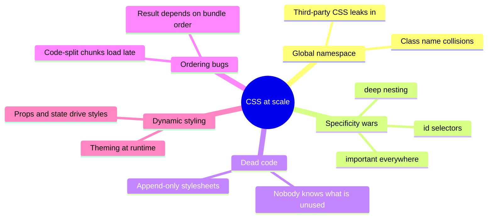

| Problem | Symptom | What fixes it |
|---|---|---|
| **Global namespace** | `.button` from a widget restyles your buttons | Scoping: CSS Modules, CSS-in-JS, framework scoping, Shadow DOM, `@scope` |
| **Specificity wars** | `!important` creep, `#app .page .card .title` selectors | Flat single-class selectors, `:where()`, cascade layers |
| **Dead code** | CSS only ever grows; deleting feels risky | Co-location (styles live next to the component), utility classes, build-time extraction |
| **Ordering bugs** | Styles differ between dev and prod or between routes | Single-class selectors, `@layer` order declared up front, deterministic extraction |
| **Dynamic styling** | Inline styles everywhere, or huge variant class lists | CSS custom properties, data attributes, variant APIs |

> The "right" architecture is the one that makes **these five problems structurally impossible** for your team, not the one with the nicest syntax.

---

### Section 2: The Cascade You Are Actually Fighting

When two declarations target the same property on the same element, the browser picks a winner in this order ([CSS Cascade Level 5/6](https://www.w3.org/TR/css-cascade-6/)):

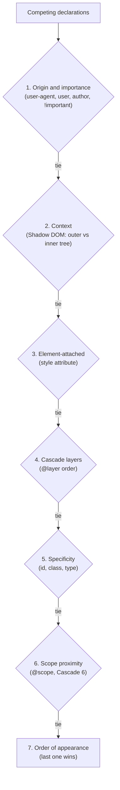

Key consequences for architecture:
- **Layers beat specificity.** A one-class selector in a later layer beats an id selector in an earlier layer. That's why `@layer reset, base, components, utilities;` is a powerful tool.
- **Unlayered styles beat all layered styles** (for normal declarations). For `!important` declarations the layer order is **reversed**, so an `!important` in the first layer wins.
- **Order of appearance is fragile.** With code splitting, the order in which CSS chunks arrive can differ by route — any architecture that relies on "my file loads later" will eventually break.
- **`:where()` has zero specificity**, so libraries use it to make their defaults trivially overridable. `:is()` takes the specificity of its most specific argument.

```text
Specificity is compared as (ids, classes/attributes/pseudo-classes, types/pseudo-elements):
  #nav a.active       → (1, 1, 1)
  .nav .link.active   → (0, 3, 0)
  :where(.nav) .link  → (0, 1, 0)     ← :where() contributes nothing
  style="..."         → beats all selectors (element-attached), loses to !important
```

---

### Section 3: The Four Families of Styling Architecture

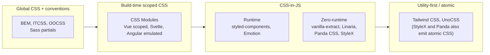

| Family | Where styles are written | When CSS is produced | How collisions are avoided |
|---|---|---|---|
| **Global + conventions** | `.css`/`.scss` files | Build (or none) | Human discipline (naming) |
| **CSS Modules** | `Button.module.css` next to the component | Build | Bundler rewrites class names to unique hashes |
| **Runtime CSS-in-JS** | JS/TS (template literals or objects) | **In the browser, during render** (and on the server for SSR) | Library generates hashed class names |
| **Zero-runtime CSS-in-JS** | JS/TS (`.css.ts`, `css()` calls) | Build — extracted to static `.css` | Compiler generates hashed class names |
| **Utility-first** | Class names in markup (`class="px-4 font-bold"`) | Build — only classes found in source | Each class does one thing; no custom names to collide |

The industry trend since React Server Components and streaming SSR has been **away from runtime style injection** and **toward build-time output** (CSS Modules, Tailwind, zero-runtime CSS-in-JS) plus native CSS features.

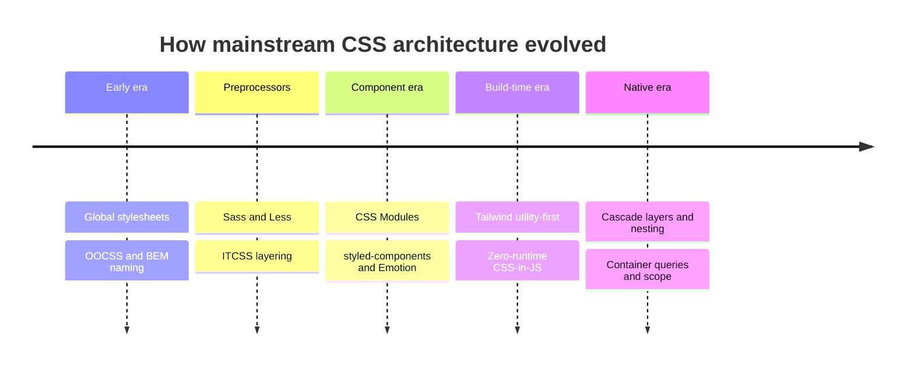

---

### Section 4: Global CSS With Conventions (BEM, ITCSS)

**BEM (Block, Element, Modifier)** keeps specificity flat by giving every styled thing exactly one class:

```css
/* Block */            .card { border-radius: 8px; }
/* Element */          .card__title { font-weight: 600; }
/* Modifier */         .card--featured { border: 2px solid gold; }
```

**ITCSS** orders files from generic to specific so the cascade flows "downhill": Settings → Tools → Generic (reset) → Elements → Objects → Components → Utilities. Native `@layer` (Section 9) now enforces the same idea in the browser instead of relying on import order.

| Pros | Cons |
|---|---|
| Zero tooling; works with any framework and server-rendered HTML | Collisions prevented only by discipline |
| Easy to override from outside (good for theming third-party UIs) | Dead CSS is hard to find — nothing links a class to its users |
| Fast: plain static CSS | Long names, manual consistency |

> **Still a good fit for:** content sites, CMS themes, server-rendered apps with little JS, and the *public override surface* of a design system.

---

### Section 5: CSS Modules

A CSS Module is a normal CSS file whose **class names are local by default**. The bundler rewrites each class to a unique name and gives your JS a mapping object.

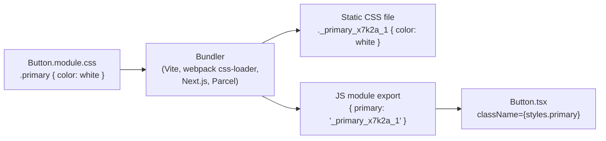

```tsx
// Button.module.css
// .button { padding: 0.5rem 1rem; border-radius: 6px; }
// .primary { composes: button; background: var(--color-primary); color: white; }

import styles from './Button.module.css';

export function Button({ children }: { children: React.ReactNode }) {
  return <button className={styles.primary}>{children}</button>;
}
```

| Feature | What it does |
|---|---|
| **Local scope by default** | `.primary` becomes a unique hashed name per file |
| **`:global(.x)`** | Opt out of hashing for one selector (e.g. styling a third-party class) |
| **`composes`** | Reuse classes from the same or another module (the element gets both class names) |
| **Static output** | Real `.css` files: cacheable, parallel-downloaded, no runtime |
| **Typing** | Vite's client types declare `*.module.css` as `{ [key: string]: string }`; tools like `typed-css-modules` generate exact `.d.ts` files |

**Trade-offs:**
- ✅ Plain CSS (all features, all devtools), zero runtime, works in React Server Components, framework-agnostic.
- ⚠️ Dynamic values need **CSS custom properties** (`style={{ '--progress': '40%' }}`) or extra classes — you can't interpolate JS into the file.
- ⚠️ CSS Modules are a **build-tool convention, not a web standard**. A component library that ships `.module.css` source forces consumers' bundlers to process it; most libraries ship precompiled CSS instead (Section 12).
- ⚠️ Ordering across modules still follows chunk load order — keep selectors single-class and use `@layer` if you need a guaranteed order.

---

### Section 6: Runtime CSS-in-JS

Libraries such as **styled-components** and **Emotion** let you write CSS inside JS, interpolate props, and get scoped class names. The CSS is generated **while components render**.

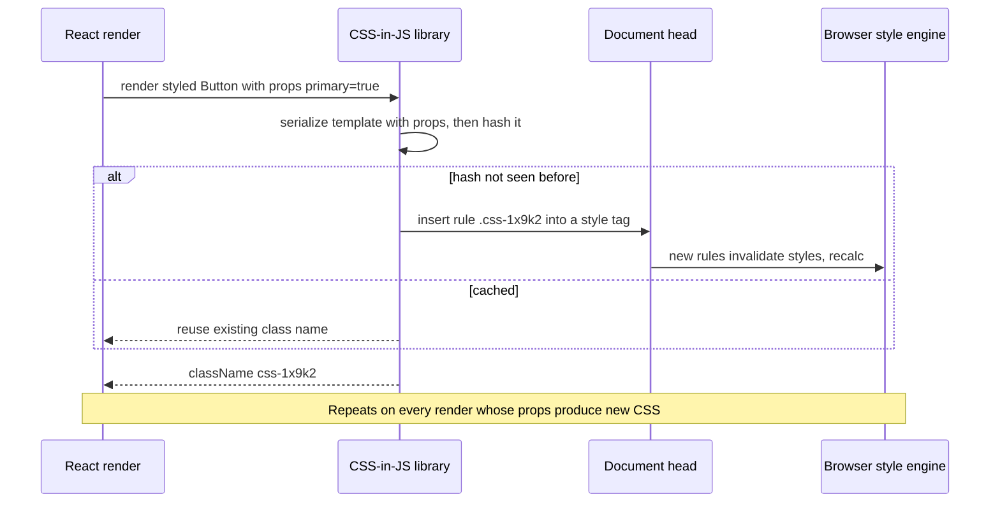

**What you get:** co-location, full dynamic styling from props, automatic dead-code removal (unused component = unused CSS), theming via a React context.

**What it costs:**

| Cost | Why |
|---|---|
| **JS bundle + main-thread work** | The library ships to the client and serializes/hashes styles during render, competing with interaction work ([INP](../04-performance-engineering/core-web-vitals-lcp-inp-cls.md)) |
| **Style recalculation** | Inserting new rules mid-session invalidates styles; React 18 added `useInsertionEffect` so libraries can inject before layout effects read the DOM |
| **SSR complexity** | The server must **collect** the styles used during render and inline them into the HTML; streaming SSR makes collection harder |
| **React Server Components** | These libraries rely on React context and client-side injection, so styled components must be **Client Components**. The [Next.js CSS-in-JS guide](https://nextjs.org/docs/app/guides/css-in-js) notes that libraries must explicitly support Server Components and streaming, and its setups register styles from a Client Component |
| **Caching** | Styles live inside JS chunks, not in separately cacheable `.css` files |

**Current status (late 2026):**
- **styled-components** — in **maintenance mode** since its maintainer's 2025 announcement (bug and security fixes, no major new direction). Existing apps keep working; new projects generally choose a build-time approach.
- **Emotion** — still widely used, notably as MUI's default styling engine; the same runtime and RSC constraints apply.
- The React team's guidance for CSS-in-JS library authors (React 18 working group) was to prefer **static extraction** and, for runtime libraries, to inject via `useInsertionEffect`. React 19 adds built-in support for `<link rel="stylesheet" precedence>` and `<style href precedence>` so styles can be deduplicated and ordered by React itself — see the [React DOM `<style>` docs](https://react.dev/reference/react-dom/components/style).

> Runtime CSS-in-JS is not "broken" — it's a **trade-off that got more expensive** once rendering moved to the server and INP became a Core Web Vital.

---

### Section 7: Zero-Runtime CSS-in-JS

Keep the authoring style (TypeScript, co-location, type-safe tokens) but move all CSS generation to **build time**. The output is static `.css` plus class-name strings.

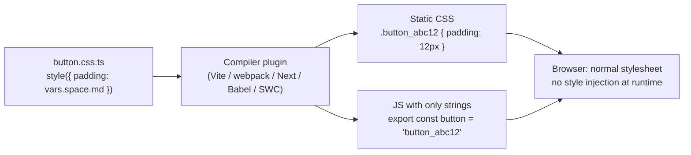

| Library | Authoring style | Output | Notes |
|---|---|---|---|
| **vanilla-extract** | `.css.ts` files with `style()`, `createTheme()`, `recipe()` | Static scoped classes + CSS variables | Strong typed themes/tokens; styles must live in `.css.ts` files |
| **Linaria** | `css` and `styled` tagged templates | Static CSS; dynamic props become CSS variables | Closest syntax to styled-components |
| **Panda CSS** | `css({...})`, recipes, patterns | **Atomic** CSS generated by static analysis | From the Chakra UI team; designed to work with RSC |
| **StyleX** | `stylex.create({...})` objects | **Atomic** CSS, deterministic merge (last style wins) | Open-sourced by Meta; strict about what can be expressed |

**Trade-offs:**
- ✅ No style runtime, static cacheable CSS, works with Server Components, type-safe tokens.
- ⚠️ **Static analysis limits**: values must be knowable at build time. Truly dynamic values (a user-chosen color, a drag position) go through **CSS custom properties**.
- ⚠️ Build plugin required for every tool in the chain (bundler, test runner, Storybook).

---

### Section 8: Utility-First CSS (Tailwind)

Instead of writing new CSS per component, you compose **single-purpose classes** that map to design tokens. Tailwind scans your source files, finds class names, and generates **only the CSS for classes that appear**.

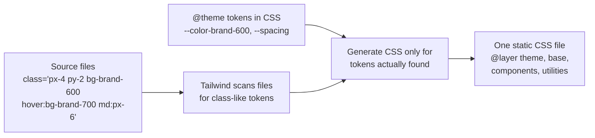

**Tailwind v4 (current major) in brief** — check the [Tailwind docs](https://tailwindcss.com/docs) for details:
- **CSS-first configuration:** `@import "tailwindcss";` plus an `@theme { … }` block that defines tokens as CSS variables (`--color-brand-600`, `--font-display`). The JS config file is optional/legacy.
- **Automatic source detection** — no `content` array required in most setups.
- Output uses **native cascade layers** (`theme`, `base`, `components`, `utilities`), so utilities reliably win over component defaults.
- Built on modern CSS (custom properties, `@property`, `color-mix()`), so it targets **modern browsers only**; projects that need older browsers stay on v3.
- Variants: `hover:`, `focus-visible:`, `md:` (min-width breakpoints), `@md:` (container queries), `dark:` (Theming note), `motion-reduce:`, `aria-*:`, `data-*:`.

**Taming long class lists in a design system:**

```tsx
import { cva, type VariantProps } from 'class-variance-authority';
import { twMerge } from 'tailwind-merge';
import { clsx, type ClassValue } from 'clsx';

const cn = (...inputs: ClassValue[]) => twMerge(clsx(inputs)); // later conflicting utilities win

const button = cva(
  'inline-flex items-center rounded-md font-medium focus-visible:outline-2 disabled:opacity-50',
  {
    variants: {
      intent: { primary: 'bg-brand-600 text-white hover:bg-brand-700', ghost: 'bg-transparent hover:bg-gray-100' },
      size: { sm: 'h-8 px-3 text-sm', md: 'h-10 px-4' },
    },
    defaultVariants: { intent: 'primary', size: 'md' },
  },
);

type ButtonProps = React.ComponentProps<'button'> & VariantProps<typeof button>;

export function Button({ intent, size, className, ...rest }: ButtonProps) {
  return <button className={cn(button({ intent, size }), className)} {...rest} />;
}
```

| Pros | Cons |
|---|---|
| CSS output stops growing once the token set is used (each utility is emitted once) | Verbose markup; readability depends on extraction into components |
| Design tokens enforced by construction (`p-4`, not `padding: 13px`) | **Class names must appear as complete strings** — `bg-${color}-500` isn't detected |
| No naming, no dead CSS, no specificity wars | Overrides need a merge strategy (`tailwind-merge`) |
| Static CSS, RSC-friendly, framework-agnostic | Another vocabulary to learn; arbitrary values (`w-[37px]`) can erode the system |

> Popular component distributions such as **shadcn/ui** pair Tailwind with headless primitives (Radix UI, React Aria) and `cva` — the code is copied into your repo rather than installed as a styled dependency. See [Headless UI](./headless-ui-renderless-components.md).

---

### Section 9: Modern Native CSS — Layers, Scope, Nesting, Custom Properties

Several problems that once required tools are now solved in the browser itself:

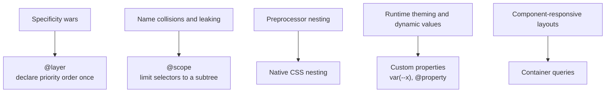

```css
/* 1. Declare layer order ONCE, first. Later layers win regardless of specificity. */
@layer vendor, reset, tokens, base, components, utilities;

/* Third-party CSS goes into the lowest layer so your components always win.
   @import must come before any other rule except @charset and @layer statements. */
@import url('vendor-datepicker.css') layer(vendor);

@layer components {
  .card {
    padding: var(--space-4);
    /* 2. Native nesting */
    & .title { font-weight: 600; }
    &:hover { box-shadow: var(--shadow-md); }
  }
}

/* 3. @scope: styles apply inside .card but stop at nested .card-slot content */
@scope (.card) to (.card-slot) {
  img { border-radius: 4px; }
}
```

| Feature | Support status (check MDN before relying on it) |
|---|---|
| `@layer` | Supported in all major browsers since 2022 |
| CSS nesting | Supported in all major browsers (relaxed syntax since late 2023) |
| Custom properties | Universally supported; `@property` (typed, animatable) in all major engines since 2024 |
| Container size queries | Supported in all major browsers since 2023 |
| `@scope` | Chromium first; Safari and Firefox shipped later — per MDN compat data, Firefox from version 146 and Safari from 26.4 |

> **Native CSS + a scoping strategy** (CSS Modules or framework scoping) is now a complete architecture for many teams — no CSS-in-JS runtime, no utility vocabulary.

---

### Section 10: How Other Frameworks and Platforms Scope Styles

| Stack | Default mechanism | Escape hatches | Notes |
|---|---|---|---|
| **React** | None built in — choose CSS Modules, Tailwind or CSS-in-JS | `className`, `style` | React 19 can hoist and dedupe `<link rel="stylesheet" precedence>` |
| **Vue (SFC)** | `<style scoped>` adds a `data-v-xxxx` attribute to elements and selectors | `:deep()`, `:slotted()`, `:global()`; `<style module>` gives CSS Modules | `v-bind()` in `<style>` binds reactive values to CSS variables |
| **Angular** | `ViewEncapsulation.Emulated` (default) rewrites selectors with `_ngcontent-*` attributes | `ViewEncapsulation.ShadowDom`, `ViewEncapsulation.None`; `::ng-deep` is deprecated | Global styles in `styles.css`; Angular Material is themed via CSS variables/Sass |
| **Svelte** | Component `<style>` is scoped by default with a generated `svelte-xxxx` class | `:global(...)` | Unused selectors are warned about and removed at compile time |
| **Web Components** | **Shadow DOM** — real encapsulation in the browser | Custom properties and `::part()` cross the boundary | See [Web Components & Shadow DOM](../10-advanced-topics/web-components-and-shadow-dom.md) |
| **React Native** | `StyleSheet.create()` JS objects; **no cascade**, no selectors | Style arrays `[a, b]` merge left to right | NativeWind brings Tailwind-style classes to RN |
| **SwiftUI / Jetpack Compose** | View modifiers / `Modifier` chains; theme via environment (`MaterialTheme` in Compose) | Custom `ViewModifier` / composable wrappers | No CSS; tokens map to theme objects |

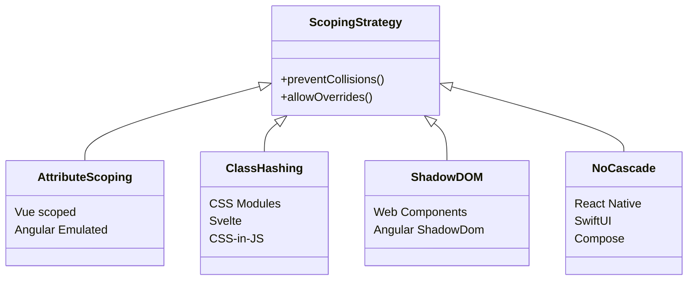

---

### Section 11: Performance — What Each Approach Costs

CSS is **render-blocking**: the browser won't paint until the CSS in `<head>` is downloaded and parsed (see [Critical Rendering Path](../01-web-fundamentals/critical-rendering-path.md)). The architecture decides how much CSS ships, when, and whether JS must run to produce it.

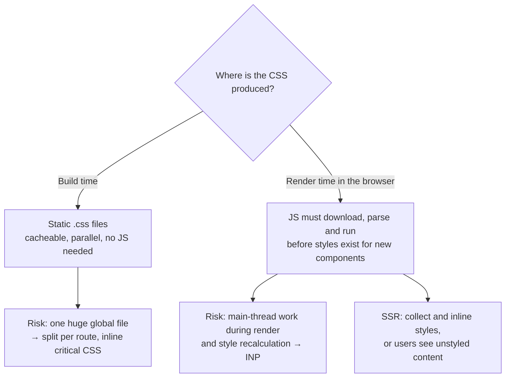

| Concern | Global/BEM | CSS Modules | Runtime CSS-in-JS | Zero-runtime | Tailwind |
|---|---|---|---|---|---|
| Runtime JS for styles | None | None | Library + per-render work | None | None |
| CSS growth with features | Linear, plus dead code | Linear, unused files dropped with code | Only rendered styles | Linear, or plateaus if atomic | Plateaus (atomic) |
| Per-route splitting | Manual | Automatic with code splitting | Automatic | Automatic (tool-dependent) | Usually one file |
| Works in RSC | ✅ | ✅ | ❌ (client components only) | ✅ | ✅ |
| Cacheable as a file | ✅ | ✅ | ❌ (inside JS) | ✅ | ✅ |

**Practical rules:**
- Measure **unused CSS** with Chrome DevTools Coverage and **style recalculation** in the Performance panel before and after a migration — don't rely on blog benchmarks.
- Prefer **class or data-attribute toggles** over regenerating styles on every state change.
- Animate `transform`/`opacity` and use custom properties for dynamic values; avoid generating a new class per pixel value (a classic runtime CSS-in-JS footgun).
- Keep CSS **atomic or split per route** so a single feature doesn't bloat the render-blocking file.

---

### Section 12: Shipping Styles From a Component Library

A design-system package must work in **apps you don't control** (different bundlers, SSR setups, frameworks).

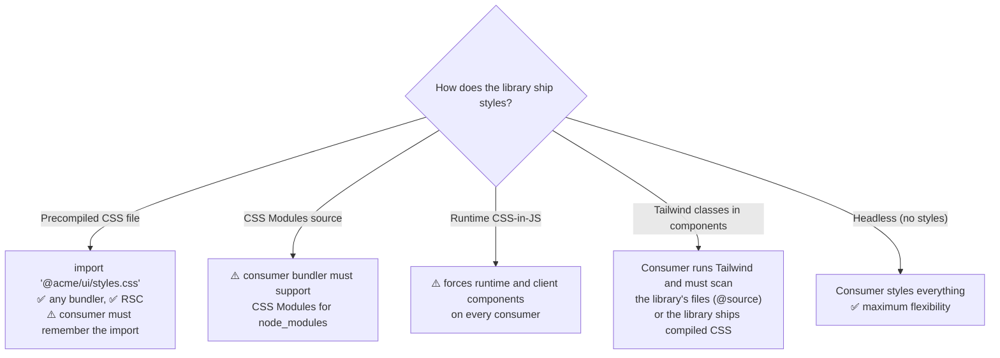

Recommended defaults for a shared library:
1. Ship **precompiled, static CSS** inside a named layer (`@layer acme`), so consumer styles win without specificity battles.
2. Expose theming through **CSS custom properties** (`--acme-color-primary`), not a JS theme provider — they work in every framework and in Server Components. See [Theming & Dark Mode](./theming-and-dark-mode.md) and [Design Tokens](./design-tokens.md).
3. Use **low-specificity selectors** (`:where()`, single classes) so overrides are easy.
4. Offer a `className` (or `class`) prop on every component, and data attributes for state (`data-state="open"`) that consumers can target.

---

## Decision Matrix

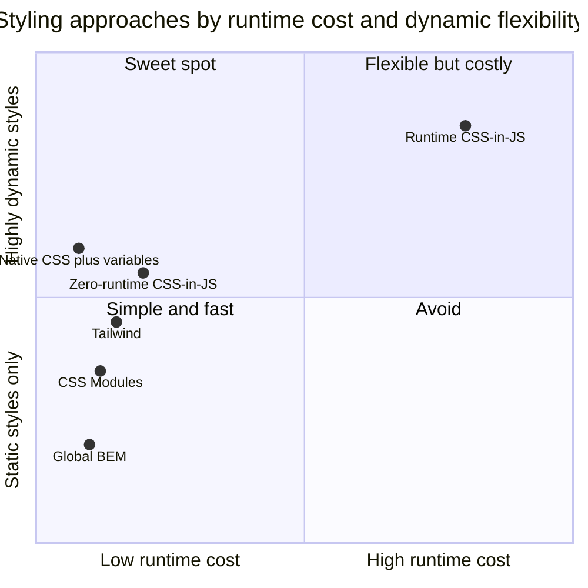

*(Positions are qualitative, not measurements.)*

| Situation | Recommended approach | Why |
|---|---|---|
| New React app on Next.js App Router / RSC | **Tailwind** or **CSS Modules** (+ native CSS) | Static output, works in Server Components |
| Large design system needing type-safe tokens | **vanilla-extract** or **Panda CSS**, or CSS Modules + token CSS variables | Build-time, typed tokens, no runtime |
| Product team shipping many screens fast | **Tailwind** + `cva` + headless primitives | Consistency by construction, little naming |
| Existing app on styled-components/Emotion | **Keep it**, avoid new runtime-heavy patterns, migrate leaf-first if RSC/INP demand it | Rewrites are expensive; migrate where it pays |
| Content site, CMS, server-rendered HTML | **Global CSS + BEM + `@layer`** | No build tooling dependency; easy theming |
| Vue / Svelte / Angular app | **Framework scoping** (+ Tailwind if the team likes utilities) | Built-in and well supported |
| Embeddable widget on third-party pages | **Shadow DOM** (Web Component) or heavily prefixed, layered CSS | Host page CSS must not leak in or out |

---

## Real-World Examples

**Example 1 — Specificity war vs cascade layers (BAD → GOOD):**
```css
/* ❌ BAD: escalating specificity to beat a vendor stylesheet */
#app .page .sidebar .datepicker .day.selected { background: var(--brand) !important; }

/* ✅ GOOD: put vendor CSS in a lower layer, then use a single class */
@layer vendor, components;
@import url('datepicker.css') layer(vendor);

@layer components {
  .day-selected { background: var(--brand); }
}
```
> `@import` rules must come before other rules (except `@charset` and `@layer` statements), so place this at the top of the entry stylesheet.

**Example 2 — Dynamic values without runtime CSS-in-JS (BAD → GOOD):**
```tsx
// ❌ BAD (runtime CSS-in-JS): every new `progress` value generates and injects a new CSS rule
const Bar = styled.div<{ progress: number }>`
  width: ${(p) => p.progress}%;
`;

// ✅ GOOD: one static class; the dynamic value travels through a custom property
import styles from './ProgressBar.module.css';
// .bar { width: var(--progress); transition: width 200ms; }

export function ProgressBar({ progress }: { progress: number }) {
  return (
    <div
      className={styles.bar}
      style={{ '--progress': `${progress}%` } as React.CSSProperties}
      role="progressbar"
      aria-valuenow={progress}
      aria-valuemin={0}
      aria-valuemax={100}
    />
  );
}
```

**Example 3 — Tailwind dynamic class names (BAD → GOOD):**
```tsx
// ❌ BAD: Tailwind never sees "bg-red-500" as a complete string, so it isn't generated
function Badge({ color }: { color: 'red' | 'green' }) {
  return <span className={`bg-${color}-500 text-white`}>●</span>;
}

// ✅ GOOD: map to complete class names that exist in source
const badgeColor = { red: 'bg-red-500', green: 'bg-green-500' } as const;
function Badge2({ color }: { color: keyof typeof badgeColor }) {
  return <span className={`${badgeColor[color]} text-white`}>●</span>;
}
```

**Example 4 — Tailwind v4 CSS-first setup with tokens and layers:**
```css
/* app.css */
@import "tailwindcss";

@theme {
  --color-brand-600: oklch(0.55 0.2 260);
  --color-brand-700: oklch(0.48 0.2 260);
  --font-display: "Inter", system-ui, sans-serif;
}

/* Scan a design-system package that lives in node_modules */
@source "../node_modules/@acme/ui";

@layer components {
  .prose-tight { @apply leading-snug tracking-tight; }
}
```

**Example 5 — vanilla-extract typed theme and recipe:**
```typescript
// theme.css.ts
import { createTheme, style } from '@vanilla-extract/css';
import { recipe } from '@vanilla-extract/recipes';

export const [themeClass, vars] = createTheme({
  color: { primary: '#2563eb', onPrimary: '#ffffff' },
  space: { sm: '8px', md: '12px' },
});

export const button = recipe({
  base: { borderRadius: 6, padding: vars.space.md },
  variants: {
    intent: {
      primary: { background: vars.color.primary, color: vars.color.onPrimary },
      ghost: { background: 'transparent' },
    },
  },
  defaultVariants: { intent: 'primary' },
});

export const focusRing = style({
  selectors: { '&:focus-visible': { outline: `2px solid ${vars.color.primary}` } },
});
```

**Example 6 — The same scoped component in Vue, Svelte and Angular:**
```html
<!-- Vue SFC: scoped styles + reactive CSS variable -->
<template><button class="btn"><slot /></button></template>
<script setup lang="ts">
const props = defineProps<{ accent: string }>();
</script>
<style scoped>
.btn { background: v-bind('props.accent'); }
</style>

<!-- Svelte 5: <style> is scoped automatically -->
<script lang="ts">
  let { children } = $props();
</script>
<button class="btn">{@render children?.()}</button>
<style>
  .btn { padding: 0.5rem 1rem; }
  :global(body.compact) .btn { padding: 0.25rem 0.5rem; }
</style>
```
```typescript
// Angular: Emulated encapsulation is the default; shown explicitly
import { Component, ViewEncapsulation } from '@angular/core';

@Component({
  selector: 'acme-button',
  template: `<button class="btn"><ng-content /></button>`,
  styles: `.btn { padding: 0.5rem 1rem; }`,
  encapsulation: ViewEncapsulation.Emulated,
})
export class AcmeButton {}
```

---

## Key Points Summary

| Concept | One-Line Explanation |
|---|---|
| **Cascade order** | Origin/importance → context → style attribute → layers → specificity → scope proximity → order |
| **`@layer`** | Declares priority order once; later layers win regardless of specificity |
| **BEM / ITCSS** | Naming and file-ordering conventions for global CSS — discipline, not enforcement |
| **CSS Modules** | Bundler hashes class names per file; static CSS, zero runtime |
| **Runtime CSS-in-JS** | Styles generated during render; flexible but costs JS, SSR work and RSC compatibility |
| **Zero-runtime CSS-in-JS** | CSS-in-TS authoring, extracted to static CSS at build time |
| **Utility-first (Tailwind)** | Compose single-purpose token classes; CSS generated only for classes found in source |
| **Atomic CSS** | One class per property-value pair, so total CSS plateaus as features grow |
| **Custom properties** | The universal channel for dynamic values and theming across every approach |
| **Framework scoping** | Vue scoped, Angular Emulated, Svelte hash class, Shadow DOM — built-in collision prevention |
| **Library styling** | Ship static CSS in a named layer + CSS variables + low specificity |

---

## Test Your Understanding

**Q1 (Basic):**
What problem does a CSS Module solve, and how does it solve it without any runtime JavaScript?

<details>
<summary>Answer</summary>

It solves **global name collisions**: two files can both define `.title` without affecting each other. At **build time**, the bundler rewrites each class name in a `.module.css` file to a unique hashed name (for example `_title_x7k2a_1`), emits that as a normal static CSS file, and exports a JS object mapping the original names to the hashed ones. The component uses `styles.title`. Nothing happens in the browser except loading a regular stylesheet, which is why CSS Modules have zero runtime cost and work in React Server Components.
</details>

**Q2 (Application):**
Your team is starting a Next.js App Router project that will mostly use Server Components. A senior dev proposes styled-components "because we know it". What do you tell them?

<details>
<summary>Answer</summary>

styled-components depends on React context and client-side style injection, so every styled component must be a **Client Component** — that undermines the point of Server Components (more JS shipped, more hydration). It also needs SSR style collection configured, adds main-thread work during render (bad for INP), and the library has been in **maintenance mode** since 2025. Recommend a **build-time** approach: Tailwind, CSS Modules, or a zero-runtime CSS-in-JS library (vanilla-extract, Panda, StyleX) if the team wants the CSS-in-TS authoring experience. Dynamic values go through CSS custom properties.
</details>

**Q3 (Tricky):**
In production, a button looks right on the home page but wrong on the settings page, and the difference disappears in development. Both pages use the same components and CSS Modules. What is the likely cause, and how do you fix it structurally?

<details>
<summary>Answer</summary>

**Order of appearance across code-split CSS chunks.** Two rules with equal specificity target the same element (for example a `Button` module class and a `SettingsForm` module class overriding `padding`). In dev, CSS is often injected per module in import order; in production, chunks for different routes load in a different order, so the "last one wins" result flips.

Structural fixes: avoid overriding one component's internals from another component's stylesheet (pass a `className` or a variant instead), keep selectors single-class, and if ordering matters, declare **`@layer`** order up front (e.g. `@layer base, components, overrides;`) so the winner no longer depends on load order.
</details>

**Q4 (Tricky):**
A developer writes `` className={`text-${size}`} `` in a Tailwind project, where `size` is `'sm' | 'lg'`. It works in Storybook but not in the production app. Why?

<details>
<summary>Answer</summary>

Tailwind generates CSS **only for complete class names it finds by scanning source files**. `text-${size}` is never a complete string, so `text-sm` and `text-lg` are only generated if they happen to appear somewhere else in the scanned files. Storybook may scan different files (or other stories use `text-sm`), so it "works" there by accident. Fix: map to complete strings (`{ sm: 'text-sm', lg: 'text-lg' }[size]`), or use a variant helper like `cva`. As a last resort, safelist classes explicitly (`@source inline(...)` in v4).
</details>

**Q5 (System design):**
You're designing a design-system package used by React (Next.js), Vue and Angular apps, some of which use Tailwind and some don't. How do you ship the styles?

<details>
<summary>Answer</summary>

Pick an approach that works in **every consumer's build**, without forcing a runtime:
- Author with whatever the DS team prefers (CSS Modules, vanilla-extract or plain CSS), but **publish precompiled static CSS** (`@acme/ui/styles.css`), wrapped in a named layer (`@layer acme`) so consumer styles win without specificity tricks.
- Expose **design tokens as CSS custom properties** (`--acme-color-primary`) for theming. They work in any framework, in Server Components, and with Tailwind (a consumer can map them in `@theme`).
- Keep selectors low-specificity (`:where()`, single classes), expose state as data attributes, and accept `className`/`class` on every component.
- Don't ship runtime CSS-in-JS (it forces a React runtime and client components on everyone) or raw CSS Modules (it depends on the consumer's bundler config).
- For multi-framework reuse, consider headless logic per framework plus shared CSS, or Web Components with `::part()` and custom properties.
</details>

**Q6 (System design):**
A large app on Emotion has poor INP on a data-heavy table where each cell's background depends on its value. Profiling shows long "Recalculate Style" and script time during updates. What do you change, short-term and long-term?

<details>
<summary>Answer</summary>

**Short-term:** stop generating a unique style per value. Use one static class per cell type and pass the value through a **CSS custom property** (`style={{ '--heat': value }}`) with `background: color-mix(...)` or a few **data-attribute buckets** (`data-level="high"`). This removes per-render serialization/hashing and new rule insertion, which cause both the script time and the full-document style invalidation. Also virtualize the table if it renders many rows (see [Virtual Scrolling](../04-performance-engineering/virtual-scrolling-and-windowing.md)).

**Long-term:** migrate leaf components to a build-time approach (CSS Modules, Tailwind or zero-runtime CSS-in-JS), starting with the hottest paths, measuring INP and style recalc before and after. Keep Emotion for untouched areas until the migration finishes; the two can coexist.
</details>

---

## Cheat Sheet

**Key Definitions:**
- **Cascade layers (`@layer`):** Named priority buckets; a later layer wins regardless of selector specificity
- **Specificity:** (ids, classes/attributes/pseudo-classes, types) — compared left to right
- **BEM:** `block__element--modifier` naming for flat, single-class selectors
- **CSS Modules:** Build-time local scoping of class names per file
- **Runtime CSS-in-JS:** Styles generated and injected during render (styled-components, Emotion)
- **Zero-runtime CSS-in-JS:** CSS-in-TS extracted to static CSS at build time (vanilla-extract, Linaria, Panda, StyleX)
- **Utility-first:** Styling by composing single-purpose classes (Tailwind)
- **Atomic CSS:** One rule per property-value pair; output size plateaus

**Quick Reference:**
```text
Need RSC / streaming SSR friendly?      → build-time: Tailwind, CSS Modules, zero-runtime CSS-in-JS
Need dynamic values?                    → CSS custom properties (style={{ '--x': v }}), not new classes
Fighting specificity?                   → @layer reset, base, components, utilities; single-class selectors
Third-party CSS overriding you?         → @import url(vendor.css) layer(vendor)
Tailwind class missing in prod?         → class names must be complete strings in source
Merging Tailwind overrides?             → twMerge(clsx(...)); variants with cva
Shipping a component library?           → precompiled CSS in @layer + CSS variables + :where()
Vue: <style scoped> / :deep()   Svelte: scoped by default / :global()   Angular: Emulated / ShadowDom
React Native: StyleSheet.create, no cascade   Web Components: Shadow DOM + ::part() + custom props
```

**Common Mistakes to Avoid:**

| Mistake | Why Wrong | Fix |
|---|---|---|
| Runtime CSS-in-JS in a Server Components app | Forces client components and runtime style work | Tailwind, CSS Modules or zero-runtime CSS-in-JS |
| Interpolating frequently changing values into styled templates | New CSS rule per value → script time and style recalc | Static class + custom property |
| Building Tailwind class names by concatenation | Scanner can't find them → missing CSS | Map to complete class strings |
| Raising specificity or adding `!important` to win | Escalation never ends | `@layer` ordering, single-class selectors |
| Overriding another component's internals from outside | Breaks with load order and refactors | `className` prop, variants, data attributes |
| Shipping `.module.css` source in an npm library | Depends on consumer bundler config | Ship precompiled CSS |
| One global stylesheet that only ever grows | Dead CSS, slow render-blocking download | Co-locate styles; split per route; atomic CSS |
| Choosing an approach by syntax preference only | Ignores RSC, INP, SSR and library constraints | Decide with the Decision Matrix |
| Migrating a whole app's styling in one big bang | Risky and slow | Migrate leaf-first; approaches can coexist |

---

## References & Further Reading

**Core docs**
- MDN: [Cascade, specificity, and inheritance](https://developer.mozilla.org/en-US/docs/Learn_web_development/Core/Styling_basics/Handling_conflicts)
- MDN: [`@layer`](https://developer.mozilla.org/en-US/docs/Web/CSS/@layer) · [`@scope`](https://developer.mozilla.org/en-US/docs/Web/CSS/@scope) · [CSS nesting](https://developer.mozilla.org/en-US/docs/Web/CSS/CSS_nesting)
- MDN: [Using CSS custom properties](https://developer.mozilla.org/en-US/docs/Web/CSS/Using_CSS_custom_properties)
- MDN: [`:where()`](https://developer.mozilla.org/en-US/docs/Web/CSS/:where)
- Chrome for Developers: [Cascade layers are coming to your browser](https://developer.chrome.com/blog/cascade-layers) · CSS-Tricks: [A complete guide to CSS cascade layers](https://css-tricks.com/css-cascade-layers/)

**Specs**
- W3C: [CSS Cascading and Inheritance Level 6](https://www.w3.org/TR/css-cascade-6/)
- W3C: [CSS Nesting Module](https://www.w3.org/TR/css-nesting-1/)

**Tools and frameworks**
- [CSS Modules (GitHub)](https://github.com/css-modules/css-modules) · Vite: [CSS Modules](https://vite.dev/guide/features.html#css-modules)
- Tailwind CSS: [Documentation](https://tailwindcss.com/docs) · [Detecting classes in source files](https://tailwindcss.com/docs/detecting-classes-in-source-files)
- [vanilla-extract](https://vanilla-extract.style/) · [Panda CSS](https://panda-css.com/) · [StyleX](https://stylexjs.com/) · [Linaria](https://github.com/callstack/linaria)
- [styled-components](https://styled-components.com/) · [Emotion](https://emotion.sh/docs/introduction)
- Next.js: [CSS-in-JS](https://nextjs.org/docs/app/guides/css-in-js)
- React: [`<style>` component](https://react.dev/reference/react-dom/components/style) · [`useInsertionEffect`](https://react.dev/reference/react/useInsertionEffect)
- Vue: [SFC CSS features](https://vuejs.org/api/sfc-css-features.html) · Angular: [Styling components](https://angular.dev/guide/components/styling) · Svelte: [Scoped styles](https://svelte.dev/docs/svelte/scoped-styles)
- React Native: [Style](https://reactnative.dev/docs/style)

**Deep dives**
- React working group: [Library upgrade guide: `<style>` (most CSS-in-JS libs)](https://github.com/reactwg/react-18/discussions/110)
- Harry Roberts: [Managing CSS Projects with ITCSS](https://csswizardry.com/2018/11/itcss-and-skillshare/)
- MDN: [Organizing your CSS](https://developer.mozilla.org/en-US/docs/Learn_web_development/Core/Styling_basics/Organizing) (covers BEM, OOCSS and other conventions)
- styled-components maintainer: [Thank you (maintenance-mode announcement, 2025)](https://opencollective.com/styled-components/updates/thank-you)

---

> **Previous Topic:** [Storybook & Component Documentation](./storybook-and-component-documentation.md)
> — Documenting and testing components in isolation

> **Next Topic:** [Responsive Design Patterns](./responsive-design-patterns.md)
> — Fluid layouts, media and container queries, responsive images

*Saved on: 2026-11-06 | Repo: Frontend System Design Learning Notes*
