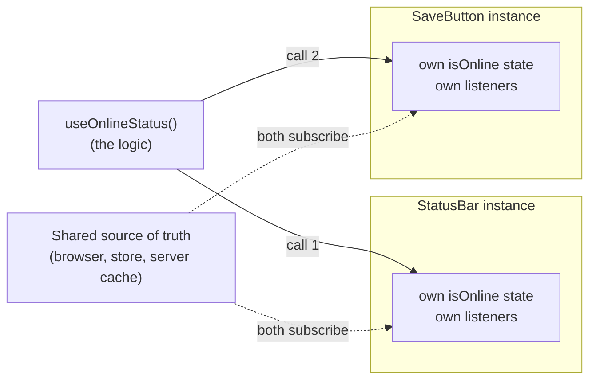
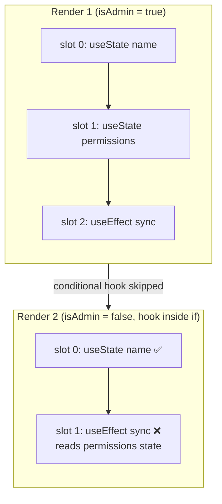
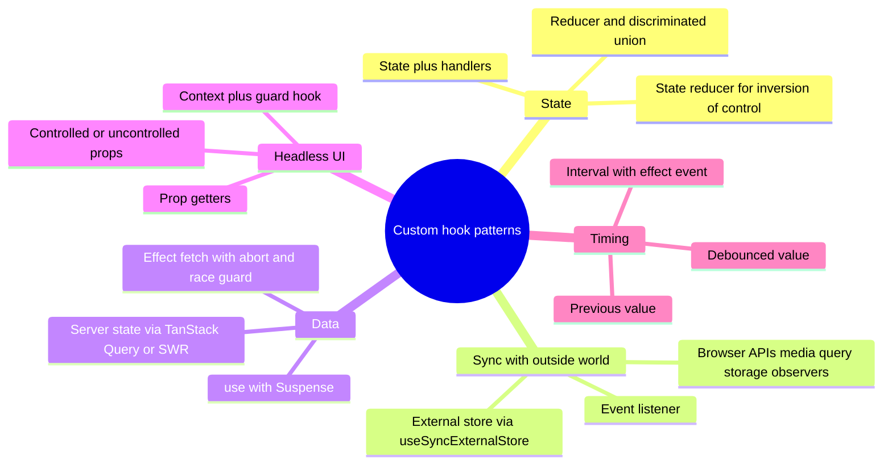
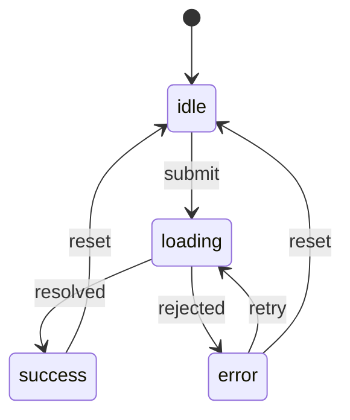
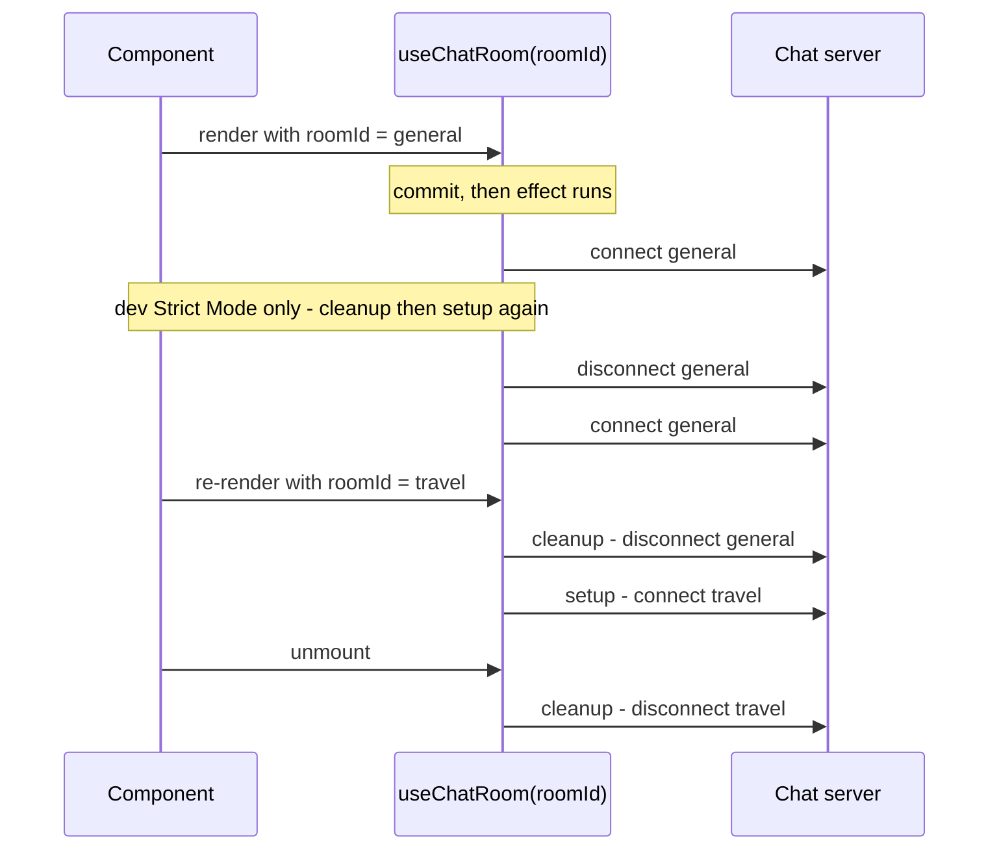
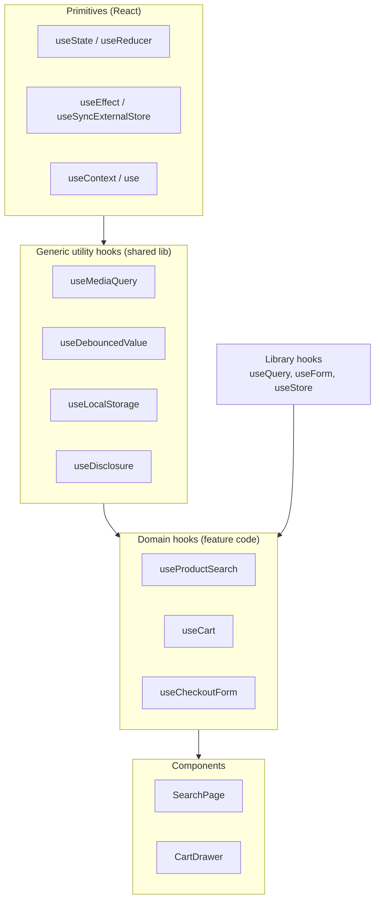
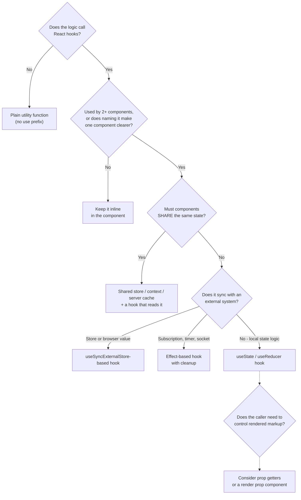

# Custom Hooks Patterns

> **Date:** 2026-11-06 · **Last updated:** 2026-11-06
> **Category:** Frontend System Design
> **Sub-Topic:** Design Systems & Components / Component Patterns
> **Level:** Intermediate · **Reading time:** ~30 min
> **Informs:** logic-reuse architecture, headless design-system APIs (prop getters, state reducers), syncing with browser APIs and external stores (useSyncExternalStore), data-fetching layer choice, SSR/RSC safety of client logic, hook API shape (tuple vs object, stable references), hook testing strategy, cross-framework equivalents (composables, signals, runes)

> **Pre-requisite:** [Higher-Order Components & Render Props](./higher-order-components-and-render-props.md) (the patterns hooks replaced) and [Client State Management Patterns](../03-state-and-data/client-state-management-patterns.md) (where state should live).
> This note is about **designing your own hooks**: the rules, the reusable patterns, the anti-patterns, and how the same idea looks in Vue, Angular, Svelte and native mobile.

**Previous:** [Higher-Order Components & Render Props](./higher-order-components-and-render-props.md) · **Next:** [Storybook & Component Documentation](./storybook-and-component-documentation.md)

---

## Table of Contents

1. [ELI5 — Simple Explanation](#eli5--simple-explanation)
2. [Section 1: What a Custom Hook Is (and Isn't)](#section-1-what-a-custom-hook-is-and-isnt)
3. [Section 2: The Rules of Hooks — and Why They Exist](#section-2-the-rules-of-hooks--and-why-they-exist)
4. [Section 3: Designing the Hook's API](#section-3-designing-the-hooks-api)
5. [Section 4: Pattern Catalog](#section-4-pattern-catalog)
6. [Section 5: Effects Inside Hooks — Lifecycle and Cleanup](#section-5-effects-inside-hooks--lifecycle-and-cleanup)
7. [Section 6: Composing Hooks into Layers](#section-6-composing-hooks-into-layers)
8. [Section 7: Performance and Stable References](#section-7-performance-and-stable-references)
9. [Section 8: SSR, Hydration and Server Components](#section-8-ssr-hydration-and-server-components)
10. [Section 9: Testing Custom Hooks](#section-9-testing-custom-hooks)
11. [Section 10: Anti-Patterns](#section-10-anti-patterns)
12. [Section 11: Other Frameworks and Native Mobile](#section-11-other-frameworks-and-native-mobile)
13. [Should This Be a Custom Hook?](#should-this-be-a-custom-hook)
14. [Real-World Examples](#real-world-examples)
15. [Key Points Summary](#key-points-summary)
16. [Test Your Understanding (with answers)](#test-your-understanding)
17. [Cheat Sheet](#cheat-sheet)
18. [References & Further Reading](#references--further-reading)

---

## ELI5 — Simple Explanation

Think of a **recipe card** for "perfect rice".

- Every cook who uses the card makes **their own pot of rice** in their own kitchen. Two cooks following the same card don't share one pot. That's a custom hook: it shares the **steps**, not the **rice** (the state).
- The card must be followed **in the same order every time** — you can't skip "add water" on Tuesdays. React relies on hooks being called in the same order on every render.
- A recipe card can reference other cards ("make the stock using card #12"). Hooks can call other hooks.
- If a card just says "cook something", it's useless. A good card has a clear name (`useRice`, not `useStuff`) and a clear result.

> **A custom hook is a function whose name starts with `use` and that calls other hooks. It lets components share stateful logic — each call gets its own independent state.**

---

## Core Concept — Step by Step

### Section 1: What a Custom Hook Is (and Isn't)

```tsx
import { useEffect, useState } from 'react';

// A custom hook: a `use`-prefixed function that calls other hooks
export function useOnlineStatus(): boolean {
  const [isOnline, setIsOnline] = useState(() => navigator.onLine);
  useEffect(() => {
    const update = () => setIsOnline(navigator.onLine);
    window.addEventListener('online', update);
    window.addEventListener('offline', update);
    return () => {
      window.removeEventListener('online', update);
      window.removeEventListener('offline', update);
    };
  }, []);
  return isOnline;
}

function SaveButton() {
  const isOnline = useOnlineStatus();
  return <button disabled={!isOnline}>{isOnline ? 'Save' : 'Reconnecting…'}</button>;
}
```

**Custom hooks share logic, not state.** Each component that calls `useOnlineStatus()` gets its own `useState` slot and its own listeners:



To make components **share** state, put it in a shared place — lift it up, use context, an external store (Zustand, Redux), or a server-state cache (TanStack Query) — and let the hook **read** from that place.

| A custom hook **is** | A custom hook **is not** |
|---|---|
| A plain function named `useX` that calls hooks | A component (it returns data, not JSX — usually) |
| Re-run on **every render** of the calling component | Run once, like a constructor |
| A way to give a concept a name (`useCart`, `useDebouncedValue`) | A way to share state between components by itself |
| Subject to the Rules of Hooks | Callable from regular functions, loops or conditions |

> If a function **doesn't call any hooks**, don't prefix it with `use` — make it a regular utility. The `use` prefix tells React's lint rules (and readers) that the Rules of Hooks apply.

---

### Section 2: The Rules of Hooks — and Why They Exist

1. **Only call hooks at the top level** of a component or custom hook — not inside conditions, loops, nested functions, `try/catch`, or after an early `return`.
2. **Only call hooks from React functions** — components and other custom hooks, not plain JS functions or class components.

React doesn't identify hook state by name. It stores state for each component in **call order**: the first `useState` call gets slot 0, the second gets slot 1, and so on. If the order changes between renders, slots get mixed up.



```tsx
// ❌ BAD: hook call order depends on a condition
function Toolbar({ isAdmin }: { isAdmin: boolean }) {
  const [name, setName] = useState('');
  if (isAdmin) {
    const [permissions] = useState<string[]>([]);  // slot shifts when isAdmin flips
  }
  useEffect(() => { /* ... */ });
}

// ✅ GOOD: always call, branch on the value
function Toolbar({ isAdmin }: { isAdmin: boolean }) {
  const [name, setName] = useState('');
  const [permissions] = useState<string[]>([]);
  useEffect(() => {
    if (!isAdmin) return;
    /* ... */
  }, [isAdmin]);
}
```

**The one exception: `use()`** (React 19). `use(promise)` and `use(context)` **can** be called inside conditions and loops — but still only inside components or hooks, not in `try/catch`.

**Enforce with tooling:** `eslint-plugin-react-hooks` provides `rules-of-hooks` (errors on conditional calls) and `exhaustive-deps` (warns about missing effect dependencies). Recent versions of the plugin also ship React Compiler-powered rules; check its README for the current preset.

---

### Section 3: Designing the Hook's API

**Naming:** `use` + what it gives you: `useDebouncedValue`, `useMediaQuery`, `useCart`. Avoid lifecycle names (`useMount`, `useUpdateEffect`) — they describe *when*, not *what* (Section 10).

**Inputs:** positional for one or two required arguments, an options object beyond that:

```tsx
useDebouncedValue(query, 300);
usePagination({ total, pageSize, initialPage: 1, siblingCount: 1 });
```

**Return shape:**

| Shape | Use when | Example |
|---|---|---|
| **Single value** | One thing comes back | `const isOnline = useOnlineStatus()` |
| **Tuple** `[value, setter]` | Exactly two things, and callers will **rename** them (like `useState`) | `const [theme, setTheme] = useLocalStorage('theme', 'light')` |
| **Object** `{ ... }` | Three or more things, or things callers pick from | `const { data, error, isPending, refetch } = useProducts()` |
| **Object with prop getters** | Headless UI behavior that must be spread onto elements | `const { getButtonProps, getPanelProps } = useDisclosure()` |

```tsx
// Tuple: TypeScript infers (string | Setter)[] unless you add `as const`
return [value, setValue] as const;
```

**Stability contract** — document which returned values keep the same identity across renders:
- Setters from `useState`/`useReducer` (and `dispatch`) are **stable**.
- Functions you create inside the hook are **new every render** unless memoized (`useCallback`) or the React Compiler memoizes them.
- Callers will put your return values in dependency arrays — unstable identities cause effect loops and wasted re-renders (Section 7).

---

### Section 4: Pattern Catalog



#### 4.1 State + handlers

The simplest and most common pattern: hide state transitions behind named actions.

```tsx
export function useDisclosure(initial = false) {
  const [isOpen, setIsOpen] = useState(initial);
  const open = useCallback(() => setIsOpen(true), []);
  const close = useCallback(() => setIsOpen(false), []);
  const toggle = useCallback(() => setIsOpen((v) => !v), []);
  return { isOpen, open, close, toggle };
}
```

#### 4.2 Reducer hook with a discriminated union

When state has several fields that must change together, use `useReducer` and a union type so impossible states can't be represented.



```tsx
type State<T> =
  | { status: 'idle' }
  | { status: 'loading' }
  | { status: 'success'; data: T }
  | { status: 'error'; error: unknown };

type Action<T> =
  | { type: 'start' }
  | { type: 'resolve'; data: T }
  | { type: 'reject'; error: unknown }
  | { type: 'reset' };

function reducer<T>(state: State<T>, action: Action<T>): State<T> {
  switch (action.type) {
    case 'start':   return { status: 'loading' };
    case 'resolve': return { status: 'success', data: action.data };
    case 'reject':  return { status: 'error', error: action.error };
    case 'reset':   return { status: 'idle' };
  }
}

export function useAsyncAction<TArgs extends unknown[], T>(fn: (...args: TArgs) => Promise<T>) {
  const [state, dispatch] = useReducer(reducer<T>, { status: 'idle' });
  const run = useCallback(async (...args: TArgs) => {
    dispatch({ type: 'start' });
    try {
      const data = await fn(...args);
      dispatch({ type: 'resolve', data });
      return data;
    } catch (error) {
      dispatch({ type: 'reject', error });
      throw error;
    }
  }, [fn]);
  const reset = useCallback(() => dispatch({ type: 'reset' }), []);
  return { ...state, run, reset };
}
```

> For form submissions in React 19, also look at the built-in `useActionState` and `useFormStatus`, which cover pending/error state for Actions.

#### 4.3 Subscribing to an external store: `useSyncExternalStore`

For anything outside React that can change — browser APIs, a global store, a WebSocket cache — `useSyncExternalStore` is the correct primitive. It avoids "tearing" (different components seeing different values during concurrent rendering) and supports SSR via a server snapshot.

```tsx
import { useCallback, useSyncExternalStore } from 'react';

export function useMediaQuery(query: string): boolean {
  const subscribe = useCallback(
    (onChange: () => void) => {
      const mql = window.matchMedia(query);
      mql.addEventListener('change', onChange);
      return () => mql.removeEventListener('change', onChange);
    },
    [query],
  );
  return useSyncExternalStore(
    subscribe,
    () => window.matchMedia(query).matches,   // client snapshot
    () => false,                               // server snapshot (no window on the server)
  );
}
```

Rules for `useSyncExternalStore`:
- `getSnapshot` must return the **same value** when nothing changed (return primitives or cached objects) — a new object every call causes an infinite re-render loop.
- Define `subscribe` outside the component or memoize it; a new function each render re-subscribes every render.

#### 4.4 Data fetching

Fetching in a hand-written `useEffect` has well-known traps: race conditions, no cache, no deduplication, no retries, waterfalls. **Prefer a server-state library** (TanStack Query, SWR, RTK Query, Apollo) or your framework's loader. Wrap it in **domain hooks** so components don't know the library:

```tsx
// Domain hook: components call useProduct(id), not useQuery directly
export function useProduct(id: string) {
  return useQuery({
    queryKey: ['product', id],
    queryFn: ({ signal }) => api.get<Product>(`/products/${id}`, { signal }),
    staleTime: 60_000,
  });
}
```

See [React Query / TanStack Query](../03-state-and-data/react-query-tanstack-query.md) and [Server State vs Client State](../03-state-and-data/server-state-vs-client-state.md). Example 3 shows a correct hand-written version for when you can't add a library.

#### 4.5 Prop getters (headless behavior)

A hook returns functions that produce **props to spread onto elements**, including ARIA attributes and event handlers — and merges the caller's own props so nothing gets overwritten. Popularized by Downshift; used by many headless libraries.

```tsx
const { getButtonProps, getPanelProps } = useDisclosure();
<button {...getButtonProps({ onClick: trackClick })}>Details</button>
<div {...getPanelProps()}>…</div>
```

Full implementation in Example 4. See [Headless UI / Renderless Components](./headless-ui-renderless-components.md).

#### 4.6 State reducer (inversion of control)

Let callers **override how state changes** without forking the hook: the hook computes its default next state, then passes it through a caller-supplied reducer.

```tsx
type ToggleState = { on: boolean };
type ToggleAction = { type: 'toggle' } | { type: 'reset' };

export function toggleReducer(state: ToggleState, action: ToggleAction): ToggleState {
  switch (action.type) {
    case 'toggle': return { on: !state.on };
    case 'reset':  return { on: false };
  }
}

export function useToggle({ reducer = toggleReducer } = {}) {
  const [{ on }, dispatch] = useReducer(reducer, { on: false });
  return { on, toggle: () => dispatch({ type: 'toggle' }), reset: () => dispatch({ type: 'reset' }) };
}

// Caller: "stop toggling after 4 clicks" — without changing the hook
const [clicks, setClicks] = useState(0);
const { on, toggle } = useToggle({
  reducer: (state, action) =>
    action.type === 'toggle' && clicks >= 4 ? state : toggleReducer(state, action),
});
```

#### 4.7 Context + guard hook

Expose context only through a hook that throws a clear error when the provider is missing:

```tsx
const CartContext = createContext<CartApi | null>(null);

export function useCart(): CartApi {
  const ctx = useContext(CartContext);
  if (!ctx) throw new Error('useCart must be used inside <CartProvider>');
  return ctx;
}
```

#### 4.8 Reading the latest value inside an effect: `useEffectEvent`

An effect that subscribes to something (an interval, a socket) often needs to call the **latest** callback without re-subscribing whenever the callback changes.

```tsx
import { useEffect, useEffectEvent } from 'react';

export function useInterval(callback: () => void, delayMs: number | null) {
  const onTick = useEffectEvent(callback);   // always sees the latest callback
  useEffect(() => {
    if (delayMs === null) return;
    const id = setInterval(() => onTick(), delayMs);
    return () => clearInterval(id);
  }, [delayMs]);                              // onTick is NOT a dependency
}
```

- `useEffectEvent` became a stable React API in **React 19.2**. In older versions, use the "latest ref" pattern: store the callback in a `useRef` and update `ref.current` in a `useLayoutEffect`; call `ref.current()` from the effect.
- Only call an effect event **from inside effects** — not during render, and don't pass it to other components or hooks.

---

### Section 5: Effects Inside Hooks — Lifecycle and Cleanup

An effect in a hook runs **after the component commits**, re-runs when its dependencies change (cleanup first), and cleans up on unmount. In development, **Strict Mode** runs setup → cleanup → setup once more on mount to surface missing cleanups.



**Every effect in a hook must:**
1. **Clean up** what it starts (listeners, timers, sockets, subscriptions, in-flight requests).
2. List **every reactive value** it reads in the dependency array (let the lint rule decide; don't silence it).
3. Be **idempotent**: setup → cleanup → setup must behave like a single setup.

> Effects are for **synchronizing with external systems**. If an effect only computes something from props/state, delete it and compute during render (Section 10). See react.dev's [You Might Not Need an Effect](https://react.dev/learn/you-might-not-need-an-effect).

---

### Section 6: Composing Hooks into Layers

Hooks compose by calling each other. A healthy codebase layers them like this:



```tsx
// Domain hook composed from generic hooks + a server-state library
export function useProductSearch(rawQuery: string) {
  const query = useDebouncedValue(rawQuery.trim(), 300);
  const result = useQuery({
    queryKey: ['products', 'search', query],
    queryFn: ({ signal }) => api.searchProducts(query, { signal }),
    enabled: query.length >= 2,
    placeholderData: keepPreviousData,     // keep old results while typing
  });
  return { query, ...result };
}
```

**Layering rules:**
- **Generic hooks** know nothing about your domain; they live in a shared package and get unit tests.
- **Domain hooks** encode business rules ("search needs 2+ characters"), hide library choices, and are what components call. This is where you can swap TanStack Query for something else without touching components. In a [Feature-Sliced Design](../02-rendering-and-architecture/feature-sliced-design.md) codebase they sit in the `model` segment of a feature or entity.
- **Components** call one or two domain hooks and render. If a component calls eight hooks, extract a domain hook.

---

### Section 7: Performance and Stable References

A custom hook runs on **every render** of its caller, and **any state update inside it re-renders the caller**. Three consequences:

| Concern | Problem | Fix |
|---|---|---|
| **Unstable returned functions/objects** | Callers put them in `useEffect`/`useMemo` deps → effects re-run every render; `memo` children re-render | `useCallback`/`useMemo` for returned values, or enable the **React Compiler**, which memoizes automatically |
| **Over-subscribing** | A hook that subscribes to the whole store re-renders on every change | Select a slice: `useStore((s) => s.cart.count)`; `useSyncExternalStore` with a narrow snapshot |
| **High-frequency updates** | `mousemove`/`scroll` state in a hook re-renders the caller 60+ times per second | Throttle with `requestAnimationFrame`, keep values in a ref, or use CSS/observers instead |
| **Expensive derived data** | Recomputed every render | `useMemo` with correct deps (measure first) |
| **Urgent vs non-urgent updates** | Typing feels laggy because results re-render synchronously | `useDeferredValue(query)` or `startTransition` |

```tsx
// ❌ Returns a new object and new functions every render
function useCounter() {
  const [count, setCount] = useState(0);
  return { count, increment: () => setCount((c) => c + 1) };
}

// ✅ Stable function identity — safe in callers' dependency arrays
function useCounter() {
  const [count, setCount] = useState(0);
  const increment = useCallback(() => setCount((c) => c + 1), []);
  return useMemo(() => ({ count, increment }), [count, increment]);
}
```

> Don't memoize everything by reflex. Memoize **what you return from shared hooks** (callers may depend on identity) and what's measurably expensive. See [React Performance (memo, useMemo, useCallback)](../04-performance-engineering/react-performance-memo-usememo-usecallback.md).

---

### Section 8: SSR, Hydration and Server Components

| Situation | Rule |
|---|---|
| **React Server Components** | Server Components **can't use** `useState`, `useEffect`, context or most custom hooks. Hooks with state or effects belong in Client Components (files marked `'use client'`). See [Streaming SSR & React Server Components](../02-rendering-and-architecture/streaming-ssr-and-react-server-components.md) |
| **SSR (any framework)** | `window`, `document`, `localStorage`, `matchMedia` don't exist on the server. Touch them only inside effects, event handlers, or `useSyncExternalStore`'s client snapshot |
| **Hydration mismatches** | Reading `localStorage` or `matchMedia` during the **first** render produces different HTML on server and client. Use `useSyncExternalStore` with a `getServerSnapshot`, or render a neutral state first |
| **IDs** | Generate element IDs with `useId()` — `Math.random()` or counters differ between server and client |
| **Effects don't run on the server** | Any logic in `useEffect` runs only after hydration — don't put content that must be in the HTML (SEO) there |

```tsx
// ❌ Crashes on the server (no window) and mismatches on hydration
function useIsMobile() {
  return window.innerWidth < 640;
}

// ✅ SSR-safe: server snapshot is `false`, client re-renders with the real value after hydration
function useIsMobile() {
  return useMediaQuery('(max-width: 639px)');
}
```

---

### Section 9: Testing Custom Hooks

Prefer testing hooks **through the components that use them** (that's what users see). For **generic shared hooks**, test the hook directly with `renderHook` from `@testing-library/react` (the separate `@testing-library/react-hooks` package is deprecated for React 18+).

```tsx
import { act, renderHook } from '@testing-library/react';
import { describe, expect, it, vi } from 'vitest';
import { useDebouncedValue } from './useDebouncedValue';

describe('useDebouncedValue', () => {
  it('updates only after the delay', () => {
    vi.useFakeTimers();
    const { result, rerender } = renderHook(
      ({ value }) => useDebouncedValue(value, 300),
      { initialProps: { value: 'a' } },
    );

    rerender({ value: 'ab' });
    expect(result.current).toBe('a');           // not yet

    act(() => { vi.advanceTimersByTime(300); });
    expect(result.current).toBe('ab');          // now updated
    vi.useRealTimers();
  });
});
```

- Wrap hooks that need context with the `wrapper` option (`renderHook(() => useCart(), { wrapper: CartProvider })`).
- Wrap state updates triggered from outside React (timers, events) in `act()`.
- For data hooks, mock the **network** (MSW) instead of mocking the library, so the real cache logic runs.

See [Unit Testing Components (Jest, Vitest)](../08-testing/unit-testing-components-jest-vitest.md) and [React Testing Library Patterns](../08-testing/react-testing-library-patterns.md).

---

### Section 10: Anti-Patterns

| Anti-pattern | Why it's harmful | Instead |
|---|---|---|
| **Lifecycle hooks** (`useMount`, `useUpdateEffect`) | They hide dependencies from the lint rule and encourage class-lifecycle thinking; react.dev explicitly advises against them | Name hooks by purpose; write the effect with correct deps |
| **Effect for derived state** (`useEffect(() => setFull(first + last))`) | Extra render, a frame of stale UI, more bugs | Compute during render: `const full = first + ' ' + last` |
| **Effect chains** (effect sets state → triggers another effect) | Cascading renders, hard to follow | Do the work in the event handler, or derive |
| **"God hooks"** (`usePage()` returning 30 values) | Every change re-renders everything; hard to test or reuse | Split by concern; components call 1–3 focused hooks |
| **Expecting shared state from a hook** | Each call has its own state → components disagree | Lift state, context, or an external store |
| **Silencing `exhaustive-deps`** | Stale closures: the effect reads old props/state | Fix the deps; use `useEffectEvent` for non-reactive logic; move objects inside the effect |
| **Hand-rolled data fetching everywhere** | Races, no cache, waterfalls, duplicated requests | A server-state library behind domain hooks |
| **`use` prefix on non-hooks** | Lint applies the rules where they don't matter; misleads readers | Plain function name |
| **Returning JSX from a hook** | Creates element/component identity problems; blurs the line | Return data and prop getters; make a component for markup |
| **Reading browser globals during render** | SSR crashes, hydration mismatches | Effects, handlers, or `useSyncExternalStore` |

---

### Section 11: Other Frameworks and Native Mobile

The "function that packages reactive logic" idea exists in every modern framework:

| Framework | Name | Key difference from React hooks |
|---|---|---|
| **Vue 3** | **Composables** (`useX()` using `ref`, `computed`, `watch`) | `setup()` runs **once** per component, not every render, so there are no call-order rules or dependency arrays; reactivity is tracked automatically. Return refs to keep reactivity when destructuring |
| **Angular** | **Signals** (`signal`, `computed`, `effect`) + functions that call **`inject()`** | Reusable logic usually lives in **injectable services**; `inject()`-based helper functions must run in an injection context (constructor/field initializer) |
| **Svelte 5** | **Runes** (`$state`, `$derived`, `$effect`) in `.svelte.js` / `.svelte.ts` modules | Runs once; fine-grained reactivity. Export functions/classes that create reactive state (Svelte 4 used stores) |
| **Solid** | Custom primitives (`createX`) with `createSignal`, `createEffect` | Component functions run once; no rules about call order |
| **React Native** | Same React hooks | Plus native APIs: `useWindowDimensions`, `useColorScheme`, `AppState` listeners in hooks |
| **SwiftUI** | Property wrappers (`@State`, `@Environment`), `@Observable` models | Logic usually lives in observable model types, not functions |
| **Jetpack Compose** | `remember { }`, `rememberXState()` state holders, `LaunchedEffect`, `DisposableEffect` | Composables follow similar "call in the same order" positional-memoization rules; the convention is `rememberFooState()` |

```typescript
// Vue 3 composable — the equivalent of useOnlineStatus
import { onMounted, onUnmounted, ref } from 'vue';

export function useOnlineStatus() {
  const isOnline = ref(navigator.onLine);
  const update = () => { isOnline.value = navigator.onLine; };
  onMounted(() => {
    window.addEventListener('online', update);
    window.addEventListener('offline', update);
  });
  onUnmounted(() => {
    window.removeEventListener('online', update);
    window.removeEventListener('offline', update);
  });
  return isOnline;   // a ref: stays reactive in the caller
}
```

```typescript
// Angular — a signal-based injectable service
import { Injectable, signal, DestroyRef, inject } from '@angular/core';

@Injectable({ providedIn: 'root' })
export class OnlineStatus {
  readonly isOnline = signal(navigator.onLine);
  constructor() {
    const update = () => this.isOnline.set(navigator.onLine);
    window.addEventListener('online', update);
    window.addEventListener('offline', update);
    inject(DestroyRef).onDestroy(() => {
      window.removeEventListener('online', update);
      window.removeEventListener('offline', update);
    });
  }
}
```

```typescript
// Svelte 5 — online.svelte.ts
export function createOnlineStatus() {
  let isOnline = $state(navigator.onLine);
  $effect(() => {
    const update = () => { isOnline = navigator.onLine; };
    window.addEventListener('online', update);
    window.addEventListener('offline', update);
    return () => {
      window.removeEventListener('online', update);
      window.removeEventListener('offline', update);
    };
  });
  return { get current() { return isOnline; } };   // getter keeps it reactive
}
```

> The Svelte `$effect` above must be created during component initialisation (call `createOnlineStatus()` from a component's `<script>`), just like a React hook must be called from a component. The SSR caveats from Section 8 apply to all three: guard `navigator`/`window` in SSR frameworks (Nuxt, Angular SSR, SvelteKit).

---

## Should This Be a Custom Hook?



---

## Real-World Examples

**Example 1 — `useDebouncedValue`:**
```tsx
import { useEffect, useState } from 'react';

export function useDebouncedValue<T>(value: T, delayMs = 300): T {
  const [debounced, setDebounced] = useState(value);
  useEffect(() => {
    const id = setTimeout(() => setDebounced(value), delayMs);
    return () => clearTimeout(id);              // restart the timer when value changes
  }, [value, delayMs]);
  return debounced;
}

// Usage: fetch only when typing pauses
const [text, setText] = useState('');
const query = useDebouncedValue(text, 300);
```
> If you only need to keep typing responsive (not reduce requests), `useDeferredValue(text)` is built in and doesn't use a fixed delay. See [Debouncing & Throttling](../04-performance-engineering/debouncing-and-throttling.md).

**Example 2 — `useLocalStorage` (BAD → GOOD):**
```tsx
// ❌ BAD: reads localStorage during render (SSR crash / hydration mismatch),
//         other tabs and other components using the same key never update
function useLocalStorageBad<T>(key: string, initial: T) {
  const [value, setValue] = useState<T>(JSON.parse(localStorage.getItem(key) ?? 'null') ?? initial);
  useEffect(() => { localStorage.setItem(key, JSON.stringify(value)); }, [key, value]);
  return [value, setValue] as const;
}

// ✅ GOOD: external store semantics — SSR-safe, same-tab and cross-tab sync
import { useCallback, useMemo, useSyncExternalStore } from 'react';

const listeners = new Set<() => void>();
function subscribe(onChange: () => void) {
  listeners.add(onChange);
  window.addEventListener('storage', onChange);       // fires for changes from OTHER tabs
  return () => {
    listeners.delete(onChange);
    window.removeEventListener('storage', onChange);
  };
}

export function useLocalStorage<T>(key: string, initial: T) {
  const raw = useSyncExternalStore(
    subscribe,
    () => localStorage.getItem(key),                  // string | null: stable when unchanged
    () => null,                                       // server: use `initial`
  );

  const value = useMemo<T>(() => {
    if (raw === null) return initial;
    try { return JSON.parse(raw) as T; } catch { return initial; }
  }, [raw, initial]);

  const setValue = useCallback((next: T) => {
    try {
      localStorage.setItem(key, JSON.stringify(next));
    } catch {
      /* quota exceeded or storage blocked: keep the UI working */
    }
    listeners.forEach((notify) => notify());          // same-tab subscribers
  }, [key]);

  return [value, setValue] as const;
}
```
> Pass a **stable** `initial` (a primitive or a module-level constant): an inline object literal changes identity every render. See [Browser Storage Mechanisms](../01-web-fundamentals/browser-storage-mechanisms.md) for storage limits and failure modes.

**Example 3 — Hand-written fetch hook without races (when you can't add a library):**
```tsx
import { useEffect, useState } from 'react';

type Result<T> = { url: string; data?: T; error?: unknown };

export function useFetchJson<T>(url: string) {
  const [result, setResult] = useState<Result<T> | null>(null);

  useEffect(() => {
    const controller = new AbortController();
    fetch(url, { signal: controller.signal })
      .then((res) => {
        if (!res.ok) throw new Error(`HTTP ${res.status}`);
        return res.json() as Promise<T>;
      })
      .then((data) => setResult({ url, data }))
      .catch((error) => {
        if (!controller.signal.aborted) setResult({ url, error });
      });
    return () => controller.abort();          // cancels stale requests → no out-of-order overwrite
  }, [url]);

  // Derive loading instead of setting it in the effect: the result belongs to an older URL
  const isLoading = result?.url !== url;
  return {
    data: isLoading ? undefined : result?.data,
    error: isLoading ? undefined : result?.error,
    isLoading,
  };
}
```
> This still lacks caching, deduplication, retries and refetch-on-focus — which is why the default answer is TanStack Query/SWR behind a domain hook (Section 4.4).

**Example 4 — Accessible disclosure with prop getters:**
```tsx
import { useCallback, useId, useState, type ButtonHTMLAttributes, type HTMLAttributes, type MouseEvent } from 'react';

export function useDisclosureA11y({ defaultOpen = false } = {}) {
  const [isOpen, setIsOpen] = useState(defaultOpen);
  const panelId = `${useId()}-panel`;

  const getButtonProps = useCallback(
    (props: ButtonHTMLAttributes<HTMLButtonElement> = {}) => ({
      ...props,
      type: 'button' as const,
      'aria-expanded': isOpen,
      'aria-controls': panelId,
      onClick: (e: MouseEvent<HTMLButtonElement>) => {
        props.onClick?.(e);                              // caller's handler runs first
        if (!e.defaultPrevented) setIsOpen((v) => !v);   // caller can opt out
      },
    }),
    [isOpen, panelId],
  );

  const getPanelProps = useCallback(
    (props: HTMLAttributes<HTMLDivElement> = {}) => ({ ...props, id: panelId, hidden: !isOpen }),
    [isOpen, panelId],
  );

  return { isOpen, setIsOpen, getButtonProps, getPanelProps };
}

// Usage — the design system owns behavior + ARIA; the team owns markup and styles
function ShippingDetails() {
  const { getButtonProps, getPanelProps } = useDisclosureA11y();
  return (
    <section>
      <button className="link" {...getButtonProps({ onClick: () => track('shipping_toggle') })}>
        Shipping details
      </button>
      <div {...getPanelProps({ className: 'panel' })}>Ships in 2–3 business days.</div>
    </section>
  );
}
```

**Example 5 — Domain hook wrapping a library (keeps components library-agnostic):**
```tsx
// features/cart/model/useAddToCart.ts
export function useAddToCart() {
  const queryClient = useQueryClient();
  return useMutation({
    mutationFn: (input: { productId: string; qty: number }) => api.addToCart(input),
    onSuccess: () => queryClient.invalidateQueries({ queryKey: ['cart'] }),
  });
}

// Component: knows nothing about query keys or cache invalidation
function AddToCartButton({ productId }: { productId: string }) {
  const addToCart = useAddToCart();
  return (
    <button disabled={addToCart.isPending} onClick={() => addToCart.mutate({ productId, qty: 1 })}>
      {addToCart.isPending ? 'Adding…' : 'Add to cart'}
    </button>
  );
}
```
> Add optimistic updates in the same domain hook when needed — see [Optimistic UI Updates](../03-state-and-data/optimistic-ui-updates.md).

---

## Key Points Summary

| Concept | One-Line Explanation |
|---|---|
| **Custom hook** | A `use`-prefixed function that calls hooks to package reusable stateful logic |
| **Shares logic, not state** | Every call has its own state; share state via context, a store or a server cache |
| **Rules of Hooks** | Top level only, React functions only — React tracks hook state by call order |
| **`use()` exception** | `use(promise)`/`use(context)` may be called conditionally (React 19) |
| **Return shape** | Value, `[a, b] as const` tuple, object, or prop getters |
| **Stable references** | Memoize returned functions/objects in shared hooks (or rely on the React Compiler) |
| **`useSyncExternalStore`** | The right primitive for browser APIs and external stores; SSR via server snapshot |
| **Effects** | Only for syncing with external systems; always clean up; complete deps |
| **`useEffectEvent`** | Read the latest props/callbacks inside an effect without re-subscribing (stable in 19.2) |
| **Prop getters** | Return functions that produce merged props + ARIA for headless components |
| **State reducer** | Let callers override state transitions without forking the hook |
| **Domain hooks** | Encode business rules and hide library choices from components |
| **SSR safety** | No browser globals during render; `useId` for IDs; hooks belong in Client Components |
| **Testing** | Through components first; `renderHook` for shared generic hooks |
| **Cross-framework** | Vue composables, Angular signals + services, Svelte runes, Compose `remember…` |

---

## Test Your Understanding

**Q1 (Basic):**
Two components both call `useCounter()`. One increments its counter. Does the other component's count change? Why?

<details>
<summary>Answer</summary>

**No.** A custom hook shares **logic**, not **state**. Each call runs its own `useState`, which React stores in the **calling component's** hook slots. Two components → two independent counters.

To share a count, put it in one place both can read: lift the state to a common parent and pass it down, use context, or use an external store (Zustand/Redux) or server cache — and have the hook **read** from it.
</details>

**Q2 (Basic):**
Why can't you call `useState` inside an `if` block, while `use(SomeContext)` inside an `if` is allowed?

<details>
<summary>Answer</summary>

React identifies the state of `useState`/`useEffect`/`useMemo` etc. **by call order** within a component. If a call is skipped on one render, every later hook reads the wrong slot (wrong state, wrong effect deps). So those hooks must be called unconditionally, in the same order, every render.

`use()` is a deliberate exception: it reads a context value or a promise's result (suspending while the promise is pending) rather than declaring per-component state the way `useState` does, and React 19 documents it as callable inside conditions and loops. It must still be called inside a component or hook, and not inside `try/catch`.
</details>

**Q3 (Application):**
A `useWindowWidth()` hook works in a Vite SPA but crashes with `window is not defined` after moving to Next.js, and when it doesn't crash it logs a hydration mismatch. Fix it.

<details>
<summary>Answer</summary>

The hook reads `window.innerWidth` **during render**. On the server there's no `window` (crash), and even where it's guarded, the server-rendered HTML uses a different value than the client's first render (mismatch).

Fix: model it as an external store with `useSyncExternalStore(subscribe, getSnapshot, getServerSnapshot)`: `subscribe` adds a `resize` listener, `getSnapshot` returns `window.innerWidth` (a primitive, so stable), `getServerSnapshot` returns a fixed default. React uses the server snapshot during hydration and then re-renders with the client value. Also make sure the component is a Client Component (`'use client'`) if it's under the App Router. Often a CSS media query or container query is better than measuring in JS at all.
</details>

**Q4 (Tricky):**
This hook causes an infinite loop of network requests. Why?

```tsx
function useUser(id: string, options = { includePosts: true }) {
  const [user, setUser] = useState<User | null>(null);
  useEffect(() => {
    api.getUser(id, options).then(setUser);
  }, [id, options]);
  return user;
}
```

<details>
<summary>Answer</summary>

The default parameter `{ includePosts: true }` creates a **new object every render**. It's in the dependency array, so the effect re-runs every render → `setUser` with a new object → re-render → new `options` object → effect runs again → and so on.

Fixes: depend on the **primitive fields** (`options.includePosts`) instead of the object; hoist the default to a module-level constant; or have callers pass memoized options. Better still, use a server-state library with a query key like `['user', id, { includePosts }]`, which compares keys by value. There's also no abort/race handling, so a fast `id` change could show the wrong user.
</details>

**Q5 (Application):**
Your design system's `useSelect` hook is used by 40 teams. One team needs "keep the menu open after selecting an item" and another needs "never select disabled items, even via keyboard". How do you support both without adding two boolean options?

<details>
<summary>Answer</summary>

Use the **state reducer pattern** (inversion of control). The hook computes its default next state for each action (`{ type: 'select', item }`, `{ type: 'close' }`, …) and then passes `(state, actionWithDefaultChanges)` to an optional caller-supplied `stateReducer`. Team A returns `{ ...changes, isOpen: true }` for select actions; team B returns the previous state when the item is disabled.

This keeps the hook small, avoids an ever-growing list of booleans ("apropcalypse"), and lets teams handle cases the library authors never predicted. Pair it with **prop getters** so teams can still compose their own handlers, and document the action types as part of the public API. This is the approach Downshift popularized.
</details>

**Q6 (System design):**
You're designing the client-side logic layer for a large e-commerce React app with many teams. How do you organize custom hooks?

<details>
<summary>Answer</summary>

- **Layers:** React primitives → a shared **generic hooks package** (`useMediaQuery`, `useDebouncedValue`, `useDisclosure`, `useLocalStorage`; no domain knowledge, unit-tested with `renderHook`) → **domain hooks** per feature (`useCart`, `useProductSearch`, `useCheckout`) → components that call one to three domain hooks.
- **Server state** goes through TanStack Query (or similar) **inside domain hooks only**; query keys and invalidation rules live next to them. Components never call `fetch` or `useQuery` directly, so the library can be swapped or upgraded in one place.
- **Shared client state** (cart drawer open, filters) in a small store or URL state, read through hooks with **selectors** to avoid over-rendering.
- **API conventions:** objects for 3+ return values, `as const` tuples otherwise, stable references documented, options objects for configuration, state reducers/prop getters for design-system hooks.
- **SSR/RSC:** hooks live in Client Components; browser APIs only via effects or `useSyncExternalStore`; `useId` for IDs.
- **Guardrails:** `eslint-plugin-react-hooks` (rules-of-hooks as error, exhaustive-deps as error), the React Compiler where adopted, `no-restricted-imports` to stop features importing each other's internals ([Feature-Sliced Design](../02-rendering-and-architecture/feature-sliced-design.md)), and Storybook stories for components that showcase hook-driven states.
</details>

---

## Cheat Sheet

**Key Definitions:**
- **Custom hook:** `function useX() { /* calls hooks */ }` — reusable stateful logic.
- **Rules of Hooks:** call at the top level, only from components/hooks; `use()` is the exception for conditionals.
- **Effect:** synchronizes a component with an external system; always paired with cleanup.
- **Effect event (`useEffectEvent`):** non-reactive logic called from an effect that always sees the latest values.
- **External store:** any value outside React; read it with `useSyncExternalStore`.
- **Prop getter:** `getXProps(userProps)` returns merged props (handlers + ARIA) to spread onto an element.
- **State reducer:** caller-supplied reducer that can override the hook's state transitions.
- **Domain hook:** feature-level hook encoding business rules and hiding libraries.

**Quick Reference:**
```text
Name            use + what it returns          useCart, useMediaQuery (not useMount)
Inputs          1–2 positional, else options   usePagination({ total, pageSize })
Return          value | [a, b] as const | { … } | prop getters
Stability       setters/dispatch are stable; memoize returned functions/objects (or React Compiler)

Which primitive?
  local state ........................ useState / useReducer
  derived value ...................... compute in render (useMemo if expensive)
  browser API / external store ....... useSyncExternalStore (server snapshot for SSR)
  subscription / timer / socket ...... useEffect + cleanup (+ useEffectEvent for latest callback)
  server data ........................ TanStack Query / SWR / RTK Query inside a domain hook
  context ............................ useContext or use(Context) + guard error
  IDs ................................ useId
  keep typing responsive ............. useDeferredValue / startTransition
  form actions (React 19) ............ useActionState / useFormStatus

Test            renderHook(() => useX(), { wrapper }) + act() + fake timers; MSW for network
```

**Common Mistakes to Avoid:**

| Mistake | Why Wrong | Fix |
|---|---|---|
| Calling a hook conditionally or in a loop | Slot order shifts → wrong state | Call unconditionally; branch inside |
| Expecting two components to share a hook's state | Each call is independent | Context / store / server cache |
| Objects/arrays from props or defaults in deps | New identity every render → effect loops | Depend on primitives; hoist constants; memoize |
| Missing effect cleanup | Leaked listeners, duplicate sockets, Strict Mode bugs | Return a cleanup function |
| Silencing `exhaustive-deps` | Stale closures | Fix deps; `useEffectEvent` for non-reactive reads |
| `useEffect` for derived data | Extra render, stale frame | Compute during render |
| `useMount`/`useUpdateEffect` style hooks | Hide dependencies, lifecycle thinking | Purpose-named hooks with proper effects |
| Reading `window`/`localStorage` in render | SSR crash, hydration mismatch | Effects or `useSyncExternalStore` |
| Hand-rolled `useFetch` everywhere | Races, no cache, no dedupe | Server-state library behind domain hooks |
| Returning new functions every render from shared hooks | Breaks callers' memoization | `useCallback`/`useMemo` or React Compiler |
| `use` prefix on a function that calls no hooks | Misleading; lint noise | Rename to a plain function |
| Returning JSX from hooks | Identity and remount problems | Return data/prop getters; build a component |

---

## References & Further Reading

**Core docs**
- react.dev: [Reusing Logic with Custom Hooks](https://react.dev/learn/reusing-logic-with-custom-hooks)
- react.dev: [Rules of Hooks](https://react.dev/reference/rules/rules-of-hooks)
- react.dev: [You Might Not Need an Effect](https://react.dev/learn/you-might-not-need-an-effect)
- react.dev: [Lifecycle of Reactive Effects](https://react.dev/learn/lifecycle-of-reactive-effects) · [Separating Events from Effects](https://react.dev/learn/separating-events-from-effects)
- react.dev: [`useSyncExternalStore`](https://react.dev/reference/react/useSyncExternalStore) · [`useEffectEvent`](https://react.dev/reference/react/useEffectEvent) · [`use`](https://react.dev/reference/react/use) · [`useId`](https://react.dev/reference/react/useId)
- react.dev: [`useActionState`](https://react.dev/reference/react/useActionState) · [`useDeferredValue`](https://react.dev/reference/react/useDeferredValue)
- react.dev: [React Compiler](https://react.dev/learn/react-compiler)
- npm: [`eslint-plugin-react-hooks`](https://www.npmjs.com/package/eslint-plugin-react-hooks)

**Testing**
- Testing Library: [`renderHook` API](https://testing-library.com/docs/react-testing-library/api/#renderhook)

**Patterns**
- Kent C. Dodds: [The State Reducer Pattern with React Hooks](https://kentcdodds.com/blog/the-state-reducer-pattern-with-react-hooks)
- Kent C. Dodds: [How to give rendering control to users with prop getters](https://kentcdodds.com/blog/how-to-give-rendering-control-to-users-with-prop-getters)
- Downshift: [`useSelect`, `useCombobox` and state reducers](https://www.downshift-js.com/)
- TanStack Query: [Overview](https://tanstack.com/query/latest/docs/framework/react/overview)

**Other frameworks**
- Vue: [Composables](https://vuejs.org/guide/reusability/composables.html)
- Angular: [Signals](https://angular.dev/guide/signals) · [Dependency injection](https://angular.dev/guide/di)
- Svelte: [`$state`](https://svelte.dev/docs/svelte/$state) · [`$effect`](https://svelte.dev/docs/svelte/$effect) · [`.svelte.js` and `.svelte.ts` files](https://svelte.dev/docs/svelte/svelte-js-files)
- Jetpack Compose: [State and Jetpack Compose](https://developer.android.com/develop/ui/compose/state)

---

> **Previous Topic:** [Higher-Order Components & Render Props](./higher-order-components-and-render-props.md)
> — The pre-hooks patterns for sharing behavior, and where they still fit

> **Next Topic:** [Storybook & Component Documentation](./storybook-and-component-documentation.md)
> — Developing, documenting and testing components in isolation

*Saved on: 2026-11-06 | Repo: Frontend System Design Learning Notes*
