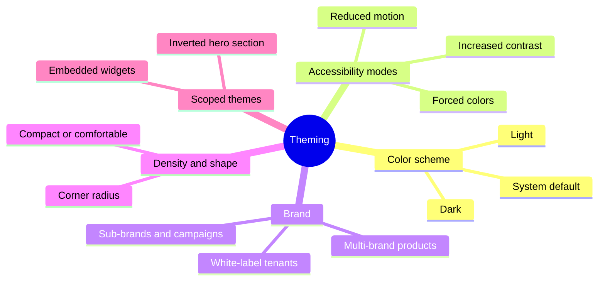
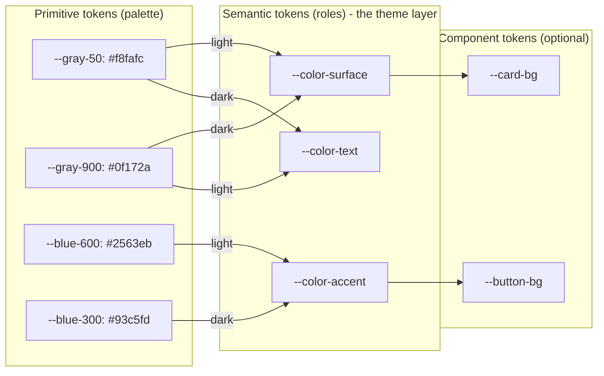
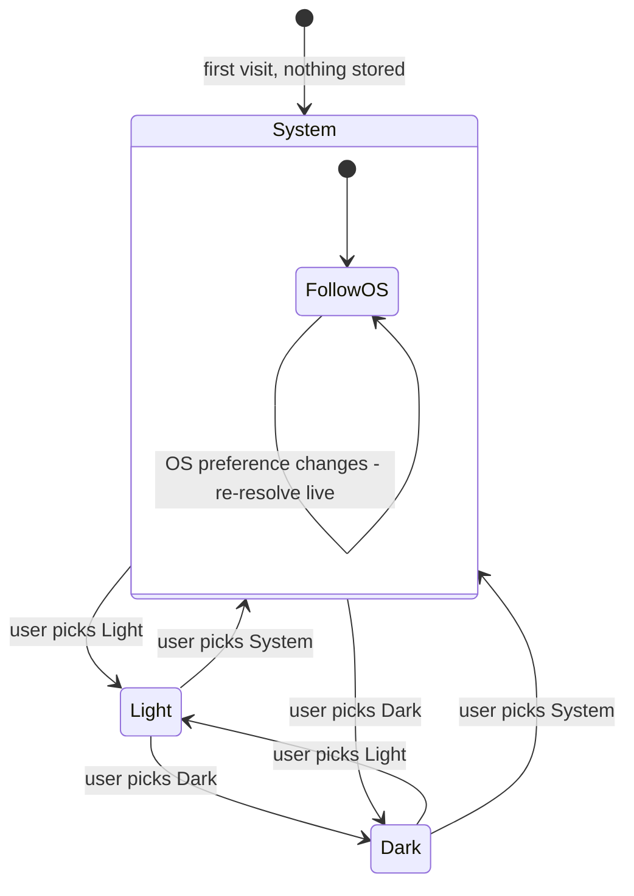
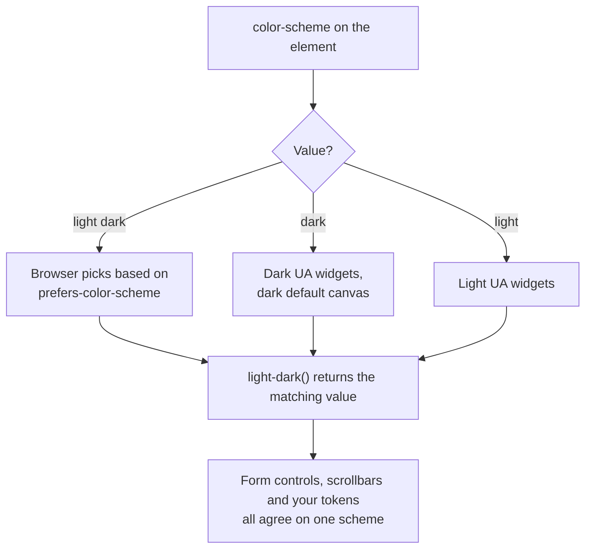
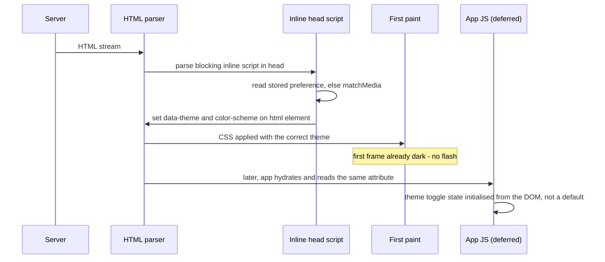
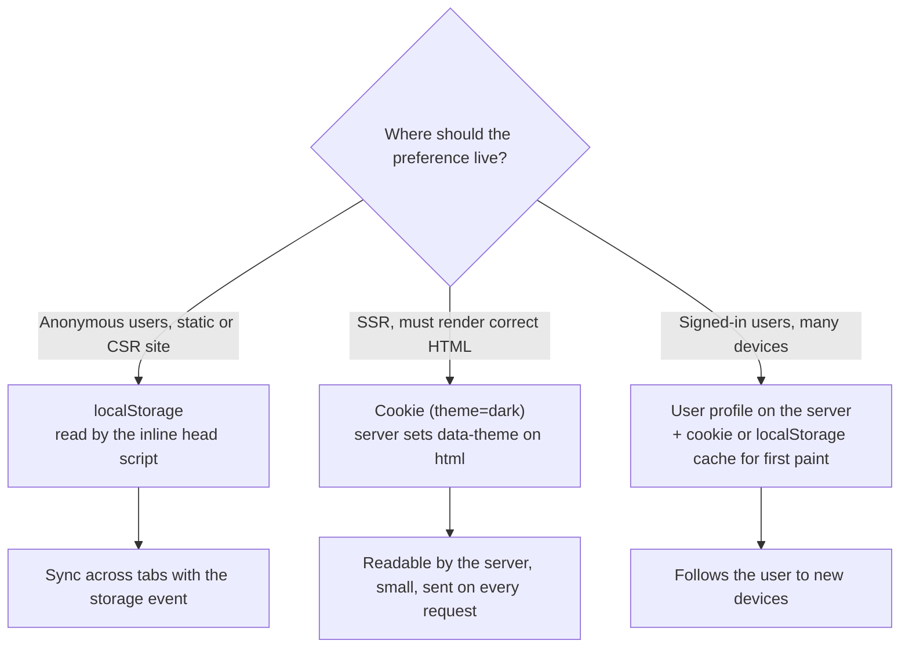
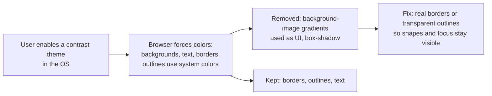
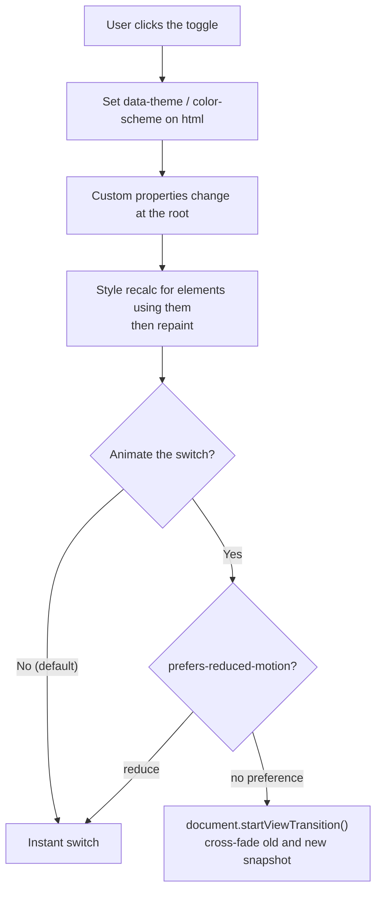
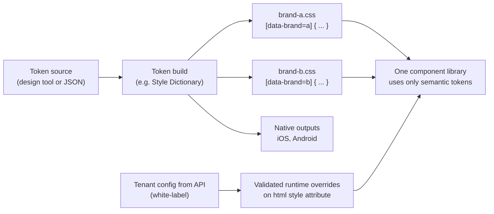
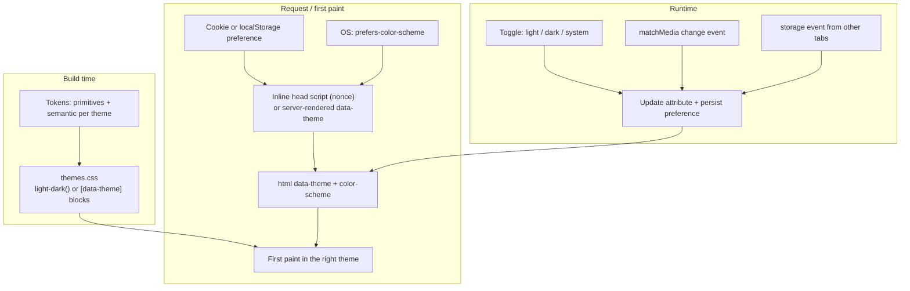

# Theming & Dark Mode

> **Date:** 2026-11-06 · **Last updated:** 2026-11-06
> **Category:** Frontend System Design
> **Sub-Topic:** Design Systems & Components / Theming
> **Level:** Intermediate · **Reading time:** ~30 min
> **Informs:** theme token architecture (primitive vs semantic), CSS custom properties vs JS theme providers, light/dark/system preference model, flash-free theme loading with SSR and CSP, theme preference persistence, dark palette and contrast design, forced-colors support, multi-brand and white-label theming, native-platform dark mode

> **Pre-requisite:** [Design Tokens](./design-tokens.md) (the values a theme swaps) and [CSS Architecture (CSS-in-JS, Tailwind, CSS Modules)](./css-architecture-css-in-js-tailwind-css-modules.md) (where those values are applied).
> This note covers how to build themes that switch **instantly, without a flash, accessibly, and across every framework** — from token layering to `color-scheme`, `light-dark()`, SSR, forced colors and multi-brand systems.

**Previous:** [Responsive Design Patterns](./responsive-design-patterns.md) · **Next:** [ARIA Roles, States & Properties](../06-accessibility-and-i18n/aria-roles-states-and-properties.md)

---

## Table of Contents

1. [ELI5 — Simple Explanation](#eli5--simple-explanation)
2. [Section 1: What "Theming" Covers](#section-1-what-theming-covers)
3. [Section 2: Token Layers — Why Semantic Tokens Make Themes Possible](#section-2-token-layers--why-semantic-tokens-make-themes-possible)
4. [Section 3: The Mechanism — CSS Custom Properties](#section-3-the-mechanism--css-custom-properties)
5. [Section 4: Light, Dark and System — the Preference Model](#section-4-light-dark-and-system--the-preference-model)
6. [Section 5: color-scheme and light-dark()](#section-5-color-scheme-and-light-dark)
7. [Section 6: Avoiding the Flash of the Wrong Theme](#section-6-avoiding-the-flash-of-the-wrong-theme)
8. [Section 7: Persisting the Preference](#section-7-persisting-the-preference)
9. [Section 8: Designing a Dark Palette](#section-8-designing-a-dark-palette)
10. [Section 9: Images, Icons, Charts and Embeds](#section-9-images-icons-charts-and-embeds)
11. [Section 10: Forced Colors and High Contrast](#section-10-forced-colors-and-high-contrast)
12. [Section 11: Switching Themes — Performance and Motion](#section-11-switching-themes--performance-and-motion)
13. [Section 12: Multi-Brand and White-Label Theming](#section-12-multi-brand-and-white-label-theming)
14. [Section 13: Frameworks and Native Platforms](#section-13-frameworks-and-native-platforms)
15. [Full Visual — Theme Architecture End to End](#full-visual--theme-architecture-end-to-end)
16. [Real-World Examples](#real-world-examples)
17. [Key Points Summary](#key-points-summary)
18. [Test Your Understanding](#test-your-understanding)
19. [Cheat Sheet](#cheat-sheet)
20. [References & Further Reading](#references--further-reading)

---

## ELI5 — Simple Explanation

Think of a **theatre stage**. The actors, props and script stay the same, but the **lighting operator** can switch between "day", "night" and "storm" presets with one lever.

- The **props** are your components. They never say "I am white" — they say "I am the **background**".
- The **lighting preset** is your theme: it decides what "background" means right now (white by day, dark grey at night).
- The **audience's preference** is the operating system setting: some people asked for night lighting before the show even started.
- A **flash of the wrong theme** is the lights blazing white for a second before the night preset kicks in — painful for everyone sitting in the dark.

> **Components reference roles (`--color-surface`), themes assign values to those roles, and the right theme must be applied before the first paint.**

---

## Core Concept — Step by Step

### Section 1: What "Theming" Covers



| Theme dimension | Who chooses | Typical mechanism |
|---|---|---|
| **Light / dark** | User (or OS default) | `prefers-color-scheme`, a stored choice, `data-theme` attribute |
| **Forced colors / high contrast** | User's OS | `forced-colors: active`, `prefers-contrast: more` — mostly the browser's job, you must not fight it |
| **Brand** | Product / tenant | A token set per brand, loaded at build or runtime |
| **Density** | User or product area | Spacing/size tokens switched by attribute |
| **Scoped** | Designer, per section | A theme attribute on a subtree (custom properties inherit) |

---

### Section 2: Token Layers — Why Semantic Tokens Make Themes Possible

A theme swaps **values behind names**. That only works if components use names that describe a **role**, not a color.



| Layer | Example | Changes per theme? | Used by components? |
|---|---|---|---|
| **Primitive** | `--blue-600` | No — it's the raw palette | ❌ Never directly |
| **Semantic** | `--color-accent`, `--color-surface-raised`, `--color-text-muted` | ✅ Yes — this is what a theme defines | ✅ Yes |
| **Component** | `--button-bg` | Usually derived from semantic | ✅ Inside that component |

```text
❌ .card { background: var(--gray-50); }        → dark theme must redefine "gray-50" as dark → names lie
✅ .card { background: var(--color-surface); }  → dark theme maps surface → gray-900
```

> Name semantic tokens in **pairs** where possible (`surface` / `on-surface`, `accent` / `on-accent`) so every background has a foreground that is guaranteed to contrast in every theme. See [Design Tokens](./design-tokens.md) for the token pipeline.

---

### Section 3: The Mechanism — CSS Custom Properties

Custom properties **inherit** and can be **redefined on any element**, and changing one updates every usage without re-rendering components. That makes them the default theming mechanism on the web.

```css
:root {
  --color-surface: #ffffff;
  --color-text: #0f172a;
  --color-accent: #2563eb;
}
[data-theme="dark"] {
  --color-surface: #0f172a;
  --color-text: #e2e8f0;
  --color-accent: #93c5fd;
}
body { background: var(--color-surface); color: var(--color-text); }

/* Scoped theme: [data-theme="dark"] is not limited to :root, so
   <section class="promo" data-theme="dark"> re-themes only that subtree.
   Give the section its own background so the redefined variables are visible. */
.promo { background: var(--color-surface); color: var(--color-text); color-scheme: dark; }
```

**Alternatives and why custom properties usually win:**

| Approach | How it switches | Drawbacks |
|---|---|---|
| **CSS custom properties** + attribute/class | Change one attribute on `<html>` | None significant; works in every framework, SSR and Server Components |
| **Separate stylesheets per theme** | Swap a `<link>` | Network request on switch, flash while loading, duplicated CSS |
| **Sass/Less variables** | Compile one CSS bundle per theme | Compile-time only — can't switch at runtime without shipping every bundle |
| **JS ThemeProvider (runtime CSS-in-JS)** | React context → regenerate styles | Re-renders the tree on switch, client-only, runtime cost; modern libraries (MUI, Chakra) now emit CSS variables instead |
| **Tailwind `dark:` variants** | Utilities gated by a selector or media query | Duplicates every color in markup; prefer Tailwind theme variables mapped to semantic tokens |

> **Rule:** JS decides **which** theme (preference, storage, toggle); CSS custom properties decide **what it looks like**. Don't pass colors through props or context.

---

### Section 4: Light, Dark and System — the Preference Model

Offer three choices, not two. "System" means "follow the OS, including when it changes at sunset".



```text
stored preference : 'light' | 'dark' | 'system'        ← what the user chose (persist this)
resolved theme    : 'light' | 'dark'                   ← what is applied right now (derive this)
resolved = preference === 'system'
  ? (matchMedia('(prefers-color-scheme: dark)').matches ? 'dark' : 'light')
  : preference
```

Two common bugs:
- **Persisting the resolved theme** instead of the preference — a "system" user gets frozen into whatever the OS was at the time.
- **Not listening for OS changes** — `matchMedia(...).addEventListener('change', …)` keeps "system" live.

---

### Section 5: color-scheme and light-dark()

Your CSS variables theme **your** elements. The browser also draws things you don't style: form controls, scrollbars, the default canvas background, spell-check underlines, date pickers. **`color-scheme`** tells the browser which schemes your page supports so it renders those in the right mode.

```html
<!-- In <head>: lets the browser use a dark canvas before CSS loads -->
<meta name="color-scheme" content="light dark" />
```

```css
:root { color-scheme: light dark; }            /* follow the OS */
:root[data-theme="light"] { color-scheme: light; }
:root[data-theme="dark"]  { color-scheme: dark; }

/* light-dark(light-value, dark-value) resolves against the USED color-scheme */
:root {
  --color-surface: light-dark(#ffffff, #0f172a);
  --color-text:    light-dark(#0f172a, #e2e8f0);
  --color-accent:  light-dark(#2563eb, #93c5fd);
}
```



| Feature | What it does | Support (per MDN) |
|---|---|---|
| `color-scheme` property / meta | Opts the page (or an element) into light/dark UA rendering | All major browsers |
| `light-dark()` | One declaration for both schemes; needs `color-scheme` set | All major browsers since 2024 |
| `prefers-color-scheme` media query | Reads the OS/browser preference | All major browsers |
| `accent-color` | Tints checkboxes, radios, range, progress | Broad; check MDN for mobile details |

> With `light-dark()`, switching the theme is just changing `color-scheme` on `<html>` — no duplicate blocks of variables. For older browsers, keep the `[data-theme]` + media-query approach as a fallback.

---

### Section 6: Avoiding the Flash of the Wrong Theme

If the theme is applied by a React effect or a deferred script, the page first paints in the default (light) theme, then flips. Dark-mode users see a white flash on every navigation.



**Options, from simplest to most robust:**

| Strategy | Flash-free? | Notes |
|---|---|---|
| **Pure CSS** (`prefers-color-scheme` / `light-dark()` only, no toggle) | ✅ | Simplest; no user override |
| **Inline blocking script in `<head>`** reading `localStorage` | ✅ | Tiny synchronous script before any CSS-dependent paint. Needs a **CSP nonce or hash** (see [Content Security Policy](../07-security/content-security-policy-csp.md)) |
| **Cookie + SSR** — server renders `data-theme` into `<html>` | ✅ for explicit light/dark | Server can't know the OS preference for "system" on the first request; combine with CSS `light-dark()`/media fallback |
| **`Sec-CH-Prefers-Color-Scheme` client hint** | Partly | Chromium-only and requires opting in via `Accept-CH`; Firefox and Safari don't send it |
| **Effect after hydration** (`useEffect`) | ❌ | Flash on every load — avoid |

**SSR and hydration:** the inline script changes `<html>` attributes before React hydrates, so the server HTML and the DOM differ. Libraries like `next-themes` tell you to put `suppressHydrationWarning` on `<html>` (it only applies one level deep). Render the toggle's **icon** only after mount, or derive it from CSS, so it doesn't mismatch either.

---

### Section 7: Persisting the Preference



| Store | Server can read? | Cross-tab sync | Notes |
|---|---|---|---|
| `localStorage` | ❌ | ✅ `storage` event | Synchronous read is fine for one tiny key; can throw in some privacy modes → wrap in `try/catch` |
| Cookie | ✅ | Manual | Not `HttpOnly` if the client also writes it; set `SameSite=Lax`, long `Max-Age` |
| Server profile | ✅ | Via app | Still cache locally for flash-free first paint |

See [Browser Storage Mechanisms](../01-web-fundamentals/browser-storage-mechanisms.md) for storage trade-offs.

---

### Section 8: Designing a Dark Palette

Dark mode is **not** `filter: invert(1)`. It's a second, deliberately designed palette.

| Principle | Why |
|---|---|
| **Use dark grey, not pure black** for main surfaces | Pure black with bright text can feel harsh and makes elevation hard to show. Material Design's dark-theme guidance has long recommended a dark grey (e.g. `#121212`) baseline |
| **Show elevation with lighter surfaces**, not just shadows | Shadows are barely visible on dark backgrounds; raised surfaces get slightly lighter |
| **Desaturate and lighten accent colors** | Saturated colors that work on white can vibrate or fail contrast on dark grey |
| **Avoid pure white body text on dark** if it glares | An off-white still meeting contrast is often more comfortable |
| **Re-check contrast in both themes** | WCAG 1.4.3 (4.5:1 text, 3:1 large text) and 1.4.11 (3:1 UI components and focus indicators) apply to **each** theme — see [Color Contrast & Visual Accessibility](../06-accessibility-and-i18n/color-contrast-and-visual-accessibility.md) |
| **Don't encode meaning only by hue** | Success/error colors shift between themes; keep icons/text labels |
| **Generate palettes in OKLCH** | Perceptually uniform lightness makes consistent light/dark ramps easier than HSL |

```css
:root {
  /* Derive states from one accent instead of hand-picking every shade */
  --color-accent: light-dark(oklch(0.55 0.2 260), oklch(0.78 0.12 260));
  --color-accent-hover: color-mix(in oklch, var(--color-accent), var(--color-text) 15%);
  --color-surface-raised: light-dark(#ffffff, color-mix(in oklch, #0f172a, white 6%));
}
```

---

### Section 9: Images, Icons, Charts and Embeds

| Asset | Technique |
|---|---|
| **Logos and illustrations** | Provide dark variants via `<picture><source media="(prefers-color-scheme: dark)">` — note this follows the **OS**, not your in-app toggle; for toggles, swap with CSS (`[data-theme=dark] .logo-light { display: none }`) or use inline SVG |
| **Icons (SVG)** | `fill="currentColor"` / `stroke="currentColor"` so they inherit text color |
| **Photos** | Usually leave alone; optionally reduce brightness slightly (`filter: brightness(.9)`) for large bright images |
| **Charts** | Read colors from CSS variables (`getComputedStyle`) and re-render on theme change; canvas-based charts don't update automatically |
| **Maps, code highlighting, editors** | Most libraries ship a dark theme — switch them together with yours |
| **Iframes / embeds** | If an embedded document's color scheme differs from its embedding element's, browsers paint the iframe with an **opaque** background (to keep it readable), so a light widget in a dark page shows a white box — pass the theme to the embed (query param or `postMessage`) |
| **Browser UI** | `<meta name="theme-color" media="(prefers-color-scheme: dark)" content="#0f172a">` tints browser chrome where supported (not Firefox, per MDN) |

---

### Section 10: Forced Colors and High Contrast

**Forced colors mode** (e.g. Windows contrast themes) replaces your colors with a small user-chosen palette. Your job is to **not break** it.



```css
/* A transparent outline is invisible normally but becomes visible in forced colors */
.button { outline: 2px solid transparent; outline-offset: 2px; }
.button:focus-visible { outline-color: var(--color-focus); }

@media (forced-colors: active) {
  .toggle[aria-checked="true"] { background: Highlight; color: HighlightText; }
  .icon { forced-color-adjust: auto; }
}

@media (prefers-contrast: more) {
  :root { --color-border: light-dark(#334155, #cbd5e1); }
}
```

- Use **CSS system colors** (`Canvas`, `CanvasText`, `LinkText`, `ButtonText`, `Highlight`, `GrayText`) inside `forced-colors` blocks.
- Use `forced-color-adjust: none` **sparingly** (e.g. a color picker swatch), never on whole regions. MDN lists it in Chromium and Firefox, not Safari.
- `prefers-contrast: more` is a hint to strengthen borders and text contrast in **your** themes.

---

### Section 11: Switching Themes — Performance and Motion



- A root-level variable change triggers **one style recalculation and repaint** — normally fine. Avoid `* { transition: background-color .3s, color .3s }`: it animates thousands of elements, looks muddy, and slows the switch. If transitions run during the switch, disable them briefly (add a class that sets `transition: none`, remove it after a frame).
- For a polished switch, **View Transitions** snapshot the old and new states and cross-fade them. `document.startViewTransition()` is available in Chromium, Safari and recent Firefox per MDN — feature-detect and fall back to an instant switch.
- Don't make the toggle async (fetching a theme file on click) unless it's a brand theme; light/dark must be instant.

---

### Section 12: Multi-Brand and White-Label Theming



| Need | Approach |
|---|---|
| A few known brands | Build one CSS file per brand (or one file with `[data-brand]` blocks); choose at build time or by hostname on the server |
| Many tenants (white-label SaaS) | Store a **small** set of tenant tokens (brand color, logo, radius, font); derive the rest (`color-mix()`, relative colors) and validate contrast **server-side** before saving |
| Brand × light/dark | Two independent axes: `data-brand` and `color-scheme`. Semantic tokens = f(brand, scheme) |
| Third-party components | Map their CSS variables to your semantic tokens in one adapter stylesheet |

**Security note:** tenant-supplied values end up in CSS. Validate them as colors/lengths (never inject raw strings into a `<style>` block), or set them through `element.style.setProperty('--brand', value)`, which can't break out into other rules.

---

### Section 13: Frameworks and Native Platforms

| Stack | Typical approach |
|---|---|
| **React / Next.js** | CSS variables + `next-themes` (inline script, `attribute="class"` or `data-theme`, `nonce` prop for CSP, `suppressHydrationWarning` on `<html>`) |
| **Tailwind v4** | `dark:` uses `prefers-color-scheme` by default; for a toggle, redefine the variant: `@custom-variant dark (&:where([data-theme=dark], [data-theme=dark] *));`. Better: map `@theme` colors to your semantic CSS variables so most components need no `dark:` at all |
| **MUI** | CSS theme variables mode with `colorSchemes: { light, dark }` and an init script to prevent SSR flicker |
| **Vue / Nuxt** | VueUse `useColorMode` / `useDark`; Nuxt's color-mode module handles SSR and the inline script |
| **Angular Material** | The `mat.theme()` Sass mixin emits `--mat-sys-*` CSS variables defined with `light-dark()`; set `color-scheme` to switch |
| **Svelte / SvelteKit** | CSS variables + a small inline script in `app.html` (or a community helper such as `mode-watcher`) |
| **React Native** | `useColorScheme()` / `Appearance`; pass semantic tokens through context or a styling library |
| **iOS** | Semantic system colors (`.label`, `.systemBackground`), asset-catalog colors with dark appearances, `@Environment(\.colorScheme)` |
| **Android** | `values-night` resources, Material 3 `DayNight` themes, `isSystemInDarkTheme()` in Compose; dynamic color on Android 12+ |

---

## Full Visual — Theme Architecture End to End



---

## Real-World Examples

**Example 1 — Hard-coded colors vs semantic tokens (BAD → GOOD):**
```css
/* ❌ BAD: colors baked into components; dark mode needs overrides everywhere */
.card { background: #fff; color: #111; border: 1px solid #e5e7eb; }
.dark .card { background: #1f2937; color: #f9fafb; border-color: #374151; }
.dark .sidebar .card { /* …and again for every context */ }

/* ✅ GOOD: components use roles; themes define roles once */
:root {
  color-scheme: light dark;
  --color-surface-raised: light-dark(#ffffff, #1e293b);
  --color-text: light-dark(#0f172a, #e2e8f0);
  --color-border: light-dark(#e2e8f0, #334155);
}
:root[data-theme="light"] { color-scheme: light; }
:root[data-theme="dark"]  { color-scheme: dark; }

.card {
  background: var(--color-surface-raised);
  color: var(--color-text);
  border: 1px solid var(--color-border);
}
```

**Example 2 — Flash-free inline script (framework-agnostic):**
```html
<head>
  <meta name="color-scheme" content="light dark" />
  <!-- Must run before the body paints. Keep it tiny; allow it in CSP with a nonce or hash. -->
  <script nonce="{{cspNonce}}">
    (function () {
      var pref = 'system';
      try { pref = localStorage.getItem('theme') || 'system'; } catch (e) {}
      var dark = pref === 'dark' ||
        (pref === 'system' && window.matchMedia('(prefers-color-scheme: dark)').matches);
      var root = document.documentElement;
      root.dataset.theme = dark ? 'dark' : 'light';
      root.style.colorScheme = dark ? 'dark' : 'light';
    })();
  </script>
  <link rel="stylesheet" href="/assets/app-3f9a1c.css" />
</head>
```

**Example 3 — React theme hook with light/dark/system, OS and cross-tab sync:**
```tsx
import { useCallback, useEffect, useSyncExternalStore } from 'react';

type Preference = 'light' | 'dark' | 'system';
const KEY = 'theme';
const media = () => window.matchMedia('(prefers-color-scheme: dark)');

function readPreference(): Preference {
  try {
    const v = localStorage.getItem(KEY);
    return v === 'light' || v === 'dark' ? v : 'system';
  } catch {
    return 'system';
  }
}

function apply(pref: Preference) {
  const dark = pref === 'dark' || (pref === 'system' && media().matches);
  const root = document.documentElement;
  root.dataset.theme = dark ? 'dark' : 'light';
  root.style.colorScheme = dark ? 'dark' : 'light';
}

const listeners = new Set<() => void>();
const notify = () => listeners.forEach((l) => l());

function subscribe(cb: () => void) {
  listeners.add(cb);
  const onStorage = (e: StorageEvent) => { if (e.key === KEY) { apply(readPreference()); notify(); } };
  window.addEventListener('storage', onStorage);
  return () => { listeners.delete(cb); window.removeEventListener('storage', onStorage); };
}

export function useTheme() {
  const preference = useSyncExternalStore(subscribe, readPreference, () => 'system' as Preference);

  // Keep "system" live when the OS switches (e.g. at sunset)
  useEffect(() => {
    if (preference !== 'system') return;
    const mql = media();
    const onChange = () => apply('system');
    mql.addEventListener('change', onChange);
    return () => mql.removeEventListener('change', onChange);
  }, [preference]);

  const setPreference = useCallback((next: Preference) => {
    try { localStorage.setItem(KEY, next); } catch { /* storage unavailable: still apply */ }
    apply(next);
    notify();
  }, []);

  return { preference, setPreference };
}
```

**Example 4 — Animated switch with View Transitions and reduced-motion fallback:**
```typescript
export function switchTheme(apply: () => void) {
  const reduce = window.matchMedia('(prefers-reduced-motion: reduce)').matches;
  if (!document.startViewTransition || reduce) {
    apply();
    return;
  }
  document.startViewTransition(apply);
}
```
```css
::view-transition-old(root),
::view-transition-new(root) { animation-duration: 200ms; }
```

**Example 5 — Tailwind v4 mapped to semantic variables:**
```css
@import "tailwindcss";

/* Toggle-driven dark variant (only needed where you still write dark: utilities) */
@custom-variant dark (&:where([data-theme=dark], [data-theme=dark] *));

:root {
  color-scheme: light dark;
  --surface: light-dark(#ffffff, #0f172a);
  --on-surface: light-dark(#0f172a, #e2e8f0);
  --accent: light-dark(#2563eb, #93c5fd);
}
:root[data-theme="light"] { color-scheme: light; }
:root[data-theme="dark"]  { color-scheme: dark; }

/* inline: utilities reference the variables, so bg-surface switches automatically */
@theme inline {
  --color-surface: var(--surface);
  --color-on-surface: var(--on-surface);
  --color-accent: var(--accent);
}
```
```html
<!-- No dark: prefixes needed for themed colors -->
<div class="bg-surface text-on-surface"><a class="text-accent">Docs</a></div>
```

**Example 6 — Vue, Angular and React Native:**
```typescript
// Vue (VueUse): 'auto' follows the OS; persisted to localStorage by default
import { useColorMode } from '@vueuse/core';
const mode = useColorMode({ attribute: 'data-theme' }); // mode.value = 'light' | 'dark' | 'auto'
```
```scss
// Angular Material: emits --mat-sys-* variables using light-dark()
@use '@angular/material' as mat;

html {
  color-scheme: light dark;
  @include mat.theme((
    color: mat.$azure-palette,
    typography: Roboto,
    density: 0,
  ));
}
html[data-theme='dark'] { color-scheme: dark; }
html[data-theme='light'] { color-scheme: light; }
```
```tsx
// React Native
import { useColorScheme, View, Text } from 'react-native';

const palette = {
  light: { surface: '#ffffff', text: '#0f172a' },
  dark: { surface: '#0f172a', text: '#e2e8f0' },
};

export function Screen() {
  const scheme = useColorScheme() === 'dark' ? 'dark' : 'light';
  const c = palette[scheme];
  return (
    <View style={{ flex: 1, backgroundColor: c.surface }}>
      <Text style={{ color: c.text }}>Hello</Text>
    </View>
  );
}
```

---

## Key Points Summary

| Concept | One-Line Explanation |
|---|---|
| **Semantic tokens** | Components use roles (`--color-surface`); themes map roles to palette values |
| **Custom properties** | Inherit, scope to subtrees, switch without re-rendering — the web's theming engine |
| **Three-state preference** | Store light/dark/system; derive the resolved theme; keep "system" live |
| **`color-scheme`** | Tells the browser to render its own UI (controls, scrollbars, canvas) in light or dark |
| **`light-dark()`** | One declaration per token for both schemes; follows the used `color-scheme` |
| **Flash prevention** | Apply the theme before first paint: inline head script (with CSP nonce) or SSR cookie |
| **Persistence** | localStorage for anonymous users, cookie for SSR, profile for signed-in users |
| **Dark palette** | Dark grey surfaces, lighter elevation, desaturated accents, contrast checked per theme |
| **Forced colors** | Don't fight the user's palette; keep borders/outlines; use system colors |
| **View Transitions** | Optional animated switch; respect reduced motion |
| **Multi-brand** | Brand and scheme are independent axes; validate tenant values |

---

## Test Your Understanding

**Q1 (Basic):**
What's the difference between `prefers-color-scheme` and `color-scheme`?

<details>
<summary>Answer</summary>

`prefers-color-scheme` is a **media feature you read**: it reports whether the user's OS or browser prefers light or dark. `color-scheme` is a **property (and meta tag) you set**: it tells the browser which schemes your page or element supports, so the browser renders **its own** UI in that mode — form controls, scrollbars, the default canvas background — and so that `light-dark()` knows which value to use. A page can read the preference and still need `color-scheme`; without it, your custom colors go dark but native inputs and scrollbars stay light.
</details>

**Q2 (Application):**
Your Next.js app stores the theme in `localStorage` and applies it in a `useEffect`. Dark-mode users complain about a white flash on every page load. Fix it.

<details>
<summary>Answer</summary>

`useEffect` runs **after** hydration, long after the first paint, so the page paints with the default light theme and then switches. Apply the theme **before first paint**:
- Add a tiny **inline blocking script in `<head>`** that reads `localStorage` (falling back to `matchMedia('(prefers-color-scheme: dark)')` for "system") and sets `data-theme` and `color-scheme` on `<html>`. Allow it in CSP with a nonce or hash. `next-themes` does exactly this.
- Add `suppressHydrationWarning` to `<html>` because the script changes its attributes before React hydrates.
- Add `<meta name="color-scheme" content="light dark">` so even the canvas before CSS loads is dark for dark-preferring users.
- Alternatively, store the choice in a **cookie** and render `data-theme` on the server; keep a CSS `prefers-color-scheme` fallback for "system".
</details>

**Q3 (Tricky):**
A user picks "System" while their OS is in light mode. That evening the OS switches to dark, but your site stays light until they reload — and if they reload it still stays light. What two bugs are likely present?

<details>
<summary>Answer</summary>

1. **The resolved theme was persisted instead of the preference.** When the user picked "System", the code saved `'light'` (what "system" resolved to at that moment). Every reload reads `'light'` and never consults the OS again. Fix: persist `'system'`, resolve at runtime.
2. **No listener for OS changes.** Even with the correct preference, a page that's already open must listen to `matchMedia('(prefers-color-scheme: dark)')`'s `change` event and re-apply while the preference is "system".

(A pure CSS approach with `color-scheme: light dark` and `light-dark()` handles "system" automatically, which is one reason to let CSS do the resolving.)
</details>

**Q4 (Tricky):**
In dark mode, your checkboxes and the page's scrollbar are still bright white, and a third-party iframe shows a white rectangle. Your CSS variables are all switching correctly. Explain both.

<details>
<summary>Answer</summary>

**Checkboxes and scrollbars** are drawn by the browser, not by your CSS variables. Unless you set `color-scheme: dark` (or `light dark`) on the root, the browser renders them in light mode. Fix: set `color-scheme` alongside `data-theme` (and optionally `accent-color` to brand the controls).

**The iframe:** when an embedded document's color scheme differs from its embedding element's, browsers give the iframe an **opaque** background so it stays readable, so a light-scheme widget inside a dark page appears as a white box. Fix: pass the current theme to the embed (URL parameter or `postMessage`) so it uses a matching scheme, or accept the light embed and give it a deliberate frame.
</details>

**Q5 (System design):**
You're building a white-label dashboard used by 300 tenants, each with a brand color and logo, and every tenant must support light and dark mode. Design the theming system.

<details>
<summary>Answer</summary>

- **Two independent axes:** `data-brand` (or runtime brand variables) × `color-scheme`. Components use only **semantic tokens** (`--color-accent`, `--color-on-accent`, `--color-surface`…).
- **Base themes** (light and dark) ship as static CSS built from the token pipeline.
- **Tenant config** stores a minimal set: brand color, logo (light and dark variants), maybe radius/font. On save, the server **validates** the values (real colors) and **checks contrast** of derived pairs (e.g. text on accent in both schemes), adjusting lightness in OKLCH or rejecting the value.
- **Derived tokens** at runtime with `color-mix()`/`light-dark()` (accent hover, subtle backgrounds), so tenants supply one color, not thirty.
- **Delivery:** the server resolves the tenant (hostname) and inlines a tiny `<style>` with escaped, validated variables, or sets them via `style` on `<html>` — no extra request, no flash. The user's light/dark preference uses a cookie or the inline-script pattern.
- **Embeds/charts** read the same variables; emails and PDFs get a server-side rendering of the same tokens.
- **Testing:** visual regression snapshots across a sample of tenants × both schemes × forced colors.
</details>

**Q6 (System design):**
Your design system's components are consumed by React, Vue and Angular apps, some using Server Components. A team proposes a `<ThemeProvider theme={...}>` React context that passes colors to every component. Evaluate the proposal and suggest an alternative.

<details>
<summary>Answer</summary>

A React context provider only works in React, only in **Client Components**, and switching themes re-renders every consumer. It also can't theme non-React consumers (Vue, Angular) or plain HTML (emails, server-rendered fragments). Colors passed through props/context also bypass the browser's `color-scheme` handling.

Alternative: ship **CSS custom properties** as the theme contract. The design system publishes `themes.css` (light, dark, brands) using semantic tokens and `light-dark()`/`[data-theme]`. Components only reference variables. Each framework adds a thin adapter that **chooses** the theme (sets `data-theme`/`color-scheme`, persists the preference) — `next-themes` in React, `useColorMode` in Vue, a small service in Angular. Server Components render themed markup with no client JS, and switching is a single attribute change.
</details>

---

## Cheat Sheet

**Key Definitions:**
- **Primitive token:** Raw palette value (`--blue-600`); never used directly by components
- **Semantic token:** A role (`--color-surface`) whose value changes per theme
- **Preference vs resolved theme:** What the user chose (light/dark/system) vs what's applied now (light/dark)
- **`color-scheme`:** Declares supported schemes; drives UA widget colors and `light-dark()`
- **`light-dark(a, b)`:** Picks `a` in light, `b` in dark, based on the used color scheme
- **Forced colors:** OS-imposed limited palette; detect with `@media (forced-colors: active)`
- **System colors:** `Canvas`, `CanvasText`, `LinkText`, `Highlight`, `ButtonText`, …

**Quick Reference:**
```text
<meta name="color-scheme" content="light dark">
:root { color-scheme: light dark; --color-surface: light-dark(#fff, #0f172a); }
:root[data-theme="dark"]  { color-scheme: dark; }      ← explicit user choice
:root[data-theme="light"] { color-scheme: light; }

Store: 'light' | 'dark' | 'system'  (never the resolved value)
Resolve: system → matchMedia('(prefers-color-scheme: dark)'), listen for 'change'
First paint: inline head script (nonce/hash) or SSR cookie → data-theme on <html>
React SSR: <html suppressHydrationWarning>; render toggle icon after mount
Cross-tab: window 'storage' event
Tailwind v4 toggle: @custom-variant dark (&:where([data-theme=dark], [data-theme=dark] *));
Forced colors: keep borders/transparent outlines; system colors; avoid forced-color-adjust: none
Animate switch: document.startViewTransition(apply) unless prefers-reduced-motion
Contrast: 4.5:1 text, 3:1 large text and UI parts — in EVERY theme
```

**Common Mistakes to Avoid:**

| Mistake | Why Wrong | Fix |
|---|---|---|
| Components use primitive colors (`--gray-50`) | Dark theme must lie about names or override everywhere | Semantic tokens |
| Applying the theme in `useEffect` | White flash before the switch | Inline head script or SSR cookie |
| Persisting the resolved theme | "System" users frozen to one scheme | Persist the preference |
| Forgetting `color-scheme` | Native controls and scrollbars stay light | Set `color-scheme` with the theme |
| `filter: invert(1)` as dark mode | Inverts images, brand colors, shadows | Design a dark palette |
| Pure black surfaces with saturated accents | Harsh contrast, vibrating colors, no elevation cues | Dark grey, desaturated accents, lighter raised surfaces |
| Global `* { transition: color… }` | Slow, muddy theme switch | Instant switch or View Transitions |
| Inline script blocked by CSP | Theme never applied, flash returns | Nonce or hash for the script |
| Box-shadow-only focus rings | Invisible in forced colors | Outline (transparent by default) |
| Theme passed through React context to every component | Client-only, re-renders, React-only | CSS custom properties as the contract |
| Unvalidated tenant colors injected into `<style>` | CSS injection, unreadable contrast | Validate, check contrast, `setProperty` |

---

## References & Further Reading

**Core docs**
- MDN: [`prefers-color-scheme`](https://developer.mozilla.org/en-US/docs/Web/CSS/@media/prefers-color-scheme)
- MDN: [`color-scheme`](https://developer.mozilla.org/en-US/docs/Web/CSS/color-scheme) · [`light-dark()`](https://developer.mozilla.org/en-US/docs/Web/CSS/color_value/light-dark)
- MDN: [Using CSS custom properties](https://developer.mozilla.org/en-US/docs/Web/CSS/Using_CSS_custom_properties)
- MDN: [`forced-colors`](https://developer.mozilla.org/en-US/docs/Web/CSS/@media/forced-colors) · [`forced-color-adjust`](https://developer.mozilla.org/en-US/docs/Web/CSS/forced-color-adjust) · [System colors](https://developer.mozilla.org/en-US/docs/Web/CSS/system-color)
- MDN: [`Sec-CH-Prefers-Color-Scheme`](https://developer.mozilla.org/en-US/docs/Web/HTTP/Reference/Headers/Sec-CH-Prefers-Color-Scheme)
- MDN: [View Transition API](https://developer.mozilla.org/en-US/docs/Web/API/View_Transition_API)
- web.dev: [prefers-color-scheme: Hello darkness, my old friend](https://web.dev/articles/prefers-color-scheme)
- web.dev: [Improved dark mode default styling with the color-scheme CSS property](https://web.dev/articles/color-scheme)

**Specs & guidelines**
- W3C: [CSS Color Adjustment Module Level 1](https://www.w3.org/TR/css-color-adjust-1/)
- W3C: [Media Queries Level 5 (user preference features)](https://www.w3.org/TR/mediaqueries-5/)
- W3C WAI: [Understanding SC 1.4.3 Contrast (Minimum)](https://www.w3.org/WAI/WCAG22/Understanding/contrast-minimum.html) · [SC 1.4.11 Non-text Contrast](https://www.w3.org/WAI/WCAG22/Understanding/non-text-contrast.html)

**Frameworks and platforms**
- [next-themes](https://github.com/pacocoursey/next-themes)
- Tailwind CSS: [Dark mode](https://tailwindcss.com/docs/dark-mode)
- MUI: [CSS theme variables](https://mui.com/material-ui/customization/css-theme-variables/overview/)
- VueUse: [`useColorMode`](https://vueuse.org/core/useColorMode/)
- Angular Material: [Theming guide](https://material.angular.dev/guide/theming)
- React Native: [`useColorScheme`](https://reactnative.dev/docs/usecolorscheme)
- Apple: [Dark Mode (Human Interface Guidelines)](https://developer.apple.com/design/human-interface-guidelines/dark-mode)
- Android: [Dark theme](https://developer.android.com/develop/ui/views/theming/darktheme)
- Material Design 3: [Color roles](https://m3.material.io/styles/color/roles)

**Deep dives**
- Microsoft Edge blog: [Styling for Windows high contrast with new standards for forced colors](https://blogs.windows.com/msedgedev/2020/09/17/styling-for-windows-high-contrast-with-new-standards-for-forced-colors/)
- Style Dictionary: [Documentation](https://styledictionary.com/)

---

> **Previous Topic:** [Responsive Design Patterns](./responsive-design-patterns.md)
> — Fluid layouts, media and container queries, responsive images

> **Next Topic:** [ARIA Roles, States & Properties](../06-accessibility-and-i18n/aria-roles-states-and-properties.md)
> — Phase 6 begins: accessibility semantics for custom components

*Saved on: 2026-11-06 | Repo: Frontend System Design Learning Notes*
