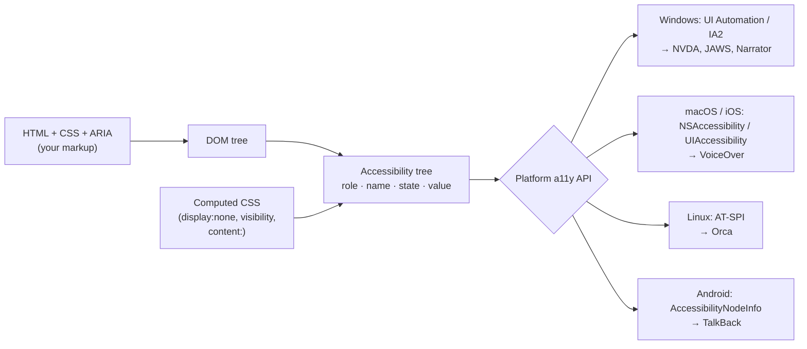
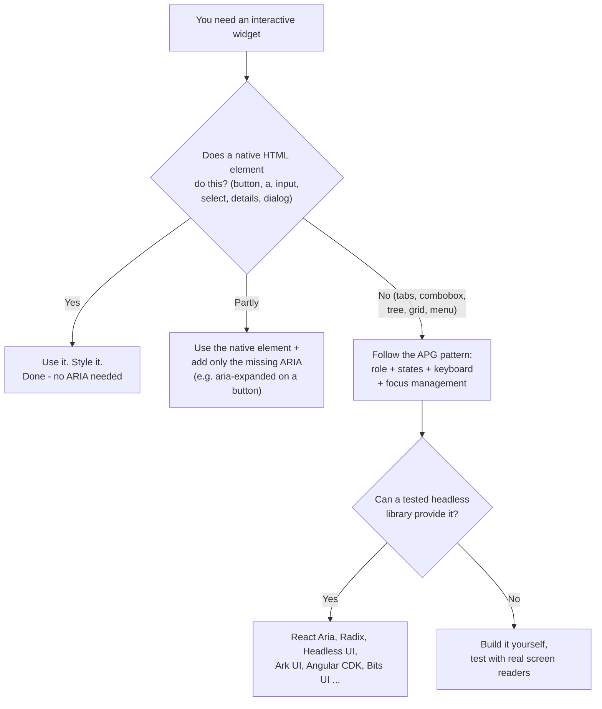
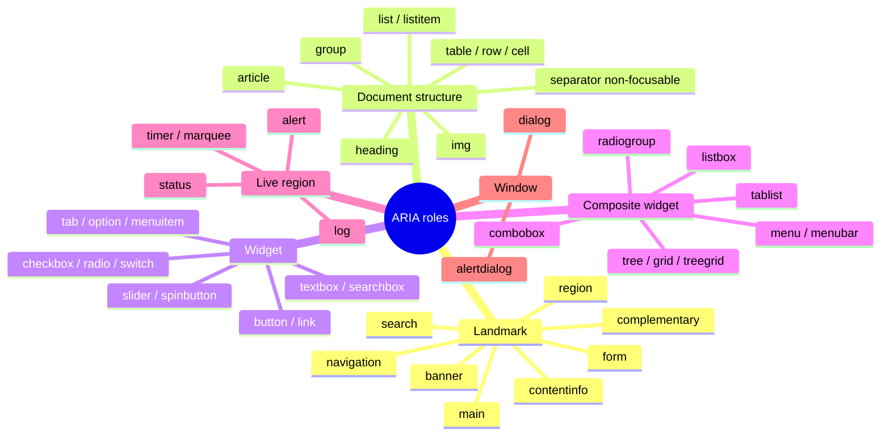
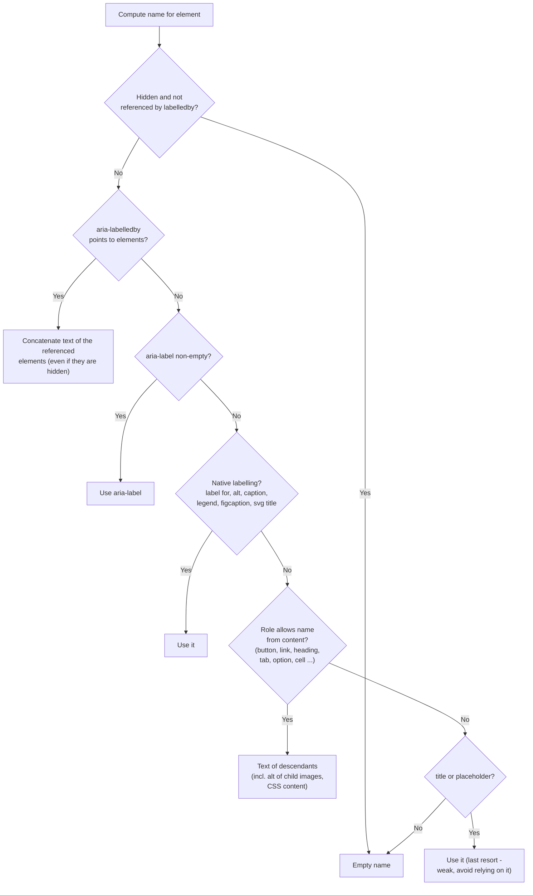
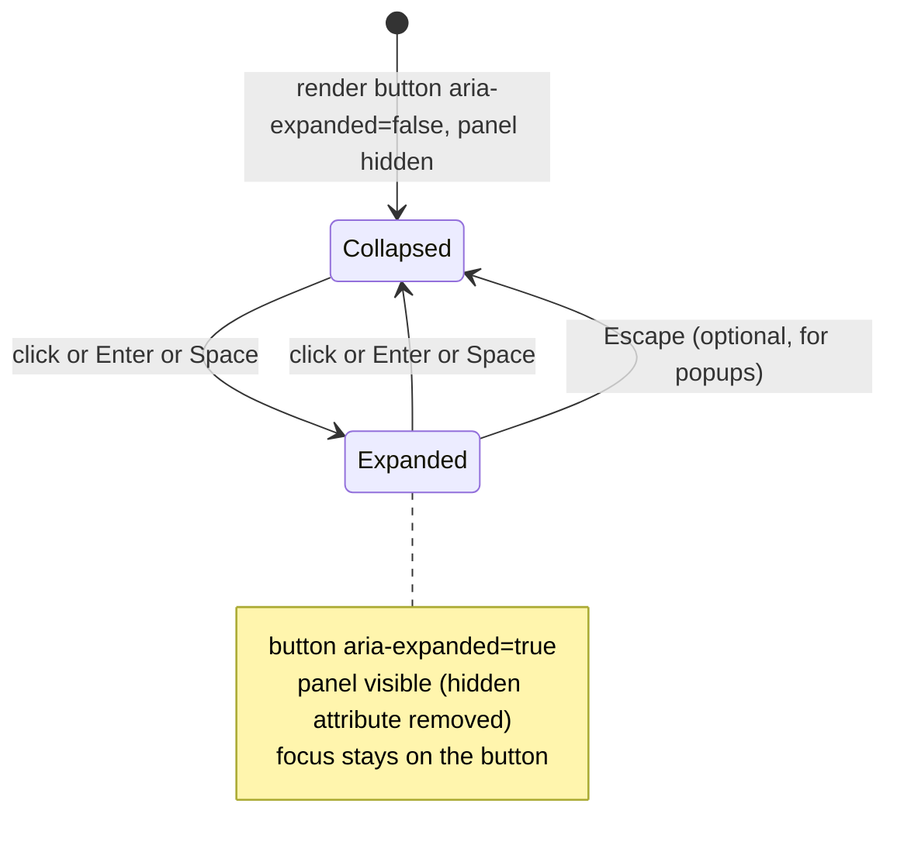
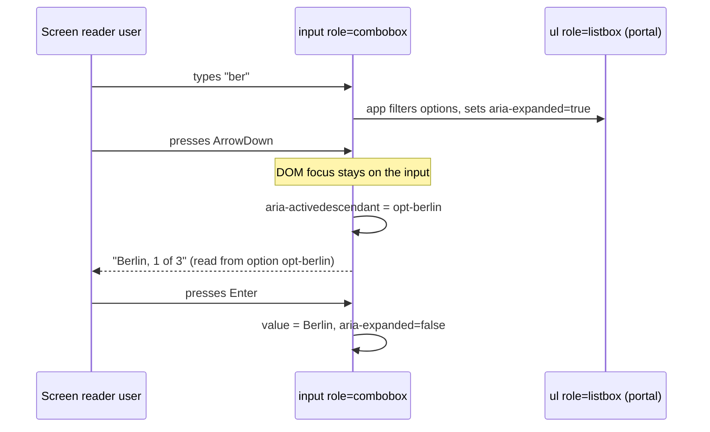
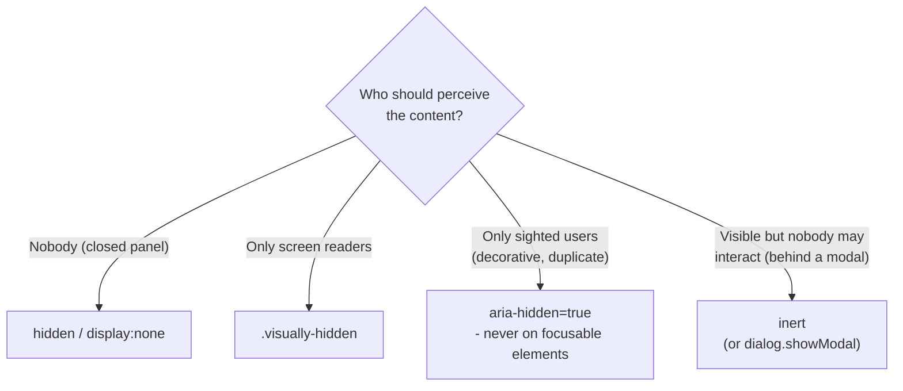
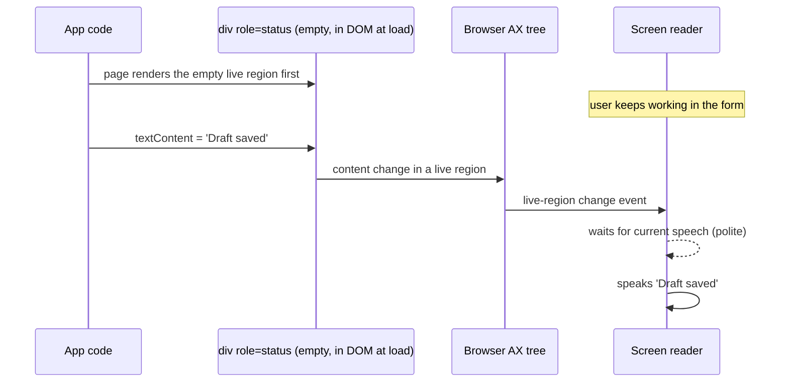
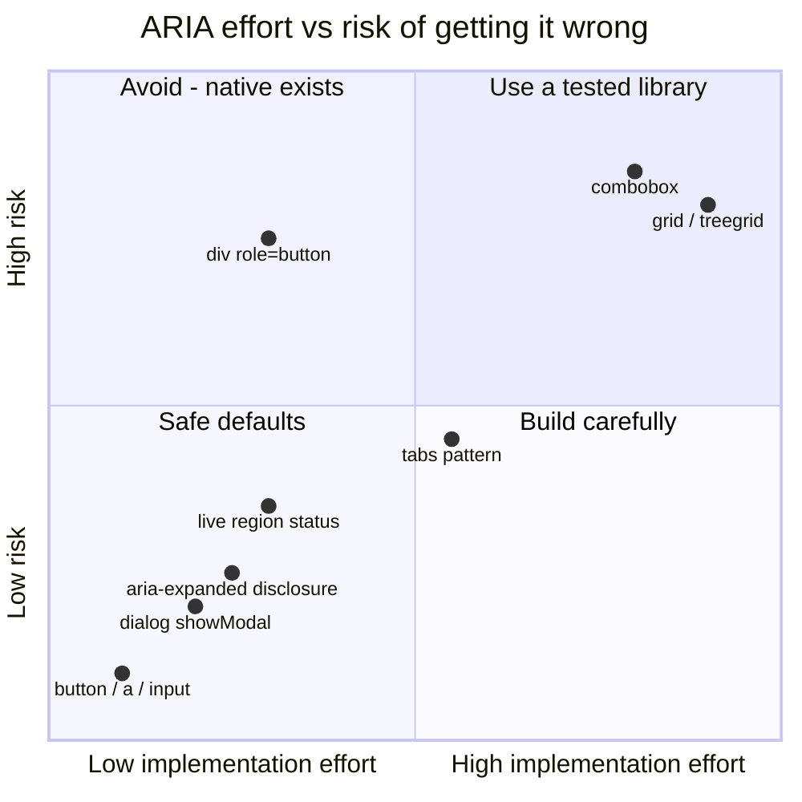

# ARIA Roles, States & Properties

> **Date:** 2026-11-06 · **Last updated:** 2026-11-06
> **Category:** Frontend System Design
> **Sub-Topic:** Accessibility / ARIA semantics
> **Level:** Intermediate · **Reading time:** ~30 min
> **Informs:** native HTML vs ARIA per widget, accessible names for icon buttons, custom widget contracts (tabs, disclosure, combobox), live-region announcements, hiding strategy (aria-hidden vs inert), design-system component a11y APIs, choosing headless UI libraries

> **Pre-requisite:** [DOM & Virtual DOM](../01-web-fundamentals/dom-and-virtual-dom.md) (the tree ARIA decorates) and [Component Architecture & Design Systems](../02-rendering-and-architecture/component-architecture-and-design-systems.md) (where these contracts live).
> This note opens **Phase 6 — Accessibility & i18n**. It explains what assistive technology actually "sees", and how ARIA changes that picture — for better or worse.

**Previous:** [Theming & Dark Mode](../05-design-systems-and-components/theming-and-dark-mode.md) · **Next:** [Keyboard Navigation & Focus Management](./keyboard-navigation-and-focus-management.md)

---

## Table of Contents

1. [ELI5 — Simple Explanation](#eli5--simple-explanation)
2. [Section 1: The Accessibility Tree](#section-1-the-accessibility-tree)
3. [Section 2: The Rules of ARIA](#section-2-the-rules-of-aria)
4. [Section 3: Roles — What Something Is](#section-3-roles--what-something-is)
5. [Section 4: Implicit Roles of HTML Elements](#section-4-implicit-roles-of-html-elements)
6. [Section 5: Accessible Name and Description](#section-5-accessible-name-and-description)
7. [Section 6: States and Properties](#section-6-states-and-properties)
8. [Section 7: Relationships Between Elements](#section-7-relationships-between-elements)
9. [Section 8: Hiding Content Correctly](#section-8-hiding-content-correctly)
10. [Section 9: Live Regions](#section-9-live-regions)
11. [Section 10: ARIA in Frameworks, Web Components and Native Mobile](#section-10-aria-in-frameworks-web-components-and-native-mobile)
12. [Decision Matrix — Native HTML or ARIA?](#decision-matrix--native-html-or-aria)
13. [Real-World Examples](#real-world-examples)
14. [Key Points Summary](#key-points-summary)
15. [Test Your Understanding (with answers)](#test-your-understanding)
16. [Cheat Sheet](#cheat-sheet)
17. [References & Further Reading](#references--further-reading)

---

## ELI5 — Simple Explanation

Imagine a museum with a **blind visitor and a tour guide**.

- The paintings and rooms are your **DOM** — what sighted visitors see.
- The tour guide doesn't describe brush strokes. They read the **labels next to each exhibit**: *"Room: Impressionism. Painting: Water Lilies. Status: on loan, returns in March."* That label card is the **accessibility tree**.
- **Role** = what the exhibit *is* ("painting", "door", "elevator button").
- **Name** = what it's *called* ("Water Lilies", "Exit").
- **State** = how it is *right now* ("door: open", "elevator button: pressed").
- **Property** = facts that rarely change ("this button controls the elevator in hall B").
- **ARIA** is a pen that lets you **rewrite the label cards**. It doesn't change the exhibit. Write "Elevator button" on a broom cupboard door, and the visitor will press it and nothing happens.

> **One-line takeaway: ARIA only changes what assistive technology is *told* — never how the element *behaves*. Use native HTML first; add ARIA only to describe custom widgets you have fully built yourself.**

---

## Core Concept — Step by Step

### Section 1: The Accessibility Tree

Browsers build a second tree next to the DOM: the **accessibility tree**. Each node has a **role**, a **name**, optional **description**, **states/properties** and a **value**. The browser exposes it to the operating system's **accessibility API**, which screen readers, voice control, switch devices and automation tools read.



A `<button>` in the DOM becomes roughly this in the accessibility tree:

```text
DOM:   <button aria-expanded="false" aria-controls="faq-1">Shipping</button>
AX:    role=button   name="Shipping"   expanded=false   focusable=true
Screen reader (NVDA):  "Shipping, button, collapsed"
```

| Term | Meaning |
|---|---|
| **Role** | The kind of thing: `button`, `link`, `checkbox`, `dialog`, `navigation`… |
| **Accessible name** | The short label AT announces ("Save", "Search products") |
| **Accessible description** | Extra help text, announced after the name (often after a pause) |
| **State** | Dynamic condition: `aria-expanded`, `aria-checked`, `aria-pressed`, `aria-selected` |
| **Property** | Mostly static characteristic or relationship: `aria-controls`, `aria-haspopup`, `aria-labelledby` |
| **Value** | For range/text widgets: slider position, text field content |

> **Inspect it yourself:** Chrome/Edge DevTools → Elements → **Accessibility** pane (and the full-page accessibility tree toggle); Firefox DevTools → **Accessibility** panel; Safari → Elements → **Node → Accessibility**. Testing Library's `getByRole('button', { name: 'Save' })` queries the same model.

---

### Section 2: The Rules of ARIA

**WAI-ARIA** (Web Accessibility Initiative – Accessible Rich Internet Applications) is a W3C spec of attributes: `role` plus `aria-*`. ARIA 1.2 is a W3C Recommendation (2023); ARIA 1.3 is in progress and some of its attributes (e.g. `aria-description`, `aria-braillelabel`) already ship in browsers — check MDN for each.

The W3C note **"Using ARIA"** gives five rules:

| # | Rule | In practice |
|---|---|---|
| 1 | If a native HTML element or attribute has the semantics **and behavior** you need, use it | `<button>`, not `<div role="button">`; `<input type="checkbox">`, not `role="checkbox"` |
| 2 | Don't change native semantics unless you really have to | Not `<h2 role="tab">`; wrap instead: `<h2><button role="tab">` only if the pattern needs it |
| 3 | All interactive ARIA controls must be **keyboard usable** | `role="button"` needs `tabindex="0"` + Enter **and** Space handlers |
| 4 | Don't put `role="presentation"`/`"none"` or `aria-hidden="true"` on a **visible focusable** element | Otherwise keyboard users land on "nothing" |
| 5 | All interactive elements must have an **accessible name** | Icon buttons need `aria-label` or visually hidden text |



**Why native wins** — compare what you get for free:

| Feature | `<button>` | `<div role="button">` |
|---|---|---|
| Role exposed | ✅ | ✅ (that's all ARIA gives you) |
| In tab order | ✅ | ❌ add `tabindex="0"` |
| Enter activates | ✅ | ❌ add keydown handler |
| Space activates (on key up) | ✅ | ❌ add key handler, prevent page scroll |
| `disabled` removes from tab order and blocks clicks | ✅ | ❌ manual |
| Submits forms, works with `form=`, `commandfor=` | ✅ | ❌ |
| Works in Windows High Contrast / forced colors | ✅ system button colors | ❌ looks like plain text |

> The WAI-ARIA Authoring Practices Guide (APG) has a section titled **"No ARIA is better than Bad ARIA"**. Wrong ARIA actively lies to users: a `role="button"` that ignores the keyboard is worse than a plain link-styled `<div>` nobody announced.

---

### Section 3: Roles — What Something Is

A **role** is set once and should not change during the element's life. ARIA groups roles into categories:



| Category | Purpose | Notes |
|---|---|---|
| **Landmark** | Page regions users jump between (screen reader "landmarks" menu / rotor) | Prefer `<header>`, `<nav>`, `<main>`, `<aside>`, `<footer>`, `<search>`, named `<section>`/`<form>` |
| **Document structure** | Non-interactive content structure | Mostly implicit from HTML; `role="heading" aria-level="2"` only when you can't use `<h2>` |
| **Widget** | Interactive controls | Each needs keyboard support and a name |
| **Composite** | Containers that manage focus among children | Usually **one tab stop** + arrow keys inside (see [Keyboard Navigation & Focus Management](./keyboard-navigation-and-focus-management.md)) |
| **Live region** | Content whose changes are announced | Section 9 |
| **Window** | Sub-windows | Prefer native `<dialog>` with `showModal()` |
| **Abstract** | Spec-internal parents (`widget`, `landmark`, `input`, `section`, `command`…) | **Never** put them in `role=""` |

**Role gotchas:**
- `role` **replaces** the native role entirely: `<ul role="tablist">` is no longer a list, and its `<li>` children become orphaned list items unless you also give them roles (`role="tab"` or `role="none"`).
- Some roles **require** owned children (`tablist` → `tab`, `listbox` → `option`, `menu` → `menuitem*`, `table` → `row`) and some require a specific parent (`tab` must be in `tablist`). Missing structure produces confusing or silent output.
- `role="application"` turns off a screen reader's browse-mode shortcuts for that subtree. It's only for truly desktop-like widgets (e.g. a canvas editor) — rarely right.
- `role="menu"` is for **application menus** (like a desktop menu bar), not for site navigation. A nav dropdown is a **disclosure** button + list of links.
- `role="presentation"` (synonym `role="none"`) strips semantics from the element itself, **not** its children's content. It's ignored if the element is focusable or has global ARIA attributes (browsers fall back to the native role — "presentational role conflict resolution").

---

### Section 4: Implicit Roles of HTML Elements

Every HTML element already maps to a role (defined in the **HTML-AAM** spec). Adding the same role again is redundant; overriding it is often invalid (the **ARIA in HTML** spec lists what's allowed).

| HTML | Implicit role | Condition / note |
|---|---|---|
| `<a href>` | `link` | Without `href` → `generic` (not focusable, not a link) |
| `<button>` | `button` | |
| `<input type="checkbox">` | `checkbox` | `switch` is allowed via `role="switch"` |
| `<input type="text">` / `<textarea>` | `textbox` | `type="text"` with `list` → `combobox` |
| `<input type="search">` | `searchbox` | |
| `<input type="range">` / `type="number"` | `slider` / `spinbutton` | |
| `<select>` | `combobox` | `multiple` or `size > 1` → `listbox` |
| `<ul>`, `<ol>` / `<li>` | `list` / `listitem` | WebKit may drop list semantics when `list-style: none` — add `role="list"` if it matters |
| `<h1>`…`<h6>` | `heading` (level 1–6) | |
| `<nav>`, `<main>`, `<aside>` | `navigation`, `main`, `complementary` | |
| `<header>`, `<footer>` | `banner`, `contentinfo` | Only when **not** inside `article`/`aside`/`main`/`nav`/`section` |
| `<section>`, `<form>` | `region`, `form` | **Only when they have an accessible name** |
| `<search>` | `search` | Newer element; supported in current Chrome, Firefox and Safari |
| `<dialog>` | `dialog` | Modal when opened with `showModal()` |
| `` / `` | `img` / `presentation` | Missing `alt` → name may come from file name (bad) |
| `<table>`, `<tr>`, `<td>`, `<th>` | `table`, `row`, `cell`, `columnheader`/`rowheader` | |
| `<fieldset>` / `details` element | `group` | |
| `<output>` | `status` | Implicit polite live region |
| `<progress>` / `<meter>` | `progressbar` / `meter` | |
| `<hr>` | `separator` | |
| `<div>`, `<span>` | `generic` | No semantics; can't be named with `aria-label` (see Section 5) |

> **CSS can affect the tree.** `display: none` and `visibility: hidden` remove nodes. `display: contents` used to drop semantics of elements like `<button>` and `<table>` in several browsers; most of those bugs are fixed, but verify on interactive elements. CSS generated `content:` text is included in accessible names.

---

### Section 5: Accessible Name and Description

The **accessible name** is computed by the **Accessible Name and Description Computation (accname)** algorithm. Simplified, the first non-empty source wins:



**Description** follows a similar order: `aria-describedby` → `aria-description` → `title` (if `title` wasn't already used as the name).

**Rules that trip people up:**
- **`aria-label` overrides visible text.** `<button aria-label="Close dialog">Cancel</button>` is announced "Close dialog", so a voice-control user who says "click Cancel" fails. WCAG 2.5.3 **Label in Name** requires the visible text to be **contained in** the accessible name, ideally at the start.
- **Naming is prohibited on some roles** (ARIA 1.2): `generic` (`<div>`, `<span>`), `paragraph`, `presentation`/`none`, `code`, `strong`, `emphasis`, `caption`, `deletion`, `insertion`, `subscript`, `superscript`. `<div aria-label="Price">` is ignored or inconsistently read — give it a real role first, or use visible text.
- `aria-label` is an attribute value: some automatic page-translation tools have historically skipped it while translating text content. For i18n-heavy apps, prefer visible text (or visually hidden text, or `aria-labelledby` pointing at text) so names go through the same translation pipeline as everything else.
- `placeholder` is not a label: it disappears on input and often fails contrast.
- An empty `alt=""` makes an image decorative (`presentation`); a **missing** `alt` is an error.

```html
<!-- Four ways to name an icon-only button, best first -->
<button><svg aria-hidden="true" focusable="false">…</svg><span class="visually-hidden">Delete invoice</span></button>
<button aria-labelledby="del-label"><svg aria-hidden="true">…</svg></button><span id="del-label" hidden>Delete invoice</span>
<button aria-label="Delete invoice"><svg aria-hidden="true">…</svg></button>
<button title="Delete invoice"><svg aria-hidden="true">…</svg></button>  <!-- last resort; tooltip-only, not touch/keyboard friendly -->
```

---

### Section 6: States and Properties

ARIA attributes are split into **states** (expected to change with user interaction) and **properties** (usually fixed). Both are just `aria-*` attributes; the distinction mostly tells you **which ones your JS must keep in sync**.

| Attribute | Type | Values | Used on | Announced as (typical) |
|---|---|---|---|---|
| `aria-expanded` | State | `true` / `false` | The **trigger** (button), not the panel | "collapsed" / "expanded" |
| `aria-pressed` | State | `true` / `false` / `mixed` | Toggle **button** | "toggle button, pressed" |
| `aria-checked` | State | `true` / `false` / `mixed` | `checkbox`, `radio`, `switch`, `menuitemcheckbox` | "checked" / "not checked" / "half checked" |
| `aria-selected` | State | `true` / `false` | `tab`, `option`, `gridcell`, `row` | "selected" |
| `aria-current` | State | `page`, `step`, `location`, `date`, `time`, `true` | Current link in nav, current step | "current page" |
| `aria-disabled` | State | `true` / `false` | Any element | "dimmed" / "unavailable" — stays focusable |
| `aria-invalid` | State | `true` / `false` / `grammar` / `spelling` | Form fields | "invalid entry" |
| `aria-hidden` | State | `true` | Any non-focusable subtree | (removed from the tree) |
| `aria-busy` | State | `true` / `false` | Region being updated | Some AT wait before announcing |
| `aria-haspopup` | Property | `true`(=menu), `menu`, `listbox`, `tree`, `grid`, `dialog` | Trigger button / combobox | "menu button", "has popup" |
| `aria-controls` | Property | ID ref(s) | Trigger → controlled element | Support is limited; harmless but not relied on |
| `aria-required` | Property | `true` / `false` | Custom fields (native: use `required`) | "required" |
| `aria-level` | Property | integer | `heading`, `treeitem`, `row` in treegrid | "heading level 3" |
| `aria-valuenow/min/max/text` | Property | numbers / string | `slider`, `progressbar`, `spinbutton`, `meter` | "40 percent" / valuetext |
| `aria-orientation` | Property | `horizontal` / `vertical` | `tablist`, `slider`, `toolbar`, `separator` | Hints arrow-key direction |
| `aria-modal` | Property | `true` | `dialog` (custom modal) | Hides outside content for some AT |

**State changes must stay in sync with behavior.** A disclosure is a tiny state machine:



**`disabled` vs `aria-disabled`:**

| | `disabled` (native) | `aria-disabled="true"` |
|---|---|---|
| Focusable | ❌ removed from tab order | ✅ stays focusable |
| Click events | Blocked by the browser | **Still fire** — you must ignore them |
| Use when | Control is truly unavailable | You want users to discover it and read *why* (e.g. a tooltip "Add a payment method first"), or a menu item inside a composite widget |

> **Boolean gotcha:** ARIA values are **strings**. `aria-expanded="false"` is a valid value and means collapsed. Removing the attribute means "not expandable" — a different thing. Frameworks differ in how they render `false` (Section 10).

---

### Section 7: Relationships Between Elements

Some properties point to other elements by **ID reference**:

| Attribute | Relationship | Example |
|---|---|---|
| `aria-labelledby` | "My name is the text over there" | Dialog named by its `<h2>` |
| `aria-describedby` | "More info is over there" | Field → hint and error text |
| `aria-errormessage` | "My error is over there" (only exposed while `aria-invalid="true"`) | Field → error; support still uneven, many teams pair it with `aria-describedby` |
| `aria-controls` | "I control that element" | Tab → tabpanel |
| `aria-owns` | "Treat that element as my child" (re-parents in the AX tree) | Combobox popup rendered in a portal |
| `aria-activedescendant` | "Focus stays on me, but the active child is that one" | Combobox input → highlighted `option` |
| `aria-details` | "Extended details are over there" | Figure → long description |
| `aria-flowto` | Alternate reading order | Rarely supported; avoid |



**ID references and components:**
- IDs must be **unique per document**. In component libraries, generate them: React `useId()`, Vue 3.5+ `useId()`, Angular a small ID-generator service (or a counter), Svelte 5 `$props.id()`.
- **Shadow DOM breaks ID references across the shadow boundary** — an `aria-labelledby` inside a shadow root can't reach an ID in the light DOM by string.
- **ARIA element reflection** (`el.ariaLabelledByElements = [labelEl]`, `ariaDescribedByElements`, `ariaActiveDescendantElement`, `ariaControlsElements`…) accepts element objects and is supported in current Chrome, Firefox and Safari (Chromium and Firefox added it in 2025). It can reference elements in the element's own tree **or an outer (ancestor) tree**, but not into another shadow root. Proposals such as **Reference Target** aim to close that gap — experimental, check status before using.

---

### Section 8: Hiding Content Correctly

"Hidden" has three audiences: sighted users, AT users, and keyboard users. Pick the tool by **who should still perceive it**:

| Technique | Visible | In AX tree (screen readers) | Focusable / clickable | Use for |
|---|---|---|---|---|
| `hidden` attribute / `display: none` | ❌ | ❌ | ❌ | Closed panels, inactive tabs |
| `visibility: hidden` | ❌ (keeps layout space) | ❌ | ❌ | Animations that need space |
| `.visually-hidden` CSS class | ❌ | ✅ | ✅ (if focusable) | Text labels for icon buttons, skip links (until focused) |
| `aria-hidden="true"` | ✅ | ❌ (whole subtree) | **Still focusable!** | Decorative icons, duplicated text |
| `inert` attribute | ✅ (often dimmed by your CSS) | ❌ | ❌ | Background behind a custom modal, off-screen carousel slides |
| `<dialog>.showModal()` | — | Outside content becomes inert automatically | — | Modals — the best option |
| `hidden="until-found"` | ❌ | ❌ | ❌, but find-in-page can reveal it | Collapsed accordion content searchable with Ctrl+F (support still varies) |

```css
/* The standard "visually hidden" utility (also called sr-only) */
.visually-hidden:not(:focus):not(:active) {
  clip-path: inset(50%);
  height: 1px;
  width: 1px;
  overflow: hidden;
  position: absolute;
  white-space: nowrap;
}
```



> **Never** put `aria-hidden="true"` on `<body>`, `<main>` or a container holding the focused element. Users can still Tab into it and hear nothing — WCAG 4.1.2 failure. `inert` removes both semantics **and** focus, which is what people usually meant.

---

### Section 9: Live Regions

Screen readers announce what has **focus**. Changes elsewhere — "Saved", "3 results", "Upload failed" — are silent unless they happen inside a **live region**.

| Markup | Politeness | Implicit `aria-atomic` | Use for |
|---|---|---|---|
| `role="status"` / `<output>` | polite | `true` | "Saved", "3 results found", cart count |
| `role="alert"` | assertive | `true` | Errors that need immediate attention |
| `role="log"` | polite | `false` | Chat messages, activity feeds (new items appended) |
| `role="timer"`, `role="marquee"` | off | — | Countdown / ticker (don't announce every tick) |
| `aria-live="polite"` | Waits until the user is idle | — | General-purpose |
| `aria-live="assertive"` | May interrupt current speech | — | Rarely; time-critical only |



**Rules that make live regions actually work:**
1. **The region must already exist in the accessibility tree** before its content changes. Inserting `<div role="alert">Error</div>` in one go is announced by some screen reader/browser pairs and missed by others; render the empty container at load, then update its text.
2. **Keep messages short** and update **text**, not big subtrees.
3. Repeating the **same text** may not be re-announced — clear it first, or add/remove content.
4. Avoid `aria-relevant` tweaks (`removals`, `all`) — support is poor.
5. Don't wrap large, frequently changing areas (a whole feed) in `aria-live` — it becomes noise.
6. **`ariaNotify()`** (`document.ariaNotify('Draft saved')` / `element.ariaNotify(...)`) is a newer API that asks AT to announce a string without a DOM live region. MDN's compat data lists it in Chromium 141+ with Firefox and Safari support arriving later — feature-detect and keep a live-region fallback.

---

### Section 10: ARIA in Frameworks, Web Components and Native Mobile

ARIA is plain HTML attributes, so every framework supports it — but **attribute vs property binding** and **boolean rendering** differ:

| Stack | Syntax | Notes |
|---|---|---|
| **React** | `<button aria-expanded={open} aria-controls={id}>` | `aria-*` stay hyphenated in JSX (not camelCase). Booleans render as `"true"`/`"false"`. IDs: `useId()`. |
| **Vue 3** | `<button :aria-expanded="open" :aria-controls="id">` | `false` renders as `"false"` (Vue 3 removes an attribute only for `null`/`undefined`). IDs: `useId()` (3.5+). |
| **Angular** | `<button [attr.aria-expanded]="open" [attr.aria-controls]="id">` | Use attribute binding (`attr.`) — there's no matching DOM property for most ARIA. Binding `null` removes the attribute. CDK `a11y`: `LiveAnnouncer`, `FocusTrap`, `ListKeyManager`, `FocusMonitor`. |
| **Svelte 5** | `<button aria-expanded={open} aria-controls={id}>` | Compiler emits `a11y_*` warnings (e.g. click handler on a non-interactive element, invalid ARIA attribute). IDs: `$props.id()`. |
| **Web Components** | `this.#internals = this.attachInternals(); this.#internals.role = 'switch'; this.#internals.ariaChecked = 'false';` | **Default semantics** via `ElementInternals` — the page author can still override with attributes. Use `delegatesFocus` for shadow roots that wrap a native control. |
| **React Native** | `<Pressable role="button" aria-label="Close" aria-expanded={open}>` | Supports `role` and many `aria-*` props (older code uses `accessibilityRole`, `accessibilityLabel`, `accessibilityState`). |
| **iOS (SwiftUI / UIKit)** | `.accessibilityLabel("Close")`, `.accessibilityAddTraits(.isButton)`, `.accessibilityValue(...)` | UIKit: `accessibilityLabel`, `accessibilityTraits`. VoiceOver reads these. |
| **Android (Compose / Views)** | `Modifier.semantics { contentDescription = "Close"; role = Role.Button; stateDescription = "Expanded" }` | Views: `contentDescription`, `AccessibilityNodeInfo`. TalkBack reads these. |

The **same model** — role, name, state, value — exists on every platform. A design system's component API should expose it consistently (e.g. every `IconButton` **requires** a `label` prop).

**Headless libraries** that ship tested ARIA + keyboard behavior: React Aria (Adobe), Radix Primitives, Headless UI, Ark UI (React/Vue/Solid/Svelte), Reka UI (Vue, formerly Radix Vue), Bits UI and Melt UI (Svelte), Angular CDK (and Angular Material). See [Headless UI / Renderless Components](../05-design-systems-and-components/headless-ui-renderless-components.md).

---

## Decision Matrix — Native HTML or ARIA?

| You need… | Use | Add ARIA? |
|---|---|---|
| Action | `<button>` | Only `aria-pressed` (toggle) or `aria-expanded` (disclosure) |
| Navigation | `<a href>` | `aria-current="page"` on the active link |
| Show/hide section | Native `details` + `summary` elements, or `<button aria-expanded>` + `hidden` panel | `aria-controls` optional |
| On/off setting | `<input type="checkbox" role="switch">` | `role="switch"` only |
| Modal | `<dialog>` + `showModal()` | `aria-labelledby` → heading |
| Non-modal popup / tooltip-like panel | `popover` attribute + `<button popovertarget>` | `aria-expanded` is set automatically for `popovertarget` buttons in supporting browsers — verify |
| Tabs | No native element | `tablist` / `tab` / `tabpanel` + `aria-selected` + roving `tabindex` |
| Autocomplete | `<input list>` + `<datalist>` for simple cases | Rich: `role="combobox"` + `listbox` + `aria-activedescendant` (APG pattern) |
| Data grid with cell navigation | `<table>` for static data | `role="grid"` only if cells are interactive and arrow-key navigable |
| Status message | `<output>` or `role="status"` | — |
| Loading spinner | Visually hidden text in a `role="status"` region | `aria-busy="true"` on the updating region |



---

## Real-World Examples

**Example 1 — Clickable `div` → real button (BAD → GOOD):**
```tsx
// ❌ BAD: announced as plain text, not focusable, no keyboard support
<div className="btn" onClick={save}>Save</div>

// ⚠️ "Fixed" with ARIA — now you must re-implement everything a button does
<div className="btn" role="button" tabIndex={0} onClick={save}
     onKeyDown={(e) => { if (e.key === 'Enter' || e.key === ' ') { e.preventDefault(); save(); } }}>
  Save
</div>

// ✅ GOOD: role, focus, Enter/Space, disabled, forced-colors — all built in
<button type="button" className="btn" onClick={save}>Save</button>
```

**Example 2 — Disclosure (accordion item) in React:**
```tsx
import { useId, useState } from 'react';

export function Disclosure({ title, children }: { title: string; children: React.ReactNode }) {
  const [open, setOpen] = useState(false);
  const panelId = useId();
  return (
    <div>
      <h3>
        <button type="button" aria-expanded={open} aria-controls={panelId} onClick={() => setOpen((o) => !o)}>
          {title}
        </button>
      </h3>
      <div id={panelId} hidden={!open}>
        {children}
      </div>
    </div>
  );
}
```
Same in **Vue**: `<button :aria-expanded="open" :aria-controls="panelId" @click="open = !open">` with `<div :id="panelId" v-show="open">` (`v-show` sets `display:none`, which also hides it from AT). **Angular**: `[attr.aria-expanded]="open()"` and `[hidden]="!open()"`. **Svelte**: `aria-expanded={open}` and `hidden={!open}`. Or simply use the native `details`/`summary` elements when its styling limits are acceptable.

**Example 3 — Toggle button vs switch:**
```html
<!-- Toggle button: the label stays the same, the state changes -->
<button type="button" aria-pressed="false" id="mute">Mute</button>

<!-- ❌ BAD: label AND state both change — users hear "Unmute, pressed" -->
<button type="button" aria-pressed="true">Unmute</button>

<!-- Switch: an on/off setting, native checkbox semantics + switch role -->
<label><input type="checkbox" role="switch" checked> Email notifications</label>

<script>
  const mute = document.getElementById('mute');
  mute.addEventListener('click', () => {
    const pressed = mute.getAttribute('aria-pressed') === 'true';
    mute.setAttribute('aria-pressed', String(!pressed));
  });
</script>
```

**Example 4 — Tabs markup (keyboard handling covered in the next note):**
```html
<div role="tablist" aria-label="Account settings">
  <button role="tab" id="tab-profile" aria-selected="true" aria-controls="panel-profile" tabindex="0">Profile</button>
  <button role="tab" id="tab-billing" aria-selected="false" aria-controls="panel-billing" tabindex="-1">Billing</button>
</div>
<div role="tabpanel" id="panel-profile" aria-labelledby="tab-profile" tabindex="0">…</div>
<div role="tabpanel" id="panel-billing" aria-labelledby="tab-billing" tabindex="0" hidden>…</div>
```

**Example 5 — A reusable live announcer:**
```typescript
// announcer.ts — mount once at app start, call announce() anywhere
let region: HTMLElement | null = null;

export function mountAnnouncer(): void {
  region = document.createElement('div');
  region.setAttribute('role', 'status');            // polite + atomic
  region.className = 'visually-hidden';
  document.body.append(region);                      // exists BEFORE any message
}

export function announce(message: string): void {
  if ('ariaNotify' in document) {                    // newer API, feature-detect
    (document as Document & { ariaNotify(m: string): void }).ariaNotify(message);
    return;
  }
  if (!region) return;
  region.textContent = '';                           // allow repeating the same text
  setTimeout(() => { region!.textContent = message; }, 50);
}

// usage: after a save mutation resolves
// announce('Draft saved');
```
Angular equivalent: inject CDK's `LiveAnnouncer` and call `announce('Draft saved', 'polite')`. React Aria exports `announce()` from `@react-aria/live-announcer`.

**Example 6 — Icon button with an enforced name in a design system:**
```tsx
type IconButtonProps = React.ButtonHTMLAttributes<HTMLButtonElement> & {
  icon: React.ReactNode;
  label: string;           // required by the type system — no unnamed icon buttons
};

export function IconButton({ icon, label, ...rest }: IconButtonProps) {
  return (
    <button type="button" {...rest}>
      <span aria-hidden="true">{icon}</span>
      <span className="visually-hidden">{label}</span>
    </button>
  );
}
```

**Example 7 — Testing the accessibility tree, not the DOM:**
```tsx
import { render, screen } from '@testing-library/react';
import userEvent from '@testing-library/user-event';

test('disclosure exposes expanded state', async () => {
  render(<Disclosure title="Shipping">Ships in 2 days</Disclosure>);
  const button = screen.getByRole('button', { name: 'Shipping' });
  expect(button).toHaveAttribute('aria-expanded', 'false');
  await userEvent.click(button);
  expect(button).toHaveAttribute('aria-expanded', 'true');
  expect(screen.getByText('Ships in 2 days')).toBeVisible();
});
```

---

## Key Points Summary

| Concept | One-Line Explanation |
|---|---|
| **Accessibility tree** | Browser's role/name/state model of the page, exposed to OS accessibility APIs |
| **ARIA** | Attributes that change what AT is told — never behavior, focus or styling |
| **First rule of ARIA** | Use native HTML when it has the semantics and behavior you need |
| **Role** | What an element is; replaces the native role completely |
| **Implicit role** | The role HTML elements have by default (HTML-AAM) |
| **Accessible name** | `aria-labelledby` > `aria-label` > native label > content > `title`/placeholder |
| **Label in Name** | Visible label text must be part of the accessible name (WCAG 2.5.3) |
| **States vs properties** | States change with interaction (`aria-expanded`); properties mostly don't (`aria-controls`) |
| **`aria-disabled`** | Announced as disabled but still focusable and clickable — you block activation |
| **ID references** | Unique per document; don't cross shadow roots — use element reflection |
| **`aria-hidden`** | Removes from AX tree only; never on focusable content |
| **`inert`** | Removes from AX tree **and** focus/clicks — for backgrounds behind modals |
| **Live regions** | Must exist before content changes; `status` = polite, `alert` = assertive |
| **Headless libraries** | Tested ARIA + keyboard patterns; the safest route for complex widgets |

---

## Test Your Understanding

**Q1 (Basic):**
What does adding `role="button"` to a `<div>` give you, and what does it **not** give you?

<details>
<summary>Answer</summary>

It changes only the **role** in the accessibility tree, so a screen reader announces "button". It does **not** make the element focusable (`tabindex="0"` needed), doesn't add Enter/Space activation, doesn't support `disabled`, doesn't submit forms and doesn't pick up system button colors in forced-colors mode. ARIA describes; it never implements behavior. That's why the first rule of ARIA says to use `<button>`.
</details>

**Q2 (Basic):**
A button contains only an SVG icon. List three ways to give it an accessible name and say which you'd pick for a multilingual product.

<details>
<summary>Answer</summary>

1. **Visually hidden text** inside the button (`<span class="visually-hidden">Delete</span>`) with the SVG `aria-hidden="true"`.
2. **`aria-labelledby`** pointing to visible or hidden text elsewhere.
3. **`aria-label="Delete"`**.
(`title` is a weak last resort.)

For a multilingual product, prefer **text content** (option 1 or 2): it flows through your i18n pipeline like any other string, and browser page-translation tools translate text content more reliably than attribute values. `aria-label` works but is easier to forget during translation.
</details>

**Q3 (Application):**
Your nav dropdown uses `role="menu"` and `role="menuitem"` on the links. Screen reader users complain it "behaves weirdly". Why, and what should it be?

<details>
<summary>Answer</summary>

`role="menu"` promises **desktop application menu** behavior: arrow-key navigation between items, typeahead, Escape to close, and focus managed inside. Screen readers switch into an interaction mode and expect exactly that. Site navigation usually only supports Tab, so users are told it's a menu but get none of the keyboard contract, and links lose their "link" role.

Use the **disclosure navigation pattern**: a `<button aria-expanded>` that shows/hides a plain `<ul>` of `<a href>` links inside `<nav>`, with `aria-current="page"` on the active link. Tab moves through the links; Escape closing the panel is a nice addition.
</details>

**Q4 (Tricky):**
`<button aria-label="Submit order">Buy now</button>` — what does a screen reader announce, and what problem does a voice-control user hit?

<details>
<summary>Answer</summary>

`aria-label` wins over content, so the screen reader says "Submit order, button". A **voice-control** user (Dragon, Voice Control on macOS/iOS, Voice Access on Android) sees "Buy now" and says "click Buy now" — but no element has that name, so the command fails. This breaks WCAG **2.5.3 Label in Name**. Fix: drop the `aria-label` (the visible text is a fine name), or make the name start with the visible text, e.g. `aria-label="Buy now — submit order"`.
</details>

**Q5 (Tricky):**
When your custom modal opens, you set `aria-hidden="true"` on `<main>`. Keyboard users report they can Tab "into nothing". Why, and what's the modern fix?

<details>
<summary>Answer</summary>

`aria-hidden` removes `<main>` from the **accessibility tree only**. Its links and buttons are still in the **tab order**, so focus moves onto elements the screen reader can't describe (a "Using ARIA" rule 4 violation). Fixes, best first:
1. Use **`<dialog>` with `showModal()`** — the browser makes everything outside inert and handles Escape and the top layer.
2. For a custom modal, put **`inert`** on the background container: it removes semantics **and** focusability/clicks.
3. Plus focus management: move focus into the dialog on open and restore it on close (covered in the next note).
</details>

**Q6 (System design):**
You're designing the component library for a company with React, Vue and Angular apps and a native mobile app. How do you make ARIA correct by default across all of them?

<details>
<summary>Answer</summary>

- **Define each component's a11y contract once** (role, name source, states, keyboard map), based on APG patterns: e.g. "Tabs: `tablist`/`tab`/`tabpanel`, `aria-selected`, roving tabindex, arrows + Home/End".
- **Build on tested headless primitives per framework** (React Aria/Radix, Reka UI or Ark UI for Vue, Angular CDK) instead of hand-writing complex widgets three times — or ship framework-agnostic **web components** with `ElementInternals` default semantics if one implementation is a must.
- **Make names impossible to forget in the API**: `label` is a required prop on `IconButton`, `Dialog` requires `title`.
- **Generate IDs** with each framework's `useId`/ID service; for web components use element reflection rather than ID strings across shadow roots.
- **Mirror the contract on mobile**: SwiftUI `.accessibilityLabel/.accessibilityAddTraits`, Compose `semantics { role; contentDescription; stateDescription }`.
- **Verify**: unit tests with `getByRole`, automated axe checks in CI, and manual screen reader passes per release (see [Screen Reader Testing](./screen-reader-testing.md) and [Automated A11y Testing (axe, Lighthouse)](./automated-a11y-testing-axe-lighthouse.md)).
</details>

---

## Cheat Sheet

**Key Definitions:**
- **WAI-ARIA:** W3C attributes (`role`, `aria-*`) that add or override accessibility semantics
- **Accessibility tree:** The browser's semantic model exposed to assistive tech
- **Role / Name / State / Value:** What it is / what it's called / how it is now / its current value
- **Accessible name computation (accname):** Algorithm deciding the name from labelledby, label, native labels, content, title
- **Implicit role:** Default role of an HTML element (HTML-AAM)
- **Live region:** Area whose changes are announced without moving focus
- **`inert`:** Makes a subtree non-interactive and hidden from AT
- **APG:** WAI-ARIA Authoring Practices Guide — reference patterns and keyboard maps

**Quick Reference:**
```text
Name priority:   aria-labelledby > aria-label > <label>/alt/legend/caption > content > title/placeholder
Name prohibited: div, span (generic), p, strong, em, code, presentation/none
Toggle button:   <button aria-pressed="true|false">      (label stays the same)
Disclosure:      <button aria-expanded="true|false" aria-controls="id"> + panel [hidden]
Current link:    <a href="/orders" aria-current="page">
Switch:          <input type="checkbox" role="switch">
Tabs:            tablist > tab[aria-selected][aria-controls] ; tabpanel[aria-labelledby]
Combobox:        input[role=combobox][aria-expanded][aria-controls][aria-activedescendant] + listbox > option
Modal:           <dialog aria-labelledby="h"> + showModal()
Status message:  <div role="status"> rendered empty at load, then set textContent
Error now:       role="alert"
Hide visually:   .visually-hidden     Hide from AT: aria-hidden="true" (non-focusable only)
Hide + disable:  inert                Hide from all: hidden / display:none
React: aria-expanded={open}  Vue: :aria-expanded="open"  Angular: [attr.aria-expanded]="open"  Svelte: aria-expanded={open}
```

**Common Mistakes to Avoid:**

| Mistake | Why Wrong | Fix |
|---|---|---|
| `<div role="button">` without keyboard support | Role promises behavior that isn't there | `<button>` |
| `aria-label` on `<div>`/`<span>` | Naming prohibited on `generic`; ignored inconsistently | Visible text, or give it a real role |
| `aria-label` that differs from visible text | Breaks voice control (WCAG 2.5.3) | Start the name with the visible label |
| `aria-hidden="true"` on focusable content | Keyboard reaches "nothing" | `inert`, or remove from tab order |
| `role="menu"` for site navigation | Promises app-menu keyboard contract | Disclosure button + list of links |
| `aria-expanded` on the panel | State belongs to the controlling button | Put it on the trigger |
| Toggle button whose label also flips | "Unmute, pressed" is contradictory | Fixed label + `aria-pressed`, or change label without `aria-pressed` |
| Injecting `role="alert"` together with its text | Often not announced | Render the region empty first, then update |
| Wrapping a whole feed in `aria-live` | Constant interruptions | Announce summaries ("5 new posts") in a status region |
| Duplicate IDs from reused components | References resolve to the wrong element | `useId()` / generated IDs |
| ID references across shadow roots | Can't resolve | Element reflection (`ariaLabelledByElements`) or keep label inside |
| Redundant roles (`<nav role="navigation">`, `<button role="button">`) | Noise; occasionally causes bugs | Rely on implicit roles |
| `placeholder` as the only label | Disappears, low contrast, inconsistent naming | `<label>` |
| Using `aria-disabled` but still running the click | AT says disabled, the action still happens | Guard the handler, or use `disabled` |

---

## References & Further Reading

**Core docs**
- MDN: [ARIA](https://developer.mozilla.org/en-US/docs/Web/Accessibility/ARIA)
- MDN: [ARIA roles reference](https://developer.mozilla.org/en-US/docs/Web/Accessibility/ARIA/Reference/Roles) · [ARIA states and properties reference](https://developer.mozilla.org/en-US/docs/Web/Accessibility/ARIA/Reference/Attributes)
- MDN: [ARIA live regions](https://developer.mozilla.org/en-US/docs/Web/Accessibility/ARIA/Guides/Live_regions)
- MDN: [Accessible name](https://developer.mozilla.org/en-US/docs/Glossary/Accessible_name) · [Accessibility tree](https://developer.mozilla.org/en-US/docs/Glossary/Accessibility_tree)
- MDN: [`inert`](https://developer.mozilla.org/en-US/docs/Web/HTML/Reference/Global_attributes/inert) · [`ElementInternals`](https://developer.mozilla.org/en-US/docs/Web/API/ElementInternals) · [`Element.ariaLabelledByElements`](https://developer.mozilla.org/en-US/docs/Web/API/Element/ariaLabelledByElements) · [`Document.ariaNotify()`](https://developer.mozilla.org/en-US/docs/Web/API/Document/ariaNotify)
- web.dev: [Learn Accessibility — ARIA and HTML](https://web.dev/learn/accessibility/aria-html)
- Chrome for Developers: [Accessibility features reference (DevTools)](https://developer.chrome.com/docs/devtools/accessibility/reference)

**Specs & W3C guidance**
- W3C: [WAI-ARIA 1.2](https://www.w3.org/TR/wai-aria-1.2/) · [WAI-ARIA 1.3 (draft)](https://w3c.github.io/aria/)
- W3C: [ARIA Authoring Practices Guide (APG)](https://www.w3.org/WAI/ARIA/apg/) · [APG patterns](https://www.w3.org/WAI/ARIA/apg/patterns/)
- W3C: [Using ARIA (the five rules)](https://www.w3.org/TR/using-aria/)
- W3C: [ARIA in HTML](https://www.w3.org/TR/html-aria/) · [HTML Accessibility API Mappings (HTML-AAM)](https://www.w3.org/TR/html-aam-1.0/)
- W3C: [Accessible Name and Description Computation 1.2](https://www.w3.org/TR/accname-1.2/)
- W3C: [Understanding WCAG 2.2 — 2.5.3 Label in Name](https://www.w3.org/WAI/WCAG22/Understanding/label-in-name.html) · [4.1.2 Name, Role, Value](https://www.w3.org/WAI/WCAG22/Understanding/name-role-value.html)

**Framework & platform docs**
- React: [`useId`](https://react.dev/reference/react/useId) · React Aria: [Accessibility overview](https://react-spectrum.adobe.com/react-aria/accessibility.html)
- Vue: [Accessibility best practices](https://vuejs.org/guide/best-practices/accessibility)
- Angular: [Accessibility in Angular](https://angular.dev/best-practices/a11y) · [CDK a11y](https://material.angular.dev/cdk/a11y/overview)
- Svelte: [Compiler warnings (a11y)](https://svelte.dev/docs/svelte/compiler-warnings)
- React Native: [Accessibility](https://reactnative.dev/docs/accessibility)
- Apple: [SwiftUI accessibility modifiers](https://developer.apple.com/documentation/swiftui/view-accessibility) · Android: [Semantics in Compose](https://developer.android.com/develop/ui/compose/accessibility/semantics)

**Deep dives**
- Sara Soueidan: [Accessible icon buttons](https://www.sarasoueidan.com/blog/accessible-icon-buttons/)
- Heydon Pickering: [Inclusive Components](https://inclusive-components.design/)
- WebAIM: [The WebAIM Million](https://webaim.org/projects/million/) — annual automated scan of home pages, including how ARIA usage relates to detected errors

---

> **Previous Topic:** [Theming & Dark Mode](../05-design-systems-and-components/theming-and-dark-mode.md)
> — Token-driven themes, `prefers-color-scheme` and avoiding a flash of the wrong theme

> **Next Topic:** [Keyboard Navigation & Focus Management](./keyboard-navigation-and-focus-management.md)
> — Tab order, roving tabindex, focus traps, focus restoration and visible focus

*Saved on: 2026-11-06 | Repo: Frontend System Design Learning Notes*
