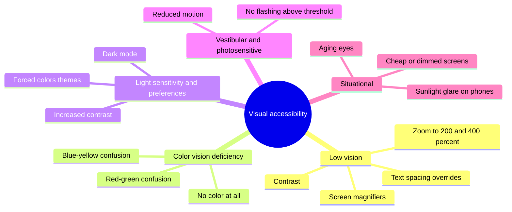
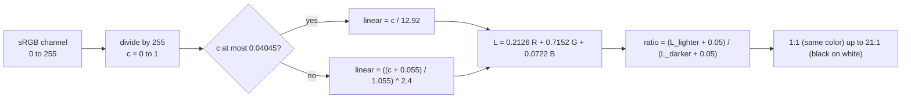
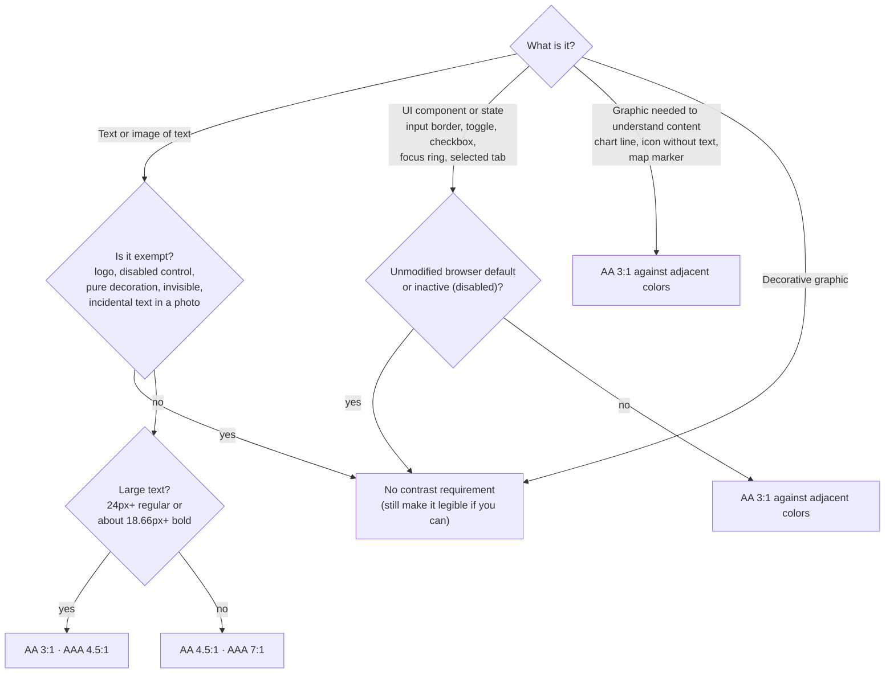
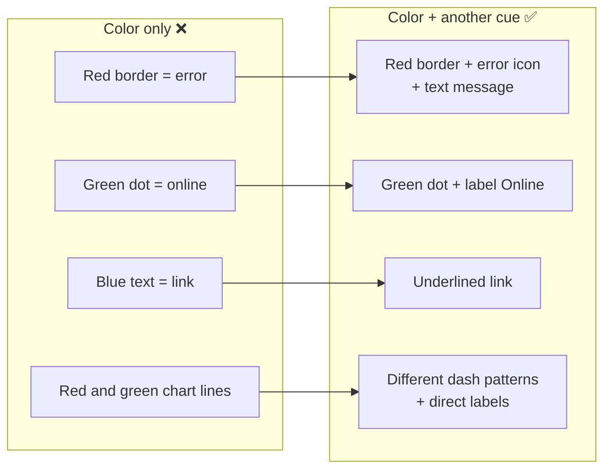
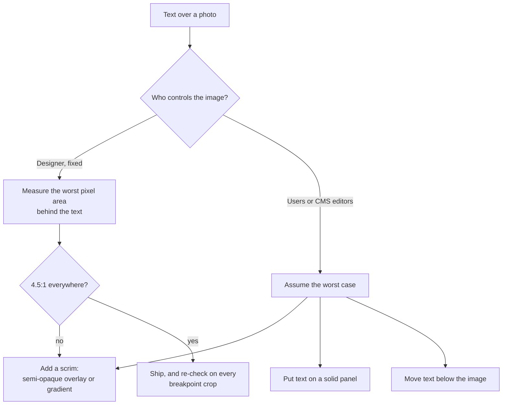
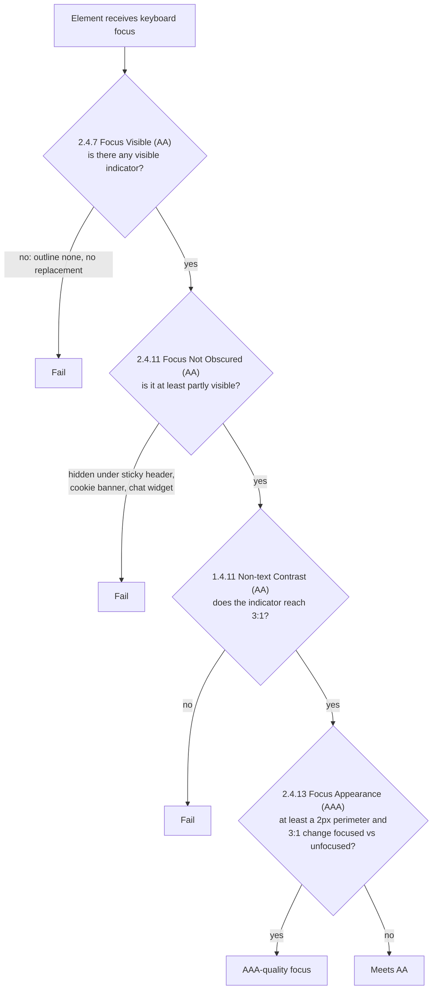
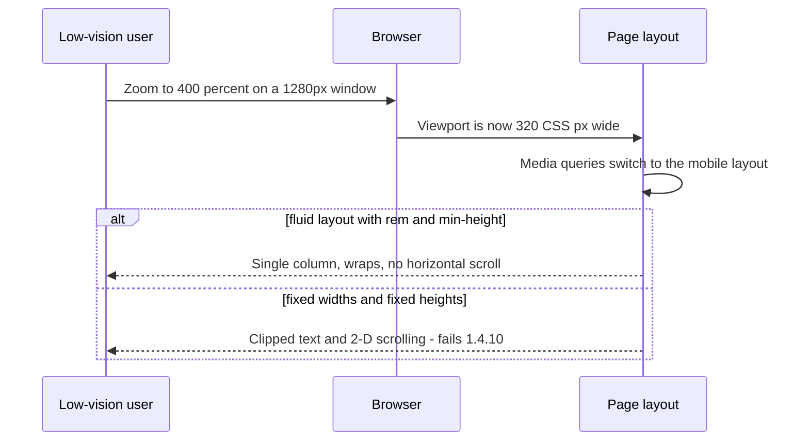
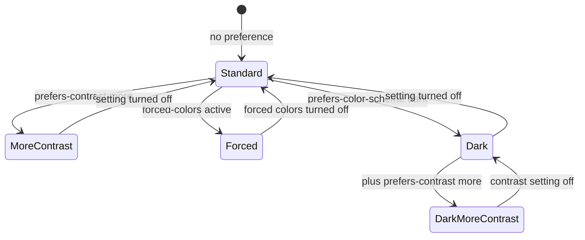
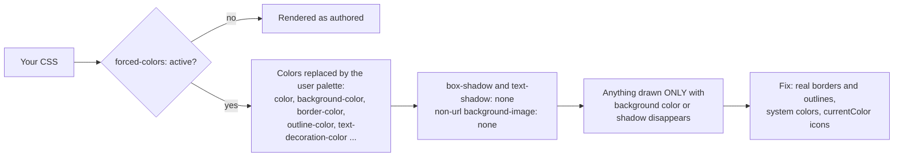
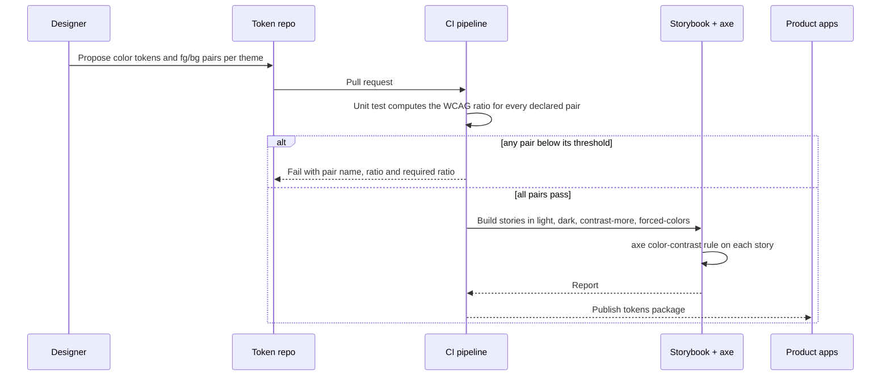

# Color Contrast & Visual Accessibility

> **Date:** 2026-11-06 · **Last updated:** 2026-11-06
> **Category:** Frontend System Design
> **Sub-Topic:** Accessibility / Visual design & perception
> **Level:** Intermediate · **Reading time:** ~28 min
> **Informs:** color token pairs and palette design, text/UI contrast thresholds (WCAG 1.4.3, 1.4.11), focus-ring design, status/error/link styling without color-only cues, dark mode and high-contrast themes, forced-colors (Windows Contrast themes) support, zoom/reflow/text-spacing resilience, reduced-motion policy, data-viz palettes

> **Pre-requisite:** [Design Tokens](../05-design-systems-and-components/design-tokens.md) (where colors live) and [Theming & Dark Mode](../05-design-systems-and-components/theming-and-dark-mode.md) (how themes swap them). [Keyboard Navigation & Focus Management](./keyboard-navigation-and-focus-management.md) covers *where* focus goes; this note covers whether people can *see* it.
> This note covers everything a user with low vision, color-vision deficiency, glare on their screen, or motion sensitivity needs from the **pixels** you draw.

**Previous:** [Screen Reader Testing](./screen-reader-testing.md) · **Next:** [Accessible Forms & Error Handling](./accessible-forms-and-error-handling.md)

---

## Table of Contents

1. [ELI5 — Simple Explanation](#eli5--simple-explanation)
2. [Section 1: Who Visual Accessibility Is For](#section-1-who-visual-accessibility-is-for)
3. [Section 2: The Contrast Ratio Math](#section-2-the-contrast-ratio-math)
4. [Section 3: Which Threshold Applies](#section-3-which-threshold-applies)
5. [Section 4: Non-Text Contrast — Borders, Icons, States](#section-4-non-text-contrast--borders-icons-states)
6. [Section 5: Never Use Color Alone](#section-5-never-use-color-alone)
7. [Section 6: The Hard Cases](#section-6-the-hard-cases)
8. [Section 7: Visible Focus](#section-7-visible-focus)
9. [Section 8: Zoom, Reflow and Text Spacing](#section-8-zoom-reflow-and-text-spacing)
10. [Section 9: User Preferences — Contrast, Motion, Color Scheme](#section-9-user-preferences--contrast-motion-color-scheme)
11. [Section 10: Forced Colors Mode](#section-10-forced-colors-mode)
12. [Section 11: Dark Mode, contrast-color() and WCAG 3](#section-11-dark-mode-contrast-color-and-wcag-3)
13. [Section 12: Frameworks and Native Mobile](#section-12-frameworks-and-native-mobile)
14. [System Design Angle — Contrast as a Design-System Contract](#system-design-angle--contrast-as-a-design-system-contract)
15. [Real-World Examples](#real-world-examples)
16. [Key Points Summary](#key-points-summary)
17. [Test Your Understanding (with answers)](#test-your-understanding)
18. [Cheat Sheet](#cheat-sheet)
19. [References & Further Reading](#references--further-reading)

---

## ELI5 — Simple Explanation

Think of **road signs**.

- A sign printed **light grey on white** is useless at dusk, in rain, or to a driver with tired eyes. Road signs use **strong contrast** (white on dark green, black on yellow) so everyone can read them in bad conditions. That is **contrast ratio**.
- A **stop sign** is red, but it is also an **octagon** with the word **STOP**. A driver who can't tell red from green still knows what it means. That is **"don't use color alone"**.
- Some drivers wear **tinted glasses** or switch the dashboard to **night mode**. The sign must still work. That is **forced colors, dark mode and user preferences**.
- Flashing lights on a road are rare and slow on purpose, because fast flashing can make some people ill. That is **motion and flashing limits**.

> **Every piece of meaning on screen must survive low contrast eyesight, no color perception, zoom, and the user's own color settings — measure it, don't eyeball it.**

---

## Core Concept — Step by Step

### Section 1: Who Visual Accessibility Is For



Most of the rules live in WCAG 2.2 under Guideline 1.4 "Distinguishable", plus a few focus and motion criteria:

| WCAG 2.2 SC | Level | One-line rule |
|---|---|---|
| **1.4.1 Use of Color** | A | Color is never the *only* way to convey information |
| **1.4.3 Contrast (Minimum)** | AA | Text: **4.5:1**; large text: **3:1** |
| **1.4.6 Contrast (Enhanced)** | AAA | Text: **7:1**; large text: **4.5:1** |
| **1.4.11 Non-text Contrast** | AA | UI component boundaries, states and meaningful graphics: **3:1** against adjacent colors |
| **1.4.4 Resize Text** | AA | Text scales to 200% without losing content or function |
| **1.4.10 Reflow** | AA | Usable at 320 CSS px wide (≈ 1280 px at 400% zoom) without 2-D scrolling |
| **1.4.12 Text Spacing** | AA | Nothing breaks when users increase line, paragraph, letter and word spacing |
| **1.4.13 Content on Hover or Focus** | AA | Tooltips/popovers are dismissible, hoverable and persistent |
| **2.4.7 Focus Visible** | AA | Keyboard focus is visible |
| **2.4.11 Focus Not Obscured (Minimum)** | AA *(new in 2.2)* | Focused element isn't entirely hidden by sticky headers, banners, etc. |
| **2.4.13 Focus Appearance** | AAA *(new in 2.2)* | Focus indicator is large enough and changes contrast by at least 3:1 |
| **2.3.1 Three Flashes or Below Threshold** | A | Nothing flashes more than 3 times per second (unless below the flash thresholds) |
| **2.2.2 Pause, Stop, Hide** | A | Auto-moving content lasting more than 5 s can be paused, stopped or hidden |
| **2.3.3 Animation from Interactions** | AAA | Interaction-triggered motion can be turned off |

> **Which level?** Laws and procurement rules almost always point at **WCAG 2.x Level AA** (e.g. EN 301 549 in the EU, the US Section 508 and ADA Title II rules). The exact WCAG version and deadlines differ by jurisdiction and change over time — check the current regulation, not a blog post.

---

### Section 2: The Contrast Ratio Math

WCAG contrast is computed from **relative luminance** — how bright a color looks to a typical eye, from 0 (black) to 1 (white).



```text
Relative luminance   L = 0.2126·R + 0.7152·G + 0.0722·B   (R, G, B linearized)
Contrast ratio         = (L1 + 0.05) / (L2 + 0.05)          L1 = lighter, L2 = darker

Green dominates luminance (0.7152) → pure green looks bright, pure blue looks dark.
Older WCAG texts print the threshold 0.03928; the current text uses 0.04045.
For 8-bit colors both give the same results.
```

**Worked examples** (computed with the formula above):

| Foreground on `#FFFFFF` | Ratio | Normal text AA (4.5) | Large text / UI (3.0) |
|---|---|---|---|
| `#767676` | 4.54:1 | ✅ (the lightest neutral grey that passes) | ✅ |
| `#777777` | 4.48:1 | ❌ — **thresholds are not rounded** | ✅ |
| `#595959` | 7.00:1 | ✅ also AAA | ✅ |
| `#949494` | 3.03:1 | ❌ | ✅ (just) |
| `#3B82F6` (a common "blue-500") | 3.68:1 | ❌ | ✅ |
| `#2563EB` (a common "blue-600") | 5.17:1 | ✅ | ✅ |
| `#EF4444` (a common "red-500") | 3.76:1 | ❌ | ✅ |
| `#FF0000` pure red | 4.00:1 | ❌ | ✅ |

> **Thresholds are exact.** 4.48:1 is a fail, even if a tool displays it as "4.5". The W3C Understanding document says the ratios are not rounded.

**What the ratio ignores:** font weight and thickness, anti-aliasing, the user's screen and ambient light. Thin fonts (weight 100–300) at small sizes read worse than the ratio suggests — treat 4.5:1 as a floor, not a target.

---

### Section 3: Which Threshold Applies



**"Large text"** in WCAG means **at least 18 pt** or **14 pt bold**. In CSS pixels (1 pt = 1.333 px) that is **24 px** regular or about **18.66 px** bold. A `16px` body font is never "large", no matter how bold.

| Exemption | Example | Caveat |
|---|---|---|
| **Inactive UI** | `disabled` button | Users still need to understand *that* it's disabled — consider explaining why instead of disabling (see [Accessible Forms & Error Handling](./accessible-forms-and-error-handling.md)) |
| **Logotypes** | Brand wordmark | Only the logo itself; a slogan next to it is regular text |
| **Incidental** | Text in a photo of a street | If the text carries meaning, provide it as real text |
| **Pure decoration** | Watermark pattern | Must carry no information |

---

### Section 4: Non-Text Contrast — Borders, Icons, States

SC 1.4.11 (added in WCAG 2.1) says the **visual information needed to identify a component or its state** must have **3:1** against the **adjacent** colors.

```text
┌────────────────────────────┐   Input with a #E5E7EB border on white:
│  Email                     │   1.24:1 → the boundary is invisible to many users  ❌
└────────────────────────────┘   Fix: border #6B7280 (4.83:1) or a filled background
                                     that itself reaches 3:1 against the page        ✅

[ ✓ ] checkbox                    The check mark vs the box fill: 3:1   ✅ required
( • ) radio, selected             The dot vs the circle fill: 3:1       ✅ required
[ Tab A ][ Tab B ]                Selected tab: the indicator (underline, fill)
                                  must reach 3:1 against what's next to it
```

| Element | What must reach 3:1 | Against |
|---|---|---|
| Text input | Its border (or fill, if there's no border) | Page background |
| Icon-only button | The icon glyph | Button background |
| Toggle switch | The thumb **and** the on/off difference | Track and page |
| Focus indicator | The ring | Both the component and the page (see Section 7) |
| Chart | Each line/bar/segment that carries data | Background **and** adjacent segments |
| Selected state | The selection indicator | Unselected neighbors |

> **Text inside a button** follows 1.4.3 (4.5:1 against the button fill). The **button's shape** only needs 3:1 against the page if the shape is the only thing that identifies it as a button — a text label alone is often enough.

---

### Section 5: Never Use Color Alone

SC 1.4.1: color can **reinforce** meaning, but something else must **carry** it — text, an icon, a pattern, position or shape.



**Links inside body text** are the classic case:
- **Simplest:** keep the **underline** (style it with `text-underline-offset`, but keep it).
- **If you remove the underline**, W3C technique G183 describes the alternative: the link color needs **3:1 against the surrounding text** (and 4.5:1 against the background) **plus** a non-color cue (underline, etc.) on hover **and** focus. Finding a color that does all three is hard — that's why the underline is the default advice.

**Color-vision deficiency (CVD)** is common, especially red-green deficiency in men (see the NEI page in References). Practical consequences:
- **Red vs green** status pairs (pass/fail, profit/loss, online/offline) are the most frequent failure. Add icons, labels, or use a blue/orange pair.
- **Charts:** use direct labels, patterns or markers, and a palette tested with a simulator (e.g. the Okabe–Ito palette is designed for CVD). Don't rely on a legend matched by hue alone.
- **Test with simulators:** Chrome DevTools → Rendering → *Emulate vision deficiencies*, or Firefox Accessibility Inspector → *Simulate*.

---

### Section 6: The Hard Cases

**Text over images and gradients.** The ratio must hold against the **lowest-contrast** part of the background behind the text — and images change (CMS uploads, crops on mobile).



**Transparency.** `rgba()`/`opacity` means the real color is a **blend** with whatever is underneath. Compute contrast on the **composited** color, not the token value. `color: rgb(0 0 0 / 0.5)` on white is effectively `#808080` → about 3.9:1, a fail for body text.

**Other traps:**

| Case | Rule of thumb |
|---|---|
| **Placeholder text** | If it conveys information, it needs 4.5:1. Browser default placeholder styles vary — set your own. Better: never put essential info only in a placeholder |
| **Disabled controls** | Exempt from contrast, but low contrast also hides them from users who need them — explain *why* something is unavailable |
| **Hover/active states** | Every state must still pass (a hover that lightens text to 3:1 fails while hovered) |
| **Text shadows / outlines** | Can help legibility, but tools usually ignore them — verify manually |
| **Thin or small fonts** | Ratio passes, legibility doesn't. Prefer weight ≥ 400 for body text |
| **Selection highlight** (`::selection`) | Custom selection colors must keep selected text readable |
| **Brand color as text** | Many brand colors fail 4.5:1 on white — use them for large text, fills with dark/white text, or derive a darker "text" shade |

---

### Section 7: Visible Focus

Keyboard users need to **see** where focus is. Three criteria stack up:



**A focus ring that works on any background** — a two-tone ring (one dark, one light) is visible on both light and dark surfaces:

```css
:focus-visible {
  outline: 2px solid #1d4ed8;          /* 6.70:1 on white */
  outline-offset: 2px;
  box-shadow: 0 0 0 4px #ffffff;       /* light halo for dark backgrounds */
}

/* Sticky header must not cover focused elements (2.4.11) */
html { scroll-padding-top: 5rem; }
```

- Use **`:focus-visible`** (supported in all modern browsers) so mouse clicks don't show a ring but keyboard focus does.
- Never `outline: none` without a replacement. If you *replace* the outline with `box-shadow`, add `outline: 2px solid transparent` — box-shadow disappears in forced colors mode (Section 10), but the transparent outline becomes visible there.
- For where focus *goes* (traps, restoration, roving tabindex), see [Keyboard Navigation & Focus Management](./keyboard-navigation-and-focus-management.md).

---

### Section 8: Zoom, Reflow and Text Spacing

Low-vision users zoom — often to 200–400% — or override text spacing with a user stylesheet or extension.

```text
1.4.4  Resize Text   → 200% text size without loss of content or function
1.4.10 Reflow        → at 320 CSS px wide: no horizontal scrolling for vertical content
                       (400% zoom on a 1280 px window = a 320 px viewport)
                       exceptions: data tables, maps, diagrams, toolbars that need 2-D layout
1.4.12 Text Spacing  → nothing is cut off or overlaps when users set:
                       line-height 1.5 × font size
                       paragraph spacing 2 × font size
                       letter-spacing 0.12 × font size
                       word-spacing 0.16 × font size
```

| Breaks zoom / spacing | Use instead |
|---|---|
| `font-size: 14px` everywhere and fixed `height` on text boxes | `rem` for type, `min-height` instead of `height`, let content grow |
| `overflow: hidden` on cards with text | Let text wrap; truncate only with a way to read the full text |
| `<meta name="viewport" content="... maximum-scale=1, user-scalable=no">` | `width=device-width, initial-scale=1` only — never block pinch-zoom |
| Fixed-width layouts, wide tables in the page flow | Responsive layout ([Responsive Design Patterns](../05-design-systems-and-components/responsive-design-patterns.md)); scroll *inside* the table container |
| Sticky header + sticky footer + cookie banner | At 400% zoom they can cover the whole viewport — un-stick on short viewports |
| Text in images | Real text (1.4.5 Images of Text) |



---

### Section 9: User Preferences — Contrast, Motion, Color Scheme

Operating systems expose visual preferences; CSS media queries let you respect them.

| Media feature | Values | Comes from (examples) | Support |
|---|---|---|---|
| `prefers-contrast` | `no-preference` · `more` · `less` · `custom` | macOS/iOS "Increase contrast", Windows Contrast themes | Chrome 96+, Firefox 101+, Safari 14.1+ |
| `forced-colors` | `none` · `active` | Windows Contrast themes; Firefox's own color-override setting | Chromium and Firefox (where an OS/browser mode exists) |
| `prefers-reduced-motion` | `no-preference` · `reduce` | "Reduce motion" (macOS/iOS), "Remove animations" (Android), "Animation effects" off (Windows) | All modern browsers |
| `prefers-color-scheme` | `light` · `dark` | OS dark mode | All modern browsers |
| `prefers-reduced-transparency` | `no-preference` · `reduce` | OS "Reduce transparency" | Chromium only so far (experimental per MDN) |



```css
/* Stronger borders and text when the user asks for more contrast */
@media (prefers-contrast: more) {
  :root {
    --color-border: #374151;      /* 10.31:1 on white */
    --color-text-muted: #374151;  /* muted text is no longer muted */
  }
}

/* Motion as an opt-in: animate only if the user hasn't asked to reduce it */
@media (prefers-reduced-motion: no-preference) {
  .card { transition: transform 200ms ease; }
  .card:hover { transform: translateY(-2px); }
}
```

**Motion and flashing:**
- **Reduced motion ≠ no motion.** Replace parallax, zooms and large slides with fades or instant changes; keep small, meaningful feedback.
- **Auto-playing** carousels, background videos and marquees longer than 5 s need pause/stop controls (2.2.2).
- **Never flash more than 3 times per second** (2.3.1) — this is a seizure-safety requirement at Level A. Performance-oriented motion tips are in [Animation Performance (CSS vs JS)](../04-performance-engineering/animation-performance-css-vs-js.md).

---

### Section 10: Forced Colors Mode

In **forced colors mode** (Windows "Contrast themes", formerly "High Contrast Mode", in Chromium browsers and Firefox; also Firefox's "override colors" option), the browser **replaces your colors** with a small user-chosen palette.



What breaks most often:

| Pattern | What happens in forced colors | Fix |
|---|---|---|
| Focus ring made only with `box-shadow` | Disappears | Add `outline: 2px solid transparent` (outline color gets forced to a visible color) |
| Button whose only boundary is a background fill | Looks like plain text | `border: 1px solid transparent` — the border becomes visible |
| Toggle/checkbox drawn with background colors | State invisible | Use system colors (`Highlight`, `CanvasText`) in a `forced-colors` query |
| SVG icon with hard-coded `fill="#333"` | May not adapt, can vanish on dark themes | `fill="currentColor"`, then test |
| Gradient as the only indicator | Removed | Add a border/outline/text cue |

```css
@media (forced-colors: active) {
  .switch[aria-checked="true"] .thumb {
    background: Highlight;        /* CSS system colors map to the user palette */
    border: 1px solid CanvasText;
  }
  .badge { border: 1px solid CanvasText; }   /* fills are gone; give it an edge */
}

/* Opt out ONLY for content where author colors carry the meaning, e.g. a color swatch */
.swatch { forced-color-adjust: none; }
```

**System colors** you'll use: `Canvas`/`CanvasText` (page background/text), `LinkText`, `ButtonFace`/`ButtonText`/`ButtonBorder`, `Highlight`/`HighlightText` (selection), `GrayText` (disabled), `Mark`/`MarkText`. Don't use forced-colors as a "hide stuff" switch, and don't sprinkle `forced-color-adjust: none` to make your brand colors win — that undoes the user's choice.

> **macOS and iOS** have no forced-colors mode (they have "Increase contrast", which maps to `prefers-contrast: more`). Safari parses `forced-colors` but it won't match in normal use. Test forced colors on Windows, or emulate it in Chrome DevTools → Rendering → *Emulate CSS media feature forced-colors*.

---

### Section 11: Dark Mode, contrast-color() and WCAG 3

**Dark mode** uses the same math — every token pair must be re-checked, because a color that passes on white can fail on dark grey.

```text
#1D4ED8 (blue-700) on #FFFFFF → 6.70:1 ✅      #1D4ED8 on #111827 → 2.65:1 ❌
#60A5FA (blue-400) on #111827 → 6.98:1 ✅      → dark themes need their own, lighter "text-link" shade
```

- Define **semantic pairs** (`--color-text-on-surface`, `--color-text-on-primary`) instead of raw colors, and validate each pair per theme (see [Design Tokens](../05-design-systems-and-components/design-tokens.md) and [Theming & Dark Mode](../05-design-systems-and-components/theming-and-dark-mode.md)).
- Very bright saturated colors on very dark backgrounds can "vibrate"; designers usually desaturate them in dark themes. The ratio still decides pass/fail.
- `color-scheme: light dark` (and `light-dark()`) makes native controls and scrollbars match the theme.

**`contrast-color()`** (CSS Color 5) returns **black or white**, whichever contrasts more with a given color — handy for user-chosen label colors:

```css
.tag {
  background: var(--tag-color);                 /* chosen by the user at runtime */
  color: contrast-color(var(--tag-color));      /* black or white */
}
```

- Per MDN's compatibility data it is now in **Chrome 147+, Firefox 146+, Safari 26+** — recent, so provide a fallback (precompute on the server, or use `@supports`).
- It only knows the one background you pass in — not images, gradients, or transparency.
- Math check: for any opaque background, either black or white always reaches **at least ~4.58:1** (WCAG formula), so the pick passes AA for normal text — but it can't guarantee **7:1** (AAA). The spec doesn't promise a WCAG-based choice in every browser, so still test your real colors.
- An older idea, `color-contrast()` (choose from a list), was dropped from shipping plans — don't use it.

**WCAG 3 and APCA.** WCAG 3 is still a **W3C Working Draft**; its contrast method is not final. **APCA** (Accessible Perceptual Contrast Algorithm) has been explored as a candidate — it accounts for font size/weight and polarity (dark-on-light vs light-on-dark). It is **not** a conformance requirement today. Use **WCAG 2.x ratios for compliance**; APCA can be a supplementary design-time check (Chrome DevTools can show it as an experiment).

---

### Section 12: Frameworks and Native Mobile

Color and contrast are **CSS concerns** — React, Vue, Angular and Svelte all use the same CSS. Framework differences show up in tooling and in reading preferences from JS.

| Stack | How to do it |
|---|---|
| **React / Next.js** | CSS media queries first; `window.matchMedia('(prefers-reduced-motion: reduce)')` in a hook when JS-driven animation must change (Example 6). Motion libraries such as Motion (formerly Framer Motion) offer a reduced-motion hook/config |
| **Vue** | Same CSS; VueUse provides `usePreferredReducedMotion`, `usePreferredContrast`, `usePreferredDark` composables |
| **Angular** | Same CSS; Angular CDK `a11y` has `HighContrastModeDetector` (adds classes for Windows high contrast). Prefer `@media (forced-colors: active)` for new code. Angular Material's theming system generates color pairs |
| **Svelte** | Same CSS; `svelte/motion` has a `prefersReducedMotion` helper in Svelte 5 (check the docs for your version). The compiler's a11y warnings don't check contrast — use axe |
| **Tailwind** | `motion-safe:` / `motion-reduce:`, `contrast-more:`, `forced-colors:`, `dark:` variants |
| **iOS (SwiftUI/UIKit)** | `@Environment(\.colorSchemeContrast)` (`.increased`), `UIAccessibility.isDarkerSystemColorsEnabled`, `isReduceMotionEnabled`; asset catalog colors can define high-contrast variants; Dynamic Type for text size |
| **Android (Compose/Views)** | Material 3 color roles (pairs like `primary`/`onPrimary`), medium/high-contrast schemes; system "High contrast text", font scale (`sp` units); recent Android versions expose a contrast level setting |
| **React Native** | `AccessibilityInfo.isReduceMotionEnabled()`, `useColorScheme()`, `PlatformColor` for system colors; contrast still has to be designed into your palette |

---

## System Design Angle — Contrast as a Design-System Contract

At scale, contrast is not something each engineer checks by eye. It's a **property of token pairs**, enforced in CI.



**Decision matrix — what to enforce where:**

| Concern | Enforce at | Tool |
|---|---|---|
| Token pair ratios (all themes) | Token build / unit tests | Your own WCAG function (Example 1) |
| Rendered text contrast | Component stories, E2E pages | axe `color-contrast` rule (see [Automated A11y Testing (axe, Lighthouse)](./automated-a11y-testing-axe-lighthouse.md)) |
| Text over images, gradients, overlays | Design review + manual check | Contrast picker on screenshots |
| Color-only meaning, CVD | Design review, component API | Simulators; components that *require* an icon/label prop for status |
| Forced colors, zoom, text spacing | Manual or scripted checks per release | Playwright `emulateMedia({ forcedColors: 'active' })`, text-spacing bookmarklet |
| Focus visibility | Component library | A single shared `:focus-visible` style token |

**Design-system API choices that prevent violations:**
- A `<StatusBadge status="error">` that always renders **icon + text**, not a free `color` prop.
- Text components that only accept **text-safe** color tokens (`text-default`, `text-muted`), not every palette shade.
- Brand colors split into **"fill"** and **"text"** variants, where only the text variant is guaranteed 4.5:1.

---

## Real-World Examples

**Example 1 — A WCAG contrast function and a token-pair test (TypeScript + Vitest):**
```typescript
// contrast.ts
const linear = (c: number) => {
  const s = c / 255;
  return s <= 0.04045 ? s / 12.92 : ((s + 0.055) / 1.055) ** 2.4;
};

export function luminance(hex: string): number {
  const h = hex.replace('#', '');
  const [r, g, b] = [0, 2, 4].map((i) => parseInt(h.slice(i, i + 2), 16));
  return 0.2126 * linear(r) + 0.7152 * linear(g) + 0.0722 * linear(b);
}

export function contrastRatio(a: string, b: string): number {
  const [hi, lo] = [luminance(a), luminance(b)].sort((x, y) => y - x);
  return (hi + 0.05) / (lo + 0.05);
}
```

```typescript
// tokens.contrast.test.ts
import { describe, it, expect } from 'vitest';
import { contrastRatio } from './contrast';
import { themes } from './tokens'; // { light: {...}, dark: {...} }

type Pair = { fg: string; bg: string; min: 4.5 | 3 };
const PAIRS: Record<string, Pair> = {
  body:        { fg: 'text-default', bg: 'surface',  min: 4.5 },
  muted:       { fg: 'text-muted',   bg: 'surface',  min: 4.5 },
  onPrimary:   { fg: 'text-on-primary', bg: 'primary', min: 4.5 },
  inputBorder: { fg: 'border-input', bg: 'surface',  min: 3 },
  focusRing:   { fg: 'focus-ring',   bg: 'surface',  min: 3 },
};

describe.each(Object.entries(themes))('theme %s', (_name, t) => {
  it.each(Object.entries(PAIRS))('%s meets its WCAG threshold', (_pair, { fg, bg, min }) => {
    const ratio = contrastRatio(t[fg], t[bg]);
    expect(ratio).toBeGreaterThanOrEqual(min); // no rounding: 4.48 fails
  });
});
```

**Example 2 — Links in body text (BAD → GOOD):**
```css
/* ❌ BAD: color is the only cue, and #3b82f6 is 3.68:1 on white */
.prose a { color: #3b82f6; text-decoration: none; }

/* ✅ GOOD: passing color + underline that stays readable */
.prose a {
  color: #1d4ed8;                    /* 6.70:1 on white */
  text-decoration: underline;
  text-decoration-thickness: 1px;
  text-underline-offset: 0.2em;
}
.prose a:hover,
.prose a:focus-visible { text-decoration-thickness: 2px; }
```

**Example 3 — Error state that doesn't rely on color (React/TSX):**
```tsx
// ❌ BAD: only the border turns red
<input className={hasError ? 'border-red-500' : 'border-gray-300'} />

// ✅ GOOD: icon + text + programmatic link; the red only reinforces it
export function EmailField({ error }: { error?: string }) {
  return (
    <div className="field">
      <label htmlFor="email">Email</label>
      <input
        id="email"
        type="email"
        aria-invalid={error ? true : undefined}
        aria-describedby={error ? 'email-error' : undefined}
        className={error ? 'input input--error' : 'input'}
      />
      {error && (
        <p id="email-error" className="field-error">
          <svg aria-hidden="true" width="16" height="16" fill="currentColor"><use href="#icon-alert" /></svg>
          {error}
        </p>
      )}
    </div>
  );
}
```
The full pattern (error summaries, announcements, timing) is in [Accessible Forms & Error Handling](./accessible-forms-and-error-handling.md).

**Example 4 — Focus ring that survives forced colors and dark sections:**
```css
:root {
  --focus-inner: #1d4ed8;  /* 6.70:1 on white */
  --focus-outer: #ffffff;
}

:focus-visible {
  outline: 2px solid var(--focus-inner);
  outline-offset: 2px;
  box-shadow: 0 0 0 4px var(--focus-outer);
}

/* Components that replaced outline with box-shadow only: */
.btn:focus-visible {
  outline: 2px solid transparent;     /* invisible normally, forced visible in forced colors */
  box-shadow: 0 0 0 2px #fff, 0 0 0 4px var(--focus-inner);
}

@media (forced-colors: active) {
  :focus-visible { outline-color: Highlight; }
}
```

**Example 5 — Hero text over a user-uploaded image:**
```css
/* ❌ BAD: white text straight on the photo — passes on dark photos, fails on bright ones */
.hero h1 { color: #fff; }

/* ✅ GOOD: a scrim guarantees a dark enough backdrop whatever the image */
.hero { position: relative; }
.hero::before {
  content: '';
  position: absolute;
  inset: 0;
  background: linear-gradient(to top, rgb(0 0 0 / 0.75), rgb(0 0 0 / 0.25) 60%, transparent);
}
.hero h1 { position: relative; color: #fff; }

/* In forced colors the gradient is removed, and text gets the user's colors — that's fine */
```

**Example 6 — Respecting reduced motion in JS-driven animation (React hook):**
```tsx
import { useSyncExternalStore } from 'react';

const QUERY = '(prefers-reduced-motion: reduce)';

function subscribe(cb: () => void) {
  const mql = window.matchMedia(QUERY);
  mql.addEventListener('change', cb);
  return () => mql.removeEventListener('change', cb);
}

export function usePrefersReducedMotion(): boolean {
  return useSyncExternalStore(
    subscribe,
    () => window.matchMedia(QUERY).matches,
    () => true, // server snapshot: assume reduced motion until the client knows
  );
}

// Usage
function Carousel() {
  const reduce = usePrefersReducedMotion();
  return <Slides autoplay={!reduce} transition={reduce ? 'none' : 'slide'} />;
}
```
Vue: `usePreferredReducedMotion()` from VueUse. Angular: `inject(BreakpointObserver).observe('(prefers-reduced-motion: reduce)')` from the CDK layout module. Svelte 5: `prefersReducedMotion` from `svelte/motion`.

**Example 7 — Checking forced colors and reduced motion in Playwright:**
```typescript
import { test, expect } from '@playwright/test';

test('primary button keeps a visible boundary in forced colors', async ({ page }) => {
  await page.emulateMedia({ forcedColors: 'active', reducedMotion: 'reduce' });
  await page.goto('/checkout');
  const button = page.getByRole('button', { name: 'Pay now' });
  await button.focus();
  // Visual snapshot per mode catches vanished borders and focus rings
  await expect(button).toHaveScreenshot('pay-button-forced-colors.png');
});
```

**Example 8 — A chart that works without color:**
```tsx
// Each series gets color + dash pattern + a direct end label (no hue-only legend)
const series = [
  { key: 'revenue', color: '#0072B2', dash: '0',   label: 'Revenue' },
  { key: 'costs',   color: '#D55E00', dash: '6 4', label: 'Costs'   },
];

<svg role="img" aria-labelledby="chart-title chart-desc">
  <title id="chart-title">Revenue vs costs, 2026</title>
  <desc id="chart-desc">Revenue rises from 40k to 90k; costs stay near 35k.</desc>
  {series.map((s) => (
    <g key={s.key}>
      <path d={paths[s.key]} stroke={s.color} strokeDasharray={s.dash} strokeWidth={2} fill="none" />
      <text x={endX} y={endY[s.key]} fill="currentColor">{s.label}</text>
    </g>
  ))}
</svg>
```
`#0072B2` (5.19:1 on white) and `#D55E00` (3.87:1) come from the Okabe–Ito palette. Both clear the 3:1 needed for graphical lines; the labels use `currentColor` because `#D55E00` would fail 4.5:1 as text. The dash pattern still separates the lines in grayscale. Provide the data as a table too for screen-reader users.

---

## Key Points Summary

| Concept | One-Line Explanation |
|---|---|
| **Contrast ratio** | (L lighter + 0.05) / (L darker + 0.05), from 1:1 to 21:1 |
| **1.4.3 (AA)** | 4.5:1 for text, 3:1 for large text (24 px, or about 18.66 px bold) |
| **1.4.6 (AAA)** | 7:1 for text, 4.5:1 for large text |
| **1.4.11 (AA)** | 3:1 for component boundaries, states, focus rings and meaningful graphics |
| **No rounding** | 4.48:1 fails the 4.5:1 threshold |
| **1.4.1 Use of Color** | Color reinforces meaning; text, icons or patterns carry it |
| **Exemptions** | Disabled controls, logos, decoration, incidental text |
| **Transparency** | Measure the composited color, not the token |
| **Focus** | Visible (2.4.7), not hidden (2.4.11), 3:1 (1.4.11); AAA adds size (2.4.13) |
| **Zoom / reflow / spacing** | 200% text, 320 px width, user spacing overrides — no clipping |
| **prefers-contrast / reduced-motion** | Respect OS settings with media queries |
| **Forced colors** | User palette replaces yours; shadows and gradients vanish — use borders, outlines, system colors |
| **contrast-color()** | Picks black or white for a background; new, so keep a fallback |
| **WCAG 3 / APCA** | Draft, not a requirement; comply with WCAG 2.x ratios |
| **Token pairs in CI** | Contrast is a tested property of the design system |

---

## Test Your Understanding

**Q1 (Basic):**
A designer proposes `#777777` body text on white and says "the checker shows 4.5, so it passes". Is that right? What about the same color for a 24 px heading?

<details>
<summary>Answer</summary>

No for body text. `#777777` on white is **4.48:1**. WCAG thresholds are **not rounded**, so anything below 4.5:1 fails 1.4.3 for normal text — the tool is rounding for display. `#767676` (4.54:1) is the lightest neutral grey that passes.

For a **24 px** heading, yes: 24 px regular counts as **large text**, where the AA threshold is **3:1**, and 4.48:1 is well above that. It would not meet AAA large text (4.5:1).
</details>

**Q2 (Application):**
Your form inputs have a 1 px `#E5E7EB` border on a white page, placeholder text `#9CA3AF`, and invalid fields get a red border. List every visual-accessibility problem and the fix.

<details>
<summary>Answer</summary>

1. **Input boundary**: `#E5E7EB` on white is about **1.24:1**. SC 1.4.11 needs **3:1** for the visual information that identifies the component. Fix: a darker border such as `#6B7280` (4.83:1), or a filled input whose fill reaches 3:1 against the page.
2. **Placeholder**: `#9CA3AF` on white is about **2.54:1**. If the placeholder carries information, it fails 1.4.3. Fix: don't put essential information in placeholders (use a visible label and hint text), and if you keep placeholders, make them at least 4.5:1.
3. **Error = red border only**: fails **1.4.1 Use of Color**, because users who can't see red can't tell which field is wrong. Fix: an error icon and a **text message** linked with `aria-describedby`, plus `aria-invalid`. The red border can stay as reinforcement.
</details>

**Q3 (Tricky):**
A team's custom buttons have no border; the button is a blue fill, and the focus ring is `box-shadow: 0 0 0 3px #93c5fd`. A Windows user with a Contrast theme says "the buttons look like plain text and I can't see where I am." Why, and what's the minimal fix?

<details>
<summary>Answer</summary>

In **forced colors mode**, the browser replaces author colors with the user's palette and sets **`box-shadow` to `none`**. The blue fill becomes the system button background color — often the same as the page — and with no border the button has no visible edge. The focus ring was a box-shadow, so it disappears too.

Minimal fix:
- `border: 1px solid transparent` on the button. Borders are kept and recolored in forced colors, so a boundary appears; normally it's invisible.
- `outline: 2px solid transparent` (plus `outline-offset`) for focus. The outline color is forced to a visible color, so focus shows up in forced colors without changing the normal look.
- Optionally use `@media (forced-colors: active)` with system colors (`ButtonText`, `Highlight`) for finer control. Don't use `forced-color-adjust: none` to force the brand colors back — that overrides the user's needs.
</details>

**Q4 (Tricky):**
`contrast-color()` always chooses black or white. Can it ever produce text that fails WCAG AA for normal text against an opaque background? What can it *not* guarantee?

<details>
<summary>Answer</summary>

With the WCAG 2.x formula, for any opaque background either black or white reaches **at least ~4.58:1** (the worst case is a mid-luminance color where both are about equal). So if the browser picks the higher-contrast one by the WCAG formula, it passes **AA for normal text**.

What it can't guarantee:
- **AAA (7:1)**: many mid-tone backgrounds can't reach 7:1 with either black or white.
- **Non-opaque or complex backgrounds**: it only sees the one color you pass, not images, gradients, transparency or what's underneath.
- **Which algorithm**: the spec doesn't require the WCAG formula in every browser, so verify the result with your own colors.
- **Support**: it shipped recently (per MDN: Chrome 147, Firefox 146, Safari 26), so older browsers need a fallback.
</details>

**Q5 (System design):**
You're building a white-label SaaS where each customer sets a brand color used for buttons, links and active tabs. How do you keep the product WCAG AA compliant across thousands of brand colors?

<details>
<summary>Answer</summary>

Treat the brand color as **input that must be validated and derived from**, not used raw:

1. **Validate at configuration time.** In the admin UI, compute the WCAG ratio live. Warn or block when the color can't serve a role (e.g. link text needs 4.5:1 on the surface).
2. **Derive role tokens.** From one brand color, generate a **fill** (buttons), a **text** shade (links, darkened/lightened in OKLCH until it passes 4.5:1 on the surface), and an **on-fill** text color (black or white — precomputed on the server, or `contrast-color()` with a fallback). Generate dark-theme variants separately.
3. **Non-text roles.** Active-tab indicator and focus ring must hit **3:1** against adjacent colors. If the brand color can't, fall back to a neutral high-contrast indicator.
4. **Don't depend on color for meaning.** Active tabs get an underline/weight change. Links stay underlined.
5. **Enforce in CI.** Run the token-pair test against a sample of real customer colors plus edge cases (pure yellow, mid grey, very dark). Run axe on key pages per theme.
6. **Forced colors.** Use real borders and outlines so the UI works when the brand color is overridden entirely.

The trade-off: designers lose exact brand fidelity in some roles, in exchange for guaranteed compliance. That's usually a product decision worth making explicitly.
</details>

**Q6 (Application):**
An auditor says your marketing site fails Reflow (1.4.10) and Text Spacing (1.4.12). The pages look fine on phones. What are the likely causes, and how do you test them?

<details>
<summary>Answer</summary>

"Looks fine on phones" ≠ passes. Common causes:
- **Reflow**: at 400% zoom on desktop (a 320 CSS px viewport), sticky headers, cookie banners and chat widgets cover most of the screen, or wide elements (tables, code blocks, carousels with fixed widths) force horizontal scrolling of the whole page. Phones may be served a different layout via device detection rather than media queries, so zoomed desktops never get it.
- **Text spacing**: fixed `height` + `overflow: hidden` on cards, buttons and nav items. When users raise line height to 1.5, letter spacing to 0.12 em, word spacing to 0.16 em and paragraph spacing to 2 em, text gets clipped or overlaps.

How to test: zoom a 1280 px wide window to 400% (or set the viewport to 320 px), and check for two-way scrolling and hidden content. Apply the four text-spacing values with a bookmarklet or user stylesheet and look for clipping. Fixes: `min-height` instead of `height`, `rem`-based type, wrap instead of clip, scroll *inside* wide components, and un-stick headers on short viewports.
</details>

---

## Cheat Sheet

**Key Definitions:**
- **Relative luminance:** Perceived brightness of a color, 0 (black) to 1 (white), from linearized sRGB
- **Contrast ratio:** (L1 + 0.05) / (L2 + 0.05), 1:1 to 21:1
- **Large text:** ≥ 24 px regular or ≥ about 18.66 px bold (18 pt / 14 pt bold)
- **Non-text contrast:** 3:1 for component boundaries, states and meaningful graphics against adjacent colors
- **Forced colors:** OS/browser mode where a user palette replaces author colors
- **System colors:** CSS keywords (`Canvas`, `CanvasText`, `Highlight`, …) that map to the active palette
- **CVD:** Color-vision deficiency (red-green is the most common type)
- **APCA:** A perceptual contrast algorithm explored for WCAG 3 — not a current requirement

**Quick Reference:**
```text
Normal text           AA 4.5:1   AAA 7:1      (no rounding: 4.48 fails)
Large text            AA 3:1     AAA 4.5:1    (24px, or about 18.66px bold)
UI parts / graphics   AA 3:1     against ADJACENT colors (1.4.11)
Focus indicator       visible (2.4.7) + not hidden (2.4.11) + 3:1 (1.4.11)
Exempt                disabled, logos, decoration, incidental text

Lightest grey on white for body text:  #767676 (4.54:1)
Color alone?          never — add text, icon, underline, pattern
Zoom                  200% text · 320 CSS px reflow · no user-scalable=no
Text spacing          line 1.5 · paragraph 2 · letter 0.12 · word 0.16 (× font size)
Motion                prefers-reduced-motion · pause >5s auto-motion · max 3 flashes/second

@media (prefers-contrast: more)   stronger borders/text
@media (forced-colors: active)    borders/outlines + system colors, no box-shadow reliance
outline: 2px solid transparent    focus ring that appears in forced colors
fill="currentColor"               icons that follow text color
contrast-color(bg)                black or white; new — keep a fallback
```

**Common Mistakes to Avoid:**

| Mistake | Why Wrong | Fix |
|---|---|---|
| Light grey "muted" text (`#999`, `#9CA3AF`) | Below 4.5:1 on white | `#767676` or darker; tokenize "text-muted" with a test |
| Rounding 4.48 up to 4.5 | WCAG thresholds are exact | Compare against the unrounded value |
| Brand color used as body/link text | Many brand colors fail 4.5:1 | Separate "fill" and "text" shades |
| Red border as the only error cue | Fails 1.4.1; invisible to CVD users | Icon + text message + `aria-describedby` |
| Links with no underline, color-only | Fails 1.4.1 unless strict 3:1 + hover/focus cue | Keep the underline |
| Faint input borders (`#E5E7EB`) | 1.24:1, fails 1.4.11 | 3:1 border or fill |
| `outline: none` with nothing else | No visible focus (2.4.7) | `:focus-visible` with a 3:1 ring |
| Focus ring only via `box-shadow` | Disappears in forced colors | Add `outline: 2px solid transparent` |
| Checking light theme only | Dark theme pairs often fail | Test every theme's token pairs |
| White text on unpredictable images | Fails on bright images | Scrim, panel or text below the image |
| `user-scalable=no` / `maximum-scale=1` | Blocks zoom for low-vision users | `width=device-width, initial-scale=1` |
| Fixed heights on text containers | Clipping with zoom or text spacing | `min-height`, wrap, `rem` |
| Autoplaying motion with no pause | Fails 2.2.2; triggers vestibular issues | Pause control; honor reduced motion |
| `forced-color-adjust: none` everywhere | Overrides the user's chosen colors | Only on swatches and similar content |
| Treating APCA scores as compliance | Not part of WCAG 2.x | Report WCAG 2.x ratios; APCA as extra insight |

---

## References & Further Reading

**Standards**
- W3C: [WCAG 2.2](https://www.w3.org/TR/WCAG22/) · [Relative luminance definition](https://www.w3.org/TR/WCAG22/#dfn-relative-luminance) · [Contrast ratio definition](https://www.w3.org/TR/WCAG22/#dfn-contrast-ratio)
- W3C Understanding: [1.4.3 Contrast (Minimum)](https://www.w3.org/WAI/WCAG22/Understanding/contrast-minimum.html) · [1.4.6 Contrast (Enhanced)](https://www.w3.org/WAI/WCAG22/Understanding/contrast-enhanced.html) · [1.4.11 Non-text Contrast](https://www.w3.org/WAI/WCAG22/Understanding/non-text-contrast.html) · [1.4.1 Use of Color](https://www.w3.org/WAI/WCAG22/Understanding/use-of-color.html)
- W3C Understanding: [1.4.4 Resize Text](https://www.w3.org/WAI/WCAG22/Understanding/resize-text.html) · [1.4.10 Reflow](https://www.w3.org/WAI/WCAG22/Understanding/reflow.html) · [1.4.12 Text Spacing](https://www.w3.org/WAI/WCAG22/Understanding/text-spacing.html)
- W3C Understanding: [2.4.11 Focus Not Obscured (Minimum)](https://www.w3.org/WAI/WCAG22/Understanding/focus-not-obscured-minimum.html) · [2.4.13 Focus Appearance](https://www.w3.org/WAI/WCAG22/Understanding/focus-appearance.html) · [2.3.1 Three Flashes or Below Threshold](https://www.w3.org/WAI/WCAG22/Understanding/three-flashes-or-below-threshold.html)
- W3C Technique: [G183 — 3:1 with surrounding text plus a cue on hover/focus](https://www.w3.org/WAI/WCAG22/Techniques/general/G183)
- W3C: [WCAG 3.0 (Working Draft)](https://www.w3.org/TR/wcag-3.0/)
- CSSWG: [CSS Color Adjustment Module Level 1 (forced colors)](https://www.w3.org/TR/css-color-adjust-1/) · [Media Queries Level 5](https://www.w3.org/TR/mediaqueries-5/) · [CSS Color 5 — `contrast-color()`](https://drafts.csswg.org/css-color-5/#contrast-color)

**Core docs**
- MDN: [`prefers-contrast`](https://developer.mozilla.org/en-US/docs/Web/CSS/Reference/At-rules/@media/prefers-contrast) · [`forced-colors`](https://developer.mozilla.org/en-US/docs/Web/CSS/Reference/At-rules/@media/forced-colors) · [`prefers-reduced-motion`](https://developer.mozilla.org/en-US/docs/Web/CSS/Reference/At-rules/@media/prefers-reduced-motion)
- MDN: [`forced-color-adjust`](https://developer.mozilla.org/en-US/docs/Web/CSS/Reference/Properties/forced-color-adjust) · [System colors](https://developer.mozilla.org/en-US/docs/Web/CSS/Reference/Values/system-color) · [`contrast-color()`](https://developer.mozilla.org/en-US/docs/Web/CSS/Reference/Values/color_value/contrast-color) · [`:focus-visible`](https://developer.mozilla.org/en-US/docs/Web/CSS/Reference/Selectors/:focus-visible)
- MDN: [Viewport `<meta>`](https://developer.mozilla.org/en-US/docs/Web/HTML/Reference/Elements/meta/name/viewport)
- web.dev: [Color and contrast (Learn Accessibility)](https://web.dev/learn/accessibility/color-contrast)

**Tools & testing**
- WebAIM: [Contrast Checker](https://webaim.org/resources/contrastchecker/)
- Chrome for Developers: [Rendering tab — emulate CSS media features](https://developer.chrome.com/docs/devtools/rendering/emulate-css)
- Playwright: [`page.emulateMedia()`](https://playwright.dev/docs/api/class-page#page-emulate-media)
- Microsoft Edge blog: [Styling for Windows high contrast with new standards for forced colors](https://blogs.windows.com/msedgedev/2020/09/17/styling-for-windows-high-contrast-with-new-standards-for-forced-colors/)

**Deep dives**
- National Eye Institute: [Color blindness](https://www.nei.nih.gov/learn-about-eye-health/eye-conditions-and-diseases/color-blindness)
- Sara Soueidan: [A guide to designing accessible, WCAG-conformant focus indicators](https://www.sarasoueidan.com/blog/focus-indicators/)
- Okabe & Ito: [Color Universal Design (CUD) palette](https://jfly.uni-koeln.de/color/)

---

> **Previous Topic:** [Screen Reader Testing](./screen-reader-testing.md)
> — Testing with NVDA, JAWS, VoiceOver and TalkBack

> **Next Topic:** [Accessible Forms & Error Handling](./accessible-forms-and-error-handling.md)
> — Labels, hints, validation timing, error summaries and announcements

*Saved on: 2026-11-06 | Repo: Frontend System Design Learning Notes*
