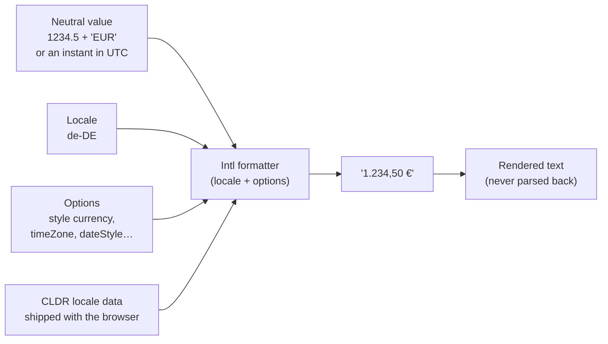
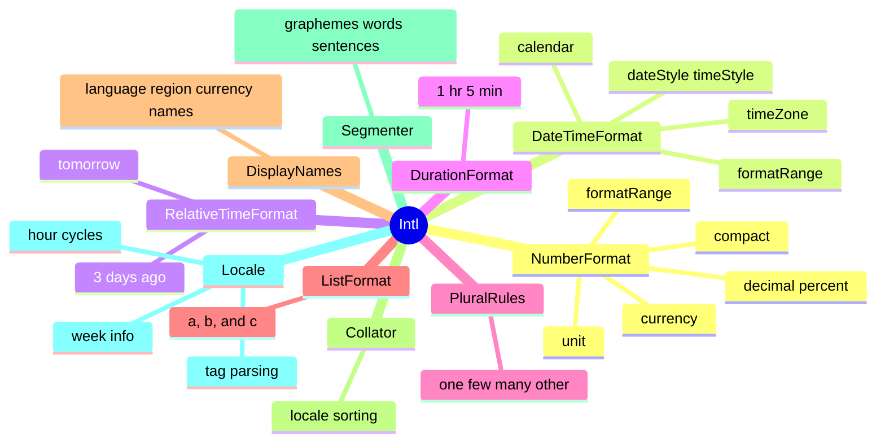
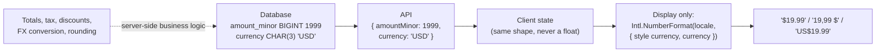
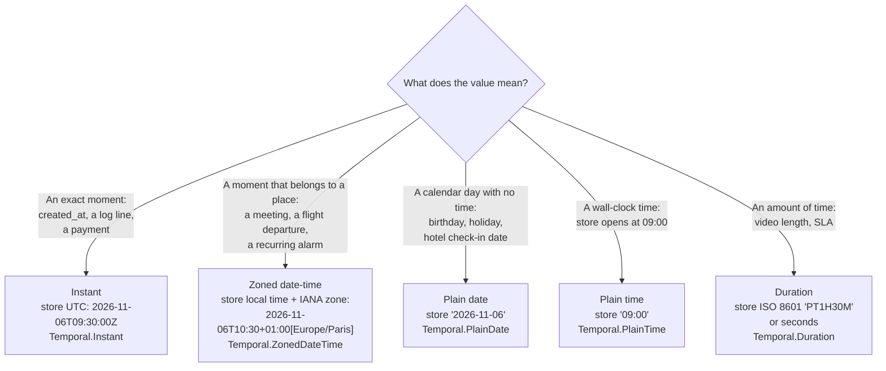
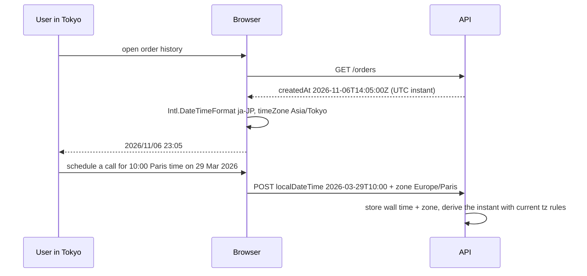
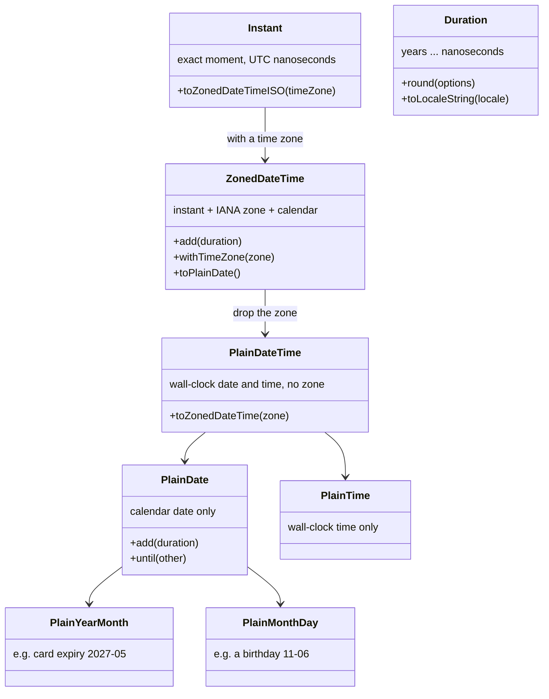
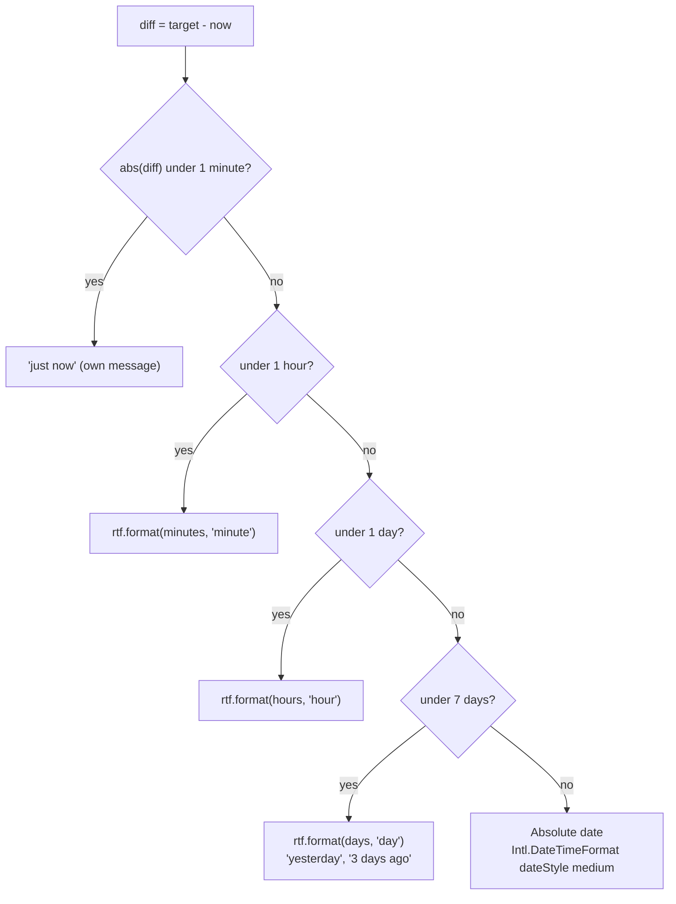
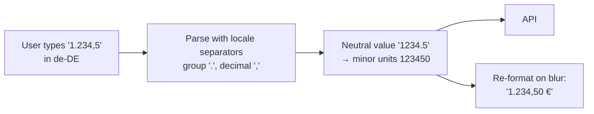

# Date, Number & Currency Formatting

> **Date:** 2026-11-06 · **Last updated:** 2026-11-06
> **Category:** Frontend System Design
> **Sub-Topic:** Internationalization / Formatting (Intl, time zones, money)
> **Level:** Intermediate · **Reading time:** ~30 min
> **Informs:** Intl API usage and formatter caching, date/time data model (instant vs zoned vs plain date), time zone handling and SSR hydration safety, money representation (minor units + ISO 4217) in APIs and state, Temporal adoption and polyfills, date-library choice (Moment migration), localized number/date input parsing, per-framework formatting (pipes, filters, FormatStyle)

> **Pre-requisite:** [Internationalization (i18n) Architecture](./internationalization-i18n-architecture.md) (how the locale is chosen) and [RTL Layout Support](./rtl-layout-support.md) (digits and bidi marks in RTL output).
> This note covers **turning data into locale-correct text** — numbers, money, dates, times, durations, lists — and the **data model** that keeps those values correct in the first place.

**Previous:** [RTL Layout Support](./rtl-layout-support.md) · **Next:** [XSS Prevention (Reflected, Stored, DOM)](../07-security/xss-prevention-reflected-stored-dom.md)

---

## Table of Contents

1. [ELI5 — Simple Explanation](#eli5--simple-explanation)
2. [Section 1: Why Formatting Is Locale Data, Not String Code](#section-1-why-formatting-is-locale-data-not-string-code)
3. [Section 2: The Intl Toolbox](#section-2-the-intl-toolbox)
4. [Section 3: Numbers — Intl.NumberFormat](#section-3-numbers--intlnumberformat)
5. [Section 4: Money — Representation Before Formatting](#section-4-money--representation-before-formatting)
6. [Section 5: Time — Pick the Right Kind of Value](#section-5-time--pick-the-right-kind-of-value)
7. [Section 6: The JavaScript Date Object and Its Traps](#section-6-the-javascript-date-object-and-its-traps)
8. [Section 7: Formatting Dates — Intl.DateTimeFormat](#section-7-formatting-dates--intldatetimeformat)
9. [Section 8: Time Zones and Daylight Saving Time](#section-8-time-zones-and-daylight-saving-time)
10. [Section 9: Temporal — The Modern Date/Time API](#section-9-temporal--the-modern-datetime-api)
11. [Section 10: Relative Time, Durations, Lists and Names](#section-10-relative-time-durations-lists-and-names)
12. [Section 11: SSR, Hydration and Performance](#section-11-ssr-hydration-and-performance)
13. [Section 12: Input — Parsing Is Harder Than Formatting](#section-12-input--parsing-is-harder-than-formatting)
14. [Libraries and Framework Comparison](#libraries-and-framework-comparison)
15. [Real-World Examples](#real-world-examples)
16. [Key Points Summary](#key-points-summary)
17. [Test Your Understanding](#test-your-understanding)
18. [Cheat Sheet](#cheat-sheet)
19. [References & Further Reading](#references--further-reading)

---

## ELI5 — Simple Explanation

Imagine one fact: *"the concert starts at 8 PM on 3 April 2026 in New York and costs twelve hundred thirty-four dollars and fifty cents."*

- An American writes **4/3/2026, 8:00 PM — $1,234.50**.
- A German writes **3.4.2026, 20:00 — 1.234,50 $**.
- An Indian writes large numbers with different grouping (**12,34,567**), and an Egyptian may use different digits (**١٢٣٤**).
- A fan in Tokyo watching the live stream needs the **same moment** shown as **Saturday morning**, not "8 PM".

The fact never changes; only how it's **written** changes. So you store the fact in one neutral, precise shape (an exact instant, an amount in cents plus "USD"), and let the browser's built-in **translator for formats** (`Intl`) write it for each reader.

> **Store values in a neutral, exact form (UTC instants, plain dates, integer minor units + currency code) and format them at the edge with `Intl` for the viewer's locale and time zone. Never build formatted strings by hand.**

---

## Core Concept — Step by Step

### Section 1: Why Formatting Is Locale Data, Not String Code

Every one of these is locale-dependent:

| Value | en-US | de-DE | fr-FR | en-IN | ar-EG |
|---|---|---|---|---|---|
| Number 1234567.891 | 1,234,567.891 | 1.234.567,891 | 1 234 567,891 | 12,34,567.891 | Arabic-Indic digits with Arabic separators |
| EUR 1234.5 | €1,234.50 | 1.234,50 € | 1 234,50 € | €1,234.50 | locale-specific |
| Date 6 Nov 2026 (numeric) | 11/6/2026 | 6.11.2026 | 06/11/2026 | 6/11/2026 | Arabic-Indic digits, RTL marks |
| 3 PM | 3:00 PM | 15:00 | 15:00 | 3:00 pm | locale-specific |

(Exact output depends on the CLDR version shipped with the browser — French, for instance, uses a narrow no-break space `U+202F` as its group separator.)



**Why not hand-roll?** Group separators, decimal marks, digit shapes, currency symbol position and spacing, grouping patterns (Indian 2-digit groups), 12/24-hour clocks, month names, calendar systems and plural-aware units are all data maintained in Unicode's **CLDR**. Browsers ship it through the **ECMA-402 `Intl` APIs**, so you get it for zero bundle cost.

---

### Section 2: The Intl Toolbox



| API | Use for | Support (verify on MDN) |
|---|---|---|
| `Intl.NumberFormat` | Numbers, percent, currency, units, compact notation, ranges | All modern browsers; newer options (`roundingMode`, `formatRange`, `trailingZeroDisplay`) since ~2022–2023 |
| `Intl.DateTimeFormat` | Dates, times, time zones, calendars, date ranges | All modern browsers |
| `Intl.RelativeTimeFormat` | "3 days ago", "tomorrow" | All modern browsers |
| `Intl.DurationFormat` | "1 hr, 5 min", "1:05:03" | Newer — supported in current Chrome, Firefox and Safari |
| `Intl.PluralRules` | Plural category for a number | All modern browsers |
| `Intl.ListFormat` | "A, B, and C" / "A, B y C" | All modern browsers |
| `Intl.DisplayNames` | "Japanese Yen", "Vereinigte Staaten" | All modern browsers |
| `Intl.Locale` (+ `getWeekInfo()`, `getHourCycles()`, `getTimeZones()`) | Locale info: first day of week, 12/24 h, zones | The `get*()` methods are recent (Firefox later than Chromium/Safari) — feature-detect |
| `Temporal` | Correct date/time arithmetic and time zones (Section 9) | Shipped in Firefox and Chrome; not yet in stable Safari at the time of writing — check MDN |

---

### Section 3: Numbers — Intl.NumberFormat

```javascript
const fmt = (locale, opts) => (v) => new Intl.NumberFormat(locale, opts).format(v);

fmt('en-US')(1234567.891);                                      // '1,234,567.891'
fmt('de-DE')(1234567.891);                                      // '1.234.567,891'
fmt('en-IN')(1234567.891);                                      // '12,34,567.891'
fmt('ar-EG')(1234.5);                                           // '١٬٢٣٤٫٥' (Arabic-Indic digits)
fmt('ar-EG-u-nu-latn')(1234.5);                                 // '1,234.5'  (Latin digits via extension)
fmt('en-US', { style: 'percent' })(0.256);                      // '26%'
fmt('en-US', { style: 'percent', maximumFractionDigits: 1, signDisplay: 'exceptZero' })(-0.034); // '-3.4%'
fmt('en', { notation: 'compact' })(1234567);                    // '1.2M'
fmt('de', { notation: 'compact' })(1500000);                    // '1,5 Mio.'
fmt('ja', { notation: 'compact' })(15000);                      // '1.5万'
fmt('en-US', { style: 'unit', unit: 'kilometer-per-hour' })(50);   // '50 km/h'
fmt('de-DE', { style: 'unit', unit: 'liter', unitDisplay: 'long' })(2); // '2 Liter'
fmt('en-US', { maximumSignificantDigits: 3 })(123456);          // '123,000'
```

**Options worth knowing:**

| Option | Values | Notes |
|---|---|---|
| `style` | `decimal`, `percent`, `currency`, `unit` | `percent` multiplies by 100 |
| `minimumFractionDigits` / `maximumFractionDigits` | 0–100 | Currency defaults come from the currency (JPY 0, USD 2, KWD 3) |
| `minimumSignificantDigits` / `maximumSignificantDigits` | 1–21 | Good for scientific/metric values |
| `notation` | `standard`, `compact`, `scientific`, `engineering` | `compact` = "1.2K" / "1,2 Mio." |
| `signDisplay` | `auto`, `always`, `exceptZero`, `negative`, `never` | `exceptZero` for deltas: "+3.4%" |
| `useGrouping` | `auto`, `always`, `min2`, `false` | `min2` skips grouping for 4-digit numbers where the locale prefers it |
| `roundingMode` | `halfExpand` (default), `halfEven`, `ceil`, `floor`, `trunc`… | Display rounding only — not accounting |
| `trailingZeroDisplay` | `auto`, `stripIfInteger` | "$5" instead of "$5.00" |
| `numberingSystem` / `-u-nu-` | `latn`, `arab`, `deva`… | Override digit shapes |

**Precision:** `format()` also accepts a **string** (`'12345678901234567890.12'`) and formats it exactly, whereas a Number literal of that size has already lost precision. Keep high-precision decimals as strings (or a decimal library) until display.

**`formatToParts()`** returns typed pieces (`integer`, `group`, `decimal`, `fraction`, `currency`, `minusSign`…) so you can style them — e.g. smaller cents — without string surgery:

```javascript
new Intl.NumberFormat('en-US', { style: 'currency', currency: 'EUR' }).formatToParts(-1234.5);
// [ {type:'minusSign',value:'-'}, {type:'currency',value:'€'}, {type:'integer',value:'1'},
//   {type:'group',value:','}, {type:'integer',value:'234'}, {type:'decimal',value:'.'},
//   {type:'fraction',value:'50'} ]
```

**Ranges:** `formatRange(3, 5)` → `'$3.00 – $5.00'`; for equal values it may produce an approximate form like `'~$3.00'`.

---

### Section 4: Money — Representation Before Formatting

Formatting money is easy. **Representing** it is where systems break.

**Rule 1 — never use binary floats for money.**

```javascript
0.1 + 0.2;            // 0.30000000000000004
(1.005).toFixed(2);   // '1.00'  — 1.005 is stored as 1.00499999999999989...
```

Use **integer minor units** (cents) or **decimal strings**, plus an **ISO 4217 currency code**. The number of minor units depends on the currency:

| Currency | ISO 4217 minor units | 1999 minor units = |
|---|---|---|
| USD, EUR, GBP, INR | 2 | 19.99 |
| JPY, KRW | 0 | 1999 |
| KWD, BHD, TND | 3 | 1.999 |



**Rule 2 — the currency is data, the locale is presentation.** They are independent:

```javascript
const money = (locale, currency) => new Intl.NumberFormat(locale, { style: 'currency', currency });
money('en-US', 'USD').format(5);  // '$5.00'
money('en-US', 'MXN').format(5);  // 'MX$5.00'  — US reader, Mexican pesos
money('es-MX', 'MXN').format(5);  // '$5.00'    — Mexican reader, Mexican pesos
money('es-MX', 'USD').format(5);  // 'USD 5.00' — Mexican reader, US dollars
money('en-CA', 'USD').format(1);  // 'US$1.00'
```

A Canadian user switching the UI to French must **not** change the price from CAD to EUR. Currency comes from the **market/account/order**, never from `navigator.language`.

**Rule 3 — the server owns money math.** Tax, discounts, rounding rules (banker's rounding vs half-up, per-line vs per-invoice), and currency conversion are business/legal decisions. The client displays what the server computed; optimistic previews must be clearly provisional.

**Display options:**

| Option | Example | Use |
|---|---|---|
| `currencyDisplay: 'symbol'` (default) | `$5.00`, `MX$5.00`, `US$5.00` | Default; disambiguates foreign dollars by locale |
| `currencyDisplay: 'narrowSymbol'` | `$5.00` | Only when the currency is obvious from context |
| `currencyDisplay: 'code'` | `EUR 5.00` | Multi-currency tables, finance |
| `currencyDisplay: 'name'` | `5.00 euros` | Screen-reader-friendly labels, prose |
| `currencySign: 'accounting'` | `($5.00)` | Negative amounts in accounting UIs |

```typescript
// Convert minor units → a display string without floating-point division
const digits = (currency: string) =>
  new Intl.NumberFormat('en', { style: 'currency', currency }).resolvedOptions().maximumFractionDigits ?? 2;

export function formatMoney(amountMinor: bigint | number, currency: string, locale: string) {
  const d = digits(currency);
  const n = BigInt(amountMinor);
  const neg = n < 0n;
  const abs = (neg ? -n : n).toString().padStart(d + 1, '0');           // 5 → '005' for 2 digits
  const decimal = d === 0 ? abs : `${abs.slice(0, -d)}.${abs.slice(-d)}`; // '1999' → '19.99'
  return new Intl.NumberFormat(locale, { style: 'currency', currency }).format(`${neg ? '-' : ''}${decimal}`);
}
formatMoney(1999, 'USD', 'de-DE');   // '19,99 $'
formatMoney(1999, 'JPY', 'ja-JP');   // '￥1,999'
formatMoney(-5, 'USD', 'en-US');     // '-$0.05'
```

> Intl's default fraction digits follow ISO 4217, but some payment providers use different conventions for specific currencies (e.g. which currencies are "zero-decimal"). Use **one source of truth** — normally the server's currency table — for converting minor units.

---

### Section 5: Time — Pick the Right Kind of Value

Most date bugs are **modeling** bugs: using one type (`Date`, a timestamp) for several different concepts.



| Concept | Wrong representation | Bug it causes |
|---|---|---|
| Birthday | Midnight UTC timestamp | Shows the previous day for users west of UTC |
| Future meeting in Paris | UTC instant only | If DST rules change before the date, the meeting moves; can't show "Paris time" |
| "Opens at 09:00" | A timestamp on 1 Jan 1970 | Off by the offset, wrong after DST |
| `created_at` | Local time string without offset | Ambiguous, unsortable across zones |

**API contract:**
- Instants: **RFC 3339 / ISO 8601 with `Z` or an offset** — `2026-11-06T09:30:00Z`.
- Zoned values: local date-time **plus the IANA time zone ID** (`Europe/Paris`), e.g. RFC 9557 format `2026-11-06T10:30:00+01:00[Europe/Paris]` or separate fields.
- Plain dates: `yyyy-mm-dd` with **no** time and no zone.
- Never use time zone **abbreviations** (`EST`, `IST`, `CST`) as data — they are ambiguous (IST is used for India, Ireland and Israel).
- Store the user's **time zone** on their profile (`Intl.DateTimeFormat().resolvedOptions().timeZone` gives the browser's IANA zone) so emails, reports and SSR use it.

---

### Section 6: The JavaScript Date Object and Its Traps

`Date` is a wrapper around **one** number: milliseconds since the Unix epoch (UTC). It has no time zone of its own — only the host's local zone for its local getters — and no concept of a plain date.

```javascript
// 1. Date-only ISO strings are parsed as UTC; date-time strings without an offset as LOCAL time
new Date('2026-11-06').toISOString();        // '2026-11-06T00:00:00.000Z'
new Date('2026-11-06T00:00').toISOString();  // depends on the machine's zone (e.g. '2026-11-05T19:00:00.000Z' in UTC+5)
new Intl.DateTimeFormat('en-US', { dateStyle: 'medium', timeZone: 'America/Los_Angeles' })
  .format(new Date('2026-11-06'));           // 'Nov 5, 2026'  ← the birthday bug

// 2. Months are 0-based; days are 1-based
new Date(2026, 10, 6);                        // 6 November 2026

// 3. Mutation and overflow
const d = new Date(2026, 0, 31);              // 31 January
d.setMonth(1);                                // "February 31" overflows → 3 March 2026

// 4. Non-ISO strings are implementation-defined
new Date('03/04/2026');                       // March 4 or 3 April? Don't.
```

| Trap | Fix |
|---|---|
| Parsing user-visible strings | Parse only ISO 8601 from APIs; build dates from components otherwise |
| Plain dates in `Date` | Keep `'yyyy-mm-dd'` strings, or `Temporal.PlainDate` |
| Local getters (`getHours`) in shared code | Explicit `timeZone` in `Intl.DateTimeFormat`, or Temporal |
| Month arithmetic with `setMonth` | Temporal (`add({ months: 1 })` clamps to the end of month) or a library |
| `Date` objects in state/serialization | Serialize as ISO strings; `JSON.stringify` already produces UTC ISO |

---

### Section 7: Formatting Dates — Intl.DateTimeFormat

```javascript
const instant = new Date('2026-11-06T14:05:00Z');

new Intl.DateTimeFormat('en-US', { dateStyle: 'full', timeStyle: 'short', timeZone: 'America/New_York' }).format(instant);
// 'Friday, November 6, 2026 at 9:05 AM'
new Intl.DateTimeFormat('en-GB', { dateStyle: 'medium', timeZone: 'Europe/London' }).format(instant);  // '6 Nov 2026'
new Intl.DateTimeFormat('de-DE', { weekday: 'long', day: 'numeric', month: 'long', year: 'numeric' }).format(instant);
// 'Freitag, 6. November 2026'
new Intl.DateTimeFormat('ja-JP-u-ca-japanese', { dateStyle: 'long' }).format(instant);  // Japanese era: '令和8年11月6日'
new Intl.DateTimeFormat('ar-SA-u-ca-islamic-umalqura', { dateStyle: 'medium' }).format(instant); // Hijri calendar
new Intl.DateTimeFormat('en-US', { timeZone: 'Asia/Kolkata', hour: 'numeric', minute: '2-digit', timeZoneName: 'short' })
  .format(instant);                                                     // '7:35 PM GMT+5:30'
new Intl.DateTimeFormat('en-US', { dateStyle: 'medium' })
  .formatRange(new Date(2026, 10, 6), new Date(2026, 10, 9));           // 'Nov 6 – 9, 2026'
```

**Two ways to choose output:**
- **`dateStyle` / `timeStyle`** (`full`, `long`, `medium`, `short`) — let the locale pick the pattern. Preferred.
- **Component options** (`year`, `month`, `day`, `weekday`, `hour`, `minute`…) — you choose *which* fields; the locale still chooses **order and punctuation**. You can't mix them with `dateStyle`/`timeStyle`.

Never write patterns like `'MM/DD/YYYY'` for display — that's choosing the order *for* the user.

| Option | Notes |
|---|---|
| `timeZone` | IANA ID. **Always pass it** in code that runs on servers or must match the server |
| `hourCycle` / `hour12` | Overrides the locale's 12/24 h preference (`h23` / `h12`) — respect user settings when you have them |
| `calendar` / `-u-ca-` | `gregory`, `islamic-umalqura`, `japanese`, `buddhist`, `persian`, `hebrew`… |
| `timeZoneName` | `short`, `long`, `shortOffset`, `longGeneric`… |
| `formatToParts()` | Typed pieces (`weekday`, `month`, `day`, `literal`) for custom styling |

**Week start and weekends** differ by region (Sunday in the US, Monday in most of Europe, Saturday in parts of the Middle East). Calendars and date pickers should use `new Intl.Locale(locale).getWeekInfo?.()` (e.g. `en-US` → `{ firstDay: 7, weekend: [6, 7] }`) with a fallback table where unsupported.

---

### Section 8: Time Zones and Daylight Saving Time

**An offset is not a time zone.** `+01:00` is a snapshot; `Europe/Paris` is a set of rules (and history) that produces different offsets through the year. The rules live in the **IANA tz database**, which changes several times a year as governments change DST policy — browsers and OSes ship updates.



**DST creates gaps and overlaps:**

```text
US spring-forward, America/New_York, Sunday 8 March 2026:
  01:59:59 EST → 03:00:00 EDT        02:30 local time does NOT exist (gap)
US fall-back, Sunday 1 November 2026:
  01:59:59 EDT → 01:00:00 EST        01:30 local time happens TWICE (overlap)

Consequences:
  "add 24 hours" ≠ "same time tomorrow" on those days
  a day can be 23 or 25 hours long
  a daily 02:30 alarm needs a policy for the missing day
```

| Problem | Correct approach |
|---|---|
| "Same time tomorrow" | Add **1 calendar day** in the event's zone (`ZonedDateTime.add({ days: 1 })`), not 86,400,000 ms |
| A local time in a gap/overlap | Choose a disambiguation policy (`earlier`, `later`, `compatible`, `reject` in Temporal) |
| "Today" for a user | Derived from **their** time zone, not the server's or UTC |
| Recurring events | Store the rule + zone; expand occurrences with zone-aware math |
| Countdown / elapsed time | Use instants (UTC); for measuring intervals in the page, `performance.now()` |

---

### Section 9: Temporal — The Modern Date/Time API

**Temporal** is the TC39 replacement for `Date`: immutable values, separate types for each concept in Section 5, first-class time zones and calendars, and exact arithmetic.

**Status (late 2026 — verify on MDN):** Temporal has shipped in **Firefox** and **Chrome**, and is in progress in Safari (Technology Preview) — so production web apps still need a **polyfill** (`@js-temporal/polyfill` or `temporal-polyfill`) or feature detection. Recent Node.js releases include it as well.



```javascript
// With native Temporal or a polyfill:  import { Temporal } from '@js-temporal/polyfill';

// Plain dates: no time zone surprises
const birthday = Temporal.PlainDate.from('1990-11-06');
const today = Temporal.Now.plainDateISO('America/Los_Angeles');   // "today" in the user's zone
const age = birthday.until(today, { largestUnit: 'years' }).years;

// Month arithmetic clamps instead of overflowing
Temporal.PlainDate.from('2026-01-31').add({ months: 1 }).toString();   // '2026-02-28'

// A meeting that belongs to Paris, shown to a user in Tokyo
const meeting = Temporal.ZonedDateTime.from('2026-03-29T10:00[Europe/Paris]');
meeting.withTimeZone('Asia/Tokyo').toLocaleString('ja-JP', { dateStyle: 'medium', timeStyle: 'short' });

// DST-safe "same time tomorrow" vs "24 hours later"
const t = Temporal.ZonedDateTime.from('2026-03-07T09:00[America/New_York]');
t.add({ days: 1 }).toString();    // '2026-03-08T09:00:00-04:00[America/New_York]'  (wall clock kept)
t.add({ hours: 24 }).toString();  // '2026-03-08T10:00:00-04:00[America/New_York]'  (exact elapsed time)

// Instants from APIs
const created = Temporal.Instant.from('2026-11-06T14:05:00Z');
created.toZonedDateTimeISO('Asia/Kolkata').toPlainTime().toString();   // '19:35:00'
```

Temporal values format through the same `Intl.DateTimeFormat` machinery (`toLocaleString(locale, options)`), and `Temporal.Duration#toLocaleString` uses `Intl.DurationFormat`.

---

### Section 10: Relative Time, Durations, Lists and Names

```javascript
// Relative time — you choose the unit; Intl chooses the words
const rtf = new Intl.RelativeTimeFormat('en', { numeric: 'auto' });
rtf.format(-1, 'day');      // 'yesterday'
rtf.format(3, 'hour');      // 'in 3 hours'
new Intl.RelativeTimeFormat('es', { numeric: 'auto' }).format(2, 'day');   // 'pasado mañana'

// Durations
new Intl.DurationFormat('en', { style: 'long' }).format({ hours: 1, minutes: 5 });          // '1 hour, 5 minutes'
new Intl.DurationFormat('en', { style: 'digital' }).format({ hours: 1, minutes: 5, seconds: 3 }); // '1:05:03'

// Lists
new Intl.ListFormat('en', { type: 'conjunction' }).format(['Ana', 'Ben', 'Chen']);     // 'Ana, Ben, and Chen'
new Intl.ListFormat('en-GB', { type: 'conjunction' }).format(['Ana', 'Ben', 'Chen']);  // 'Ana, Ben and Chen'

// Display names for pickers
new Intl.DisplayNames(['en'], { type: 'currency' }).of('JPY');   // 'Japanese Yen'
new Intl.DisplayNames(['de'], { type: 'region' }).of('US');      // 'Vereinigte Staaten'
new Intl.DisplayNames(['fr'], { type: 'language' }).of('de');    // 'allemand'
```

`RelativeTimeFormat` does **not** pick the unit for you. A helper must decide "45 seconds → 'now'", "3 hours", "yesterday", then switch to an absolute date after a threshold (e.g. a week), and refresh periodically:



For "days ago", compute the difference in **calendar days in the user's zone**, not `ms / 86_400_000` — 11 PM yesterday is "yesterday", even though it was one hour ago.

---

### Section 11: SSR, Hydration and Performance

**Hydration:** the server and the browser must produce identical text. Locale *and* time zone must match.

| Situation | Approach |
|---|---|
| User's zone known (profile/cookie) | Format on the server with `timeZone: user.timeZone`; the client uses the same value |
| Zone unknown on first visit | Render a zone-neutral value (date only, or UTC with a label), set a cookie from `Intl.DateTimeFormat().resolvedOptions().timeZone`, refine after mount |
| "Local time" widgets, relative times ("3 min ago") | Render on the client after mount, or render server value and suppress the warning on that one text node (React: `suppressHydrationWarning`) |
| Static (SSG) pages | Never bake "now"-relative strings into static HTML |

Always emit machine-readable time in the markup: `<time datetime="2026-11-06T14:05:00Z">6 Nov 2026, 14:05</time>`.

**Performance:**
- Constructing `Intl` formatters is far more expensive than calling `format()`. **Create once, reuse** — cache by `locale + JSON.stringify(options)` (Example 1), especially inside lists, tables and virtualized rows.
- `Date.prototype.toLocaleString(locale, options)` and `Number.prototype.toLocaleString` may construct a new formatter on every call — avoid them in hot loops.
- Don't ship date-locale data in your bundle (Moment locales, date-fns locale objects for formatting) when `Intl` already has it.

---

### Section 12: Input — Parsing Is Harder Than Formatting

`Intl` **formats** but doesn't **parse**. Prefer inputs that produce neutral values:

| Input | Recommendation |
|---|---|
| Date | `<input type="date">`: its `value` is always `yyyy-mm-dd`; the displayed format follows the browser/OS locale (not your page's `lang`). Use a custom date picker only when you need range/disabled-day logic — and keep its value ISO |
| Time | `<input type="time">` → `HH:mm` value |
| Amounts | `<input type="text" inputmode="decimal">`, parse with the locale's separators (Example 5). `type="number"` handles locale decimal separators inconsistently and changes value on scroll in some browsers |
| Currency | Separate currency selector (code), amount in the market's minor units; never infer the currency from the typed symbol |
| Phone numbers | A library such as libphonenumber, store E.164 (`+14155550123`) |



---

## Libraries and Framework Comparison

**Date libraries:**

| Library | Status / model | When to use |
|---|---|---|
| **Native `Intl` + `Date`** | Built in; formatting is excellent, arithmetic and zones are weak | Formatting everywhere |
| **Temporal** (+ polyfill) | The standard going forward; immutable, zone- and calendar-aware | New code that does date arithmetic or zone conversion |
| **date-fns** | Functional, tree-shakable functions over `Date`; time zone support via `@date-fns/tz` in recent versions | Existing `Date` codebases needing arithmetic |
| **Luxon** | Immutable `DateTime` built on `Intl`, zone-aware | Zone-heavy apps until Temporal is everywhere |
| **Day.js** | Small Moment-like API with plugins | Migrating off Moment with minimal changes |
| **Moment.js** | **Legacy, in maintenance mode** (its maintainers' own status since 2020); large, mutable, bundles locales | Don't start new code with it; migrate to Temporal/Luxon/date-fns/Day.js |

**Formatting per framework:**

| Stack | Numbers / currency | Dates | Notes |
|---|---|---|---|
| **React** | `Intl` directly, or react-intl `<FormattedNumber>` / `intl.formatNumber` | `<FormattedDate>`, `<FormattedRelativeTime>` | next-intl: `useFormatter()` with a global `timeZone` config to avoid hydration mismatches |
| **Vue** | vue-i18n `n(value, 'currency')` with `numberFormats` | `d(date, 'short')` with `datetimeFormats` | Named formats are defined per locale in config |
| **Angular** | `DecimalPipe`, `CurrencyPipe`, `PercentPipe` | `DatePipe` (`{{ d \| date:'medium' }}`) | Pipes have traditionally used **Angular's own CLDR locale data** rather than `Intl` — locales beyond `en-US` must be registered (`registerLocaleData`) or included by `--localize` builds; check the docs for your version |
| **Svelte** | `Intl` directly (svelte-i18n offers `$number`, `$date`) | Same | Cache formatters in a module |
| **iOS (Swift)** | `value.formatted(.currency(code: "EUR"))`, `NumberFormatter` | `date.formatted(date: .abbreviated, time: .shortened)`, `DateFormatter` | Respects user's region and 12/24 h settings |
| **Android (Kotlin)** | `NumberFormat.getCurrencyInstance(locale)`, `android.icu.text.NumberFormatter` | `java.time` + `DateTimeFormatter.ofLocalizedDate(FormatStyle.MEDIUM)` | Use `java.time` (desugaring for older API levels) |
| **Flutter** | `intl` package: `NumberFormat.simpleCurrency(locale: 'de_DE', name: 'EUR')` | `DateFormat.yMMMd('de').format(date)` | Flutter's `intl` uses underscore locale names |

---

## Real-World Examples

**Example 1 — A cached formatter module (TypeScript):**
```typescript
// format.ts — one place for all display formatting
const cache = new Map<string, Intl.NumberFormat | Intl.DateTimeFormat | Intl.RelativeTimeFormat>();

function cached<T>(kind: string, locale: string, options: object, create: () => T): T {
  const key = `${kind}|${locale}|${JSON.stringify(options)}`;
  let f = cache.get(key) as T | undefined;
  if (!f) {
    f = create();
    cache.set(key, f as never);
  }
  return f;
}

export const numberFmt = (locale: string, options: Intl.NumberFormatOptions = {}) =>
  cached('n', locale, options, () => new Intl.NumberFormat(locale, options));

export const dateFmt = (locale: string, options: Intl.DateTimeFormatOptions) =>
  cached('d', locale, options, () => new Intl.DateTimeFormat(locale, options));

export const relFmt = (locale: string, options: Intl.RelativeTimeFormatOptions = { numeric: 'auto' }) =>
  cached('r', locale, options, () => new Intl.RelativeTimeFormat(locale, options));

// Usage in a 10,000-row table: one formatter, many calls
const priceFmt = numberFmt('de-DE', { style: 'currency', currency: 'EUR' });
rows.map((r) => priceFmt.format(r.price));
```

**Example 2 — The birthday bug (BAD → GOOD):**
```typescript
// API: { "birthday": "1990-11-06" }  — a plain date

// ❌ BAD: parsed as UTC midnight, then shown in the user's local zone → "Nov 5" in the Americas
const label = new Date(user.birthday).toLocaleDateString('en-US', { month: 'long', day: 'numeric' });

// ✅ GOOD (Intl only): format in UTC, because the value was never a moment in time
const label2 = new Intl.DateTimeFormat('en-US', { month: 'long', day: 'numeric', timeZone: 'UTC' })
  .format(new Date(`${user.birthday}T00:00:00Z`));            // 'November 6'

// ✅ BETTER (Temporal): a plain date has no zone at all
const label3 = Temporal.PlainDate.from(user.birthday)
  .toLocaleString('en-US', { month: 'long', day: 'numeric' }); // 'November 6'
```

**Example 3 — Relative time component that stays correct (React):**
```tsx
import { useEffect, useState } from 'react';
import { dateFmt, relFmt } from './format';

const UNITS: [Intl.RelativeTimeFormatUnit, number][] = [
  ['day', 86_400_000], ['hour', 3_600_000], ['minute', 60_000],
];

export function RelativeTime({ iso, locale }: { iso: string; locale: string }) {
  const [now, setNow] = useState<number | null>(null);          // null on the server → no hydration mismatch
  useEffect(() => {
    setNow(Date.now());
    const id = setInterval(() => setNow(Date.now()), 60_000);
    return () => clearInterval(id);
  }, []);

  const then = Date.parse(iso);
  const absolute = dateFmt(locale, { dateStyle: 'medium', timeStyle: 'short' }).format(then);
  if (now === null) return <time dateTime={iso}>{absolute}</time>;

  const diff = then - now;
  if (Math.abs(diff) > 7 * 86_400_000) return <time dateTime={iso}>{absolute}</time>;
  for (const [unit, ms] of UNITS) {
    if (Math.abs(diff) >= ms || unit === 'minute') {
      return (
        <time dateTime={iso} title={absolute}>
          {relFmt(locale).format(Math.round(diff / ms), unit)}
        </time>
      );
    }
  }
  return null;
}
```
(The first render prints the absolute date on both server and client, but its time zone must still match — pass an explicit `timeZone` from the user profile in real apps.)

**Example 4 — Money in the API and state (BAD → GOOD):**
```json
{ "total": 19.99, "currencySymbol": "$" }
```
```json
{ "total": { "amountMinor": 1999, "currency": "USD" }, "taxIncluded": true }
```
```typescript
// ✅ Client: display only, using the order's currency and the viewer's locale
const totalLabel = formatMoney(order.total.amountMinor, order.total.currency, locale); // from Section 4
// ❌ Never: order.items.reduce((s, i) => s + i.price * i.qty, 0) * 1.2  — floats + client-side tax rules
```

**Example 5 — Parsing a localized decimal input:**
```typescript
export function parseLocaleNumber(input: string, locale: string): number | null {
  const parts = new Intl.NumberFormat(locale).formatToParts(12345.6);
  const group = parts.find((p) => p.type === 'group')?.value ?? ',';
  const decimal = parts.find((p) => p.type === 'decimal')?.value ?? '.';

  // Map locale digits (e.g. Arabic-Indic) to ASCII
  const digits = [...new Intl.NumberFormat(locale, { useGrouping: false }).format(9876543210)].reverse();
  const toAscii = new Map(digits.map((d, i) => [d, String(i)]));

  const normalized = [...input.trim()]
    .map((ch) => toAscii.get(ch) ?? ch)
    .join('')
    .replaceAll(group, '')
    .replaceAll(' ', '').replaceAll(' ', '').replaceAll(' ', '') // space-like group separators
    .replace(decimal, '.');

  return /^-?\d+(\.\d+)?$/.test(normalized) ? Number(normalized) : null;
}

parseLocaleNumber('1.234,5', 'de-DE');   // 1234.5
parseLocaleNumber('1 234,5', 'fr-FR');   // 1234.5
parseLocaleNumber('١٢٣٤٫٥', 'ar-EG');    // 1234.5
```

**Example 6 — Same formatting in Vue, Angular and Svelte:**
```typescript
// Vue 3 + vue-i18n: named formats per locale
import { createI18n } from 'vue-i18n';
export const i18n = createI18n({
  legacy: false,
  locale: 'de-DE',
  numberFormats: { 'de-DE': { currency: { style: 'currency', currency: 'EUR' } } },
  datetimeFormats: { 'de-DE': { short: { dateStyle: 'medium' } } },
});
// <template>{{ n(1234.5, 'currency') }} · {{ d(order.createdAt, 'short') }}</template>
```
```typescript
// Angular: register locale data (unless built with --localize), then use pipes
import { registerLocaleData } from '@angular/common';
import localeDe from '@angular/common/locales/de';
registerLocaleData(localeDe);
// template: {{ price | currency: 'EUR' : 'symbol' : '1.2-2' : 'de' }}  ·  {{ createdAt | date: 'medium' : undefined : 'de' }}
```
```svelte
<!-- Svelte 5: plain Intl, formatter created once per locale -->
<script lang="ts">
  let { amount, locale }: { amount: number; locale: string } = $props();
  const fmt = $derived(new Intl.NumberFormat(locale, { style: 'currency', currency: 'EUR' }));
</script>
<span>{fmt.format(amount)}</span>
```

---

## Key Points Summary

| Concept | One-Line Explanation |
|---|---|
| **Intl / CLDR** | Browser-provided, locale-correct formatting with zero bundle cost |
| **Never hand-format** | No `'MM/DD/YYYY'`, no manual separators, no `toFixed` for display |
| **Cache formatters** | Construction is expensive; reuse per locale + options |
| **Money = minor units + ISO 4217** | Integers (or decimal strings), never floats; currency is data, locale is presentation |
| **Server owns money math** | Tax, rounding, FX are business rules |
| **Instant vs zoned vs plain** | Pick the type that matches the meaning; most bugs are modeling bugs |
| **IANA zone, not offset/abbreviation** | `Europe/Paris` carries DST rules; `+01:00` and `IST` don't |
| **Date traps** | Date-only strings are UTC; months 0-based; mutation; implementation-defined parsing |
| **DST** | Gaps and overlaps; "tomorrow" ≠ +24 h |
| **Temporal** | Immutable, zone/calendar-aware types; shipped in Firefox and Chrome, polyfill elsewhere |
| **RelativeTimeFormat** | Formats words; you choose unit and thresholds |
| **SSR** | Same locale and `timeZone` on server and client; "now"-relative text on the client |
| **Inputs** | ISO values from date/time inputs; locale-aware parsing for numbers |
| **Moment** | Legacy/maintenance mode — use Intl + Temporal (or Luxon/date-fns/Day.js) |

---

## Test Your Understanding

**Q1 (Basic):**
Why should you use `Intl.NumberFormat` instead of `amount.toFixed(2).replace('.', ',') + ' €'`?

<details>
<summary>Answer</summary>

The hand-written version encodes **one** locale's rules: decimal comma, symbol after the number, a regular space, no grouping. Other locales differ in decimal and group separators (`,` `.` U+202F `’`), symbol position and spacing, grouping patterns (Indian `12,34,567`), digit shapes (Arabic-Indic), negative-number style (`-€5` vs `(€5.00)`), and the currency's own fraction digits (JPY 0, KWD 3). `toFixed` also rounds binary floats surprisingly (`(1.005).toFixed(2)` is `'1.00'`). `Intl.NumberFormat(locale, { style: 'currency', currency })` uses CLDR data shipped in the browser, so it's correct for every locale at no bundle cost.
</details>

**Q2 (Application):**
Design the data model and API fields for: an order's creation time, a user's birthday, a webinar scheduled for 10:00 New York time next spring, a store's opening hours, and an order total.

<details>
<summary>Answer</summary>

- **Order created:** an **instant** — `"createdAt": "2026-11-06T14:05:00Z"` (RFC 3339, UTC). Displayed in the viewer's zone.
- **Birthday:** a **plain date** — `"birthday": "1990-11-06"`. No time, no zone; never convert to a timestamp.
- **Webinar:** a **zoned date-time** — `"startsAt": { "local": "2027-04-15T10:00", "timeZone": "America/New_York" }` (or the RFC 9557 string `2027-04-15T10:00:00-04:00[America/New_York]`). Storing the zone keeps it at 10:00 New York time even if DST rules change; viewers elsewhere see it converted.
- **Opening hours:** **plain times** + weekday + the store's IANA zone — `{ "day": "MON", "opens": "09:00", "closes": "17:00", "timeZone": "Europe/Berlin" }`.
- **Order total:** `{ "amountMinor": 1999, "currency": "USD" }` — integer minor units + ISO 4217, computed server-side.
</details>

**Q3 (Tricky):**
Users in California report their birthday shows one day early, but users in Germany are fine. The API returns `"1990-11-06"`. Explain and fix.

<details>
<summary>Answer</summary>

`new Date('1990-11-06')` parses a **date-only ISO string as UTC midnight**. Formatting it in the user's local zone (`toLocaleDateString`, or `Intl.DateTimeFormat` without `timeZone`) converts it to local time: in California (UTC−8) that's 4 PM on **5 November**; in Germany (UTC+1) it's 1 AM on 6 November, so the bug is invisible there.

Fix: treat it as a **plain date**. Use `Temporal.PlainDate.from('1990-11-06')`, or keep it as a string and format with `timeZone: 'UTC'` from a UTC-midnight `Date`, or split into components. Never convert plain dates through the local zone.
</details>

**Q4 (Tricky):**
A reminder app adds `24 * 60 * 60 * 1000` ms to schedule "the same time tomorrow". Twice a year, reminders fire an hour off. Why, and what's the fix?

<details>
<summary>Answer</summary>

On DST transition days, a calendar day in the user's zone is **23 or 25 hours** long. Adding a fixed 86,400,000 ms keeps elapsed time constant, so the wall-clock time shifts by an hour. Users expect **wall-clock** recurrence.

Fix: store the reminder as wall time + IANA zone, and compute the next occurrence with zone-aware calendar arithmetic: `ZonedDateTime.add({ days: 1 })` in Temporal (or Luxon/date-fns-tz). Also decide what happens when the local time falls in a **gap** (02:30 on spring-forward doesn't exist) or **overlap** (01:30 on fall-back happens twice) — Temporal's `disambiguation` option makes that explicit.
</details>

**Q5 (Application):**
A Canadian user switches the UI from English to French. A product page shows `CA$19.99` before and `19,99 €` after. What went wrong in the architecture?

<details>
<summary>Answer</summary>

The code derived the **currency from the locale** (`fr` → EUR). Currency is a property of the **market/price/account**, not the language. The price should still be CAD; only its **presentation** changes: `new Intl.NumberFormat('fr-CA', { style: 'currency', currency: 'CAD' }).format(19.99)` → `19,99 $`.

Fix the model: prices come from the API as `{ amountMinor, currency }` for the user's market; the locale (from the UI language plus region) only goes into the formatter. Language and market selectors are separate settings.
</details>

**Q6 (System design):**
You're building a dashboard used worldwide with a large table (timestamps, amounts, percentages) server-rendered with React, plus relative "updated 2 min ago" labels. List the formatting decisions.

<details>
<summary>Answer</summary>

- **Data contract:** timestamps as UTC RFC 3339 instants; amounts as minor units + currency (or decimal strings for metrics); percentages as raw ratios.
- **User settings:** store locale **and** IANA time zone in the profile (default from `Intl.DateTimeFormat().resolvedOptions().timeZone` on first visit); let users override 12/24 h.
- **SSR:** format with explicit `locale` and `timeZone` from the profile so server HTML equals the client render; relative "x min ago" labels render after mount (or absolute on the server, relative on the client), refreshed on an interval.
- **Performance:** one cached `Intl.NumberFormat`/`DateTimeFormat` per column format, reused across rows (and with virtualization for very long tables).
- **Correctness:** `signDisplay: 'exceptZero'` for deltas, `notation: 'compact'` only where precision isn't needed (with the exact value in a tooltip), `currencyDisplay: 'code'` in multi-currency columns, `<time datetime>` for machine-readable times.
- **Aggregation:** "today", "this week" and week start computed in the **user's zone** and locale (`getWeekInfo` with a fallback), ideally on the server with the same zone.
- **Exports:** CSV uses neutral formats (ISO dates, `.` decimals), not display strings.
</details>

---

## Cheat Sheet

**Key Definitions:**
- **CLDR:** Unicode's database of locale conventions used by `Intl`, ICU and most platforms
- **ECMA-402:** The specification of JavaScript's `Intl` APIs
- **Minor units:** The smallest currency unit (cents); ISO 4217 defines how many per currency
- **Instant:** An exact moment on the global timeline (UTC)
- **Plain date/time:** A calendar date or wall-clock time with no zone
- **IANA time zone:** A named rule set like `America/New_York` (offsets + DST history)
- **DST gap/overlap:** Local times that don't exist / occur twice on transition days
- **Temporal:** The modern JavaScript date/time API with distinct types per concept

**Quick Reference:**
```text
Numbers:     new Intl.NumberFormat(locale, { maximumFractionDigits: 2 })
Percent:     { style: 'percent', signDisplay: 'exceptZero' }
Compact:     { notation: 'compact' }                         → 1.2M / 1,2 Mio. / 1.5万
Units:       { style: 'unit', unit: 'kilometer-per-hour' }
Currency:    { style: 'currency', currency: order.currency } ← currency from DATA, not locale
             currencyDisplay: symbol | narrowSymbol | code | name · currencySign: 'accounting'
Exact:       format('12345678901234567890.12')               ← strings keep precision
Dates:       new Intl.DateTimeFormat(locale, { dateStyle: 'medium', timeStyle: 'short', timeZone })
Ranges:      formatRange(a, b)        Parts: formatToParts(v)
Relative:    new Intl.RelativeTimeFormat(locale, { numeric: 'auto' }).format(-1, 'day')
Durations:   new Intl.DurationFormat(locale, { style: 'long' })
Lists:       new Intl.ListFormat(locale, { type: 'conjunction' })
Week:        new Intl.Locale(locale).getWeekInfo?.()       (fallback table)
User zone:   Intl.DateTimeFormat().resolvedOptions().timeZone

Store:       instant → '2026-11-06T09:30:00Z'
             zoned   → local + 'Europe/Paris'  (RFC 9557: ...+01:00[Europe/Paris])
             plain   → '2026-11-06' / '09:00'
             money   → { amountMinor: 1999, currency: 'USD' }
Never:       floats for money · Date for birthdays · 'EST'/'IST' as data · +86400000 for "tomorrow"
Perf:        cache formatters; avoid toLocaleString() in hot loops
SSR:         same locale + timeZone on both sides; "now"-relative text after mount
```

**Common Mistakes to Avoid:**

| Mistake | Why Wrong | Fix |
|---|---|---|
| Hand-built formats (`'MM/DD/YYYY'`, manual separators) | Wrong for most locales | `Intl` with `dateStyle` / `style` options |
| Floats for money | Rounding errors (`0.1 + 0.2`) | Integer minor units or decimal strings + currency code |
| Currency derived from locale | Language switch changes the price's currency | Currency from the market/order data |
| Client computes tax/discount totals | Diverges from the server's legal rounding | Server computes; client displays |
| `new Date('yyyy-mm-dd')` for birthdays | Parsed as UTC → previous day in the Americas | Plain date (`Temporal.PlainDate`) or format in UTC |
| Storing offsets or abbreviations | `+01:00` loses DST rules; `IST` is ambiguous | IANA zone IDs |
| `+ 86_400_000` for "tomorrow" | 23/25-hour days on DST transitions | Zone-aware `add({ days: 1 })` |
| No `timeZone` on the server | Server zone leaks into HTML; hydration mismatch | Explicit `timeZone` from profile/cookie |
| `new Intl.*` inside render loops | Expensive construction per cell | Cache formatters |
| `toLocaleString()` in big tables | May build a formatter per call | Reuse a cached formatter's `format()` |
| Parsing displayed strings back | Locale marks, spaces, bidi characters | Keep neutral values; parse inputs with locale separators |
| New code on Moment.js | Legacy, maintenance mode, heavy | Intl + Temporal (polyfill) or Luxon/date-fns/Day.js |
| Comparing formatted strings in tests across runtimes | CLDR versions differ (spaces, marks) | `formatToParts` or semantic assertions |

---

## References & Further Reading

**Core docs (MDN)**
- [`Intl.NumberFormat`](https://developer.mozilla.org/en-US/docs/Web/JavaScript/Reference/Global_Objects/Intl/NumberFormat) · [`Intl.DateTimeFormat`](https://developer.mozilla.org/en-US/docs/Web/JavaScript/Reference/Global_Objects/Intl/DateTimeFormat)
- [`Intl.RelativeTimeFormat`](https://developer.mozilla.org/en-US/docs/Web/JavaScript/Reference/Global_Objects/Intl/RelativeTimeFormat) · [`Intl.DurationFormat`](https://developer.mozilla.org/en-US/docs/Web/JavaScript/Reference/Global_Objects/Intl/DurationFormat) · [`Intl.ListFormat`](https://developer.mozilla.org/en-US/docs/Web/JavaScript/Reference/Global_Objects/Intl/ListFormat) · [`Intl.DisplayNames`](https://developer.mozilla.org/en-US/docs/Web/JavaScript/Reference/Global_Objects/Intl/DisplayNames)
- [`Intl.Locale.prototype.getWeekInfo()`](https://developer.mozilla.org/en-US/docs/Web/JavaScript/Reference/Global_Objects/Intl/Locale/getWeekInfo)
- [`Date`](https://developer.mozilla.org/en-US/docs/Web/JavaScript/Reference/Global_Objects/Date) · [`Date.parse()` — date time string format](https://developer.mozilla.org/en-US/docs/Web/JavaScript/Reference/Global_Objects/Date#date_time_string_format)
- [`Temporal`](https://developer.mozilla.org/en-US/docs/Web/JavaScript/Reference/Global_Objects/Temporal)
- [`<input type="date">`](https://developer.mozilla.org/en-US/docs/Web/HTML/Reference/Elements/input/date) · [`inputmode`](https://developer.mozilla.org/en-US/docs/Web/HTML/Reference/Global_attributes/inputmode) · [`<time>`](https://developer.mozilla.org/en-US/docs/Web/HTML/Reference/Elements/time)

**Specs & standards**
- ECMA-402: [ECMAScript Internationalization API](https://tc39.es/ecma402/)
- TC39: [Temporal documentation](https://tc39.es/proposal-temporal/docs/)
- IETF: [RFC 3339 — Date and Time on the Internet](https://www.rfc-editor.org/rfc/rfc3339) · [RFC 9557 — Date and Time with Additional Information (time zone suffix)](https://www.rfc-editor.org/rfc/rfc9557)
- IANA: [Time Zone Database](https://www.iana.org/time-zones)
- ISO: [ISO 4217 currency codes](https://www.iso.org/iso-4217-currency-codes.html)
- Unicode: [CLDR](https://cldr.unicode.org/)

**Libraries & frameworks**
- Moment.js: [Project status](https://momentjs.com/docs/#/-project-status/)
- [Luxon](https://moment.github.io/luxon/) · [date-fns](https://date-fns.org/) · [Day.js](https://day.js.org/)
- Temporal polyfills: [@js-temporal/polyfill](https://github.com/js-temporal/temporal-polyfill) · [temporal-polyfill](https://github.com/fullcalendar/temporal-polyfill)
- FormatJS: [react-intl components](https://formatjs.github.io/docs/react-intl/components)
- next-intl: [Date and time formatting](https://next-intl.dev/docs/usage/dates-times)
- Vue I18n: [Number formatting](https://vue-i18n.intlify.dev/guide/essentials/number.html) · [Datetime formatting](https://vue-i18n.intlify.dev/guide/essentials/datetime.html)
- Angular: [Format data based on locale](https://angular.dev/guide/i18n/format-data-locale)
- React: [`suppressHydrationWarning`](https://react.dev/reference/react-dom/components/common#common-props)
- Apple: [`FormatStyle`](https://developer.apple.com/documentation/foundation/formatstyle) · Android: [`android.icu.text.NumberFormat`](https://developer.android.com/reference/android/icu/text/NumberFormat) · Flutter: [`intl` package](https://pub.dev/packages/intl)

**Deep dives**
- W3C Internationalization: [Working with time zones](https://www.w3.org/TR/timezone/)
- Stripe docs: [Supported currencies and zero-decimal currencies](https://docs.stripe.com/currencies)

---

> **Previous Topic:** [RTL Layout Support](./rtl-layout-support.md)
> — Mirroring layouts for right-to-left scripts with logical CSS and bidi-safe text

> **Next Topic:** [XSS Prevention (Reflected, Stored, DOM)](../07-security/xss-prevention-reflected-stored-dom.md)
> — Phase 7 begins: frontend security, starting with cross-site scripting

*Saved on: 2026-11-06 | Repo: Frontend System Design Learning Notes*
