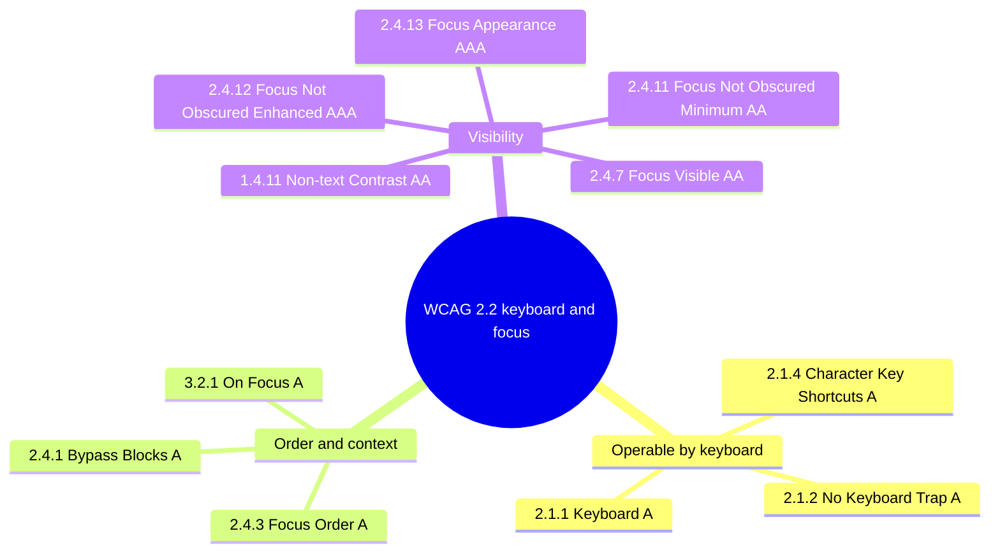
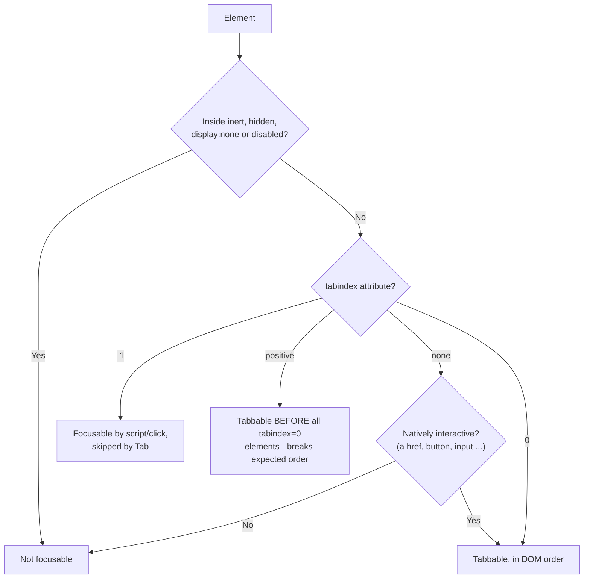
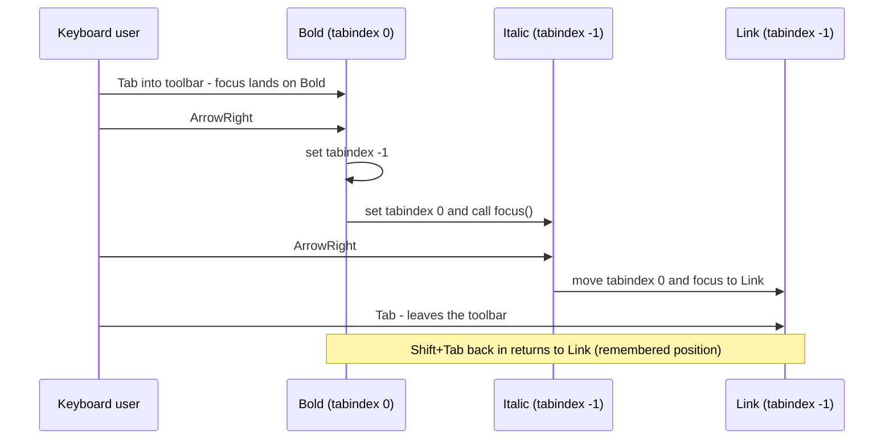
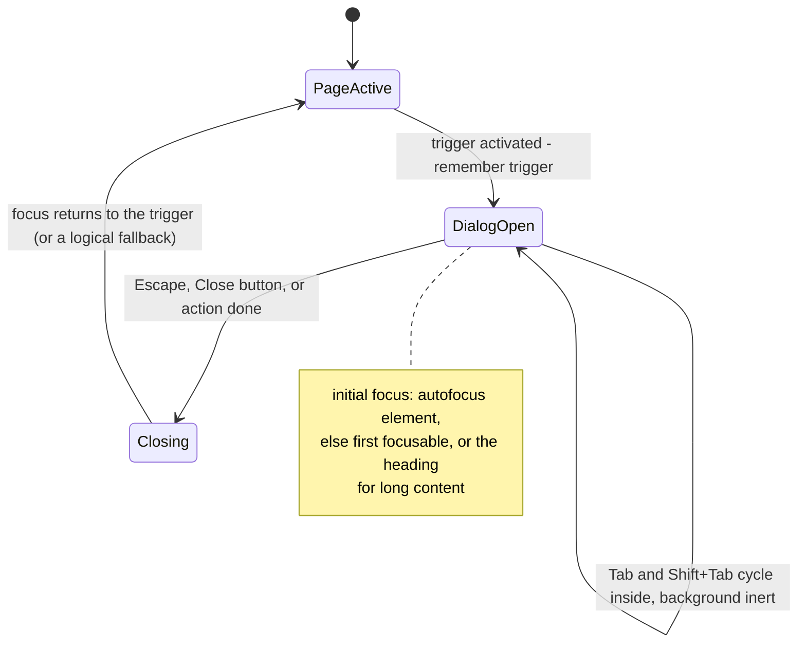
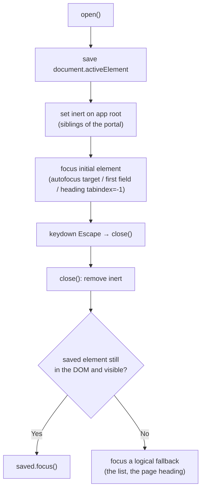
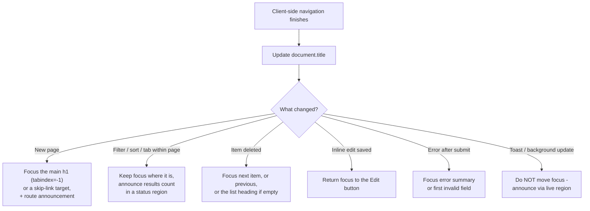
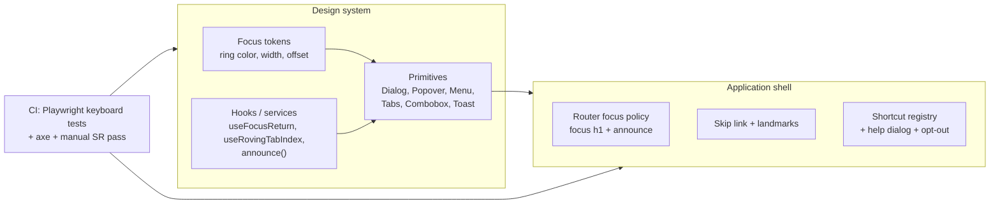

# Keyboard Navigation & Focus Management

> **Date:** 2026-11-06 · **Last updated:** 2026-11-06
> **Category:** Frontend System Design
> **Sub-Topic:** Accessibility / Keyboard & focus
> **Level:** Intermediate · **Reading time:** ~32 min
> **Informs:** focus strategy on SPA route changes, modal/drawer/popover focus handling, roving tabindex vs aria-activedescendant in composite widgets, focus-ring design tokens, keyboard shortcut policy, skip links, sticky-header focus obscuring, design-system keyboard contracts

> **Pre-requisite:** [ARIA Roles, States & Properties](./aria-roles-states-and-properties.md) (roles and states of the widgets you'll make keyboard-operable) and [DOM & Virtual DOM](../01-web-fundamentals/dom-and-virtual-dom.md).
> This note covers **who uses the keyboard, how focus moves, and how an app keeps focus somewhere sensible** when the UI changes underneath it.

**Previous:** [ARIA Roles, States & Properties](./aria-roles-states-and-properties.md) · **Next:** [Screen Reader Testing](./screen-reader-testing.md)

---

## Table of Contents

1. [ELI5 — Simple Explanation](#eli5--simple-explanation)
2. [Section 1: Who Depends on the Keyboard](#section-1-who-depends-on-the-keyboard)
3. [Section 2: Focusable, Tabbable and tabindex](#section-2-focusable-tabbable-and-tabindex)
4. [Section 3: Focus Order = DOM Order](#section-3-focus-order--dom-order)
5. [Section 4: Visible Focus](#section-4-visible-focus)
6. [Section 5: Standard Key Conventions](#section-5-standard-key-conventions)
7. [Section 6: Composite Widgets — Roving tabindex vs aria-activedescendant](#section-6-composite-widgets--roving-tabindex-vs-aria-activedescendant)
8. [Section 7: Dialogs, Popovers and Focus Traps](#section-7-dialogs-popovers-and-focus-traps)
9. [Section 8: Focus Management in SPAs](#section-8-focus-management-in-spas)
10. [Section 9: Skip Links and Bypass Blocks](#section-9-skip-links-and-bypass-blocks)
11. [Section 10: Keyboard Shortcuts](#section-10-keyboard-shortcuts)
12. [Section 11: The Focus APIs](#section-11-the-focus-apis)
13. [Section 12: Frameworks and Native Mobile](#section-12-frameworks-and-native-mobile)
14. [System Design Angle](#system-design-angle)
15. [Real-World Examples](#real-world-examples)
16. [Key Points Summary](#key-points-summary)
17. [Test Your Understanding (with answers)](#test-your-understanding)
18. [Cheat Sheet](#cheat-sheet)
19. [References & Further Reading](#references--further-reading)

---

## ELI5 — Simple Explanation

Imagine using a TV with only a remote: **arrow keys, OK and Back**. There's no mouse pointer.

- The **highlighted tile** on screen is **focus** — the one thing your next key press acts on.
- If the highlight is invisible, you're lost (**visible focus**).
- If pressing "next" jumps from the top-left tile to the bottom-right and back, you're confused (**focus order**).
- If a pop-up opens and the highlight stays on the screen *behind* it, you can't reach the pop-up (**moving focus into dialogs**).
- If you close the pop-up and the highlight jumps back to the very first tile, you have to start over (**restoring focus**).
- If you open a menu and can never leave it, you're stuck (**keyboard trap**).

> **One-line takeaway: Everything a mouse can do, the keyboard must do too — and whenever the UI changes, *you* decide where focus goes next, because the browser often can't.**

---

## Core Concept — Step by Step

### Section 1: Who Depends on the Keyboard

Keyboard access isn't just for people who "don't use a mouse":

| User | Input | What they need from you |
|---|---|---|
| Blind screen reader users | Keyboard + screen reader commands | Real focusable controls, logical order, focus moved on UI changes |
| Motor impairments | Keyboard, **switch devices**, sip-and-puff, head pointers | Everything reachable by Tab/arrows, big focus targets, no timing pressure |
| Voice control users | Dragon, Voice Control (Apple), Voice Access (Android) | Named, focusable controls ("click Save") |
| Low-vision users with magnification | Keyboard + zoom | **Visible focus** that stays on screen |
| Power users | Shortcuts | Predictable keys, shortcuts that don't clash |
| Smart TV / game console / tablet + keyboard | D-pad, hardware keyboard | Spatial/arrow navigation, focus visible from a distance |

The relevant **WCAG 2.2** success criteria (Level A/AA unless noted):



---

### Section 2: Focusable, Tabbable and tabindex

- **Focusable** = can receive focus (by click, script `.focus()`, or Tab).
- **Tabbable** = focusable **and** in the **sequential focus navigation order** (reached with Tab / Shift+Tab).

| Element | Focusable | Tabbable |
|---|---|---|
| `<a href>`, `<button>`, `<input>`, `<select>`, `<textarea>`, the `summary` element | ✅ | ✅ |
| Same, with `disabled` | ❌ | ❌ |
| `<a>` without `href` | ❌ | ❌ |
| `<div>`, `<span>`, `<h1>` | ❌ | ❌ |
| Anything with `tabindex="0"` | ✅ | ✅ (in DOM order) |
| Anything with `tabindex="-1"` | ✅ (script/click only) | ❌ |
| Anything with `tabindex="1"`+ (positive) | ✅ | ✅ **before everything else** — avoid |
| Elements inside `inert`, `hidden`, `display:none`, `visibility:hidden` | ❌ | ❌ |
| `<iframe>`, `<video controls>`, elements with `contenteditable` | ✅ | ✅ |
| Scroll containers with no focusable children | Chromium and Firefox make them keyboard-focusable; don't rely on it everywhere | Add `tabindex="0"` + a name if users must scroll them |



| `tabindex` | Use it for |
|---|---|
| (none) | Native controls — the default |
| `0` | Custom widgets that must be in the tab order (the one tab stop of a composite widget, a scrollable region) |
| `-1` | Programmatic focus targets: headings after route change, dialog containers, error summaries, roving-tabindex items not currently active |
| `> 0` | **Never.** It creates a separate order that jumps around the page and is impossible to maintain across components |

---

### Section 3: Focus Order = DOM Order

Tab follows the **DOM order** (plus positive tabindex, plus special rules for shadow DOM slots and popovers). CSS can make the **visual** order differ — and keyboard users then see focus jump around (WCAG 2.4.3).

```text
DOM:     [Cancel] [Save]
CSS:     flex-direction: row-reverse   →  visual:  [Save] [Cancel]
Tab:     Cancel → Save                 →  focus moves RIGHT-to-LEFT visually  ❌
```

Sources of visual/DOM mismatch:
- `order`, `flex-direction: *-reverse`, `grid-template-areas`, explicit grid placement, `position: absolute`.
- Portals (React `createPortal`, Vue `<Teleport>`, Angular CDK Overlay, Svelte portals): a dropdown rendered at the end of `<body>` is **last** in Tab order, far from its trigger — manage focus explicitly or use the `popover` attribute, which places the popover right after its invoker in the sequential focus order when opened from a `popovertarget`/`commandfor` button.

**Fix:** change the DOM order to match the visual order. The CSS **`reading-flow`** / `reading-order` properties (shipping in Chromium from 137, experimental elsewhere) let flex/grid layouts make focus and reading order follow the visual layout — treat as progressive enhancement and check MDN for current support.

---

### Section 4: Visible Focus

The browser's default focus ring is fine; **removing it without a replacement** is one of the most common accessibility failures.

```css
/* ❌ BAD: focus disappears for everyone */
*:focus { outline: none; }

/* ✅ GOOD: a strong ring for keyboard users, none for mouse clicks on buttons */
:where(a, button, input, select, textarea, summary, [tabindex]):focus-visible {
  outline: 3px solid var(--focus-ring, #1a5fd0);
  outline-offset: 2px;
}

/* Keep sticky headers from hiding the focused element (WCAG 2.4.11) */
html { scroll-padding-top: var(--header-height, 64px); }

/* Forced colors (Windows High Contrast): outlines survive; box-shadow rings don't */
@media (forced-colors: active) {
  :focus-visible { outline: 3px solid CanvasText; }
}
```

**`:focus` vs `:focus-visible`:**

| | `:focus` | `:focus-visible` |
|---|---|---|
| Matches | Any focused element | Focused element **when the browser judges a ring is useful** |
| Keyboard Tab | ✅ | ✅ |
| Mouse click on a button | ✅ | ❌ (usually) |
| Click into a text input | ✅ | ✅ (text entry always shows focus) |
| Script `.focus()` | ✅ | Follows the last input modality (keyboard → yes) |
| Support | Universal | All current browsers (Baseline since 2022) |

**Design rules for a focus indicator:**
- **WCAG 1.4.11 (AA):** the indicator needs **3:1 contrast** against adjacent colors.
- **WCAG 2.4.13 Focus Appearance (AAA):** an area at least as large as a 2 CSS px perimeter around the control, with 3:1 contrast between focused and unfocused states. A good target even if you only claim AA.
- Use **`outline`** (not only `box-shadow`) so forced-colors mode keeps it; a two-tone ring (light inner + dark outer) works on any background.
- Make it a **design token** (`--focus-ring-color`, `--focus-ring-width`, `--focus-ring-offset`) so every component in the design system uses the same ring — see [Theming & Dark Mode](../05-design-systems-and-components/theming-and-dark-mode.md) for themed tokens.
- **Focus Not Obscured (2.4.11, AA):** sticky headers, cookie banners and chat widgets must not **entirely** cover the focused element. `scroll-padding` handles headers; non-modal banners need to leave room or be dismissible.

---

### Section 5: Standard Key Conventions

Users expect the same keys to do the same things everywhere. The **APG** defines them per pattern.

| Key | Expected behavior |
|---|---|
| `Tab` / `Shift+Tab` | Move to the next/previous **tab stop** (control or composite widget) |
| `Enter` | Activate links and buttons (button: on keydown); submit single-field forms |
| `Space` | Activate buttons (on keyup), toggle checkboxes, select in listboxes; **scrolls the page** on links/non-controls |
| `Arrow keys` | Move **inside** a composite widget: radio group, tabs, menu, listbox, tree, grid, slider, toolbar |
| `Home` / `End` | First / last item in a composite widget; start/end of a text field |
| `PageUp` / `PageDown` | Bigger jumps (grids, long listboxes, sliders) |
| `Escape` | Close dialog, popover, menu, combobox popup — and **return focus** to the trigger |
| Printable characters | Typeahead in listboxes, menus, trees, select |

| Widget | Tab | Arrows | Enter / Space | Escape |
|---|---|---|---|---|
| Button | Focus | — | Activate | — |
| Checkbox | Focus | — | Space toggles | — |
| Radio group | Into the **checked** (or first) radio, then out | Move **and select** | Space selects | — |
| Tabs | Into the **active** tab, next Tab goes into the panel | Move between tabs (auto- or manual activation) | Activate (manual mode) | — |
| Menu button + menu | Focus button | Down opens and focuses first item; Up/Down move | Activate item | Close, focus button |
| Combobox | Focus input | Down opens/moves highlight | Enter selects | Close popup (second Esc may clear) |
| Dialog (modal) | Cycles **inside** the dialog | — | — | Close, restore focus |
| Grid | One tab stop | Move cell by cell | Enter edits/activates | Exit edit mode |
| Slider | Focus thumb | Change value | — | — |

> **macOS/Safari note:** by default Safari's Tab key skips links, and macOS's system "Keyboard navigation" setting decides whether Tab reaches buttons. Testers must enable Safari's "Press Tab to highlight each item on a webpage" setting (or use Option+Tab). It's not a bug in your site — but write it in your QA checklist.

---

### Section 6: Composite Widgets — Roving tabindex vs aria-activedescendant

A composite widget (toolbar, tablist, listbox, menu, grid, tree) is **one Tab stop**; arrows move inside it. That keeps Tab efficient: a toolbar with 12 buttons costs one Tab press, not twelve.

**Option A — Roving tabindex:** exactly one child has `tabindex="0"`, the rest `-1`. Arrow keys move `tabindex="0"` and **real DOM focus**.



**Option B — `aria-activedescendant`:** DOM focus stays on the container (or a combobox input); `aria-activedescendant="option-7"` tells AT which child is "active". You render the visual highlight yourself.

| | Roving tabindex | `aria-activedescendant` |
|---|---|---|
| Where DOM focus is | On the active item | On the container / input |
| Scroll into view | Automatic with `focus()` | You must call `scrollIntoView({ block: 'nearest' })` |
| `:focus-visible` styling | Works naturally | Style the active item via a class / `[aria-selected]` |
| Best for | Toolbars, tabs, radio-like groups, menus, trees | **Combobox** (typing must stay in the input), large virtualized listboxes |
| Virtualized lists | Hard — the active item might not be rendered | Easier, but the referenced element must exist in the DOM |
| Screen reader support | Very solid | Solid in modern AT; test your target combinations |

> **Emerging:** the proposed HTML `focusgroup` attribute would give arrow-key navigation declaratively. It's experimental and Chromium-only at the time of writing — not for production yet.

---

### Section 7: Dialogs, Popovers and Focus Traps

A modal's focus lifecycle has four jobs: **move in, contain, close with Escape, restore**.



**Native `<dialog>` with `showModal()` does most of it:**
- Puts the dialog in the **top layer** and makes the rest of the document **inert** (not focusable, not in the AX tree).
- Moves focus into the dialog: the `autofocus` element if any, otherwise the first focusable descendant (exact rules have been refined in the spec — be explicit with `autofocus`).
- **Escape** closes it (fires `cancel`, then `close`).
- On close, browsers restore focus to the previously focused element. Restore manually if the trigger was re-rendered or removed.
- `closedby="any"` adds light dismiss (click outside) — supported in Chromium and Firefox; check Safari before relying on it.

**Note:** Tab inside a modal `<dialog>` can move focus out to the **browser chrome** (address bar) after the last element instead of wrapping. That is allowed — it's not a keyboard trap, and users can return. Custom traps usually wrap from last to first.

**Popovers** (`popover` attribute) are **non-modal**: no inert background, no focus trap, light-dismiss with Escape or outside click (`popover="auto"`). Opening via `popovertarget`/`commandfor` puts the popover's content next in Tab order after the invoker, and focus returns to the invoker on Escape in supporting browsers. Use popovers for menus, pickers and toggletips; use `<dialog>` + `showModal()` for anything that must block the page.

**Custom modal (e.g. a design-system Drawer built from divs):**



Libraries that implement this: React Aria `FocusScope`/`useDialog`, Radix Dialog, Headless UI Dialog, Angular CDK `cdkTrapFocus` + `Dialog`, Reka UI / Ark UI (Vue), Bits UI / Melt UI (Svelte), and the framework-agnostic `focus-trap` package.

**Keyboard traps (WCAG 2.1.2)** are the bad kind: an embedded video player, rich-text editor or map that swallows Tab with no documented way out. Editors that use Tab for indentation must provide an escape (e.g. Escape then Tab, or Ctrl+M style toggles) **and** tell users.

---

### Section 8: Focus Management in SPAs

In a multi-page app, every navigation resets focus to the top of the new document and screen readers announce the new title. In an SPA, the DOM is swapped under the user: **focus stays on the clicked link** (now possibly removed) or falls back to `<body>`, and nothing is announced.



| Framework / router | Built-in behavior (check your version's docs) | What you add |
|---|---|---|
| **Next.js** | Route announcer reads the new page title (or h1/path) to screen readers | Focus the `h1`/`main` if you want focus reset |
| **React Router** | No focus management | `useEffect` on `location` to focus the heading |
| **SvelteKit** | Resets focus after navigation and has a route announcer based on the title | Unique `<title>` per page; `autofocus` for exceptions |
| **Nuxt** | `<NuxtRouteAnnouncer>` component | Focus handling in `router.afterEach` / page `onMounted` |
| **Vue Router** | No focus management | `router.afterEach` + `nextTick` → focus heading |
| **Angular Router** | No focus management | `Router.events` (`NavigationEnd`) + `afterNextRender` → focus heading; CDK `LiveAnnouncer` |

**Focus targets need `tabindex="-1"`** if they're not natively focusable (a heading, a `<main>`), and should not show a giant focus ring for this programmatic focus — `:focus-visible` usually handles that, or style `[tabindex="-1"]:focus { outline: none }` **only** for these non-interactive targets.

---

### Section 9: Skip Links and Bypass Blocks

A **skip link** is the first focusable element on the page; it jumps past repeated navigation (WCAG 2.4.1).

```html
<body>
  <a class="skip-link" href="#main">Skip to main content</a>
  <header>… 40 nav links …</header>
  <main id="main" tabindex="-1">
    <h1>Orders</h1>
  </main>
</body>
```

```css
.skip-link {
  position: absolute;
  inset-inline-start: 1rem;
  top: -100px;              /* off-screen until focused */
}
.skip-link:focus { top: 1rem; }
```

- `tabindex="-1"` on the target ensures focus actually **moves** there (older browsers only scrolled), so the next Tab continues from main content.
- Landmarks (`<main>`, `<nav>`) and proper headings are a second bypass mechanism for screen reader users — but sighted keyboard users can't use those shortcuts, so skip links still matter.
- In SPAs with a hash router, `href="#main"` conflicts with routing — handle the click and call `main.focus()` instead.

---

### Section 10: Keyboard Shortcuts

| Rule | Why |
|---|---|
| **Single-character shortcuts** (e.g. `j`/`k`, `?`) must be **turn-off-able, remappable, or only active when a component has focus** (WCAG 2.1.4) | Voice-control users dictating text trigger them accidentally; screen readers use single letters in browse mode |
| Prefer **modifier combos** (`Ctrl/Cmd+K`) | Fewer collisions |
| Don't override **browser and AT shortcuts** (`Ctrl+F`, `Ctrl+L`, `Ctrl+T`, `Alt+Left`, NVDA/JAWS `Insert+…`, VoiceOver `Ctrl+Option+…`) | Users lose core functionality |
| Use **`event.key`** for character shortcuts, **`event.code`** for position-based keys (games, WASD) | `key` follows the user's keyboard layout |
| Ignore events while **`event.isComposing`** | Don't fire shortcuts in the middle of IME input (Chinese, Japanese, Korean) |
| Skip shortcuts when focus is in a text field or `contenteditable` | Typing "k" shouldn't navigate away |
| Show a **shortcut help dialog** (`?`) and expose with `aria-keyshortcuts` | Discoverability for sighted and AT users |
| `accesskey` | Inconsistent modifiers per browser/OS and collisions with AT — generally avoid |

---

### Section 11: The Focus APIs

| API | What it does |
|---|---|
| `el.focus()` | Moves focus; scrolls it into view |
| `el.focus({ preventScroll: true })` | Focus without scrolling (e.g. you animate the scroll yourself) |
| `el.focus({ focusVisible: true })` | Ask the browser to show the focus ring for programmatic focus — newer option; check MDN support |
| `el.blur()` | Remove focus (rarely right — focus goes to `<body>`) |
| `document.activeElement` | Currently focused element (`shadowRoot.activeElement` inside shadow DOM) |
| `focus` / `blur` events | Don't bubble |
| `focusin` / `focusout` events | **Bubble** — use for "focus left this component" checks; `event.relatedTarget` = where focus went |
| `:focus-within` | Style a container while anything inside is focused |
| `autofocus` attribute | Focus on page load / dialog open; on page load it can disorient screen reader users — use sparingly |
| `attachShadow({ mode, delegatesFocus: true })` | Clicking the host or calling `host.focus()` focuses the first focusable element in the shadow root |
| `inert` attribute | Remove a subtree from focus, clicks and the AX tree |

```typescript
// "Did focus leave the component?" — the correct way (handles keyboard AND mouse)
container.addEventListener('focusout', (e: FocusEvent) => {
  const next = e.relatedTarget as Node | null;
  if (!next || !container.contains(next)) closePopup();
});
```

---

### Section 12: Frameworks and Native Mobile

Focusing requires a **DOM element that already exists** — after a state change, wait for the render to commit.

| Stack | Get the element | Wait for render | Helpers |
|---|---|---|---|
| **React** | `useRef` | `useEffect`/`useLayoutEffect`, or a **ref callback** | `autoFocus` prop; React Aria `FocusScope`, `useFocusRing`; Radix/Headless UI handle dialogs |
| **Vue 3** | Template `ref` / `useTemplateRef()` (3.5+) | `await nextTick()` | Custom `v-focus` directive; Reka UI / Ark UI primitives |
| **Angular** | `viewChild()` / `@ViewChild` + `ElementRef` | `afterNextRender()` | CDK a11y: `FocusTrap`, `FocusMonitor` (keyboard vs mouse origin), `FocusKeyManager` (roving focus), `ActiveDescendantKeyManager` |
| **Svelte 5** | `bind:this` | `await tick()` | Actions (`use:trapFocus`); compiler warns on `autofocus` (`a11y_autofocus`) |
| **Web Components** | `this.shadowRoot.querySelector` | After `connectedCallback`/render | `delegatesFocus: true` |
| **iOS** | SwiftUI `@AccessibilityFocusState`, `@FocusState`; UIKit `UIAccessibility.post(notification: .screenChanged, argument: view)` | — | Hardware-keyboard support via `UIKeyCommand` / `.keyboardShortcut` |
| **Android** | Compose `FocusRequester` + `Modifier.focusRequester()`; Views `requestFocus()` | — | D-pad/keyboard navigation via focus order modifiers (`focusProperties`) |
| **React Native** | `ref.current?.focus()` for inputs; `AccessibilityInfo.setAccessibilityFocus(reactTag)` for screen reader focus | — | Keyboard focus on TV/desktop targets varies by platform |

> **Two different focuses on mobile:** *input focus* (where typing goes) and *accessibility focus* (where VoiceOver/TalkBack's cursor is). Moving one doesn't always move the other.

---

## System Design Angle

When designing a product or design system, write down the **focus contract** the same way you write an API contract:



| Decision | Recommended default | Trade-off |
|---|---|---|
| Route change focus | Focus `<h1 tabindex="-1">` + update title + announce | Some teams focus `<main>` or a skip link instead; pick one and apply everywhere |
| Modal implementation | Native `<dialog>` + `showModal()` | Styling/animation of `::backdrop` and top layer needs care |
| Non-modal popups | `popover` attribute | Positioning needs CSS anchor positioning or a library |
| Composite widgets | Roving tabindex | `aria-activedescendant` for combobox / virtualized lists |
| Focus ring | `:focus-visible` + outline tokens, 3:1 contrast, forced-colors safe | Brand teams may push for subtle rings — hold the line on contrast |
| Shortcuts | Modifier-based, central registry, help dialog, disable switch | More engineering than ad-hoc `keydown` listeners |
| Toasts | Never steal focus; live region; actions reachable later (e.g. in a notifications panel) | Timed toasts with actions need a pause or a persistent alternative (WCAG 2.2.1) |

---

## Real-World Examples

**Example 1 — Roving tabindex hook (React + TypeScript):**
```tsx
import { useRef, useState, KeyboardEvent } from 'react';

export function Toolbar({ items }: { items: { id: string; label: string; onClick(): void }[] }) {
  const [active, setActive] = useState(0);
  const refs = useRef<(HTMLButtonElement | null)[]>([]);

  const move = (next: number) => {
    const i = (next + items.length) % items.length;   // wrap around
    setActive(i);
    refs.current[i]?.focus();
  };

  const onKeyDown = (e: KeyboardEvent) => {
    switch (e.key) {
      case 'ArrowRight': e.preventDefault(); move(active + 1); break;
      case 'ArrowLeft':  e.preventDefault(); move(active - 1); break;
      case 'Home':       e.preventDefault(); move(0); break;
      case 'End':        e.preventDefault(); move(items.length - 1); break;
    }
  };

  return (
    <div role="toolbar" aria-label="Formatting" aria-orientation="horizontal" onKeyDown={onKeyDown}>
      {items.map((item, i) => (
        <button
          key={item.id}
          ref={(el) => { refs.current[i] = el; }}
          type="button"
          tabIndex={i === active ? 0 : -1}
          onClick={() => { setActive(i); item.onClick(); }}
        >
          {item.label}
        </button>
      ))}
    </div>
  );
}
```
Angular gets the same behavior from CDK `FocusKeyManager` (`withWrap()`, `withHorizontalOrientation('ltr')`); for RTL layouts, swap ArrowLeft/ArrowRight.

**Example 2 — Native modal dialog with explicit focus restore (React):**
```tsx
import { useEffect, useRef } from 'react';

export function ConfirmDialog({ open, onClose, title, children }: {
  open: boolean; onClose(): void; title: string; children: React.ReactNode;
}) {
  const ref = useRef<HTMLDialogElement>(null);
  const trigger = useRef<HTMLElement | null>(null);

  useEffect(() => {
    const dialog = ref.current!;
    if (open && !dialog.open) {
      trigger.current = document.activeElement as HTMLElement;
      dialog.showModal();                       // inert background, Escape, top layer
    } else if (!open && dialog.open) {
      dialog.close();
    }
  }, [open]);

  return (
    <dialog
      ref={ref}
      aria-labelledby="confirm-title"
      onClose={() => {
        onClose();
        // Browsers restore focus on close; this covers a re-rendered/removed trigger
        if (trigger.current?.isConnected) trigger.current.focus();
      }}
    >
      <h2 id="confirm-title">{title}</h2>
      {children}
      <form method="dialog">
        <button value="cancel" autoFocus>Cancel</button>
        <button value="confirm">Delete</button>
      </form>
    </dialog>
  );
}
```
Putting initial focus on **Cancel** for a destructive confirmation is deliberate: an accidental Enter shouldn't delete data.

**Example 3 — Route-change focus in four frameworks:**
```tsx
// React Router
import { useEffect, useRef } from 'react';
import { useLocation } from 'react-router';

export function PageHeading({ children }: { children: string }) {
  const ref = useRef<HTMLHeadingElement>(null);
  const { pathname } = useLocation();
  useEffect(() => {
    document.title = `${children} · Acme`;
    ref.current?.focus();
  }, [pathname, children]);
  return <h1 ref={ref} tabIndex={-1}>{children}</h1>;
}
```
```typescript
// Vue Router
router.afterEach(async () => {
  await nextTick();
  document.querySelector<HTMLElement>('main h1')?.focus();
});

// Angular
router.events.pipe(filter((e) => e instanceof NavigationEnd)).subscribe(() => {
  afterNextRender(() => document.querySelector<HTMLElement>('main h1')?.focus(), { injector });
});

// SvelteKit: built-in focus reset + route announcer; just give every page a unique <title>
```
The `h1` needs `tabindex="-1"` in every framework.

**Example 4 — Focus after deleting a list item (BAD → GOOD):**
```tsx
// ❌ BAD: the focused Delete button disappears → focus falls to <body> → user is lost at the top
const remove = (id: string) => setItems((xs) => xs.filter((x) => x.id !== id));

// ✅ GOOD: move focus to the next item (or previous, or the heading when the list is empty)
const remove = (index: number) => {
  const next = items[index + 1] ?? items[index - 1];
  setItems((xs) => xs.filter((_, i) => i !== index));
  requestAnimationFrame(() => {
    const target = next
      ? document.getElementById(`item-${next.id}`)
      : document.getElementById('list-heading');
    target?.focus();                       // items/heading have tabIndex={-1}
  });
  announce('Item deleted');                // live region from the ARIA note
};
```

**Example 5 — Global shortcut that respects users (TypeScript):**
```typescript
const isTyping = (t: EventTarget | null) =>
  t instanceof HTMLElement &&
  (t.isContentEditable || ['INPUT', 'TEXTAREA', 'SELECT'].includes(t.tagName));

window.addEventListener('keydown', (e) => {
  if (e.isComposing || e.defaultPrevented) return;          // IME input, already handled
  const mod = navigator.platform.startsWith('Mac') ? e.metaKey : e.ctrlKey;
  if (mod && e.key.toLowerCase() === 'k') {                 // Cmd/Ctrl+K: command palette
    e.preventDefault();
    openCommandPalette();
    return;
  }
  if (!settings.singleKeyShortcuts || isTyping(e.target)) return;  // WCAG 2.1.4 opt-out
  if (e.key === '?') openShortcutHelp();
});
```
(`navigator.platform` is deprecated but still widely used for this; `navigator.userAgentData?.platform` is Chromium-only.)

**Example 6 — Keyboard tests with Playwright:**
```typescript
import { test, expect } from '@playwright/test';

test('dialog traps and restores focus', async ({ page }) => {
  await page.goto('/orders');
  const trigger = page.getByRole('button', { name: 'Delete order' });
  await trigger.focus();
  await page.keyboard.press('Enter');

  const dialog = page.getByRole('dialog', { name: 'Delete order?' });
  await expect(dialog).toBeVisible();
  await expect(dialog.getByRole('button', { name: 'Cancel' })).toBeFocused();

  await page.keyboard.press('Escape');
  await expect(dialog).toBeHidden();
  await expect(trigger).toBeFocused();
});
```

---

## Key Points Summary

| Concept | One-Line Explanation |
|---|---|
| **Focusable vs tabbable** | Focusable can receive focus; tabbable is also in the Tab sequence |
| **`tabindex="0"` / `"-1"`** | Add to Tab order / focusable only by script |
| **Positive tabindex** | Creates a separate order — never use |
| **Focus order** | Follows DOM order; CSS reordering and portals break it |
| **`:focus-visible`** | Show the ring when it helps (keyboard), not after mouse clicks on buttons |
| **Focus Not Obscured** | Sticky UI must not cover the focused element (2.4.11, AA) |
| **Composite widget** | One tab stop; arrows move inside |
| **Roving tabindex** | Move `tabindex="0"` + real focus between children |
| **`aria-activedescendant`** | Focus stays on container/input; AT follows the referenced child |
| **Modal focus** | Move in, contain (inert), Escape closes, restore to trigger |
| **`<dialog>` + `showModal()`** | Native inert background, Escape and focus restore |
| **Popover** | Non-modal, light dismiss, focus order follows the invoker |
| **SPA route change** | Update title, focus the `h1` (`tabindex="-1"`), announce |
| **Skip link** | First focusable element; jumps to `<main>` |
| **Single-key shortcuts** | Must be disable-able, remappable or focus-scoped (2.1.4) |

---

## Test Your Understanding

**Q1 (Basic):**
What's the difference between `tabindex="0"`, `tabindex="-1"` and `tabindex="3"`? When would you use each?

<details>
<summary>Answer</summary>

- `0`: element becomes **tabbable in DOM order**. Use for the single tab stop of a custom composite widget or a scrollable region that has no focusable children.
- `-1`: element is **focusable only programmatically** (or by click), skipped by Tab. Use for focus targets like a page `h1` after route change, an error summary, a dialog container, or inactive items in a roving-tabindex group.
- `3` (positive): element jumps **ahead of all `0`/native elements** in Tab order, ordered by value. Avoid it: it creates a second, hidden ordering system that breaks as soon as components are composed. Fix the DOM order instead.
</details>

**Q2 (Basic):**
Why is `*:focus { outline: none; }` harmful, and what's the modern replacement?

<details>
<summary>Answer</summary>

It removes the only indicator of where keyboard focus is, failing WCAG **2.4.7 Focus Visible**; keyboard users effectively navigate blind. Teams usually add it because of rings appearing after mouse clicks. The replacement is **`:focus-visible`**, which the browser applies when a ring is useful (keyboard navigation, text inputs) but typically not after a mouse click on a button. Style it with an `outline` that has 3:1 contrast, an offset, and survives forced-colors mode.
</details>

**Q3 (Application):**
Your tabs component makes every tab a separate Tab stop and selects a tab on focus. A screen reader user says navigating the page is tedious. What should the keyboard contract be?

<details>
<summary>Answer</summary>

Per the APG Tabs pattern: the `tablist` is **one tab stop** (roving tabindex — only the active tab has `tabindex="0"`). **Arrow keys** move between tabs (Left/Right for horizontal), **Home/End** jump to the first/last, and the next **Tab** moves into the active `tabpanel`. Activation can be **automatic** (selecting on arrow focus — fine when panels render instantly) or **manual** (arrow moves focus, Enter/Space selects — better when panels load slowly). That cuts the number of Tab presses and matches what AT users expect from `role="tab"`.
</details>

**Q4 (Tricky):**
A combobox uses roving tabindex: pressing ArrowDown moves DOM focus to the highlighted option. Users report that typing more characters doesn't filter any more. Why, and what's the fix?

<details>
<summary>Answer</summary>

Moving DOM focus to the option takes it **out of the text input**, so keystrokes no longer go into the field. A combobox needs focus to **stay in the input** while the user moves through suggestions. Use **`aria-activedescendant`** on the input pointing at the highlighted option's ID, render the highlight with a class, and call `scrollIntoView({ block: 'nearest' })` on the active option. Roving tabindex is for widgets where the items themselves take focus (toolbars, tabs, menus).
</details>

**Q5 (Tricky):**
After a user clicks "Delete" on row 14 of a 50-row table, the next Tab press puts focus on the site logo. What happened and how should the UI behave?

<details>
<summary>Answer</summary>

The focused "Delete" button was **removed from the DOM**, so focus fell back to `<body>`. The next Tab starts from the beginning of the document. Screen reader users also lose their place and hear nothing. The UI should **decide where focus goes**: focus row 15 (the next item), or row 13 if it was the last, or the table heading/empty-state message if the list is now empty. Also announce "Order 14 deleted" in a status live region. If deletion is confirmed by a dialog, apply the same logic on dialog close, because the original trigger no longer exists.
</details>

**Q6 (System design):**
You're defining the accessibility architecture for a large SPA with 40 teams contributing routes. How do you make focus management consistent?

<details>
<summary>Answer</summary>

- **Centralize route focus in the app shell**: on navigation end, set `document.title`, focus the page `h1` (`tabindex="-1"`) rendered by a shared `PageHeading` component, and trigger a route announcement. Teams don't write their own.
- **Ship focus-safe primitives in the design system**: Dialog (native `<dialog>`), Popover, Menu, Tabs, Combobox, Toast — built on tested headless libraries, with focus restore and Escape handling included, and **focus-ring tokens** applied globally via `:focus-visible`.
- **Shared utilities**: `useFocusReturn`, a roving-tabindex hook/CDK `FocusKeyManager`, an `announce()` service, a shortcut registry with a help dialog and a single-key opt-out.
- **Layout rules**: skip link in the shell, `scroll-padding-top` matching the sticky header, lint rules against positive `tabindex` and `outline: none` without a `:focus-visible` replacement.
- **Verification**: Playwright keyboard-only journeys for critical flows (`toBeFocused()` assertions), axe in CI, and periodic manual screen reader passes ([Screen Reader Testing](./screen-reader-testing.md)).
</details>

---

## Cheat Sheet

**Key Definitions:**
- **Focus:** The element that receives keyboard input
- **Tab stop:** An element (or composite widget) reached with Tab
- **Sequential focus navigation order:** DOM order, modified by positive tabindex, shadow DOM and popovers
- **Composite widget:** One tab stop; arrow keys navigate children
- **Roving tabindex:** Only the active child has `tabindex="0"`
- **Focus trap:** Containing focus inside a modal on purpose
- **Keyboard trap:** Being stuck somewhere without a way out — a WCAG failure
- **Focus restoration:** Returning focus to the trigger after closing an overlay

**Quick Reference:**
```text
Tabbable natively: a[href], button, input, select, textarea, summary, iframe, [contenteditable]
tabindex:          0 = add to Tab order   -1 = script-focusable only   >0 = never
Visible focus:     :focus-visible { outline: 3px solid <3:1 color>; outline-offset: 2px }
Sticky header:     html { scroll-padding-top: <header height> }
Keys:              Tab between widgets · Arrows inside widgets · Enter/Space activate · Esc closes
Composite:         roving tabindex (toolbar, tabs, menu, tree) | aria-activedescendant (combobox)
Modal:             <dialog> + showModal() · autofocus the safe choice · restore focus on close
Non-modal popup:   popover attribute + popovertarget/commandfor button
Background:        inert (custom overlays)   never aria-hidden on focusable content
Route change:      title → focus h1[tabindex=-1] → announce
Item removed:      focus next → previous → container heading
Toast:             never steal focus; live region
Shortcuts:         Ctrl/Cmd+key; single keys need opt-out; skip in inputs; ignore isComposing
Leaving check:     focusout + relatedTarget + container.contains()
Wait for render:   React useEffect · Vue nextTick · Angular afterNextRender · Svelte tick
```

**Common Mistakes to Avoid:**

| Mistake | Why Wrong | Fix |
|---|---|---|
| `outline: none` with no replacement | Invisible focus (2.4.7) | `:focus-visible` ring with 3:1 contrast |
| Positive `tabindex` | Unpredictable order | Fix DOM order |
| CSS `order` / `row-reverse` for important controls | Visual and focus order diverge (2.4.3) | Reorder the DOM |
| Click handlers on `div`s | Not focusable or keyboard operable | `<button>` / `<a href>` |
| Every item in a toolbar/list is a tab stop | Tedious navigation | Roving tabindex |
| Modal without inert background | Tab escapes behind the overlay | `showModal()` or `inert` |
| Not restoring focus after closing | User lands at top of page | Save and restore the trigger |
| Moving focus to toasts | Interrupts the user's task | Live region announcement |
| Doing nothing on SPA route change | Focus stays on removed link; nothing announced | Focus `h1`, set title, announce |
| Sticky header covering focused elements | Fails 2.4.11 | `scroll-padding-top` |
| Single-key shortcuts always on | Voice/SR users trigger them by accident (2.1.4) | Modifiers, opt-out, focus-scoped |
| `blur()` after click to hide the ring | Focus jumps to `<body>` | Use `:focus-visible` |
| Focusing before the element renders | `null` ref, nothing happens | Wait for commit (`useEffect`, `nextTick`, `afterNextRender`, `tick`) |
| Testing only in Chrome with a mouse | Misses Safari Tab settings and real keyboard flows | Keyboard-only test pass + Playwright `toBeFocused()` |

---

## References & Further Reading

**Core docs**
- MDN: [Keyboard-navigable JavaScript widgets](https://developer.mozilla.org/en-US/docs/Web/Accessibility/Guides/Keyboard-navigable_JavaScript_widgets)
- MDN: [`tabindex`](https://developer.mozilla.org/en-US/docs/Web/HTML/Reference/Global_attributes/tabindex) · [`:focus-visible`](https://developer.mozilla.org/en-US/docs/Web/CSS/:focus-visible) · [`HTMLElement.focus()`](https://developer.mozilla.org/en-US/docs/Web/API/HTMLElement/focus)
- MDN: [`<dialog>`](https://developer.mozilla.org/en-US/docs/Web/HTML/Reference/Elements/dialog) · [Popover API](https://developer.mozilla.org/en-US/docs/Web/API/Popover_API) · [`inert`](https://developer.mozilla.org/en-US/docs/Web/HTML/Reference/Global_attributes/inert)
- MDN: [`reading-flow`](https://developer.mozilla.org/en-US/docs/Web/CSS/reading-flow) · [`scroll-padding`](https://developer.mozilla.org/en-US/docs/Web/CSS/scroll-padding)
- web.dev: [Learn Accessibility — Focus](https://web.dev/learn/accessibility/focus) · [Keyboard access fundamentals](https://web.dev/articles/keyboard-access)
- web.dev: [Use tabindex](https://web.dev/articles/using-tabindex)

**Specs & W3C guidance**
- W3C: [APG — Developing a Keyboard Interface](https://www.w3.org/WAI/ARIA/apg/practices/keyboard-interface/)
- W3C: [APG patterns — Dialog (Modal)](https://www.w3.org/WAI/ARIA/apg/patterns/dialog-modal/) · [Tabs](https://www.w3.org/WAI/ARIA/apg/patterns/tabs/) · [Combobox](https://www.w3.org/WAI/ARIA/apg/patterns/combobox/) · [Toolbar](https://www.w3.org/WAI/ARIA/apg/patterns/toolbar/)
- W3C: [Understanding 2.1.1 Keyboard](https://www.w3.org/WAI/WCAG22/Understanding/keyboard.html) · [2.4.3 Focus Order](https://www.w3.org/WAI/WCAG22/Understanding/focus-order.html) · [2.4.7 Focus Visible](https://www.w3.org/WAI/WCAG22/Understanding/focus-visible.html)
- W3C: [Understanding 2.4.11 Focus Not Obscured (Minimum)](https://www.w3.org/WAI/WCAG22/Understanding/focus-not-obscured-minimum.html) · [2.4.13 Focus Appearance](https://www.w3.org/WAI/WCAG22/Understanding/focus-appearance.html) · [2.1.4 Character Key Shortcuts](https://www.w3.org/WAI/WCAG22/Understanding/character-key-shortcuts.html)
- WHATWG HTML: [Focus](https://html.spec.whatwg.org/multipage/interaction.html#focus) · [The dialog element](https://html.spec.whatwg.org/multipage/interactive-elements.html#the-dialog-element)

**Framework & platform docs**
- React: [Manipulating the DOM with refs](https://react.dev/learn/manipulating-the-dom-with-refs) · React Aria: [FocusScope](https://react-spectrum.adobe.com/react-aria/FocusScope.html)
- Vue: [Accessibility — routing and focus](https://vuejs.org/guide/best-practices/accessibility)
- Angular: [CDK a11y (FocusTrap, FocusMonitor, KeyManagers)](https://material.angular.dev/cdk/a11y/overview) · [`afterNextRender`](https://angular.dev/api/core/afterNextRender)
- Svelte: [`tick`](https://svelte.dev/docs/svelte/lifecycle-hooks#tick) · SvelteKit: [Accessibility (route announcements, focus)](https://svelte.dev/docs/kit/accessibility)
- Next.js: [Accessibility — route announcements](https://nextjs.org/docs/architecture/accessibility)
- Apple: [`AccessibilityFocusState`](https://developer.apple.com/documentation/swiftui/accessibilityfocusstate) · Android: [Focus in Compose](https://developer.android.com/develop/ui/compose/touch-input/focus)

**Deep dives**
- Marcy Sutton (Gatsby study): [What we learned from user testing of accessible client-side routing](https://www.gatsbyjs.com/blog/2019-07-11-user-testing-accessible-client-routing/)
- Sara Soueidan: [A guide to designing accessible, WCAG-conformant focus indicators](https://www.sarasoueidan.com/blog/focus-indicators/)
- Scott O'Hara: [Use the dialog element (reasonably)](https://www.scottohara.me/blog/2023/01/26/use-the-dialog-element.html)

---

> **Previous Topic:** [ARIA Roles, States & Properties](./aria-roles-states-and-properties.md)
> — Roles, names, states and live regions: what assistive technology is told

> **Next Topic:** [Screen Reader Testing](./screen-reader-testing.md)
> — How to actually test with NVDA, JAWS, VoiceOver, TalkBack and Narrator

*Saved on: 2026-11-06 | Repo: Frontend System Design Learning Notes*
