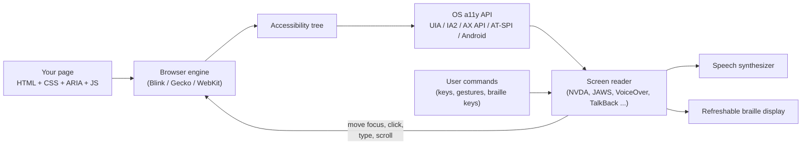
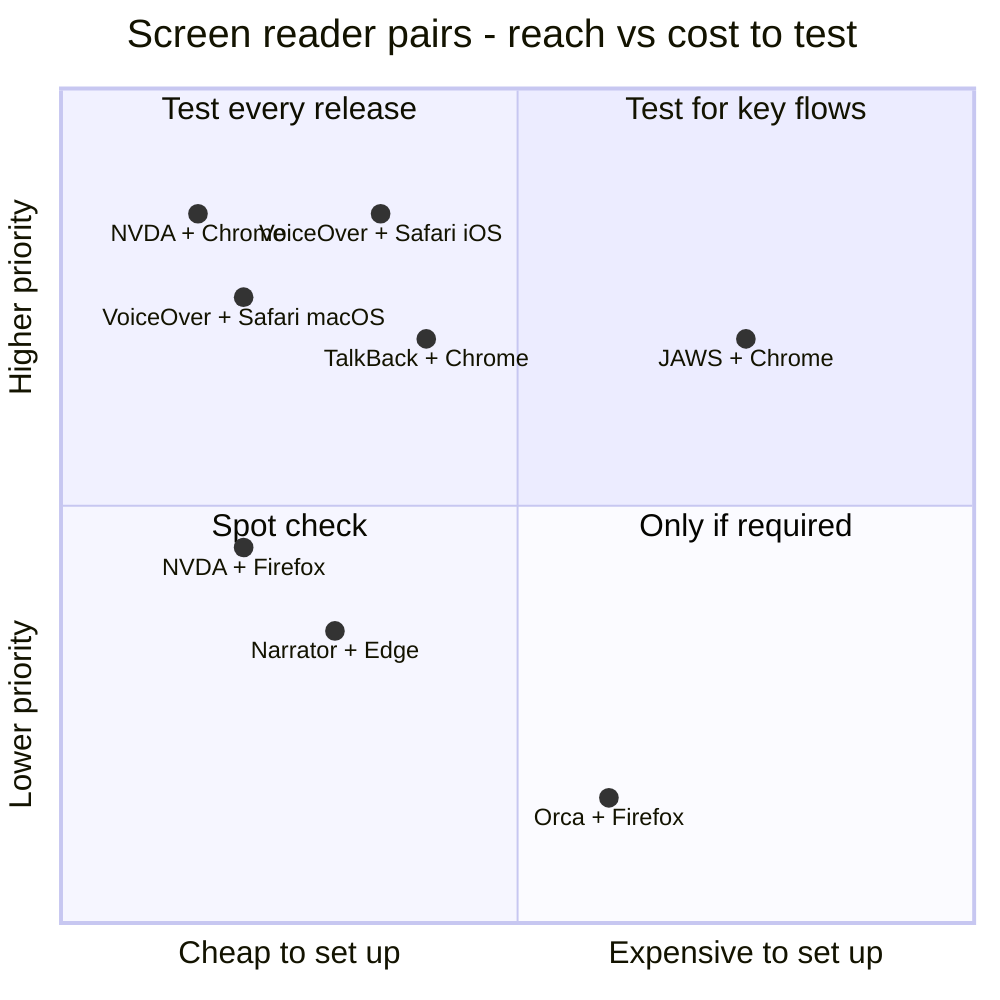
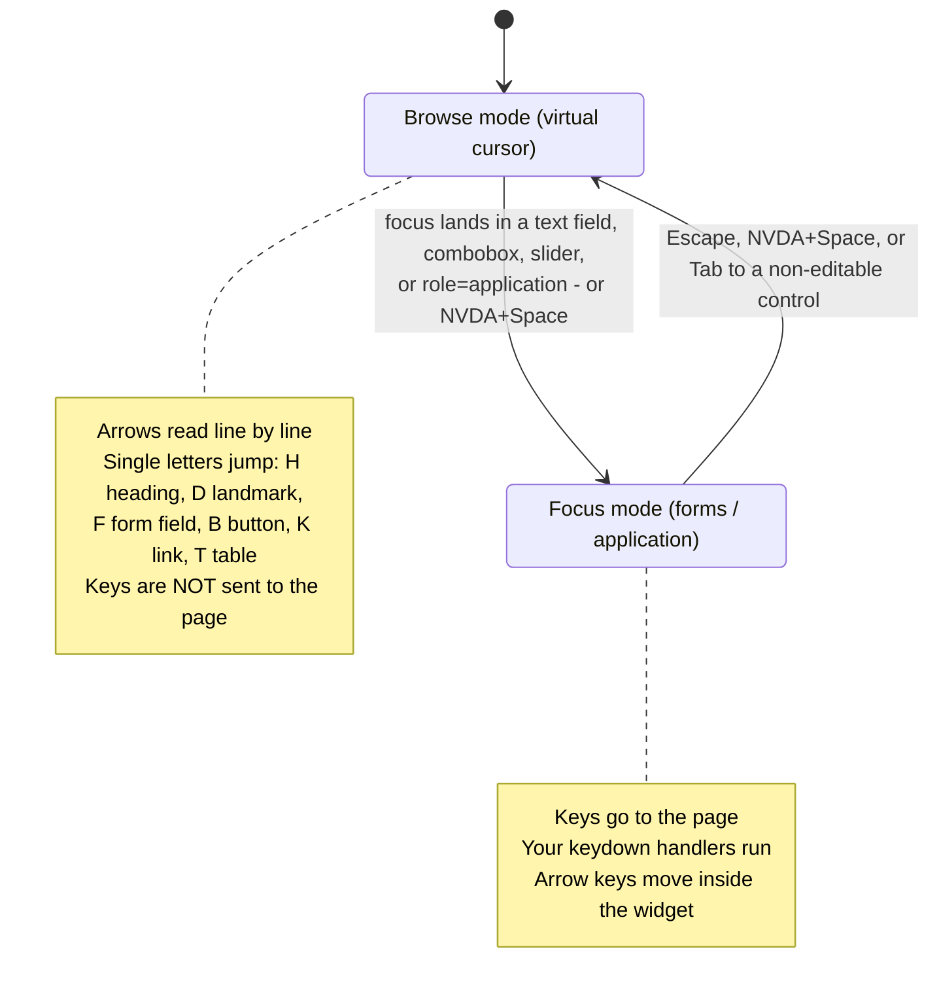
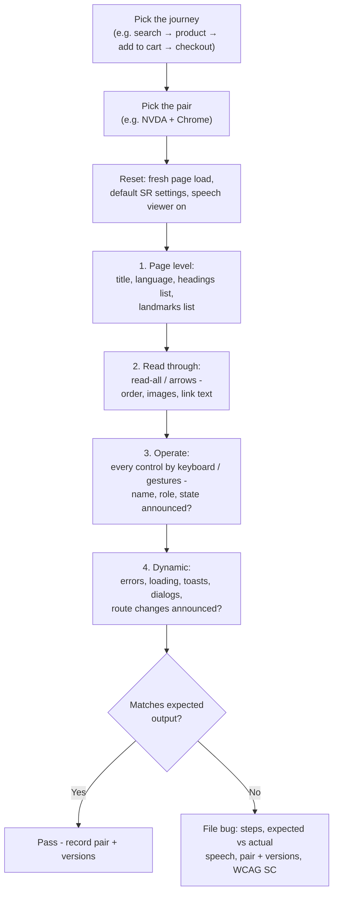
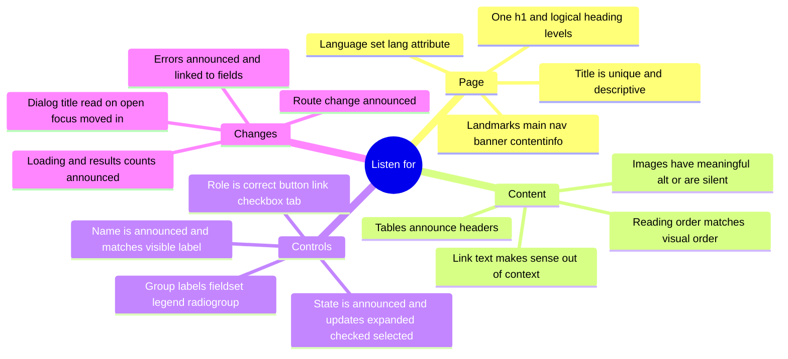
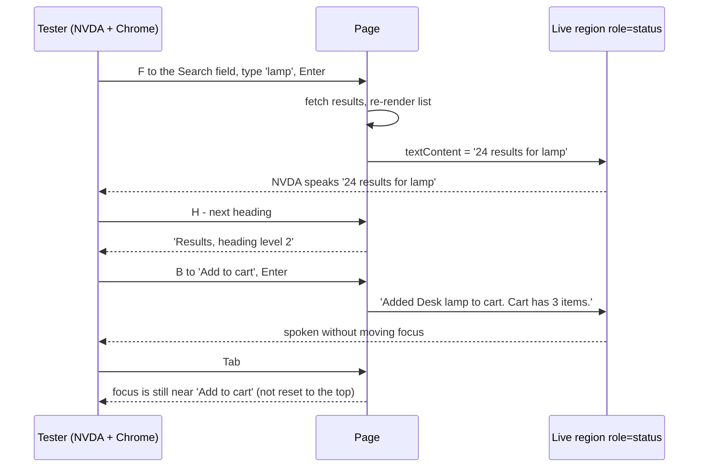
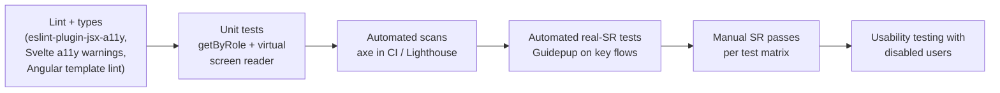
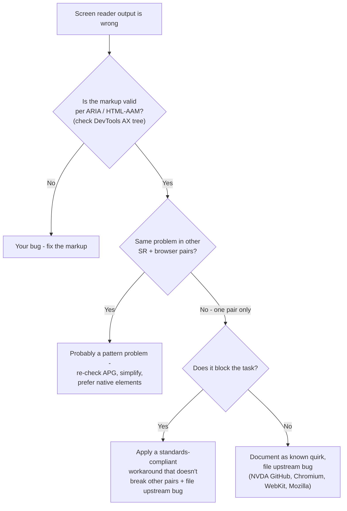

# Screen Reader Testing

> **Date:** 2026-11-06 · **Last updated:** 2026-11-06
> **Category:** Frontend System Design
> **Sub-Topic:** Accessibility / Manual assistive-technology testing
> **Level:** Intermediate · **Reading time:** ~30 min
> **Informs:** screen reader + browser support matrix, manual a11y QA in the definition of done, release test scripts for custom widgets, automated screen reader tests (Guidepup), a11y bug triage and reporting, when to test with disabled users, native mobile (VoiceOver/TalkBack) QA

> **Pre-requisite:** [ARIA Roles, States & Properties](./aria-roles-states-and-properties.md) (what screen readers are told) and [Keyboard Navigation & Focus Management](./keyboard-navigation-and-focus-management.md) (how they move).
> This note is the **practical** one: which screen readers to test with, how to drive them, what to listen for, and how to fit that into a delivery process.

**Previous:** [Keyboard Navigation & Focus Management](./keyboard-navigation-and-focus-management.md) · **Next:** [Color Contrast & Visual Accessibility](./color-contrast-and-visual-accessibility.md)

---

## Table of Contents

1. [ELI5 — Simple Explanation](#eli5--simple-explanation)
2. [Section 1: How a Screen Reader Reads a Web Page](#section-1-how-a-screen-reader-reads-a-web-page)
3. [Section 2: The Screen Readers and Their Browsers](#section-2-the-screen-readers-and-their-browsers)
4. [Section 3: Choosing a Test Matrix](#section-3-choosing-a-test-matrix)
5. [Section 4: Browse Mode vs Focus Mode](#section-4-browse-mode-vs-focus-mode)
6. [Section 5: Essential Commands](#section-5-essential-commands)
7. [Section 6: A Repeatable Test Session](#section-6-a-repeatable-test-session)
8. [Section 7: What to Listen For](#section-7-what-to-listen-for)
9. [Section 8: Testing Dynamic UI](#section-8-testing-dynamic-ui)
10. [Section 9: Tools That Help — Speech Logs, Inspectors and Automation](#section-9-tools-that-help--speech-logs-inspectors-and-automation)
11. [Section 10: Native Mobile Apps](#section-10-native-mobile-apps)
12. [Section 11: Bugs, Quirks and What to Fix](#section-11-bugs-quirks-and-what-to-fix)
13. [System Design Angle — Screen Reader QA in the Delivery Process](#system-design-angle--screen-reader-qa-in-the-delivery-process)
14. [Real-World Examples](#real-world-examples)
15. [Key Points Summary](#key-points-summary)
16. [Test Your Understanding (with answers)](#test-your-understanding)
17. [Cheat Sheet](#cheat-sheet)
18. [References & Further Reading](#references--further-reading)

---

## ELI5 — Simple Explanation

Imagine checking a recipe card by **phoning a friend and asking them to read it aloud** — without them seeing your kitchen.

- If the card says "Step 3" before "Step 1", your friend reads it in the wrong order (**reading order**).
- If a picture of an ingredient has no caption, they say "image" and you don't know what to buy (**missing alt text**).
- If you secretly change the oven temperature on the card while they're reading step 5, they won't notice unless you **tell them** (**live regions**).
- If a box says "click here", your friend can't tell what it does (**accessible name**).

A **screen reader** is that friend: it reads the page out loud (or to a **braille display**) and lets the user jump around by headings, links, buttons and landmarks. **Screen reader testing** means you become the listener and check whether the page still makes sense **without seeing it**.

> **One-line takeaway: Automated tools check the markup; only a real screen reader shows whether the experience works. Test the key journeys with the screen reader + browser pairs your users actually use.**

---

## Core Concept — Step by Step

### Section 1: How a Screen Reader Reads a Web Page

A screen reader never reads your HTML directly. It reads the **accessibility tree** through the operating system's accessibility API, then presents it as **speech** and/or **braille**, and sends user commands back.



Consequences:
- **The same markup can sound different** in each screen reader + browser pair, because the browser **maps** the tree to the API and the screen reader **interprets** it. A bug can live in your code, the browser, or the screen reader.
- **Users rarely Tab through a page.** They read with arrow keys and jump by headings, landmarks, links and form fields. If you only test with Tab, you miss most of the experience. WebAIM's Screen Reader User Survey has repeatedly reported headings as a primary way users find information on a long page — check the latest results for current numbers.
- **Braille users** get the same tree in a different form: short, abbreviated role labels and no speech timing. Concise names help both.

---

### Section 2: The Screen Readers and Their Browsers

| Screen reader | Platform | Cost | Pair it with | Notes |
|---|---|---|---|---|
| **NVDA** | Windows | Free, open source | Chrome, Firefox, Edge | Most common free option; ideal for developer testing |
| **JAWS** | Windows | Commercial (time-limited demo mode available) | Chrome, Edge | Long-established, common in enterprise and government |
| **Narrator** | Windows (built in) | Free | Edge | Improved a lot in recent Windows releases; fewer users on the web than NVDA/JAWS |
| **VoiceOver (macOS)** | macOS (built in) | Free | **Safari** | Apple tunes VO for Safari; Chrome + VO works but is a less common pairing |
| **VoiceOver (iOS/iPadOS)** | iPhone, iPad | Free | **Safari** (all iOS browsers use WebKit under the hood) | Touch gestures; very common on mobile |
| **TalkBack** | Android | Free | **Chrome** | Touch gestures; varies by Android version and device vendor |
| **Orca** | Linux (GNOME) | Free, open source | Firefox | Small share, important for Linux users |
| **ChromeVox** | ChromeOS | Built in | Chrome | Education / Chromebook-heavy audiences |

**Which matters most for your product?** Use real data, in this order:
1. Your **analytics** (OS + browser mix; screen readers aren't detectable — and must not be fingerprinted).
2. Contract or regulatory requirements (e.g. a government client requiring JAWS support).
3. **WebAIM's Screen Reader User Survey** for the general population of screen reader users — it's the best public source of usage trends.

> Never assume "it works in VoiceOver, so it works". VoiceOver + Safari, NVDA + Chrome and JAWS + Chrome differ in how they handle live regions, `aria-describedby`, tables, comboboxes and focus changes.

---

### Section 3: Choosing a Test Matrix



A **pragmatic default** for a consumer web product (adjust with your data):

| Tier | Pairs | When |
|---|---|---|
| **Tier 1 — every release for changed flows** | NVDA + Chrome (Windows), VoiceOver + Safari (iOS) | Covers the two biggest platforms with free tools |
| **Tier 2 — key journeys each release cycle** | VoiceOver + Safari (macOS), TalkBack + Chrome (Android), JAWS + Chrome or Edge | Enterprise / government audiences raise JAWS to Tier 1 |
| **Tier 3 — spot checks / on request** | NVDA + Firefox, Narrator + Edge, Orca + Firefox | When analytics or customers call for it |

**Write it down as a support policy** — like a browser support matrix — so "it works" has a definition. The cost of a pair is mostly **setup**: Windows screen readers need a Windows machine or VM (UTM, Parallels, a cloud Windows desktop), JAWS needs a license for serious use, and mobile needs real devices (simulators don't run VoiceOver/TalkBack the same way).

---

### Section 4: Browse Mode vs Focus Mode

Windows screen readers (NVDA, JAWS, Narrator) have **two modes** for web content. This is the single most important concept for understanding screen reader bug reports.



| | Browse mode (NVDA) / Virtual cursor (JAWS) / Scan mode (Narrator) | Focus mode / Forms mode |
|---|---|---|
| Arrow keys | Move the **reading cursor** through content | Sent to the page (move caret, change slider, move in listbox) |
| Letter keys | Quick navigation (H, D, F, B, K, T…) | Typed into the field |
| Your `keydown` handlers | **Usually not called** for these keys | Called |
| Switches when | Leaving a field, pressing Escape | Entering a text field or a widget that needs arrows |

**Why it matters:**
- A custom widget that relies on arrow keys only works once the screen reader is in **focus mode**. Correct roles (`listbox`, `tablist`, `grid`, `slider`, `combobox`, `menu`) make screen readers switch automatically; a `div` soup doesn't.
- `role="application"` forces focus mode for the whole subtree — users lose reading shortcuts. Only for truly app-like regions.
- **VoiceOver** has no separate browse/focus mode in the same sense: you move with VO keys (Control+Option + arrows) and **interact** into groups; Quick Nav and the **rotor** provide jump navigation.
- **Mobile** screen readers use **swipe** gestures to move item by item and the **rotor / reading controls** to jump by headings, links or controls.

---

### Section 5: Essential Commands

Learn enough to **navigate like a user**, not just Tab.

**NVDA (Windows)** — NVDA key = `Insert` (desktop layout) or `Caps Lock` (laptop layout, configurable):

| Action | Keys |
|---|---|
| Start / stop | `Ctrl+Alt+N` (if the desktop shortcut was created) / `NVDA+Q` |
| Read all from here / stop speech | `NVDA+Down Arrow` / `Ctrl` |
| Next / previous item | `Down` / `Up` (browse mode) |
| Next heading / heading level n | `H` / `1`–`6` (`Shift` = previous) |
| Next landmark / form field / button / link / table | `D` / `F` / `B` / `K` / `T` |
| Elements list (headings, links, landmarks…) | `NVDA+F7` |
| Toggle browse ↔ focus mode | `NVDA+Space` |
| Table navigation | `Ctrl+Alt+Arrow keys` |
| Speech viewer (text log of speech) | NVDA menu (`NVDA+N`) → Tools → Speech viewer |

**JAWS (Windows)** — JAWS key = `Insert`:

| Action | Keys |
|---|---|
| Read all / stop | `Insert+Down Arrow` / `Ctrl` |
| Next heading / region (landmark) / form field / button | `H` / `R` / `F` / `B` |
| Lists of headings / links / form fields | `Insert+F6` / `Insert+F7` / `Insert+F5` |
| Toggle virtual cursor | `Insert+Z` |
| Table navigation | `Ctrl+Alt+Arrow keys` |

**VoiceOver (macOS)** — VO = `Control+Option`:

| Action | Keys |
|---|---|
| Turn on / off | `Cmd+F5` (or triple-press Touch ID on some Macs) |
| Read all / stop | `VO+A` / `Control` |
| Next / previous item | `VO+Right` / `VO+Left` |
| Activate | `VO+Space` |
| Rotor (headings, links, landmarks, form controls…) | `VO+U`, then arrows |
| Next heading / link / form control | `VO+Cmd+H` / `VO+Cmd+L` / `VO+Cmd+J` |
| Interact into / out of a group | `VO+Shift+Down` / `VO+Shift+Up` |
| Quick Nav (single-key navigation) | Toggle with `Left+Right` arrows together, then `H`, `L`, etc. if single-key Quick Nav is enabled |

**VoiceOver (iOS)** and **TalkBack (Android)**:

| Action | VoiceOver iOS | TalkBack |
|---|---|---|
| Turn on (after setting a shortcut) | Triple-click side/Home button (Accessibility Shortcut) | Hold both volume keys for about 3 seconds (if the shortcut is enabled) |
| Next / previous item | Swipe right / left | Swipe right / left |
| Activate | Double-tap | Double-tap |
| Read from top / from current | Two-finger swipe up / down | Via the TalkBack menu ("Read from top" / "Read from next item") |
| Jump by headings / links / controls | **Rotor**: two-finger rotate, then swipe up/down | **Reading controls**: change granularity, then swipe up/down (gestures vary by TalkBack version) |
| Back / dismiss | Two-finger scrub ("Z" shape) | Back gesture or system Back |
| Screen off while testing (honest test) | **Screen Curtain**: three-finger triple-tap | Dim screen option in TalkBack settings |

> Gestures and shortcuts change between OS and screen reader versions — keep a link to the vendor's current command reference in your test docs (see References).

---

### Section 6: A Repeatable Test Session

Treat a screen reader pass like any other test: **a script, an expected result, and a log**.



**Before you start:**
- **Know the expected behavior.** For custom widgets, read the matching **APG pattern** first (keyboard map + roles + states). You can't judge "Expanded, menu, 4 items" without knowing what *should* be said.
- **Use default settings.** Power users change verbosity, but bugs should reproduce on defaults. Slow the speech rate down while learning.
- **Turn the screen off sometimes** (VoiceOver Screen Curtain on iOS, or simply look away). Sighted testers unconsciously fill gaps from the screen.
- **Record versions** of OS, browser and screen reader — behavior differs between versions.

---

### Section 7: What to Listen For



**Expected vs bug — example announcements** (wording is approximate and differs by screen reader and version; judge the **information**, not the exact words):

| Element | Good output contains | Typical bug output | Likely cause |
|---|---|---|---|
| Icon-only delete button | "Delete invoice, button" | "button" / "trash-icon.svg, button" | No accessible name |
| Disclosure | "Shipping, button, collapsed" → after Enter "expanded" | "Shipping, clickable" | `div` with click handler, no role/state |
| Checkbox | "Email me updates, check box, not checked" | "Email me updates" (no role/state) | Custom checkbox without `role`/`aria-checked`, or a hidden native input |
| Required field with error | "Email, edit, required, invalid entry, Enter a valid email address" | "Edit text" / "Email, edit" and the error never read | Missing label, `aria-invalid`, `aria-describedby` |
| Modal dialog opening | "Delete order?, dialog" + first focused control | Nothing, or content behind the dialog keeps being read | Focus not moved; background not inert |
| Search results updated | "24 results" (spoken politely) | Silence | No live region / region created together with its text |
| Tabs | "Billing, tab, 2 of 3, selected" | "Billing, button" | Missing `tablist`/`tab` roles |
| Decorative image | (silent) | "image" / "hero-banner-final-v2.png" | Missing `alt=""` |
| Data table cell | "Price, column 3, 19.99" | "19.99" with no header context | Layout built with `div`s, or missing `<th>`/`scope` |

---

### Section 8: Testing Dynamic UI

Most real-world screen reader bugs are in **what happens after an interaction**, not in static content.



Checklist for dynamic behavior:

| Interaction | Listen for |
|---|---|
| Submit form with errors | Error summary or first invalid field gets focus **and** is announced; each field reads its error |
| Async loading | "Loading…" (politely) and the result / count when done; no repeated chatter |
| Infinite scroll / "Load more" | New items announced as a count; focus not lost; a way to reach the footer |
| Modal open / close | Dialog name read on open; focus inside; Escape closes; focus returns to trigger |
| Toast / snackbar | Announced once; not stealing focus; actions available elsewhere |
| SPA route change | New page title or `h1` announced; reading starts at the new content |
| Drag and drop | A keyboard alternative exists and outcomes are announced |
| Real-time updates (chat, prices) | Not so chatty that the user can't work; `role="log"` for chat |

---

### Section 9: Tools That Help — Speech Logs, Inspectors and Automation

| Tool | What it gives you | Use it for |
|---|---|---|
| **NVDA Speech Viewer** | A window with every spoken phrase as text | Copy exact output into bug reports |
| **VoiceOver caption panel** | On-screen text of what VO says (on by default on macOS) | Demos, screenshots |
| **JAWS speech history** | Recent speech output (`Insert+Space`, then `H`) | Reviewing missed announcements |
| **Browser accessibility inspectors** | Computed role, name, states, full AX tree (Chrome/Edge/Firefox/Safari DevTools) | **First pass** before launching a screen reader; explains *why* output is wrong |
| **Accessibility Insights for Web** | Guided manual assessment + automated checks | Structured audits |
| **Guidepup** (`@guidepup/guidepup`, `@guidepup/playwright`) | Drives **real** VoiceOver (macOS) and NVDA (Windows) from tests, returns spoken phrases | Regression tests for critical flows on CI runners with real OSes |
| **Virtual Screen Reader** (`@guidepup/virtual-screen-reader`) | Simulated screen reader over the DOM/AX model in Node/jsdom | Fast unit-level checks of names, roles, live regions |
| **Xcode Accessibility Inspector / Android Accessibility Scanner** | Inspect native or WebView accessibility properties | Mobile apps and hybrid apps |



Each layer catches different things. **Automated scanners find only part of WCAG issues** — they can tell a button has *a* name, not whether the name makes sense or whether focus went to the right place after a delete. See [Automated A11y Testing (axe, Lighthouse)](./automated-a11y-testing-axe-lighthouse.md) and [Accessibility Testing](../08-testing/accessibility-testing.md).

---

### Section 10: Native Mobile Apps

Native and hybrid apps use the same screen readers but different tooling:

| Platform | Inspect | Automated checks | Notes |
|---|---|---|---|
| **iOS (SwiftUI/UIKit)** | Xcode **Accessibility Inspector** | XCUITest `try app.performAccessibilityAudit()` (Xcode 15+) | Test VoiceOver with Screen Curtain; check rotor headings (`.accessibilityAddTraits(.isHeader)`) |
| **Android (Compose/Views)** | **Accessibility Scanner** app, Layout Inspector semantics | Espresso `AccessibilityChecks.enable()`; Compose UI tests on semantics | Test TalkBack on more than one vendor/OS version if your audience is broad |
| **React Native** | Platform inspectors + `accessibilityLabel`/`aria-*` props | Testing Library for React Native `getByRole` | Run real VoiceOver/TalkBack — RN maps props differently per platform |
| **WebViews / Capacitor / hybrid** | Safari Web Inspector (iOS WebView), Chrome `chrome://inspect` (Android WebView) | Web tools on the web content | The web content's a11y tree is exposed through the native container — test the whole app |

---

### Section 11: Bugs, Quirks and What to Fix

When output is wrong, decide **whose bug it is** before "fixing":



Rules of thumb:
- **Don't code for one screen reader.** A hack that makes JAWS say the "right" words often breaks NVDA or VoiceOver. Standards-compliant markup is the long-term fix.
- **Verbosity differences aren't bugs.** VoiceOver saying "dimmed" and NVDA saying "unavailable" are both correct for a disabled control.
- **Don't add extra text to "help"** (e.g. `aria-label="Click this button to submit the form"`). Users know what a button is; extra words slow them down.
- **Report upstream.** NVDA (GitHub), Chromium, Mozilla and WebKit bug trackers all accept accessibility bugs; include a minimal test case.
- **Compare with the a11y support data** projects like a11ysupport.io and the ARIA-AT project (W3C) publish for how roles and attributes behave across pairs.

---

## System Design Angle — Screen Reader QA in the Delivery Process

```mermaid
gantt
    title Where screen reader testing fits in one feature cycle
    dateFormat X
    axisFormat %s
    section Design
    Annotate headings, landmarks, names, focus order :d1, 0, 2
    section Build
    Native elements or headless primitives, getByRole tests :b1, 2, 6
    DevTools AX tree check per component :b2, 3, 6
    section Verify
    axe in CI on every PR :v1, 2, 8
    Tier 1 manual SR pass on changed flows :v2, 6, 8
    Guidepup regression on critical journeys :v3, 6, 8
    section Release
    Tier 2 pass on key journeys :r1, 8, 9
    Periodic usability testing with SR users :r2, 9, 10
```



| Decision | Recommended approach |
|---|---|
| **Support policy** | Publish a screen reader/browser matrix (tiers), like a browser support matrix |
| **Definition of Done** | "Changed flows pass Tier 1 SR test script" for UI stories |
| **Design handoff** | Designers annotate heading levels, landmarks, accessible names for icons, focus order and announcements |
| **Component library** | Each component has a documented SR test script and expected output; test once per release, reuse everywhere |
| **Automation** | Lint + `getByRole` + axe on every PR; Guidepup for 3–5 business-critical journeys |
| **Expertise** | Train a few "a11y champions" per team to be fluent with NVDA and VoiceOver; bring in experienced screen reader users for audits and usability studies |
| **Bug triage** | Severity by **task impact** (can't complete checkout = blocker), not by WCAG level alone |

> A sighted developer using a screen reader for 10 minutes is **not** a screen reader user. Developer testing catches broken names, roles, states and focus. **Usability** (is it efficient? is it confusing?) needs people who use screen readers every day.

---

## Real-World Examples

**Example 1 — A test script for a component (store it next to the component):**
```text
Component: Combobox "Country"
Pairs: NVDA 2025.x + Chrome stable, VoiceOver + Safari (macOS), VoiceOver + Safari (iOS)

Step 1  F (NVDA) / VO+Cmd+J (VO) to the field
        Expect: "Country, combo box, collapsed, editable" (+ hint if present)
Step 2  Type "ger"
        Expect: list opens; count announced politely, e.g. "3 results available"
Step 3  Down Arrow
        Expect: "Germany, 1 of 3" — focus stays in the input (caret still editable)
Step 4  Enter
        Expect: value "Germany" set; list closes; "collapsed" (or value re-read)
Step 5  Escape with list open
        Expect: list closes, typed text kept; second Escape may clear
Fail if: options not read, focus jumps into the list, or the count is never announced
```

**Example 2 — Fixing what testing found (BAD → GOOD):**
```tsx
// ❌ Heard: "button" — no name. Then nothing when results load.
<button onClick={search}><SearchIcon /></button>
{loading ? <Spinner /> : <Results items={items} />}

// ✅ Heard: "Search, button" ... "Loading results" ... "24 results"
<button type="button" onClick={search}>
  <SearchIcon aria-hidden="true" />
  <span className="visually-hidden">Search</span>
</button>
<div role="status" className="visually-hidden">
  {loading ? 'Loading results' : `${items.length} results`}
</div>
<Results items={items} aria-busy={loading} />
```
The status region is rendered on first load and only its **text** changes, so every screen reader in the matrix sees it as an existing live region.

**Example 3 — Real VoiceOver regression test with Guidepup + Playwright (macOS runner):**
```typescript
import { voiceOverTest as test } from '@guidepup/playwright';
import { expect } from '@playwright/test';

test('product page headings are announced in order', async ({ page, voiceOver }) => {
  await page.goto('https://shop.example.com/products/desk-lamp', { waitUntil: 'load' });
  await voiceOver.navigateToWebContent();

  await voiceOver.perform(voiceOver.keyboardCommands.findNextHeading);
  expect(await voiceOver.lastSpokenPhrase()).toContain('Desk lamp');

  await voiceOver.perform(voiceOver.keyboardCommands.findNextHeading);
  expect(await voiceOver.lastSpokenPhrase()).toContain('Reviews');
});
```
Guidepup also provides `nvdaTest` for Windows runners. These tests need a real OS with the screen reader configured (Guidepup ships a setup script), so keep them to a few critical journeys; assert with `toContain` on key words rather than exact strings, which change across versions.

**Example 4 — Fast unit-level check with the virtual screen reader (Vitest/Jest + jsdom):**
```typescript
import { virtual } from '@guidepup/virtual-screen-reader';
import { render } from '@testing-library/react';
import userEvent from '@testing-library/user-event';
import { Disclosure } from './Disclosure';

// Walk the whole container and return everything the virtual screen reader "spoke"
async function readAll(container: HTMLElement): Promise<string[]> {
  await virtual.start({ container });
  while ((await virtual.lastSpokenPhrase()) !== 'end of document') {
    await virtual.next();
  }
  const log = await virtual.spokenPhraseLog();
  await virtual.stop();
  return log;
}

test('disclosure exposes a named button and reveals its panel', async () => {
  const { container, getByRole } = render(<Disclosure title="Shipping">Ships in 2 days</Disclosure>);

  const before = (await readAll(container)).join(' | ');
  expect(before).toMatch(/button/);
  expect(before).toMatch(/Shipping/);
  expect(before).not.toMatch(/Ships in 2 days/);       // hidden panel is not read

  await userEvent.click(getByRole('button', { name: 'Shipping' }));

  const after = (await readAll(container)).join(' | ');
  expect(after).toMatch(/Ships in 2 days/);             // panel is now in the reading order
});
```
A simulator checks the **spec-level** model. It cannot reproduce real NVDA/VoiceOver bugs — it complements manual and real-SR tests, it doesn't replace them. The same approach works for Vue (`@testing-library/vue`), Angular (`@testing-library/angular`) and Svelte (`@testing-library/svelte`) components.

**Example 5 — A bug report that gets fixed:**
```text
Title:     [A11y][Checkout] Card number error not announced to screen readers
Severity:  Blocker — screen reader users cannot tell why "Pay" fails
Pair:      NVDA 2025.x + Chrome (stable), Windows 11  ·  also VoiceOver + Safari iOS
WCAG:      3.3.1 Error Identification (A), 4.1.3 Status Messages (AA)
Steps:     1. Go to /checkout  2. F to "Card number", type 1234  3. Tab to "Pay", Enter
Expected:  Focus moves to "Card number"; NVDA says
           "Card number, edit, invalid entry, Enter a 16-digit card number"
Actual:    Focus stays on "Pay"; NVDA says nothing; red text appears visually only
Speech log (NVDA Speech Viewer):
           "Pay, button"  →  (silence)
Likely cause: error <p> not linked with aria-describedby; field has no aria-invalid;
           no focus move or live announcement on submit
```

**Example 6 — PR checklist snippet for UI changes:**
```markdown
### Screen reader check (Tier 1)
- [ ] NVDA + Chrome: headings list (NVDA+F7) shows a logical outline
- [ ] Every new control is announced with name + role + state
- [ ] Dynamic changes (errors, loading, results) are announced once
- [ ] Dialogs: name read on open, focus inside, Escape closes, focus restored
- [ ] VoiceOver + Safari iOS: swipe through the changed screen in order
- [ ] Speech log or recording attached for custom widgets
```

---

## Key Points Summary

| Concept | One-Line Explanation |
|---|---|
| **Screen reader** | Software that presents the accessibility tree as speech/braille and takes navigation commands |
| **SR + browser pair** | The unit of testing — output depends on both |
| **Test matrix** | Tiered list of pairs to test, based on analytics, contracts and survey data |
| **Browse vs focus mode** | Windows SRs read with arrows/letters in browse mode; keys reach the page in focus mode |
| **Rotor / reading controls** | VoiceOver/TalkBack way to jump by headings, links, controls |
| **Users don't just Tab** | They jump by headings, landmarks, links and form fields |
| **Expected output** | Judge information (name, role, state, value), not exact wording |
| **Dynamic UI** | Most bugs: errors, loading, dialogs, route changes, toasts |
| **Speech viewer / logs** | Text record of what was spoken — attach to bug reports |
| **Guidepup** | Automates real VoiceOver/NVDA; virtual SR for fast unit checks |
| **Whose bug?** | Validate markup first, compare pairs, then work around or report upstream |
| **Real users** | Developer testing finds defects; disabled users find usability problems |

---

## Test Your Understanding

**Q1 (Basic):**
Why isn't "I tabbed through the page with VoiceOver on" a sufficient screen reader test?

<details>
<summary>Answer</summary>

Tab only visits **focusable** elements. Screen reader users mostly **read** with arrow keys/swipes and **jump** by headings, landmarks, links and form fields. Tabbing skips headings, paragraphs, images, tables and live announcements, so you'd miss missing alt text, a broken heading outline, wrong reading order and silent status messages. It also tests a single pair (VoiceOver + one browser); NVDA/JAWS on Windows behave differently, especially with browse/focus modes.
</details>

**Q2 (Basic):**
What's the difference between browse mode and focus mode in NVDA, and why does it affect custom widgets?

<details>
<summary>Answer</summary>

In **browse mode** NVDA intercepts keys: arrows move its reading cursor and single letters jump (H for headings, F for form fields), so your page's `keydown` handlers don't receive those keys. In **focus mode** keys pass through to the page. NVDA switches to focus mode automatically when focus lands on editable fields and on widgets whose roles need arrow keys (combobox, listbox, slider, grid, tablist and similar). A custom widget built from `div`s without those roles never triggers focus mode, so its arrow-key handling appears "broken" to NVDA users even though it works for sighted keyboard users.
</details>

**Q3 (Application):**
You have budget for testing with three screen reader + browser pairs on a consumer e-commerce site. Which do you pick and why?

<details>
<summary>Answer</summary>

A solid default is **NVDA + Chrome** (Windows desktop, free, widely used), **VoiceOver + Safari on iOS** (the dominant mobile combination for screen reader users in many markets, and all iOS browsers use WebKit), and either **VoiceOver + Safari on macOS** or **TalkBack + Chrome on Android**, depending on your analytics' platform mix. Upgrade **JAWS + Chrome** into the set if you sell to enterprises/governments that standardize on it. Always justify the choice with your own analytics plus the latest WebAIM Screen Reader User Survey, and document it as a support policy.
</details>

**Q4 (Tricky):**
After you add `role="alert"` to a toast, VoiceOver + Safari announces it but NVDA + Chrome sometimes doesn't. The toast component mounts the whole `<div role="alert">Saved</div>` when it appears. What's going on?

<details>
<summary>Answer</summary>

The live region and its content are being **inserted together**. Screen readers watch **existing** live regions for changes; a region that appears with content already inside may or may not be announced depending on the browser/SR pair and timing. Fix: render an **empty** `role="status"` (polite — "Saved" isn't urgent, so `alert` is the wrong politeness anyway) container at app start and **update its text** when a toast fires, or use a shared announcer service (CDK `LiveAnnouncer`, React Aria's `announce`). Then re-test in both pairs.
</details>

**Q5 (Tricky):**
JAWS reads a custom select as "Country, edit" while NVDA reads "Country, combo box, collapsed". A developer proposes adding `aria-label="Country combo box"` and a JAWS-only hidden span. What do you do instead?

<details>
<summary>Answer</summary>

Don't hack for one screen reader — role words in `aria-label` duplicate the role ("combo box, combo box") in other screen readers and break voice control. First **inspect the accessibility tree**: is `role="combobox"` on the right element, with `aria-expanded`, `aria-controls` and a correct label? Compare with the **APG combobox pattern** and with ARIA-AT/a11ysupport data for this pair. If markup is valid and only JAWS differs, check the JAWS version and browser, look for a **standards-compliant** adjustment (often using a native `<select>` or a tested library like React Aria fixes it), document the quirk, and report it to the vendor. If the task is still completable, it may be acceptable as a known issue.
</details>

**Q6 (System design):**
Design a screen reader testing strategy for a design system used by 30 product teams.

<details>
<summary>Answer</summary>

- **Support policy**: tiered SR + browser matrix (e.g. Tier 1: NVDA + Chrome, VoiceOver + Safari iOS; Tier 2: VoiceOver + Safari macOS, TalkBack + Chrome, JAWS + Chrome), published in the design system docs.
- **Per-component test scripts** with expected announcements (name, role, states, keyboard), stored with the component and run for every release of the library. Teams inherit verified components instead of re-testing primitives.
- **Automation pyramid**: lint rules and `getByRole` tests on every PR; virtual screen reader unit tests for names/states; axe in CI; Guidepup real-SR tests on macOS/Windows runners for the most complex components (combobox, dialog, date picker, data grid).
- **Product teams** own **flow-level** Tier 1 passes for changed journeys (Definition of Done), using a shared PR checklist and bug template.
- **People**: a11y champions per team trained on NVDA/VoiceOver; periodic audits and usability studies with experienced screen reader users; triage by task impact.
- **Feedback loop**: track SR bugs by component and pair; upstream reports for browser/SR bugs; release notes call out a11y changes.
</details>

---

## Cheat Sheet

**Key Definitions:**
- **Screen reader:** Software that turns the accessibility tree into speech/braille and lets users navigate it
- **Browse (virtual) mode:** Windows SR mode where keys move the reading cursor and jump by element type
- **Focus (forms) mode:** Keys are passed to the page; used for fields and composite widgets
- **Rotor / reading controls:** VoiceOver/TalkBack menus for jumping by headings, links, landmarks, controls
- **Speech viewer:** Text log of spoken output (NVDA); caption panel (VoiceOver)
- **Test matrix:** The SR + browser pairs you commit to support, by tier
- **ARIA-AT:** W3C project testing how ARIA patterns are supported across screen readers and browsers

**Quick Reference:**
```text
Pairs:      NVDA+Chrome · JAWS+Chrome/Edge · VoiceOver+Safari (macOS, iOS) · TalkBack+Chrome · Narrator+Edge
NVDA:       NVDA=Insert · read all NVDA+Down · stop Ctrl · H/D/F/B/K/T jump · NVDA+F7 lists · NVDA+Space mode
JAWS:       read all Insert+Down · H/R/F/B jump · Insert+F6 headings · Insert+F7 links · Insert+F5 fields
VO macOS:   Cmd+F5 on/off · VO=Ctrl+Option · VO+A read · VO+Right next · VO+Space activate · VO+U rotor
VO iOS:     swipe right/left · double-tap · two-finger rotate = rotor · two-finger swipe up = read all
            Screen Curtain: three-finger triple-tap
TalkBack:   swipe right/left · double-tap · reading controls + swipe up/down · both volume keys = on/off
Session:    page (title, lang, headings, landmarks) → read-through → operate controls → dynamic changes
Listen for: name · role · state · value · order · announcements after actions
Bug report: pair + versions · steps · expected vs actual speech · speech log · WCAG SC · task impact
Automation: lint → getByRole → virtual SR → axe → Guidepup (real VO/NVDA) → manual → user testing
```

**Common Mistakes to Avoid:**

| Mistake | Why Wrong | Fix |
|---|---|---|
| Testing only with Tab | Misses reading order, headings, images, announcements | Read with arrows/swipes; jump by headings/landmarks |
| Testing only VoiceOver on macOS | Windows SRs and mobile behave differently | Tiered matrix from your data |
| Pairing SRs with "wrong" browsers (e.g. VoiceOver + Firefox) | Unrepresentative bugs and false alarms | Test the pairs users actually use |
| Judging exact wording | Verbosity differs by SR/version | Judge name, role, state, value |
| Hacks for one screen reader | Breaks other pairs | Fix markup to spec; report upstream |
| Role words in labels ("Submit button") | Duplicated announcements | Name only: "Submit" |
| Watching the screen while testing | You fill gaps visually | Screen Curtain / look away |
| No record of versions | Can't reproduce or track regressions | Log OS, browser and SR versions |
| Relying only on automated scans | They can't judge meaning or flow | Manual SR passes for key journeys |
| Treating developer testing as usability testing | Experts navigate very differently | Include experienced SR users |
| Testing mobile in simulators only | VoiceOver/TalkBack behave differently on devices | Real devices |
| Testing static pages only | Most bugs are in dynamic updates | Script errors, loading, dialogs, route changes |

---

## References & Further Reading

**Screen reader documentation**
- NV Access: [NVDA User Guide](https://download.nvaccess.org/documentation/userGuide.html) · [NVDA Commands Quick Reference](https://download.nvaccess.org/documentation/keyCommands.html)
- Freedom Scientific: [JAWS hot keys](https://www.freedomscientific.com/training/jaws/hotkeys/)
- Apple: [VoiceOver User Guide for Mac](https://support.apple.com/guide/voiceover/welcome/mac) · [Use VoiceOver on iPhone](https://support.apple.com/guide/iphone/turn-on-and-practice-voiceover-iph3e2e415f/ios)
- Google: [Get started on Android with TalkBack](https://support.google.com/accessibility/android/answer/6283677) · [TalkBack gestures](https://support.google.com/accessibility/android/answer/6151827)
- Microsoft: [Complete guide to Narrator](https://support.microsoft.com/en-us/windows/complete-guide-to-narrator-e4397a0d-ef4f-b386-d8ae-c172f109bdb1)

**Testing guidance**
- WebAIM: [Testing with Screen Readers](https://webaim.org/articles/screenreader_testing/) · [Using NVDA to Evaluate Web Accessibility](https://webaim.org/articles/nvda/) · [Using VoiceOver to Evaluate Web Accessibility](https://webaim.org/articles/voiceover/)
- WebAIM: [Screen Reader User Survey #10 results](https://webaim.org/projects/screenreadersurvey10/) (check WebAIM for a newer edition)
- W3C: [ARIA-AT — Assistive Technology support for ARIA patterns](https://aria-at.w3.org/)
- W3C: [APG patterns (expected keyboard and semantics)](https://www.w3.org/WAI/ARIA/apg/patterns/)
- a11ysupport.io: [Accessibility support data](https://a11ysupport.io/)

**Tools**
- Guidepup: [Documentation](https://www.guidepup.dev/) · [Playwright integration](https://github.com/guidepup/guidepup-playwright) · [Virtual Screen Reader](https://github.com/guidepup/virtual-screen-reader)
- Microsoft: [Accessibility Insights](https://accessibilityinsights.io/)
- Chrome for Developers: [Accessibility features reference (DevTools)](https://developer.chrome.com/docs/devtools/accessibility/reference)
- Apple: [Accessibility Inspector](https://developer.apple.com/documentation/accessibility/accessibility-inspector) · WWDC23: [Perform accessibility audits for your app](https://developer.apple.com/videos/play/wwdc2023/10035/)
- Android: [Accessibility Scanner](https://support.google.com/accessibility/android/answer/6376570) · [Accessibility checking with Espresso](https://developer.android.com/guide/topics/ui/accessibility/testing#espresso)

**Specs**
- W3C: [WCAG 2.2](https://www.w3.org/TR/WCAG22/) · [Understanding 4.1.3 Status Messages](https://www.w3.org/WAI/WCAG22/Understanding/status-messages.html)
- W3C: [Core Accessibility API Mappings](https://www.w3.org/TR/core-aam-1.2/)

---

> **Previous Topic:** [Keyboard Navigation & Focus Management](./keyboard-navigation-and-focus-management.md)
> — Tab order, roving tabindex, focus traps, focus restoration and visible focus

> **Next Topic:** [Color Contrast & Visual Accessibility](./color-contrast-and-visual-accessibility.md)
> — Contrast ratios, color-independent meaning, zoom, reflow and motion preferences

*Saved on: 2026-11-06 | Repo: Frontend System Design Learning Notes*
