# Authentication Flows in SPAs

> **Date:** 2026-11-06 · **Last updated:** 2026-11-06
> **Category:** Frontend System Design
> **Sub-Topic:** Security / Authentication
> **Level:** Advanced · **Reading time:** ~30 min
> **Informs:** login architecture (session cookie vs tokens vs BFF), OAuth/OIDC flow choice, PKCE, token refresh strategy, route guards, logout and multi-tab sync, SSO and passkeys, native-app login

> **Pre-requisite:** [CORS & Same-Origin Policy](../01-web-fundamentals/cors-and-same-origin-policy.md) (origin vs site, credentials) and [Browser Storage Mechanisms](../01-web-fundamentals/browser-storage-mechanisms.md) (cookies, `HttpOnly`, `SameSite`).
> This note covers **how a single-page app proves who the user is** — sessions, tokens, OAuth 2.0 / OpenID Connect, refresh, logout — and which flow to pick. Where tokens live is the next note.

**Previous:** [CSRF Protection](./csrf-protection.md) · **Next:** [Secure Token Storage](./secure-token-storage.md)

---

## Table of Contents

1. [ELI5 — Simple Explanation](#eli5--simple-explanation)
2. [Section 1: Authentication vs Authorization, and the SPA Problem](#section-1-authentication-vs-authorization-and-the-spa-problem)
3. [Section 2: The Three Architectures](#section-2-the-three-architectures)
4. [Section 3: Session-Cookie Authentication](#section-3-session-cookie-authentication)
5. [Section 4: Access Tokens, Refresh Tokens and JWTs](#section-4-access-tokens-refresh-tokens-and-jwts)
6. [Section 5: OAuth 2.0 and OpenID Connect](#section-5-oauth-20-and-openid-connect)
7. [Section 6: Authorization Code Flow with PKCE](#section-6-authorization-code-flow-with-pkce)
8. [Section 7: Deprecated Flows — Implicit and Password Grant](#section-7-deprecated-flows--implicit-and-password-grant)
9. [Section 8: Backend-for-Frontend (BFF)](#section-8-backend-for-frontend-bff)
10. [Section 9: Keeping the User Logged In — Refresh Strategies](#section-9-keeping-the-user-logged-in--refresh-strategies)
11. [Section 10: Auth State in the Client](#section-10-auth-state-in-the-client)
12. [Section 11: Logout Done Properly](#section-11-logout-done-properly)
13. [Section 12: Passkeys, MFA and Federated Login](#section-12-passkeys-mfa-and-federated-login)
14. [Section 13: Frameworks, SSR and Native Apps](#section-13-frameworks-ssr-and-native-apps)
15. [Decision Matrix](#decision-matrix)
16. [Real-World Examples](#real-world-examples)
17. [Key Points Summary](#key-points-summary)
18. [Test Your Understanding (with answers)](#test-your-understanding)
19. [Cheat Sheet](#cheat-sheet)
20. [References & Further Reading](#references--further-reading)

---

## ELI5 — Simple Explanation

Think of a **music festival**:
- At the gate you show your **ID** once (**authentication** — "who are you?").
- Security gives you a **wristband** (**session cookie** or **access token**). From then on, every stage checks the wristband, not your ID.
- The wristband says "**General**" or "**VIP**" (**authorization** — "what may you do?").
- Wristbands **expire** at midnight. If you have a **day pass** in your pocket (**refresh token**), you can swap it for a new wristband without queuing at the ID desk again.
- Big festivals don't check IDs themselves. They send you to a **ticket office** run by someone else (**the identity provider** — Google, Okta, Entra ID, Auth0…). The office gives you a **sealed voucher** (**authorization code**) to bring back; the festival trades it for wristbands **behind the scenes**.
- **PKCE** is like tearing the voucher in half: you keep one half, so a pickpocket who steals the other half can't redeem it.

> **An SPA cannot keep a secret. Pick a flow where the browser holds as little as possible — ideally just an `HttpOnly` session cookie — and let the server do the trusted work.**

---

## Core Concept — Step by Step

### Section 1: Authentication vs Authorization, and the SPA Problem

| Term | Question | Example | Who enforces it |
|---|---|---|---|
| **Authentication (AuthN)** | Who are you? | Password, passkey, SSO login | Identity provider / your auth server |
| **Authorization (AuthZ)** | What may you do? | "Can edit invoice 42" | **The API, on every request** |
| **Session** | How do we remember AuthN between requests? | Cookie with an opaque session ID | Server-side session store |
| **Token** | A portable proof of AuthN/AuthZ | OAuth access token, often a JWT | Resource server validates it |

**Why SPAs are hard:**

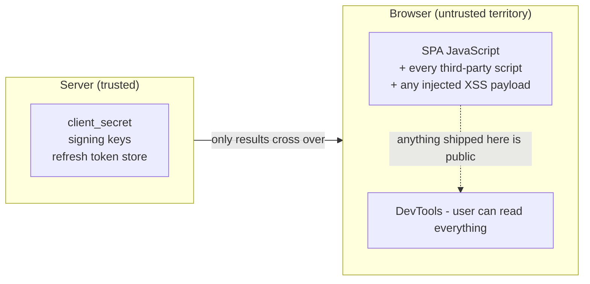

- An SPA is a **public client** (OAuth terminology): its code is downloaded by everyone, so it **cannot hold a `client_secret`**.
- Any token the JavaScript can **read**, an XSS payload can **read and exfiltrate** (see [XSS Prevention](./xss-prevention-reflected-stored-dom.md)).
- Route guards in the browser are **UX only**. A user can edit JS or call your API with `curl`. **Every API endpoint must enforce authorization itself.**

---

### Section 2: The Three Architectures

The IETF OAuth working group's guidance for browser apps (*OAuth 2.0 for Browser-Based Applications*) describes three patterns, from most to least secure:

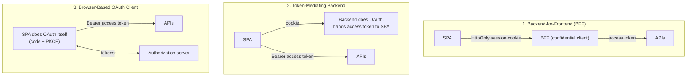

| Pattern | Tokens in browser | Needs a backend | Main residual risk |
|---|---|---|---|
| **Session cookie, same-site API** (no OAuth) | None — opaque session ID in `HttpOnly` cookie | Your API server | CSRF (mitigated by `SameSite` + tokens) |
| **BFF** | None | Yes — a thin server in front of the SPA | CSRF on the BFF; XSS can still *use* the session while the page is open |
| **Token-mediating backend** | Access token only (refresh stays server-side) | Yes | XSS can steal short-lived access tokens |
| **Browser-based OAuth client** | Access + (rotating) refresh token | No | XSS can steal tokens or run its own OAuth flow silently |

> **Default recommendation:** if you control the API and it is same-site with the SPA, use a **plain session cookie**. If you must talk to a third-party identity provider or several APIs, put a **BFF** in front. Use a pure browser OAuth client only when you truly have no backend.

---

### Section 3: Session-Cookie Authentication

The oldest pattern is still the best fit for most first-party SPAs.

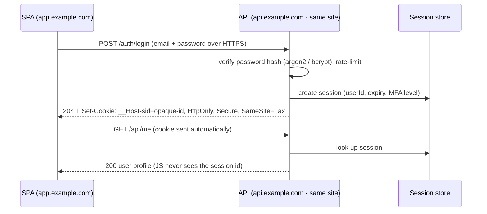

**Properties:**
- The session ID is **opaque** (random, at least 128 bits of entropy) — it means nothing without the server-side store.
- **Instant revocation:** delete the row and the user is logged out everywhere.
- **`HttpOnly`** — JavaScript (and therefore XSS) can't read it.
- **CSRF** is the trade-off because browsers attach cookies automatically. `SameSite=Lax`/`Strict` blocks most cross-site cases; add a CSRF token or check `Origin` / `Sec-Fetch-Site` for state-changing requests (see [CSRF Protection](./csrf-protection.md)).
- **Rotate the session ID on login** (and on privilege change) to prevent session fixation.

**Works best when** the SPA and API are **same-site** (e.g. `app.example.com` + `api.example.com`, or the API under `/api` on the same origin). Cross-*site* setups need `SameSite=None` cookies, which are third-party cookies there and get blocked by Safari and Firefox by default.

---

### Section 4: Access Tokens, Refresh Tokens and JWTs

When APIs are separate services, or a third party issues identities, you deal with **tokens**:

| Token | Purpose | Typical lifetime | Audience | Where it should live |
|---|---|---|---|---|
| **Access token** | Call an API (`Authorization: Bearer …`) | Minutes (often 5–15) | The resource server (API) | BFF server, or JS memory |
| **Refresh token** | Get new access tokens without re-login | Hours to weeks, often rotating | The authorization server only | BFF server, or `HttpOnly` cookie scoped to the token endpoint |
| **ID token** (OIDC) | Tell the **client** who logged in | Short | The client app | Read once, then discard or keep claims |

**JWT anatomy** (RFC 7519) — three base64url segments: `header.payload.signature`.

```text
eyJhbGciOiJSUzI1NiIsImtpZCI6ImsxIn0      ← header   {"alg":"RS256","kid":"k1"}
.eyJzdWIiOiJ1XzQyIiwiYXVkIjoiYXBpIiwiZXhwIjoxNzk...  ← payload  {"sub":"u_42","aud":"api","exp":...,"scope":"read"}
.Mx9f...                                   ← signature over header.payload with the issuer's private key
```

**Rules that prevent the classic JWT bugs:**
- A JWT is **signed, not encrypted** — anyone can base64-decode the payload. Never put secrets or PII you wouldn't show the user in it.
- **Validate on the server**: signature with the expected algorithm (reject `alg: none` and algorithm switching), `iss`, `aud`, `exp`, `nbf`. Use a maintained library.
- The **SPA should treat an access token as opaque.** Don't make UI decisions from its claims (use a `/me` endpoint or the ID token), because providers may change the format or encrypt it.
- **Never send the ID token to your API as a bearer token** — its audience is the client, not the API.
- JWTs can't be revoked individually without extra infrastructure — keep them **short-lived**.

**Opaque vs JWT access tokens:** opaque tokens require an introspection call (RFC 7662) but are revocable instantly; JWTs are validated locally but live until `exp`. Many systems use JWTs with short lifetimes plus refresh.

---

### Section 5: OAuth 2.0 and OpenID Connect

**OAuth 2.0** (RFC 6749) is a **delegated authorization** framework: "let this app call that API on my behalf". **OpenID Connect (OIDC)** adds **authentication** on top: an **ID token** and a `/userinfo` endpoint, so "Sign in with X" works.

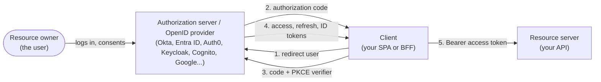

| Concept | Meaning |
|---|---|
| **Client ID** | Public identifier of your app |
| **Redirect URI** | Exact URL the code is returned to — must be **pre-registered and matched exactly** |
| **Scope** | Requested permissions (`openid profile email orders:read`) |
| **`state`** | Random value to bind the response to the request (CSRF protection for the callback) |
| **`nonce`** (OIDC) | Random value echoed in the ID token to stop token replay |
| **Discovery** | `/.well-known/openid-configuration` lists endpoints and keys |
| **JWKS** | The provider's public keys for verifying signatures |

**Grant types today:**

| Grant | Use it? |
|---|---|
| **Authorization Code + PKCE** | ✅ The standard for SPAs, BFFs, mobile and web servers |
| **Client Credentials** | ✅ Machine-to-machine only (never in a browser) |
| **Device Authorization** (RFC 8628) | ✅ TVs and CLI tools |
| **Refresh Token** | ✅ With rotation or sender-constraining for public clients |
| **Implicit** | ❌ Deprecated (Section 7) |
| **Resource Owner Password Credentials** | ❌ Must not be used (Section 7) |

> **OAuth 2.1** is an IETF draft that folds these best practices into one document (PKCE everywhere, no implicit, no password grant, exact redirect matching). Check its current status before citing it as a final standard; the settled reference today is **RFC 9700 (OAuth 2.0 Security Best Current Practice, January 2025)**.

---

### Section 6: Authorization Code Flow with PKCE

**PKCE** (RFC 7636, "pixie") proves that whoever redeems the authorization code is the same party that started the flow.

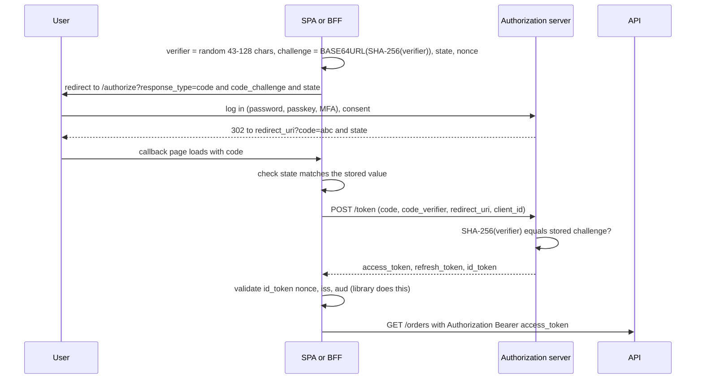

**Why PKCE matters:** the code travels through the browser (URL, history, logs). Without PKCE an attacker who intercepts the code (malicious app with the same custom URL scheme, a leaky log, a `Referer` header) can redeem it. With PKCE they'd also need the **verifier**, which never left the client.

**Checklist for the callback:**
- Always use `code_challenge_method=S256` (never `plain`).
- Verify `state`; store `verifier`/`state`/`nonce` in `sessionStorage` (survives the redirect, scoped to the tab) and delete them after use.
- Remove `?code=…` from the URL with `history.replaceState` right after the exchange.
- Validate a **`returnTo`** path against an allow-list of relative paths — an open redirect here is a classic phishing vector.
- Even confidential clients (BFFs) should use PKCE — RFC 9700 recommends it for all clients.

---

### Section 7: Deprecated Flows — Implicit and Password Grant

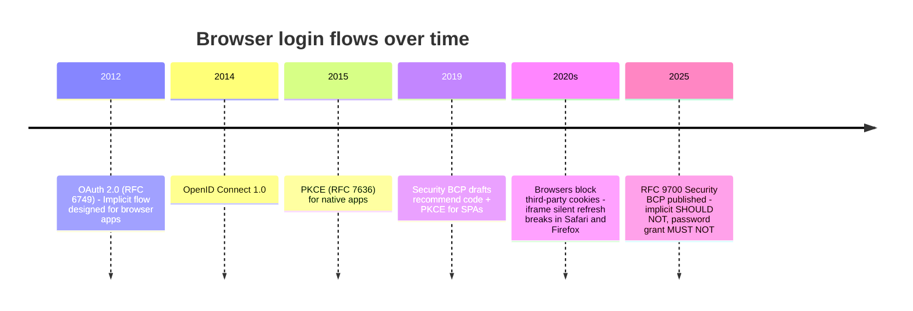

| Flow | What it did | Why it's out | Replace with |
|---|---|---|---|
| **Implicit** (`response_type=token`) | Returned the access token directly in the URL fragment | Tokens leak via history, `Referer`, logs and browser extensions; no refresh tokens; no sender binding | Authorization Code + PKCE |
| **Password grant (ROPC)** | SPA collects the password and posts it to the token endpoint | Trains users to type passwords into any app, breaks MFA/passkeys/SSO, exposes credentials to the client | Authorization Code + PKCE via the provider's login page |
| **Hidden-iframe silent auth** (`prompt=none`) | Renewed tokens using the provider's session cookie inside an iframe | The iframe is cross-site, so its cookies are **third-party** — blocked by default in Safari and Firefox | Refresh-token rotation, or a BFF |

> You will still find the implicit flow in old tutorials and older versions of some SDKs. If you see `response_type=token` or `id_token token`, plan a migration.

---

### Section 8: Backend-for-Frontend (BFF)

A **BFF** is a small server on the **same site** as the SPA that acts as a **confidential OAuth client**. The browser only ever holds an `HttpOnly` session cookie.

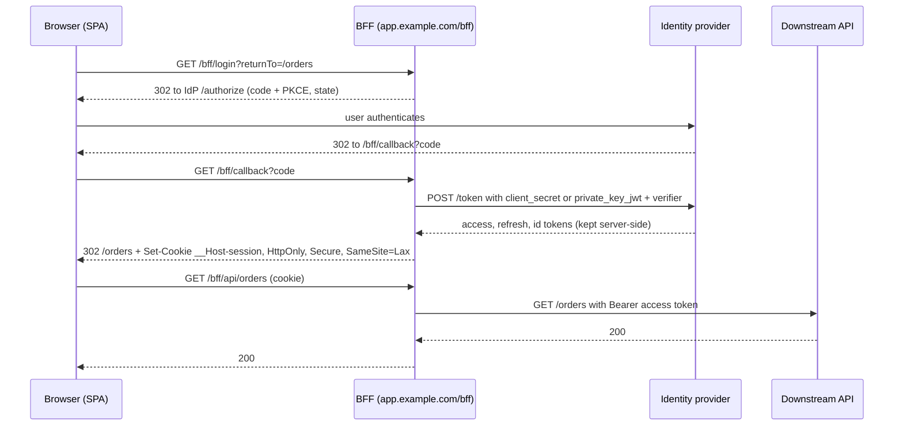

**What the BFF does:**
- Runs the OAuth flow as a confidential client and **stores tokens in a server-side session** (Redis, DB, or an encrypted cookie if small).
- **Proxies API calls**, attaching the access token and refreshing it when needed.
- Exposes `/bff/user` (who am I?) and `/bff/logout`.
- **Requires CSRF protection** on its endpoints — commonly a custom header (e.g. `X-CSRF: 1`) that forces a CORS preflight, plus `SameSite`.

**Costs:** an extra hop and a server to run (often your SSR server already is one — Next.js, Nuxt, SvelteKit, Remix and Angular SSR can host the BFF routes). The full pattern is covered in [Authentication Architecture (BFF Pattern)](../10-advanced-topics/authentication-architecture-bff-pattern.md).

---

### Section 9: Keeping the User Logged In — Refresh Strategies

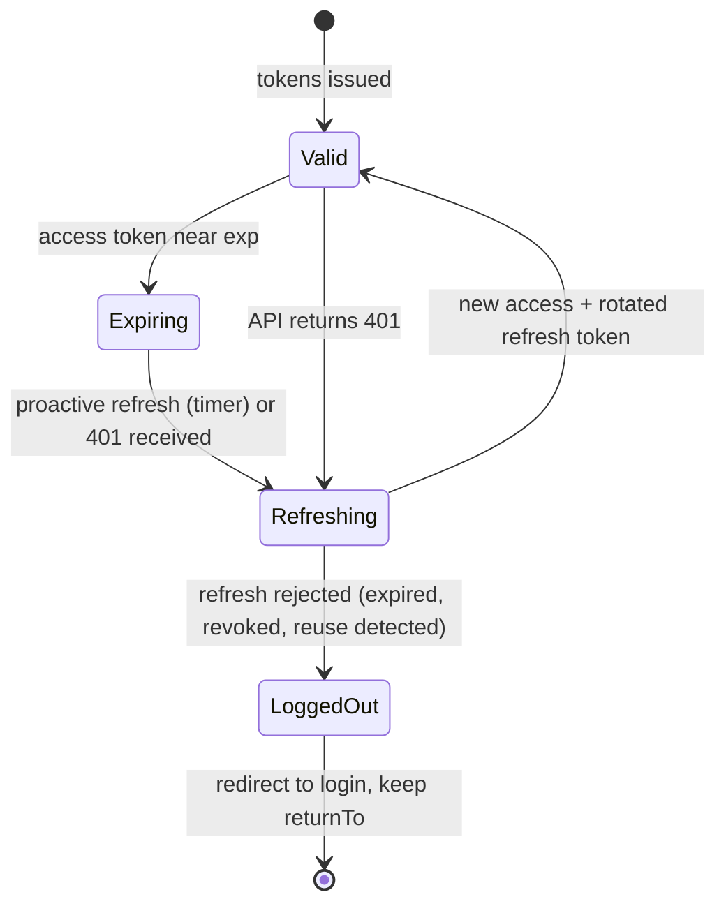

| Strategy | How | Notes |
|---|---|---|
| **Session cookie sliding expiry** | Server extends the session on activity | Simplest; set an absolute max lifetime too |
| **BFF refresh** | BFF refreshes server-side when the access token is near expiry | Browser never notices |
| **Refresh token rotation** | Each refresh returns a **new** refresh token; the old one is invalidated | If an old token is reused, the server **revokes the whole family** — detects theft |
| **Sender-constrained tokens (DPoP)** | Tokens bound to a key pair the client holds (RFC 9449) | Stolen tokens are useless without the private key |
| **Iframe silent auth** | Hidden iframe with `prompt=none` | ❌ Broken by third-party cookie blocking — avoid |

**Client-side rules:**
- **Single-flight refresh:** if ten requests get `401` at once, run **one** refresh and replay the ten after it (Example 2). Otherwise rotation sees parallel refreshes and may treat them as reuse.
- **Coordinate across tabs** — with rotation, two tabs refreshing simultaneously can invalidate each other. Use the Web Locks API (`navigator.locks.request`) or let one tab refresh and broadcast via `BroadcastChannel`.
- Refresh **proactively** shortly before `exp` (the token response's `expires_in` tells you when) and **reactively** on `401` as a fallback.
- Respect **idle timeouts** and **absolute lifetimes** — banking apps often force re-login after a fixed time regardless of activity.

---

### Section 10: Auth State in the Client

Model auth as an explicit state machine, not a boolean. The **"unknown"** state prevents a flash of the login page while you check the session.

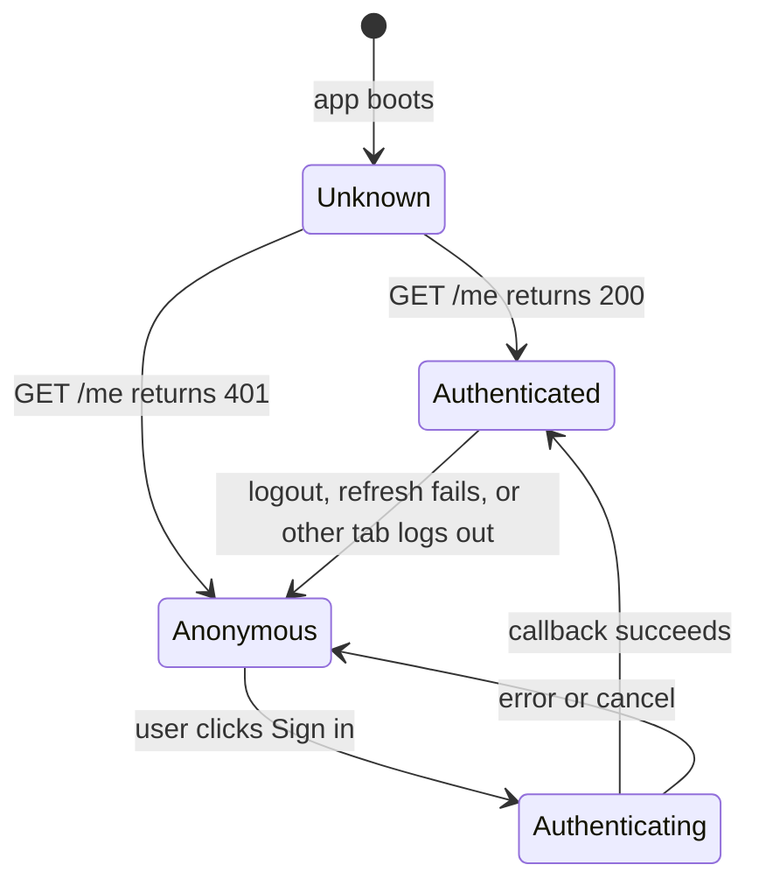

**Patterns:**
- **Source of truth = the server.** On boot, call `/me` (or `/bff/user`). Cache the profile in your server-state cache (TanStack Query, SWR, Apollo) and invalidate it on login/logout.
- **Route guards** redirect for UX: React Router loaders, TanStack Router `beforeLoad`, Vue Router `beforeEach`, Angular `CanActivateFn`/`CanMatchFn`, SvelteKit `+layout.server.ts` load or `hooks.server.ts`. None of them is a security boundary.
- **Role-based UI** (hide "Delete" for viewers) is cosmetic; the API still enforces permissions.
- **Multi-tab sync:** broadcast `logout` / `login` events on a `BroadcastChannel` so other tabs update immediately.
- **Clear sensitive caches on logout:** server-state cache, in-memory stores, persisted query caches, IndexedDB.
- **Return-to-page:** store the intended path before redirecting to login and validate it on return.

---

### Section 11: Logout Done Properly

Logout has **four layers**; forgetting one leaves the user partly logged in.

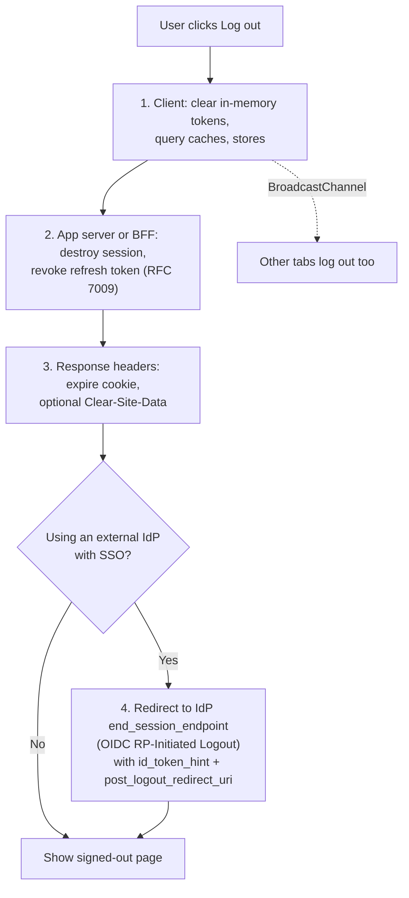

- Without step 2, a stolen refresh token keeps working.
- Without step 4, the next "Sign in" silently logs the same user back in through the IdP's SSO session — surprising on shared computers.
- `Clear-Site-Data: "cache", "cookies", "storage"` wipes the origin's data in supporting browsers (see [Browser Caching Strategies](../01-web-fundamentals/browser-caching-strategies.md)).
- For server-initiated logout (admin revokes access, password change), OIDC **Back-Channel Logout** lets the IdP notify your BFF directly.

---

### Section 12: Passkeys, MFA and Federated Login

**Passkeys** (WebAuthn / FIDO2 credentials) replace passwords with a key pair: the private key stays on the device or in the user's password manager, and the server stores only the public key. They're **phishing-resistant** because the credential is bound to your domain (the relying party ID).

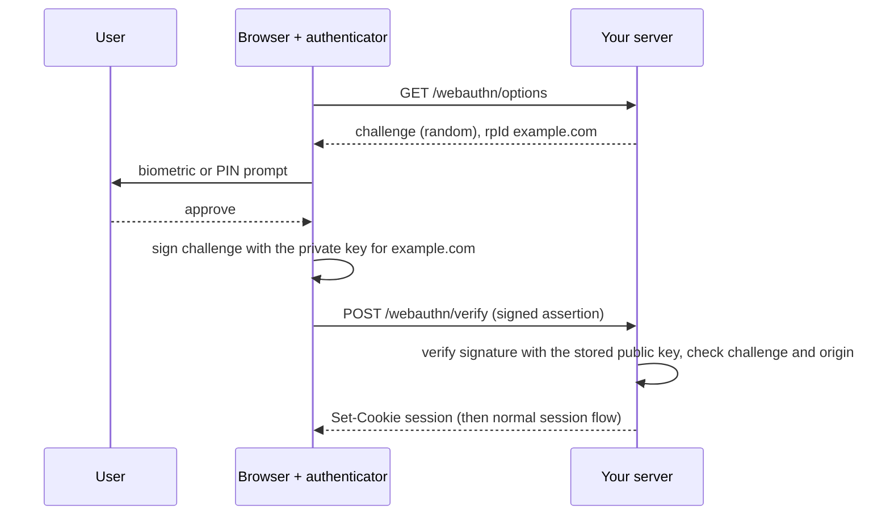

- Supported in all major browsers via `navigator.credentials.create()` / `.get()`. **Conditional UI** (passkeys offered in the username field's autofill, `autocomplete="username webauthn"`, `mediation: 'conditional'`) is broadly supported — check `PublicKeyCredential.isConditionalMediationAvailable()`.
- Use a server library (e.g. SimpleWebAuthn for Node, or your IdP's passkey support) — the verification logic is subtle.
- After a passkey login you still need a **session** — passkeys replace the *credential*, not the session/token architecture above.

**MFA:** prefer passkeys/security keys or TOTP over SMS. Step-up auth (re-prompt before sensitive actions) is usually driven by the server (`acr_values` / `max_age` in OIDC).

**Federated login:** "Sign in with Google/Apple/Microsoft" is OIDC with that provider. **FedCM** (Federated Credential Management, `IdentityCredential`) is a browser API that lets identity providers work without third-party cookies; it ships in Chromium-based browsers but not in Firefox or Safari as of this writing — treat it as progressive enhancement and check MDN.

---

### Section 13: Frameworks, SSR and Native Apps

| Stack | Where auth usually lives | Notes |
|---|---|---|
| **React SPA (Vite)** | Session cookie API or BFF; OIDC client library if no backend | Auth context + server-state query for `/me`; router loaders for guards |
| **Next.js** | Server: Route Handlers / Server Actions as the BFF; libraries such as Auth.js or a provider SDK | Check auth **inside** each Server Action / Route Handler / data-access function — not only in middleware (Next.js 16 renamed `middleware` to `proxy`). CVE-2025-29927 showed middleware-only checks can be bypassed |
| **Vue / Nuxt** | Nuxt server routes as BFF (e.g. `nuxt-auth-utils`), `useState` for user | Vue Router `beforeEach` guards for UX |
| **Angular** | `HttpInterceptorFn` attaches credentials/handles 401; `CanActivateFn` guards | Libraries like `angular-auth-oidc-client`; Angular SSR can host BFF routes |
| **SvelteKit** | `hooks.server.ts` `handle` reads the session cookie and sets `event.locals.user` | Check `locals.user` in each `+page.server.ts` load and action |
| **Native iOS / Android** | Authorization Code + PKCE in the **system browser** (RFC 8252) | `ASWebAuthenticationSession` (iOS), Custom Tabs (Android), AppAuth libraries; never an embedded WebView for the login page; prefer claimed HTTPS redirects (Universal Links / App Links) over custom schemes |
| **React Native / Flutter** | Same as native — AppAuth-based libraries or provider SDKs, tokens in Keychain/Keystore | See [Secure Token Storage](./secure-token-storage.md) |

**SSR twist:** with server rendering, the **server** needs the user's identity to render the first HTML. Cookies are sent with the navigation request; `Authorization` headers are not. That's another reason SSR apps use **cookie sessions** (or a BFF) rather than tokens held in JS memory. Mark personalized HTML `Cache-Control: private, no-cache` so CDNs never cache it.

---

## Decision Matrix

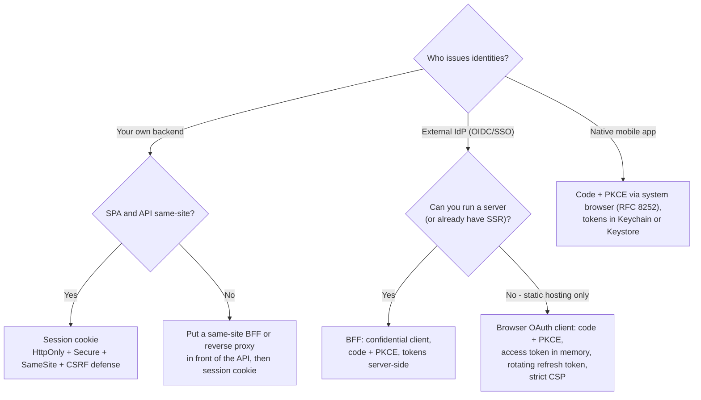

| Criterion | Session cookie | BFF | Browser OAuth client |
|---|---|---|---|
| Tokens exposed to XSS | None | None | Access (+ refresh) token |
| Needs a server | Yes (your API) | Yes | No |
| CSRF to handle | Yes | Yes | No (bearer header), but XSS risk is higher |
| Works with SSR | ✅ Natural | ✅ Natural | ⚠️ Server can't see in-memory tokens |
| Works with external IdP / SSO | Via your backend | ✅ | ✅ |
| Third-party cookie dependency | None if same-site | None if same-site | None with rotation; yes with iframe renew |
| Recommended for sensitive apps | ✅ | ✅ | ⚠️ Only with strong CSP and short lifetimes |

---

## Real-World Examples

**Example 1 — PKCE helpers with the Web Crypto API (TypeScript):**
```typescript
// pkce.ts — works in all modern browsers (crypto.subtle requires a secure context: HTTPS or localhost)
function base64url(bytes: Uint8Array): string {
  let s = '';
  bytes.forEach((b) => (s += String.fromCharCode(b)));
  return btoa(s).replace(/\+/g, '-').replace(/\//g, '_').replace(/=+$/, '');
}

export function randomString(byteLength = 32): string {
  return base64url(crypto.getRandomValues(new Uint8Array(byteLength))); // 32 bytes → 43 chars
}

export async function pkceChallenge(verifier: string): Promise<string> {
  const digest = await crypto.subtle.digest('SHA-256', new TextEncoder().encode(verifier));
  return base64url(new Uint8Array(digest));
}

export async function startLogin(cfg: { authorizeUrl: string; clientId: string; redirectUri: string }) {
  const verifier = randomString();
  const state = randomString(16);
  const nonce = randomString(16);
  sessionStorage.setItem('pkce', JSON.stringify({ verifier, state, nonce, returnTo: location.pathname }));

  const url = new URL(cfg.authorizeUrl);
  url.search = new URLSearchParams({
    response_type: 'code',
    client_id: cfg.clientId,
    redirect_uri: cfg.redirectUri,
    scope: 'openid profile email',
    state,
    nonce,
    code_challenge: await pkceChallenge(verifier),
    code_challenge_method: 'S256',
  }).toString();
  location.assign(url);
}
```
> In production prefer a certified library (e.g. `oidc-client-ts`, your IdP's SDK, or the BFF doing this server-side). The code above shows *what* the library does.

**Example 2 — Single-flight refresh in a fetch wrapper (BAD → GOOD):**
```typescript
// ❌ BAD: every 401 triggers its own refresh → races, and rotation may flag reuse
async function apiBad(path: string) {
  let res = await fetch(path, { headers: { Authorization: `Bearer ${token}` } });
  if (res.status === 401) {
    await refresh();                       // 10 parallel 401s → 10 refreshes
    res = await fetch(path, { headers: { Authorization: `Bearer ${token}` } });
  }
  return res;
}

// ✅ GOOD: one refresh in flight; everyone awaits the same promise
let accessToken: string | null = null;     // memory only
let refreshing: Promise<void> | null = null;
const authChannel = new BroadcastChannel('auth');   // tells other tabs about logout

function refreshOnce(): Promise<void> {
  refreshing ??= (async () => {
    const res = await fetch('/auth/refresh', { method: 'POST', credentials: 'include' });
    if (!res.ok) throw new Error('session-expired');
    accessToken = (await res.json()).access_token;
  })().finally(() => { refreshing = null; });
  return refreshing;
}

export async function api(path: string, init: RequestInit = {}): Promise<Response> {
  const send = () =>
    fetch(path, { ...init, headers: { ...init.headers, Authorization: `Bearer ${accessToken}` } });

  let res = await send();
  if (res.status !== 401) return res;

  try {
    await refreshOnce();
  } catch {
    authChannel.postMessage({ type: 'logout' });
    window.location.assign(`/login?returnTo=${encodeURIComponent(location.pathname)}`);
    return new Promise<Response>(() => {});   // navigation in progress
  }
  return send();                                // replay once, never loop
}
```

**Example 3 — React auth provider with an explicit "unknown" state:**
```tsx
import { createContext, useContext, type ReactNode } from 'react';
import { useQuery, useQueryClient } from '@tanstack/react-query';
import { Navigate, useLocation } from 'react-router';

type User = { id: string; name: string; roles: string[] };
type AuthState =
  | { status: 'unknown' }
  | { status: 'anonymous' }
  | { status: 'authenticated'; user: User };

const AuthContext = createContext<AuthState>({ status: 'unknown' });

export function AuthProvider({ children }: { children: ReactNode }) {
  const { data, isPending } = useQuery({
    queryKey: ['me'],
    queryFn: async () => {
      const res = await fetch('/bff/user', { credentials: 'include' });
      if (res.status === 401) return null;
      if (!res.ok) throw new Error('me failed');
      return (await res.json()) as User;
    },
    staleTime: 5 * 60_000,
  });

  const state: AuthState = isPending
    ? { status: 'unknown' }
    : data ? { status: 'authenticated', user: data } : { status: 'anonymous' };

  return <AuthContext.Provider value={state}>{children}</AuthContext.Provider>;
}

export function RequireAuth({ children }: { children: ReactNode }) {
  const auth = useContext(AuthContext);
  const location = useLocation();
  if (auth.status === 'unknown') return <p aria-busy="true">Checking your session…</p>;
  if (auth.status === 'anonymous') {
    return <Navigate to={`/login?returnTo=${encodeURIComponent(location.pathname)}`} replace />;
  }
  return <>{children}</>;          // UX only — the API still checks every request
}

export function useLogout() {
  const qc = useQueryClient();
  return async () => {
    await fetch('/bff/logout', { method: 'POST', credentials: 'include', headers: { 'X-CSRF': '1' } });
    qc.clear();                                    // drop every cached user-specific query
    new BroadcastChannel('auth').postMessage({ type: 'logout' });
    window.location.assign('/signed-out');
  };
}
```

**Example 4 — Express session login with fixation protection:**
```typescript
import express from 'express';
import session from 'express-session';
import argon2 from 'argon2';

const app = express();
app.use(express.json());
app.use(session({
  name: '__Host-sid',                 // __Host- prefix: Secure, Path=/, no Domain
  secret: process.env.SESSION_SECRET!,
  resave: false,
  saveUninitialized: false,
  cookie: { httpOnly: true, secure: true, sameSite: 'lax', path: '/', maxAge: 8 * 60 * 60 * 1000 },
  // store: new RedisStore({ client })  ← use a real store in production
}));

app.post('/auth/login', async (req, res, next) => {
  const user = await findUserByEmail(req.body.email);
  const ok = user && (await argon2.verify(user.passwordHash, req.body.password));
  if (!ok) return res.status(401).json({ error: 'invalid_credentials' }); // same message for both cases

  req.session.regenerate((err) => {   // new session id → defeats session fixation
    if (err) return next(err);
    req.session.userId = user.id;
    res.sendStatus(204);
  });
});

app.post('/auth/logout', (req, res, next) => {
  req.session.destroy((err) => {
    if (err) return next(err);
    res.clearCookie('__Host-sid', { path: '/', secure: true, httpOnly: true, sameSite: 'lax' });
    res.set('Clear-Site-Data', '"cache", "storage"');
    res.sendStatus(204);
  });
});
```

**Example 5 — The same concerns in Angular, Vue and SvelteKit:**
```typescript
// Angular — functional interceptor + guard
export const authInterceptor: HttpInterceptorFn = (req, next) => {
  const router = inject(Router);            // inject() only works synchronously here, not inside catchError
  return next(req.clone({ withCredentials: true })).pipe(
    catchError((err) => {
      if (err.status === 401) router.navigate(['/login']);
      return throwError(() => err);
    }),
  );
};
export const authGuard: CanActivateFn = () =>
  inject(AuthService).isLoggedIn() || inject(Router).createUrlTree(['/login']);

// Vue Router — global guard (UX only)
router.beforeEach(async (to) => {
  const auth = useAuthStore();
  if (to.meta.requiresAuth && !(await auth.ensureUser())) {
    return { path: '/login', query: { returnTo: to.fullPath } };
  }
});

// SvelteKit — src/hooks.server.ts: resolve the session once per request
export const handle: Handle = async ({ event, resolve }) => {
  const sid = event.cookies.get('__Host-sid');
  event.locals.user = sid ? await sessions.getUser(sid) : null;
  return resolve(event);
};
// …and in each +page.server.ts: if (!locals.user) redirect(303, '/login');
```

**Example 6 — Validating `returnTo` (BAD → GOOD):**
```typescript
// ❌ BAD: open redirect → https://app.example.com/login?returnTo=https://evil.example
window.location.assign(new URLSearchParams(location.search).get('returnTo') ?? '/');

// ✅ GOOD: only same-origin relative paths
function safeReturnTo(raw: string | null): string {
  if (!raw || !raw.startsWith('/') || raw.startsWith('//') || raw.startsWith('/\\')) return '/';
  const url = new URL(raw, location.origin);
  return url.origin === location.origin ? url.pathname + url.search + url.hash : '/';
}
```

---

## Key Points Summary

| Concept | One-Line Explanation |
|---|---|
| **AuthN vs AuthZ** | Who you are vs what you may do — the API enforces AuthZ on every request |
| **Public client** | An SPA can't keep secrets; everything shipped to the browser is readable |
| **Session cookie** | Opaque ID in an `HttpOnly` cookie; simplest and revocable; needs CSRF defense |
| **Access token** | Short-lived bearer credential for APIs; treat as opaque in the SPA |
| **Refresh token** | Long-lived credential for new access tokens; rotate or sender-constrain it |
| **ID token** | OIDC proof of login for the client; never an API credential |
| **Authorization Code + PKCE** | The one OAuth flow for browsers, mobile and servers |
| **Implicit / password grant** | Deprecated / forbidden by RFC 9700 |
| **BFF** | Same-site server is the OAuth client; browser holds only a session cookie |
| **Refresh rotation** | New refresh token per use; reuse revokes the family |
| **Single-flight refresh** | One refresh for many concurrent 401s |
| **Route guards** | UX only, never a security boundary |
| **Logout layers** | Client state, server session + revocation, cookies, IdP session |
| **Passkeys** | Phishing-resistant WebAuthn credentials; still need a session afterwards |
| **Native apps** | Code + PKCE in the system browser, never an embedded WebView |

---

## Test Your Understanding

**Q1 (Basic):**
Why can't an SPA use a `client_secret`, and what replaces it in the authorization code flow?

<details>
<summary>Answer</summary>

Everything in an SPA's bundle is downloaded to every user's browser, so a `client_secret` embedded there is public — anyone can read it in DevTools. OAuth calls such apps **public clients**. **PKCE** replaces the secret's role for the code exchange: the client generates a one-time random `code_verifier`, sends only its SHA-256 hash (`code_challenge`) in the authorization request, and proves possession by sending the verifier to the token endpoint. A stolen authorization code is useless without that verifier. (A BFF, being a server, *can* be a confidential client and use a real secret or `private_key_jwt` — and should still use PKCE.)
</details>

**Q2 (Application):**
You're building a first-party dashboard: React SPA at `app.acme.com`, Node API at `api.acme.com`, your own user database. A teammate proposes JWTs in `localStorage`. What do you propose instead and why?

<details>
<summary>Answer</summary>

A **session cookie**: on login, the API sets `HttpOnly; Secure; SameSite=Lax` (e.g. with the `__Host-` prefix if it's host-only) containing an opaque session ID; the SPA calls the API with `credentials: 'include'`, and CORS allows exactly `https://app.acme.com` with credentials. The two hosts are **same-site** (`acme.com`), so the cookie isn't a third-party cookie and `SameSite` still applies.

Why: no token is readable by JavaScript (XSS can't exfiltrate it), sessions are revocable instantly, SSR becomes possible later, and there's no refresh-token machinery. The trade-off is CSRF, handled by `SameSite` plus a CSRF token or `Origin`/`Sec-Fetch-Site` checks on mutations. JWTs in `localStorage` add complexity and give any XSS payload a long-lived credential it can steal.
</details>

**Q3 (Tricky):**
After moving the access token from `localStorage` to an `HttpOnly` cookie, a reviewer says "we're now immune to XSS". Are they right?

<details>
<summary>Answer</summary>

No. `HttpOnly` stops XSS from **reading and exfiltrating** the credential, which matters: the attacker can't keep using it after the user closes the tab, and can't use it from their own machine. But injected script runs **in the user's page**, so it can still **make authenticated requests** (the browser attaches the cookie) and read the responses, for as long as the page is open. That's sometimes called session riding. XSS must still be prevented at the source: output encoding, framework escaping, Trusted Types, and a strict **CSP**. `HttpOnly` limits the damage; it doesn't remove the vulnerability.
</details>

**Q4 (Tricky):**
Your SPA uses an OIDC library with rotating refresh tokens. Users with several tabs open get randomly logged out. Logs show "refresh token reuse detected". What's happening, and how do you fix it?

<details>
<summary>Answer</summary>

Each tab refreshes independently. Tab A uses refresh token R1 and receives R2 (R1 is now invalid). Tab B, still holding R1, refreshes a moment later. The server sees a reused R1, assumes theft, and **revokes the whole token family**, logging out every tab.

Fixes: coordinate refreshes across tabs — take a Web Lock (`navigator.locks.request('refresh', …)`) so only one tab refreshes, and share the result (e.g. via `BroadcastChannel` or shared storage the library supports). Also make refresh **single-flight** within a tab. Some providers offer a short reuse grace window, but don't rely on it. Moving to a **BFF** removes the problem: there's one server-side session and the browser never refreshes anything.
</details>

**Q5 (Tricky):**
Your app used hidden-iframe silent renew (`prompt=none`) and worked for years. Now Safari and Firefox users are sent to the login page every hour, while most Chrome users aren't. Why?

<details>
<summary>Answer</summary>

The iframe loads the identity provider's domain inside your page, so the IdP's session cookie is a **third-party cookie** in that context. Safari (ITP) and Firefox (Total Cookie Protection / Enhanced Tracking Protection) block or partition third-party cookies by default, so the IdP sees no session and returns `login_required`. Chrome still allows third-party cookies by default (Google changed course on removing them), though users can block them, so it behaves differently. Fix: stop relying on third-party cookies — use the **authorization code flow with refresh-token rotation**, or move to a **BFF** with a first-party session cookie. Putting the IdP on a same-site custom domain (e.g. `login.acme.com`) also helps.
</details>

**Q6 (System design):**
Design authentication for a B2B SaaS: Next.js app, customers sign in through their own SSO (Okta, Entra ID), several internal microservices, strict security review. Outline the flow, token handling, logout and the risks you'd mention.

<details>
<summary>Answer</summary>

- **Architecture:** a **BFF inside the Next.js server** (Route Handlers) acting as a confidential OIDC client per customer tenant (connection chosen by email domain or org slug). Authorization code + PKCE, `state`, `nonce`, exact redirect URIs.
- **Tokens:** stored server-side in a session store (Redis) keyed by an opaque `__Host-` cookie (`HttpOnly`, `Secure`, `SameSite=Lax`). The browser never sees access, refresh or ID tokens. The BFF exchanges or forwards access tokens to microservices (token exchange RFC 8693 or an internal gateway), each validating `aud`/`iss`/`exp`.
- **Rendering:** Server Components read the session from cookies. Every Server Action and data-access function checks the session and permissions — not just the `proxy`/middleware layer. Personalized responses are `private, no-cache`.
- **Refresh:** the BFF refreshes server-side with rotation; idle timeout plus absolute session lifetime per tenant policy.
- **CSRF:** `SameSite=Lax`, plus Server Actions' built-in origin check, plus a custom header or token on BFF routes.
- **Logout:** destroy the session, revoke the refresh token, OIDC RP-initiated logout at the tenant's IdP, `BroadcastChannel` to other tabs, and back-channel logout so IdP-side deprovisioning ends sessions.
- **Risks to discuss:** XSS still allows session riding (so strict CSP and Trusted Types), tenant-mixing bugs (bind session to tenant ID), open redirects in `returnTo`, logging tokens, and IdP outages (graceful error pages).
</details>

---

## Cheat Sheet

**Key Definitions:**
- **Public client:** An app that can't keep a secret (SPA, mobile); uses PKCE
- **Confidential client:** A server-side app with a secret or private key (BFF, web server)
- **PKCE:** `code_verifier` kept by the client, `code_challenge = BASE64URL(SHA256(verifier))` sent first
- **`state` / `nonce`:** Random values that bind the callback / ID token to this login attempt
- **Access / refresh / ID token:** Call APIs / renew access tokens / tell the client who logged in
- **BFF:** Same-site server that runs OAuth and holds tokens; browser gets an `HttpOnly` cookie
- **Refresh token rotation:** One-time-use refresh tokens; reuse revokes the family
- **RP-Initiated Logout:** OIDC redirect to the IdP's `end_session_endpoint`

**Quick Reference:**
```text
Own users, same-site API          → session cookie: __Host-sid; HttpOnly; Secure; SameSite=Lax  (+ CSRF defense)
External IdP + you have a server  → BFF: code + PKCE as confidential client, tokens server-side
External IdP, static hosting only → code + PKCE in browser, access token in memory, rotating refresh, strict CSP
Native mobile                     → code + PKCE in system browser (RFC 8252), Keychain/Keystore
Machine to machine                → client credentials (never in a browser)

Flow:     /authorize?response_type=code&code_challenge_method=S256 → callback?code&state → POST /token + verifier
Never:    implicit (response_type=token), password grant, iframe silent renew, tokens in URLs
Always:   validate state, exact redirect URIs, safe returnTo, rotate session id on login
Refresh:  single-flight per tab + Web Lock across tabs; proactive before exp, reactive on 401
Logout:   clear client caches → destroy session + revoke refresh → expire cookie → IdP end_session → broadcast
Guards:   UX only; API authorizes every request
```

**Common Mistakes to Avoid:**

| Mistake | Why Wrong | Fix |
|---|---|---|
| Implicit flow or tokens in the URL fragment | Leaks via history, `Referer`, logs; deprecated by RFC 9700 | Authorization Code + PKCE |
| Collecting passwords for an external IdP (password grant) | Breaks MFA/SSO, exposes credentials, forbidden by RFC 9700 | Redirect to the IdP's login page |
| `client_secret` in the SPA bundle | It's public the moment you deploy | PKCE, or a BFF as confidential client |
| Long-lived tokens in `localStorage` | Any XSS can steal them | Session cookie / BFF; memory-only short-lived access token otherwise |
| Treating route guards as security | Users can bypass client code | Authorize in the API on every request |
| Decoding the access token for UI logic | Format is the API's business and may change | Use `/me` or ID token claims |
| Sending the ID token to APIs | Wrong audience; not an access token | Use the access token |
| Parallel refreshes on many 401s | Races; rotation flags reuse and logs out | Single-flight + cross-tab lock |
| Relying on iframe silent renew | Third-party cookies blocked in Safari/Firefox | Refresh rotation or BFF |
| Not rotating the session ID on login | Session fixation | `regenerate()` on login / privilege change |
| Unvalidated `returnTo` | Open redirect for phishing | Allow only same-origin relative paths |
| Logout that only clears client state | Refresh token and IdP session remain valid | Revoke server-side + RP-initiated logout |
| Auth check only in Next.js middleware/proxy | Bypass bugs (e.g. CVE-2025-29927); not a full boundary | Check in each Server Action / data access function |
| Login inside an embedded WebView (mobile) | App can capture credentials; no shared SSO; providers block it | System browser via AppAuth / ASWebAuthenticationSession / Custom Tabs |

---

## References & Further Reading

**Specs and IETF guidance**
- IETF: [RFC 9700 — Best Current Practice for OAuth 2.0 Security](https://www.rfc-editor.org/rfc/rfc9700)
- IETF: [OAuth 2.0 for Browser-Based Applications (draft)](https://datatracker.ietf.org/doc/draft-ietf-oauth-browser-based-apps/)
- IETF: [RFC 7636 — PKCE](https://www.rfc-editor.org/rfc/rfc7636) · [RFC 6749 — OAuth 2.0](https://www.rfc-editor.org/rfc/rfc6749) · [RFC 8252 — OAuth for Native Apps](https://www.rfc-editor.org/rfc/rfc8252)
- IETF: [RFC 7519 — JWT](https://www.rfc-editor.org/rfc/rfc7519) · [RFC 9068 — JWT Profile for Access Tokens](https://www.rfc-editor.org/rfc/rfc9068) · [RFC 9449 — DPoP](https://www.rfc-editor.org/rfc/rfc9449) · [RFC 7009 — Token Revocation](https://www.rfc-editor.org/rfc/rfc7009)
- IETF: [OAuth 2.1 (draft)](https://datatracker.ietf.org/doc/draft-ietf-oauth-v2-1/)
- OpenID Foundation: [OpenID Connect Core 1.0](https://openid.net/specs/openid-connect-core-1_0.html) · [RP-Initiated Logout 1.0](https://openid.net/specs/openid-connect-rpinitiated-1_0.html) · [Back-Channel Logout 1.0](https://openid.net/specs/openid-connect-backchannel-1_0.html)

**Core docs**
- MDN: [Using HTTP cookies](https://developer.mozilla.org/en-US/docs/Web/HTTP/Guides/Cookies)
- MDN: [Web Authentication API](https://developer.mozilla.org/en-US/docs/Web/API/Web_Authentication_API) · [FedCM API](https://developer.mozilla.org/en-US/docs/Web/API/FedCM_API)
- MDN: [Web Locks API](https://developer.mozilla.org/en-US/docs/Web/API/Web_Locks_API) · [`BroadcastChannel`](https://developer.mozilla.org/en-US/docs/Web/API/BroadcastChannel)
- web.dev: [Passkeys](https://web.dev/articles/passkey-registration) · Google for Developers: [Passkeys developer guide](https://developers.google.com/identity/passkeys)
- OWASP: [Authentication Cheat Sheet](https://cheatsheetseries.owasp.org/cheatsheets/Authentication_Cheat_Sheet.html) · [Session Management Cheat Sheet](https://cheatsheetseries.owasp.org/cheatsheets/Session_Management_Cheat_Sheet.html) · [OAuth 2.0 Cheat Sheet](https://cheatsheetseries.owasp.org/cheatsheets/OAuth2_Cheat_Sheet.html)

**Framework docs**
- Next.js: [Authentication guide](https://nextjs.org/docs/app/guides/authentication)
- Angular: [HTTP interceptors](https://angular.dev/guide/http/interceptors) · [Route guards](https://angular.dev/guide/routing/route-guards)
- Vue Router: [Navigation guards](https://router.vuejs.org/guide/advanced/navigation-guards.html)
- SvelteKit: [Hooks](https://svelte.dev/docs/kit/hooks) · [Auth](https://svelte.dev/docs/kit/auth)

**Deep dives**
- Duende Software: [The BFF pattern](https://docs.duendesoftware.com/bff/)
- Auth0 docs: [Refresh token rotation](https://auth0.com/docs/secure/tokens/refresh-tokens/refresh-token-rotation)
- AppAuth: [Native app OAuth libraries](https://appauth.io/)

---

> **Previous Topic:** [CSRF Protection](./csrf-protection.md)
> — Why browsers attach cookies to forged requests, and how SameSite, tokens and Fetch Metadata stop it

> **Next Topic:** [Secure Token Storage](./secure-token-storage.md)
> — Where sessions and tokens should live in the browser and on mobile, and what each option protects against

*Saved on: 2026-11-06 | Repo: Frontend System Design Learning Notes*
