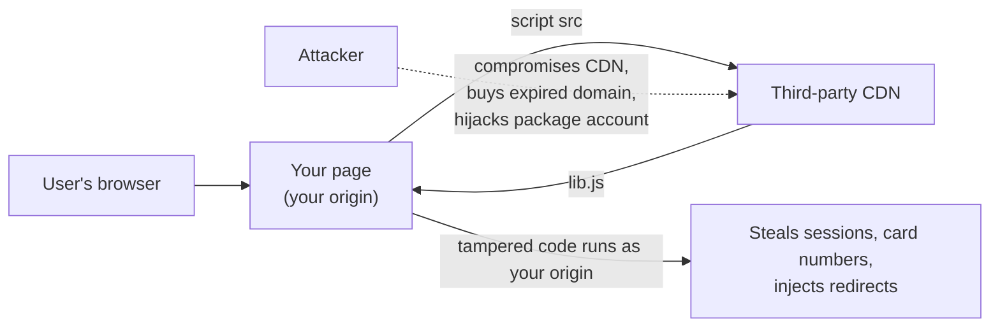
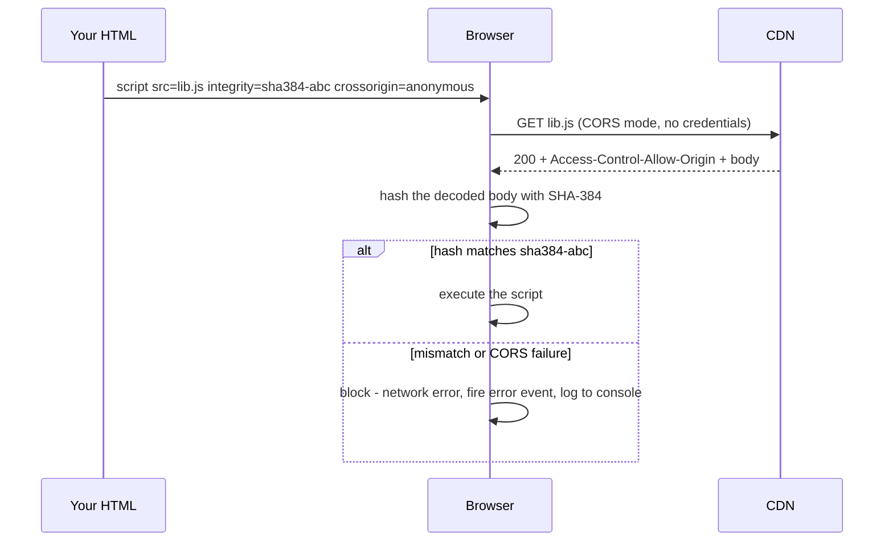
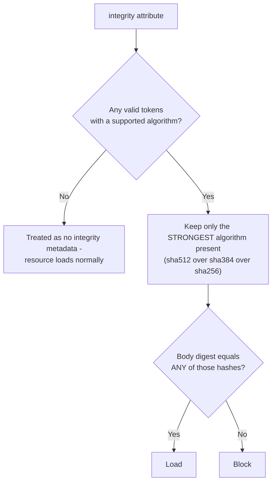
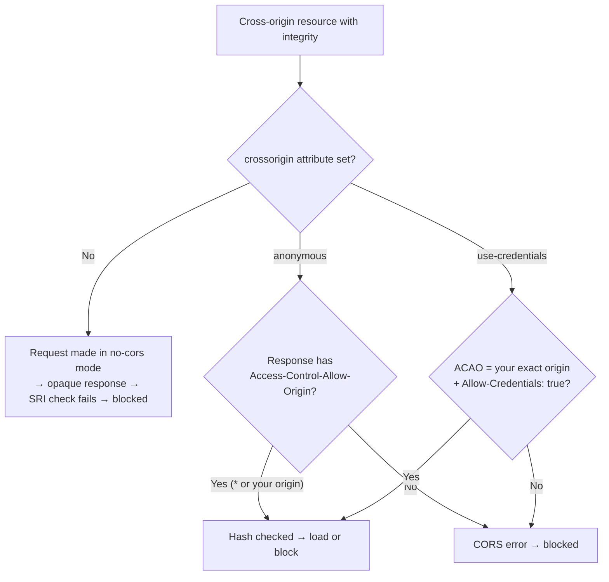
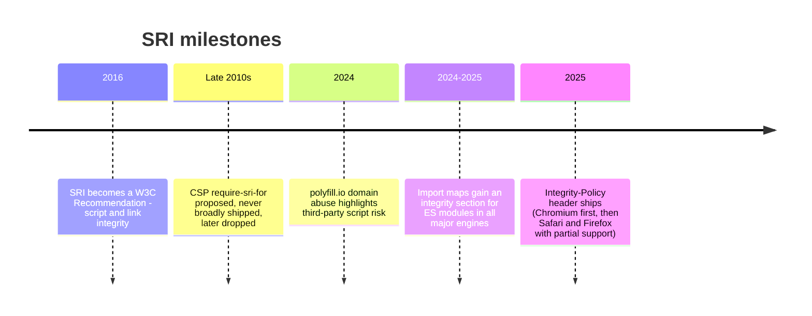
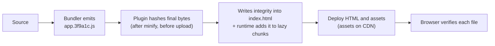
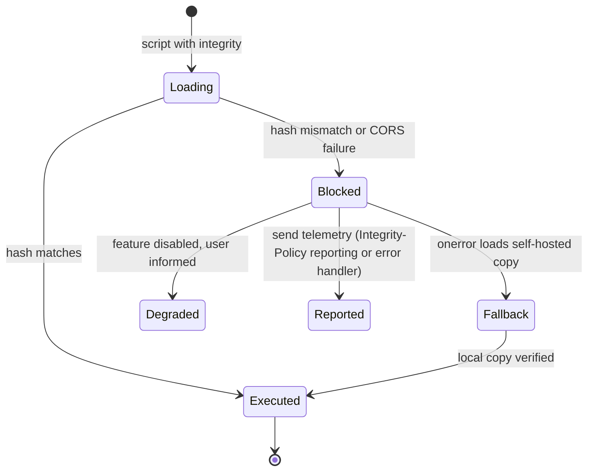
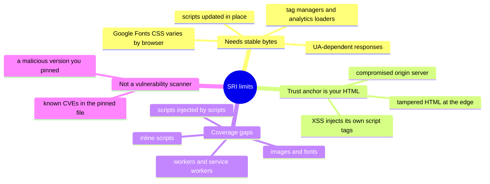
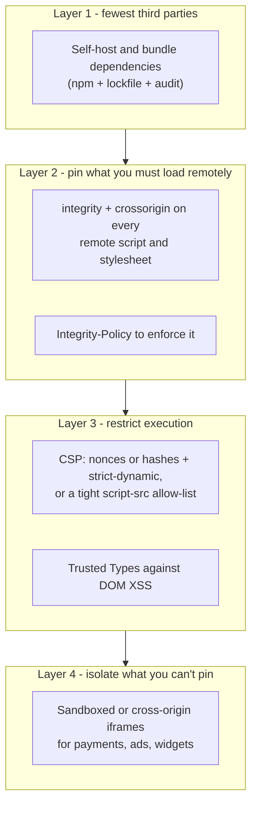
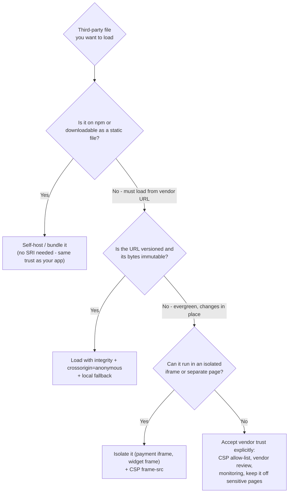

# Subresource Integrity (SRI)

> **Date:** 2026-11-06 · **Last updated:** 2026-11-06
> **Category:** Frontend System Design
> **Sub-Topic:** Security / Supply Chain
> **Level:** Intermediate · **Reading time:** ~22 min
> **Informs:** third-party script and CDN loading policy, self-hosting vs public CDNs, build-time integrity hashes, `crossorigin` and CORS setup, Integrity-Policy enforcement, import maps, supply-chain incident response

> **Pre-requisite:** [CORS & Same-Origin Policy](../01-web-fundamentals/cors-and-same-origin-policy.md) (`crossorigin`, opaque responses) and [Content Security Policy (CSP)](./content-security-policy-csp.md) (which origins may load scripts).
> CSP decides **where** scripts may come from. SRI decides **which exact bytes** are acceptable.

**Previous:** [Secure Token Storage](./secure-token-storage.md) · **Next:** [Clickjacking & iframe Protection](./clickjacking-and-iframe-protection.md)

---

## Table of Contents

1. [ELI5 — Simple Explanation](#eli5--simple-explanation)
2. [Section 1: The Problem — You Run Code You Don't Host](#section-1-the-problem--you-run-code-you-dont-host)
3. [Section 2: How SRI Works](#section-2-how-sri-works)
4. [Section 3: The integrity Attribute Format](#section-3-the-integrity-attribute-format)
5. [Section 4: SRI Needs CORS](#section-4-sri-needs-cors)
6. [Section 5: Where SRI Applies (and Where It Doesn't)](#section-5-where-sri-applies-and-where-it-doesnt)
7. [Section 6: Generating Hashes and Build Integration](#section-6-generating-hashes-and-build-integration)
8. [Section 7: Failure Handling and Fallbacks](#section-7-failure-handling-and-fallbacks)
9. [Section 8: Enforcing SRI — Integrity-Policy](#section-8-enforcing-sri--integrity-policy)
10. [Section 9: What SRI Cannot Protect](#section-9-what-sri-cannot-protect)
11. [Section 10: SRI, CSP and Self-Hosting Together](#section-10-sri-csp-and-self-hosting-together)
12. [Decision Matrix](#decision-matrix)
13. [Real-World Examples](#real-world-examples)
14. [Key Points Summary](#key-points-summary)
15. [Test Your Understanding (with answers)](#test-your-understanding)
16. [Cheat Sheet](#cheat-sheet)
17. [References & Further Reading](#references--further-reading)

---

## ELI5 — Simple Explanation

You order a **sealed medicine bottle** from a pharmacy you don't own.

- Before you leave home you write down the bottle's **unique fingerprint** (the **hash**) from the manufacturer's list.
- When the bottle arrives, you check its fingerprint. **Match → take it. Mismatch → throw it away**, even though it came from the "right" pharmacy.
- A crook who swaps the contents at the pharmacy (a **compromised CDN** or a hijacked domain) can't fake the fingerprint.
- But if the manufacturer **changes the recipe every week** under the same name (a script that updates in place), your written fingerprint stops matching and you get nothing at all. That's the main limitation.
- And the fingerprint must be written on **your** shopping list (your HTML). If someone tampers with your list itself, the check is useless.

> **SRI pins a resource to exact bytes: the browser refuses anything else. Use it for versioned files you don't control; self-host when you can.**

---

## Core Concept — Step by Step

### Section 1: The Problem — You Run Code You Don't Host

A `<script src="https://cdn.example/lib.js">` gives that CDN **full control of your page**: it runs with your origin's privileges, reads the DOM, sees form input and can call your APIs with the user's cookies.



**Real incidents of this class:**
- **polyfill.io (2024):** the popular `polyfill.io` domain changed owners, and in June 2024 its responses were reported to include malicious code redirecting some mobile visitors. Every site still loading the script inherited the attack. Because that service returned **different code per browser**, SRI couldn't even be used with it — the lesson is to **self-host** or pin immutable files.
- **Magecart-style card skimming:** attackers inject skimmers into third-party or first-party scripts on checkout pages. SRI helps when the tampered file is a pinned third-party asset. It can't help when the attacker changes the HTML or your own server.

---

### Section 2: How SRI Works



- The browser computes a hash of the **response body** (after removing HTTP content-encoding such as gzip/brotli) and compares it to the hash in your HTML.
- **On mismatch the resource is treated as a network error**: the script doesn't run / the stylesheet doesn't apply, and the element fires `error`.
- The check happens on **every load**, including loads served from the HTTP cache.
- Broad support: `<script integrity>` and `<link integrity>` work in all modern browsers (Chrome 45+, Firefox 43+, Safari 11.1+ per MDN compat data).

---

### Section 3: The integrity Attribute Format

```html
<script
  src="https://cdn.jsdelivr.net/npm/dayjs@1.11.13/dayjs.min.js"
  integrity="sha384-<base64 digest of the exact file>"
  crossorigin="anonymous"
  referrerpolicy="no-referrer"></script>
```

```text
integrity = "<algorithm>-<base64 digest>[?options] [<algorithm>-<base64 digest> ...]"

algorithm   → sha256 | sha384 | sha512        (sha1/md5 are not accepted)
digest      → standard base64 of the raw hash bytes (not hex, not base64url)
multiple    → space-separated list
```

**How the browser picks among several hashes:**



Consequences:
- `integrity="sha256-AAA sha384-BBB"` → only `sha384-BBB` is checked. A wrong strong hash can't be rescued by a correct weak one.
- Listing **two hashes of the same algorithm** lets you roll over safely, e.g. during a planned file update: `sha384-OLD sha384-NEW`.
- **`sha384` is the conventional choice** (it's what most tools and CDNs emit).
- An **unknown algorithm or malformed token is ignored** — a typo can silently disable the check. Verify that SRI actually blocks a tampered file (Example 6).

---

### Section 4: SRI Needs CORS

For a **cross-origin** resource, the browser may only inspect the body if the response is CORS-enabled. Otherwise it's an **opaque** response and can't be hashed, so the load fails.



| `crossorigin` value | Cookies sent | Server must send | Use |
|---|---|---|---|
| *(absent)* on cross-origin + `integrity` | — | — | ❌ Always fails |
| `anonymous` | No | `Access-Control-Allow-Origin: *` (or your origin) | ✅ Public CDN files |
| `use-credentials` | Yes | `ACAO: <your origin>` + `Access-Control-Allow-Credentials: true` | Rare — private asset hosts |

- Major public CDNs (jsDelivr, cdnjs, unpkg) send `Access-Control-Allow-Origin: *`.
- **Same-origin** resources don't need `crossorigin` — but SRI on them only helps if the HTML and the assets are served from **different trust domains** (e.g. HTML from your app server, assets from a separate bucket/CDN).
- If you `preload` a resource that uses SRI, give the `<link rel="preload">` the **same `integrity` and `crossorigin`** as the element that consumes it. Otherwise the preload may not be reused and the file downloads twice (see [Prefetching & Preloading](../04-performance-engineering/prefetching-and-preloading.md)).

---

### Section 5: Where SRI Applies (and Where It Doesn't)

| Resource | SRI support | How |
|---|---|---|
| Classic `<script src>` | ✅ All modern browsers | `integrity` attribute |
| `<script type="module" src>` | ✅ | `integrity` on the entry tag (dependencies: see import maps) |
| `<link rel="stylesheet">` | ✅ | `integrity` attribute |
| `<link rel="preload">` / `modulepreload` | ✅ | `integrity` attribute (match the consumer) |
| `fetch()` | ✅ | `fetch(url, { integrity: 'sha384-…' })` (`Request.integrity`) |
| **Static `import` / dynamic `import()`** of modules | ✅ Via **import map `integrity`** (Chrome/Edge 127+, Firefox 138+, Safari 18+ per MDN) | `<script type="importmap">{"integrity": {…}}` |
| Chunks loaded by a bundler runtime | ⚠️ Only if the bundler/plugin injects `integrity` | webpack-subresource-integrity, Angular CLI, Next.js (experimental) |
| Inline `<script>` / `<style>` | ❌ Not SRI | Use CSP **hashes or nonces** |
| `new Worker()`, `importScripts()`, Service Worker scripts | ❌ No integrity option | Same-origin hosting + CSP `worker-src` |
| Images, fonts, media, iframes | ❌ (no standard `integrity` attribute) | Trust the origin; CSP; sandboxed iframes |
| Third-party script that injects further scripts | ⚠️ Only the first file is pinned | Its children load without SRI unless it adds them |



> **Experimental:** SRI Level 2 work adds **signature-based integrity** (e.g. Ed25519 public keys in `integrity`, so a publisher can update a file and re-sign it). At the time of writing only Chromium ships it, as experimental. Check MDN before using it.

---

### Section 6: Generating Hashes and Build Integration

**By hand (command line):**
```bash
# OpenSSL (macOS / Linux / Git Bash)
echo "sha384-$(openssl dgst -sha384 -binary dayjs.min.js | openssl base64 -A)"

# Node.js one-liner
node -e "const c=require('crypto'),f=require('fs');console.log('sha384-'+c.createHash('sha384').update(f.readFileSync(process.argv[1])).digest('base64'))" dayjs.min.js

# Verify what a CDN actually serves (hash the bytes you'll receive)
curl -s https://cdn.jsdelivr.net/npm/dayjs@1.11.13/dayjs.min.js | openssl dgst -sha384 -binary | openssl base64 -A
```

Many CDNs (jsDelivr, cdnjs) show a ready-made `integrity` attribute for versioned files. **Still verify it yourself** — you're trusting whoever computed it.

**In the build:**



| Tool / framework | SRI support |
|---|---|
| **webpack** | `webpack-subresource-integrity` plugin; set `output.crossOriginLoading: 'anonymous'` so lazy chunks get `integrity` too |
| **Angular CLI** | `"subresourceIntegrity": true` in the build options of `angular.json` |
| **Next.js** | `experimental.sri` (App Router) — check the current docs for status |
| **Nuxt** | `nuxt-security` module offers an SRI option |
| **Vite** | No built-in option; community plugins add `integrity` to emitted tags — verify they also cover dynamic imports |
| **SvelteKit / Astro** | Focus on CSP hash/nonce generation for inline scripts; check docs for external-asset SRI |
| **Rails / Laravel / Django** | Asset helpers or packages can emit `integrity` attributes |

**Gotcha — anything that rewrites bytes after hashing breaks SRI:** CDN "auto-minify" or script-rewriting features, HTML/JS optimizers on a proxy, `git` line-ending conversion on deploy, a BOM added by an editor. Content-encoding (gzip/brotli) is fine because hashing happens on the decoded body.

---

### Section 7: Failure Handling and Fallbacks

When SRI blocks a file, your app may be missing a dependency. Decide deliberately:



- A **self-hosted fallback** keeps the app working when the CDN serves bad bytes or is down. Keep fallback files on your own origin, versioned identically.
- **Report** failures: an `error` event on the element tells you the load failed (not *why*); the console shows the SRI message; Integrity-Policy reporting endpoints (Section 8) can collect violations.
- **Don't** auto-retry without integrity — that defeats the point.
- An SRI failure on a **render-blocking stylesheet** means unstyled content; make sure critical CSS doesn't depend on a third-party file.

---

### Section 8: Enforcing SRI — Integrity-Policy

By default SRI is **opt-in per tag**: forget one `integrity` attribute and that script loads unchecked. The **`Integrity-Policy`** response header lets a page **require** integrity metadata.

```http
Integrity-Policy: blocked-destinations=(script), endpoints=(integrity-endpoint)
Reporting-Endpoints: integrity-endpoint="https://example.com/reports/integrity"

# Roll out safely first: report, don't block
Integrity-Policy-Report-Only: blocked-destinations=(script), endpoints=(integrity-endpoint)
```

| Aspect | Detail |
|---|---|
| What it blocks | Scripts loaded **without** integrity metadata, and `no-cors` script requests that can't be checked |
| `blocked-destinations` | `(script)` is the shipped value; `(style)` is experimental and not broadly supported |
| Reporting | `endpoints=(…)` refers to names in `Reporting-Endpoints` |
| Support (per MDN compat data) | Chromium 138+; Safari 26 (partial — e.g. module scripts can be blocked even when the import map provides integrity); Firefox 145 (partial — reporting endpoints ignored, violations logged to console) |
| Predecessor | CSP's `require-sri-for` directive was proposed but never broadly shipped, and has been dropped — don't use it |

**Rollout plan:** start with `Integrity-Policy-Report-Only` → fix every reported script (add hashes or self-host) → switch to enforcing on the routes where it's clean.

---

### Section 9: What SRI Cannot Protect



- **Updating-in-place scripts** — vendors like payment or analytics providers often ship one evergreen URL and change it continuously (and some advise against pinning). SRI would break the integration on every update. Options: load them on **isolated pages** (e.g. payment iframes), restrict them with CSP, review the vendor's security posture, or use the vendor's npm package if one exists and bundle it.
- **The hash lives in your HTML.** If an attacker can modify your HTML (server compromise, malicious edge worker, XSS), they can change or remove the hash. SRI protects you from **other people's** servers, not your own.
- **Pinning doesn't mean safe:** if the version you pinned was already malicious or vulnerable, SRI faithfully loads it. Pair with [Dependency Vulnerability Scanning](./dependency-vulnerability-scanning.md).
- **Partitioned caches** mean public CDNs no longer give cross-site cache hits (see [Browser Caching Strategies](../01-web-fundamentals/browser-caching-strategies.md)), so the performance argument for third-party CDNs is weak. Self-hosting removes the supply-chain risk *and* an extra connection.

---

### Section 10: SRI, CSP and Self-Hosting Together



| Mechanism | Answers | Weakness on its own |
|---|---|---|
| **Self-hosting** | "Do we depend on someone else's server at runtime?" | Still trusts the npm package (supply chain at build time) |
| **SRI** | "Are these the exact bytes we reviewed?" | Opt-in per tag; breaks with mutable scripts |
| **Integrity-Policy** | "Did we forget a hash?" | New; support still uneven |
| **CSP** | "Which sources may run code here?" | An allowed host serving tampered code still runs |
| **Sandboxed iframes** | "If this widget is evil, what can it reach?" | Integration is more work |

> CSP Level 3 also allows **hash-sources** in `script-src` to match external scripts that carry the same hash in their `integrity` attribute. Browser support varies; test before relying on it.

---

## Decision Matrix



| Asset | Recommendation |
|---|---|
| Your own bundles on your origin | No SRI needed (same trust as the HTML) — unless assets live on a separate host you trust less |
| Your bundles on a separate CDN/bucket | SRI via the build plugin; adds defense if that storage is compromised |
| Versioned library from a public CDN | SRI + `crossorigin="anonymous"` — or better, self-host |
| `@latest` / unversioned CDN URL | ❌ Never with SRI (breaks) and never without (unpinned) — pin a version |
| Google Fonts CSS | SRI not possible (response varies by browser) — self-host fonts instead |
| Payment, analytics, tag managers, chat widgets | Usually not SRI-compatible — isolate, restrict with CSP, review the vendor |

---

## Real-World Examples

**Example 1 — Loading a library from a CDN (BAD → GOOD):**
```html
<!-- ❌ BAD: unpinned version, no integrity, no CORS mode -->
<script src="https://cdn.jsdelivr.net/npm/dayjs/dayjs.min.js"></script>

<!-- ❌ ALSO BAD: integrity without crossorigin → opaque response → always blocked -->
<script src="https://cdn.jsdelivr.net/npm/dayjs@1.11.13/dayjs.min.js"
        integrity="sha384-REPLACE_WITH_REAL_HASH"></script>

<!-- ✅ GOOD: exact version + integrity + CORS + local fallback -->
<script src="https://cdn.jsdelivr.net/npm/dayjs@1.11.13/dayjs.min.js"
        integrity="sha384-REPLACE_WITH_REAL_HASH"
        crossorigin="anonymous"
        referrerpolicy="no-referrer"
        onerror="loadLocalDayjs()"></script>
```
> Replace `REPLACE_WITH_REAL_HASH` with the output of the commands in Section 6 — never copy a hash from an untrusted page. If your CSP forbids inline event handlers (it should), attach the `error` listener from your bundle instead (Example 2).

**Example 2 — Loading a pinned script from code with a fallback (TypeScript):**
```typescript
type PinnedScript = { src: string; integrity: string; fallback: string };

export function loadPinnedScript({ src, integrity, fallback }: PinnedScript): Promise<void> {
  return new Promise((resolve, reject) => {
    const load = (url: string, withIntegrity: boolean, onFail: () => void) => {
      const s = document.createElement('script');
      s.src = url;
      if (withIntegrity) {
        s.integrity = integrity;
        s.crossOrigin = 'anonymous';
      }
      s.onload = () => resolve();
      s.onerror = onFail;
      document.head.append(s);
    };

    load(src, true, () => {
      reportIntegrityFailure(src);                 // telemetry: CDN tampered or down
      load(fallback, false, () => reject(new Error(`Failed to load ${src}`))); // same-origin copy
    });
  });
}

function reportIntegrityFailure(src: string) {
  navigator.sendBeacon('/reports/script-load-failure', JSON.stringify({ src, at: Date.now() }));
}
```

**Example 3 — Verified `fetch()` of a JSON or WASM file:**
```typescript
// fetch() supports integrity too; a mismatch rejects the promise with a TypeError
const res = await fetch('https://cdn.example.com/models/v3/weights.bin', {
  integrity: 'sha384-REPLACE_WITH_REAL_HASH',
  mode: 'cors',
});
const bytes = await res.arrayBuffer();
```

**Example 4 — Import map with integrity for ES modules:**
```html
<script type="importmap">
{
  "imports": {
    "lit": "https://cdn.jsdelivr.net/npm/lit@3.2.1/+esm"
  },
  "integrity": {
    "https://cdn.jsdelivr.net/npm/lit@3.2.1/+esm": "sha384-REPLACE_WITH_REAL_HASH"
  }
}
</script>
<script type="module">
  import { LitElement, html } from 'lit';   // fetched and verified against the import map hash
</script>
```
> Import-map `integrity` covers modules loaded through the map, including dynamic `import()`. CDN "+esm" endpoints may themselves import further URLs that also need entries. Check that each URL serves fixed bytes before pinning it.

**Example 5 — Build integration (webpack and Angular):**
```javascript
// webpack.config.js
const { SubresourceIntegrityPlugin } = require('webpack-subresource-integrity');

module.exports = {
  output: {
    filename: '[name].[contenthash].js',
    crossOriginLoading: 'anonymous',            // required so lazy chunks can be verified
  },
  plugins: [new SubresourceIntegrityPlugin({ hashFuncNames: ['sha384'] })],
};
```
```json
{
  "projects": {
    "app": {
      "architect": {
        "build": {
          "options": { "subresourceIntegrity": true }
        }
      }
    }
  }
}
```

**Example 6 — Prove SRI is actually enforcing (Playwright test):**
```typescript
import { test, expect } from '@playwright/test';

test('tampered CDN script is blocked by SRI', async ({ page }) => {
  // Serve modified bytes for the pinned CDN file
  await page.route('https://cdn.jsdelivr.net/npm/dayjs@1.11.13/dayjs.min.js', (route) =>
    route.fulfill({
      status: 200,
      headers: { 'Access-Control-Allow-Origin': '*', 'Content-Type': 'text/javascript' },
      body: 'window.__tampered = true;',
    }),
  );
  const errors: string[] = [];
  page.on('console', (msg) => msg.type() === 'error' && errors.push(msg.text()));

  await page.goto('/');
  expect(await page.evaluate(() => (window as any).__tampered)).toBeUndefined();
  expect(errors.some((e) => /integrity/i.test(e))).toBe(true);
});
```

**Example 7 — Enforcing with Integrity-Policy (Express, report-only first):**
```typescript
app.use((req, res, next) => {
  res.set('Reporting-Endpoints', 'integrity-endpoint="/reports/integrity"');
  res.set('Integrity-Policy-Report-Only', 'blocked-destinations=(script), endpoints=(integrity-endpoint)');
  // After reports are clean on a route: switch to 'Integrity-Policy' for that route
  next();
});

app.post('/reports/integrity', express.json({ type: 'application/reports+json' }), (req, res) => {
  for (const report of req.body) console.warn('integrity report', report.body);
  res.sendStatus(204);
});
```

**Framework notes:** in **React/Vue/Svelte** apps the SRI work happens at build time (plugin or framework option) or in the HTML template for third-party tags — components shouldn't create `<script>` tags ad hoc. **Next.js** `next/script` passes through `integrity` and `crossOrigin` props for third-party scripts. **Angular** handles its own bundles via `subresourceIntegrity`. **Native mobile** apps don't use SRI. Code ships inside the signed app bundle, and remotely loaded web content in WebViews should follow the same rules as the web.

---

## Key Points Summary

| Concept | One-Line Explanation |
|---|---|
| **SRI** | Browser refuses a subresource whose hash doesn't match the `integrity` value |
| **Format** | `sha256/384/512-<base64>`; space-separated list; strongest algorithm wins |
| **CORS requirement** | Cross-origin SRI needs `crossorigin` + `Access-Control-Allow-Origin` |
| **Failure** | Treated as a network error: no execution, `error` event, console message |
| **Coverage** | Scripts, stylesheets, preloads, `fetch()`, import-map modules |
| **Not covered** | Inline code (use CSP hashes), workers, images, fonts, scripts injected by scripts |
| **Stable bytes** | Only works for versioned, immutable files |
| **Trust anchor** | The hash lives in your HTML — SRI can't protect a compromised origin |
| **Integrity-Policy** | Header that requires integrity metadata; new, support uneven |
| **Self-hosting** | Best default — removes runtime third-party risk entirely |
| **Build plugins** | Hash final bytes and add `integrity` to entry and lazy chunks |
| **Signature-based SRI** | Experimental Level 2 feature (Chromium only so far) |

---

## Test Your Understanding

**Q1 (Basic):**
What does the browser do when a `<script>` has an `integrity` attribute and the downloaded file's hash doesn't match?

<details>
<summary>Answer</summary>

It treats the response as a **network error**: the script is **not executed**, the element fires an `error` event, and the console logs an integrity failure. It doesn't fall back to running the file anyway. That's the point: any byte change (tampering, a different version, a CDN rewriting the file) means the code isn't the code you reviewed, so it doesn't run.
</details>

**Q2 (Application):**
You add `integrity="sha384-…"` to a script from `https://cdn.example.com` and it's blocked in every browser, even though you verified the hash is correct. What's the most likely cause and the fix?

<details>
<summary>Answer</summary>

The tag is missing **`crossorigin="anonymous"`** (or the CDN doesn't send `Access-Control-Allow-Origin`). Without `crossorigin`, a cross-origin script is fetched in **no-cors** mode and the response is **opaque**, so the browser can't read the bytes to hash them and the integrity check fails. Add `crossorigin="anonymous"` and confirm the response carries `Access-Control-Allow-Origin: *` (or your origin). Also check that a preload for the same URL uses the same `crossorigin` and `integrity`.
</details>

**Q3 (Tricky):**
A teammate writes `integrity="sha256-CORRECT sha512-WRONG"` to "support older tools". The script is blocked. Why?

<details>
<summary>Answer</summary>

The browser uses only the hashes with the **strongest algorithm present**, here `sha512`, and ignores weaker ones. The body must match one of the `sha512` values, and the only one is wrong, so the correct `sha256` hash never gets checked. Fix: use one algorithm (conventionally `sha384`), or make sure every hash of the strongest algorithm listed is correct. Multiple hashes of the **same** algorithm are useful for rolling between two known-good versions.
</details>

**Q4 (Tricky):**
After the polyfill.io incident, a manager asks: "Would SRI have saved us?" Answer precisely.

<details>
<summary>Answer</summary>

Mostly **no, because SRI couldn't be used with that service in the first place**. polyfill.io generated **different JavaScript per browser** (based on the User-Agent) at a stable URL, so there was no single hash to pin. Any `integrity` attribute would have broken loading for most users. Sites that tried to use it with SRI would simply have failed closed.

The real protections were: **self-host** the polyfills you need (or drop them for modern browsers), avoid runtime dependencies on third-party domains, keep a CSP allow-list small, and monitor third-party scripts. SRI is the right tool for third-party files that are **versioned and immutable**, and for those it would have blocked a swapped file.
</details>

**Q5 (Application):**
Your app is fully bundled and served from your own origin via a CDN you configure. Is SRI worth adding? When would it add real protection?

<details>
<summary>Answer</summary>

If the HTML and assets come from the **same origin and the same infrastructure**, SRI adds little. Anyone who can tamper with the assets can usually also tamper with the HTML that holds the hashes. It adds real protection when the **trust domains differ**: HTML rendered by your app servers, but JS/CSS served from a separate storage bucket or a third-party CDN account with different credentials and access controls. If that bucket or CDN account is compromised, mismatched hashes block the tampered files. It's cheap to add with a build plugin (webpack-subresource-integrity, Angular's `subresourceIntegrity`), but make sure lazy chunks are covered too and that nothing rewrites bytes after hashing.
</details>

**Q6 (System design):**
You're the security lead for an e-commerce checkout that loads: your bundles from your CDN, a charting library from a public CDN, Google Fonts, a payment provider's evergreen SDK, and a tag manager. Design the integrity strategy.

<details>
<summary>Answer</summary>

- **Your bundles:** content-hashed filenames, served from your CDN. Add SRI through the build if the CDN storage is a separate trust domain. Make sure lazy chunks get `integrity`.
- **Charting library:** **self-host** it from npm (lockfile, audit). If it must stay remote, pin an exact version with `integrity` + `crossorigin="anonymous"` + a same-origin fallback.
- **Google Fonts:** the CSS varies by browser, so SRI is impossible. **Self-host** the font files (which also helps performance and privacy).
- **Payment SDK:** evergreen and often explicitly not SRI-compatible. Load it as the vendor requires, keep card entry inside the **provider's iframe** (hosted fields) so your page never touches card data, and allow only its origin in CSP.
- **Tag manager:** the biggest risk, since it can inject arbitrary scripts. **Keep it off checkout pages** entirely, or tightly govern who can publish tags.
- **Enforcement:** strict CSP (nonces + `strict-dynamic`) on checkout. `Integrity-Policy-Report-Only` first, then enforce for scripts on checkout once reports are clean. Monitor reports and console errors.
- **Process:** dependency scanning, review of every new third-party script, and a playbook to remove a script quickly.
</details>

---

## Cheat Sheet

**Key Definitions:**
- **SRI:** Integrity metadata (`integrity` attribute) the browser checks against the fetched bytes
- **Integrity metadata:** `algorithm-base64digest` tokens; strongest algorithm wins
- **Opaque response:** A no-cors cross-origin response whose body can't be read — and can't be SRI-checked
- **Integrity-Policy:** Header requiring integrity metadata for scripts (with reporting)
- **Import map integrity:** Hash map for module URLs loaded via `import` / `import()`
- **Trust anchor:** The HTML (or import map) that holds the expected hashes

**Quick Reference:**
```text
Tag:        <script src="https://cdn/x@1.2.3/x.min.js" integrity="sha384-…" crossorigin="anonymous"></script>
Style:      <link rel="stylesheet" href="…" integrity="sha384-…" crossorigin="anonymous">
Preload:    same integrity + crossorigin as the consumer
fetch:      fetch(url, { integrity: 'sha384-…' })
Modules:    <script type="importmap"> { "imports": {…}, "integrity": { "<url>": "sha384-…" } }
Hash:       openssl dgst -sha384 -binary file | openssl base64 -A   → prefix with "sha384-"
Enforce:    Integrity-Policy(-Report-Only): blocked-destinations=(script), endpoints=(name)
Requires:   exact version in URL · immutable bytes · CORS (ACAO) · no post-hash rewriting
Not for:    inline scripts (CSP hashes) · workers · images/fonts · evergreen vendor SDKs · UA-varying CSS
Best:       self-host > SRI-pinned remote file > isolated iframe > trusted evergreen script
```

**Common Mistakes to Avoid:**

| Mistake | Why Wrong | Fix |
|---|---|---|
| `integrity` without `crossorigin` on a cross-origin file | Opaque response can't be hashed → always blocked | Add `crossorigin="anonymous"`; ensure ACAO header |
| SRI on `@latest` or unversioned URLs | Bytes change → blocked on next release | Pin an exact version |
| SRI on evergreen vendor SDKs / Google Fonts CSS | Content changes or varies per browser | Self-host, isolate, or accept vendor trust explicitly |
| Copying hashes from random websites | You trust whoever computed it | Compute from bytes you reviewed |
| Mixed algorithms with a wrong strong hash | Only the strongest algorithm is checked | One algorithm, all correct |
| Typos in the algorithm prefix | Unknown tokens are ignored → no check at all | Test that tampered files are blocked |
| Preload without matching `integrity`/`crossorigin` | Preload not reused → double download | Copy both attributes to the preload |
| Bundler SRI only on entry files | Lazy chunks load unchecked | Configure runtime integrity (`crossOriginLoading`) |
| CDN auto-minify / rewriting after build | Bytes change → SRI fails in production only | Disable rewriting features for hashed assets |
| Thinking SRI protects against a compromised origin | The attacker edits the hashes too | Origin hardening, CSP, monitoring |
| Using CSP `require-sri-for` | Never broadly shipped; dropped | `Integrity-Policy` |
| No fallback for critical CDN files | SRI block = broken app | Same-origin fallback + telemetry |

---

## References & Further Reading

**Core docs**
- MDN: [Subresource Integrity](https://developer.mozilla.org/en-US/docs/Web/Security/Subresource_Integrity)
- MDN: [`<script>` `integrity` attribute](https://developer.mozilla.org/en-US/docs/Web/HTML/Reference/Elements/script#integrity) · [`<link>` `integrity`](https://developer.mozilla.org/en-US/docs/Web/HTML/Reference/Elements/link#integrity)
- MDN: [`crossorigin` attribute](https://developer.mozilla.org/en-US/docs/Web/HTML/Reference/Attributes/crossorigin) · [`Request.integrity`](https://developer.mozilla.org/en-US/docs/Web/API/Request/integrity)
- MDN: [`<script type="importmap">` — integrity metadata](https://developer.mozilla.org/en-US/docs/Web/HTML/Reference/Elements/script/type/importmap)
- MDN: [`Integrity-Policy` header](https://developer.mozilla.org/en-US/docs/Web/HTTP/Reference/Headers/Integrity-Policy) · [`Integrity-Policy-Report-Only`](https://developer.mozilla.org/en-US/docs/Web/HTTP/Reference/Headers/Integrity-Policy-Report-Only)

**Specs**
- W3C: [Subresource Integrity](https://www.w3.org/TR/SRI/) · [SRI editor's draft (Level 2 work)](https://w3c.github.io/webappsec-subresource-integrity/)
- WHATWG HTML: [Import maps](https://html.spec.whatwg.org/multipage/webappapis.html#import-maps)
- W3C: [Content Security Policy Level 3](https://www.w3.org/TR/CSP3/)

**Tools & build integration**
- [SRI Hash Generator (srihash.org)](https://www.srihash.org/)
- [webpack-subresource-integrity](https://github.com/waysact/webpack-subresource-integrity)
- Angular: [Workspace build options (`subresourceIntegrity`)](https://angular.dev/reference/configs/workspace-config)
- Next.js: [`sri` configuration](https://nextjs.org/docs/app/api-reference/config/next-config-js/sri)
- jsDelivr: [Documentation](https://www.jsdelivr.com/documentation)

**Incidents & deep dives**
- Cloudflare: [Automatically replacing polyfill.io links with Cloudflare's mirror](https://blog.cloudflare.com/automatically-replacing-polyfill-io-links-with-cloudflares-mirror-for-a-safer-internet/)
- Sansec: [Polyfill supply chain attack](https://sansec.io/research/polyfill-supply-chain-attack)
- web.dev: [Mitigate cross-site scripting (XSS) with a strict CSP](https://web.dev/articles/strict-csp)
- OWASP: [Third Party JavaScript Management Cheat Sheet](https://cheatsheetseries.owasp.org/cheatsheets/Third_Party_Javascript_Management_Cheat_Sheet.html)

---

> **Previous Topic:** [Secure Token Storage](./secure-token-storage.md)
> — Where sessions and tokens should live, and what each option protects against

> **Next Topic:** [Clickjacking & iframe Protection](./clickjacking-and-iframe-protection.md)
> — Stopping other sites from framing your UI, and sandboxing the frames you embed

*Saved on: 2026-11-06 | Repo: Frontend System Design Learning Notes*
