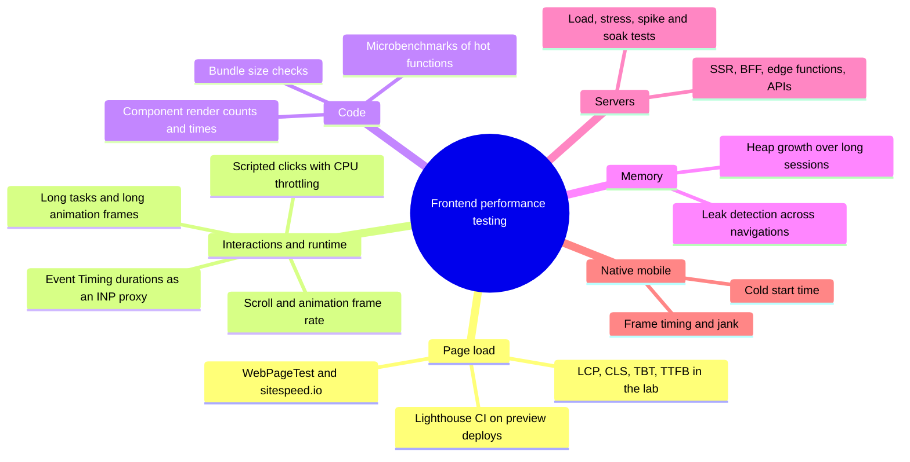
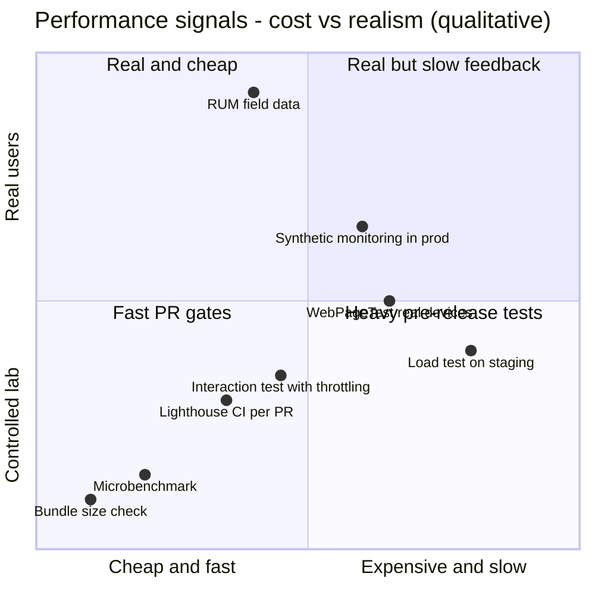
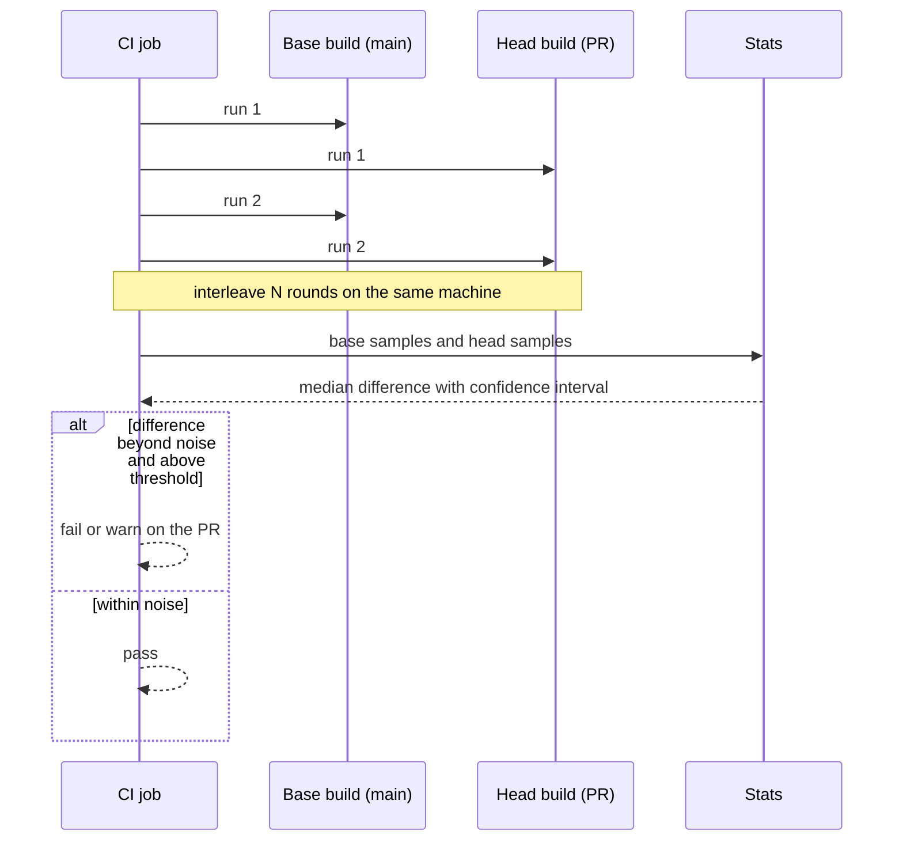
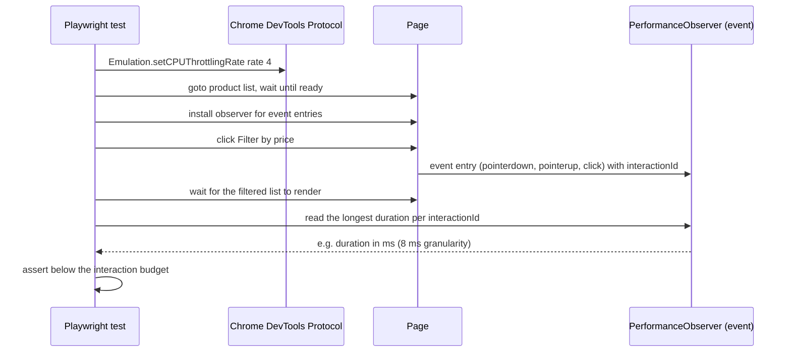
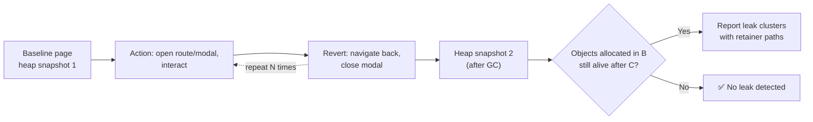
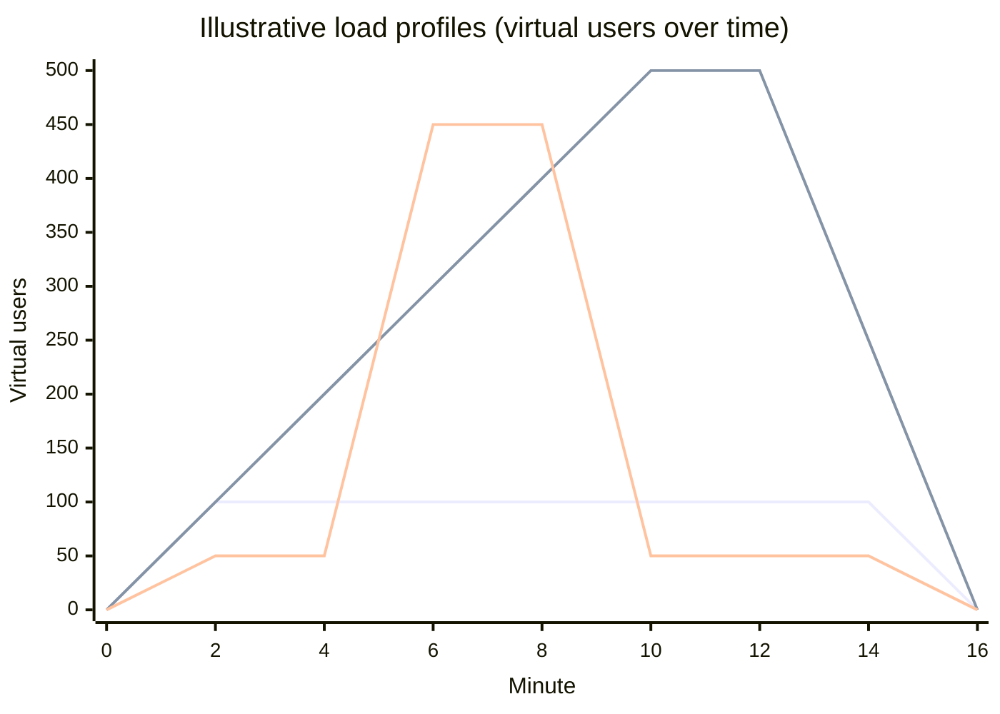
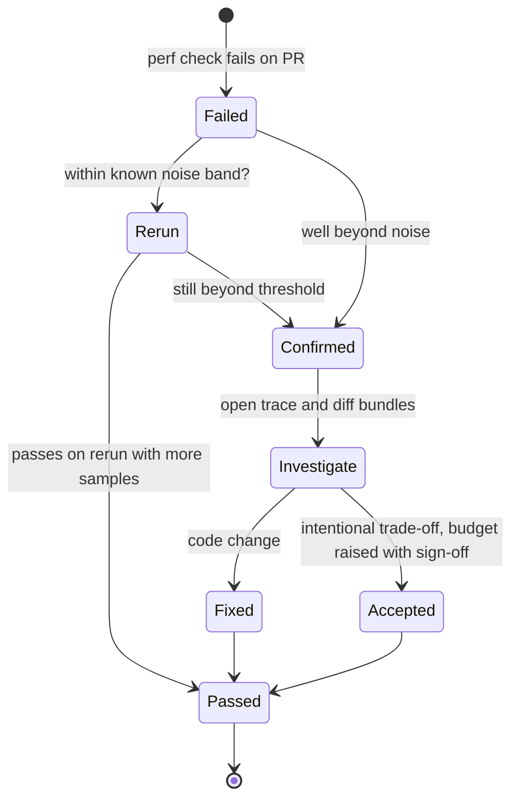
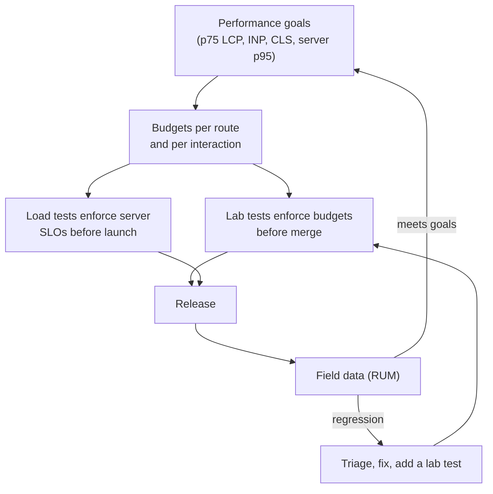

# Performance Testing

> **Date:** 2026-11-06 · **Last updated:** 2026-11-06
> **Category:** Frontend System Design
> **Sub-Topic:** Testing / Performance
> **Level:** Intermediate · **Reading time:** ~28 min
> **Informs:** CI performance regression gates, lab test environment (CPU/network throttling, dedicated runners), statistical base-vs-head comparison, interaction latency tests for INP, load testing SSR/BFF/edge before launches, microbenchmarks for hot code paths, memory-leak tests, mobile startup benchmarks

> **Pre-requisite:** [Core Web Vitals (LCP, INP, CLS)](../04-performance-engineering/core-web-vitals-lcp-inp-cls.md), [Lighthouse & Performance Auditing](../04-performance-engineering/lighthouse-and-performance-auditing.md) and [Performance Budgets](../04-performance-engineering/performance-budgets.md).
> Lighthouse *audits* a page; this note is about building a **test suite** that keeps the whole product fast — pages, interactions, servers, code paths and memory.

**Previous:** [Visual Regression Testing](./visual-regression-testing.md) · **Next:** [Accessibility Testing](./accessibility-testing.md)

---

## Table of Contents

1. [ELI5 — Simple Explanation](#eli5--simple-explanation)
2. [Section 1: What Performance Testing Covers](#section-1-what-performance-testing-covers)
3. [Section 2: Lab, Synthetic and Field](#section-2-lab-synthetic-and-field)
4. [Section 3: Noise and Statistics](#section-3-noise-and-statistics)
5. [Section 4: Page-Load Tests in CI](#section-4-page-load-tests-in-ci)
6. [Section 5: Interaction and Runtime Tests](#section-5-interaction-and-runtime-tests)
7. [Section 6: Microbenchmarks](#section-6-microbenchmarks)
8. [Section 7: Component Render Performance](#section-7-component-render-performance)
9. [Section 8: Memory-Leak Tests](#section-8-memory-leak-tests)
10. [Section 9: Load Testing the Frontend's Servers](#section-9-load-testing-the-frontends-servers)
11. [Section 10: Where Each Test Runs in the Pipeline](#section-10-where-each-test-runs-in-the-pipeline)
12. [Section 11: Frameworks and Native Mobile](#section-11-frameworks-and-native-mobile)
13. [System Design Angle](#system-design-angle)
14. [Real-World Examples](#real-world-examples)
15. [Key Points Summary](#key-points-summary)
16. [Test Your Understanding (with answers)](#test-your-understanding)
17. [Cheat Sheet](#cheat-sheet)
18. [References & Further Reading](#references--further-reading)

---

## ELI5 — Simple Explanation

Think of a **car factory**:

- **Microbenchmark** = testing one engine part on a bench: "does this new piston move faster than the old one?"
- **Lab page test** = putting the finished car on a **treadmill in a controlled room**: same temperature, same fuel, same driver every time. Great for spotting "this car got 10% slower than last week's model".
- **Load test** = sending **a thousand cars onto the same road at once** to see if the bridge (your server) holds up.
- **Soak test** = driving for **24 hours straight** to see if something slowly overheats (memory leaks).
- **Field data (RUM)** = asking **real drivers** how the car feels on real roads, in real weather. That's the truth — but it arrives after the car is sold.

The trick: treadmill numbers are **noisy** — run the test several times, compare the old and new model **side by side**, and only shout when the difference is bigger than the noise.

> **Performance testing turns "it feels slower" into a repeatable, statistically sound check that runs before users notice — across page loads, interactions, servers and memory.**

---

## Core Concept — Step by Step

### Section 1: What Performance Testing Covers



| Test type | Question it answers | Typical tools |
|---|---|---|
| **Page-load (lab)** | Did this change make the page load slower? | Lighthouse CI, WebPageTest, sitespeed.io, Playwright + Performance APIs |
| **Interaction / runtime** | Does clicking "Filter" still respond quickly on a slow phone? | Playwright/Puppeteer + CDP throttling, Lighthouse user flows (timespan), Event Timing API |
| **Microbenchmark** | Is `formatRows()` v2 faster than v1? | Vitest `bench` (tinybench), mitata, Tachometer |
| **Render performance** | Did this component start re-rendering 10× per keystroke? | React `<Profiler>`, Reassure (React Native), render-count assertions |
| **Bundle size** | Did we just ship 200 KB more JS? | size-limit, bundler limits — see [Performance Budgets](../04-performance-engineering/performance-budgets.md) |
| **Memory** | Does opening and closing a modal leak detached DOM? | memlab, DevTools heap snapshots — see [Memory Leaks in Frontend Apps](../04-performance-engineering/memory-leaks-in-frontend-apps.md) |
| **Load / stress** | Can the SSR server or BFF handle launch-day traffic? | k6, Artillery, Gatling, JMeter, Locust, autocannon |
| **Field (RUM)** | What do real users actually experience? | web-vitals library, CrUX, RUM vendors — see [Real User Monitoring (RUM)](../09-monitoring-and-observability/real-user-monitoring-rum.md) |

> Performance testing is not one tool. It's a **portfolio**: cheap, deterministic checks on every PR; heavier and more realistic tests nightly or before releases; field data as the final judge.

---

### Section 2: Lab, Synthetic and Field



*(Placement is qualitative, to show the trade-off — not measured data.)*

| Kind | Environment | Strength | Weakness |
|---|---|---|---|
| **Lab** | Controlled machine, emulated device and network | Repeatable; runs before merge; full traces for debugging | Not real users; emulation ≠ real phones; no real interaction mix |
| **Synthetic** | Scripted runs against staging/production on a schedule | Catches regressions from deploys, CDNs and third parties; consistent baseline | Still a few fixed locations/devices |
| **Field (RUM)** | Real users' browsers | The truth — p75 Core Web Vitals, real devices, real networks | Arrives after release; noisy; needs traffic; hard to attribute to one commit |

**Rule:** use **lab tests to prevent** regressions, **field data to confirm** they didn't happen anyway, and investigate when they disagree. A lab LCP that improves while the field p75 gets worse usually means the lab isn't representative (wrong device class, cache state, or user mix). See [Synthetic Monitoring](../09-monitoring-and-observability/synthetic-monitoring.md) for scheduled production checks.

---

### Section 3: Noise and Statistics

Run the same unchanged page five times and you'll get five different numbers. Sources of variance:

| Source | Mitigation |
|---|---|
| Shared CI runners ("noisy neighbours"), CPU frequency scaling, thermal throttling | Dedicated or consistent runner type; run base and head **on the same machine in the same job** |
| Network jitter to real third parties | Test against a local/preview build; block or stub third parties for code-change tests |
| Cache state (cold vs warm, Service Worker installed or not) | Decide which you're measuring; reset explicitly between runs |
| Browser version upgrades | Pin the browser; treat browser upgrades as their own "change" |
| Background work (GC timing, JIT warm-up) | Warm-up iterations for microbenchmarks; many samples |
| Server variance (cold starts, DB caches) | Warm up; or serve static fixtures |

**Statistical rules of thumb:**
- **Never compare single runs.** Take several samples and compare **medians** (or distributions), not one number against one number.
- **Measure your noise first** with an **A/A test**: compare `main` against itself. The spread you see is the minimum change you can reliably detect with that setup.
- **Compare base vs head side by side**, interleaved (A, B, A, B…) on the same machine, rather than comparing today's head against a stored number from last week.
- **Use relative thresholds where possible** ("head must not be more than X% slower than base") plus **absolute ceilings** from your budgets.
- **For latency distributions, report percentiles** (p50, p75, p95, p99) — never the average, which hides the slow tail.
- **Tools that do statistics for you:** Tachometer auto-samples until it can state a confidence interval for the difference; Vitest `bench` reports mean, margin of error and samples per benchmark.



> **Treat a flaky perf gate like a flaky unit test:** it destroys trust. Start with warnings, measure the noise, then turn the most stable checks into hard failures.

---

### Section 4: Page-Load Tests in CI

Covered in depth in [Lighthouse & Performance Auditing](../04-performance-engineering/lighthouse-and-performance-auditing.md). The essentials for a test suite:

- **Run against a production build** (minified, compressed, same CDN headers as production) — dev servers are not representative.
- **Test key routes**, not just the home page: landing, product/detail, search results, checkout, a logged-in dashboard.
- **Emulate a mid-range mobile device** (Lighthouse's default mobile preset applies CPU and network throttling) and keep the settings fixed.
- **Assert on metrics and on resource sizes**: LCP, CLS, TBT (the lab proxy for responsiveness during load), plus JS/CSS/image bytes.
- **Use several runs and an explicit aggregation** (median) for metric assertions.
- **Keep reports** (LHCI server, artifacts) so you can open the trace for a failure.

**Lab metrics and what they stand for:**

| Lab metric | Field counterpart | Note |
|---|---|---|
| LCP | LCP | Comparable if the lab device/network resemble your users |
| CLS (during load) | CLS | Field CLS includes shifts after load (scroll, interactions), so it's often higher |
| TBT | INP (partially) | TBT measures main-thread blocking **during load** only; INP measures **interactions** across the whole visit |
| TTFB | TTFB | Lab TTFB on a local server says little about production backends |
| — | INP | Needs **interactions**: script them (Section 5) or use Lighthouse **timespan** mode |

**Other tools:**
- **WebPageTest** — real browsers and devices in many locations, filmstrips, scripted multi-step tests, and side-by-side comparisons.
- **sitespeed.io** — open-source suite (browsertime + dashboards) for scheduled or CI runs.
- **Playwright/Puppeteer + Performance APIs** — for custom metrics (`performance.mark`/`measure`, `PerformanceObserver` for LCP, long tasks) inside your existing E2E suite.

---

### Section 5: Interaction and Runtime Tests

Page-load tests miss the most common modern regression: **slow interactions** (INP). A filter that took 80 ms now takes 400 ms because someone added a synchronous sort over 10,000 rows.



What to measure and how:

| Signal | API / tool | Notes |
|---|---|---|
| **Interaction duration** (input → next paint) | Event Timing API (`PerformanceObserver` with `type: 'event'`, `durationThreshold` ≥ 16 ms) | The same data INP is built on. Durations are rounded to 8 ms |
| **Long tasks** | `PerformanceObserver` with `type: 'longtask'` (Chromium) | Tasks over 50 ms |
| **Long animation frames** | Long Animation Frames API (`type: 'long-animation-frame'`, Chromium) | Better attribution than long tasks: which scripts delayed rendering |
| **Frame rate during scroll/animation** | `requestAnimationFrame` sampling, DevTools trace | Check dropped frames in virtualized lists and animations |
| **Custom timings** | `performance.mark()` / `performance.measure()` | E.g. "search results rendered" — framework-agnostic and readable from tests |
| **Full trace** | Playwright `browser.startTracing()` (Chromium), Lighthouse user flows, DevTools Performance panel | For debugging a failing test, not for gating |

**Key techniques:**
- **CPU throttling** via CDP (`Emulation.setCPUThrottlingRate`) — Chromium only. It slows the main thread to make regressions visible on a fast CI machine. It's a multiplier of *that* machine's speed, so absolute numbers aren't comparable across runner types.
- **Assert relative to base** or with generous absolute budgets (e.g. "≤ 200 ms at 4× throttling" — the [INP "good" threshold](../04-performance-engineering/core-web-vitals-lcp-inp-cls.md) is 200 ms at p75 in the field).
- **Lighthouse user flows** (`startFlow` with `navigate`, `startTimespan`/`endTimespan`, `snapshot`) give Lighthouse reports for multi-step journeys, including interaction metrics in timespan mode.
- **Event Timing and Long Animation Frames are not available in every browser** — check MDN compat. Run these tests in Chromium and rely on RUM for cross-browser truth.

---

### Section 6: Microbenchmarks

Use microbenchmarks for **hot code paths** you control: data transforms, parsers, formatters, virtual-list calculations, selectors.

```typescript
// format.bench.ts — run with: npx vitest bench
import { bench, describe } from 'vitest';
import { formatRowsV1, formatRowsV2 } from './format';
import rows from './fixtures/10k-rows.json';

describe('formatRows (10k rows)', () => {
  bench('v1 - map + spread', () => { formatRowsV1(rows); });
  bench('v2 - single loop', () => { formatRowsV2(rows); });
});
```

**Pitfalls:**

| Pitfall | Why it misleads | Fix |
|---|---|---|
| Benchmarking code the JIT can eliminate | Result unused → engine may skip work | Use the result (return/accumulate it) |
| No warm-up | First iterations run in the interpreter/baseline tier | Tools warm up; don't hand-roll `Date.now()` loops |
| Unrealistic inputs | 10 items vs 10,000 in production — different algorithms win | Use production-shaped fixtures |
| Comparing across machines | CI hardware varies | Compare variants **in the same run** |
| Optimising code that isn't hot | Saves microseconds no user feels | Profile first (DevTools), benchmark second |
| Node results applied to browsers | Same engine (V8) as Chrome, but not Safari/Firefox | Browser benchmarks (Tachometer, Vitest browser mode) for browser-specific code |

> A microbenchmark answers "**which implementation is faster in isolation**". It doesn't answer "**will users notice**" — that's what page and interaction tests are for.

---

### Section 7: Component Render Performance

Framework regressions often show up as **too many renders**, not slow single renders.

| Framework | Measuring renders |
|---|---|
| **React** | `<Profiler id onRender>` reports `actualDuration` and `baseDuration` per commit. Disabled in normal production builds — use a profiling build for production-like numbers, or dev builds for render **counts**. React DevTools Profiler for exploration |
| **React Native** | Reassure (Callstack) — runs component scenarios repeatedly and compares render count and duration between branches |
| **Vue** | `app.config.performance = true` (dev mode) adds component init/render/patch marks to the browser Performance timeline; Vue DevTools has a performance tab |
| **Angular** | Angular DevTools Profiler shows change-detection cycles per component; `ng.profiler.timeChangeDetection()` after `enableDebugTools()` (dev) |
| **Svelte** | No virtual-DOM render cycle to count; use the browser Performance panel and custom `performance.mark` calls |

**Render-count tests are stable** because they don't depend on machine speed: "typing 5 characters in Search must not re-render `ProductGrid`" is deterministic, and catches the classic "new object prop every render" regression (see [React Performance (memo, useMemo, useCallback)](../04-performance-engineering/react-performance-memo-usememo-usecallback.md)).

---

### Section 8: Memory-Leak Tests

Leaks hurt long-lived SPAs (dashboards, editors, chat): each navigation or modal leaves detached DOM, listeners or caches behind until the tab slows down or crashes.



- **memlab** (open-source, from Meta) automates this: you write a scenario with `url`, `action` and `back` steps; it drives Chromium via Puppeteer, takes heap snapshots and reports leaked objects with retainer traces.
- **Repeat the action** many times in a soak-style test and check that heap size stabilises rather than growing linearly.
- **`performance.measureUserAgentSpecificMemory()`** can report memory from real pages, but requires cross-origin isolation and is Chromium-only — check MDN before relying on it.
- Typical culprits: un-removed listeners and observers, timers, subscriptions, module-level caches, closures holding large data, third-party widgets. Details in [Memory Leaks in Frontend Apps](../04-performance-engineering/memory-leaks-in-frontend-apps.md).

---

### Section 9: Load Testing the Frontend's Servers

A modern frontend has **servers**: SSR/streaming servers, BFFs, edge functions, image optimizers, API routes. They need load tests before launches and big campaigns.



*(Lines: average-load, stress ramp, spike. Shapes only — not real data.)*

| Test | Shape | Answers |
|---|---|---|
| **Smoke** | A handful of users, briefly | Does the script and system work at all? |
| **Average-load** | Ramp to expected normal traffic, hold | Do we meet latency/error SLOs on a normal day? |
| **Stress** | Ramp above normal | How does it degrade? Which component saturates first? |
| **Spike** | Sudden jump (campaign, push notification) | Do autoscaling, caches and queues cope? |
| **Soak** (endurance) | Normal load for hours | Memory leaks, connection pool exhaustion, log/disk growth |
| **Breakpoint** | Keep increasing until failure | Capacity ceiling for planning |

**Frontend-specific load-testing advice:**
- **Test what's dynamic.** Hashed static assets come from the CDN; load-test SSR routes, API/BFF endpoints, and cache-miss paths. Test both **cache-hit and cache-miss** behaviour of ISR/edge caches.
- **Use realistic traffic mixes** (60% product pages, 20% search, …) from analytics, with realistic think time.
- **Open vs closed models:** a closed model (fixed number of virtual users looping) sends *fewer* requests when the server slows down, which can understate latency under overload (coordinated omission). For "N requests per second" questions, use an **arrival-rate** (open) model — k6's `constant-arrival-rate`/`ramping-arrival-rate` executors.
- **Gate on percentiles and error rate** (`p(95) < 500 ms`, errors `< 1%`), not averages.
- **Browser-level load** is expensive (each virtual user is a real browser). Mix many protocol-level users with a few browser users — k6's `k6/browser` module can collect Web Vitals from the browser users while HTTP users generate load.
- **Never load-test production or third parties without agreement** — and warn your CDN/WAF, or you'll test its DDoS protection instead.

| Tool | Script language | Notes |
|---|---|---|
| **k6** (Grafana) | JavaScript | Thresholds as pass/fail, scenarios/executors, browser module, cloud or local |
| **Artillery** | YAML + JS | Playwright engine for browser-level scenarios |
| **Gatling** | Scala/Java/Kotlin (JS/TS SDK available) | High throughput, detailed reports |
| **JMeter** | GUI/XML | Long-established, plugin ecosystem |
| **Locust** | Python | User behaviour as Python code |
| **autocannon** | CLI / Node | Quick HTTP benchmarking of a Node server |

---

### Section 10: Where Each Test Runs in the Pipeline

```mermaid
flowchart LR
    subgraph PR["Every PR (minutes)"]
        P1["Bundle size limits"]
        P2["Microbenchmarks<br/>(base vs head)"]
        P3["Render-count tests"]
        P4["Lighthouse CI on<br/>preview deploy"]
        P5["Key interaction tests<br/>with CPU throttling"]
    end
    subgraph NIGHT["Nightly / main (hour)"]
        N1["Full route matrix,<br/>WebPageTest / sitespeed.io"]
        N2["memlab leak scenarios"]
        N3["Load test on staging"]
    end
    subgraph REL["Before big launches"]
        R1["Stress, spike, soak"]
        R2["Real-device runs"]
    end
    subgraph PROD["Production (continuous)"]
        F1["Synthetic monitoring"]
        F2["RUM: p75 Web Vitals,<br/>alerts per release"]
    end
    PR --> NIGHT --> REL --> PROD
    PROD -.->|"field regressions become<br/>new lab tests"| PR
```



**Triage loop when a perf test fails:**



> If "rerun until green" becomes the normal fix, the check is too noisy — add samples, move to a dedicated runner, or switch to a relative comparison.

---

### Section 11: Frameworks and Native Mobile

| Stack | Page / interaction tests | Code / render tests |
|---|---|---|
| **React / Next.js** | Lighthouse CI, Playwright + Event Timing; Next.js reports Web Vitals via `useReportWebVitals` | `<Profiler>`, render-count tests, Vitest bench |
| **Vue / Nuxt** | Same browser-level tools | `app.config.performance` marks, Vitest bench |
| **Angular** | Same browser-level tools; Angular CLI `budgets` in `angular.json` for bundle sizes | Angular DevTools profiler, `ng.profiler.timeChangeDetection()` |
| **Svelte / SvelteKit** | Same browser-level tools | Custom marks, Vitest bench |
| **React Native** | Flashlight (Android performance measurements), platform profilers | Reassure for render regressions |
| **Android** | Jetpack **Macrobenchmark** (startup, scrolling, frame timing) | Jetpack **Microbenchmark**; Baseline Profiles to improve startup |
| **iOS** | XCTest `measure(metrics:)` with `XCTApplicationLaunchMetric`, `XCTOSSignpostMetric`; Instruments | XCTest `measure` blocks |
| **Flutter** | `integration_test` with `traceAction` in profile mode; DevTools performance view | Benchmarks in profile mode, not debug |

> **Mobile rule:** measure on **real, mid-range devices** in release/profile builds. Debug builds and simulators distort performance heavily.

---

## System Design Angle

When designing a product, performance testing answers: **"How do we know we stay fast as 30 engineers ship every day?"**

**Decisions to make explicitly:**

| Decision | Options | Guidance |
|---|---|---|
| **What blocks a merge?** | Bundle size, render counts, Lighthouse metrics, interaction budgets | Gate on the **most stable** checks (sizes, render counts); warn on noisier metrics until the noise is measured |
| **Test environment** | Shared CI runners, dedicated runners, hosted services | Dedicated or consistent machines for timing; anything works for sizes |
| **Device profile** | Desktop, emulated mid-range mobile, real devices | Match your **field** device mix (from RUM/analytics) |
| **Which routes and interactions** | All vs key journeys | The pages and interactions that drive business metrics |
| **Baseline** | Fixed numbers vs base-branch comparison | Base-vs-head for regressions + absolute ceilings from budgets |
| **Load test targets** | SSR, BFF, edge, APIs | Expected peak × safety margin, from product forecasts |
| **Feedback loop** | RUM → lab | Every field regression gets a lab test that would have caught it |



**Interview talking points:** distinguish lab from field; explain noise and why you compare medians of base vs head; say which checks block merges and why; mention load testing SSR/BFF separately from page speed; close the loop with RUM.

---

## Real-World Examples

**Example 1 — Interaction latency test with Playwright (Chromium):**
```typescript
import { test, expect } from '@playwright/test';

test('price filter responds quickly on a throttled CPU', async ({ page, browserName }) => {
  test.skip(browserName !== 'chromium', 'CDP throttling and Event Timing are Chromium-based here');

  const cdp = await page.context().newCDPSession(page);
  await cdp.send('Emulation.setCPUThrottlingRate', { rate: 4 });

  await page.goto('/products');
  await expect(page.getByRole('list', { name: 'Products' })).toBeVisible();

  // Collect Event Timing entries (the data INP is built on)
  await page.evaluate(() => {
    (window as any).__events = [];
    new PerformanceObserver((list) => {
      for (const e of list.getEntries() as PerformanceEventTiming[]) {
        if (e.interactionId) (window as any).__events.push({ id: e.interactionId, d: e.duration });
      }
    }).observe({ type: 'event', durationThreshold: 16, buffered: true });
  });

  await page.getByRole('button', { name: 'Under $50' }).click();
  await expect(page.getByText(/results/)).toBeVisible();
  await page.waitForTimeout(100); // let the observer deliver entries (observer callbacks are async)

  const worst = await page.evaluate(() =>
    Math.max(0, ...(window as any).__events.map((e: { d: number }) => e.d)),
  );
  expect(worst).toBeLessThanOrEqual(200);
});
```

> If no entry is recorded, the interaction took under 16 ms — `Math.max(0, …)` treats that as a pass. Use **relative** budgets (vs `main`) if your runners vary.

**Example 2 — Lighthouse user flow (navigation + interaction timespan):**
```javascript
// flow.mjs — node flow.mjs
import fs from 'node:fs';
import puppeteer from 'puppeteer';
import { startFlow } from 'lighthouse';

const browser = await puppeteer.launch();
const page = await browser.newPage();
const flow = await startFlow(page, { name: 'Search and filter' });

await flow.navigate('https://preview.example.com/search?q=shoes');

await flow.startTimespan({ name: 'Apply filter' });
await page.click('button[data-filter="size-42"]');
await page.waitForSelector('[data-testid="results-updated"]');
await flow.endTimespan();

fs.writeFileSync('flow-report.html', await flow.generateReport());
await browser.close();
```

**Example 3 — k6 load test for SSR pages with thresholds (open model):**
```javascript
// load.js — k6 run load.js
import http from 'k6/http';
import { check } from 'k6';

export const options = {
  scenarios: {
    product_pages: {
      executor: 'ramping-arrival-rate',   // open model: requests per second, not looping users
      startRate: 10,
      timeUnit: '1s',
      preAllocatedVUs: 50,
      maxVUs: 500,
      stages: [
        { duration: '2m', target: 100 },  // ramp to 100 req/s
        { duration: '10m', target: 100 }, // hold
        { duration: '1m', target: 0 },
      ],
    },
  },
  thresholds: {
    http_req_duration: ['p(95)<500', 'p(99)<1200'], // ms
    http_req_failed: ['rate<0.01'],
  },
};

const ids = JSON.parse(open('./product-ids.json')); // realistic spread, includes cache misses

export default function () {
  const id = ids[Math.floor(Math.random() * ids.length)];
  const res = http.get(`https://staging.example.com/products/${id}`, { tags: { route: 'product' } });
  check(res, {
    'status is 200': (r) => r.status === 200,
    'is SSR HTML': (r) => r.body.includes('<main'),
  });
}
```

**Example 4 — k6 browser users collecting Web Vitals alongside load:**
```javascript
import { browser } from 'k6/browser';

export const options = {
  scenarios: {
    ui: {
      executor: 'constant-vus',
      vus: 2,
      duration: '10m',
      options: { browser: { type: 'chromium' } },
    },
  },
  thresholds: {
    browser_web_vital_lcp: ['p(75)<2500'],
    browser_web_vital_cls: ['p(75)<0.1'],
  },
};

export default async function () {
  const page = await browser.newPage();
  try {
    await page.goto('https://staging.example.com/products/42');
    await page.locator('button[name="add-to-cart"]').click();
  } finally {
    await page.close();
  }
}
```

**Example 5 — memlab leak scenario:**
```javascript
// settings-leak.js — npx memlab run --scenario settings-leak.js
module.exports = {
  url: () => 'http://localhost:4173/',
  // action: allocate the thing we suspect leaks
  action: async (page) => {
    await page.click('a[href="/settings"]');
    await page.waitForSelector('[data-testid="settings-form"]');
  },
  // back: return to the original state; anything from `action` still alive is suspicious
  back: async (page) => {
    await page.click('a[href="/"]');
    await page.waitForSelector('[data-testid="home"]');
  },
};
```

**Example 6 — Render-count regression test (React, BAD → GOOD):**
```tsx
import { memo, useState } from 'react';
import { render, screen } from '@testing-library/react';
import userEvent from '@testing-library/user-event';
import { test, expect } from 'vitest';

let gridRenders = 0;
const ProductGrid = memo(function ProductGrid({ items }: { items: string[] }) {
  gridRenders++; // render counter: deterministic, independent of machine speed
  return <ul>{items.map((i) => <li key={i}>{i}</li>)}</ul>;
});
const ITEMS = ['Shoe', 'Sock', 'Hat'];

// ❌ BAD: a new array on every render defeats memo — the grid re-renders on every keystroke
function SearchPageBad() {
  const [q, setQ] = useState('');
  return (
    <>
      <input aria-label="Search" value={q} onChange={(e) => setQ(e.target.value)} />
      <ProductGrid items={ITEMS.filter(Boolean)} />
    </>
  );
}

// ✅ GOOD: stable props — the grid only re-renders when its data changes
function SearchPage() {
  const [q, setQ] = useState('');
  return (
    <>
      <input aria-label="Search" value={q} onChange={(e) => setQ(e.target.value)} />
      <ProductGrid items={ITEMS} />
    </>
  );
}

test('typing in search does not re-render the grid', async () => {
  render(<SearchPage />);           // swap in <SearchPageBad /> and this test fails
  const before = gridRenders;
  await userEvent.type(screen.getByRole('textbox', { name: 'Search' }), 'shoes');
  expect(gridRenders - before).toBe(0);
});
```

> Use `<Profiler onRender>` when you need **durations** (`actualDuration`, `baseDuration`); use a plain counter like this for **render counts**. Avoid `<StrictMode>` in render-count tests — in development it intentionally double-invokes renders. With the React Compiler enabled, many of these memoization regressions are prevented automatically, but the test still documents the expectation.

**Example 7 — Mobile startup benchmark (Android Macrobenchmark):**
```kotlin
@RunWith(AndroidJUnit4::class)
class StartupBenchmark {
    @get:Rule val rule = MacrobenchmarkRule()

    @Test
    fun coldStartup() = rule.measureRepeated(
        packageName = "com.example.shop",
        metrics = listOf(StartupTimingMetric()),
        iterations = 10,
        startupMode = StartupMode.COLD,
    ) {
        pressHome()
        startActivityAndWait()
    }
}
```

---

## Key Points Summary

| Concept | One-Line Explanation |
|---|---|
| **Portfolio of tests** | Sizes, benchmarks, lab pages, interactions, memory, load — each answers a different question |
| **Lab vs field** | Lab prevents regressions before merge; field (RUM) is the truth after release |
| **Noise** | Same code, different numbers — measure it with A/A runs before setting thresholds |
| **Base vs head** | Compare medians of interleaved runs on the same machine |
| **Percentiles** | Report p50/p75/p95/p99, never averages |
| **TBT vs INP** | TBT is load-time blocking in the lab; INP needs real or scripted interactions |
| **Interaction tests** | CPU throttling + Event Timing entries in Chromium |
| **Microbenchmarks** | Compare implementations of hot code in isolation, with realistic inputs |
| **Render counts** | Deterministic, machine-independent check for unnecessary re-renders |
| **Memory tests** | Action → revert → check what survived (memlab) |
| **Load tests** | Smoke, average, stress, spike, soak, breakpoint — on SSR/BFF/edge, not the CDN |
| **Open model** | Arrival-rate load avoids understating latency under overload |
| **Mobile** | Real mid-range devices, release/profile builds, Macrobenchmark / XCTest metrics |

---

## Test Your Understanding

**Q1 (Basic):**
Your Lighthouse CI check shows LCP of 2.1 s on one run and 2.6 s on the next, for the same commit. A teammate wants to set the gate at "LCP ≤ 2.3 s". What's wrong with that plan?

<details>
<summary>Answer</summary>

The measurement noise (≈0.5 s here) is larger than the margin between typical values and the threshold, so the gate would pass or fail **randomly** — a flaky test that teaches people to click "rerun".

Fix: run several times per URL and assert on the **median** (or another explicit aggregation); measure noise with an A/A comparison first; use a dedicated or consistent runner; and either set the threshold outside the noise band or compare base vs head on the same machine. Bundle-size checks are deterministic and can be hard gates sooner.
</details>

**Q2 (Application):**
Field INP p75 for the product list page regressed from 150 ms to 320 ms after a release, but Lighthouse CI's Performance score didn't change. Why didn't CI catch it, and what test would?

<details>
<summary>Answer</summary>

Lighthouse in **navigation mode** measures the page **load**. Its responsiveness proxy, TBT, only covers main-thread blocking during load. INP measures **interactions** across the whole visit — e.g. clicking a filter after the page loaded. A slow event handler added in the release doesn't affect load metrics at all.

A test that would catch it: a **scripted interaction test** (Playwright/Puppeteer) that loads the page, applies CPU throttling, performs the key interactions (filter, sort, add to cart), and reads **Event Timing** durations per interaction — asserting against a budget or against `main`. Lighthouse **user flows** in timespan mode are another option. Then keep RUM as the confirmation.
</details>

**Q3 (Tricky):**
A k6 load test with 200 looping virtual users shows p95 latency of 400 ms. In production, at what you believed was a similar load, users saw multi-second responses. What's a likely flaw in the test design?

<details>
<summary>Answer</summary>

A **closed model**: each virtual user waits for its response before sending the next request. When the server slows down, the virtual users automatically send **fewer** requests, so the server never experiences the overload that real traffic (which keeps arriving regardless) causes. Slow periods are under-sampled — the **coordinated omission** problem — and latency looks better than reality.

Fix: use an **open model** (arrival-rate executor: "N requests/second") sized from real peak traffic. Also check the traffic mix (were cache misses included?), think time, and whether the test hit a CDN cache instead of the SSR origin.
</details>

**Q4 (Tricky):**
A microbenchmark shows `parseV2()` is 3× faster than `parseV1()`. After shipping, nothing improves in the field. Give three possible reasons.

<details>
<summary>Answer</summary>

1. **The code isn't on the critical path.** If parsing takes 2 ms of a 400 ms interaction, a 3× speedup saves ~1 ms nobody notices. Profile before optimising.
2. **Unrealistic inputs.** The benchmark used a small or uniform fixture; production data is larger or shaped differently, and a different algorithm wins there.
3. **Engine/environment mismatch.** The benchmark ran in Node (V8) on a fast CI CPU; users run Safari or low-end Android where JIT behaviour and costs differ.

Others: dead-code elimination made the benchmark measure nothing, or warm-up effects dominated. Microbenchmarks compare implementations in isolation — they don't prove user-visible impact.
</details>

**Q5 (System design):**
You're the frontend lead for an e-commerce site with SSR (Next.js), a BFF, and a big sale coming in 6 weeks. Design the performance testing plan.

<details>
<summary>Answer</summary>

- **Goals first:** from RUM, current p75 LCP/INP/CLS per key route; server SLOs (e.g. SSR p95 and error rate); expected peak traffic from marketing forecasts × safety margin.
- **Every PR:** bundle-size limits per route (hard gate); render-count tests for the product grid and cart; Lighthouse CI on preview deploys for home, PLP, PDP, cart, checkout (median of several runs, warn → gate once noise is known); interaction tests for filter, add-to-cart, checkout steps with CPU throttling.
- **Nightly on staging:** average-load test (open model) with a realistic route mix including **cache misses**; memlab scenario for the cart drawer and PDP gallery.
- **Before the sale:** stress and spike tests (the sale start is a spike) on SSR, BFF, image optimizer and search; a soak test for leaks and connection pools; verify CDN/edge caching and stale-while-revalidate behaviour under load; coordinate with the CDN/WAF provider.
- **During/after:** synthetic monitoring on key journeys; RUM dashboards by route and release with alerts.
- **Trade-offs to discuss:** cost of browser-level load (keep it to a few VUs), runner noise, testing against production vs staging fidelity.
</details>

**Q6 (Application):**
Which of these should block a merge on day one, and which should start as warnings: (a) a 10% increase in route JS size, (b) Lighthouse LCP 5% worse than `main`, (c) the product grid re-rendering on every keystroke, (d) p95 SSR latency in a nightly load test?

<details>
<summary>Answer</summary>

- **(a) Block.** Byte sizes are deterministic — the same input always produces the same size, so the gate isn't flaky.
- **(c) Block.** Render counts don't depend on machine speed; the test is deterministic and the regression is clear.
- **(b) Warn first.** A 5% LCP change is likely within lab noise on shared runners. Measure noise (A/A), add runs and medians, then gate on differences beyond the noise.
- **(d) Not a PR gate.** It runs nightly on staging, so it can't block a specific PR. Alert the owning team and open an issue automatically, and use it as a release gate before big launches.
</details>

---

## Cheat Sheet

**Key Definitions:**
- **Lab test:** Controlled, repeatable measurement on a fixed device/network profile
- **Synthetic monitoring:** Scheduled scripted tests against staging/production
- **RUM (field):** Measurements from real users' browsers
- **A/A test:** Comparing a build against itself to measure noise
- **Microbenchmark:** Repeated timing of a small piece of code in isolation
- **Load / stress / spike / soak test:** Server tests at normal, above-normal, sudden and sustained traffic
- **Open vs closed model:** Requests arrive at a set rate vs a fixed pool of looping users
- **Coordinated omission:** Under-sampling slow periods because the load generator waits for responses
- **Event Timing API:** Per-interaction durations — the raw data behind INP

**Quick Reference:**
```text
Every PR      sizes (gate) · render counts (gate) · microbench base vs head
              Lighthouse CI on preview: several runs, median, key routes
              interaction tests: CDP CPU throttling + Event Timing (Chromium)
Nightly       full routes (WebPageTest/sitespeed.io) · memlab · staging load test
Pre-launch    stress · spike · soak · real devices
Production    synthetic monitoring · RUM p75 by route and release

Stats         A/A first · interleave base/head · medians · percentiles, not averages
Lab ↔ field   LCP≈LCP · CLS(load) ≤ CLS(field) · TBT ≠ INP · INP needs interactions
Load (k6)     arrival-rate executors · thresholds p(95), http_req_failed · realistic mix
              test cache misses · never load-test prod/third parties without agreement
Mobile        real mid-range devices · release/profile builds · Macrobenchmark / XCTest metrics
```

**Common Mistakes to Avoid:**

| Mistake | Why Wrong | Fix |
|---|---|---|
| Comparing single runs | Noise dominates | Several runs, medians, base vs head |
| Gating on noisy metrics from day one | Flaky gates get ignored | Warn → measure noise → gate |
| Testing a dev build | Dev mode is much slower and differently shaped | Production build, production headers |
| Only testing page load | Misses slow interactions (INP) | Scripted interaction tests |
| Reporting average latency | Hides the slow tail | p50/p95/p99 |
| Closed-model load tests for throughput questions | Understates latency under overload | Arrival-rate (open) model |
| Load-testing the CDN-cached path only | Origin never stressed | Include cache misses and dynamic routes |
| Microbenchmarks with toy inputs | Wrong winner | Production-shaped fixtures, profile first |
| Ignoring memory in long-lived SPAs | Slow degradation, crashes | memlab scenarios, soak tests |
| Mobile perf tests on simulators/debug builds | Distorted numbers | Real devices, release/profile builds |
| No link from field regressions back to tests | Same regression returns | Add a lab test for every field regression |

---

## References & Further Reading

**Core docs**
- web.dev: [Lab and field data](https://web.dev/articles/lab-and-field-data-differences)
- web.dev: [Interaction to Next Paint (INP)](https://web.dev/articles/inp) · [Optimize long tasks](https://web.dev/articles/optimize-long-tasks)
- MDN: [`PerformanceEventTiming`](https://developer.mozilla.org/en-US/docs/Web/API/PerformanceEventTiming) · [`PerformanceObserver`](https://developer.mozilla.org/en-US/docs/Web/API/PerformanceObserver) · [`Performance.mark()`](https://developer.mozilla.org/en-US/docs/Web/API/Performance/mark)
- Chrome for Developers: [Long Animation Frames API](https://developer.chrome.com/docs/web-platform/long-animation-frames)
- Chrome DevTools Protocol: [`Emulation.setCPUThrottlingRate`](https://chromedevtools.github.io/devtools-protocol/tot/Emulation/#method-setCPUThrottlingRate)

**Page and flow testing**
- Lighthouse: [User flows](https://github.com/GoogleChrome/lighthouse/blob/main/docs/user-flows.md) · [Lighthouse CI](https://github.com/GoogleChrome/lighthouse-ci)
- [WebPageTest documentation (Catchpoint)](https://docs.catchpoint.com/wpt/docs/webpageteststarter) · [sitespeed.io documentation](https://www.sitespeed.io/documentation/)
- Playwright: [`CDPSession`](https://playwright.dev/docs/api/class-cdpsession)

**Benchmarks, render and memory**
- Vitest: [`bench`](https://vitest.dev/api/#bench) · [Tachometer (GitHub)](https://github.com/google/tachometer)
- React: [`<Profiler>`](https://react.dev/reference/react/Profiler) · Vue: [`app.config.performance`](https://vuejs.org/api/application.html#app-config-performance) · Angular: [DevTools](https://angular.dev/tools/devtools)
- [memlab](https://facebook.github.io/memlab/) · [Reassure (Callstack)](https://callstack.github.io/reassure/)

**Load testing**
- Grafana k6: [Load test types](https://grafana.com/docs/k6/latest/testing-guides/test-types/) · [Open and closed models](https://grafana.com/docs/k6/latest/using-k6/scenarios/concepts/open-vs-closed/) · [Browser module](https://grafana.com/docs/k6/latest/using-k6-browser/) · [Thresholds](https://grafana.com/docs/k6/latest/using-k6/thresholds/)
- [Artillery docs](https://www.artillery.io/docs) · [autocannon (GitHub)](https://github.com/mcollina/autocannon)

**Native mobile**
- Android Developers: [Macrobenchmark overview](https://developer.android.com/topic/performance/benchmarking/macrobenchmark-overview)
- Apple: [XCTest performance tests (`measure(metrics:)`)](https://developer.apple.com/documentation/xctest/performance-tests)
- Flutter: [Performance profiling with integration tests](https://docs.flutter.dev/cookbook/testing/integration/profiling)

**Related notes**
- [Lighthouse & Performance Auditing](../04-performance-engineering/lighthouse-and-performance-auditing.md) · [Performance Budgets](../04-performance-engineering/performance-budgets.md) · [Real User Monitoring (RUM)](../09-monitoring-and-observability/real-user-monitoring-rum.md) · [Synthetic Monitoring](../09-monitoring-and-observability/synthetic-monitoring.md)

---

> **Previous Topic:** [Visual Regression Testing](./visual-regression-testing.md)
> — Catching unintended visual changes with screenshot baselines

> **Next Topic:** [Accessibility Testing](./accessibility-testing.md)
> — Automated, manual and assistive-technology testing for inclusive UIs

*Saved on: 2026-11-06 | Repo: Frontend System Design Learning Notes*
