# React Testing Library Patterns

> **Date:** 2026-11-06 · **Last updated:** 2026-11-06
> **Category:** Frontend System Design
> **Sub-Topic:** Testing / Component Testing
> **Level:** Intermediate · **Reading time:** ~30 min
> **Informs:** component test strategy, query and selector conventions (role-first vs test IDs), accessible markup as a testability requirement, async UI testing, network mocking boundary (MSW), test-utils and provider setup, hook testing, Enzyme and react-test-renderer migration, cross-framework component testing (Vue, Angular, Svelte, React Native)

> **Pre-requisite:** [Unit Testing Components (Jest, Vitest)](./unit-testing-components-jest-vitest.md) (test runners, jsdom, mocks) and [ARIA Roles, States & Properties](../06-accessibility-and-i18n/aria-roles-states-and-properties.md) (roles and accessible names — the vocabulary RTL queries with).
> This note covers **how to write component tests that resemble how people use the UI**: picking queries, simulating interactions, handling async updates, wiring providers and network mocks, and the anti-patterns that make tests brittle. APIs below are from the current Testing Library packages; check the [official docs](https://testing-library.com/docs/) for your version.

**Previous:** [Unit Testing Components (Jest, Vitest)](./unit-testing-components-jest-vitest.md) · **Next:** [Integration Testing](./integration-testing.md)

---

## Table of Contents

1. [ELI5 — Simple Explanation](#eli5--simple-explanation)
2. [Section 1: The Guiding Principle](#section-1-the-guiding-principle)
3. [Section 2: The Toolkit and Setup](#section-2-the-toolkit-and-setup)
4. [Section 3: Query Priority](#section-3-query-priority)
5. [Section 4: Query Variants — get, query, find](#section-4-query-variants--get-query-find)
6. [Section 5: Simulating Users — user-event vs fireEvent](#section-5-simulating-users--user-event-vs-fireevent)
7. [Section 6: Async UI — findBy, waitFor and act](#section-6-async-ui--findby-waitfor-and-act)
8. [Section 7: Custom Render with Providers](#section-7-custom-render-with-providers)
9. [Section 8: Mocking the Network with MSW](#section-8-mocking-the-network-with-msw)
10. [Section 9: Testing Hooks, Portals, Router and Errors](#section-9-testing-hooks-portals-router-and-errors)
11. [Section 10: Debugging Failing Queries](#section-10-debugging-failing-queries)
12. [Section 11: Legacy Tools and Their Status](#section-11-legacy-tools-and-their-status)
13. [Framework Comparison](#framework-comparison)
14. [Real-World Examples](#real-world-examples)
15. [Key Points Summary](#key-points-summary)
16. [Test Your Understanding](#test-your-understanding)
17. [Cheat Sheet](#cheat-sheet)
18. [References & Further Reading](#references--further-reading)

---

## ELI5 — Simple Explanation

Imagine you hire a **mystery shopper** to check a new shop.

- A bad inspector walks into the **back office** and checks that the cashier's drawer has exactly three compartments and that the manager's spreadsheet uses column C. Rearrange the office and the report fails, even though shoppers are perfectly happy.
- A good mystery shopper does what a **customer** does: reads the signs, finds the "Checkout" counter, asks for the "Large" size, pays, and checks they got a receipt. Rearrange the office and the report still passes. Remove the "Checkout" sign and the report fails, because real customers would be lost too.

React Testing Library (RTL) turns your test into that mystery shopper. It doesn't let you peek at component state or internal methods. It finds things the way a person (or a screen reader) does: by **role**, **label** and **text**, then clicks and types like a user.

> **Test what the user sees and does, not how the component is built. If a refactor keeps the UI the same, the tests should keep passing.**

---

## Core Concept — Step by Step

### Section 1: The Guiding Principle

Testing Library's founding rule, from its docs: *"The more your tests resemble the way your software is used, the more confidence they can give you."*

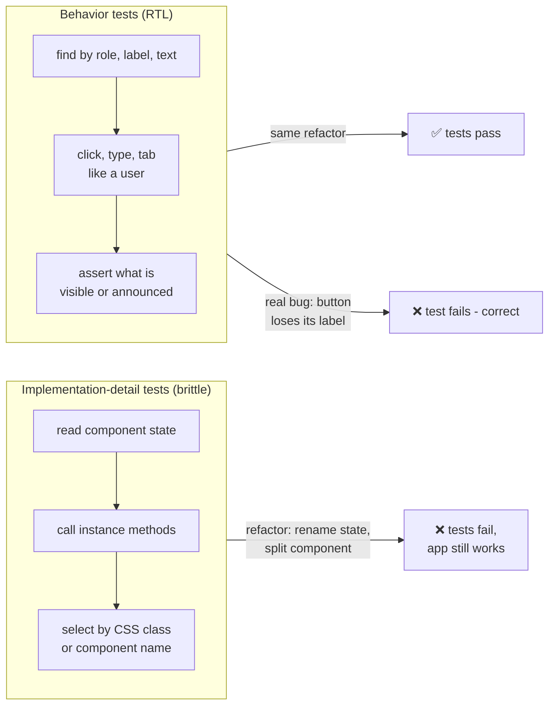

Two kinds of failure matter:

| Failure type | Meaning | Who suffers |
|---|---|---|
| **False negative** | Test fails but the app works (refactor broke a test) | Developers lose trust and start deleting or skipping tests |
| **False positive** | Test passes but the app is broken (test checked internals, not output) | Users ship with bugs |

RTL is designed to reduce both. Your component's **users** are (1) the people using the UI and (2) the developers rendering it with props. A test should only touch what those two can touch: the DOM output and the props.

**A side effect that matters for design:** because the best queries use the **accessibility tree**, writing RTL tests nudges you towards accessible markup. A `<div onClick>` "button" can't be found with `getByRole('button')`. The test pushes you to use a real `<button>`.

---

### Section 2: The Toolkit and Setup

"React Testing Library" is several packages that work together:

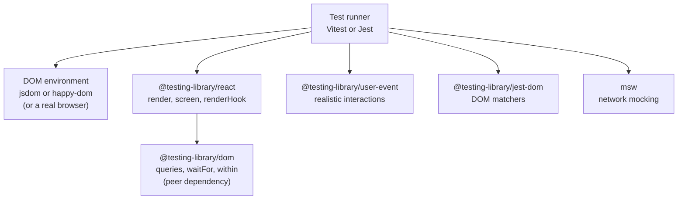

| Package | Role |
|---|---|
| `@testing-library/dom` | The framework-agnostic core: queries (`getByRole`…), `waitFor`, `within`, `fireEvent`. In current RTL versions it's a **peer dependency** you install yourself |
| `@testing-library/react` | `render`, `screen`, `rerender`, `unmount`, `renderHook`, and `act` integration for React |
| `@testing-library/user-event` | Simulates full user interactions (pointer, keyboard, clipboard, upload) |
| `@testing-library/jest-dom` | Matchers such as `toBeInTheDocument`, `toBeDisabled`, `toHaveAccessibleName`. Works with Jest and Vitest |
| `msw` (Mock Service Worker) | Intercepts `fetch`/XHR at the network level so components use their real data code |

**Setup with Vitest:**

```bash
npm i -D vitest jsdom @testing-library/react @testing-library/dom @testing-library/user-event @testing-library/jest-dom msw
```

```typescript
// vitest.config.ts
import { defineConfig } from 'vitest/config';
import react from '@vitejs/plugin-react';

export default defineConfig({
  plugins: [react()],
  test: {
    environment: 'jsdom',
    globals: true, // lets RTL register its automatic cleanup in a global afterEach
    setupFiles: ['./src/test/setup.ts'],
  },
});
```

```typescript
// src/test/setup.ts
import '@testing-library/jest-dom/vitest';
```

> **Cleanup gotcha:** RTL unmounts rendered trees after each test **automatically**, but only when the runner exposes a global `afterEach`. Jest does by default; Vitest does only with `globals: true`. Without it, add `afterEach(cleanup)` yourself, or rendered trees leak between tests.

**jsdom vs happy-dom vs real browser:** jsdom and happy-dom are JavaScript implementations of the DOM. They don't do layout (`getBoundingClientRect()` returns zeros), don't paint, and differ in edge cases. For layout-dependent behaviour, run component tests in a real browser (Vitest Browser Mode, Playwright or Cypress component testing) or cover it in [E2E tests](./e2e-testing-playwright-cypress.md).

---

### Section 3: Query Priority

Testing Library publishes a **priority order** for queries. Use the highest one that works.

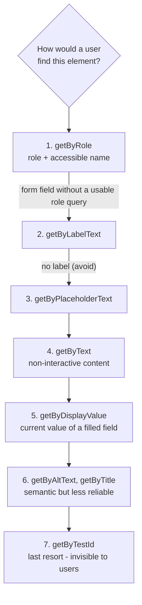

| Priority | Query | Finds | Typical use |
|---|---|---|---|
| 1 | `getByRole('button', { name: /save/i })` | Elements in the **accessibility tree** by role and accessible name | Buttons, links, headings, textboxes, checkboxes, dialogs, tabs, rows |
| 2 | `getByLabelText('Email')` | Form controls by their `<label>` / `aria-labelledby` / `aria-label` | Inputs (also covered by `getByRole('textbox', { name })`) |
| 3 | `getByPlaceholderText('Search…')` | Placeholder text | Only when there's no label (a placeholder is not a label) |
| 4 | `getByText('No results')` | Text content | Paragraphs, messages, empty states |
| 5 | `getByDisplayValue('Alice')` | The current value of inputs/selects | Pre-filled edit forms |
| 6 | `getByAltText('Logo')`, `getByTitle('Close')` | `alt` / `title` attributes | Images, SVG titles |
| 7 | `getByTestId('chart-canvas')` | `data-testid` | Canvas, charts, things with no role or text |

**`getByRole` options worth knowing:**

```typescript
screen.getByRole('heading', { level: 2, name: 'Billing' });
screen.getByRole('checkbox', { name: 'Remember me', checked: true });
screen.getByRole('tab', { selected: true });
screen.getByRole('button', { name: 'Menu', expanded: false });
screen.getByRole('button', { pressed: true });          // toggle buttons (aria-pressed)
screen.getByRole('dialog', { name: 'Delete project?' });
screen.getByRole('button', { hidden: true });           // include elements hidden from the a11y tree
```

**Accessible name** is computed the way assistive tech computes it: from `<label>`, `aria-labelledby`, `aria-label`, text content, `alt`, and so on. If `getByRole('button', { name: 'Close' })` fails for an icon button, a screen reader user can't identify it either. **Fix the markup, not the test.**

> **Performance note:** `*ByRole` computes accessibility information and can be noticeably slower than other queries on very large DOM trees. Keep it as the default. If a specific test is slow, narrow the search with `within(container)` before reaching for `getByTestId`.

**Scoping with `within`:** when the same text appears in several places, scope the query to a region instead of falling back to test IDs:

```typescript
import { screen, within } from '@testing-library/react';

const row = screen.getByRole('row', { name: /invoice 1042/i });
await user.click(within(row).getByRole('button', { name: 'Delete' }));

const nav = screen.getByRole('navigation', { name: 'Main' });
expect(within(nav).getByRole('link', { name: 'Settings' })).toHaveAttribute('aria-current', 'page');
```

---

### Section 4: Query Variants — get, query, find

Every query (`ByRole`, `ByText`, …) comes in six variants:

| Variant | 0 matches | 1 match | >1 matches | Async? | Use for |
|---|---|---|---|---|---|
| `getBy…` | **throws** | returns element | **throws** | No | Element that should be there **now** |
| `queryBy…` | returns `null` | returns element | **throws** | No | Asserting something is **absent** |
| `findBy…` | **rejects** after timeout | resolves element | **rejects** | Yes (Promise) | Element that will **appear** later |
| `getAllBy…` | throws | `[el]` | array | No | Lists that must be non-empty |
| `queryAllBy…` | `[]` | `[el]` | array | No | Counting, possibly zero |
| `findAllBy…` | rejects | resolves `[el]` | resolves array | Yes | Lists that load asynchronously |

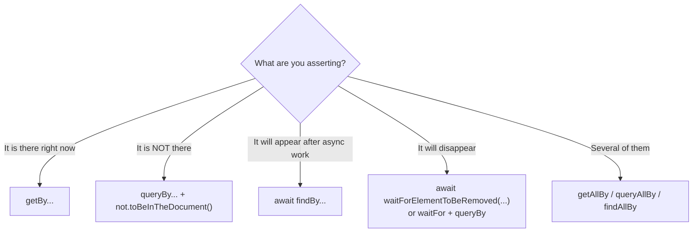

**Why the errors matter:** `getBy` throwing is a *feature*. The error message prints the current DOM and, for `ByRole`, the list of available roles and names, so a failing test explains itself.

```typescript
// ❌ getBy throws before the assertion runs — the "not" never gets a chance
expect(screen.getByText('Error')).not.toBeInTheDocument();

// ✅ queryBy returns null, and the assertion reads clearly
expect(screen.queryByText('Error')).not.toBeInTheDocument();

// ✅ getBy already asserts presence; toBeInTheDocument just makes intent explicit
expect(screen.getByRole('alert')).toBeInTheDocument();
```

---

### Section 5: Simulating Users — user-event vs fireEvent

`fireEvent` dispatches **one** DOM event. A real click is a sequence: `pointerdown → mousedown → focus → pointerup → mouseup → click`. Typing a character is `keydown → keypress → beforeinput → input → keyup`, and it respects selection, `maxLength` and disabled state.

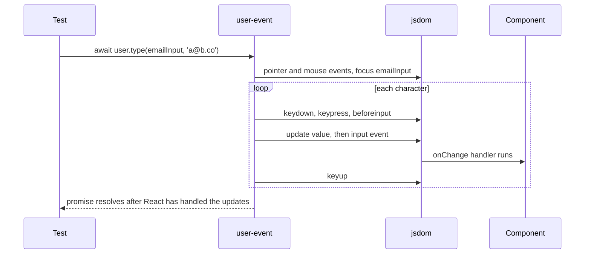

| | `fireEvent` (from `@testing-library/dom`) | `user-event` |
|---|---|---|
| What it does | Dispatches a single event | Simulates the full interaction a browser would produce |
| Focus handling | None | Moves focus like a browser |
| Respects `disabled`, `pointer-events: none` | No — fires anyway | Yes — won't click disabled controls; throws on `pointer-events: none` |
| API style | Sync | **Async** — always `await` |
| When to use | Events user-event doesn't model (e.g. `scroll`, custom events, media events) | **Default for all interactions** |

**Current user-event API** — create a session with `setup()`, ideally before rendering:

```typescript
import userEvent from '@testing-library/user-event';

const user = userEvent.setup();
render(<SignupForm />);

await user.type(screen.getByLabelText('Email'), 'ada@example.com');
await user.click(screen.getByRole('checkbox', { name: /accept terms/i }));
await user.selectOptions(screen.getByRole('combobox', { name: 'Plan' }), 'pro');
await user.upload(screen.getByLabelText('Avatar'), new File(['x'], 'me.png', { type: 'image/png' }));
await user.keyboard('{Enter}');
await user.tab();                 // keyboard navigation — test focus order
await user.hover(screen.getByRole('button', { name: 'Help' }));
await user.clear(screen.getByLabelText('Email'));
```

> **With fake timers**, tell user-event how to advance them, or its internal delays will hang: `userEvent.setup({ advanceTimers: vi.advanceTimersByTime })` (Jest: `jest.advanceTimersByTime`).

---

### Section 6: Async UI — findBy, waitFor and act

Most real components update **after** something async: a fetch, a debounce, a transition, a lazy chunk. RTL gives three tools.

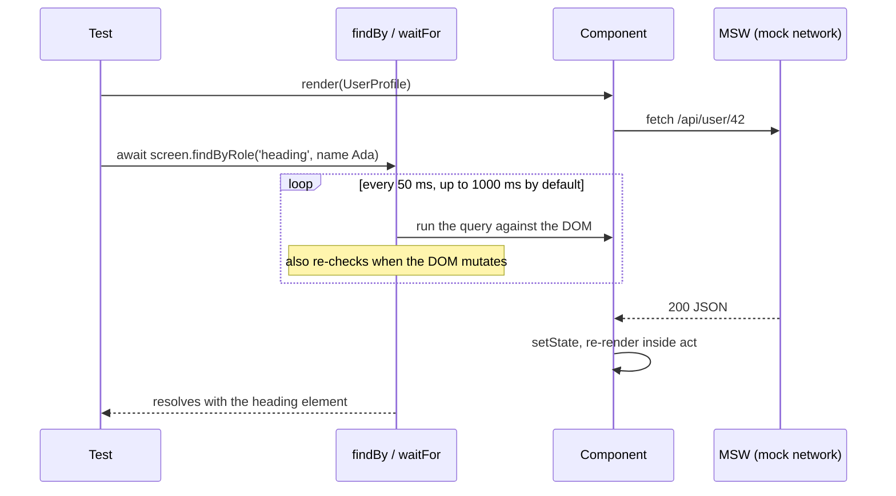

| Tool | What it does | Use it when |
|---|---|---|
| `await screen.findByX(...)` | `getBy` + retry until it passes or times out | Waiting for an element to **appear** — the usual case |
| `await waitFor(() => expect(...))` | Retries the callback until it doesn't throw | Waiting for a **non-element** condition (a mock was called, an attribute changed) |
| `await waitForElementToBeRemoved(() => screen.queryByText('Loading…'))` | Waits for removal; fails if the element isn't there at the start | Spinners and toasts going away |

Defaults: timeout **1000 ms**, interval **50 ms**; both are configurable per call (`{ timeout: 3000 }`) or globally with `configure({ asyncUtilTimeout })`.

**`waitFor` rules (each one fixes a common flaky test):**

```typescript
// ❌ Side effect inside waitFor — it may run many times
await waitFor(() => { user.click(button); expect(spy).toHaveBeenCalled(); });

// ❌ Empty callback — waits one tick and proves nothing
await waitFor(() => {});

// ❌ Several assertions — the first failure hides progress on the others and slows the retry loop
await waitFor(() => { expect(a).toBe(1); expect(b).toBe(2); });

// ✅ Act outside, wait for ONE condition, then assert the rest synchronously
await user.click(button);
await waitFor(() => expect(onSave).toHaveBeenCalledTimes(1));
expect(screen.getByRole('status')).toHaveTextContent('Saved');

// ✅ Prefer findBy over waitFor + getBy
expect(await screen.findByRole('alert')).toHaveTextContent('Invalid email');
```

**`act()` and the "not wrapped in act(...)" warning**

React batches updates and runs effects inside `act()` so that, when `act` returns, the DOM reflects every pending update. RTL **already wraps** `render`, `rerender`, `fireEvent`, user-event and its async utilities in `act`. So:

- You almost never need to call `act` yourself in RTL tests.
- The warning usually means **a state update happened after the test stopped waiting**: an un-awaited `user.click`, a fetch that resolves after the last assertion, or a timer that fires later.
- The fix is to **wait for the final UI state** (`await findBy…`), not to sprinkle `act` around.

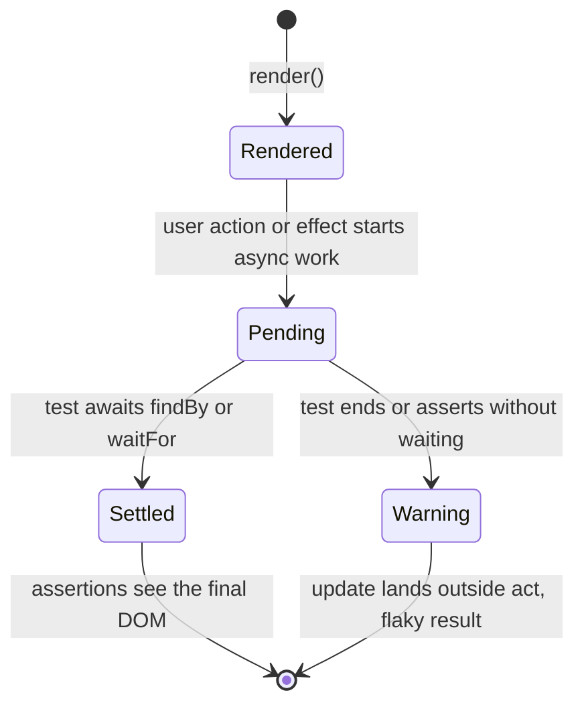

> **Where `act` lives now:** in React 18.3+ and React 19, import it from `react` (`import { act } from 'react'`). The old `react-dom/test-utils` export is deprecated. RTL re-exports `act` too.

---

### Section 7: Custom Render with Providers

Real components need context: theme, router, i18n, data client, store. Don't repeat the providers in every test. Create one `test-utils.tsx` that re-exports RTL with a custom `render`.

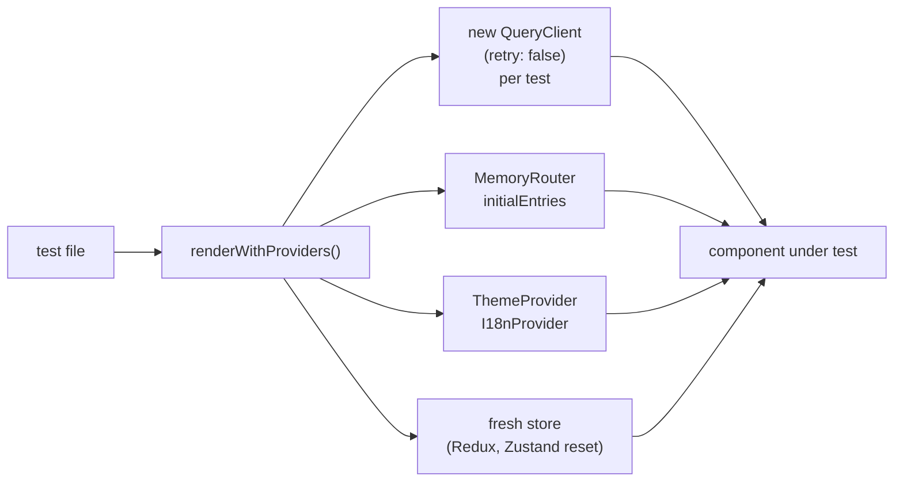

```tsx
// src/test/test-utils.tsx
import type { ReactElement, ReactNode } from 'react';
import { render, type RenderOptions } from '@testing-library/react';
import userEvent from '@testing-library/user-event';
import { QueryClient, QueryClientProvider } from '@tanstack/react-query';
import { MemoryRouter } from 'react-router';
import { ThemeProvider } from '../theme';

interface Options extends Omit<RenderOptions, 'wrapper'> {
  route?: string;
}

export function renderWithProviders(ui: ReactElement, { route = '/', ...options }: Options = {}) {
  // A NEW client per test: no cache shared between tests, no retries slowing failures
  const queryClient = new QueryClient({
    defaultOptions: { queries: { retry: false }, mutations: { retry: false } },
  });

  function Wrapper({ children }: { children: ReactNode }) {
    return (
      <QueryClientProvider client={queryClient}>
        <MemoryRouter initialEntries={[route]}>
          <ThemeProvider>{children}</ThemeProvider>
        </MemoryRouter>
      </QueryClientProvider>
    );
  }

  return {
    user: userEvent.setup(),
    queryClient,
    ...render(ui, { wrapper: Wrapper, ...options }),
  };
}

export * from '@testing-library/react';
```

Rules for the wrapper:
- **Fresh state per test.** A module-level `QueryClient` or store leaks cached data between tests and makes test order matter.
- **Disable retries** in data clients, or a failing request makes the test wait through the retry backoff before failing.
- **Mirror production providers.** If production wraps the app in `<I18nProvider>`, so should tests; otherwise you test a different app.
- **Expose what tests need** (`user`, `queryClient`, a `store`) from the helper, instead of tests reaching into modules.

---

### Section 8: Mocking the Network with MSW

Where you mock decides what you test. Mocking the **network** keeps your fetch code, data client, parsing and error handling in the test.

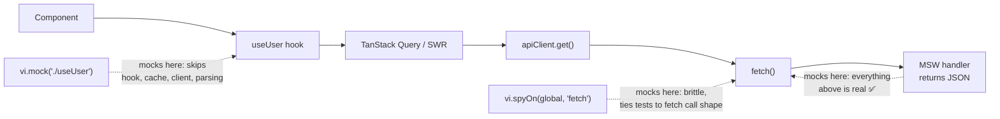

```typescript
// src/test/server.ts
import { setupServer } from 'msw/node';
import { http, HttpResponse } from 'msw';

export const handlers = [
  http.get('/api/users/:id', ({ params }) =>
    HttpResponse.json({ id: params.id, name: 'Ada Lovelace', role: 'admin' }),
  ),
];

export const server = setupServer(...handlers);
```

```typescript
// src/test/setup.ts
import '@testing-library/jest-dom/vitest';
import { server } from './server';

beforeAll(() => server.listen({ onUnhandledRequest: 'error' })); // fail on unexpected requests
afterEach(() => server.resetHandlers());                          // drop per-test overrides
afterAll(() => server.close());
```

Per-test overrides cover the unhappy paths:

```typescript
import { http, HttpResponse, delay } from 'msw';

server.use(http.get('/api/users/:id', () => new HttpResponse(null, { status: 500 })));   // server error
server.use(http.get('/api/users/:id', () => HttpResponse.error()));                     // network failure
server.use(http.get('/api/users/:id', async () => { await delay('infinite'); return HttpResponse.json(user); })); // stays loading
```

**Relative URLs in Node:** tests run Node's built-in `fetch`, which has no page URL to resolve `/api/users/1` against. Depending on the environment setup, such calls fail with an "Invalid URL" / "Failed to parse URL" error. The robust pattern is an API client that builds absolute URLs from a configurable base (e.g. `API_BASE_URL`), with the same base used in the handlers.

The same handlers can power **Storybook** (via an MSW addon) and the **browser** during development (`setupWorker` from `msw/browser`). One source of fake API behaviour serves several tools. More on network boundaries in [Integration Testing](./integration-testing.md).

---

### Section 9: Testing Hooks, Portals, Router and Errors

**Custom hooks — test through a component first.** If a hook is only used by one component, testing the component covers it. For a reusable hook, use `renderHook` (exported from `@testing-library/react`; the separate `@testing-library/react-hooks` package is deprecated):

```typescript
import { renderHook, act } from '@testing-library/react';
import { useCounter } from './useCounter';

test('increments', () => {
  const { result, rerender } = renderHook(({ step }) => useCounter({ step }), {
    initialProps: { step: 2 },
  });
  act(() => result.current.increment()); // direct state change outside RTL helpers → wrap in act
  expect(result.current.count).toBe(2);
  rerender({ step: 5 });
});
```

**Portals (modals, toasts, tooltips):** `screen` queries `document.body`, and portals usually render into `body`, so `screen.getByRole('dialog')` just works. Don't query from the `container` returned by `render` for portal content.

**Router:** render with `MemoryRouter` (or `createMemoryRouter` + `RouterProvider` for data routers) and `initialEntries`. Assert on what the user sees after navigation (a heading on the new page), not on `history.push` calls.

**Error boundaries:** render a child that throws, assert the fallback UI, and silence the expected `console.error` noise for that test only:

```typescript
test('shows fallback when a widget crashes', () => {
  const spy = vi.spyOn(console, 'error').mockImplementation(() => {});
  render(<ErrorBoundary fallback={<p role="alert">Something went wrong</p>}><Boom /></ErrorBoundary>);
  expect(screen.getByRole('alert')).toHaveTextContent('Something went wrong');
  spy.mockRestore();
});
```

**React Server Components:** async Server Components can't be rendered by RTL in a jsdom test today. Next.js's testing docs recommend **E2E tests** for async Server Components. Test the Client Components and pure functions in RTL, and cover the server-rendered page in Playwright or Cypress. Check your framework's docs, because this area is changing.

---

### Section 10: Debugging Failing Queries

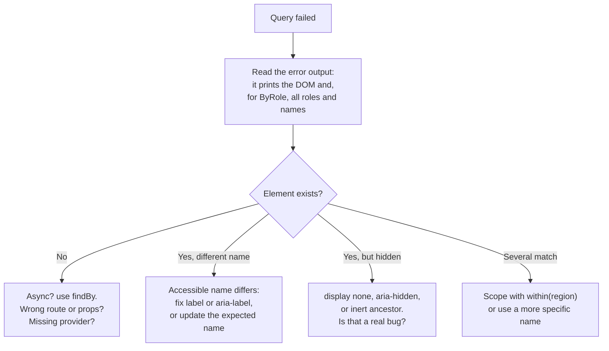

| Tool | What it does |
|---|---|
| `screen.debug()` / `screen.debug(element)` | Pretty-prints the DOM (or a subtree) |
| `logRoles(container)` | Lists every element by role with its accessible name |
| `screen.logTestingPlaygroundURL()` | Prints a link to Testing Playground, which suggests the best query |
| `prettyDOM(el, maxLength)` | Returns the formatted DOM string |
| `DEBUG_PRINT_LIMIT=20000` env var | Raises the default output limit for large DOMs |
| Vitest UI / `--inspect` + `debugger` | Step through a test |

---

### Section 11: Legacy Tools and Their Status

| Tool | Status (late 2026) | Move to |
|---|---|---|
| **Enzyme** (`shallow`, `mount`, `wrapper.state()`) | Unmaintained. No official adapter for React 17+; community adapters exist but don't track modern React | RTL. Replace `shallow` with full render + MSW; replace `.state()` assertions with DOM assertions |
| **`react-test-renderer`** | **Deprecated** in React 19; React recommends RTL | RTL (`render`) |
| **`react-dom/test-utils`** (`act`, `Simulate`) | `act` moved to `react`; the other helpers were removed in React 19 | `import { act } from 'react'`; user-event for interactions |
| **`@testing-library/react-hooks`** | Deprecated | `renderHook` from `@testing-library/react` |
| **Snapshot tests of whole components** | Still supported, widely discouraged as the main assertion: large snapshots get rubber-stamped | Explicit assertions; small inline snapshots for serialised output; [visual regression](./visual-regression-testing.md) for appearance |

**Migrating an Enzyme suite:** don't port tests one-to-one. Rewrite each test as "given this UI, when the user does X, they see Y". Many shallow tests collapse into fewer, stronger RTL tests.

---

## Framework Comparison

Testing Library has bindings for most UI frameworks with the **same queries and philosophy**. Native mobile frameworks have their own testers built on the same idea: find things by semantics.

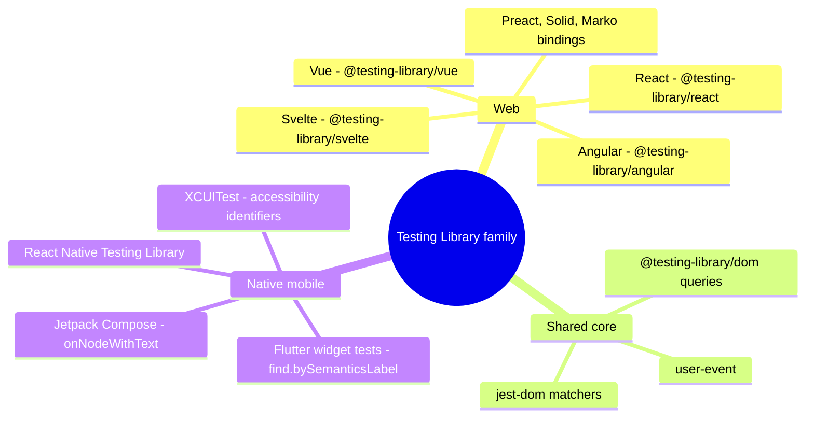

| Stack | Render | Query | Notes |
|---|---|---|---|
| **React** | `render(<Counter />)` | `screen.getByRole(...)` | user-event for interactions |
| **Vue** | `render(Counter, { props: { initial: 1 } })` | Same `screen` queries | `fireEvent` returns a promise (await the DOM update); user-event works too |
| **Angular** | `await render(CounterComponent)` | Same `screen` queries | Async `render`; accepts TestBed providers. Runs under the Angular CLI's test runner (recent versions support Vitest) or Jest |
| **Svelte** | `render(Counter, { props: { initial: 1 } })` | Same `screen` queries | Works with Svelte 5 runes; see the Svelte Testing Library docs for setup |
| **React Native** | `render(<Counter />)` from `@testing-library/react-native` | `screen.getByRole('button', { name })`, `getByText` | `userEvent.setup()` and `fireEvent.press`; built-in matchers like `toBeOnTheScreen()` |
| **Flutter** | `await tester.pumpWidget(...)` | `find.text`, `find.bySemanticsLabel` | `await tester.tap(...)` then `await tester.pump()` |
| **Jetpack Compose** | `composeTestRule.setContent { ... }` | `onNodeWithText`, `onNodeWithContentDescription` | `performClick()`, `assertIsDisplayed()` |

```typescript
// Vue — same test shape as React
import { render, screen } from '@testing-library/vue';
import userEvent from '@testing-library/user-event';
import Counter from './Counter.vue';

test('increments', async () => {
  const user = userEvent.setup();
  render(Counter, { props: { initial: 1 } });
  await user.click(screen.getByRole('button', { name: 'Increment' }));
  expect(screen.getByText('Count: 2')).toBeInTheDocument();
});
```

---

## Real-World Examples

**Example 1 — A login form (BAD → GOOD):**
```tsx
// ❌ BAD: implementation details, CSS selectors, sync fireEvent, no async wait
test('login', () => {
  const { container } = render(<LoginForm />);
  fireEvent.change(container.querySelector('.email-input')!, { target: { value: 'a@b.co' } });
  fireEvent.click(container.querySelector('button.primary')!);
  expect(container.querySelector('.spinner')).toBeTruthy();
});

// ✅ GOOD: roles and labels, user-event, wait for the outcome a user would see
test('logs in and greets the user', async () => {
  const { user } = renderWithProviders(<LoginForm />);

  await user.type(screen.getByLabelText('Email'), 'ada@example.com');
  await user.type(screen.getByLabelText('Password'), 'correct horse');
  await user.click(screen.getByRole('button', { name: 'Sign in' }));

  expect(await screen.findByRole('heading', { name: 'Welcome back, Ada' })).toBeInTheDocument();
  expect(screen.queryByRole('alert')).not.toBeInTheDocument();
});
```

**Example 2 — Validation errors announced accessibly:**
```tsx
test('shows an accessible error for an invalid email', async () => {
  const { user } = renderWithProviders(<SignupForm />);
  const email = screen.getByRole('textbox', { name: 'Email' });

  await user.type(email, 'not-an-email');
  await user.click(screen.getByRole('button', { name: 'Create account' }));

  expect(email).toBeInvalid();                                       // aria-invalid="true"
  expect(email).toHaveAccessibleErrorMessage('Enter a valid email'); // via aria-errormessage
  expect(email).toHaveFocus();                                       // focus moved to the first error
});
```

**Example 3 — Loading, success and error states with MSW:**
```tsx
import { http, HttpResponse } from 'msw';
import { server } from '../test/server';

test('shows the profile after loading', async () => {
  renderWithProviders(<UserProfile id="42" />);
  expect(screen.getByRole('status')).toHaveTextContent('Loading');
  expect(await screen.findByRole('heading', { name: 'Ada Lovelace' })).toBeInTheDocument();
});

test('shows a retry button when the API fails', async () => {
  server.use(http.get('/api/users/:id', () => new HttpResponse(null, { status: 500 })));
  const { user } = renderWithProviders(<UserProfile id="42" />);

  const retry = await screen.findByRole('button', { name: 'Try again' });
  server.resetHandlers(); // next request succeeds
  await user.click(retry);
  expect(await screen.findByRole('heading', { name: 'Ada Lovelace' })).toBeInTheDocument();
});
```

**Example 4 — A modal dialog: focus and keyboard:**
```tsx
test('dialog traps focus and closes on Escape', async () => {
  const { user } = renderWithProviders(<DeleteProjectButton />);
  const trigger = screen.getByRole('button', { name: 'Delete project' });

  await user.click(trigger);
  const dialog = screen.getByRole('dialog', { name: 'Delete project?' });
  expect(within(dialog).getByRole('button', { name: 'Cancel' })).toHaveFocus();

  await user.keyboard('{Escape}');
  expect(screen.queryByRole('dialog')).not.toBeInTheDocument();
  expect(trigger).toHaveFocus(); // focus returned to the trigger
});
```

**Example 5 — A debounced search box with fake timers:**
```tsx
test('searches after the user stops typing', async () => {
  vi.useFakeTimers();
  const user = userEvent.setup({ advanceTimers: vi.advanceTimersByTime });
  const onSearch = vi.fn();
  render(<SearchBox onSearch={onSearch} delay={300} />);

  await user.type(screen.getByRole('searchbox', { name: 'Search' }), 'react');
  expect(onSearch).not.toHaveBeenCalled();

  await act(() => vi.advanceTimersByTimeAsync(300));
  expect(onSearch).toHaveBeenCalledTimes(1);
  expect(onSearch).toHaveBeenCalledWith('react');
  vi.useRealTimers();
});
```

**Example 6 — Testing a list with `within` instead of test IDs:**
```tsx
test('marks a todo as done', async () => {
  const { user } = renderWithProviders(<TodoList initial={[{ id: 1, title: 'Write tests', done: false }]} />);
  const item = screen.getByRole('listitem', { name: /write tests/i }); // name via aria-labelledby on the li

  await user.click(within(item).getByRole('checkbox'));
  expect(within(item).getByRole('checkbox')).toBeChecked();
});
```

---

## Key Points Summary

| Concept | One-Line Explanation |
|---|---|
| **Guiding principle** | Tests that resemble real usage give the most confidence and survive refactors |
| **Query priority** | Role → Label → Placeholder → Text → DisplayValue → Alt/Title → TestId |
| **`getByRole` + `name`** | Finds elements through the accessibility tree; failure often means an a11y bug |
| **`getBy` / `queryBy` / `findBy`** | Present now / assert absent / appears later (async) |
| **`screen`** | Queries `document.body`; prefer it over destructuring `render`'s return |
| **`within`** | Scopes queries to a region (row, dialog, nav) |
| **user-event** | Full, async, realistic interactions; `userEvent.setup()` then `await user.click()` |
| **`fireEvent`** | Single synthetic event; only for events user-event doesn't model |
| **`findBy` / `waitFor`** | Retry until success or timeout (default 1000 ms, 50 ms interval) |
| **act warning** | A state update happened after the test stopped waiting; await the final UI |
| **Custom render** | One `test-utils` wrapper with fresh providers per test |
| **MSW** | Mock at the network so hooks, cache and parsing stay real |
| **`renderHook`** | For reusable hooks; otherwise test hooks through components |
| **Legacy** | Enzyme unmaintained, `react-test-renderer` deprecated in React 19 → RTL |

---

## Test Your Understanding

**Q1 (Basic):**
What is the difference between `getByText`, `queryByText` and `findByText`? Give one situation where each is the right choice.

<details>
<summary>Answer</summary>

- `getByText` returns the element or **throws** if there are zero or several matches. Use it for content that should be there **right now**, such as a heading rendered from props.
- `queryByText` returns **`null`** when nothing matches (it still throws on multiple matches). Use it to assert **absence**: `expect(screen.queryByText('Error')).not.toBeInTheDocument()`. With `getBy` the query would throw before the assertion runs.
- `findByText` returns a **promise** that retries `getByText` until it succeeds or times out (1000 ms by default). Use it for content that appears **after async work**, such as data loaded from an API.
</details>

**Q2 (Application):**
A teammate's test uses `screen.getByTestId('submit-btn')` for a button labelled with only an SVG icon. The test passes. In review you suggest `getByRole('button', { name: 'Submit order' })`, and it fails. What does the failure tell you, and how do you fix it?

<details>
<summary>Answer</summary>

It tells you the button has **no accessible name**. Screen reader users hear "button" and have no idea what it does. The test ID hid an accessibility bug that the role query exposed.

Fix the **component**, not the test: add `aria-label="Submit order"` to the button, or visually hidden text inside it, and mark the SVG `aria-hidden="true"`. Then the role query passes, and it will keep passing if the markup is refactored, as long as users can still identify the button.
</details>

**Q3 (Tricky):**
A test passes but logs `Warning: An update to UserCard inside a test was not wrapped in act(...)`. The teammate wraps `render` in `act()` and the warning remains. What is really happening?

<details>
<summary>Answer</summary>

`render` is already wrapped in `act` by RTL, so wrapping it again changes nothing. The warning means **a state update happened after the test stopped waiting**: typically the component starts a fetch in an effect, the test asserts on the loading state and finishes, and then the response arrives and calls `setState`, outside any `act` scope.

Fix: **wait for the final state** the user would see, e.g. `await screen.findByRole('heading', { name: 'Ada' })`. Also check for un-awaited `user.click` calls and timers that fire after the test. Avoid silencing the warning: it points at a test that doesn't cover the real end state, and it can hide flakiness.
</details>

**Q4 (Tricky):**
Why is the following test flaky, and how would you rewrite it?

```typescript
await waitFor(() => {
  user.click(screen.getByRole('button', { name: 'Save' }));
  expect(api.save).toHaveBeenCalled();
});
```

<details>
<summary>Answer</summary>

`waitFor` re-runs its callback every 50 ms until it stops throwing. The callback contains a **side effect**, so the click can happen several times, and `user.click` isn't awaited inside it. Whether `save` gets called once or three times depends on timing.

Rewrite: do the action once, outside, then wait for one condition:

```typescript
await user.click(screen.getByRole('button', { name: 'Save' }));
await waitFor(() => expect(api.save).toHaveBeenCalledTimes(1));
```

Even better, assert on what the user sees: `expect(await screen.findByRole('status')).toHaveTextContent('Saved')`.
</details>

**Q5 (Application):**
Your component uses TanStack Query and a shared `queryClient` exported from `src/queryClient.ts`. Tests pass alone but fail when run together. Why, and what's the fix?

<details>
<summary>Answer</summary>

The shared client **caches results across tests**. Test A loads user 42. Test B, which expects an error response for user 42, gets the cached success instead and never hits the MSW override. The outcome depends on test order. Default retries also make failing requests slow.

Fix: create a **new `QueryClient` per test** inside a custom render helper, with `retry: false`, and reset MSW handlers in `afterEach`. Each test then starts with an empty cache and only the network behaviour it declares.
</details>

**Q6 (System design):**
You're defining the component-testing conventions for a 40-engineer design system plus three product apps (React web, Vue admin, React Native mobile). What rules do you write down?

<details>
<summary>Answer</summary>

- **One philosophy across stacks:** Testing Library bindings for React, Vue and React Native, so queries and patterns transfer between teams.
- **Query policy:** `getByRole` with `name` by default; `getByLabelText` for fields; `getByTestId` only for non-semantic things (canvas, charts), and only with a justification in review. Lint rules (`eslint-plugin-testing-library`, `eslint-plugin-jest-dom`) enforce this.
- **Interactions:** user-event with `setup()`; `fireEvent` only for events user-event doesn't model.
- **Async:** `findBy` for appearance; `waitFor` with one assertion and no side effects; no manual `act` unless driving hooks or timers directly.
- **Network:** MSW handlers shared by tests, Storybook and local development, with `onUnhandledRequest: 'error'`. No mocking of the app's own hooks or data client.
- **Providers:** one `test-utils` per app with fresh state per test.
- **Scope:** RTL for component and integration tests; layout, visual and cross-browser behaviour go to visual regression and E2E. Async Server Components go to E2E.
- **Migration:** no new Enzyme or `react-test-renderer` tests; old ones are rewritten when touched.
</details>

---

## Cheat Sheet

**Key Definitions:**
- **Accessible name:** The label assistive tech announces for an element, computed from `<label>`, `aria-label`, `aria-labelledby`, content or `alt`
- **`screen`:** Query object bound to `document.body`
- **`within(el)`:** Query object scoped to a subtree
- **user-event:** Library that simulates complete, realistic user interactions (async)
- **`act()`:** React's helper that flushes updates and effects; RTL calls it for you
- **MSW:** Mock Service Worker, which intercepts requests at the network layer in Node and browsers
- **Custom render:** A `render` wrapper that adds the app's providers with fresh state per test

**Quick Reference:**
```text
Find now ............ screen.getByRole('button', { name: /save/i })
Assert absent ....... expect(screen.queryByText('Error')).not.toBeInTheDocument()
Wait to appear ...... await screen.findByRole('alert')
Wait to disappear ... await waitForElementToBeRemoved(() => screen.queryByText(/loading/i))
Wait for condition .. await waitFor(() => expect(fn).toHaveBeenCalledTimes(1))
Scope ............... within(screen.getByRole('dialog')).getByRole('button', { name: 'OK' })
Interact ............ const user = userEvent.setup(); await user.click(el); await user.type(el, 'x')
Fake timers ......... userEvent.setup({ advanceTimers: vi.advanceTimersByTime })
Hooks ............... renderHook(() => useThing(), { wrapper })
Debug ............... screen.debug(); logRoles(container); screen.logTestingPlaygroundURL()

Query priority: Role > LabelText > PlaceholderText > Text > DisplayValue > AltText/Title > TestId
Async defaults: timeout 1000 ms, interval 50 ms
Vitest: globals: true (auto cleanup) + import '@testing-library/jest-dom/vitest'
```

**Common Mistakes to Avoid:**

| Mistake | Why Wrong | Fix |
|---|---|---|
| `container.querySelector('.btn')` | Ties tests to CSS and structure; users don't see classes | `screen.getByRole('button', { name })` |
| `getByTestId` everywhere | Invisible to users; hides missing labels | Role/label queries; test IDs only as a last resort |
| `expect(getBy…).not.toBeInTheDocument()` | `getBy` throws before the assertion | `queryBy…` |
| `fireEvent` for clicks and typing | Skips focus, disabled checks, key sequences | `await user.click()` / `user.type()` |
| Forgetting `await` on user-event | Assertions run before updates; act warnings | Always `await` |
| Side effects or many assertions in `waitFor` | Repeated actions, slow and flaky retries | Act outside; one assertion inside |
| `waitFor(() => getBy…)` | Verbose; worse error message | `await findBy…` |
| Wrapping everything in `act` | Hides the real problem (not waiting for final state) | Await the final UI with `findBy` |
| Shared store or query client between tests | Order-dependent results | New instance per test in the custom render |
| `vi.mock` of your own data hooks | Skips cache, parsing and error paths | MSW at the network boundary |
| Big component snapshots | Rubber-stamped updates, catch nothing specific | Explicit assertions; visual regression for looks |
| Testing layout in jsdom | jsdom doesn't do layout | Real-browser component tests or E2E |
| New Enzyme / `react-test-renderer` tests | Unmaintained / deprecated | RTL |

---

## References & Further Reading

**Core docs**
- Testing Library: [Guiding principles](https://testing-library.com/docs/guiding-principles)
- Testing Library: [About queries and priority](https://testing-library.com/docs/queries/about)
- Testing Library: [`ByRole` query](https://testing-library.com/docs/queries/byrole)
- Testing Library: [React Testing Library API](https://testing-library.com/docs/react-testing-library/api)
- Testing Library: [Async methods (`waitFor`, `findBy`)](https://testing-library.com/docs/dom-testing-library/api-async)
- Testing Library: [user-event — Introduction](https://testing-library.com/docs/user-event/intro) · [Options (`advanceTimers`)](https://testing-library.com/docs/user-event/options)
- Testing Library: [Setup — custom render](https://testing-library.com/docs/react-testing-library/setup)
- jest-dom: [Custom matchers](https://github.com/testing-library/jest-dom)
- MSW: [Documentation](https://mswjs.io/docs/)

**React**
- React: [`act`](https://react.dev/reference/react/act)
- React: [React 19 upgrade guide (test utilities)](https://react.dev/blog/2024/04/25/react-19-upgrade-guide)
- Next.js: [Testing with Vitest](https://nextjs.org/docs/app/guides/testing/vitest)

**Other frameworks**
- [Vue Testing Library](https://testing-library.com/docs/vue-testing-library/intro) · [Angular Testing Library](https://testing-library.com/docs/angular-testing-library/intro) · [Svelte Testing Library](https://testing-library.com/docs/svelte-testing-library/intro)
- [React Native Testing Library](https://github.com/callstack/react-native-testing-library)
- Flutter: [An introduction to widget testing](https://docs.flutter.dev/cookbook/testing/widget/introduction)
- Android: [Testing your Compose layout](https://developer.android.com/develop/ui/compose/testing)

**Deep dives**
- Kent C. Dodds: [Common mistakes with React Testing Library](https://kentcdodds.com/blog/common-mistakes-with-react-testing-library)
- Kent C. Dodds: [Testing implementation details](https://kentcdodds.com/blog/testing-implementation-details)
- Testing Library: [Testing Playground](https://testing-playground.com/)
- Vitest: [Browser Mode](https://vitest.dev/guide/browser/)

---

> **Previous Topic:** [Unit Testing Components (Jest, Vitest)](./unit-testing-components-jest-vitest.md)
> — Test runners, environments, mocks and the basics of testing a component in isolation

> **Next Topic:** [Integration Testing](./integration-testing.md)
> — Testing features end to end inside the app: several components, real state and a mocked network

*Saved on: 2026-11-06 | Repo: Frontend System Design Learning Notes*
