# Error Boundaries & Global Error Handling

> **Date:** 2026-11-06 · **Last updated:** 2026-11-06
> **Category:** Frontend System Design
> **Sub-Topic:** Monitoring & Observability / Error Handling
> **Level:** Intermediate · **Reading time:** ~28 min
> **Informs:** error boundary placement and granularity, fallback UX and recovery, global error/unhandledrejection handlers, API error model, chunk-load recovery, error reporting pipeline, SSR/RSC error handling

> **Pre-requisite:** [JavaScript Runtime & Event Loop](../01-web-fundamentals/javascript-runtime-event-loop.md) (tasks, microtasks, promises) and [Code Splitting & Lazy Loading](../04-performance-engineering/code-splitting-and-lazy-loading.md) (chunk loading).
> This note covers **catching, containing and recovering from errors in the browser**. Sending them to a tracking service is the next note.

**Previous:** [Testing Strategies & Pyramid](../08-testing/testing-strategies-and-pyramid.md) · **Next:** [Error Tracking (Sentry, Datadog RUM)](./error-tracking-sentry-datadog-rum.md)

---

## Table of Contents

1. [ELI5 — Simple Explanation](#eli5--simple-explanation)
2. [Section 1: A Taxonomy of Frontend Errors](#section-1-a-taxonomy-of-frontend-errors)
3. [Section 2: How Errors Travel in the Browser](#section-2-how-errors-travel-in-the-browser)
4. [Section 3: The Global Safety Net — error and unhandledrejection](#section-3-the-global-safety-net--error-and-unhandledrejection)
5. [Section 4: React Error Boundaries](#section-4-react-error-boundaries)
6. [Section 5: Getting Async and Event Errors into a Boundary](#section-5-getting-async-and-event-errors-into-a-boundary)
7. [Section 6: Root-Level Error Callbacks in React 19](#section-6-root-level-error-callbacks-in-react-19)
8. [Section 7: Server Rendering, RSC and Next.js error.tsx](#section-7-server-rendering-rsc-and-nextjs-errortsx)
9. [Section 8: Other Frameworks and Native Mobile](#section-8-other-frameworks-and-native-mobile)
10. [Section 9: Network and API Errors](#section-9-network-and-api-errors)
11. [Section 10: Error UX — Fallbacks, Recovery and Accessibility](#section-10-error-ux--fallbacks-recovery-and-accessibility)
12. [Section 11: The Reporting Pipeline](#section-11-the-reporting-pipeline)
13. [System Design Angle — A Layered Error Architecture](#system-design-angle--a-layered-error-architecture)
14. [Real-World Examples](#real-world-examples)
15. [Key Points Summary](#key-points-summary)
16. [Test Your Understanding (with answers)](#test-your-understanding)
17. [Cheat Sheet](#cheat-sheet)
18. [References & Further Reading](#references--further-reading)

---

## ELI5 — Simple Explanation

Think of the **electrical system in a house**:

- Each room has its own **fuse** (an **error boundary**). If the toaster shorts out, only the kitchen goes dark — the rest of the house keeps its lights on, and a little sign says *"Kitchen fuse tripped — press to reset"*.
- The house also has a **main breaker and a smoke alarm** (the **global `error` / `unhandledrejection` handlers**). They catch whatever no room's fuse handled, and they phone the electrician (your **error-tracking service**).
- Some problems aren't shorts at all — the power company had an outage (a **network/API error**). You don't blow a fuse for that; you show *"Power is out, we'll retry"* and keep everything else working.

Without fuses, one faulty toaster plunges the whole house into darkness — that is a React app with no error boundary: **one render error unmounts the entire UI and the user sees a blank page.**

> **Contain errors close to where they happen, give the user a way to recover, and make sure nothing escapes without being reported.**

---

## Core Concept — Step by Step

### Section 1: A Taxonomy of Frontend Errors

Not every error deserves the same treatment. Classify first:

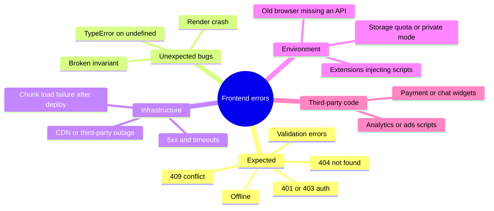

| Kind | Example | Treatment |
|---|---|---|
| **Expected / domain** | Wrong password, item out of stock, 404 | Normal UI state — inline message, **not** an exception to report |
| **Recoverable infrastructure** | 503, timeout, offline, chunk failed to load | Retry (with backoff), offline UI, reload once for chunks; report if persistent |
| **Unexpected (bugs)** | `Cannot read properties of undefined` during render | Error boundary fallback + **always report** with context |
| **Fatal** | App shell itself fails to boot | Static fallback page, full reload button, report |
| **Noise** | Errors from browser extensions or third-party scripts | Filter or tag separately so they don't drown real bugs |

**Where errors originate** decides **which mechanism can catch them**:

| Origin | Caught by an error boundary? | Caught by `window` `error` / `unhandledrejection`? |
|---|---|---|
| Rendering a component | ✅ (React, Vue `onErrorCaptured`, Svelte `<svelte:boundary>`, Solid) | Only if no boundary catches it |
| Effects / lifecycle methods | ✅ in React (and Svelte effects) | Only if uncaught |
| Event handlers (`onClick`) | ❌ (React, Svelte) | ✅ `error` if it throws synchronously |
| `setTimeout`, `requestAnimationFrame` callbacks | ❌ | ✅ `error` |
| Rejected promise nobody handles | ❌ (unless you rethrow into the boundary) | ✅ `unhandledrejection` |
| ``/`<script>`/`<link>` failing to load | ❌ | Only with a **capture-phase** `error` listener |
| Errors inside a Web Worker | ❌ | The worker's own `self` `error`; `worker.onerror` in the page |
| Server rendering | Framework-specific (Section 7) | ❌ (it's on the server) |

---

### Section 2: How Errors Travel in the Browser

A thrown value unwinds the **call stack** until a `try/catch` handles it. If nothing does, the current task ends and the browser reports it. Promises follow a different path: a rejection with no handler is reported **after the microtask checkpoint**, as `unhandledrejection`.

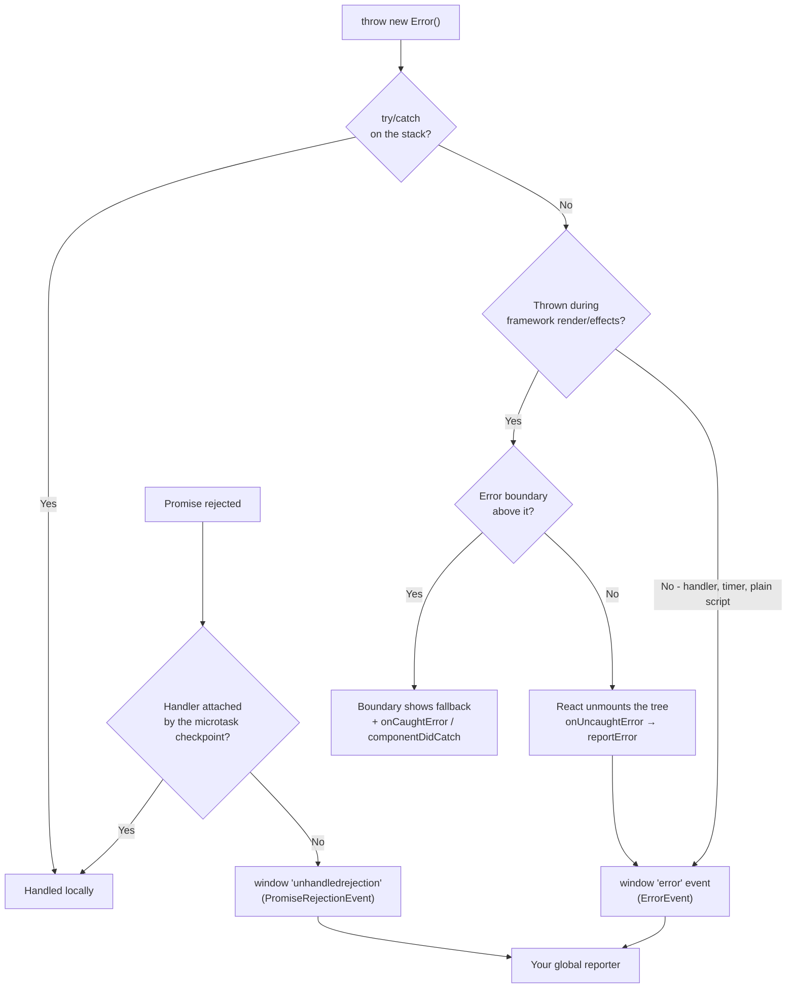

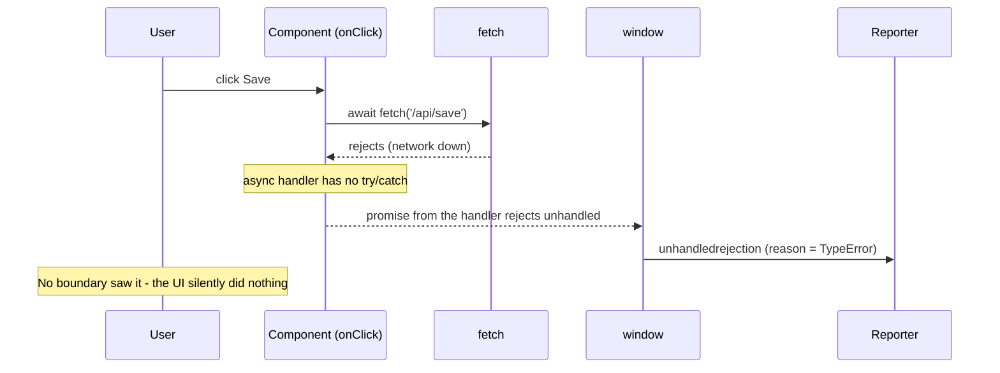

> **Key insight:** async errors bypass error boundaries and `try/catch` around the *call site*. If you don't handle them, the only place they surface is `unhandledrejection` — and the user gets **no feedback at all**.

---

### Section 3: The Global Safety Net — error and unhandledrejection

Install these **once, as early as possible** (before other scripts), so nothing escapes unseen.

| API | Fires for | Event object | Notes |
|---|---|---|---|
| `window.addEventListener('error', fn)` | Uncaught exceptions from scripts | `ErrorEvent` (`message`, `filename`, `lineno`, `colno`, `error`) | `event.preventDefault()` suppresses the default console report |
| `window.addEventListener('error', fn, true)` | **Also** resource load failures (``, `<script>`, `<link>`) — these don't bubble, so you need the **capture** phase | Plain `Event`, `event.target` is the element | No stack; check `target.src`/`href` |
| `window.addEventListener('unhandledrejection', fn)` | Promise rejected with no handler | `PromiseRejectionEvent` (`reason`, `promise`) | `reason` may be any value, not always an `Error` |
| `window.addEventListener('rejectionhandled', fn)` | A handler was attached **later** to an already-reported rejection | `PromiseRejectionEvent` | Lets you retract a report |
| `window.onerror = (msg, src, line, col, err) => …` | Same as `error` (legacy form) | Positional args | Returning `true` suppresses the default report |
| `reportError(err)` | You *want* an error reported as if uncaught, without throwing | — | Dispatches an `error` event to the global; widely supported (MDN: Chrome 95, Firefox 93, Safari 15.4) |
| `document.addEventListener('securitypolicyviolation', fn)` | CSP violations | `SecurityPolicyViolationEvent` | See [Content Security Policy (CSP)](../07-security/content-security-policy-csp.md) |

**The "Script error." problem:** when a script from **another origin** (your CDN, a third-party) throws, browsers hide the details — you get only `"Script error."` with no stack, file or line. This is a deliberate protection against leaking information across origins.

```html
<!-- ✅ Fix: request the script with CORS, and have the server allow it -->
<script src="https://cdn.example.com/app.3f9a1c.js" crossorigin="anonymous"></script>
<!-- the CDN must respond with: Access-Control-Allow-Origin: https://app.example.com (or *) -->
```

**Workers and iframes have their own globals.** A Web Worker needs `self.addEventListener('error' | 'unhandledrejection', …)` inside the worker; the page sees worker failures via `worker.onerror`. Each iframe has its own `window`.

---

### Section 4: React Error Boundaries

An **error boundary** is a component that catches errors thrown while rendering its **descendants** (and in their lifecycle methods/effects), shows a **fallback UI**, and reports the error. As of React 19, boundaries must still be **class components** (there is no hook equivalent of `componentDidCatch` yet), so teams write one once or use the `react-error-boundary` package.

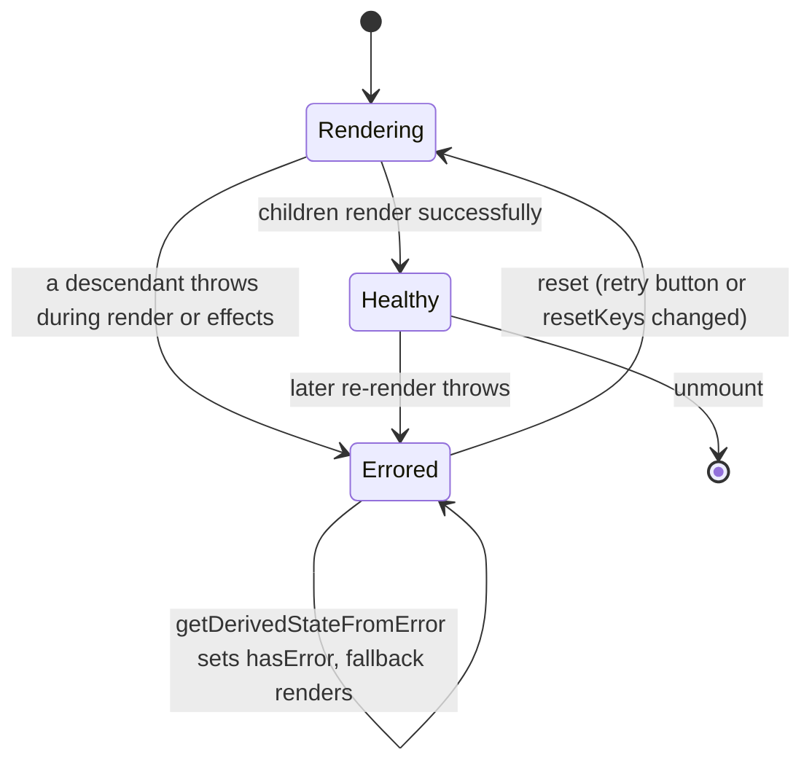

| Method | Phase | Use it for |
|---|---|---|
| `static getDerivedStateFromError(error)` | Render phase (must be pure) | Return state that switches to the fallback UI |
| `componentDidCatch(error, info)` | Commit phase (side effects OK) | Logging/reporting; `info.componentStack` shows **which components** were rendering |

**What a React error boundary does NOT catch:**
- Errors in **event handlers** (they don't happen during rendering — use `try/catch`).
- **Asynchronous** code: `setTimeout`, `requestAnimationFrame`, promises you don't route back into React.
- Errors during **server rendering** (handled by the server/framework — Section 7).
- Errors thrown **in the boundary itself** — they go to the next boundary up.

**Placement and granularity** — this is the real design decision:

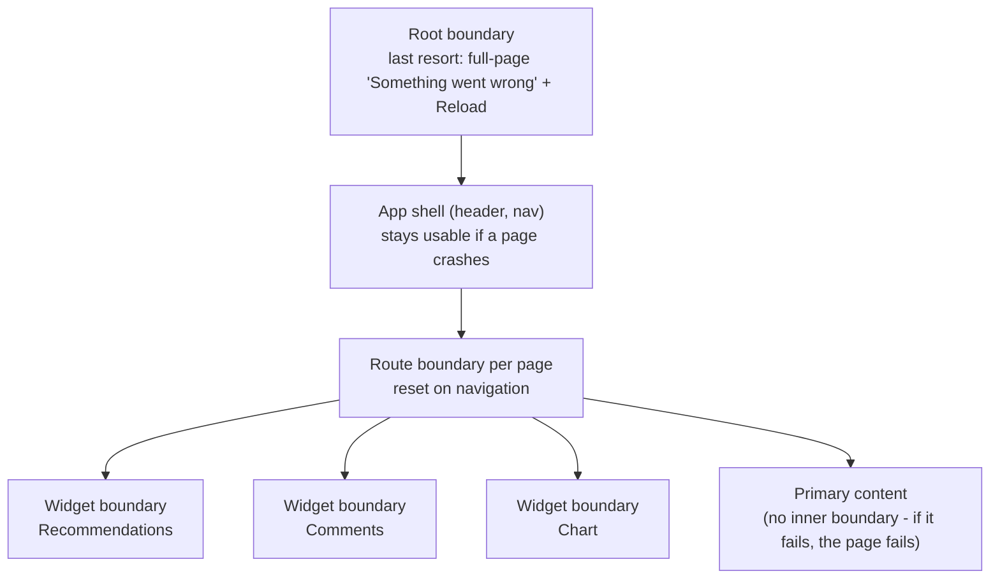

| Level | Fallback | Why |
|---|---|---|
| **Root** | Full page with "Reload" | The last net — a blank white screen is the worst outcome |
| **Route / page** | Page-level message; header and navigation keep working | The user can navigate away; reset when the route changes |
| **Widget / feature** | Small inline "Couldn't load comments — Retry" | Non-critical features fail alone |
| **Third-party embeds** | Hide or show a placeholder | Someone else's bug shouldn't break your page |

> **Don't wrap every component.** Too many boundaries produce a page full of half-broken boxes and hide real failures. Put them around **independently useful units** of the UI.

---

### Section 5: Getting Async and Event Errors into a Boundary

Boundaries only see errors thrown **during React's work**. To show an async failure in a boundary's fallback, you must hand it back to React:

| Technique | How | Notes |
|---|---|---|
| **`showBoundary`** (react-error-boundary) | `const { showBoundary } = useErrorBoundary(); … catch (e) { showBoundary(e) }` | Explicit and readable |
| **State setter rethrow** | `setState(() => { throw err })` | Works without a library; the throw happens during render |
| **Actions / transitions** (React 19) | Errors thrown inside an Action passed to `startTransition` or a form `action` are shown by the nearest boundary | Check the React docs for `useTransition` / `useActionState` |
| **Suspense data libraries** | TanStack Query `useSuspenseQuery` (or `throwOnError: true`), Apollo/Relay suspense hooks, `use(promise)` | The library throws during render; reset with `QueryErrorResetBoundary` |
| **Local handling** | `try/catch` in the handler + inline error state | Often better UX for user actions: keep the form, show a message |

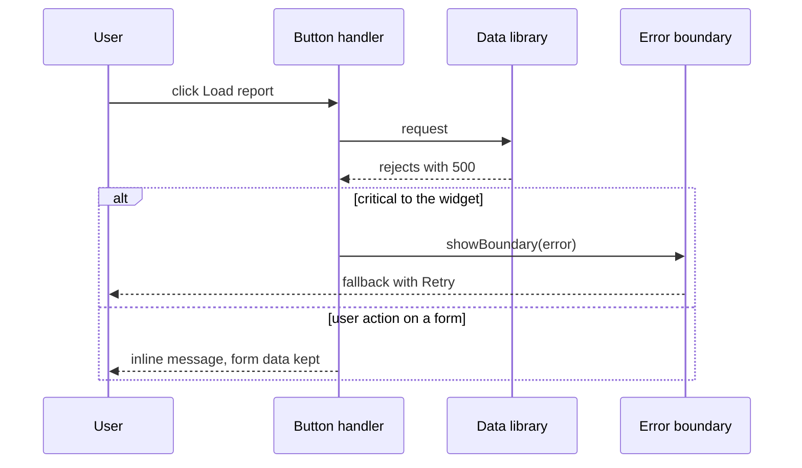

**Rule of thumb:** errors from **user actions** (submit, save, delete) → handle locally with an inline message and keep the user's input. Errors that make a **whole region unusable** (its data failed to load) → route to that region's boundary.

---

### Section 6: Root-Level Error Callbacks in React 19

React 19 added options on `createRoot` / `hydrateRoot` to observe every error React handles:

| Option | Called when | Typical use |
|---|---|---|
| `onCaughtError(error, errorInfo)` | A boundary caught the error | Report with `errorInfo.componentStack` |
| `onUncaughtError(error, errorInfo)` | No boundary caught it (the tree unmounted) | Report as fatal; show a static fallback |
| `onRecoverableError(error, errorInfo)` | React recovered automatically (e.g. a hydration mismatch fell back to client rendering) | Report as a warning — these hide real SSR bugs |

React 19 also changed default reporting: uncaught errors go to `window.reportError` and caught errors to `console.error`, each reported **once** (React 18 re-threw and logged duplicates). Error-tracking SDKs provide ready-made handlers for these options (see the next note).

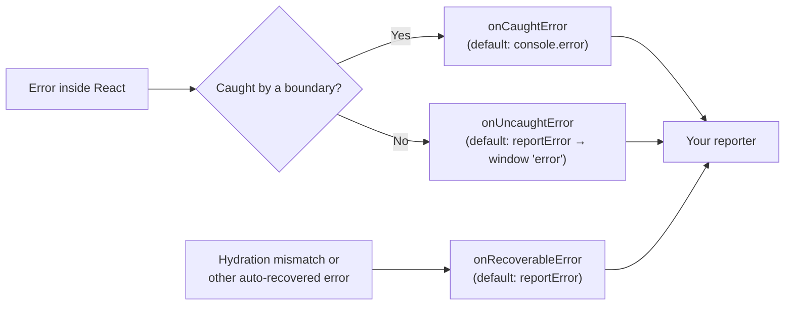

---

### Section 7: Server Rendering, RSC and Next.js error.tsx

With SSR and React Server Components, errors can happen **on the server** before any client code runs:

| Where | What happens | What to do |
|---|---|---|
| Server render of the shell fails | No HTML can be produced | Return a 500 page; log on the server |
| Server render inside a `<Suspense>` boundary fails (streaming) | React streams the fallback and **retries on the client** | The client boundary decides; `onRecoverableError` is reported if the client succeeds |
| Server Component throws | Framework catches it and serializes a **safe** error to the client | Show the route's error UI; match logs by a digest/ID |
| Hydration mismatch | React patches or re-renders on the client | Fix the cause (dates, `Math.random`, `window` checks during render) |

**Next.js App Router conventions:**

```text
app/
├── global-error.tsx        ← replaces the ROOT layout when it fails (must render its own <html> and <body>)
├── layout.tsx
├── error.tsx               ← boundary for everything under app/ (not the root layout itself)
├── not-found.tsx           ← for notFound() — an expected 404, not a crash
└── dashboard/
    ├── layout.tsx          ← stays visible when dashboard/page.tsx crashes
    ├── error.tsx           ← boundary around dashboard/page.tsx and children
    └── page.tsx
```

- `error.tsx` must be a **Client Component** (`'use client'`). It receives `error` and recovery functions.
- **Recovery:** current Next.js docs recommend **`retry()`** (re-fetches and re-renders the segment; stable since Next.js 16.3 per the version history) and keep **`reset()`** for clearing the error state *without* re-fetching. Older versions only have `reset()` — check the docs for your version.
- In production, errors from Server Components reach the client with a **generic message** and an **`error.digest`** that matches the server log — sensitive details are never sent to the browser.
- `error.tsx` does **not** catch errors in the `layout.tsx` of the **same** segment (the boundary sits inside that layout); the parent segment's `error.tsx` does.
- Server-side reporting: `instrumentation.ts` with `onRequestError` captures server errors for your tracker.

> Expected errors in Server Actions (validation, "email taken") should be **returned as values** (e.g. via `useActionState`), not thrown — throwing turns an ordinary outcome into an error page.

---

### Section 8: Other Frameworks and Native Mobile

| Framework | Component-level containment | App-wide handler | Notes |
|---|---|---|---|
| **React** | Class error boundary / `react-error-boundary` | `createRoot` `onCaughtError` / `onUncaughtError` + window listeners | No boundary for event handlers/async |
| **Next.js** | `error.tsx` per route segment, `global-error.tsx` | `instrumentation.ts` (`onRequestError`) + client listeners | Server errors arrive with `digest` |
| **Vue 3** | `onErrorCaptured((err, instance, info) => …)` in a parent; return `false` to stop propagation — build an `<ErrorBoundary>` component with it | `app.config.errorHandler = (err, instance, info) => …` | Vue's handler also receives errors from component event handlers and lifecycle hooks invoked through Vue |
| **Nuxt** | `<NuxtErrorBoundary>` | `error.vue` page, `vue:error` / `app:error` hooks, `showError` / `createError` | |
| **Angular** | No component-level boundary; `@defer` has an `@error` block for failed lazy loads | Custom `ErrorHandler` (`{ provide: ErrorHandler, useClass: … }`), `provideBrowserGlobalErrorListeners()` (generated by default in new CLI apps) | HTTP errors via interceptors (`withInterceptors`) |
| **Svelte 5** | `<svelte:boundary>` with a `failed` snippet `(error, reset)` and/or `onerror` | `window` listeners | Catches render and effect errors, not event handlers or `setTimeout` |
| **SvelteKit** | `+error.svelte` per route | `handleError` in `hooks.client` / `hooks.server` | `error(404, …)` for expected errors |
| **Solid** | `<ErrorBoundary fallback={(err, reset) => …}>` | `window` listeners | |
| **React Native** | Same React error boundaries | A JS global handler (`ErrorUtils.setGlobalHandler`, an RN global) | **Native crashes** (Objective-C/Swift/Kotlin) need a native crash reporter (e.g. Sentry, Firebase Crashlytics) |
| **Native iOS / Android** | — | `NSSetUncaughtExceptionHandler` / `Thread.setDefaultUncaughtExceptionHandler` | Usually handled by a crash-reporting SDK |

---

### Section 9: Network and API Errors

**`fetch()` only rejects on network failures** (offline, DNS, CORS, abort). A `404` or `500` **resolves** normally with `response.ok === false`. Forgetting this is one of the most common frontend bugs.

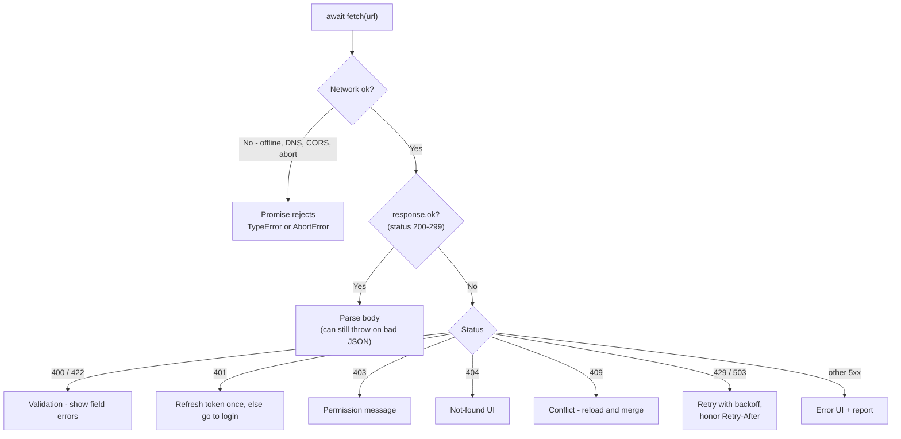

**A consistent error model** makes every layer simpler:

| Field | Purpose |
|---|---|
| `kind` | `'network' \| 'http' \| 'parse' \| 'abort' \| 'timeout'` |
| `status` | HTTP status if any |
| `code` | Machine-readable server code (`EMAIL_TAKEN`) — prefer RFC 9457 *Problem Details* (`application/problem+json`) on the server |
| `retryable` | Whether automatic retry is safe (idempotent requests, 429/503/network) |
| `requestId` | Correlates with server logs and traces |

**Retry rules:** retry only **idempotent** requests (GET, PUT, DELETE with the same body) or requests protected by an **idempotency key**; use **exponential backoff with jitter**; cap attempts; never retry 4xx except 408/429. Data libraries (TanStack Query, SWR, Apollo, RTK Query) have retry built in — configure it rather than writing your own.

**Chunk-load failures** after a deploy (`Failed to fetch dynamically imported module`, `ChunkLoadError`) are a special case: reload once to pick up the new HTML. See [Browser Caching Strategies](../01-web-fundamentals/browser-caching-strategies.md) (Example 4) and [Code Splitting & Lazy Loading](../04-performance-engineering/code-splitting-and-lazy-loading.md).

---

### Section 10: Error UX — Fallbacks, Recovery and Accessibility

A good fallback answers three questions: **what happened**, **is my data safe**, and **what can I do now**.

| Do | Don't |
|---|---|
| Plain language: "We couldn't load your invoices." | Show stack traces, error codes alone, or `[object Object]` |
| Offer an action: **Retry**, **Go back**, **Reload**, **Contact support** (with a reference ID) | Dead-end screens |
| **Keep user input** (form values, drafts) | Unmount a half-filled form and lose it |
| Keep navigation working (route-level boundaries) | Replace the whole app for one widget's failure |
| Announce errors to assistive tech: `role="alert"` (or a polite live region for non-urgent ones), move focus to the error heading for page-level failures | Change only color or show a silent icon |
| Distinguish offline from server errors | Show "Something went wrong" for everything |
| Show a **reference ID** that support can search in the tracker | Ask users to "send a screenshot of the console" |

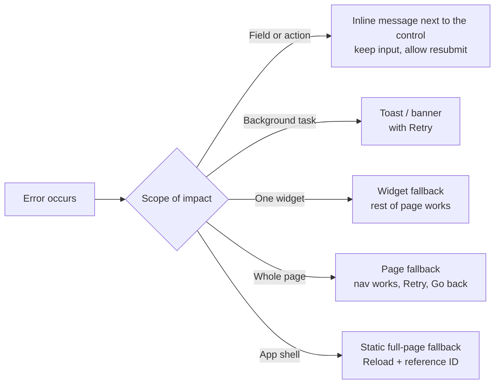

See [Keyboard Navigation & Focus Management](../06-accessibility-and-i18n/keyboard-navigation-and-focus-management.md) and [ARIA Roles, States & Properties](../06-accessibility-and-i18n/aria-roles-states-and-properties.md) for focus and live-region details.

---

### Section 11: The Reporting Pipeline

Catching is half the job. Every unexpected error should be **reported once, with context, without leaking user data**.

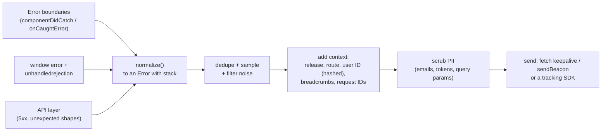

| Step | Why |
|---|---|
| **Normalize** | `throw "oops"` or rejecting with an object gives no stack; wrap non-`Error` values |
| **Dedupe** | One bug in a render loop can fire thousands of identical events |
| **Filter noise** | Browser extensions, bots, `ResizeObserver loop` messages, known third-party scripts |
| **Context** | Release/version, route, component stack, recent actions (breadcrumbs) — without them a stack trace is a riddle |
| **Scrub** | Never send passwords, tokens, full emails or payment data |
| **Deliver reliably** | `fetch(url, { keepalive: true })` or `navigator.sendBeacon` survive page unload |
| **Source maps** | Minified stacks are unreadable; upload source maps to the tracker, don't serve them publicly unless you intend to |

In practice a tracking SDK (Sentry, Datadog, etc.) does most of this — see [Error Tracking (Sentry, Datadog RUM)](./error-tracking-sentry-datadog-rum.md). Use `Error.cause` (`new Error('Saving invoice failed', { cause: err })`) to keep the original error when you wrap it.

---

## System Design Angle — A Layered Error Architecture

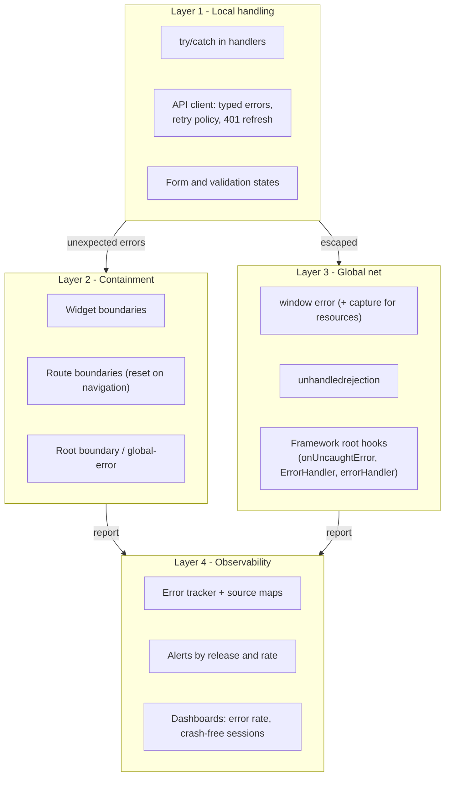

**Decisions to make (and to state in a design review):**

| Decision | Options | Guidance |
|---|---|---|
| Boundary granularity | Root only / route / widget | Root + route always; widget for independent, non-critical regions |
| Async errors | Local inline state vs boundary | User actions → inline; failed region data → boundary |
| Reset strategy | Retry button, `resetKeys` (route, IDs), full reload | Reset on navigation; reload once for chunk errors |
| API error contract | Ad-hoc vs Problem Details (RFC 9457) | One typed error model shared by every request |
| Retry policy | None / fixed / exponential with jitter | Idempotent only, capped, honor `Retry-After` |
| Third-party isolation | Same page / boundary / sandboxed iframe | Boundary for React widgets; iframe for untrusted embeds |
| Reporting | DIY endpoint vs SDK | SDK for source maps, grouping and alerts; DIY only for strict data residency |
| SSR/RSC | Generic message + digest | Never send server error details to the browser |

---

## Real-World Examples

**Example 1 — A reusable error boundary (TypeScript, no library):**
```tsx
import { Component, type ErrorInfo, type ReactNode } from 'react';

type Props = {
  fallback: (args: { error: Error; reset: () => void }) => ReactNode;
  onError?: (error: Error, info: ErrorInfo) => void;
  resetKeys?: unknown[];          // reset automatically when any of these change (e.g. route, id)
  children: ReactNode;
};
type State = { error: Error | null };

export class ErrorBoundary extends Component<Props, State> {
  state: State = { error: null };

  static getDerivedStateFromError(error: unknown): State {
    return { error: error instanceof Error ? error : new Error(String(error)) };
  }

  componentDidCatch(error: Error, info: ErrorInfo) {
    this.props.onError?.(error, info);   // report with info.componentStack
  }

  componentDidUpdate(prev: Props) {
    const changed = this.props.resetKeys?.some((k, i) => !Object.is(k, prev.resetKeys?.[i]));
    if (this.state.error && changed) this.reset();
  }

  reset = () => this.setState({ error: null });

  render() {
    const { error } = this.state;
    return error ? this.props.fallback({ error, reset: this.reset }) : this.props.children;
  }
}
```

**Example 2 — Boundaries at three levels with `react-error-boundary`:**
```tsx
import { ErrorBoundary, type FallbackProps } from 'react-error-boundary';
import { useLocation } from 'react-router';
import { reportError } from './reporting';

function PageFallback({ error, resetErrorBoundary }: FallbackProps) {
  return (
    <section role="alert" aria-labelledby="err-title">
      <h1 id="err-title" tabIndex={-1} ref={(el) => el?.focus()}>This page couldn't load</h1>
      <p>Your other pages still work. Reference: {(error as { id?: string }).id ?? 'n/a'}</p>
      <button onClick={resetErrorBoundary}>Try again</button>
    </section>
  );
}

export function AppLayout({ children }: { children: React.ReactNode }) {
  const { pathname } = useLocation();
  return (
    <>
      <Header />                                  {/* outside the route boundary: stays usable */}
      <ErrorBoundary
        FallbackComponent={PageFallback}
        onError={(error, info) => reportError(error, { componentStack: info.componentStack })}
        resetKeys={[pathname]}                    // navigating away clears the error
      >
        <main>{children}</main>
      </ErrorBoundary>
    </>
  );
}

export function ProductPage() {
  return (
    <>
      <ProductDetails />                          {/* primary content: failure = page failure */}
      <ErrorBoundary fallback={<p>Recommendations are unavailable right now.</p>}>
        <Recommendations />                       {/* non-critical widget fails alone */}
      </ErrorBoundary>
    </>
  );
}
```

**Example 3 — Async errors: BAD → GOOD:**
```tsx
// ❌ BAD: the rejection escapes; no boundary sees it; the button silently does nothing
function ExportButton() {
  return <button onClick={async () => { await exportReport(); }}>Export</button>;
}

// ✅ GOOD (user action): handle locally, keep the user informed
function ExportButtonGood() {
  const [status, setStatus] = useState<'idle' | 'busy' | 'error'>('idle');
  async function onClick() {
    setStatus('busy');
    try {
      await exportReport();
      setStatus('idle');
    } catch (err) {
      setStatus('error');
      reportError(err);
    }
  }
  return (
    <>
      <button onClick={onClick} disabled={status === 'busy'}>Export</button>
      {status === 'error' && <p role="alert">Export failed. Please try again.</p>}
    </>
  );
}

// ✅ GOOD (region can't work without it): hand the error to the nearest boundary
import { useErrorBoundary } from 'react-error-boundary';
function ReportViewer({ id }: { id: string }) {
  const { showBoundary } = useErrorBoundary();
  useEffect(() => {
    const ctrl = new AbortController();
    loadReport(id, ctrl.signal).then(setReport).catch((e) => {
      if ((e as Error).name !== 'AbortError') showBoundary(e);
    });
    return () => ctrl.abort();
  }, [id, showBoundary]);
  /* … */
}
```

**Example 4 — The global safety net, installed first:**
```typescript
// error-net.ts — import this before anything else in the entry file
type Report = (error: Error, extra?: Record<string, unknown>) => void;

function toError(value: unknown): Error {
  if (value instanceof Error) return value;
  try { return new Error(typeof value === 'string' ? value : JSON.stringify(value)); }
  catch { return new Error(String(value)); }
}

export function installGlobalErrorNet(report: Report) {
  // 1. Uncaught exceptions from scripts
  window.addEventListener('error', (event) => {
    if (event instanceof ErrorEvent) {
      if (event.message === 'Script error.' && !event.error) {
        report(new Error('Cross-origin script error (add crossorigin + CORS)'), { kind: 'opaque' });
        return;
      }
      report(toError(event.error ?? event.message), {
        kind: 'uncaught', file: event.filename, line: event.lineno, col: event.colno,
      });
    }
  });

  // 2. Resource load failures (img/script/link) — they don't bubble, so listen in the capture phase
  window.addEventListener('error', (event) => {
    const el = event.target;
    if (el instanceof HTMLScriptElement || el instanceof HTMLLinkElement || el instanceof HTMLImageElement) {
      const url = 'src' in el ? el.src : el.href;
      report(new Error(`Resource failed to load: ${url}`), { kind: 'resource', tag: el.tagName });
    }
  }, true);

  // 3. Promises nobody handled
  window.addEventListener('unhandledrejection', (event) => {
    report(toError(event.reason), { kind: 'unhandledrejection' });
  });
}
```

**Example 5 — React 19 root callbacks:**
```tsx
import { createRoot } from 'react-dom/client';
import { report } from './reporting';

const root = createRoot(document.getElementById('root')!, {
  onCaughtError: (error, info) => report(error, { level: 'error', componentStack: info.componentStack }),
  onUncaughtError: (error, info) => {
    report(error, { level: 'fatal', componentStack: info.componentStack });
    document.getElementById('static-fallback')!.hidden = false; // plain-HTML fallback outside React
  },
  onRecoverableError: (error, info) => report(error, { level: 'warning', componentStack: info.componentStack }),
});
root.render(<App />);
```

**Example 6 — A typed fetch wrapper (expected vs unexpected errors):**
```typescript
export class HttpError extends Error {
  constructor(
    public status: number,
    public code: string | undefined,
    public requestId: string | null,
    message: string,
  ) {
    super(message);
    this.name = 'HttpError';
  }
  get retryable() { return this.status === 408 || this.status === 429 || this.status >= 500; }
}

export async function api<T>(input: string, init?: RequestInit): Promise<T> {
  let res: Response;
  try {
    res = await fetch(input, init);
  } catch (err) {
    if ((err as Error).name === 'AbortError') throw err;          // caller cancelled — not a bug
    throw new Error('Network request failed', { cause: err });     // offline, DNS, CORS
  }
  if (!res.ok) {
    const problem = await res.json().catch(() => ({}));            // RFC 9457 problem+json if available
    throw new HttpError(res.status, problem.code, res.headers.get('x-request-id'),
      problem.title ?? `HTTP ${res.status}`);
  }
  return (await res.json()) as T;
}
```

**Example 7 — Next.js route error UI:**
```tsx
// app/dashboard/error.tsx
'use client';
import { useEffect } from 'react';

export default function DashboardError({ error, retry }: { error: unknown; retry: () => void }) {
  useEffect(() => {
    // error.digest matches the server log entry for Server Component errors
    console.error(error);
  }, [error]);
  const digest = error instanceof Error ? (error as Error & { digest?: string }).digest : undefined;
  return (
    <div role="alert">
      <h2>We couldn't load your dashboard.</h2>
      {digest && <p>Reference: {digest}</p>}
      <button onClick={() => retry()}>Try again</button>   {/* older Next.js versions: reset() */}
    </div>
  );
}
```

**Example 8 — The same idea in Vue, Angular and Svelte:**
```typescript
// Vue 3 — app-wide handler + a boundary component built on onErrorCaptured
app.config.errorHandler = (err, instance, info) => report(toError(err), { info });

// ErrorBoundary.vue (script setup)
// const error = ref<Error | null>(null);
// onErrorCaptured((err) => { error.value = toError(err); return false; }); // false = stop propagation
// template: <slot v-if="!error" /> <div v-else role="alert">…<button @click="error = null">Retry</button></div>

// Angular — custom ErrorHandler + browser listeners
// export class ReportingErrorHandler implements ErrorHandler {
//   handleError(error: unknown) { report(toError(error)); }
// }
// bootstrapApplication(App, { providers: [
//   provideBrowserGlobalErrorListeners(),
//   { provide: ErrorHandler, useClass: ReportingErrorHandler },
// ]});
```
```html
<!-- Svelte 5 -->
<svelte:boundary onerror={(error) => report(error)}>
  <Comments />
  {#snippet failed(error, reset)}
    <p role="alert">Comments failed to load.</p>
    <button onclick={reset}>Retry</button>
  {/snippet}
</svelte:boundary>
```

---

## Key Points Summary

| Concept | One-Line Explanation |
|---|---|
| **Error boundary** | Component that catches render/effect errors in its subtree and shows a fallback |
| **Boundary limits** | Doesn't catch event handlers, timers, unhandled promises, SSR, or itself |
| **Granularity** | Root + route always; widget-level for independent, non-critical regions |
| **`window` `error`** | Global catch for uncaught exceptions; capture phase also sees resource failures |
| **`unhandledrejection`** | Global catch for promises rejected with no handler |
| **"Script error."** | Cross-origin script details are hidden unless `crossorigin` + CORS |
| **`showBoundary` / Actions** | Ways to route async errors into a boundary |
| **React 19 root callbacks** | `onCaughtError`, `onUncaughtError`, `onRecoverableError` observe all React errors |
| **Next.js `error.tsx`** | Client boundary per route segment; `global-error.tsx` for the root layout |
| **`error.digest`** | Safe ID linking a client-visible server error to server logs |
| **`fetch` semantics** | Rejects only on network failure; check `response.ok` for HTTP errors |
| **Expected vs unexpected** | Validation/404 are UI states; bugs go to boundaries and the tracker |
| **Error UX** | Explain, keep data, offer an action, announce to assistive tech |
| **Reporting pipeline** | Normalize, dedupe, add context, scrub PII, deliver with keepalive |

---

## Test Your Understanding

**Q1 (Basic):**
Which of these does a React error boundary catch: (a) a `TypeError` in a component's render, (b) a throw inside `onClick`, (c) a rejected `fetch` inside `useEffect` with no `.catch`, (d) an error in `useEffect`'s synchronous body? Explain why.

<details>
<summary>Answer</summary>

- **(a) Yes** — it happens while React renders the subtree.
- **(b) No** — event handlers run outside rendering, when React is not in the middle of building the tree; use `try/catch` and local state.
- **(c) No** — the rejection happens later, in a microtask, outside React's work. It surfaces only as `unhandledrejection`. Catch it and call `showBoundary(err)` (or a state-setter rethrow) to route it to the boundary.
- **(d) Yes** — errors thrown synchronously in effects during the commit are caught by the nearest boundary.

The rule: boundaries catch errors **thrown during React's own render/commit work**, not errors in code React merely scheduled or that runs later.
</details>

**Q2 (Application):**
A product page has a header, product details, reviews, and a "customers also bought" carousel from a recommendations service that fails about once a day. Where do you put error boundaries and what does each fallback show?

<details>
<summary>Answer</summary>

- **Root boundary** (last resort): full-page message, Reload button and reference ID.
- **Route boundary** around the page content, with the **header outside it** so navigation keeps working; it resets when the route changes.
- **Widget boundary** around the **recommendations carousel**: on failure, hide it or show "Recommendations unavailable" — the purchase path is unaffected.
- **Widget boundary** around **reviews** (useful but not essential): "Couldn't load reviews — Retry".
- **No inner boundary** around **product details**: without them the page has no purpose, so their failure should show the page-level fallback.

Every boundary reports through `onError` / `onCaughtError` with the component stack.
</details>

**Q3 (Tricky):**
Your error tracker shows thousands of events reading only `Script error.` with no stack. What is happening, and how do you get useful data?

<details>
<summary>Answer</summary>

The failing scripts are loaded from **another origin** (your CDN domain or a third-party), and the browser **sanitizes** errors from cross-origin scripts to avoid leaking information — only `"Script error."` reaches `window.onerror`, with no file, line or `error` object.

For your own scripts: add `crossorigin="anonymous"` to the `<script>` tags (bundlers have a setting for this) **and** have the CDN send `Access-Control-Allow-Origin`. Then you get full stacks, which source maps can de-minify. For third-party scripts you don't control, you can't fix the details: filter or tag those events so they don't hide your own bugs, and wrap your calls into their APIs in `try/catch`.
</details>

**Q4 (Tricky):**
In a Next.js App Router app, `app/dashboard/layout.tsx` throws while fetching the user's team. `app/dashboard/error.tsx` exists, but users see the parent error UI instead. Why? And why does the message say something generic instead of "Team service timeout"?

<details>
<summary>Answer</summary>

`error.tsx` wraps the segment's **page and children inside the layout**, so it cannot catch errors from the **layout of the same segment** — the layout is *outside* that boundary. The error bubbles to the **parent segment's** `error.tsx` (or `global-error.tsx` for the root layout). Fix: move the risky fetch into the page or a child component, or rely on the parent boundary.

The message is generic because errors thrown in **Server Components** are **sanitized in production**: the client receives a generic message plus `error.digest`, a hash that matches the server log. This prevents leaking internal details (hostnames, SQL, secrets) to the browser. Look up the digest in server logs, or report server errors with `instrumentation.ts`'s `onRequestError`.
</details>

**Q5 (Application):**
`await fetch('/api/orders')` returns a 500 page, yet your `try/catch` never runs and the UI shows "No orders yet". Explain and fix.

<details>
<summary>Answer</summary>

`fetch` **only rejects on network-level failures** (offline, DNS, CORS, abort). An HTTP 500 is a successful *transport* — the promise resolves with `response.ok === false`. The code probably parsed the body (or fell back to an empty list) and rendered the empty state, **hiding a server error as "no data"**, which is misleading.

Fix: centralize requests in a wrapper that checks `response.ok` and throws a typed `HttpError` (status, code, request ID, retryable). Then the UI distinguishes **empty** (200 with `[]`) from **error** (retryable message), and the data layer can retry 5xx with backoff. Data libraries do this if your fetcher throws on non-OK responses.
</details>

**Q6 (System design):**
Design error handling for a large SaaS dashboard (React SPA, many independent widgets, third-party chat widget, weekly deploys). What layers, policies and metrics would you put in place?

<details>
<summary>Answer</summary>

- **Local layer:** one typed API client (`HttpError`, Problem Details from the server, request IDs), retry with exponential backoff and jitter for idempotent calls and 429/503, a single 401 → refresh → retry-once flow, and inline errors for user actions that keep form state.
- **Containment:** a root boundary with a static fallback, route boundaries reset on navigation (shell and nav outside them), and **one boundary per dashboard widget** so a failing chart doesn't take down the others; widget data errors routed via suspense queries or `showBoundary`.
- **Third parties:** the chat widget loaded asynchronously and isolated (its own boundary or an iframe); its errors tagged and filtered separately.
- **Deploy safety:** keep old hashed chunks, reload once on chunk-load errors, `crossorigin` on scripts, source maps uploaded per release.
- **Global net:** `error` (plus capture for resources), `unhandledrejection`, and React 19 root callbacks, installed first.
- **Reporting:** normalize, dedupe, sample noise, attach release/route/hashed user ID/breadcrumbs, scrub PII, deliver with `keepalive`/beacon via an error-tracking SDK.
- **Metrics and alerts:** error rate and crash-free sessions per release, alerts on new error groups and spikes after a deploy, fallback-render counts per widget, chunk-load-error rate.
- **UX:** accessible alerts, reference IDs shown to users, offline vs server errors distinguished.
</details>

---

## Cheat Sheet

**Key Definitions:**
- **Error boundary:** A component that catches errors from its descendants' rendering and shows a fallback
- **Fallback UI:** What renders instead of the failed subtree
- **Reset:** Clearing the boundary's error state to try rendering again
- **Global error handler:** `window` listener for uncaught exceptions (`error`) and unhandled promises (`unhandledrejection`)
- **Unhandled rejection:** A rejected promise with no handler by the end of the microtask checkpoint
- **Error digest:** A server-generated ID shown in place of sanitized Server Component error details
- **Problem Details:** RFC 9457 JSON format for HTTP API errors

**Quick Reference:**
```text
Catches what?
  Error boundary  → render, lifecycle, effects of descendants
  try/catch       → event handlers, async/await code
  window 'error'  → uncaught exceptions (+ capture phase: resource load failures)
  'unhandledrejection' → promises with no handler
  reportError(e)  → report without throwing

React 19 root:   createRoot(el, { onCaughtError, onUncaughtError, onRecoverableError })
Async → boundary: useErrorBoundary().showBoundary(err) · setState(() => { throw err }) · Actions · suspense queries
Next.js:         error.tsx ('use client', error + retry/reset) · global-error.tsx (own <html><body>) · error.digest
Vue:             app.config.errorHandler · onErrorCaptured (return false to stop) · Nuxt <NuxtErrorBoundary>
Angular:         ErrorHandler · provideBrowserGlobalErrorListeners() · @defer { } @error { }
Svelte 5:        <svelte:boundary onerror> + {#snippet failed(error, reset)}
fetch:           rejects only on network errors → check response.ok
Cross-origin:    <script crossorigin="anonymous"> + Access-Control-Allow-Origin, else "Script error."
Placement:       root + route (reset on navigation) + widget for non-critical regions
```

**Common Mistakes to Avoid:**

| Mistake | Why Wrong | Fix |
|---|---|---|
| No error boundary at all | One render error unmounts the whole app → blank page | Root + route boundaries at minimum |
| Expecting boundaries to catch `onClick`/async errors | They only catch errors during React's render/commit | `try/catch` + local state, or `showBoundary` |
| Header/nav inside the route boundary | A page crash also removes navigation | Keep the shell outside the route boundary |
| Never resetting the boundary | User stays stuck on the fallback after navigating | `resetKeys` on route/IDs, Retry button |
| Treating `fetch` 4xx/5xx as success | Errors shown as empty data | Check `response.ok`; throw typed errors |
| Throwing for expected outcomes | Validation errors become error pages and tracker noise | Return them as values / UI state |
| Missing `unhandledrejection` listener | Async failures disappear silently | Install the global net first |
| Cross-origin scripts without `crossorigin` | Only "Script error." is reported | `crossorigin="anonymous"` + CORS header |
| Retrying non-idempotent requests blindly | Duplicate orders or payments | Retry only idempotent calls or use idempotency keys |
| Showing stack traces to users | Confusing and leaks internals | Plain message + reference ID |
| Sending raw errors with PII to the tracker | Privacy and compliance risk | Scrub before sending |
| A boundary around every component | Half-broken pages, hidden failures | Boundaries around independently useful units |

---

## References & Further Reading

**React and frameworks**
- React: [Catching rendering errors with an error boundary (`Component`)](https://react.dev/reference/react/Component#catching-rendering-errors-with-an-error-boundary)
- React: [`createRoot` options — `onCaughtError`, `onUncaughtError`, `onRecoverableError`](https://react.dev/reference/react-dom/client/createRoot)
- React blog: [React 19 — Better error reporting](https://react.dev/blog/2024/12/05/react-19#error-handling)
- [`react-error-boundary` (GitHub)](https://github.com/bvaughn/react-error-boundary)
- Next.js: [Error handling](https://nextjs.org/docs/app/getting-started/error-handling) · [`error.js` file convention](https://nextjs.org/docs/app/api-reference/file-conventions/error)
- TanStack Query: [Suspense and error boundaries](https://tanstack.com/query/latest/docs/framework/react/guides/suspense)
- Vue: [`app.config.errorHandler`](https://vuejs.org/api/application.html#app-config-errorhandler) · [`onErrorCaptured`](https://vuejs.org/api/composition-api-lifecycle.html#onerrorcaptured)
- Nuxt: [Error handling](https://nuxt.com/docs/getting-started/error-handling)
- Angular: [Unhandled errors in Angular](https://angular.dev/best-practices/error-handling)
- Svelte: [`<svelte:boundary>`](https://svelte.dev/docs/svelte/svelte-boundary) · SvelteKit: [Errors](https://svelte.dev/docs/kit/errors)
- Solid: [`<ErrorBoundary>`](https://docs.solidjs.com/reference/components/error-boundary)

**Browser APIs (MDN)**
- [Window: `error` event](https://developer.mozilla.org/en-US/docs/Web/API/Window/error_event) · [`ErrorEvent`](https://developer.mozilla.org/en-US/docs/Web/API/ErrorEvent)
- [Window: `unhandledrejection` event](https://developer.mozilla.org/en-US/docs/Web/API/Window/unhandledrejection_event) · [`PromiseRejectionEvent`](https://developer.mozilla.org/en-US/docs/Web/API/PromiseRejectionEvent)
- [`reportError()`](https://developer.mozilla.org/en-US/docs/Web/API/Window/reportError)
- [`crossorigin` attribute](https://developer.mozilla.org/en-US/docs/Web/HTML/Reference/Attributes/crossorigin)
- [`Error.cause`](https://developer.mozilla.org/en-US/docs/Web/JavaScript/Reference/Global_Objects/Error/cause)
- [Using the Fetch API — checking that the fetch was successful](https://developer.mozilla.org/en-US/docs/Web/API/Fetch_API/Using_Fetch#checking_response_status)

**Specs**
- WHATWG HTML: [Runtime script errors](https://html.spec.whatwg.org/multipage/webappapis.html#runtime-script-errors) · [Unhandled promise rejections](https://html.spec.whatwg.org/multipage/webappapis.html#unhandled-promise-rejections)
- IETF: [RFC 9457 — Problem Details for HTTP APIs](https://www.rfc-editor.org/rfc/rfc9457)

---

> **Previous Topic:** [Testing Strategies & Pyramid](../08-testing/testing-strategies-and-pyramid.md)
> — How much of each kind of test to write, and when they run

> **Next Topic:** [Error Tracking (Sentry, Datadog RUM)](./error-tracking-sentry-datadog-rum.md)
> — Sending the errors you caught to a service that groups, de-minifies and alerts on them

*Saved on: 2026-11-06 | Repo: Frontend System Design Learning Notes*
