# Real User Monitoring (RUM)

> **Date:** 2026-11-06 · **Last updated:** 2026-11-06
> **Category:** Frontend System Design
> **Sub-Topic:** Monitoring & Observability / Real User Monitoring
> **Level:** Intermediate · **Reading time:** ~32 min
> **Informs:** RUM pipeline design (collect, beacon, ingest, aggregate), which browser timing APIs to collect, session sampling rate, segmentation dimensions and cardinality, percentile dashboards and field SLOs, release-regression alerting, frontend-to-backend trace correlation, telemetry privacy and consent, vendor vs self-hosted RUM

> **Pre-requisite:** [Core Web Vitals (LCP, INP, CLS)](../04-performance-engineering/core-web-vitals-lcp-inp-cls.md) (the metrics themselves, field vs lab) and [Error Tracking (Sentry, Datadog RUM)](./error-tracking-sentry-datadog-rum.md).
> This note is about the **system** that measures real users: what to collect, how to get it off the page reliably, how to aggregate it honestly and how to act on it.

**Previous:** [Error Tracking (Sentry, Datadog RUM)](./error-tracking-sentry-datadog-rum.md) · **Next:** [Synthetic Monitoring](./synthetic-monitoring.md)

---

## Table of Contents

1. [ELI5 — Simple Explanation](#eli5--simple-explanation)
2. [Section 1: What RUM Is (and Is Not)](#section-1-what-rum-is-and-is-not)
3. [Section 2: The RUM Pipeline End to End](#section-2-the-rum-pipeline-end-to-end)
4. [Section 3: What the Browser Can Measure](#section-3-what-the-browser-can-measure)
5. [Section 4: Navigation Timing — Breaking Down a Page Load](#section-4-navigation-timing--breaking-down-a-page-load)
6. [Section 5: Context — The Dimensions That Make Data Useful](#section-5-context--the-dimensions-that-make-data-useful)
7. [Section 6: Getting Data Off the Page Reliably](#section-6-getting-data-off-the-page-reliably)
8. [Section 7: Sampling](#section-7-sampling)
9. [Section 8: Aggregation — Percentiles, Histograms and Traps](#section-8-aggregation--percentiles-histograms-and-traps)
10. [Section 9: SPAs, bfcache and Prerendering](#section-9-spas-bfcache-and-prerendering)
11. [Section 10: Correlating Frontend and Backend](#section-10-correlating-frontend-and-backend)
12. [Section 11: Privacy, Consent and Ad Blockers](#section-11-privacy-consent-and-ad-blockers)
13. [Section 12: Dashboards, SLOs and Alerting](#section-12-dashboards-slos-and-alerting)
14. [Build vs Buy](#build-vs-buy)
15. [Framework and Platform Notes](#framework-and-platform-notes)
16. [Real-World Examples](#real-world-examples)
17. [Key Points Summary](#key-points-summary)
18. [Test Your Understanding (with answers)](#test-your-understanding)
19. [Cheat Sheet](#cheat-sheet)
20. [References & Further Reading](#references--further-reading)

---

## ELI5 — Simple Explanation

Imagine you run a **pizza delivery** company and want to know how fast deliveries really are.

- **Synthetic monitoring** is sending your own test driver on the same route every hour. Useful and repeatable, but it is one car, one route, perfect weather.
- **Real User Monitoring** is putting a **small stopwatch in every pizza box**. Each customer's box records when the order was placed, when it left the shop and when it arrived, then mails a postcard back.
- You never read one postcard on its own. You sort thousands of them by **neighbourhood, time of day and driver**, and ask questions like *"For 3 out of 4 customers in the north side, how long did they wait?"* That is the **75th percentile**.
- Some postcards get lost in the mail (users closing the tab, ad blockers), so you design the postcard to be **small and sent early**.
- You never write the customer's name or address on the postcard unless you truly need it (privacy).

> **One-line takeaway: RUM measures what real users actually experienced, on their devices and networks, and only becomes useful once you segment it and look at percentiles instead of averages.**

---

## Core Concept — Step by Step

### Section 1: What RUM Is (and Is Not)

**Real User Monitoring** is a small script (or SDK) that runs inside every real page view, reads the browser's performance and error APIs, and sends the results to a backend that aggregates them across all users.

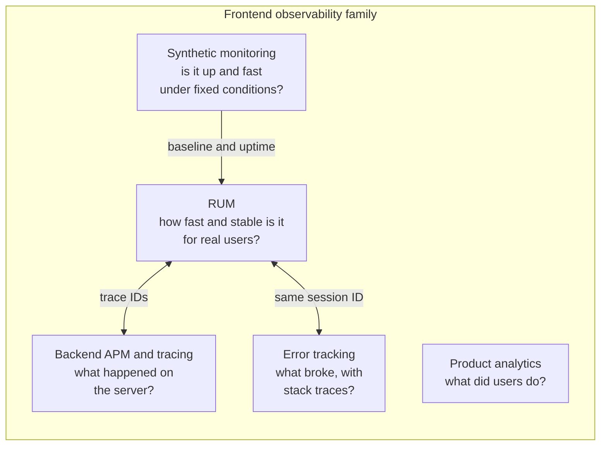

| Tool | Question it answers | Data source | Typical owner |
|---|---|---|---|
| **RUM** | How fast and stable is the experience, for whom, on which pages? | Every (sampled) real page view | Frontend platform / performance team |
| **Synthetic monitoring** | Is it up? Did this deploy regress under controlled conditions? | Scripted bots from fixed locations | SRE / QA (see [Synthetic Monitoring](./synthetic-monitoring.md)) |
| **Error tracking** | Which exceptions happen, how often, with which stack? | Error events + breadcrumbs | Feature teams |
| **Product analytics** | Which features do people use, which funnels convert? | Business events | Product / growth (see [Analytics Architecture](./analytics-architecture.md)) |
| **CrUX** | What does Google see for my origin and URLs? | Opted-in Chrome users, 28-day window | Free public baseline, not a replacement for RUM |

**Why RUM can't be replaced by lab tests:** real users differ in device CPU, network, cache state, logged-in state, consent banners, browser extensions, geography and the exact content they see. A lab run measures one combination. RUM measures the **distribution**.

**Why lab tests can't be replaced by RUM:** RUM tells you *what* is slow and *for whom*, but it lags behind (you need traffic) and it rarely contains enough detail to explain *why*. You reproduce and fix in the lab ([Lighthouse & Performance Auditing](../04-performance-engineering/lighthouse-and-performance-auditing.md)).

> Many vendors bundle RUM, error tracking and session replay into one SDK (Datadog RUM, Sentry, New Relic Browser, Dynatrace, Grafana Faro). The concepts in this note apply whether you buy one or build your own.

---

### Section 2: The RUM Pipeline End to End

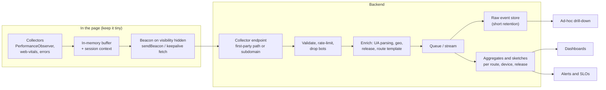

| Stage | Design decisions | Common mistake |
|---|---|---|
| **Collect** | Which APIs, which attribution, how much detail per event | Collecting everything and shipping a heavy SDK that itself hurts LCP/INP |
| **Buffer** | Batch events per page view; keep the latest value per metric | Sending one request per event |
| **Send** | When (page hidden), how (`sendBeacon`, `keepalive`), payload size | Sending only on `load` (misses INP and CLS) or on `unload` |
| **Ingest** | Schema validation, auth-less public endpoint protection, bot filtering | Trusting the payload blindly; letting arbitrary strings become dimensions |
| **Enrich** | User agent → browser/OS/device class, IP → country (then drop the IP), URL → route template | Storing raw URLs with tokens and personal data |
| **Store** | Raw events with short retention; long-term aggregates | Keeping raw events forever (cost, privacy) |
| **Aggregate** | Percentiles from histograms or quantile sketches | Averages, or averaging percentiles across segments |
| **Act** | Dashboards per route and release, alerts on sustained change | Alerting on single noisy data points |

**Load the RUM script without hurting the thing it measures.** Load it `async` (or as a small inline snippet that loads the SDK asynchronously), register observers with `buffered: true` so early entries are not lost, and keep the in-page code small. Vendors usually offer an "async snippet" with a command queue (`window.DD_RUM.onReady(...)`-style) so calls made before the SDK loads are replayed.

---

### Section 3: What the Browser Can Measure

All modern timing APIs share one interface: **`PerformanceObserver`** subscribed to an **entry type**. The table shows support from MDN browser-compat-data (late 2026). Always feature-detect with `PerformanceObserver.supportedEntryTypes`.

| Entry type / API | What it gives you | Chromium | Firefox | Safari |
|---|---|---|---|---|
| `navigation` (Navigation Timing L2) | Phases of the document load: redirect, DNS, TCP, TLS, TTFB, DOM events, sizes | ✅ | ✅ | ✅ 15+ |
| `resource` (Resource Timing) | Same phases for every subresource and `fetch`/XHR call | ✅ | ✅ | ✅ |
| `paint` | First Paint (Chromium), First Contentful Paint | ✅ | ✅ | ✅ 14.1+ |
| `largest-contentful-paint` | LCP candidates and element | ✅ | ✅ 122+ | ✅ 26.2+ |
| `event` + `interactionId` | Event Timing for INP | ✅ | ✅ 144+ | ✅ 26.2+ |
| `layout-shift` | CLS inputs | ✅ | ❌ | ❌ |
| `long-animation-frame` (LoAF) | Slow frames with **script attribution** (source URL, function, invoker) | ✅ 123+ | ❌ | ❌ |
| `longtask` | Tasks over 50 ms (older, less attribution than LoAF) | ✅ | ❌ | ❌ |
| `element` (Element Timing) | Render time of elements you mark with `elementtiming` | ✅ | ❌ | ❌ |
| `mark` / `measure` (User Timing) | Your own business timings ("search results rendered") | ✅ | ✅ | ✅ |
| `serverTiming` on entries | Backend timings you send in the `Server-Timing` header | ✅ | ✅ | ✅ 16.4+ |
| `visibility-state` | When the page was hidden or visible | ✅ 115+ | ❌ | ❌ |
| `soft-navigation` | Client-side route changes as navigations (experimental) | ✅ 151+ | ❌ | ❌ |

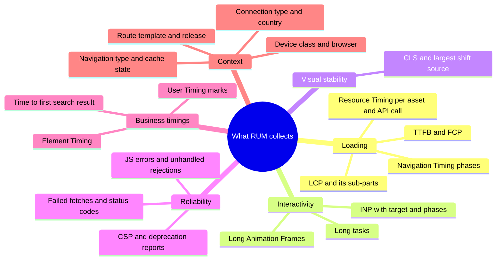

**Custom business metrics usually matter more than generic ones.** "Time until the product grid shows prices", "time from clicking Search to results visible", "time to first message rendered" are what users feel. Mark them with User Timing:

```typescript
performance.mark('search:submit');
await renderResults(results);
// measure from the click to the frame where results were committed
requestAnimationFrame(() => {
  performance.measure('search:results-visible', 'search:submit');
});
```

> **Cross-origin resources:** for a third-party script or CDN on another origin, Resource Timing exposes only start time, duration and end time. DNS/connect/request phases and sizes are zero unless that server sends **`Timing-Allow-Origin`** (for example `Timing-Allow-Origin: https://www.example.com`). Set it on your own CDN and API origins.

---

### Section 4: Navigation Timing — Breaking Down a Page Load

The `navigation` entry is the most valuable single record RUM collects: it splits TTFB into network and server parts, which tells you *which team* owns a slow page.

```mermaid
flowchart LR
    S(["startTime = 0"]) --> RD["Redirects<br/>redirectStart - redirectEnd"]
    RD --> SW["Service Worker<br/>workerStart"]
    SW --> CA["HTTP cache check<br/>fetchStart"]
    CA --> DNS["DNS<br/>domainLookupStart - End"]
    DNS --> TCP["TCP connect<br/>connectStart"]
    TCP --> TLS["TLS<br/>secureConnectionStart - connectEnd"]
    TLS --> REQ["Request sent, server works<br/>requestStart"]
    REQ --> TTFB["First byte<br/>responseStart = TTFB"]
    TTFB --> DL["Download HTML<br/>responseEnd"]
    DL --> DOM["Parse and run scripts<br/>domInteractive, DOMContentLoaded"]
    DOM --> LD["load event<br/>loadEventEnd"]
```

| Derived metric | Formula (entry fields) | Points to |
|---|---|---|
| Redirect time | `redirectEnd - redirectStart` | Marketing links, `http`→`https`, trailing-slash redirects |
| Service Worker startup | `fetchStart - workerStart` (when `workerStart > 0`) | SW boot cost |
| DNS | `domainLookupEnd - domainLookupStart` | DNS provider, missing preconnect (see [DNS Resolution & CDN](../01-web-fundamentals/dns-resolution-and-cdn.md)) |
| Connection (TCP + TLS) | `connectEnd - connectStart` | Distance to edge, TLS setup (see [TCP & TLS Handshake](../01-web-fundamentals/tcp-tls-handshake.md)) |
| Server / edge time | `responseStart - requestStart` | Origin rendering, cache misses at the CDN |
| HTML download | `responseEnd - responseStart` | Document size, streaming |
| Cache hit hint | `transferSize === 0 && encodedBodySize > 0` | Served from the HTTP cache (same-origin or TAO-enabled) |

Reading it with code:

```typescript
const [nav] = performance.getEntriesByType('navigation') as PerformanceNavigationTiming[];
if (nav) {
  const breakdown = {
    type: nav.type,                                   // 'navigate' | 'reload' | 'back_forward' | 'prerender'
    redirect: nav.redirectEnd - nav.redirectStart,
    dns: nav.domainLookupEnd - nav.domainLookupStart,
    connect: nav.connectEnd - nav.connectStart,
    server: nav.responseStart - nav.requestStart,
    ttfb: nav.responseStart,                         // relative to startTime 0
    download: nav.responseEnd - nav.responseStart,
    domInteractive: nav.domInteractive,
    transferSize: nav.transferSize,
  };
}
```

> Zero values are normal: a reused connection has no DNS/TCP/TLS phase, and a page restored from bfcache produces **no new navigation entry at all**. Treat "0" and "missing" as distinct states in your schema.

---

### Section 5: Context — The Dimensions That Make Data Useful

A p75 LCP of 2.9 s for "the whole site" is almost useless. The same number split by route, device and release tells you exactly where to look. Every RUM event should carry a small, fixed set of **dimensions**.

| Dimension | How to get it | Notes |
|---|---|---|
| **Route template** | Your router (`/product/:id`), not `location.href` | Raw URLs explode cardinality and may contain personal data |
| **Release / build ID** | Injected at build time | Enables "did this deploy regress?" |
| **Navigation type** | `navigate`, `reload`, `back-forward-cache`, `prerender`, `soft-navigation` | bfcache and prerender loads are much faster and skew averages |
| **Device class** | Parse the user agent server-side (or User-Agent Client Hints) → mobile / tablet / desktop | `navigator.deviceMemory` and `hardwareConcurrency` add CPU hints (deviceMemory is Chromium-only) |
| **Browser + version** | User agent parsing on the server | Needed because some metrics exist only in some engines |
| **Effective connection type** | `navigator.connection.effectiveType` | Chromium-only; absent elsewhere, so never require it |
| **Country / region** | From the CDN or IP at ingest, then discard the IP | Latency is mostly geography |
| **Cache state** | Navigation `transferSize`, `deliveryType` where supported | First visit vs repeat visit behave very differently |
| **Logged-in state, plan, A/B variant** | App state | Lets you link performance to experiments (see [Feature Flags & A/B Testing](./feature-flags-and-a-b-testing.md)) |
| **Visibility** | Was the page ever hidden before the metric was recorded? | Background-loaded pages produce misleading timings |

**Cardinality** is the number of distinct values a dimension can have. Every extra high-cardinality dimension multiplies storage and makes each segment too small to trust.

```text
GOOD dimension values:  route=/product/:id   device=mobile   release=2026.11.06-3
BAD dimension values:   url=/product/8812?ref=mail&email=ana@example.com   userId=48121   sessionId=...
                        (keep IDs as attributes on raw events if you need drill-down, never as aggregate dimensions)
```

---

### Section 6: Getting Data Off the Page Reliably

The hard part of RUM is not measuring; it's **delivering the measurement**. INP and CLS are only final when the user leaves, and mobile browsers often kill a page without firing `unload`.

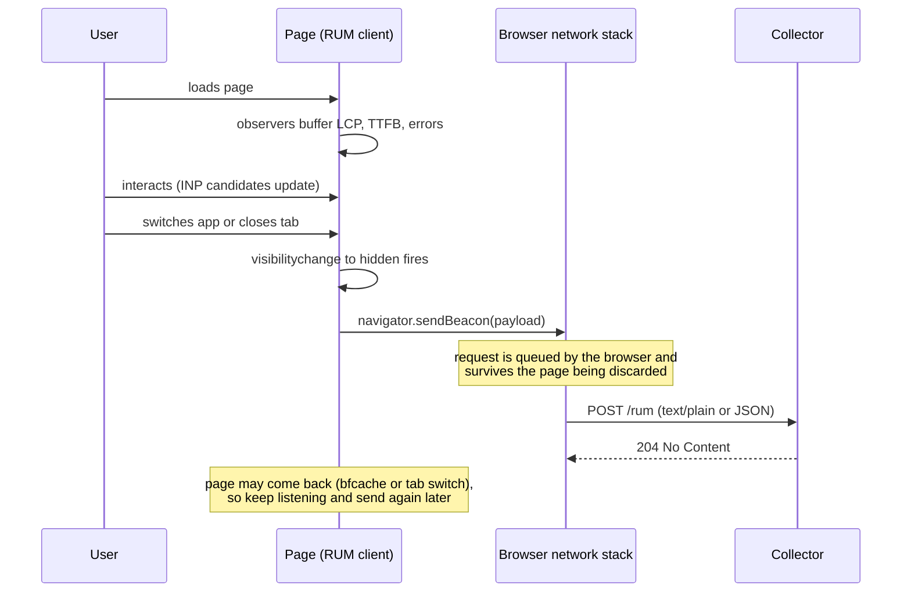

**Rules that hold across browsers:**

| Rule | Why |
|---|---|
| Flush on **`visibilitychange` → `hidden`** (and optionally `pagehide`) | It's the last event reliably fired on mobile; `unload` is unreliable and blocks bfcache in several browsers |
| Use **`navigator.sendBeacon()`**, fall back to **`fetch(..., { keepalive: true })`** | Both let the request outlive the page |
| Keep payloads small | The Fetch spec limits in-flight `keepalive` bodies (sendBeacon uses the same mechanism) to **64 KiB in total**; `sendBeacon` returns `false` if it can't queue |
| Send **again** if the page becomes visible and later hidden | INP and CLS can change after the first flush; deduplicate by page-view ID server-side, keep the last value |
| Avoid custom headers on beacons | `sendBeacon` can't set headers; a JSON `Blob` type triggers a CORS preflight if the collector is cross-origin. Plain text body to a same-origin path avoids both |
| Don't block the main thread to send | Serialize small payloads; never do synchronous XHR on exit |

**`fetchLater()`** is a newer API that lets a page hand the browser a request to send later, even if the page is destroyed. MDN lists it as experimental and Chromium-only (from Chrome 135) as of late 2026, so feature-detect and keep `sendBeacon` as the fallback.

---

### Section 7: Sampling

At high traffic you don't need every page view to get a stable p75, and every event costs money to ingest and store. **Sample per session, not per event.**

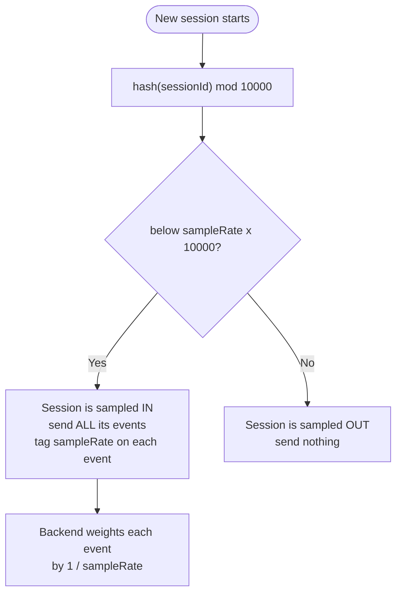

| Choice | Recommendation | Reason |
|---|---|---|
| **Unit** | Session (or page view), decided once | Per-event sampling breaks funnels and makes a page view's LCP and INP come from different users |
| **Deterministic** | Hash of a random session ID | Same decision on every page of the session; no coordination needed |
| **Record the rate** | `sampleRate` on every event | Lets you change rates per route or per release without corrupting counts |
| **Different rates per data type** | Metrics at a higher rate, session replay at a much lower one, errors often at 100 % | Replay is expensive and privacy-sensitive; errors are rarer and more valuable |
| **Low-traffic segments** | Raise the rate for small routes, countries or new releases | A segment with too few samples gives a p75 that jumps around |

> Sampling reduces precision, not accuracy, **if** it is random. Sampling that depends on something correlated with speed (for example "only users who stayed 10 seconds") biases the result.

Vendor equivalents: Datadog Browser SDK `sessionSampleRate` and `sessionReplaySampleRate`; Sentry `tracesSampleRate`, `replaysSessionSampleRate` and `replaysOnErrorSampleRate`. Check the current SDK docs for defaults.

---

### Section 8: Aggregation — Percentiles, Histograms and Traps

Field performance data is **skewed with a long tail**: most loads are fine, some are terrible. The mean is dragged by outliers and hides what typical users get.

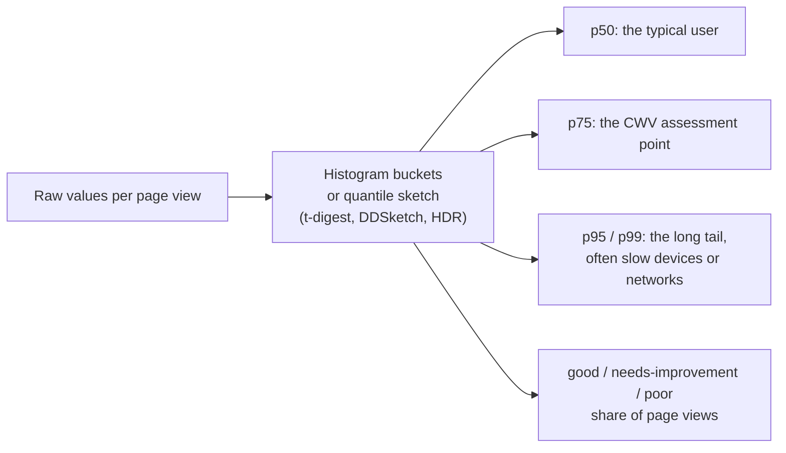

| Statistic | Use it for | Watch out |
|---|---|---|
| **p75** | Core Web Vitals pass/fail, SLOs | Matches how Google assesses CWV (see [Core Web Vitals](../04-performance-engineering/core-web-vitals-lcp-inp-cls.md)) |
| **p50** | Typical experience | Hides the users who suffer |
| **p95 / p99** | Tail latency, slow devices | Needs many samples to be stable |
| **% good** | Easy to explain to stakeholders | Depends on thresholds; pair it with a percentile |
| **Mean** | Almost never for timings | Dominated by outliers |

**Traps that produce wrong dashboards:**

1. **Averaging percentiles.** The p75 of the whole site is **not** the mean of each route's p75. Merge histograms or sketches, then compute the percentile.
2. **Mix shift (Simpson's paradox).** If traffic moves from fast desktop users to slow mobile users, the site-wide p75 gets worse even though every segment stayed the same or improved. Always check segmented views before blaming a release.
3. **Bimodal distributions.** Cache hits and misses, or bfcache restores and fresh loads, create two humps. One percentile describes neither; split by the dimension that causes the humps.
4. **Small segments.** A p75 from a few dozen page views is noise. Show the sample count next to every percentile and hide segments below a minimum.
5. **Survivorship.** Users who abandon before the beacon is sent are missing. A faster page can *increase* recorded LCP because slow users who previously bounced now stay long enough to be measured.

---

### Section 9: SPAs, bfcache and Prerendering

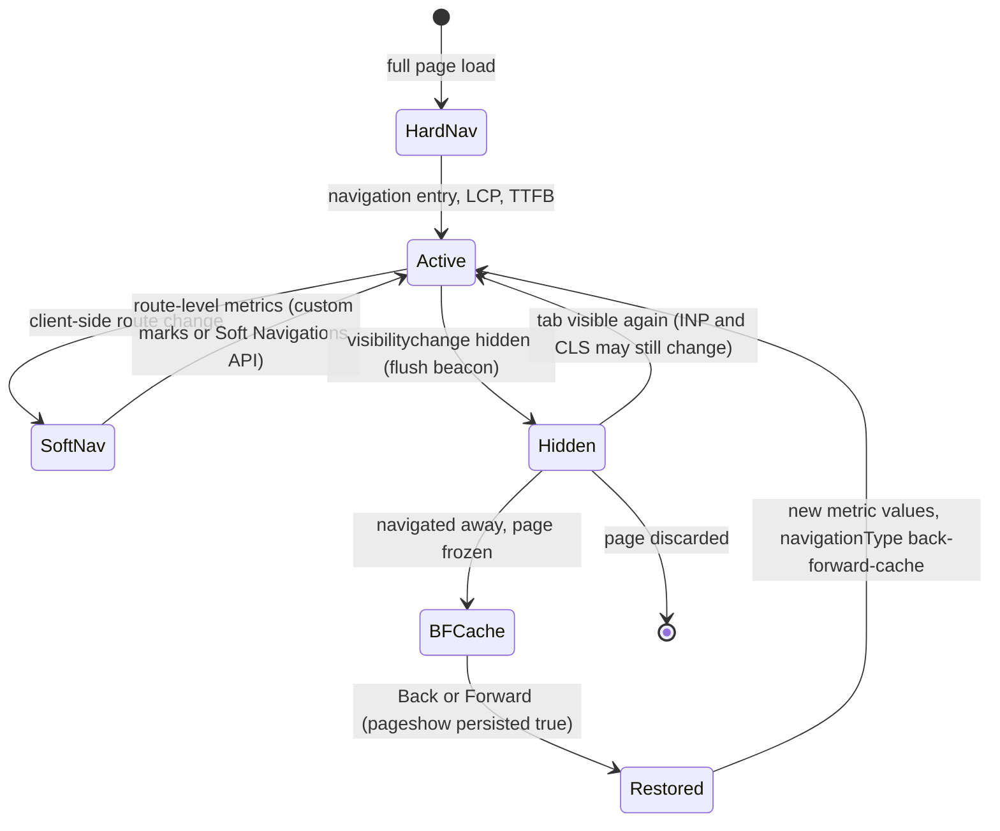

| Situation | Problem for RUM | What to do |
|---|---|---|
| **SPA route change** | No new `navigation` entry; INP and CLS keep accumulating on the landing URL | Emit a "route view" event per route with its own ID, start time and custom marks. Chromium 151+ exposes experimental soft-navigation entries; other engines don't, so keep the custom approach |
| **bfcache restore** | No navigation entry and no new page load; analytics snippets that run on load miss it | Listen for `pageshow` with `event.persisted`; `web-vitals` reports these with `navigationType: 'back-forward-cache'` |
| **Prerendered page** | Load happened before the user asked for it | Measure from `activationStart` (Chromium) so LCP reflects what the user waited for; the `web-vitals` library does this |
| **Page loaded in the background** | Timings include time the user wasn't looking | Ignore loads where the page was hidden before the metric fired |

> Segment by `navigationType`. A site that wins more bfcache restores will see its overall p75 improve, which is real for users but can hide a regression in fresh loads.

---

### Section 10: Correlating Frontend and Backend

When RUM says "`/checkout` TTFB got slower", you want to jump straight to the backend trace that served it.

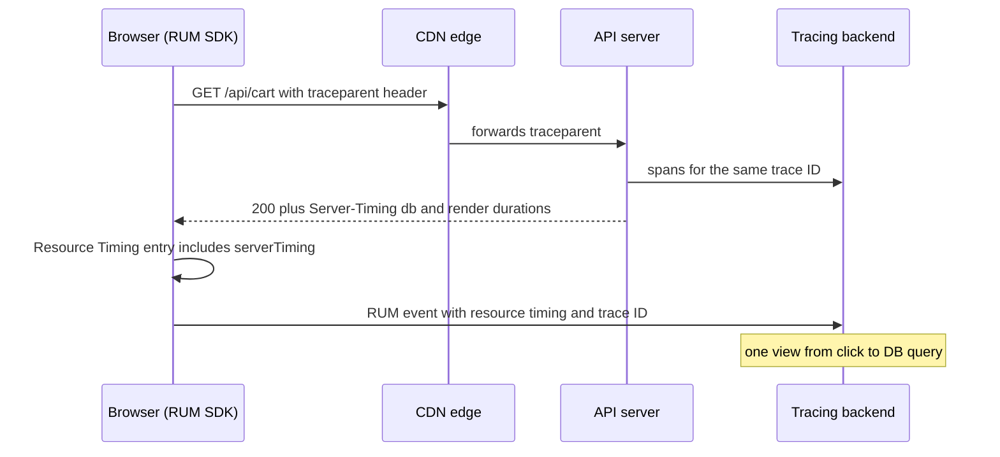

| Mechanism | What it does | Cross-origin requirement |
|---|---|---|
| **W3C Trace Context** (`traceparent`) | RUM SDK starts a trace and propagates its ID on `fetch`/XHR to your APIs | Your API's CORS must allow the header (`Access-Control-Allow-Headers: traceparent`); SDKs let you list which URLs get it (Sentry `tracePropagationTargets`, Datadog `allowedTracingUrls`) |
| **`Server-Timing` header** | Server reports named durations; the browser exposes them on navigation and resource entries | `Timing-Allow-Origin` for cross-origin; HTTPS |
| **Release tags** | Same version string on frontend and backend events | None |
| **Session ID** | Joins RUM, errors and replay for one user visit | Keep it random, not a user ID |

```http
HTTP/2 200
Server-Timing: edge;desc="cache MISS";dur=3, db;dur=48, render;dur=112
Timing-Allow-Origin: https://www.example.com
```

> **Never send `traceparent` to third-party domains.** It leaks internal IDs and can break their CORS. Restrict propagation to your own API hosts.

OpenTelemetry has JavaScript browser instrumentation, but its client-side (browser) support is still described as experimental in the OpenTelemetry docs; check the current status before standardizing on it. Vendor SDKs are more complete for Web Vitals and session context today.

---

### Section 11: Privacy, Consent and Ad Blockers

RUM data is telemetry about real people. Treat it like any other personal data.

| Risk | Mitigation |
|---|---|
| **URLs contain personal data or secrets** (emails, reset tokens, search terms) | Send route templates; strip query strings and fragments by default; allow-list known safe parameters |
| **Element selectors and text** in attribution (LCP element, INP target) | Send CSS selectors, never text content or input values |
| **IP addresses** | Derive country/region at ingest, then drop or truncate the IP |
| **Session replay** records the screen | Mask all text and inputs by default; sample very low; respect consent |
| **Stable identifiers** | Use a random session ID that rotates; avoid persistent user IDs unless you need them and have a legal basis |
| **Consent rules** | Whether performance telemetry needs consent depends on jurisdiction and on what you store (cookies, identifiers). Decide with your privacy/legal team and wire the SDK to your consent manager |
| **CSP** blocks the beacon | Add the collector to `connect-src` (see [Content Security Policy (CSP)](../07-security/content-security-policy-csp.md)) |
| **Ad blockers and tracking protection** block known vendor domains | Proxy the collector through a first-party path (`/rum`) or subdomain; vendors document "proxy" or "tunnel" options. Expect *some* loss either way and don't try to evade explicit user opt-outs |

> **Data minimization is also a cost control.** Every field you don't collect is a field you don't store, secure or explain in a privacy review.

---

### Section 12: Dashboards, SLOs and Alerting

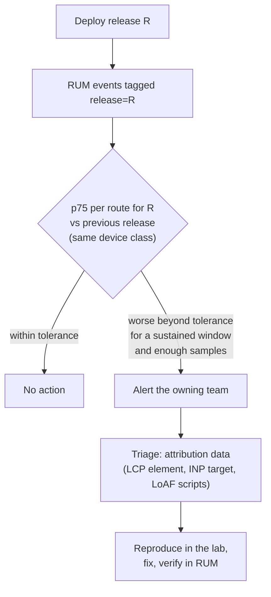

**A useful default dashboard:**

| Panel | Grouping |
|---|---|
| p75 LCP, INP, CLS, TTFB | Per route template × device class, with sample counts |
| % good / needs improvement / poor | Same grouping, stacked |
| Release comparison | Current vs previous release, same segments |
| TTFB breakdown | DNS / connect / server / download, per country |
| Top INP targets and LoAF scripts | Ranked by count of poor interactions |
| Error rate and failed API calls | Per route and release (joins with [Error Tracking](./error-tracking-sentry-datadog-rum.md)) |
| Custom business timings | "results visible", "checkout ready" |

**Alerting rules that don't cry wolf:**
- Alert on **sustained** change over a window (for example 30–60 minutes), never on a single data point.
- Require a **minimum sample size** per segment before evaluating.
- Compare **like with like**: same route, device class and navigation type; ideally release vs previous release.
- Turn alerts into **SLOs** with an error budget, such as "p75 LCP ≤ 2.5 s on `/product/:id` for mobile, measured over 28 days". Performance budgets in CI ([Performance Budgets](../04-performance-engineering/performance-budgets.md)) stop regressions before release; RUM SLOs catch what slips through.

---

## Build vs Buy

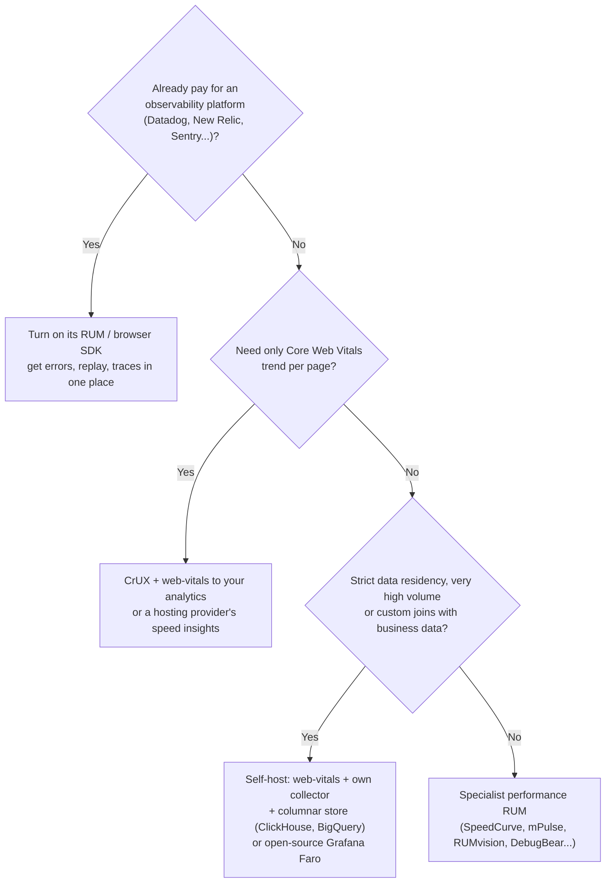

| Option | Strengths | Weaknesses |
|---|---|---|
| **CrUX** (free) | Zero setup, what Google uses, public API and BigQuery | Chrome only, opted-in users, 28-day window, only pages/origins with enough traffic, no custom dimensions |
| **Hosting-provider insights** (e.g. Vercel Speed Insights, Cloudflare Web Analytics) | One click, privacy-friendly defaults | Limited dimensions and drill-down |
| **Full observability vendor** | RUM + errors + replay + backend traces, mature SDKs | Cost scales with sessions/events; vendor lock-in |
| **Specialist performance RUM** | Deep performance features, competitor benchmarking in some products | Another tool to integrate |
| **Self-hosted** | Full control, data residency, cheap at scale, join with business data | You own the SDK, pipeline, percentiles and dashboards |

> Whatever you choose, keep **one definition** of each metric. Two tools computing "LCP" differently will produce two numbers and long meetings.

---

## Framework and Platform Notes

| Stack | How RUM is usually wired |
|---|---|
| **React (Vite/CRA-style SPA)** | Call `web-vitals` `onLCP/onINP/onCLS/...` once in the entry file; emit route-view events from the router (`useLocation` effect in React Router, router subscription in TanStack Router) |
| **Next.js** | `useReportWebVitals` from `next/web-vitals` in a client component rendered by the root layout; Next also emits framework-specific timings. Add route templates from the App Router (`usePathname` + your own pattern mapping) |
| **Vue / Nuxt** | Call `web-vitals` in `main.ts` (Vue) or a client-only Nuxt plugin (`plugins/rum.client.ts`); use `router.afterEach` for route views with `route.matched` for templates |
| **Angular** | Initialize in the browser only (`isPlatformBrowser` or `afterNextRender`) so SSR doesn't run it; use `Router.events` (`NavigationEnd`) and the route config path for templates |
| **Svelte / SvelteKit** | `src/hooks.client.ts` or `onMount` in the root `+layout.svelte`; `afterNavigate` for route views; `$page.route.id` gives the route template |
| **Astro / MPAs** | Every page is a hard navigation, so the plain `web-vitals` snippet in a shared layout is enough; with View Transitions routing, add route-view events |
| **iOS / Android native** | Different metrics: app start time, screen load, frozen/slow frames, hangs/ANRs, crash-free sessions. Vendor mobile RUM SDKs, Apple **MetricKit**, and **Android vitals** in Play Console |
| **React Native / Flutter** | Vendor SDKs with JS/Dart bridges; web-vitals concepts don't apply directly |

---

## Real-World Examples

**Example 1 — A minimal, production-shaped RUM client (TypeScript):**
```typescript
// rum.ts
import {
  onLCP, onINP, onCLS, onTTFB, onFCP, type MetricWithAttribution,
} from 'web-vitals/attribution';

const SAMPLE_RATE = 0.2;                       // 20 % of sessions
const ENDPOINT = '/rum';                       // first-party path, proxied to the collector
const RELEASE = import.meta.env.VITE_RELEASE;  // injected at build time

function sessionId(): string {
  try {
    let id = sessionStorage.getItem('rum-sid');
    if (!id) { id = crypto.randomUUID(); sessionStorage.setItem('rum-sid', id); }
    return id;
  } catch { return crypto.randomUUID(); }      // storage blocked: per-page session
}

// Deterministic per-session sampling: hash the random ID into [0, 1)
function inSample(id: string, rate: number): boolean {
  let h = 0;
  for (const ch of id) h = (h * 31 + ch.charCodeAt(0)) >>> 0;
  return h / 2 ** 32 < rate;
}

const sid = sessionId();
const sampled = inSample(sid, SAMPLE_RATE);
const pageViewId = crypto.randomUUID();
const queue = new Map<string, Record<string, unknown>>(); // latest value per metric

function record(metric: MetricWithAttribution) {
  queue.set(metric.name, {
    name: metric.name,
    value: Math.round(metric.name === 'CLS' ? metric.value * 1000 : metric.value), // CLS x1000 as an integer
    rating: metric.rating,
    navigationType: metric.navigationType,
    target: selectorOf(metric),               // a CSS selector only, never text content
  });
}

// Attribution field names differ per metric (see the web-vitals README for your version)
function selectorOf(metric: MetricWithAttribution): string | undefined {
  switch (metric.name) {
    case 'LCP': return metric.attribution.target;
    case 'INP': return metric.attribution.interactionTarget;
    case 'CLS': return metric.attribution.largestShiftTarget;
    default: return undefined;
  }
}

function flush() {
  if (!sampled || queue.size === 0) return;
  const body = JSON.stringify({
    sid, pageViewId, release: RELEASE, sampleRate: SAMPLE_RATE,
    route: currentRouteTemplate(),             // e.g. '/product/:id' from your router
    metrics: [...queue.values()],
  });
  queue.clear();
  // text/plain keeps it a "simple" request: no CORS preflight, no custom headers needed
  const sent = navigator.sendBeacon?.(ENDPOINT, body);
  if (!sent) fetch(ENDPOINT, { method: 'POST', body, keepalive: true }).catch(() => {});
}

if (sampled) {
  onLCP(record); onINP(record); onCLS(record); onTTFB(record); onFCP(record);
  document.addEventListener('visibilitychange', () => {
    if (document.visibilityState === 'hidden') flush();
  });
}

declare function currentRouteTemplate(): string;
```

**Example 2 — Collecting Long Animation Frame attribution (Chromium), BAD → GOOD:**
```typescript
// ❌ BAD: logs every frame with full entry objects (huge payloads, includes URLs with query strings)
new PerformanceObserver((list) => {
  list.getEntries().forEach((e) => send(JSON.stringify(e)));
}).observe({ type: 'long-animation-frame', buffered: true });

// ✅ GOOD: only frames that block for a while, summarized, URL without query string, capped
const worstScripts = new Map<string, number>();
if (PerformanceObserver.supportedEntryTypes?.includes('long-animation-frame')) {
  new PerformanceObserver((list) => {
    for (const frame of list.getEntries() as PerformanceLongAnimationFrameTiming[]) {
      if (frame.blockingDuration < 100) continue;
      for (const s of frame.scripts) {
        const src = s.sourceURL ? new URL(s.sourceURL).origin + new URL(s.sourceURL).pathname : 'inline';
        const key = `${src}#${s.sourceFunctionName || '(anonymous)'}`;
        worstScripts.set(key, Math.max(worstScripts.get(key) ?? 0, s.duration));
      }
    }
  }).observe({ type: 'long-animation-frame', buffered: true });
}
// On flush: send the top 5 entries of worstScripts by duration.
```
> If `PerformanceLongAnimationFrameTiming` is missing from your TypeScript DOM lib, declare a minimal interface locally. LoAF is Chromium-only, so treat it as diagnostic data, not a metric you compare across browsers.

**Example 3 — Emitting `Server-Timing` and reading it in RUM:**
```typescript
// server.ts (Express)
import express from 'express';
const app = express();

app.get('/api/products', async (req, res) => {
  const t0 = performance.now();
  const rows = await db.query('select ...');
  const dbMs = performance.now() - t0;
  res.set('Server-Timing', `db;dur=${dbMs.toFixed(1)}, app;dur=${(performance.now() - t0).toFixed(1)}`);
  res.set('Timing-Allow-Origin', 'https://www.example.com'); // needed if the page is on another origin
  res.json(rows);
});
```
```typescript
// browser: attach server timings to the slowest API calls
for (const r of performance.getEntriesByType('resource') as PerformanceResourceTiming[]) {
  if (r.initiatorType !== 'fetch' || r.duration < 500) continue;
  const server = Object.fromEntries(r.serverTiming.map((s) => [s.name, s.duration]));
  console.log(new URL(r.name).pathname, Math.round(r.duration), server); // e.g. { db: 48.2, app: 61.9 }
}
```

**Example 4 — The collector: validate, enrich, minimize (BAD → GOOD):**
```typescript
// ❌ BAD: stores whatever arrives, including full URLs and the client IP
app.post('/rum', express.json(), (req, res) => {
  store.insert({ ...req.body, ip: req.ip, url: req.get('referer') });
  res.sendStatus(204);
});

// ✅ GOOD: bounded schema, server-side enrichment, no IP stored
import { z } from 'zod';
const Event = z.object({
  sid: z.string().uuid(),
  pageViewId: z.string().uuid(),
  release: z.string().max(40),
  route: z.string().max(120).regex(/^\/[\w\-/:.]*$/),   // templates only
  sampleRate: z.number().min(0.0001).max(1),
  metrics: z.array(z.object({
    name: z.enum(['LCP', 'INP', 'CLS', 'TTFB', 'FCP']),
    value: z.number().int().min(0).max(120_000),
    rating: z.enum(['good', 'needs-improvement', 'poor']),
    navigationType: z.string().max(30),
    target: z.string().max(200).optional(),
  })).max(20),
});

app.post('/rum', express.text({ type: '*/*', limit: '64kb' }), (req, res) => {
  const parsed = Event.safeParse(safeJson(req.body));
  if (!parsed.success) return res.sendStatus(400);
  const ua = parseUserAgent(req.get('user-agent') ?? '');       // browser, os, device class
  if (ua.isBot) return res.sendStatus(204);
  queue.publish({
    ...parsed.data,
    browser: ua.browser, os: ua.os, device: ua.deviceClass,
    country: req.get('cf-ipcountry') ?? geoFromIp(req.ip),      // CDN header or lookup, IP not stored
    receivedAt: Date.now(),
  });
  res.sendStatus(204);
});
```

**Example 5 — Aggregating correctly (BigQuery SQL):**
```sql
-- p75 LCP per route and device for the latest release, with sample counts.
-- Computed from raw values: never average per-route p75s to get a site-wide p75.
SELECT
  route,
  device,
  COUNT(*) AS samples,
  APPROX_QUANTILES(value, 100)[OFFSET(75)] AS p75_lcp_ms,
  COUNTIF(rating = 'good') / COUNT(*) AS share_good
FROM rum.metrics
WHERE name = 'LCP'
  AND release = @release
  AND navigation_type IN ('navigate', 'reload')   -- exclude bfcache/prerender for load comparisons
GROUP BY route, device
HAVING samples >= 500                             -- hide segments too small to trust
ORDER BY p75_lcp_ms DESC;
```
> With sampling rates that differ by segment, weight each row by `1 / sample_rate` when computing counts and shares, or keep rates uniform within a comparison.

**Example 6 — Next.js App Router:**
```tsx
// app/rum-reporter.tsx
'use client';
import { useReportWebVitals } from 'next/web-vitals';

export function RumReporter() {
  useReportWebVitals((metric) => {
    // metric.name: 'TTFB' | 'FCP' | 'LCP' | 'INP' | 'CLS' | Next-specific timings
    const body = JSON.stringify({ name: metric.name, value: metric.value, id: metric.id });
    navigator.sendBeacon?.('/rum', body) || fetch('/rum', { method: 'POST', body, keepalive: true });
  });
  return null;
}
// app/layout.tsx: render <RumReporter /> inside <body>
```

---

## Key Points Summary

| Concept | One-Line Explanation |
|---|---|
| **RUM** | Measures performance and reliability on real users' devices and networks |
| **RUM vs synthetic** | RUM finds what is slow and for whom; lab and synthetic explain why and catch regressions before users |
| **PerformanceObserver** | One interface for all timing entries; use `buffered: true` and feature-detect |
| **Navigation Timing** | Splits TTFB into redirect, DNS, connect, server and download |
| **Timing-Allow-Origin** | Required for detailed timings of cross-origin resources |
| **Server-Timing** | Lets the backend report durations that RUM can read |
| **Beacon on hidden** | Flush on `visibilitychange` → hidden with `sendBeacon` / `keepalive` |
| **64 KiB keepalive budget** | Keep beacon payloads small |
| **Per-session sampling** | Deterministic hash of a random session ID; record the rate |
| **p75** | The standard field statistic; compute from merged histograms, never average percentiles |
| **Mix shift** | Traffic composition changes can move site-wide numbers with no real regression |
| **Route templates** | Low-cardinality, privacy-safe page dimension |
| **navigationType** | Separates fresh loads from bfcache, prerender and soft navigations |
| **traceparent** | Joins a frontend request to its backend trace; only send to your own APIs |
| **Privacy** | No raw URLs, text content or IPs; mask replay; follow consent rules |

---

## Test Your Understanding

**Q1 (Basic):**
Your Lighthouse score is 98, yet RUM shows p75 LCP of 4.1 s on mobile. Both tools are working correctly. How?

<details>
<summary>Answer</summary>

Lighthouse measures **one** emulated device and network, usually with a cold cache, logged out, without consent banners, from a data centre. RUM measures the **distribution** of real users: slower phones, worse networks, far-away regions, logged-in pages with more content, third-party scripts and A/B tests the lab never saw. The p75 sits in the slower part of that distribution. Neither number is "wrong": RUM tells you that users are suffering and which segments (route, device, country) are worst; then you reproduce *those* conditions in the lab to find the cause.
</details>

**Q2 (Basic):**
Why do RUM scripts send data on `visibilitychange` (hidden) instead of on `load` or `unload`?

<details>
<summary>Answer</summary>

At `load`, INP and CLS haven't happened yet; they are only final when the user leaves. `unload` is not fired reliably (especially on mobile, where the OS kills background tabs) and blocks the back/forward cache in several browsers. `visibilitychange` to `hidden` is the last event that browsers reliably fire before a page may be discarded, so you flush there with `sendBeacon` or `fetch({ keepalive: true })`, which outlive the page. Because the page can become visible again, you keep listening and may send updated values later, deduplicated by page-view ID.
</details>

**Q3 (Application):**
Product asks for "average page load time" on the exec dashboard. What do you build instead, and why?

<details>
<summary>Answer</summary>

Field timings are long-tailed, so the mean is dominated by a few terrible loads and doesn't describe any real user. Show **p75 LCP, INP and CLS** (the Core Web Vitals assessment point) plus the **% of page views rated good**, split at least by device class, and show the sample count. For an exec view, a single "% good page views" trend is easy to read; the engineering view adds per-route p75 and release comparisons. Compute percentiles from raw values or merged histograms, not by averaging per-page percentiles.
</details>

**Q4 (Tricky):**
After a release that cut JavaScript by 40 %, site-wide p75 LCP got **worse**. Every individual route × device segment improved. What could explain it?

<details>
<summary>Answer</summary>

**Mix shift (Simpson's paradox).** If the share of traffic moved toward slower segments (for example a marketing campaign brought many more mobile users from distant regions, or the faster page now keeps slow users who previously bounced before the beacon was sent), the blended p75 can rise while every segment improves. The **survivorship** effect is common after speed improvements: users on slow connections who used to abandon now stay long enough to be measured. Check segment-level numbers, traffic composition and the number of samples per segment before calling it a regression.
</details>

**Q5 (Tricky):**
RUM shows that a third-party chat widget's script takes 900 ms, but DNS, connect and download phases are all `0`. Is the widget fast to download?

<details>
<summary>Answer</summary>

You can't tell. For **cross-origin** resources, Resource Timing hides the detailed phases (DNS, connect, request, response start) and sizes unless the third-party server sends `Timing-Allow-Origin`. You only see start time, duration and end time. The zeros mean "not exposed", not "took no time". Ask the vendor to send `Timing-Allow-Origin`, or measure it in the lab. Long Animation Frame data (Chromium) can still show how long its *script execution* blocked the main thread.
</details>

**Q6 (System design):**
Design RUM for a global e-commerce SPA with 50 million page views a day, strict EU data residency and an existing self-hosted tracing stack. Outline the pipeline and the key decisions.

<details>
<summary>Answer</summary>

- **Client:** `web-vitals` attribution build plus custom User Timing marks ("prices visible", "checkout ready"), route-view events from the router, a small error hook. Deterministic **per-session sampling** (rate chosen by how many samples you need per route × device × release; higher for small routes and new releases), rate stamped on every event.
- **Transport:** batch per page view, flush on `visibilitychange` hidden with `sendBeacon`, small text payload to a **first-party** `/rum` path (no preflight, fewer blocks), add the path to CSP `connect-src`.
- **Ingest in the EU:** edge/collector validates a bounded schema, drops bots, parses the user agent, derives country from the CDN, discards IPs, maps URLs to route templates, publishes to a queue in an EU region.
- **Storage:** raw events in a columnar store with short retention for drill-down; rollups as histograms/sketches per route, device, country, release and navigation type for long-term trends.
- **Correlation:** propagate `traceparent` only to own API hosts, add `Server-Timing` on APIs, tag both sides with the release.
- **Use:** dashboards with p75 and sample counts, release-vs-previous comparisons, sustained-window alerts with minimum samples, field SLOs per key route. Privacy review covering consent, masking and retention.
</details>

---

## Cheat Sheet

**Key Definitions:**
- **RUM:** Performance and reliability telemetry collected from real page views
- **Beacon:** A small request sent with `sendBeacon` or `keepalive` fetch that survives page teardown
- **Dimension:** An attribute you group by (route, device, release); keep cardinality low
- **Sampling rate:** Fraction of sessions that report; weight counts by `1 / rate`
- **p75:** Value that 75 % of page views are at or below; the CWV assessment point
- **Quantile sketch:** Compact, mergeable structure (t-digest, DDSketch, HDR histogram) for percentiles at scale
- **Timing-Allow-Origin:** Header that exposes detailed timings of a cross-origin resource
- **Server-Timing:** Header carrying backend durations into browser timing entries

**Quick Reference:**
```text
Collect:     web-vitals (attribution build) + navigation/resource entries + User Timing marks + errors
Observers:   PerformanceObserver({ type, buffered: true }); check PerformanceObserver.supportedEntryTypes
TTFB split:  redirect | DNS | connect (TCP+TLS) | server (responseStart - requestStart) | download
Context:     route template, release, navigationType, device class, browser, country, cache state
Send:        visibilitychange hidden -> sendBeacon(text) || fetch(keepalive) ; payload << 64 KiB ; resend if visible again
Sample:      per session, hash(random id) < rate ; stamp sampleRate on each event
Aggregate:   p75 (+ p50, p95) from histograms/sketches ; show sample counts ; never average percentiles
Segment:     always by device class and navigationType before judging a release
Correlate:   traceparent to own APIs only ; Server-Timing + Timing-Allow-Origin ; same release tag
Privacy:     no raw URLs/query strings, no text content, no IP storage, mask replay, follow consent
Alert:       sustained window + minimum samples + like-for-like comparison ; SLO on p75 per key route
```

**Common Mistakes to Avoid:**

| Mistake | Why Wrong | Fix |
|---|---|---|
| Reporting mean load time | Long-tailed data; the mean describes nobody | p75 / p95 and % good |
| Averaging per-route p75s | Percentiles don't average | Merge histograms or compute from raw values |
| Sending on `load` only | Misses INP, CLS and late LCP updates | Flush on `visibilitychange` hidden, resend later |
| Using `unload` | Unreliable and blocks bfcache | `visibilitychange` / `pagehide` |
| Raw URLs as a dimension | Cardinality explosion and personal data leaks | Route templates; strip query strings |
| Per-event sampling | One page view's metrics come from different users | Per-session deterministic sampling |
| Comparing releases site-wide only | Mix shift and survivorship mislead | Compare per segment, same navigation type |
| Ignoring bfcache and soft navigations | Missing or misattributed page views | Handle `pageshow` persisted and route-view events |
| Heavy synchronous RUM snippet in `<head>` | The monitor slows the page it measures | Async load, buffered observers, small payload |
| Sending `traceparent` everywhere | CORS failures on third parties, leaks IDs | Allow-list your own API origins |
| No minimum sample size on alerts | Alert noise and fatigue | Sustained window + minimum samples |
| Trusting the client payload | Spam and garbage dimensions | Schema validation, rate limits, bot filtering |

---

## References & Further Reading

**Core docs**
- MDN: [Performance APIs](https://developer.mozilla.org/en-US/docs/Web/API/Performance_API)
- MDN: [`PerformanceObserver`](https://developer.mozilla.org/en-US/docs/Web/API/PerformanceObserver)
- MDN: [Navigation timing](https://developer.mozilla.org/en-US/docs/Web/API/Performance_API/Navigation_timing) · [Resource timing](https://developer.mozilla.org/en-US/docs/Web/API/Performance_API/Resource_timing) · [Server timing](https://developer.mozilla.org/en-US/docs/Web/API/Performance_API/Server_timing)
- MDN: [`Timing-Allow-Origin`](https://developer.mozilla.org/en-US/docs/Web/HTTP/Reference/Headers/Timing-Allow-Origin) · [`Server-Timing`](https://developer.mozilla.org/en-US/docs/Web/HTTP/Reference/Headers/Server-Timing)
- MDN: [`Navigator.sendBeacon()`](https://developer.mozilla.org/en-US/docs/Web/API/Navigator/sendBeacon) · [`Window.fetchLater()`](https://developer.mozilla.org/en-US/docs/Web/API/Window/fetchLater)
- MDN: [`PerformanceLongAnimationFrameTiming`](https://developer.mozilla.org/en-US/docs/Web/API/PerformanceLongAnimationFrameTiming)

**web.dev / Chrome**
- web.dev: [Best practices for measuring Web Vitals in the field](https://web.dev/articles/vitals-field-measurement-best-practices)
- web.dev: [Measure and debug performance with Google Analytics 4 and BigQuery](https://web.dev/articles/vitals-ga4)
- Chrome for Developers: [Page Lifecycle API](https://developer.chrome.com/docs/web-platform/page-lifecycle-api)
- Chrome for Developers: [Long Animation Frames API](https://developer.chrome.com/docs/web-platform/long-animation-frames)
- Chrome for Developers: [Chrome UX Report (CrUX) overview](https://developer.chrome.com/docs/crux)
- GitHub: [GoogleChrome/web-vitals](https://github.com/GoogleChrome/web-vitals)

**Specs**
- W3C: [Navigation Timing Level 2](https://www.w3.org/TR/navigation-timing-2/) · [Resource Timing](https://www.w3.org/TR/resource-timing/) · [Server Timing](https://www.w3.org/TR/server-timing/) · [User Timing](https://www.w3.org/TR/user-timing/)
- W3C: [Beacon](https://www.w3.org/TR/beacon/) · [Trace Context](https://www.w3.org/TR/trace-context/)
- WHATWG: [Fetch Standard — keepalive](https://fetch.spec.whatwg.org/#request-keepalive-flag)

**Vendors and tooling**
- Datadog: [Real User Monitoring](https://docs.datadoghq.com/real_user_monitoring/)
- Sentry: [Performance monitoring for JavaScript](https://docs.sentry.io/platforms/javascript/tracing/)
- Grafana: [Faro Web SDK](https://grafana.com/docs/grafana-cloud/monitor-applications/frontend-observability/)
- OpenTelemetry: [JavaScript browser instrumentation](https://opentelemetry.io/docs/languages/js/getting-started/browser/)
- Next.js: [`useReportWebVitals`](https://nextjs.org/docs/app/api-reference/functions/use-report-web-vitals)
- Apple: [MetricKit](https://developer.apple.com/documentation/metrickit) · Android: [Android vitals](https://developer.android.com/topic/performance/vitals)

---

> **Previous Topic:** [Error Tracking (Sentry, Datadog RUM)](./error-tracking-sentry-datadog-rum.md)
> — Capturing, grouping and triaging exceptions from production

> **Next Topic:** [Synthetic Monitoring](./synthetic-monitoring.md)
> — Scripted checks from fixed locations: uptime, journeys and lab regressions

*Saved on: 2026-11-06 | Repo: Frontend System Design Learning Notes*
