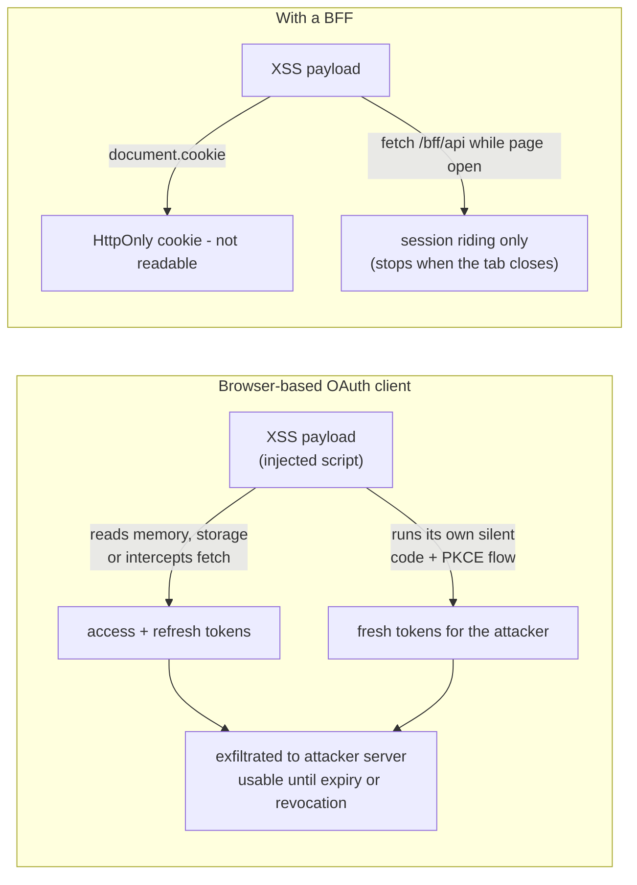
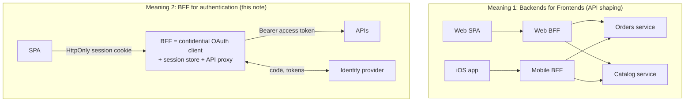
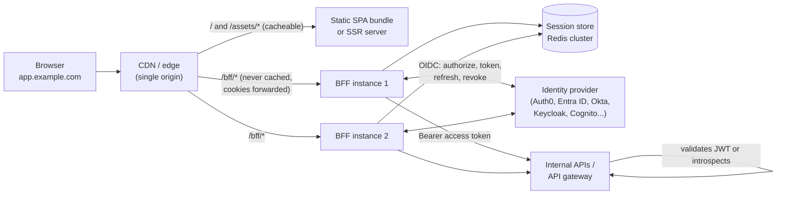
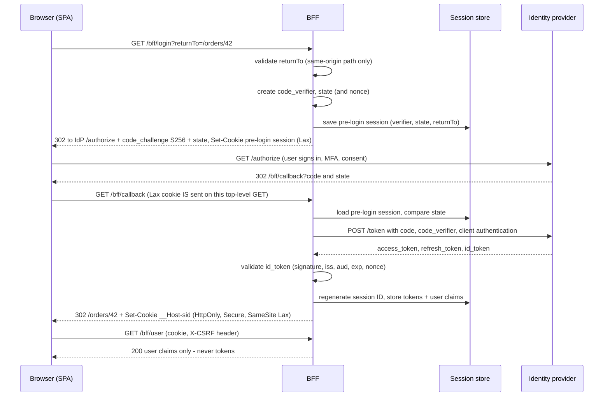
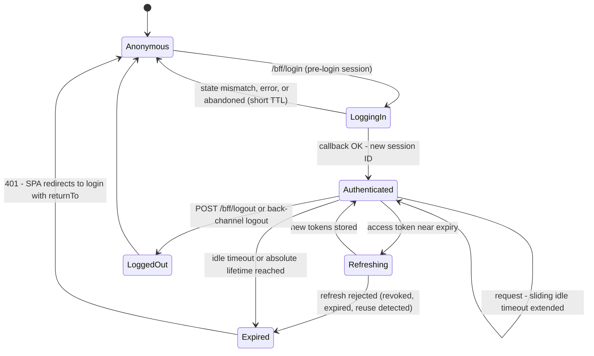
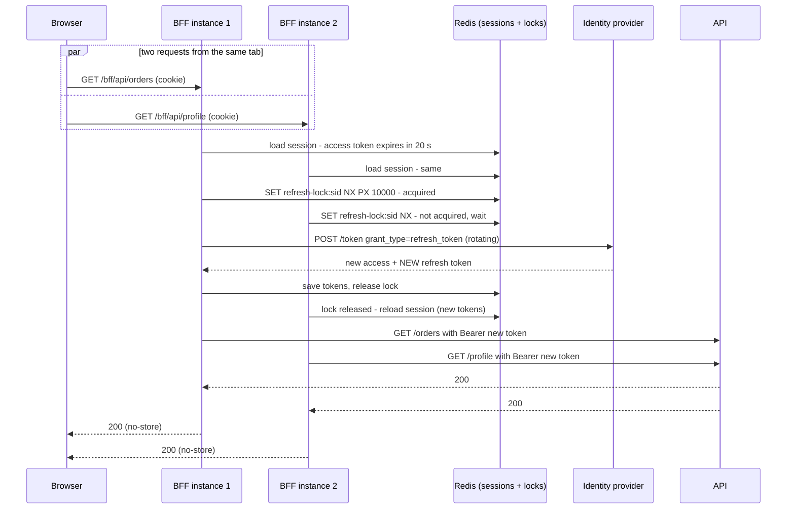
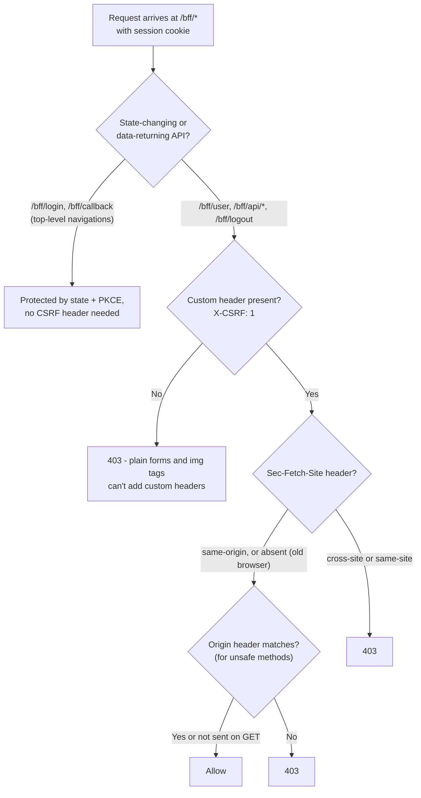
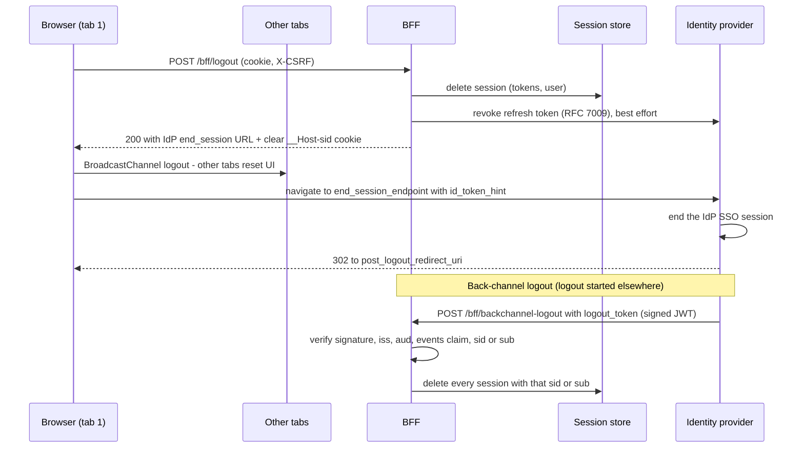
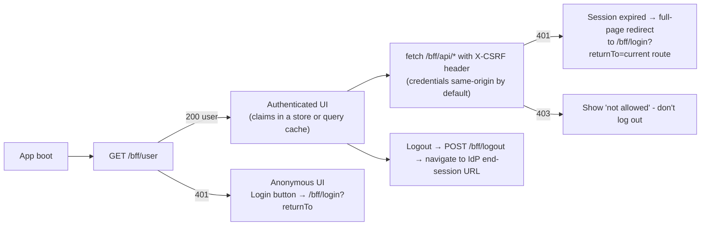
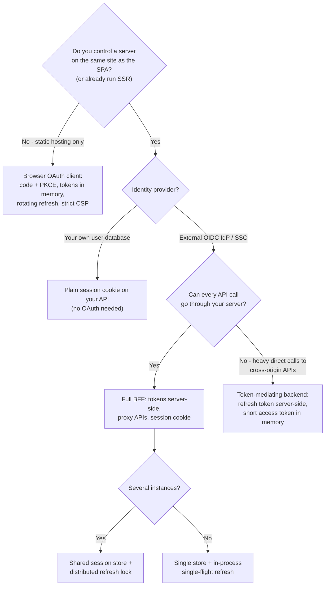

# Authentication Architecture (BFF Pattern)

> **Date:** 2026-11-06 · **Last updated:** 2026-11-06
> **Category:** Frontend System Design
> **Sub-Topic:** Advanced Topics / Authentication Architecture
> **Level:** Advanced · **Reading time:** ~32 min
> **Informs:** BFF vs token-mediating backend vs browser OAuth client, where OAuth tokens live, session store design (server-side vs sealed cookie), session cookie attributes, CSRF defense for cookie-authenticated APIs, token refresh concurrency across BFF instances, API proxying and downstream token exchange, login/logout endpoints (RP-initiated and back-channel logout), deployment topology (same-origin routing, CDN rules), SSR framework integration

> **Pre-requisite:** [Authentication Flows in SPAs](../07-security/authentication-flows-in-spas.md) (OAuth 2.0, OIDC, PKCE, the three architectures) and [Secure Token Storage](../07-security/secure-token-storage.md) (cookies vs memory vs storage, `HttpOnly`, `__Host-`).
> Those notes explain **why** a Backend-for-Frontend is the recommended default. This one is the **engineering blueprint**: endpoints, sessions, refresh, CSRF, logout, scaling, deployment and framework integration.

**Previous:** [Web Components & Shadow DOM](./web-components-and-shadow-dom.md) · **Next:** [SEO for SPAs & Dynamic Content](./seo-for-spas-and-dynamic-content.md)

---

## Table of Contents

1. [ELI5 — Simple Explanation](#eli5--simple-explanation)
2. [Section 1: Why Tokens Don't Belong in the Browser](#section-1-why-tokens-dont-belong-in-the-browser)
3. [Section 2: What a BFF Is (Two Meanings)](#section-2-what-a-bff-is-two-meanings)
4. [Section 3: Reference Architecture and Deployment](#section-3-reference-architecture-and-deployment)
5. [Section 4: The Login Flow in Detail](#section-4-the-login-flow-in-detail)
6. [Section 5: Sessions — Store, Cookie and Lifetime](#section-5-sessions--store-cookie-and-lifetime)
7. [Section 6: Proxying APIs and Refreshing Tokens](#section-6-proxying-apis-and-refreshing-tokens)
8. [Section 7: CSRF — the Price of Cookies](#section-7-csrf--the-price-of-cookies)
9. [Section 8: Logout — Local, RP-Initiated and Back-Channel](#section-8-logout--local-rp-initiated-and-back-channel)
10. [Section 9: The Frontend Side of a BFF](#section-9-the-frontend-side-of-a-bff)
11. [Section 10: Threat Model — What the BFF Does and Doesn't Fix](#section-10-threat-model--what-the-bff-does-and-doesnt-fix)
12. [Section 11: Variants — Token-Mediating Backend, SSR, Edge, Mobile](#section-11-variants--token-mediating-backend-ssr-edge-mobile)
13. [Decision Matrix](#decision-matrix)
14. [Real-World Examples](#real-world-examples)
15. [Key Points Summary](#key-points-summary)
16. [Test Your Understanding](#test-your-understanding)
17. [Cheat Sheet](#cheat-sheet)
18. [References & Further Reading](#references--further-reading)

---

## ELI5 — Simple Explanation

Imagine a **hotel**.

- The **identity provider** is the government office that issues **passports** (tokens). Passports are valuable: whoever holds one can use it.
- In a **browser-only app**, you carry your passport around in your pocket all day. A pickpocket (an **XSS** script) can steal it and use it somewhere else, even after you've gone home.
- With a **BFF**, you hand your passport to the **hotel's front desk** (the BFF, a small server). The desk locks it in a **safe** (server-side session) and gives you a **room key card** (an `HttpOnly` session cookie).
- The key card only works **at this hotel**. The pickpocket can't read it (it's `HttpOnly`) and can't use it from another hotel (`SameSite` + CSRF checks).
- When you ask for room service (an API call), the desk **uses your passport on your behalf**, renews it when it's about to expire, and never hands it back to you.
- When you check out (**logout**), the desk shreds the key card *and* returns the passport to the office (token revocation, IdP logout).

> **A BFF keeps OAuth tokens on the server and gives the browser only a same-site, `HttpOnly` session cookie. It removes token theft from the threat model, at the cost of running a server and defending against CSRF.**

---

## Core Concept — Step by Step

### Section 1: Why Tokens Don't Belong in the Browser

A single-page app that talks to an OAuth/OIDC identity provider directly is a **public client**: it can't keep a secret, and its tokens live where JavaScript can reach them.



| Problem with tokens in the browser | Why it matters |
|---|---|
| **Token exfiltration** | Any XSS can read tokens from memory, storage or by wrapping `fetch`, then use them **from anywhere** until they expire |
| **Refresh token theft** | A stolen refresh token can mint new access tokens for hours or days (rotation and DPoP reduce this, see [Secure Token Storage](../07-security/secure-token-storage.md)) |
| **Silent flows by an attacker** | Even with tokens hidden (e.g. in a worker), XSS can start a new authorization flow in a hidden iframe or popup and grab a fresh code |
| **No client secret** | The identity provider can't strongly authenticate the app; it relies on PKCE and redirect URIs only |
| **Third-party cookie restrictions** | Iframe-based silent renew depends on the IdP's cookies in a third-party context. Safari and Firefox block those by default; don't depend on them anywhere |

The IETF OAuth working group's *OAuth 2.0 for Browser-Based Applications* document lists the BFF as the most secure of its architectures, and the **OAuth 2.0 Security Best Current Practice (RFC 9700)** sets the baseline that every option must meet (code flow + PKCE, no implicit grant, exact redirect URI matching, sender-constrained or rotating refresh tokens).

---

### Section 2: What a BFF Is (Two Meanings)

The name comes from Sam Newman's **Backends for Frontends** pattern: a dedicated backend per client type (web, iOS, partner API) that shapes and aggregates data for that client. The **auth BFF** is a specialisation of it: a backend whose first job is to be the **confidential OAuth client** for the SPA.



In practice they often merge: the same web BFF handles login **and** aggregates APIs. Keep the two concerns separate in code (an auth module and an API-composition module) so you can reason about security independently.

**Responsibilities of an auth BFF:**

| Responsibility | Endpoint or component |
|---|---|
| Start login (code + PKCE, `state`, optional PAR) | `GET /bff/login?returnTo=…` |
| Finish login, exchange code for tokens with client authentication | `GET /bff/callback` |
| Hold tokens in a server-side session, issue a session cookie | Session store (Redis, DB) or sealed cookie |
| Tell the SPA who's logged in (claims, not tokens) | `GET /bff/user` |
| Proxy API calls, attaching and refreshing the access token | `/bff/api/*` (or `/api/*`) |
| Logout locally and at the IdP; revoke tokens | `POST /bff/logout` |
| Receive IdP-initiated logout | `POST /bff/backchannel-logout` |
| CSRF defense on every cookie-authenticated endpoint | Middleware |

---

### Section 3: Reference Architecture and Deployment



**Topology rules:**

| Rule | Why |
|---|---|
| **Serve the SPA and the BFF from the same origin** (`app.example.com` + `/bff/*`) | No CORS at all; `SameSite=Lax`/`Strict` cookies just work; the cookie can be `__Host-` (host-only, `Path=/`) |
| If they must be on different hosts, keep them **same-site** (`app.example.com` + `bff.example.com`) | `SameSite` still protects; cross-*site* would need `SameSite=None` (a third-party cookie, blocked by Safari and Firefox by default) |
| **Never cache `/bff/*` at the CDN** | Responses are per-user; caching them leaks data between users. Send `Cache-Control: no-store` or `private, no-store` |
| **Forward cookies only to `/bff/*`** | Keeps the static path cookie-free and cacheable |
| **Shared session store** for multiple instances | Any instance can serve any request; no sticky sessions |
| **Co-locate the BFF with the APIs** (same region) | Every API call takes an extra hop; keep that hop short and use keep-alive connection pools |
| **APIs still validate tokens** | The BFF isn't the only gate. APIs check signature, `aud`, `exp` and scopes (zero trust) |

> Many teams don't need a separate service: **an SSR server already is a backend on the same origin** (Next.js, Nuxt, SvelteKit, React Router/Remix, Angular SSR, ASP.NET, Spring). Add the BFF routes there (Section 11).

---

### Section 4: The Login Flow in Detail



**Details that matter:**

| Step | Rule |
|---|---|
| **`returnTo`** | Accept only **relative paths** on your own origin (`/orders/42`), never full URLs. Otherwise `/bff/login?returnTo=https://evil.example` becomes an **open redirect** (Example 6) |
| **PKCE + `state`** | Use PKCE even though the BFF is confidential (RFC 9700 recommends it for all clients). `state` (and `nonce` for OIDC) bind the callback to this browser |
| **Pre-login cookie** | Must be `SameSite=Lax`, not `Strict`: the callback is a **cross-site** top-level navigation from the IdP, and a `Strict` cookie isn't sent on it, which shows up as "state mismatch" |
| **Client authentication** | `client_secret` is the minimum; prefer `private_key_jwt` (signed assertion) or mTLS where your IdP supports it |
| **PAR** (RFC 9126) | Pushed Authorization Requests send the authorize parameters server-to-server first, so they can't be tampered with in the URL. Use it when your IdP supports it, especially for high-assurance apps |
| **Session fixation** | **Regenerate the session ID** after login. Never reuse the pre-login session ID for the authenticated session |
| **Scopes** | `openid profile email` + `offline_access` (or the IdP's equivalent) if you need refresh tokens; request API scopes/audience explicitly |
| **ID token** | Validate it (libraries do), extract only the claims the UI needs, keep the raw ID token server-side for `id_token_hint` at logout |

---

### Section 5: Sessions — Store, Cookie and Lifetime

#### 5.1 Where the session lives

| Option | How | Pros | Cons |
|---|---|---|---|
| **Server-side store** (Redis, database) | Cookie holds an opaque random ID; tokens in the store | Instant revocation, small cookie, back-channel logout is easy, tokens never leave the server | Store to run and scale; a lookup per request |
| **Sealed (encrypted) cookie** | Tokens encrypted and authenticated (AEAD) into the cookie itself (e.g. `iron-session`, Auth.js JWT sessions) | Stateless, no store | Can't revoke one session without extra state; browsers enforce cookie size limits (roughly 4 KB), so tokens may need chunking; encrypted tokens still travel on every request |
| **Hybrid** | Small sealed cookie + server-side denylist or token cache | Stateless reads, revocable | More moving parts |

> **Default:** a server-side store. Use sealed cookies only for small apps or when you can't run a store, and keep access tokens short-lived.

#### 5.2 The session cookie

```http
Set-Cookie: __Host-sid=Yk3v...q9; Path=/; Secure; HttpOnly; SameSite=Lax; Max-Age=1800
```

| Attribute | Why |
|---|---|
| `__Host-` prefix | Browser enforces `Secure`, `Path=/` and **no `Domain`**, so a sibling subdomain can't set or overwrite it |
| `HttpOnly` | JavaScript can't read it, so XSS can't exfiltrate it |
| `Secure` | HTTPS only |
| `SameSite=Lax` | Not sent on cross-site subresource requests or POSTs; still sent on top-level GET navigations (needed for deep links and the login callback). `Strict` is stronger but breaks arriving from external links while logged in, unless you use a two-cookie pattern |
| `Max-Age` / `Expires` | Matches the session's idle timeout; omit for a browser-session cookie |
| Opaque value | High-entropy random ID (at least 128 bits), not a JWT; nothing to decode |

#### 5.3 Session lifetime



| Setting | Guidance |
|---|---|
| **Idle timeout** (sliding) | Extend on activity. Short for sensitive apps, longer for low-risk consumer apps. Follow your compliance requirements |
| **Absolute lifetime** | Force re-authentication after a fixed time regardless of activity; don't exceed the refresh token's lifetime |
| **Access token lifetime** | Short (minutes). The BFF refreshes it; the browser never notices |
| **Step-up authentication** | For sensitive actions, send the user back through the IdP with `acr_values`/`max_age` and record the new auth time in the session |
| **Session listing and revocation** | Index sessions by user (`sub`) and IdP session (`sid`) so you can "log out everywhere" and process back-channel logout |

---

### Section 6: Proxying APIs and Refreshing Tokens



**Refresh token rotation makes concurrency a correctness problem.** With rotation, each refresh invalidates the previous refresh token. If two BFF instances refresh with the **same** old token, the IdP may treat the second use as **token reuse** (a theft signal) and revoke the whole token family, logging the user out at random under load. Fixes:

1. **Single-flight per session:** an in-process promise map handles one instance; a **distributed lock** (Redis `SET key NX PX`) handles many.
2. **Waiters reload** the session after the lock is released instead of refreshing again.
3. **Refresh proactively** (e.g. when less than a minute is left), so most requests never wait.
4. Many IdPs offer a short **reuse grace period** for rotation. Use it as a safety net, not as the design.

**Proxy rules:**

| Rule | Detail |
|---|---|
| Allowlist upstreams | Map `/bff/api/orders/*` → orders service. Never proxy to a URL taken from the request (SSRF) |
| Strip and set headers | Remove the `Cookie` header before forwarding; add `Authorization: Bearer …`; don't forward hop-by-hop headers |
| Stream bodies | Don't buffer large uploads or downloads in memory; don't parse JSON bodies before proxying |
| Per-API audience | If APIs need different audiences or scopes, use **token exchange** (RFC 8693) or separate refresh-token requests per resource, and cache the per-audience tokens in the session |
| Map errors | Upstream `401` after a fresh token → session problem → return `401` to the SPA. Upstream `403` → pass through (authorization, not authentication) |
| Real-time | WebSocket/SSE upgrades also carry the cookie. **Check the `Origin` header** on the handshake (cross-site WebSocket hijacking), then attach the token upstream. See [WebSockets, SSE & Long Polling](../01-web-fundamentals/websockets-sse-long-polling.md) |
| Rate limits | Apply per session and per user at the BFF; it's now your public edge |

---

### Section 7: CSRF — the Price of Cookies

Cookies are attached by the browser automatically, so **any site can try to make the browser send a request to your BFF**. That's **Cross-Site Request Forgery**. Bearer-token SPAs don't have this problem; BFFs do.



| Defense | How it works | Notes |
|---|---|---|
| **`SameSite=Lax` (or `Strict`)** | Browser omits the cookie on cross-*site* POSTs and subresource requests | Doesn't stop attacks from **same-site** hosts (a compromised `blog.example.com` is same-site with `app.example.com`) |
| **Required custom header** (`X-CSRF: 1`) | A cross-origin page can only add custom headers via `fetch`, which triggers a **CORS preflight** that your BFF never approves | Simple and robust; used by several BFF frameworks. Make sure your CORS config doesn't allow other origins |
| **`Sec-Fetch-Site` / `Origin` checks** | Reject requests whose fetch metadata says `cross-site` (or `same-site` if siblings are untrusted) | Supported in all modern browsers; treat a missing header as legacy and fall back to the other checks |
| **Synchronizer or double-submit token** | Token in the page or a readable cookie, echoed in a header | Classic approach. Angular's `HttpClient` has built-in support for the cookie-to-header variant |
| **No state changes on GET** | GET must be safe; `Lax` cookies are sent on top-level GET navigations | Fundamental HTTP hygiene |

> Use **at least two layers**: `SameSite` cookies plus a required custom header (or a CSRF token), and validate `Origin`/`Sec-Fetch-Site` on unsafe methods. See [CSRF Protection](../07-security/csrf-protection.md) and [CORS & Same-Origin Policy](../01-web-fundamentals/cors-and-same-origin-policy.md).

---

### Section 8: Logout — Local, RP-Initiated and Back-Channel



| Logout type | What it ends | When you need it |
|---|---|---|
| **Local logout** | BFF session + cookie | Always |
| **Token revocation** (RFC 7009) | The refresh token at the IdP | Always, if the IdP supports it, so a leaked store copy is useless |
| **RP-initiated logout** (OIDC) | The IdP's SSO session | When "logout" should also sign the user out of the IdP (otherwise the next login is silent) |
| **Back-channel logout** (OIDC) | Your session when the user logs out **elsewhere** (another app, admin action) | SSO across several apps; enterprise requirements |
| **Front-channel logout** (OIDC) | Same, via iframes loaded by the IdP | Avoid where possible: relies on third-party cookies in iframes |

Also send `Clear-Site-Data: "cache", "storage"` on the logout response to wipe cached per-user data on shared devices (see [Browser Caching Strategies](../01-web-fundamentals/browser-caching-strategies.md)). Clear in-memory client state (query caches, stores) before navigating away.

---

### Section 9: The Frontend Side of a BFF

The SPA becomes **simpler**: no OAuth library, no token handling, no refresh timers.



| Concern | Frontend rule |
|---|---|
| **Who am I?** | Call `/bff/user` once at boot; cache it (TanStack Query, SWR, a store). It returns **claims** for display, not tokens |
| **Authorization in the UI** | Hide or disable UI based on claims/roles, but **enforce on the server**. The UI check is UX, not security |
| **Login** | Full-page navigation to `/bff/login?returnTo=…` (not `fetch`): the IdP needs a top-level page |
| **Session expiry** | Handle `401` globally: save unsaved work if possible, then redirect to login with `returnTo` |
| **Multiple tabs** | The cookie is shared, so tabs share the session automatically. Broadcast logout with `BroadcastChannel` so other tabs update their UI |
| **SSR** | The server reads the session cookie directly and renders personalized HTML; send `Cache-Control: private, no-store` on those pages |
| **bfcache** | After logout, Back may restore a logged-in page from the back/forward cache. Re-check `/bff/user` on `pageshow` with `event.persisted` |

---

### Section 10: Threat Model — What the BFF Does and Doesn't Fix

| Threat | BFF effect | Remaining defenses |
|---|---|---|
| **Token exfiltration via XSS** | ✅ Eliminated: no tokens in the browser | — |
| **Refresh token theft** | ✅ Eliminated from the browser | Encrypt tokens at rest in the store; revoke on logout |
| **Session riding via XSS** (attacker's script calls `/bff/api` while the page is open) | ❌ Still possible, but limited to the tab's lifetime and to what the BFF exposes | **Prevent XSS**: strict CSP, Trusted Types, output encoding ([XSS Prevention](../07-security/xss-prevention-reflected-stored-dom.md), [CSP](../07-security/content-security-policy-csp.md)) |
| **CSRF** | ⚠️ **Introduced** by cookie auth | SameSite + custom header/token + Origin checks (Section 7) |
| **Session fixation** | ⚠️ Possible if IDs aren't rotated | Regenerate the session ID at login |
| **Open redirect via `returnTo`** | ⚠️ Introduced by the login endpoint | Relative-path allowlist |
| **BFF compromise** | ⚠️ Concentrated risk: the BFF holds every user's tokens | Least privilege, secrets in a vault, encrypted session store, short token lifetimes, monitoring |
| **Cookie tossing from a sibling subdomain** | ✅ Prevented by `__Host-` prefix | Keep untrusted content off your registrable domain |
| **Stolen session cookie (malware on the device)** | ❌ A cookie is a bearer credential | Short idle timeouts, re-auth for sensitive actions, anomaly detection; device-bound sessions are an emerging browser feature (check current support) |

> **The BFF changes "steal the token and use it anywhere, for hours" into "use the session from inside the victim's tab, while it's open".** That's a big reduction, not immunity. XSS prevention remains essential.

---

### Section 11: Variants — Token-Mediating Backend, SSR, Edge, Mobile

| Variant | How it differs | When to choose |
|---|---|---|
| **Token-mediating backend** | Backend runs OAuth and keeps the refresh token, but hands **short-lived access tokens** to the SPA, which calls APIs directly | APIs on other origins that can't be proxied efficiently (very high volume, large streaming) and accept the XSS-theft risk of short-lived tokens |
| **SSR framework as BFF** | Login, callback and proxy are routes in Next.js, Nuxt, SvelteKit, React Router, Angular SSR, ASP.NET, Spring | You already run SSR: no extra service, same origin for free |
| **API gateway as BFF** | Gateway handles OIDC login, sessions and token relay (e.g. Spring Cloud Gateway's token relay, managed gateway OIDC plugins) | Platform teams standardising auth for many SPAs |
| **Edge BFF** | Login and proxy at edge functions | Low latency at the edge, but needs a globally replicated session store and careful secret handling. See [Edge Rendering](../02-rendering-and-architecture/edge-rendering.md) |
| **Native mobile** | Usually **not** a cookie BFF: native apps use code + PKCE through the system browser (RFC 8252) and keep tokens in Keychain/Keystore. A mobile BFF may still aggregate APIs (Section 2, meaning 1) | Native iOS/Android, React Native, Flutter |
| **Embedded webviews in native apps** | Webviews have their own cookie jar; share the session deliberately or log in inside the webview | Hybrid apps (Capacitor, Ionic) |

**Framework building blocks** (verify current APIs in their docs):

| Stack | Typical BFF pieces |
|---|---|
| **Node (Express/Fastify)** | `openid-client` (OIDC), `express-session` + a Redis store, a proxy route |
| **Next.js** | Route Handlers for `/bff/*`, Middleware for route protection; libraries such as Auth.js or the IdP's Next.js SDK handle sessions server-side |
| **Nuxt** | Server routes (`server/api/*`) and server middleware; sealed-cookie session utilities |
| **SvelteKit** | `hooks.server.ts` to load the session into `event.locals`, `+server.ts` endpoints for login/callback/proxy |
| **Angular** | BFF on the server (Angular SSR's Node server or a separate service); in the app, an `HttpClient` interceptor adds the CSRF header, or `withXsrfConfiguration` for cookie-to-header tokens |
| **ASP.NET Core** | Cookie + OpenID Connect handlers; Duende's BFF library adds the CSRF header check, user endpoint and proxying |
| **Spring** | Spring Security OAuth2 Client (login, token storage) + Spring Cloud Gateway `TokenRelay` |

---

## Decision Matrix



| Criterion | Full BFF | Token-mediating backend | Browser OAuth client | Plain session cookie |
|---|---|---|---|---|
| Tokens visible to JS | None | Short-lived access token | Access + refresh | None |
| Needs a server | Yes | Yes | No | Yes (your API) |
| CSRF defense needed | Yes | Yes (for the token endpoint) | No | Yes |
| Extra network hop per API call | Yes | No | No | No |
| Works with external IdP/SSO | ✅ | ✅ | ✅ | Via your backend |
| Third-party cookie dependency | None (same-site) | None | None with rotation | None (same-site) |
| SSR can use the session | ✅ | ✅ | ⚠️ | ✅ |
| Best for | Most production SPAs with an IdP | High-volume direct API access | No-backend apps | Your own users and API |

---

## Real-World Examples

**Example 1 — A minimal but complete BFF in Node (Express + `openid-client` + Redis):**

```javascript
// bff/server.mjs — Node 20+ (ESM, global fetch). Install: express express-session connect-redis redis openid-client
import express from 'express';
import session from 'express-session';
import { RedisStore } from 'connect-redis'; // export style differs between major versions; check yours
import { createClient } from 'redis';
import { Readable } from 'node:stream';
import * as oidc from 'openid-client';

const { ISSUER_URL, CLIENT_ID, CLIENT_SECRET, SESSION_SECRET, REDIS_URL } = process.env;
const APP_ORIGIN = 'https://app.example.com';
const UPSTREAMS = { orders: 'https://orders.internal.example.com', profile: 'https://profile.internal.example.com' };

const config = await oidc.discovery(new URL(ISSUER_URL), CLIENT_ID, CLIENT_SECRET);
const redis = createClient({ url: REDIS_URL });
await redis.connect();

const app = express();
app.set('trust proxy', 1); // TLS ends at the load balancer; needed for Secure cookies

app.use('/bff', session({
  name: '__Host-sid',
  secret: SESSION_SECRET,
  store: new RedisStore({ client: redis, prefix: 'bff:sess:' }),
  resave: false,
  saveUninitialized: false,
  rolling: true, // sliding idle timeout
  cookie: { httpOnly: true, secure: true, sameSite: 'lax', path: '/', maxAge: 30 * 60 * 1000 },
}));

// --- CSRF: custom header + fetch metadata (Section 7) ---
function csrf(req, res, next) {
  if (req.get('X-CSRF') !== '1') return res.status(403).json({ error: 'csrf' });
  const site = req.get('Sec-Fetch-Site');
  if (site && site !== 'same-origin') return res.status(403).json({ error: 'cross_site' });
  next();
}

// --- Open-redirect-safe returnTo (Example 6) ---
function safeReturnTo(value) {
  if (typeof value !== 'string' || !value.startsWith('/') || value.startsWith('//') || value.includes('\\')) return '/';
  return value;
}

// --- Login ---
app.get('/bff/login', async (req, res) => {
  const verifier = oidc.randomPKCECodeVerifier();
  const state = oidc.randomState();
  req.session.login = { verifier, state, returnTo: safeReturnTo(req.query.returnTo) };
  const url = oidc.buildAuthorizationUrl(config, {
    redirect_uri: `${APP_ORIGIN}/bff/callback`,
    scope: 'openid profile email offline_access',
    code_challenge: await oidc.calculatePKCECodeChallenge(verifier),
    code_challenge_method: 'S256',
    state,
  });
  req.session.save(() => res.redirect(url.href));
});

// --- Callback ---
app.get('/bff/callback', async (req, res, next) => {
  const login = req.session.login;
  if (!login) return res.redirect('/bff/login'); // pre-login session expired or cookie missing
  try {
    const tokens = await oidc.authorizationCodeGrant(config, new URL(req.originalUrl, APP_ORIGIN), {
      pkceCodeVerifier: login.verifier,
      expectedState: login.state,
    });
    const claims = tokens.claims();
    req.session.regenerate((err) => { // new session ID: prevents session fixation
      if (err) return next(err);
      req.session.user = { sub: claims.sub, name: claims.name, email: claims.email };
      req.session.tokens = toStored(tokens);
      req.session.save(() => res.redirect(login.returnTo));
    });
  } catch (err) {
    next(err);
  }
});

function toStored(tokens, previous = {}) {
  return {
    access: tokens.access_token,
    refresh: tokens.refresh_token ?? previous.refresh, // rotation returns a new one
    idToken: tokens.id_token ?? previous.idToken,
    expiresAt: Date.now() + (tokens.expiresIn() ?? 300) * 1000,
  };
}

// --- Who am I? (claims only) ---
app.get('/bff/user', csrf, (req, res) => {
  res.set('Cache-Control', 'no-store');
  if (!req.session.user) return res.status(401).json({ authenticated: false });
  res.json({ authenticated: true, user: req.session.user });
});

// --- Single-flight refresh: in-process map + Redis lock for multiple instances ---
const inflight = new Map();
const sleep = (ms) => new Promise((r) => setTimeout(r, ms));
const reload = (req) => new Promise((ok, fail) => req.session.reload((e) => (e ? fail(e) : ok())));
const save = (req) => new Promise((ok, fail) => req.session.save((e) => (e ? fail(e) : ok())));

async function freshAccessToken(req) {
  if (req.session.tokens.expiresAt - Date.now() > 60_000) return req.session.tokens.access;

  let job = inflight.get(req.sessionID);
  if (!job) {
    job = (async () => {
      const lockKey = `bff:refresh-lock:${req.sessionID}`;
      const gotLock = await redis.set(lockKey, '1', { NX: true, PX: 10_000 });
      if (!gotLock) {                       // another instance is refreshing
        for (let i = 0; i < 50 && (await redis.exists(lockKey)); i++) await sleep(100);
        return reload(req);                 // pick up the tokens it stored
      }
      try {
        await reload(req);                  // someone may have refreshed just before us
        const current = req.session.tokens;
        if (current.expiresAt - Date.now() > 60_000) return;
        const tokens = await oidc.refreshTokenGrant(config, current.refresh);
        req.session.tokens = toStored(tokens, current);
        await save(req);
      } finally {
        await redis.del(lockKey);
      }
    })().finally(() => inflight.delete(req.sessionID));
    inflight.set(req.sessionID, job);
  }
  await job;
  await reload(req); // waiters in this instance hold stale copies of the session
  return req.session.tokens.access;
}

// --- API proxy with an upstream allowlist (no body parsing before this route) ---
app.all('/bff/api/:service/*rest', csrf, async (req, res, next) => {
  const base = UPSTREAMS[req.params.service];
  if (!base) return res.status(404).end();
  if (!req.session.tokens) return res.status(401).json({ error: 'unauthenticated' });
  try {
    const access = await freshAccessToken(req);
    const path = req.originalUrl.slice(`/bff/api/${req.params.service}`.length);
    const hasBody = !['GET', 'HEAD'].includes(req.method);
    const upstream = await fetch(base + path, {
      method: req.method,
      headers: {
        authorization: `Bearer ${access}`,          // cookies are NOT forwarded
        accept: req.get('accept') ?? 'application/json',
        ...(hasBody && { 'content-type': req.get('content-type') ?? 'application/json' }),
      },
      body: hasBody ? req : undefined,               // stream the request body through
      duplex: hasBody ? 'half' : undefined,
    });
    res.status(upstream.status);
    res.set('Cache-Control', 'private, no-store');
    const type = upstream.headers.get('content-type');
    if (type) res.set('Content-Type', type);
    if (upstream.body) Readable.fromWeb(upstream.body).pipe(res);
    else res.end();
  } catch (err) {
    if (err?.error === 'invalid_grant') {             // refresh token expired, revoked or reused
      return req.session.destroy(() => res.status(401).json({ error: 'session_expired' }));
    }
    next(err);
  }
});

// --- Logout (local + revocation + RP-initiated) ---
app.post('/bff/logout', csrf, (req, res) => {
  const { refresh, idToken } = req.session.tokens ?? {};
  req.session.destroy(() => {
    res.clearCookie('__Host-sid', { path: '/', secure: true, httpOnly: true, sameSite: 'lax' });
    res.set('Clear-Site-Data', '"cache", "storage"');
    if (refresh) oidc.tokenRevocation(config, refresh).catch(() => {}); // best effort
    const params = { post_logout_redirect_uri: `${APP_ORIGIN}/` };
    if (idToken) params.id_token_hint = idToken;
    res.json({ redirectTo: oidc.buildEndSessionUrl(config, params).href });
  });
});

app.listen(3000);
```

The proxy route uses Express 5 path syntax (`/*rest`); in Express 4 write `/bff/api/:service/*`. For production you'd also add structured logging (never log tokens or cookies), rate limiting, timeouts on upstream calls, encryption of tokens at rest in Redis, and back-channel logout (Example 5).

**Example 2 — The SPA side (React + TanStack Query):**

```tsx
// auth/bff.ts
export class SessionExpiredError extends Error {}

export function login(returnTo = location.pathname + location.search) {
  location.assign(`/bff/login?returnTo=${encodeURIComponent(returnTo)}`);
}

export async function bff(path: string, init: RequestInit = {}): Promise<Response> {
  const res = await fetch(`/bff${path}`, {
    ...init,
    credentials: 'same-origin',                      // the default, stated for clarity
    headers: { 'X-CSRF': '1', ...init.headers },
  });
  if (res.status === 401 && path !== '/user') {
    login();                                         // session expired mid-use
    throw new SessionExpiredError();
  }
  return res;
}

export async function logout() {
  const res = await bff('/logout', { method: 'POST' });
  const { redirectTo } = await res.json();
  new BroadcastChannel('auth').postMessage('logout'); // other tabs reset their UI
  location.assign(redirectTo);                        // end the IdP session too
}
```

```tsx
// auth/useUser.ts
import { useQuery } from '@tanstack/react-query';
import { bff } from './bff';

type User = { sub: string; name?: string; email?: string };

export function useUser() {
  return useQuery({
    queryKey: ['bff', 'user'],
    queryFn: async (): Promise<User | null> => {
      const res = await bff('/user');
      if (res.status === 401) return null;            // anonymous, not an error
      if (!res.ok) throw new Error(`user ${res.status}`);
      return (await res.json()).user;
    },
    staleTime: 5 * 60_000,
  });
}

// Usage
function Header() {
  const { data: user, isPending } = useUser();
  if (isPending) return null;
  return user ? <AccountMenu user={user} /> : <button onClick={() => login()}>Sign in</button>;
}
```

The same `bff()` wrapper works unchanged in Vue (a composable around it, or `@tanstack/vue-query`), Svelte (a store or `$state` in a `.svelte.ts` module) and Solid.

**Example 3 — Angular: add the CSRF header with a functional interceptor:**

```typescript
// csrf.interceptor.ts
import { HttpInterceptorFn } from '@angular/common/http';

export const bffCsrfInterceptor: HttpInterceptorFn = (req, next) =>
  next(req.url.startsWith('/bff/') ? req.clone({ setHeaders: { 'X-CSRF': '1' } }) : req);

// app.config.ts
import { ApplicationConfig } from '@angular/core';
import { provideHttpClient, withInterceptors } from '@angular/common/http';

export const appConfig: ApplicationConfig = {
  providers: [provideHttpClient(withInterceptors([bffCsrfInterceptor]))],
};
```

If your BFF uses the cookie-to-header (double-submit) pattern instead, Angular's built-in support is configured with `withXsrfConfiguration({ cookieName, headerName })`; it only applies to mutating requests to relative URLs.

**Example 4 — Next.js App Router as the BFF (proxy route):**

```typescript
// app/bff/api/[...path]/route.ts
import { cookies } from 'next/headers';
import { getSession, freshAccessToken } from '@/server/session'; // your session module (Redis-backed)

const API_BASE = process.env.API_BASE!;

async function proxy(req: Request, { params }: { params: Promise<{ path: string[] }> }) {
  if (req.headers.get('x-csrf') !== '1') return new Response('csrf', { status: 403 });

  const sid = (await cookies()).get('__Host-sid')?.value;
  const session = sid ? await getSession(sid) : null;
  if (!session) return Response.json({ error: 'unauthenticated' }, { status: 401 });

  const { path } = await params;
  const url = new URL(req.url);
  const hasBody = !['GET', 'HEAD'].includes(req.method);
  const upstream = await fetch(`${API_BASE}/${path.map(encodeURIComponent).join('/')}${url.search}`, {
    method: req.method,
    headers: {
      authorization: `Bearer ${await freshAccessToken(session)}`,
      'content-type': req.headers.get('content-type') ?? 'application/json',
    },
    body: hasBody ? req.body : undefined,
    duplex: hasBody ? 'half' : undefined, // required by Node's fetch when streaming a body
    cache: 'no-store',
  } as RequestInit & { duplex?: 'half' });

  return new Response(upstream.body, {
    status: upstream.status,
    headers: { 'content-type': upstream.headers.get('content-type') ?? 'application/json', 'cache-control': 'private, no-store' },
  });
}

export { proxy as GET, proxy as POST, proxy as PUT, proxy as PATCH, proxy as DELETE };
```

In recent Next.js versions `cookies()` and route `params` are asynchronous, as shown. Server Components can call `getSession()` directly to render personalized HTML without a network hop. SvelteKit (`hooks.server.ts` + `+server.ts`) and Nuxt (`server/api/bff/[...path].ts`) follow the same shape.

**Example 5 — Back-channel logout endpoint:**

```javascript
// Receives a signed logout_token from the IdP when the user logs out elsewhere
import { createRemoteJWKSet, jwtVerify } from 'jose';

const jwks = createRemoteJWKSet(new URL(config.serverMetadata().jwks_uri));

app.post('/bff/backchannel-logout', express.urlencoded({ extended: false }), async (req, res) => {
  try {
    const { payload } = await jwtVerify(req.body.logout_token, jwks, {
      issuer: config.serverMetadata().issuer,
      audience: CLIENT_ID,
      maxTokenAge: '2 minutes',
    });
    const events = payload.events ?? {};
    if (!events['http://schemas.openid.net/event/backchannel-logout'] || payload.nonce) {
      return res.status(400).end(); // not a logout token
    }
    // Sessions were indexed at login: bff:by-sid:<sid> and bff:by-sub:<sub> → set of session IDs
    const key = payload.sid ? `bff:by-sid:${payload.sid}` : `bff:by-sub:${payload.sub}`;
    const ids = await redis.sMembers(key);
    if (ids.length) await redis.del(ids.map((id) => `bff:sess:${id}`));
    await redis.del(key);
    res.set('Cache-Control', 'no-store').status(200).end();
  } catch {
    res.status(400).end();
  }
});
```

This endpoint is called **server-to-server** by the IdP, so it has no session cookie and no CSRF header; it's authenticated by the logout token's signature instead. Don't put the `csrf` middleware on it, and check for replayed `jti` values if your IdP sends them.

**Example 6 — `returnTo` handling (BAD → GOOD):**

```javascript
// ❌ BAD: open redirect — /bff/login?returnTo=https://evil.example/phish
res.redirect(req.query.returnTo);

// ❌ STILL BAD: "starts with /" accepts protocol-relative and backslash tricks
//    /bff/login?returnTo=//evil.example   or   /\evil.example
if (req.query.returnTo.startsWith('/')) res.redirect(req.query.returnTo);

// ✅ GOOD: resolve against your origin and require the same origin
function safeReturnTo(value, origin = 'https://app.example.com') {
  try {
    const url = new URL(String(value ?? '/'), origin);
    return url.origin === origin ? url.pathname + url.search + url.hash : '/';
  } catch {
    return '/';
  }
}
```

**Example 7 — Routing one origin to static files and the BFF (nginx):**

```nginx
server {
    listen 443 ssl;
    server_name app.example.com;

    # SPA static assets: cookie-free and cacheable
    location /assets/ {
        root /var/www/app;
        add_header Cache-Control "public, max-age=31536000, immutable" always;
    }

    # BFF: never cached, cookies and real client info forwarded
    location /bff/ {
        proxy_pass http://bff_upstream;
        proxy_set_header Host $host;
        proxy_set_header X-Forwarded-Proto $scheme;
        proxy_set_header X-Forwarded-For $proxy_add_x_forwarded_for;
        add_header Cache-Control "no-store" always;
    }

    # SPA HTML fallback
    location / {
        root /var/www/app;
        try_files $uri /index.html;
        add_header Cache-Control "no-cache" always;
    }
}
```

---

## Key Points Summary

| Concept | One-Line Explanation |
|---|---|
| **BFF (auth)** | A same-site server that is the confidential OAuth client and keeps tokens off the browser |
| **Backends for Frontends** | The broader pattern: one backend per client type, shaping APIs for it |
| **Session cookie** | `__Host-`, `HttpOnly`, `Secure`, `SameSite=Lax`, opaque random ID |
| **Server-side session store** | Revocable, small cookie, enables back-channel logout; the default choice |
| **Sealed cookie session** | Stateless but hard to revoke and size-limited |
| **Login hardening** | PKCE + state + nonce, `returnTo` allowlist, session ID regeneration |
| **Refresh concurrency** | Single-flight per session; distributed lock across instances; waiters reload |
| **Proxy** | Allowlisted upstreams, strip cookies, add bearer token, stream bodies, `no-store` |
| **CSRF** | Introduced by cookies: SameSite + custom header/token + Origin/`Sec-Fetch-Site` checks |
| **Logout** | Destroy session, revoke refresh token, RP-initiated logout, back-channel logout |
| **Frontend** | No tokens: `/bff/user` for claims, global 401 → login with `returnTo` |
| **Residual risk** | XSS can still ride the session while the tab is open — keep CSP and XSS defenses |
| **Token-mediating backend** | Refresh token server-side, short access token in the SPA for direct API calls |
| **Deployment** | Same origin, `/bff/*` never cached, shared session store, co-located with APIs |

---

## Test Your Understanding

**Q1 (Basic):**
What exactly does a BFF protect against compared with a browser-based OAuth client, and what doesn't it protect against?

<details>
<summary>Answer</summary>

**Protects against:** theft of access and refresh tokens. The browser never holds them, only an `HttpOnly` session cookie that JavaScript can't read. An XSS attacker can't exfiltrate a credential and use it from their own machine for hours, and can't silently run a new OAuth flow to obtain tokens (the BFF is the only client that can redeem codes, with its client credentials).

**Doesn't protect against:** **session riding**. While the victim's tab is open, an injected script can still call `/bff/api/*` and the browser attaches the cookie. The BFF also **introduces CSRF risk** (cookies are sent automatically) and an **open-redirect risk** at the login endpoint. So you still need XSS prevention (strict CSP, Trusted Types), CSRF defenses and `returnTo` validation.
</details>

**Q2 (Application):**
Design the auth architecture for a React SPA using Microsoft Entra ID (or any OIDC IdP) that calls three internal APIs with different audiences, deployed as four BFF instances behind a load balancer.

<details>
<summary>Answer</summary>

- **Routing:** one origin, `app.example.com`; CDN serves static assets; `/bff/*` goes to the BFF pool with caching disabled.
- **Login:** `/bff/login` with code + PKCE + state/nonce, validated `returnTo`; confidential client using `private_key_jwt` (or a secret from a vault); PAR if supported.
- **Session:** opaque `__Host-sid` cookie (`HttpOnly; Secure; SameSite=Lax`), sessions in a **shared Redis** with tokens encrypted at rest, idle + absolute timeouts, regenerate ID on login, index by `sub` and `sid`.
- **Per-API tokens:** request a token per audience using the refresh token (or token exchange, RFC 8693), cached per session and audience.
- **Refresh:** proactive when under a minute remains; **single-flight per session** with an in-process map plus a **Redis lock** across the four instances; waiters reload the session.
- **Proxy:** `/bff/api/{service}/*` allowlist → upstream base URLs; strip cookies; bearer token; stream; `private, no-store`; map `invalid_grant` to 401.
- **CSRF:** `SameSite=Lax` + required `X-CSRF: 1` header + `Sec-Fetch-Site`/`Origin` checks; no CORS for other origins.
- **Logout:** destroy session, revoke refresh token, RP-initiated logout, back-channel logout endpoint.
- **SPA:** `/bff/user` via TanStack Query; global 401 → `/bff/login?returnTo`; `BroadcastChannel` for logout across tabs.
- **APIs:** still validate JWT signature, audience and scopes.
</details>

**Q3 (Tricky):**
After scaling the BFF from one to six instances, some users get logged out at random during busy periods. The IdP logs show "refresh token reuse detected". What's happening and how do you fix it?

<details>
<summary>Answer</summary>

The IdP uses **refresh token rotation**: each refresh returns a new refresh token and invalidates the old one. When a page fires several API calls at once near access-token expiry, **different BFF instances** each see an expiring token and each refresh with the **same** old refresh token. The first succeeds; the second looks like a replay of a used token, which rotation treats as **theft**, so the IdP revokes the whole token family and the session dies.

With one instance, an in-process single-flight (or luck) hid the problem. Fix: a **distributed lock per session** (Redis `SET NX PX`) so only one instance refreshes, others wait and **reload the session** to pick up the new tokens; refresh **proactively** so fewer requests hit the boundary; and use the IdP's reuse grace period only as a safety net.
</details>

**Q4 (Tricky):**
Your login works in Chrome during development, but in production users intermittently land back on `/bff/login` after authenticating at the IdP, with "state mismatch" errors. The pre-login cookie was set with `SameSite=Strict`. Explain.

<details>
<summary>Answer</summary>

The callback (`/bff/callback?code=…&state=…`) arrives as a **top-level navigation initiated from the IdP's site**, which is a **cross-site** request. `SameSite=Strict` cookies are **not sent** on cross-site requests, including top-level navigations, so the BFF can't find the pre-login session holding `state` and the PKCE verifier, and treats it as a mismatch. (Behaviour can also vary depending on whether the IdP is same-site in dev, e.g. a local IdP on `localhost`, which hides the bug.)

Fix: use **`SameSite=Lax`** for the pre-login and session cookies (sent on top-level GET navigations, still blocked on cross-site POSTs and subresources). If you want `Strict` for the main session, use a two-cookie design: a `Lax` cookie for navigation and a `Strict` cookie required for state-changing API calls.
</details>

**Q5 (Tricky):**
A teammate argues: "With a BFF and `HttpOnly` cookies we no longer need a Content Security Policy, since XSS can't steal anything." Respond.

<details>
<summary>Answer</summary>

That's wrong. XSS can't **steal** the cookie or tokens, but injected script runs **inside your origin** with the user's session:

- It can call `/bff/api/*` with the cookie attached and the CSRF header set (it's same-origin, so the custom header check passes), reading and changing the user's data: **session riding**.
- It can rewrite the UI to phish credentials or MFA codes, or capture what the user types.
- It can trigger sensitive actions (payments, account changes) unless they require step-up authentication.

The BFF limits the attack to the lifetime of the open tab and to the endpoints the BFF exposes, which is a real improvement, but **XSS prevention remains mandatory**: strict CSP with nonces or hashes, Trusted Types, safe templating, and step-up auth for sensitive operations.
</details>

**Q6 (System design):**
A company has a web SPA, an iOS app, an Android app and a partner integration, all using the same identity provider and the same microservices. Where do BFFs fit, and should the mobile apps use the web BFF's cookie sessions?

<details>
<summary>Answer</summary>

Use **one BFF per client type** (Sam Newman's original pattern), each shaped for its client:

- **Web BFF:** the auth BFF described here. Confidential OAuth client, server-side sessions, `HttpOnly` cookie, CSRF defenses, API proxy and aggregation for the SPA (and its SSR).
- **Mobile BFF:** API aggregation tailored to mobile screens (fewer round trips, smaller payloads), but **not** cookie sessions. Native apps use authorization code + PKCE through the **system browser** (RFC 8252) and keep tokens in Keychain/Keystore; the mobile BFF validates bearer tokens. Cookies in native HTTP stacks work but lose the browser protections (`SameSite`, `HttpOnly` against page script) that motivate the web BFF.
- **Partner integration:** machine-to-machine OAuth (client credentials) at an API gateway, no user sessions.
- **Microservices** validate tokens themselves (audience, scopes) whatever the client. Use token exchange where a BFF needs a narrower downstream token.

Shared concerns (rate limits, observability, token validation libraries) live in a platform layer so the per-client BFFs stay thin.
</details>

---

## Cheat Sheet

**Key Definitions:**
- **BFF (auth):** Same-site backend that runs OAuth as a confidential client and holds tokens server-side
- **Confidential client:** A client that can authenticate to the IdP (secret, `private_key_jwt`, mTLS)
- **Session riding:** Using a victim's authenticated session from inside their browser (XSS or CSRF)
- **Token-mediating backend:** Backend keeps the refresh token; the SPA gets short-lived access tokens
- **Refresh token rotation:** Each refresh returns a new refresh token; reusing an old one revokes the family
- **RP-initiated logout:** The app sends the user to the IdP's end-session endpoint to end the SSO session
- **Back-channel logout:** The IdP calls the app server-to-server with a signed logout token
- **PAR:** Pushed Authorization Requests — authorize parameters sent server-to-server first (RFC 9126)
- **Token exchange:** Swapping a token for one with a different audience or scope (RFC 8693)

**Quick Reference:**
```text
Endpoints:   GET /bff/login?returnTo   GET /bff/callback   GET /bff/user
             /bff/api/{service}/*      POST /bff/logout    POST /bff/backchannel-logout
Cookie:      __Host-sid=<random>; Path=/; Secure; HttpOnly; SameSite=Lax; Max-Age=<idle timeout>
Login:       code + PKCE (S256) + state + nonce · validate returnTo · regenerate session ID
Store:       Redis/DB · tokens encrypted at rest · index by sub and sid · idle + absolute timeouts
Refresh:     proactive (< 60 s left) · single-flight · Redis lock across instances · waiters reload
Proxy:       allowlist upstreams · drop Cookie · add Bearer · stream · Cache-Control: private, no-store
CSRF:        SameSite=Lax + X-CSRF: 1 header (forces preflight) + Sec-Fetch-Site/Origin checks
Logout:      destroy session · revoke refresh token · end_session with id_token_hint · Clear-Site-Data
SPA:         no tokens · /bff/user at boot · 401 → /bff/login?returnTo · BroadcastChannel logout
Deploy:      one origin · /bff/* never cached · co-locate with APIs · APIs still validate JWTs
Native apps: code + PKCE via system browser (RFC 8252), tokens in Keychain/Keystore — not BFF cookies
```

**Common Mistakes to Avoid:**

| Mistake | Why Wrong | Fix |
|---|---|---|
| Returning tokens from `/bff/user` "for convenience" | Puts tokens back in reach of XSS, defeating the BFF | Return claims only; proxy API calls |
| No CSRF defense because "it's our own SPA" | Cookies are sent cross-site automatically | SameSite + custom header/token + Origin checks |
| `SameSite=Strict` on the pre-login cookie | Not sent on the cross-site callback → state mismatch | `Lax` for login and session cookies |
| Unvalidated `returnTo` | Open redirect for phishing | Same-origin relative paths only |
| Not regenerating the session ID at login | Session fixation | `regenerate()` after the callback |
| Refreshing on every instance in parallel | Rotation reuse detection logs users out | Single-flight + distributed lock |
| Caching `/bff/*` at the CDN | Serves one user's data to another | `no-store`; exclude `/bff/*` from caching |
| Proxying to URLs taken from the request | SSRF into internal networks | Allowlist of upstream services |
| Forwarding the browser's `Cookie` header upstream | Leaks the session to every API | Strip cookies, send only the bearer token |
| Logging request headers | Tokens and session IDs end up in logs | Redact `Authorization`, `Cookie`, `Set-Cookie` |
| Logout that only deletes the local session | IdP session silently logs the user back in; refresh token stays valid | Revoke + RP-initiated logout (+ back-channel) |
| Dropping CSP because tokens are server-side | XSS can still ride the session | Keep strict CSP and Trusted Types |
| Cross-site BFF (`SameSite=None`) | Third-party cookie, blocked in Safari/Firefox, weaker CSRF posture | Same-origin or same-site deployment |

---

## References & Further Reading

**Core guidance**
- IETF: [OAuth 2.0 for Browser-Based Applications](https://datatracker.ietf.org/doc/draft-ietf-oauth-browser-based-apps/) (BFF, token-mediating backend, browser-based client — check the document's current status)
- IETF: [RFC 9700 — Best Current Practice for OAuth 2.0 Security](https://www.rfc-editor.org/rfc/rfc9700)
- OWASP: [Session Management Cheat Sheet](https://cheatsheetseries.owasp.org/cheatsheets/Session_Management_Cheat_Sheet.html) · [CSRF Prevention Cheat Sheet](https://cheatsheetseries.owasp.org/cheatsheets/Cross-Site_Request_Forgery_Prevention_Cheat_Sheet.html) · [Unvalidated Redirects and Forwards](https://cheatsheetseries.owasp.org/cheatsheets/Unvalidated_Redirects_and_Forwards_Cheat_Sheet.html)
- MDN: [`Set-Cookie` (prefixes, SameSite)](https://developer.mozilla.org/en-US/docs/Web/HTTP/Reference/Headers/Set-Cookie) · [`Sec-Fetch-Site`](https://developer.mozilla.org/en-US/docs/Web/HTTP/Reference/Headers/Sec-Fetch-Site) · [`Clear-Site-Data`](https://developer.mozilla.org/en-US/docs/Web/HTTP/Reference/Headers/Clear-Site-Data)

**Specs**
- IETF: [RFC 6749 — OAuth 2.0](https://www.rfc-editor.org/rfc/rfc6749) · [RFC 7636 — PKCE](https://www.rfc-editor.org/rfc/rfc7636) · [RFC 9126 — PAR](https://www.rfc-editor.org/rfc/rfc9126) · [RFC 8693 — Token Exchange](https://www.rfc-editor.org/rfc/rfc8693) · [RFC 7009 — Token Revocation](https://www.rfc-editor.org/rfc/rfc7009) · [RFC 8252 — OAuth for Native Apps](https://www.rfc-editor.org/rfc/rfc8252) · [RFC 9449 — DPoP](https://www.rfc-editor.org/rfc/rfc9449)
- OpenID: [OpenID Connect Core 1.0](https://openid.net/specs/openid-connect-core-1_0.html) · [RP-Initiated Logout 1.0](https://openid.net/specs/openid-connect-rpinitiated-1_0.html) · [Back-Channel Logout 1.0](https://openid.net/specs/openid-connect-backchannel-1_0.html)

**Libraries and framework docs**
- [`openid-client` (Node.js)](https://github.com/panva/openid-client) · [`jose`](https://github.com/panva/jose) · [`express-session`](https://github.com/expressjs/session)
- Next.js: [Route Handlers (`route.js`)](https://nextjs.org/docs/app/api-reference/file-conventions/route) · [Auth.js](https://authjs.dev/)
- Angular: [HttpClient XSRF/CSRF security](https://angular.dev/best-practices/security#httpclient-xsrf-csrf-security)
- Spring: [Spring Security OAuth2 Client](https://docs.spring.io/spring-security/reference/servlet/oauth2/client/index.html)

**Deep dives**
- Sam Newman: [Backends For Frontends pattern](https://samnewman.io/patterns/architectural/bff/)

---

> **Previous Topic:** [Web Components & Shadow DOM](./web-components-and-shadow-dom.md)
> — Framework-agnostic custom elements with encapsulated DOM and styles

> **Next Topic:** [SEO for SPAs & Dynamic Content](./seo-for-spas-and-dynamic-content.md)
> — Making client-rendered content discoverable by search engines and social previews

*Saved on: 2026-11-06 | Repo: Frontend System Design Learning Notes*
