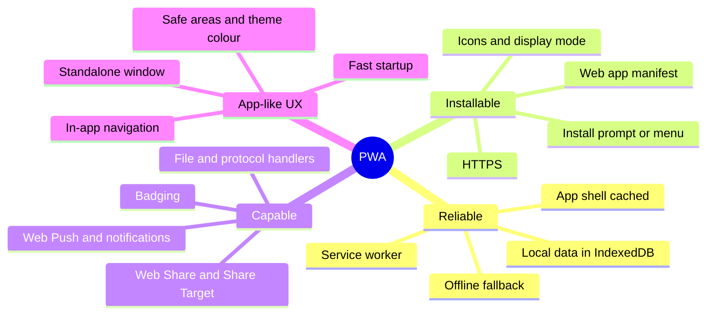
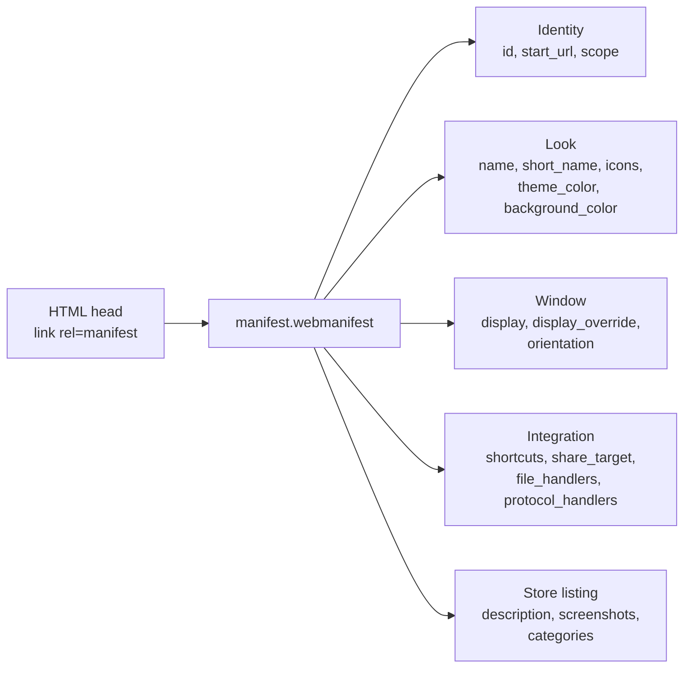
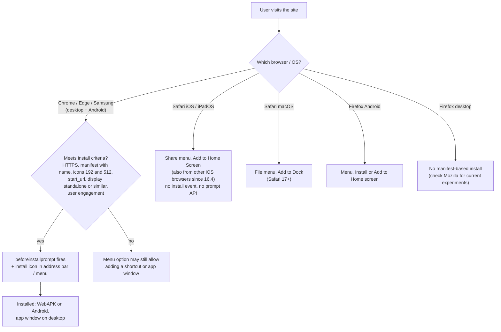
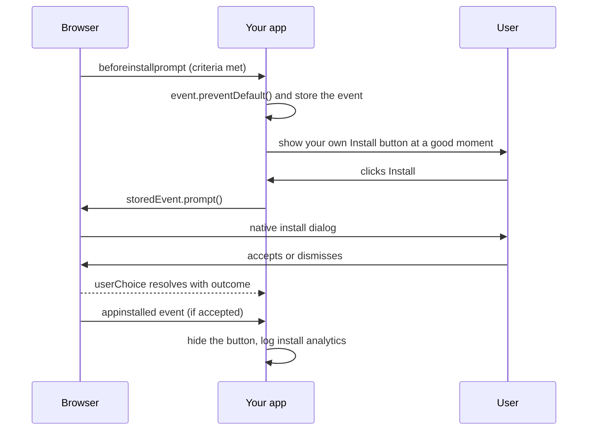
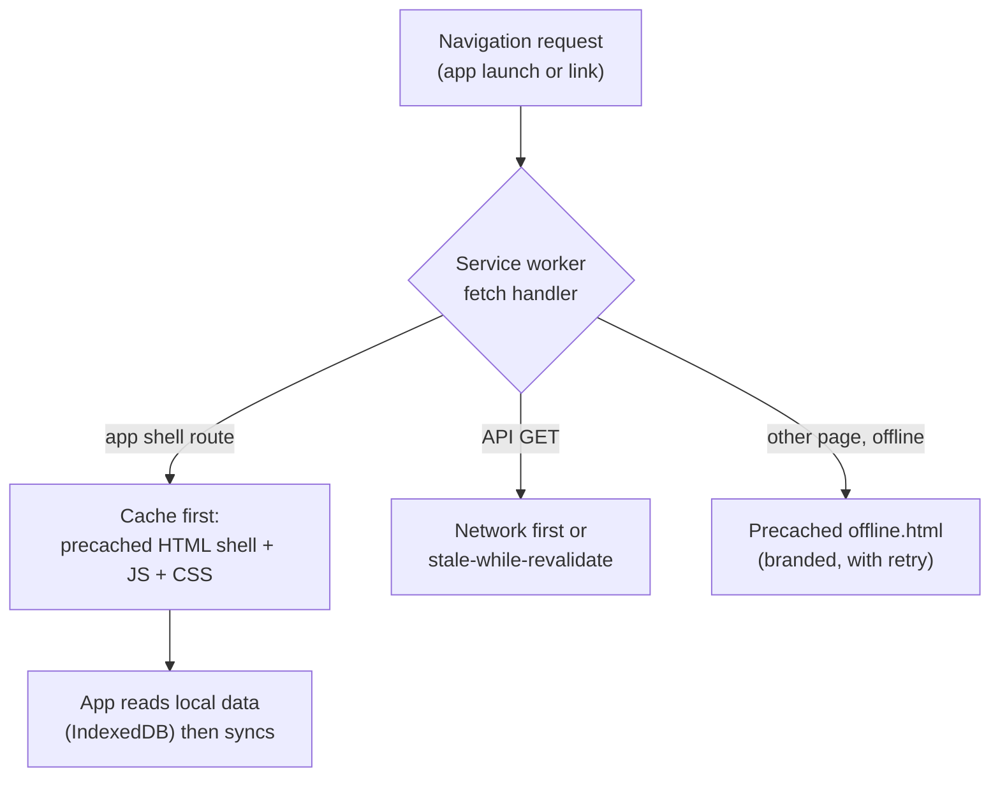
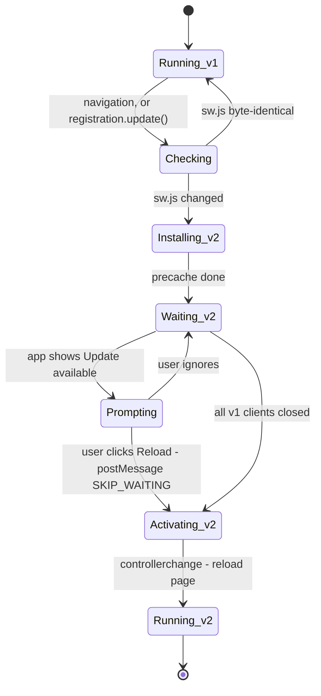
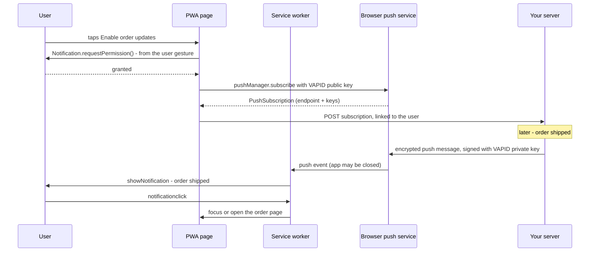
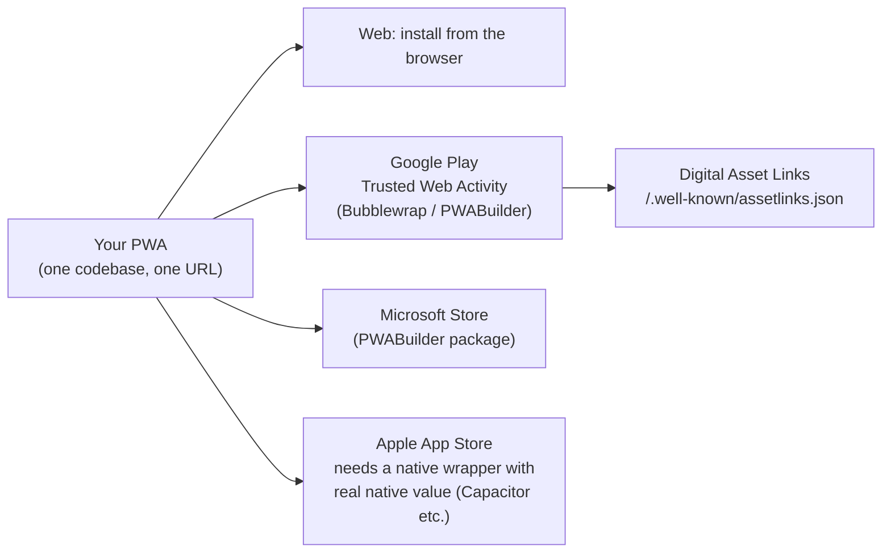
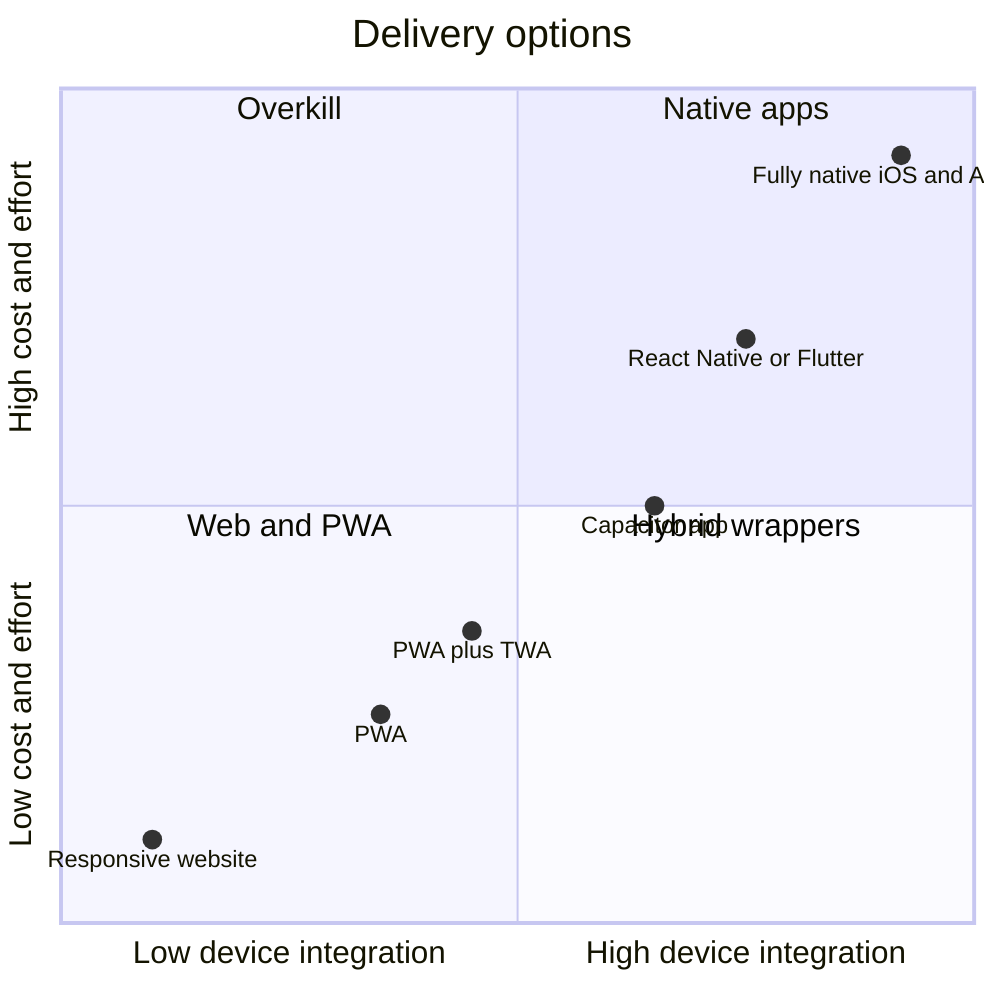

# Progressive Web Apps (PWA)

> **Date:** 2026-11-06 · **Last updated:** 2026-11-06
> **Category:** Frontend System Design
> **Sub-Topic:** Advanced Topics / Progressive Web Apps
> **Level:** Intermediate · **Reading time:** ~32 min
> **Informs:** PWA vs native vs hybrid choice, web app manifest design (id, scope, icons, display), install UX per platform, offline scope and app shell, service worker update UX, Web Push and notification strategy (incl. iOS limits), app-store distribution (TWA, Microsoft Store), storage persistence, standalone-mode UI (safe areas, navigation)

> **Pre-requisite:** [Service Workers & Web Workers](../01-web-fundamentals/service-workers-and-web-workers.md) (lifecycle, caching strategies, updates) and [Offline-First Architecture](../03-state-and-data/offline-first-architecture.md) (app shell, local data, sync).
> This note opens **Phase 10 — Advanced Topics**. It covers what turns a website into an **installable, app-like product**, and where the platform limits are in late 2026.

**Previous:** [Logging Best Practices](../09-monitoring-and-observability/logging-best-practices.md) · **Next:** [WebAssembly (WASM) in Frontend](./webassembly-wasm-in-frontend.md)

---

## Table of Contents

1. [ELI5 — Simple Explanation](#eli5--simple-explanation)
2. [Section 1: What Makes a PWA](#section-1-what-makes-a-pwa)
3. [Section 2: The Web App Manifest](#section-2-the-web-app-manifest)
4. [Section 3: Icons and Splash Screens](#section-3-icons-and-splash-screens)
5. [Section 4: Installability Across Platforms](#section-4-installability-across-platforms)
6. [Section 5: Install UX](#section-5-install-ux)
7. [Section 6: Offline and the App Shell](#section-6-offline-and-the-app-shell)
8. [Section 7: Updates](#section-7-updates)
9. [Section 8: Standalone Mode UI](#section-8-standalone-mode-ui)
10. [Section 9: Capabilities — Push, Badging, Share, Files](#section-9-capabilities--push-badging-share-files)
11. [Section 10: Storage on Installed Apps](#section-10-storage-on-installed-apps)
12. [Section 11: App Store Distribution](#section-11-app-store-distribution)
13. [Section 12: Testing and Measuring](#section-12-testing-and-measuring)
14. [Decision Matrix — PWA vs Native vs Hybrid](#decision-matrix--pwa-vs-native-vs-hybrid)
15. [Framework Comparison](#framework-comparison)
16. [Real-World Examples](#real-world-examples)
17. [Key Points Summary](#key-points-summary)
18. [Test Your Understanding (with answers)](#test-your-understanding)
19. [Cheat Sheet](#cheat-sheet)
20. [References & Further Reading](#references--further-reading)

---

## ELI5 — Simple Explanation

Think of a **food truck that can become a restaurant**:

- On the street, anyone can walk up and order — no reservation, no app store. That's a **website**: instant, linkable, no install.
- If you like it, you can ask the truck to **park permanently outside your house**. Now it has its own spot (an **icon** on your home screen), its own sign (**name, colours**), and opens without the street noise (**no browser address bar**). That's **installing** a PWA.
- The truck keeps a **pantry** so it can still serve when the supply road is closed. That's the **service worker cache** — working **offline**.
- It can **ring your doorbell** when your order is ready. That's **push notifications** — but some neighbourhoods (platforms) only allow doorbells for trucks that are parked at your house.
- When the menu changes, the truck **restocks overnight** and tells you "new menu available — refresh?". That's the **update flow**.

> **A PWA is a normal website that adds a manifest, a service worker and app-quality UX, so it can be installed, work offline and use some device features — while staying a URL that's always one click away.**

---

## Core Concept — Step by Step

### Section 1: What Makes a PWA

"PWA" isn't a single API. It's a set of web technologies plus a quality bar.



| Building block | Required for | Covered in |
|---|---|---|
| **HTTPS** (or `localhost`) | Service workers, most capabilities, install | — |
| **Web app manifest** | Install, icon, name, display mode | Section 2 |
| **Service worker** | Offline, push, background features | [Service Workers & Web Workers](../01-web-fundamentals/service-workers-and-web-workers.md) |
| **Responsive, fast UI** | Feeling like an app on every screen | [Responsive Design Patterns](../05-design-systems-and-components/responsive-design-patterns.md), [Core Web Vitals](../04-performance-engineering/core-web-vitals-lcp-inp-cls.md) |
| **Offline data strategy** | Doing real work without a network | [Offline-First Architecture](../03-state-and-data/offline-first-architecture.md) |

**"Progressive"** means the same codebase works everywhere and **enhances** where the platform supports more: a plain website in an old browser, an installable offline app in a modern one. Always feature-detect.

---

### Section 2: The Web App Manifest

A JSON file linked from every page: `<link rel="manifest" href="/manifest.webmanifest">`, served as `application/manifest+json`.



| Member | Purpose | Gotchas |
|---|---|---|
| `id` | **Stable identity** of the installed app | If missing, browsers derive it from `start_url`. Changing either later can make browsers treat it as a **different app** — set `id` once and never change it |
| `name` / `short_name` | Full name (install dialog, splash) / short name (under the icon) | Keep `short_name` short enough not to be truncated on home screens |
| `start_url` | Where the app opens | Add a marker like `?source=pwa` for analytics; it must be inside `scope` and cached for offline |
| `scope` | URLs that belong to the app | Navigating outside scope opens browser UI or an in-app browser view |
| `display` | `fullscreen`, `standalone`, `minimal-ui`, `browser` | Unsupported values fall back along that chain |
| `display_override` | Ordered list tried before `display` (e.g. `window-controls-overlay`) | Chromium only; experimental per MDN |
| `icons` | App icons with `sizes`, `type`, `purpose` (`any`, `maskable`, `monochrome`) | Section 3 |
| `theme_color` / `background_color` | Title bar / status bar colour; splash background | `<meta name="theme-color">` in the page overrides `theme_color` and can vary by `media` (light/dark) |
| `shortcuts` | Jump-list / long-press menu entries | Supported in Chromium and recent Safari on macOS; check MDN |
| `screenshots`, `description` | Richer install dialog on some platforms | Chromium shows a richer install UI when provided |
| `share_target` | Appear in the OS share sheet | Chromium; Android support is better than desktop |
| `file_handlers`, `protocol_handlers` | Open files / custom `web+` links | Chromium desktop, experimental |

> **Manifest support is uneven.** Safari on iOS ignored many members for years and still supports fewer than Chromium; Firefox desktop doesn't support installing apps from a manifest (per MDN's compat data). Check each member on MDN before depending on it.

---

### Section 3: Icons and Splash Screens

```text
Maskable icon safe zone (purpose: "maskable")

   ┌─────────────────────────┐   full icon: fill to the edges with background colour
   │      ╭───────────╮      │
   │    ╭─┘           └─╮    │   the OS may crop to a circle, squircle, rounded square…
   │    │  SAFE ZONE    │    │   keep the logo inside the central circle
   │    │ radius = 40%  │    │   (diameter = 80% of the icon width)
   │    ╰─╮           ╭─╯    │
   │      ╰───────────╯      │
   └─────────────────────────┘
```

**Practical icon set:**

| File | Purpose | Why |
|---|---|---|
| `icon-192.png`, `icon-512.png` | `any` | Chromium's install criteria require 192 and 512 px icons |
| `icon-maskable-512.png` | `maskable` | Android adaptive icons — avoids a small logo in a white circle |
| `apple-touch-icon.png` (180×180) | `<link rel="apple-touch-icon">` | iOS has historically preferred this over manifest icons; still a safe fallback |
| `favicon.svg` / `favicon.ico` | Browser tab | Not part of the manifest |
| `icon-monochrome.png` | `monochrome` | Used by some platforms for notifications/themed icons |

**Don't** mark one icon `"purpose": "any maskable"` — it then gets used for both and looks wrong in one of them. Provide separate files.

**Splash screens:** Android/Chromium generate the launch screen from `name`, `background_color` and an icon. iOS historically needed `apple-touch-startup-image` links per device size; many teams now accept the default iOS launch behaviour rather than maintain dozens of images.

---

### Section 4: Installability Across Platforms



**Chromium install criteria** (summarised — see web.dev's "install criteria" page for the current list):
- Served over **HTTPS**.
- A manifest with `name` or `short_name`, **192 px and 512 px icons**, `start_url`, a `display` of `fullscreen`, `standalone`, `minimal-ui` or `window-controls-overlay`, and `prefer_related_applications` absent or `false`.
- A user-engagement heuristic (the user has interacted with the page).
- Not already installed.

Chrome **no longer requires** a service worker with a `fetch` handler for installability (it used to). You still want one for offline support and push. Recent Chrome desktop versions also let users install sites that don't meet the criteria from the menu; the criteria decide whether Chrome actively promotes installation and fires `beforeinstallprompt`.

| Platform | Install path | Programmatic prompt? | Notes |
|---|---|---|---|
| Chrome / Edge desktop | Address-bar icon, menu | ✅ `beforeinstallprompt` | Opens in its own window; OS app list integration |
| Chrome Android | Menu / install banner | ✅ `beforeinstallprompt` | Installed as a WebAPK (appears like a native app) |
| Samsung Internet | Menu | ✅ | Chromium-based |
| Safari iOS / iPadOS | Share → Add to Home Screen | ❌ | Show your own instructions; storage is separate from Safari |
| Safari macOS | File → Add to Dock | ❌ | Safari 17+ |
| Firefox Android | Menu | ❌ | |
| Firefox desktop | — | ❌ | Not supported via manifest (per MDN data) |

---

### Section 5: Install UX



**Good install UX:**
- **Don't prompt on first load.** Offer install after the user has shown intent (second visit, completed a task, clicked "Get the app").
- **`prompt()` works once per event** and must be called from a user gesture. After a dismissal, wait for the next `beforeinstallprompt`.
- **iOS has no event** — detect iOS Safari not in standalone mode and show a small "Tap Share → Add to Home Screen" hint, dismissible and not repeated constantly.
- **Detect "already installed / running installed"**: `matchMedia('(display-mode: standalone)')`, iOS's non-standard `navigator.standalone`, and (Chromium, experimental) `navigator.getInstalledRelatedApps()`.
- **Don't fight your own native app.** If you have one, either use `related_applications` + `prefer_related_applications: true` (Chromium then promotes the native app) or don't show the web install button to users who have the native app.
- **Track installs** via `appinstalled` and a `display-mode` dimension on page views ([Analytics Architecture](../09-monitoring-and-observability/analytics-architecture.md)).

---

### Section 6: Offline and the App Shell

Installed apps get opened when the user is **offline** — on a plane, in a lift. A PWA that shows the browser's "No internet" page feels broken.



Minimum offline bar for an installed PWA:
1. **Precache the app shell** (HTML/JS/CSS/fonts/icons) at install time, versioned by build hash.
2. **A branded offline fallback** for navigations that can't be served.
3. **Clear UI state**: an offline indicator, disabled actions that need the network, queued actions where you support them.
4. **Navigation preload** if you use network-first for navigations, so the SW boot time doesn't delay HTML.

Strategies (cache-first, network-first, stale-while-revalidate), precaching and Workbox are covered in [Service Workers & Web Workers](../01-web-fundamentals/service-workers-and-web-workers.md); local data, outboxes and sync are in [Offline-First Architecture](../03-state-and-data/offline-first-architecture.md).

---

### Section 7: Updates

Installed PWAs update like websites — **no store review** — but the service worker lifecycle means a new version waits until all tabs/windows of the old one close, unless you take control.



**Update UX choices:**

| Strategy | Behaviour | Use when |
|---|---|---|
| **Prompt to reload** | Show "New version available — Reload" | Default for apps with user state (forms, editors) |
| **Auto-update on next launch** | New SW waits; next cold start gets it | Content apps; simplest |
| **Immediate `skipWaiting` + reload** | Forces the new version now | Critical security fixes only — can interrupt users mid-task |

**Rules:**
- Serve `sw.js` with `Cache-Control: no-cache` ([Browser Caching Strategies](../01-web-fundamentals/browser-caching-strategies.md)).
- Installed apps may stay open for **days** — call `registration.update()` periodically (e.g. hourly or on `visibilitychange` to visible).
- Keep old hashed assets on the server for a while so old clients can still lazy-load chunks.
- Have a **kill switch** SW ready in case a broken SW ships.
- Manifest changes (name, icons) are picked up by browsers on their own schedule — they aren't instant.

---

### Section 8: Standalone Mode UI

Without browser chrome, your app must provide what the browser used to.

| Concern | What to do |
|---|---|
| **No Back button** (iOS especially) | Provide in-app back navigation in the header for deep screens |
| **No address bar / refresh** | Pull-to-refresh or a refresh action where data can be stale; a "Share link" action since users can't copy the URL |
| **Notches and home indicators** | `<meta name="viewport" content="width=device-width, initial-scale=1, viewport-fit=cover">` + `padding: env(safe-area-inset-top)` etc. |
| **Status/title bar colour** | `theme_color` + `<meta name="theme-color" media="(prefers-color-scheme: dark)" content="...">` |
| **Desktop title bar** | `display_override: ["window-controls-overlay"]` lets content draw into the title bar area (Chromium desktop); use the `titlebar-area-*` env variables |
| **Links outside scope** | Open in an in-app browser or the default browser — make external links obvious |
| **Mode-specific styling** | `@media (display-mode: standalone) { ... }` |
| **Text selection, overscroll** | Consider `overscroll-behavior` and `user-select` on app chrome (not on content) — don't break accessibility |

```css
/* Only when running as an installed app */
@media (display-mode: standalone) {
  .browser-only-hint { display: none; }
  .app-header {
    padding-top: max(12px, env(safe-area-inset-top));
    padding-inline: max(16px, env(safe-area-inset-left)) max(16px, env(safe-area-inset-right));
  }
}
```

---

### Section 9: Capabilities — Push, Badging, Share, Files

Support differs a lot by platform. The table summarises MDN's compat data at the time of writing — **always feature-detect and re-check MDN.**

| Capability | API | Chromium (desktop / Android) | Safari (macOS / iOS) | Firefox (desktop / Android) |
|---|---|---|---|---|
| **Web Push** | Push API + Notifications + service worker | ✅ / ✅ | ✅ macOS 16+ / ✅ iOS 16.4+ **installed home-screen apps only** | ✅ / ✅ |
| **App badge** | `navigator.setAppBadge()` | ✅ desktop / ❌ Android | ✅ / ✅ (installed) | ❌ |
| **Share content** | `navigator.share()` | ✅ (desktop support came later) / ✅ | ✅ / ✅ | Behind a flag on desktop / ✅ Android |
| **Receive shares** | manifest `share_target` | ✅ / ✅ | ❌ | ❌ |
| **Open files** | manifest `file_handlers` + `launchQueue` | ✅ desktop only | ❌ | ❌ |
| **Periodic Background Sync** | `periodicSync` | ✅ (installed, engagement-gated) | ❌ | ❌ |
| **Background Fetch** | `backgroundFetch` | ✅ | ❌ | ❌ |
| **Persistent storage** | `navigator.storage.persist()` | ✅ | ✅ (15.2+) | ✅ |

**Web Push architecture:**



**Push rules:**
- **Ask in context, from a user gesture** — "Notify me when my order ships", not a dialog on page load. Safari and Firefox require a gesture; Chrome may show a quieter UI for sites that prompt badly.
- **`userVisibleOnly: true`** — every push must show a notification (Chrome requires this flag; Safari also expects visible notifications).
- **iOS:** push works only after the user **adds the app to the Home Screen** and opens it from there. Your web UI should explain that. Safari has also added **Declarative Web Push** (a push format that can display without running the service worker) — check the WebKit blog for support details.
- **Handle subscription churn**: when the push service returns 404/410, delete that subscription server-side.
- **Payloads are encrypted** (RFC 8291) and **signed with VAPID** (RFC 8292) — use a library such as `web-push` (Node) rather than hand-rolling crypto.

---

### Section 10: Storage on Installed Apps

- **Quotas and eviction** follow the browser's normal rules ([Browser Storage Mechanisms](../01-web-fundamentals/browser-storage-mechanisms.md)). Under storage pressure, "best-effort" origins can be evicted.
- **`navigator.storage.persist()`** asks for persistent storage. Chromium decides automatically (installed apps and engaged sites are more likely to get it); Firefox may ask the user; Safari supports the API since 15.2.
- **iOS / iPadOS:** a home-screen web app has **its own storage, separate from Safari**. Cookies, localStorage and IndexedDB set in Safari are not visible to the installed app, so **users must log in again** after installing. Design onboarding for that.
- **Safari's 7-day rule** for script-writable storage counts days the site is *used*; WebKit has said home-screen web apps have their own day counter, so an app that's opened regularly keeps its data. Still treat local data as a cache that can be rebuilt from the server.

---

### Section 11: App Store Distribution



| Store | How | Watch out for |
|---|---|---|
| **Google Play** | **Trusted Web Activity (TWA)** — a thin Android app that opens your PWA full-screen in the user's browser (usually Chrome), sharing its storage | Must verify domain ownership with **Digital Asset Links**; Play policies (including billing rules for digital goods) apply |
| **Microsoft Store** | Package the PWA with **PWABuilder** | Store listing assets; updates still come from your server |
| **Apple App Store** | No direct PWA submission. Wrap with a WebView-based shell (e.g. **Capacitor**) | App Review rejects apps that are just a repackaged website (guideline 4.2, "minimum functionality") — add genuine native features |
| **Samsung Galaxy Store, others** | Vary | Check each store's current policy |

> Store distribution adds discoverability and trust, but also review processes, policy constraints and fees on digital goods. Many products ship the PWA on the web and use a store wrapper only where the store matters.

---

### Section 12: Testing and Measuring

- **Chrome DevTools → Application**: Manifest (with **installability errors**), Service workers (update on reload, bypass for network, push/sync simulation), Storage (quota, clear site data).
- **Lighthouse removed its PWA category** in Lighthouse 12 (2024). Use DevTools' manifest/installability checks and tools like **PWABuilder** for a report card instead of a "PWA score".
- **Real devices**: test install, offline launch, push, and updates on **iOS Safari** and **Android Chrome** — emulators miss storage separation and push behaviour.
- **Playwright**: can test service-worker behaviour and offline mode (`context.setOffline(true)`); install prompts can't be fully automated.
- **Measure in production**: install count (`appinstalled`), share of sessions in `display-mode: standalone`, push opt-in and opt-out rates, offline sessions, update adoption (SW version reported with logs — see [Logging Best Practices](../09-monitoring-and-observability/logging-best-practices.md)).

---

## Decision Matrix — PWA vs Native vs Hybrid



| Need | PWA | Hybrid (Capacitor / WebView shell) | Cross-platform native (React Native, Flutter) | Native (Swift / Kotlin) |
|---|---|---|---|---|
| One codebase with the website | ✅ | ✅ mostly | ⚠️ separate UI code | ❌ |
| Instant updates, no store review | ✅ | ⚠️ web parts yes; native shell needs review | ⚠️ OTA for JS in some setups, policy-limited | ❌ |
| Linkable / SEO | ✅ | ❌ inside the app | ❌ | ❌ |
| Push on iOS | ⚠️ installed only | ✅ | ✅ | ✅ |
| Background processing, geofencing, Bluetooth, NFC, HealthKit, widgets | ❌ / limited | ✅ via plugins | ✅ | ✅ |
| App-store presence | ⚠️ via TWA/Store packages | ✅ | ✅ | ✅ |
| Install friction | Lowest (no store) — but iOS install is manual | Store install | Store install | Store install |

**Rule of thumb:** start with a PWA when the product is content, commerce, productivity or internal tooling, and the web is already a main channel. Go native or hybrid when you depend on iOS background features, deep device APIs, or store-driven acquisition.

---

## Framework Comparison

| Stack | PWA tooling | Notes |
|---|---|---|
| **React (Vite)** | `vite-plugin-pwa` (Workbox under the hood); `virtual:pwa-register/react` gives a `useRegisterSW` hook | Same plugin serves Vue, Svelte, Solid, Preact |
| **Next.js** | `app/manifest.ts` (typed `MetadataRoute.Manifest`); service worker hand-written or via **Serwist** | Next.js docs include a PWA guide covering manifest, push and security headers |
| **Vue / Nuxt** | `vite-plugin-pwa`; Nuxt: `@vite-pwa/nuxt` | `useRegisterSW` from `virtual:pwa-register/vue` |
| **Angular** | `ng add @angular/pwa` → `@angular/service-worker` + `ngsw-config.json` | `SwUpdate` service for update prompts, `SwPush` for push |
| **SvelteKit** | Built-in `src/service-worker.js` with the `$service-worker` module (lists build/static files and a version) | Add a manifest in `static/`; or use `@vite-pwa/sveltekit` |
| **Any** | **Workbox** for routing, strategies and precaching | Generates precache manifests from your build output |
| **Native bridge** | **Bubblewrap** / **PWABuilder** (TWA, Microsoft Store), **Capacitor** (iOS/Android shells) | Keep the web app the source of truth |

---

## Real-World Examples

**Example 1 — A complete manifest:**
```json
{
  "id": "/",
  "name": "Acme Tasks — plan your day",
  "short_name": "Acme Tasks",
  "description": "Fast, offline-capable task lists for teams.",
  "start_url": "/?source=pwa",
  "scope": "/",
  "display": "standalone",
  "display_override": ["window-controls-overlay", "standalone"],
  "background_color": "#ffffff",
  "theme_color": "#3b5bdb",
  "lang": "en",
  "dir": "ltr",
  "icons": [
    { "src": "/icons/icon-192.png", "sizes": "192x192", "type": "image/png", "purpose": "any" },
    { "src": "/icons/icon-512.png", "sizes": "512x512", "type": "image/png", "purpose": "any" },
    { "src": "/icons/icon-maskable-512.png", "sizes": "512x512", "type": "image/png", "purpose": "maskable" }
  ],
  "shortcuts": [
    { "name": "New task", "url": "/tasks/new?source=shortcut", "icons": [{ "src": "/icons/new-96.png", "sizes": "96x96" }] },
    { "name": "Today", "url": "/today?source=shortcut" }
  ],
  "screenshots": [
    { "src": "/screens/wide.png", "sizes": "1280x800", "type": "image/png", "form_factor": "wide", "label": "Task board" },
    { "src": "/screens/narrow.png", "sizes": "750x1334", "type": "image/png", "form_factor": "narrow", "label": "Today view" }
  ],
  "share_target": {
    "action": "/share",
    "method": "GET",
    "params": { "title": "title", "text": "text", "url": "url" }
  }
}
```

**Example 2 — The `<head>` tags:**
```html
<meta name="viewport" content="width=device-width, initial-scale=1, viewport-fit=cover" />
<link rel="manifest" href="/manifest.webmanifest" />
<meta name="theme-color" content="#3b5bdb" media="(prefers-color-scheme: light)" />
<meta name="theme-color" content="#1b1f3b" media="(prefers-color-scheme: dark)" />
<link rel="icon" href="/favicon.svg" type="image/svg+xml" />
<link rel="apple-touch-icon" href="/icons/apple-touch-icon-180.png" />
```

**Example 3 — An install button hook with an iOS fallback (React + TypeScript):**
```tsx
// usePwaInstall.ts
import { useEffect, useState } from 'react';

// Not in TypeScript's DOM lib because it's Chromium-only
interface BeforeInstallPromptEvent extends Event {
  prompt(): Promise<void>;
  userChoice: Promise<{ outcome: 'accepted' | 'dismissed'; platform: string }>;
}

const isStandalone = () =>
  window.matchMedia('(display-mode: standalone)').matches ||
  (navigator as Navigator & { standalone?: boolean }).standalone === true; // iOS, non-standard

const isIos = () =>
  /iphone|ipad|ipod/i.test(navigator.userAgent) ||
  (navigator.platform === 'MacIntel' && navigator.maxTouchPoints > 1); // iPadOS reports as Mac

export function usePwaInstall() {
  const [deferred, setDeferred] = useState<BeforeInstallPromptEvent | null>(null);
  const [installed, setInstalled] = useState(isStandalone);

  useEffect(() => {
    const onPrompt = (e: Event) => {
      e.preventDefault();                       // keep the browser's mini-infobar from showing now
      setDeferred(e as BeforeInstallPromptEvent);
    };
    const onInstalled = () => { setInstalled(true); setDeferred(null); };
    window.addEventListener('beforeinstallprompt', onPrompt);
    window.addEventListener('appinstalled', onInstalled);
    return () => {
      window.removeEventListener('beforeinstallprompt', onPrompt);
      window.removeEventListener('appinstalled', onInstalled);
    };
  }, []);

  async function install() {
    if (!deferred) return 'unavailable' as const;
    await deferred.prompt();                    // must run inside a user gesture
    const { outcome } = await deferred.userChoice;
    setDeferred(null);                          // the event can only be used once
    return outcome;
  }

  return {
    canPrompt: !!deferred && !installed,
    showIosHint: !installed && !deferred && isIos(),
    installed,
    install,
  };
}
```

```tsx
// InstallBanner.tsx — offer install only after the user has shown intent
export function InstallBanner({ eligible }: { eligible: boolean }) {
  const { canPrompt, showIosHint, install } = usePwaInstall();
  if (!eligible) return null;
  if (canPrompt) return <button onClick={() => install()}>Install Acme Tasks</button>;
  if (showIosHint) return <p>To install: tap <strong>Share</strong>, then <strong>Add to Home Screen</strong>.</p>;
  return null;
}
```

**Example 4 — Update prompt with `vite-plugin-pwa`:**
```typescript
// vite.config.ts
import { defineConfig } from 'vite';
import react from '@vitejs/plugin-react';
import { VitePWA } from 'vite-plugin-pwa';

export default defineConfig({
  plugins: [
    react(),
    VitePWA({
      registerType: 'prompt',                       // don't auto-skipWaiting
      includeAssets: ['favicon.svg', 'icons/apple-touch-icon-180.png'],
      manifest: false,                              // or inline the manifest object here
      workbox: {
        globPatterns: ['**/*.{js,css,html,svg,png,woff2}'],
        navigateFallback: '/index.html',
        navigateFallbackDenylist: [/^\/api\//],
      },
    }),
  ],
});
```

```tsx
// UpdatePrompt.tsx
import { useRegisterSW } from 'virtual:pwa-register/react';

export function UpdatePrompt() {
  const { needRefresh: [needRefresh, setNeedRefresh], updateServiceWorker } = useRegisterSW({
    onRegisteredSW(_url, registration) {
      // installed apps can stay open for days: check for updates periodically
      if (registration) setInterval(() => registration.update(), 60 * 60 * 1000);
    },
  });

  if (!needRefresh) return null;
  return (
    <div role="status">
      A new version is available.
      <button onClick={() => updateServiceWorker(true)}>Reload</button>
      <button onClick={() => setNeedRefresh(false)}>Later</button>
    </div>
  );
}
```

**Example 5 — Web Push: subscribe in context (BAD → GOOD) and handle it in the SW:**
```typescript
// ❌ BAD: permission dialog on page load, no context — users block it, and Safari/Firefox need a gesture
Notification.requestPermission();

// ✅ GOOD: from a button with a clear benefit
async function enableOrderUpdates(vapidPublicKey: Uint8Array) {
  if (!('serviceWorker' in navigator) || !('PushManager' in window)) {
    return 'unsupported'; // on iOS this also means "not installed to Home Screen yet"
  }
  const permission = await Notification.requestPermission();
  if (permission !== 'granted') return permission;

  const reg = await navigator.serviceWorker.ready;
  const sub = (await reg.pushManager.getSubscription()) ??
    (await reg.pushManager.subscribe({ userVisibleOnly: true, applicationServerKey: vapidPublicKey }));

  await fetch('/api/push/subscriptions', {
    method: 'POST',
    headers: { 'Content-Type': 'application/json' },
    body: JSON.stringify(sub),                  // endpoint + p256dh + auth keys
  });
  return 'granted';
}
```

```javascript
// sw.js
self.addEventListener('push', (event) => {
  const data = event.data?.json() ?? { title: 'Acme Tasks', body: 'You have an update' };
  event.waitUntil(
    self.registration.showNotification(data.title, {
      body: data.body,
      icon: '/icons/icon-192.png',
      badge: '/icons/badge-72.png',
      data: { url: data.url ?? '/' },
      tag: data.tag,                            // replaces older notifications with the same tag
    }),
  );
});

self.addEventListener('notificationclick', (event) => {
  event.notification.close();
  const url = new URL(event.notification.data.url, self.location.origin).href;
  event.waitUntil((async () => {
    const windows = await clients.matchAll({ type: 'window', includeUncontrolled: true });
    const existing = windows.find((w) => w.url === url);
    return existing ? existing.focus() : clients.openWindow(url);
  })());
});
```

```javascript
// Server (Node) — send with the web-push library
import webpush from 'web-push';

webpush.setVapidDetails('mailto:ops@example.com', process.env.VAPID_PUBLIC, process.env.VAPID_PRIVATE);

export async function notify(subscription, payload) {
  try {
    await webpush.sendNotification(subscription, JSON.stringify(payload), { TTL: 3600 });
  } catch (err) {
    if (err.statusCode === 404 || err.statusCode === 410) await deleteSubscription(subscription.endpoint);
    else throw err;
  }
}
```

**Example 6 — Framework-native setups:**
```typescript
// Next.js App Router — app/manifest.ts (served at /manifest.webmanifest)
import type { MetadataRoute } from 'next';

export default function manifest(): MetadataRoute.Manifest {
  return {
    id: '/',
    name: 'Acme Tasks',
    short_name: 'Acme Tasks',
    start_url: '/?source=pwa',
    display: 'standalone',
    background_color: '#ffffff',
    theme_color: '#3b5bdb',
    icons: [
      { src: '/icons/icon-192.png', sizes: '192x192', type: 'image/png' },
      { src: '/icons/icon-512.png', sizes: '512x512', type: 'image/png' },
      { src: '/icons/icon-maskable-512.png', sizes: '512x512', type: 'image/png', purpose: 'maskable' },
    ],
  };
}
```

```typescript
// Angular — after `ng add @angular/pwa`: prompt for updates with SwUpdate
import { Injectable, inject } from '@angular/core';
import { SwUpdate, VersionReadyEvent } from '@angular/service-worker';
import { filter } from 'rxjs';

@Injectable({ providedIn: 'root' })
export class UpdateService {
  private updates = inject(SwUpdate);
  constructor() {
    if (!this.updates.isEnabled) return;
    this.updates.versionUpdates
      .pipe(filter((e): e is VersionReadyEvent => e.type === 'VERSION_READY'))
      .subscribe(() => {
        if (confirm('A new version is available. Reload?')) {
          this.updates.activateUpdate().then(() => document.location.reload());
        }
      });
  }
}
```

```javascript
// SvelteKit — src/service-worker.js (built in; registered automatically)
import { build, files, version } from '$service-worker';

const CACHE = `cache-${version}`;
const ASSETS = [...build, ...files];

self.addEventListener('install', (event) => {
  event.waitUntil(caches.open(CACHE).then((c) => c.addAll(ASSETS)));
});

self.addEventListener('activate', (event) => {
  event.waitUntil(caches.keys().then((keys) =>
    Promise.all(keys.filter((k) => k !== CACHE).map((k) => caches.delete(k)))));
});

self.addEventListener('fetch', (event) => {
  if (event.request.method !== 'GET') return;
  const url = new URL(event.request.url);
  if (ASSETS.includes(url.pathname)) {
    event.respondWith(caches.match(url.pathname).then((r) => r ?? fetch(event.request)));
  }
});
```

---

## Key Points Summary

| Concept | One-Line Explanation |
|---|---|
| **PWA** | A website + manifest + service worker + app-quality UX |
| **Manifest `id`** | Stable app identity — set once, never change |
| **`start_url` / `scope`** | Where the app opens / which URLs belong to it |
| **`display`** | `standalone` removes browser UI; `display_override` adds newer modes |
| **Maskable icon** | Full-bleed icon with the logo inside the central 80% safe zone |
| **Install criteria** | Chromium: HTTPS, manifest basics, 192/512 icons, engagement |
| **`beforeinstallprompt`** | Chromium-only event to show your own install button |
| **iOS install** | Manual Share → Add to Home Screen; storage separate from Safari |
| **App shell** | Precached HTML/JS/CSS so the app launches offline |
| **Update flow** | New SW waits; prompt to reload; check for updates periodically |
| **Web Push** | Push API + VAPID; on iOS only for installed home-screen apps |
| **TWA** | Ship the PWA to Google Play via a thin Android wrapper |
| **Lighthouse** | No PWA category since Lighthouse 12 — use DevTools installability checks |

---

## Test Your Understanding

**Q1 (Basic):**
What are the minimum pieces needed for a site to be installable in Chrome, and which of them also matter for Safari on iOS?

<details>
<summary>Answer</summary>

Chrome: **HTTPS**, a linked **manifest** with `name`/`short_name`, **192 px and 512 px icons**, `start_url`, a `display` of `standalone`/`fullscreen`/`minimal-ui`/`window-controls-overlay`, `prefer_related_applications` not true, and some user engagement. A service worker with a fetch handler is no longer required for installability, but you still want one for offline.

iOS Safari lets users add **any** page to the Home Screen manually; there's no install event or criteria check. The manifest (`display`, `name`, `start_url`, icons) and `apple-touch-icon` decide how it looks and whether it opens standalone, and HTTPS + a service worker matter for offline and push. So the manifest and icons matter on both; the install *prompt* mechanics are Chromium-only.
</details>

**Q2 (Application):**
Your PWA shows a "Install app" banner on every first page load. Install rates are low and bounce rate went up. What would you change?

<details>
<summary>Answer</summary>

Prompting before the user has seen any value interrupts them and trains them to dismiss it.

- Call `preventDefault()` on `beforeinstallprompt`, **store the event**, and show your **own** button only after a signal of intent: a second visit, a completed task, or a "Get the app" entry point in settings or the footer.
- Explain the **benefit** ("works offline, opens from your home screen").
- Respect dismissals (don't re-show for a while).
- On iOS, show a small, dismissible Add-to-Home-Screen hint at a similar moment.
- Measure: `appinstalled`, the share of `display-mode: standalone` sessions, and retention of installed users vs others.
</details>

**Q3 (Tricky):**
A user logs in on Safari, installs the PWA to the iPhone Home Screen, opens it — and is logged out. Bug?

<details>
<summary>Answer</summary>

No, it's platform behaviour. On iOS, a home-screen web app runs with **its own storage container**, separate from Safari: cookies, localStorage, IndexedDB and Cache Storage aren't shared. The installed app has never seen the session cookie.

Design for it: make login in the installed app quick (passkeys, "Sign in with…", magic links that open correctly in standalone mode), and don't assume data cached in Safari exists in the app. Push subscriptions must also be created from inside the installed app.
</details>

**Q4 (Tricky):**
You shipped a release, but users of the installed desktop PWA keep running the old version for days. Your `sw.js` is served with `no-cache`. Why?

<details>
<summary>Answer</summary>

The browser does find the new service worker, but it stays in the **waiting** state while any window of the old version is open. Installed desktop PWAs are often left open for days, and closing the window is rare, so the old SW keeps controlling the page. Also, the browser only checks for updates on navigations (or when you call `registration.update()`), and an SPA that never does a full navigation rarely triggers it.

Fix: call `registration.update()` periodically and on `visibilitychange` to visible; when a new SW is waiting, show **"New version — Reload"**, then `postMessage({ type: 'SKIP_WAITING' })` and reload on `controllerchange`. Reserve automatic `skipWaiting` for urgent fixes, and keep old hashed assets on the server so open sessions don't break.
</details>

**Q5 (System design):**
A retail company wants push notifications for order updates on iOS and Android and asks if a PWA is enough or if they need native apps.

<details>
<summary>Answer</summary>

- **Android (Chrome/Samsung/Firefox):** Web Push works in the browser and for installed PWAs. A PWA is enough.
- **iOS/iPadOS:** Web Push works **only for web apps added to the Home Screen** (iOS 16.4+), and users must install manually (no prompt API). Reach is therefore limited to users who install.
- Options:
  1. **PWA only**: accept lower iOS reach; add a clear in-app guide to installing, and back push up with email/SMS for critical messages.
  2. **PWA + store wrappers**: TWA on Google Play; on iOS a Capacitor shell that uses **native push (APNs)** and adds real native value to pass App Review.
  3. **Native apps** if push-driven re-engagement is central to the business and iOS is a large share of revenue.
- Either way: subscriptions keyed to the user server-side, ask for permission in context ("Notify me when my order ships"), clean up 404/410 subscriptions, and measure opt-in rates per platform.
</details>

**Q6 (System design):**
Design the PWA layer for a field-service app (technicians fill in job reports, often with no signal) used on Android tablets and iPads.

<details>
<summary>Answer</summary>

- **Manifest:** fixed `id`, `start_url: "/jobs?source=pwa"`, `display: standalone`, `orientation` left to the device, maskable icons, `shortcuts` for "Today's jobs" and "New report".
- **App shell:** precache all route chunks, fonts and icons (Workbox / vite-plugin-pwa); branded offline fallback; navigation preload if navigations are network-first.
- **Data:** jobs and forms in IndexedDB; an **outbox** for report submissions with idempotency keys, synced on `online`/app open. Background Sync only as an enhancement (Chromium), never the only path. Photos stored as Blobs with size limits. Call `navigator.storage.persist()` and show storage usage. See [Offline-First Architecture](../03-state-and-data/offline-first-architecture.md).
- **Install:** onboarding screen with platform-specific install steps (button on Android via `beforeinstallprompt`, Share → Add to Home Screen on iPad). Explain that iPad users must log in inside the installed app.
- **Updates:** prompt-to-reload when no unsynced data exists; defer updates while a form is open; periodic `registration.update()`.
- **Standalone UI:** in-app back navigation, safe-area padding, an obvious sync status indicator.
- **Push:** "New job assigned" via Web Push (iPad requires the installed app; fall back to in-app polling on open).
- **Distribution:** consider a TWA on Google Play / managed Play for MDM deployment; on iPad, MDM can deploy web clips, or use a Capacitor wrapper if device features (e.g. background location) are needed.
</details>

---

## Cheat Sheet

**Key Definitions:**
- **PWA:** a web app that is installable, reliable offline and integrated with the OS where supported
- **Web app manifest:** JSON describing the app's identity, look and window mode
- **Service worker:** script that intercepts requests and handles push/background events
- **App shell:** the minimal HTML/CSS/JS needed to render the UI, cached for offline launch
- **Maskable icon:** an icon designed to survive OS cropping (safe zone = central circle, radius 40%)
- **WebAPK:** Android package Chrome generates for an installed PWA
- **TWA (Trusted Web Activity):** Android wrapper that opens a verified PWA full-screen for Play distribution
- **VAPID:** keys that identify your server to push services (RFC 8292)

**Quick Reference:**
```text
Manifest:     id (never change) · name · short_name · start_url (?source=pwa) · scope · display: standalone
              icons 192 + 512 (any) + 512 maskable · theme_color · background_color · shortcuts · screenshots
Head:         <link rel="manifest"> · theme-color meta (light/dark media) · apple-touch-icon · viewport-fit=cover
Install:      Chromium → beforeinstallprompt: preventDefault, store, prompt() on click, once per event
              iOS → manual Share → Add to Home Screen (show a hint) · macOS Safari → Add to Dock
Detect:       matchMedia('(display-mode: standalone)') · navigator.standalone (iOS) · appinstalled event
Offline:      precache shell by build hash · offline.html fallback · navigation preload · IndexedDB data
Updates:      sw.js no-cache · registration.update() periodically · prompt → SKIP_WAITING → reload on controllerchange
Push:         ask from a gesture, in context · userVisibleOnly: true · VAPID · delete 404/410 subscriptions
              iOS: installed home-screen apps only (16.4+)
Storage:      navigator.storage.persist() · iOS installed app storage is separate from Safari
Stores:       Google Play = TWA + assetlinks.json · Microsoft Store = PWABuilder · App Store = native wrapper with real value
Testing:      DevTools Application panel (installability errors) · real iOS + Android devices · no Lighthouse PWA score
```

**Common Mistakes to Avoid:**

| Mistake | Why Wrong | Fix |
|---|---|---|
| Changing `start_url` or `id` after launch | Browsers may treat it as a different app; duplicates | Set `id` explicitly once |
| Single icon with `"any maskable"` | Looks wrong either cropped or uncropped | Separate `any` and `maskable` files |
| Install prompt on first load | Interrupts users; low conversion | Prompt after intent, with a clear benefit |
| Waiting for `beforeinstallprompt` on iOS | It never fires there | Show manual install instructions |
| No offline fallback | Installed app shows the browser error page | Precache shell + `offline.html` |
| Auto `skipWaiting` on every release | Mixed old/new code, lost form state | Prompt to reload; skip only for urgent fixes |
| Never calling `registration.update()` | Long-lived windows stay on old versions | Periodic and on-visible update checks |
| Push permission requested on load | Users deny; Safari/Firefox require a gesture | Ask in context from a button |
| Assuming Safari's login carries into the iOS app | Storage is separate | Fast in-app login, passkeys |
| No in-app Back button in standalone mode | Users get stuck (no browser chrome) | Header back navigation, share-link action |
| Ignoring safe areas | Content under the notch/home indicator | `viewport-fit=cover` + `env(safe-area-inset-*)` |
| Chasing a Lighthouse PWA score | Category removed in Lighthouse 12 | DevTools installability checks, real-device tests |
| Wrapping a plain website for the App Store | Rejected for minimum functionality | Add native value or stay on the web |

---

## References & Further Reading

**Core docs**
- MDN: [Progressive web apps](https://developer.mozilla.org/en-US/docs/Web/Progressive_web_apps)
- MDN: [Web app manifests](https://developer.mozilla.org/en-US/docs/Web/Progressive_web_apps/Manifest) · [Making PWAs installable](https://developer.mozilla.org/en-US/docs/Web/Progressive_web_apps/Guides/Making_PWAs_installable)
- MDN: [`beforeinstallprompt` event](https://developer.mozilla.org/en-US/docs/Web/API/Window/beforeinstallprompt_event) · [`display-mode` media feature](https://developer.mozilla.org/en-US/docs/Web/CSS/@media/display-mode)
- MDN: [Push API](https://developer.mozilla.org/en-US/docs/Web/API/Push_API) · [Badging API](https://developer.mozilla.org/en-US/docs/Web/API/Badging_API) · [`StorageManager.persist()`](https://developer.mozilla.org/en-US/docs/Web/API/StorageManager/persist)
- web.dev: [Learn PWA](https://web.dev/learn/pwa/) · [Installation criteria](https://web.dev/articles/install-criteria) · [Maskable icons](https://web.dev/articles/maskable-icon)
- web.dev: [Patterns for promoting PWA installation](https://web.dev/articles/promote-install)
- web.dev: [Window Controls Overlay](https://web.dev/articles/window-controls-overlay)
- Chrome for Developers: [Trusted Web Activity overview](https://developer.chrome.com/docs/android/trusted-web-activity)
- Lighthouse: [v12.0.0 release notes — PWA category removal](https://github.com/GoogleChrome/lighthouse/releases/tag/v12.0.0)

**Specs**
- W3C: [Web Application Manifest](https://www.w3.org/TR/appmanifest/)
- W3C: [Service Workers](https://www.w3.org/TR/service-workers/) · [Push API](https://www.w3.org/TR/push-api/)
- IETF: [RFC 8030 — Web Push protocol](https://www.rfc-editor.org/rfc/rfc8030) · [RFC 8291 — Message encryption](https://www.rfc-editor.org/rfc/rfc8291) · [RFC 8292 — VAPID](https://www.rfc-editor.org/rfc/rfc8292)

**Platforms**
- WebKit: [Web Push for Web Apps on iOS and iPadOS](https://webkit.org/blog/13878/web-push-for-web-apps-on-ios-and-ipados/)
- WebKit: [WebKit blog](https://webkit.org/blog/) — search for "Declarative Web Push" and the Safari release notes for current push and home-screen app behaviour
- Apple: [App Review Guidelines (4.2 Minimum Functionality)](https://developer.apple.com/app-store/review/guidelines/#minimum-functionality)

**Tooling**
- [Vite PWA plugin](https://vite-pwa-org.netlify.app/) · [Workbox](https://developer.chrome.com/docs/workbox)
- Next.js: [Progressive Web Apps guide](https://nextjs.org/docs/app/guides/progressive-web-apps) · [`manifest.ts`](https://nextjs.org/docs/app/api-reference/file-conventions/metadata/manifest)
- Angular: [Service workers & PWA](https://angular.dev/ecosystem/service-workers)
- SvelteKit: [Service workers](https://svelte.dev/docs/kit/service-workers)
- [PWABuilder](https://www.pwabuilder.com/) · [Bubblewrap](https://github.com/GoogleChromeLabs/bubblewrap) · [Capacitor](https://capacitorjs.com/docs)

---

> **Previous Topic:** [Logging Best Practices](../09-monitoring-and-observability/logging-best-practices.md)
> — Structured, private, correlated client-side logs

> **Next Topic:** [WebAssembly (WASM) in Frontend](./webassembly-wasm-in-frontend.md)
> — Running near-native compiled code in the browser

*Saved on: 2026-11-06 | Repo: Frontend System Design Learning Notes*
