# WebAssembly (WASM) in Frontend

> **Date:** 2026-11-06 · **Last updated:** 2026-11-06
> **Category:** Frontend System Design
> **Sub-Topic:** Advanced Topics / WebAssembly
> **Level:** Advanced · **Reading time:** ~30 min
> **Informs:** WASM vs JS vs server for a CPU-heavy feature, source language and toolchain choice, JS-WASM boundary design (batching, memory sharing), worker placement, .wasm loading and caching (streaming compile, MIME type, preload), CSP `wasm-unsafe-eval`, COOP/COEP for WASM threads, bundle-size budgets, framework, SSR and edge integration

> **Pre-requisite:** [Web Workers for Heavy Computation](../04-performance-engineering/web-workers-for-heavy-computation.md) (worker protocols, transfer, SharedArrayBuffer and cross-origin isolation) and [JavaScript Runtime & Event Loop](../01-web-fundamentals/javascript-runtime-event-loop.md) (long tasks, main-thread budget).
> This note explains **what WebAssembly is, when it actually beats JavaScript, and how to ship it** in a production frontend without hurting load time, security or maintainability.

**Previous:** [Progressive Web Apps (PWA)](./progressive-web-apps-pwa.md) · **Next:** [Web Components & Shadow DOM](./web-components-and-shadow-dom.md)

---

## Table of Contents

1. [ELI5 — Simple Explanation](#eli5--simple-explanation)
2. [Section 1: What WebAssembly Is (and Isn't)](#section-1-what-webassembly-is-and-isnt)
3. [Section 2: From Source Code to a Running Module](#section-2-from-source-code-to-a-running-module)
4. [Section 3: The Module Model — Imports, Exports, Linear Memory](#section-3-the-module-model--imports-exports-linear-memory)
5. [Section 4: Loading, Compiling and Caching](#section-4-loading-compiling-and-caching)
6. [Section 5: Crossing the JS–WASM Boundary](#section-5-crossing-the-jswasm-boundary)
7. [Section 6: Performance Reality — When WASM Wins](#section-6-performance-reality--when-wasm-wins)
8. [Section 7: Off the Main Thread — Workers, Threads, SIMD](#section-7-off-the-main-thread--workers-threads-simd)
9. [Section 8: Languages and Toolchains](#section-8-languages-and-toolchains)
10. [Section 9: Modern Features and Browser Support](#section-9-modern-features-and-browser-support)
11. [Section 10: Security Model and CSP](#section-10-security-model-and-csp)
12. [Section 11: Bundlers, Frameworks, SSR, Edge and Native](#section-11-bundlers-frameworks-ssr-edge-and-native)
13. [Section 12: Debugging and Profiling](#section-12-debugging-and-profiling)
14. [Decision Matrix](#decision-matrix)
15. [Real-World Examples](#real-world-examples)
16. [Key Points Summary](#key-points-summary)
17. [Test Your Understanding](#test-your-understanding)
18. [Cheat Sheet](#cheat-sheet)
19. [References & Further Reading](#references--further-reading)

---

## ELI5 — Simple Explanation

Picture a restaurant kitchen.

- **JavaScript** is the head chef. Versatile, fast to start, talks to the waiters and the dining room (the **DOM**), and improvises well.
- **WebAssembly** is a **specialised machine** the chef can order, flat-packed, from a factory (a compiler for C++, Rust, Go…). Once unpacked (compiled) it slices 10,000 onions with steady, predictable speed.
- The machine sits **behind a hatch**. It can't walk into the dining room. Everything goes in and out through the hatch, and each trip costs a little time (the **JS–WASM boundary**).
- Ordering one onion at a time through the hatch is slower than the chef just doing it. Passing **a whole crate at once** is where the machine shines.
- The machine also arrives in a box that has to be shipped and unpacked first (**download and compile**). For a two-minute job, it isn't worth the delivery.

> **WebAssembly is a fast, sandboxed compute engine next to JavaScript, not a replacement for it. Use it for heavy, self-contained work you can hand over in big batches, and keep the UI in JS.**

---

## Core Concept — Step by Step

### Section 1: What WebAssembly Is (and Isn't)

WebAssembly (WASM) is a **portable binary instruction format** for a stack-based virtual machine. Browsers compile it to machine code and run it in the **same sandbox as JavaScript**, with the same origin and the same permissions.

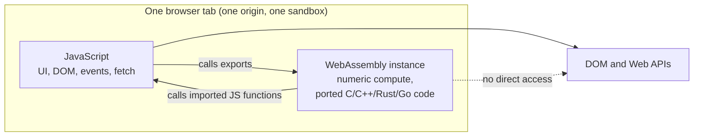

| WebAssembly **is** | WebAssembly **is not** |
|---|---|
| A compilation target for C, C++, Rust, Go, C#, Kotlin, Dart, Zig, AssemblyScript and more | A language you normally write by hand (the text format `.wat` exists for learning and debugging) |
| Fast to decode, validate and compile, with predictable performance | Automatically faster than JavaScript for every task |
| Sandboxed: it touches only its own memory and the functions you import | Able to call the DOM or Web APIs directly. Everything goes through JS |
| Supported in every modern browser since 2017, plus Node.js, Deno, Bun and edge runtimes | A plugin like Flash or Java applets. It is part of the web platform |
| A W3C standard (Core 1.0 became a Recommendation in 2019; newer versions add GC, exceptions, 64-bit memory…) | Frozen: features keep shipping, at different times per engine (Section 9) |

**The four values at the core:** fast, safe, portable, and compact. The spec defines integer and float types (`i32`, `i64`, `f32`, `f64`), a 128-bit vector type (`v128`) and reference types. Strings, objects and arrays don't exist natively in the original design; toolchains build them in linear memory or, with **WasmGC**, as engine-managed structs and arrays.

A hand-written module in the **text format** (WAT):

```wat
(module
  (func (export "add") (param $a i32) (param $b i32) (result i32)
    local.get $a
    local.get $b
    i32.add))
```

```javascript
// Compile the binary form of the module above and call it
const { instance } = await WebAssembly.instantiateStreaming(fetch('/add.wasm'));
console.log(instance.exports.add(2, 3)); // 5
```

---

### Section 2: From Source Code to a Running Module

In practice you never write `.wasm` yourself. A **toolchain** compiles another language and usually emits **JS glue code** that loads the module and converts values at the boundary.

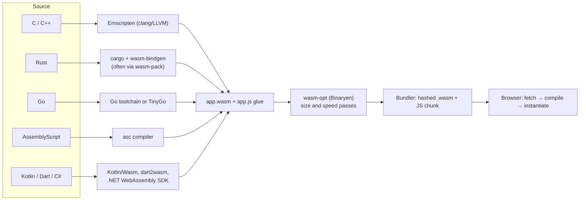

Inside the browser, the engine compiles the bytes to machine code. Modern engines use **tiers**: a fast baseline compiler gets code running quickly (V8 calls it **Liftoff**), then an optimizing compiler (V8: **TurboFan**) recompiles hot functions in the background. Unlike JavaScript, there is no type guessing and no deoptimization, because WASM types are explicit. That's where the **predictable** performance comes from.

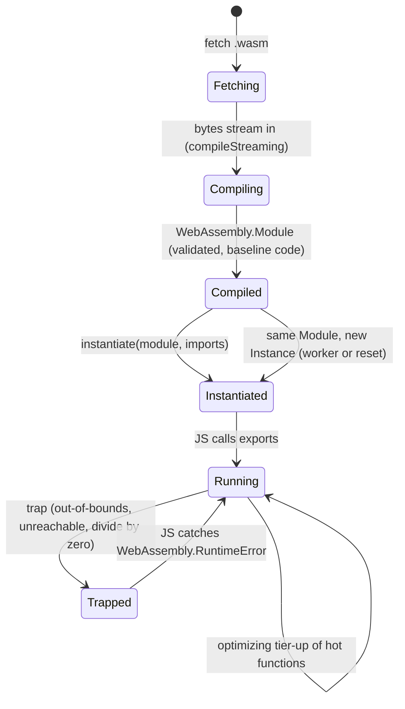

> A **trap** throws a `WebAssembly.RuntimeError` into JavaScript. For C/C++/Rust code the instance's memory may be in an inconsistent state afterwards, so many apps **re-instantiate** after a trap rather than keep using it.

---

### Section 3: The Module Model — Imports, Exports, Linear Memory

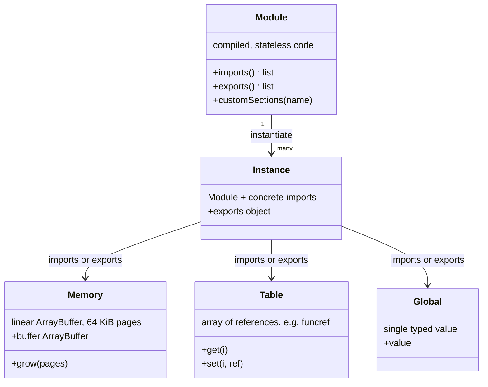

| Piece | What it is | Why you care |
|---|---|---|
| **Module** | Compiled, stateless code. Can be posted to workers and instantiated many times | Compile once, instantiate per worker (no recompiling) |
| **Instance** | A Module plus its imports, with its own state | `instance.exports` holds the callable functions |
| **Imports** | JS functions and objects the module needs (`console.log`, `Math.random`, DOM helpers) | The only way WASM reaches the outside world |
| **Linear memory** | One contiguous, bounds-checked byte array (`WebAssembly.Memory`), visible to JS as an `ArrayBuffer` | Where C/Rust heaps, strings and pixel buffers live. JS reads and writes it through typed arrays |
| **Table** | Array of references (mainly function pointers) | How C function pointers and Rust trait objects work |

**Linear memory is the key idea.** It is just bytes. JS and WASM share it with **zero copies**, as long as data is already inside it:

```javascript
const memory = new WebAssembly.Memory({ initial: 1, maximum: 100 }); // 1 page = 64 KiB
let bytes = new Uint8Array(memory.buffer);
bytes[0] = 42;

memory.grow(1);          // add one page
console.log(bytes.length); // 0 — the old ArrayBuffer was DETACHED by grow()
bytes = new Uint8Array(memory.buffer); // always re-create views after any call that may grow memory
```

> **Gotcha:** in C/Rust, *any* allocation inside a WASM call can grow memory. Glue code (wasm-bindgen, Emscripten's `HEAPU8`) refreshes its views for you. If you hold your own typed-array views, re-create them after each call. Shared memory (`shared: true`) doesn't detach, but the old view still has the old length.

**Size limits:** classic WASM ("wasm32") addresses up to 4 GiB; browsers may cap lower, especially on mobile. **Memory64** raises the address space but isn't in every browser yet (Section 9).

---

### Section 4: Loading, Compiling and Caching

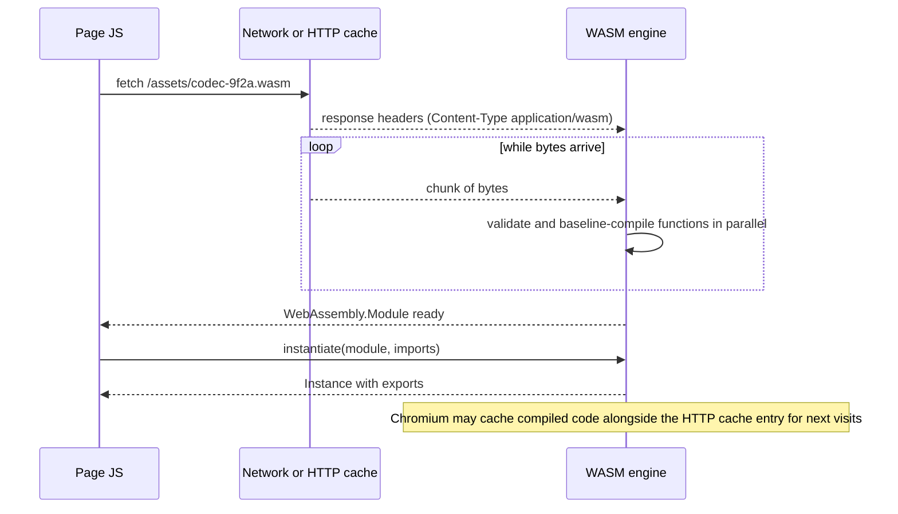

**The loading APIs, from best to worst:**

| API | Behavior | Use |
|---|---|---|
| `WebAssembly.instantiateStreaming(fetch(url), imports)` | Compiles **while downloading**, then instantiates | Default choice |
| `WebAssembly.compileStreaming(fetch(url))` | Streaming compile, returns a `Module` you can post to workers | One module, many workers |
| `WebAssembly.instantiate(bytes, imports)` | Waits for the full download, then compiles | Fallback when streaming isn't possible (wrong MIME type, bytes from IndexedDB) |
| `new WebAssembly.Module(bytes)` (synchronous) | Blocks the thread while compiling | Workers only, and small modules. Chromium rejects it on the main thread above a size limit |

**Production requirements:**

1. **Serve `Content-Type: application/wasm`.** The streaming APIs reject any other MIME type with a `TypeError`. Some servers and object stores still default to `application/octet-stream`.
2. **Compress it.** WASM binaries compress well with Brotli or gzip. Make sure your CDN compresses `application/wasm` (it often isn't in default lists).
3. **Hash the file name and cache forever** (`public, max-age=31536000, immutable`), exactly like JS chunks. See [Browser Caching Strategies](../01-web-fundamentals/browser-caching-strategies.md).
4. **Cross-origin `.wasm`** needs CORS headers, because `fetch()` defaults to CORS mode.
5. **Load it lazily.** A `.wasm` file is part of your bundle budget. Load it on the route or interaction that needs it, not on first paint. See [Code Splitting & Lazy Loading](../04-performance-engineering/code-splitting-and-lazy-loading.md).
6. **Preload when you know it's needed soon:**

```html
<!-- as="fetch" requires crossorigin so the preload matches fetch()'s CORS mode -->
<link rel="preload" href="/assets/codec-9f2a.wasm" as="fetch" type="application/wasm" crossorigin>
```

**Code caching:** Chromium can store the optimized machine code for a module fetched with `compileStreaming`/`instantiateStreaming`, tied to the HTTP cache entry. On a repeat visit it skips most compilation, another reason to use streaming APIs and immutable, hashed URLs. Other engines have their own caching. Treat it as a bonus, not a guarantee.

```http
HTTP/2 200
content-type: application/wasm
content-encoding: br
cache-control: public, max-age=31536000, immutable
access-control-allow-origin: https://app.example.com
```

---

### Section 5: Crossing the JS–WASM Boundary

Calls between JS and WASM are cheap in modern engines, but **converting data** is not. Numbers pass directly. Everything else has to be encoded into linear memory and decoded back.

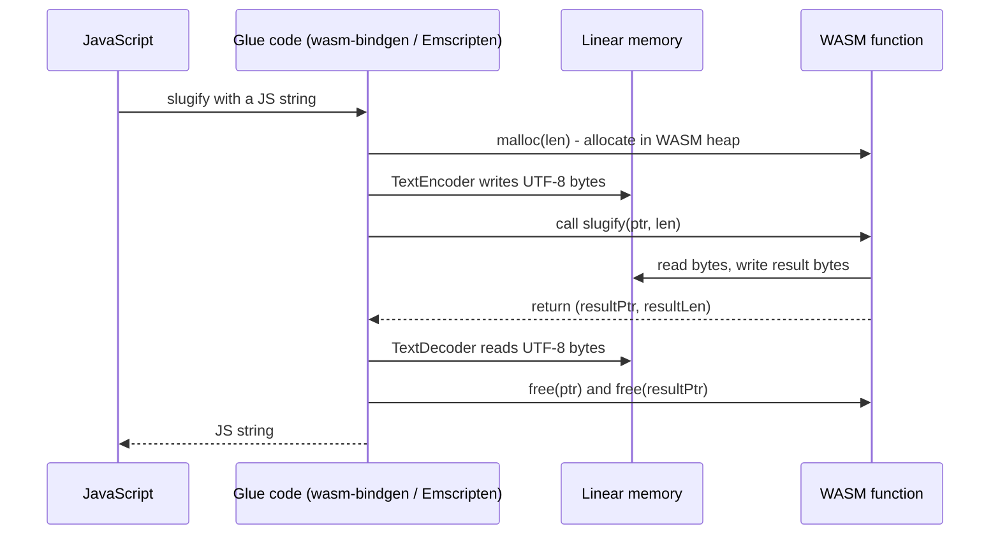

| Value type | Cost across the boundary |
|---|---|
| `i32`, `f32`, `f64` numbers | Near zero, passed directly |
| `i64` | Becomes a JS `BigInt` (supported in all major browsers) |
| Strings | Encode + copy + allocate + decode (UTF-16 in JS vs usually UTF-8 in WASM). **JS String Builtins** reduce this for WasmGC languages |
| Arrays / typed arrays | Copy into linear memory, unless JS writes directly into a view of WASM memory |
| Objects | Serialized (JSON, serde) or held as opaque `externref` handles |
| DOM nodes | Only as opaque references. Every DOM operation is a call back into JS |

**Design rules for the boundary:**

```text
1. Make few, large calls:     process(buffer)          not  processPixel(x, y) × 2 million
2. Keep data where it's used: allocate the buffer inside WASM memory, let JS fill it through a view
3. Avoid strings in hot loops: pass numbers, indices, or pre-encoded bytes
4. Keep long-lived state inside WASM: e.g. a document model, a physics world, a SQLite database
5. Treat the API like a network API: coarse-grained commands, batched results
```

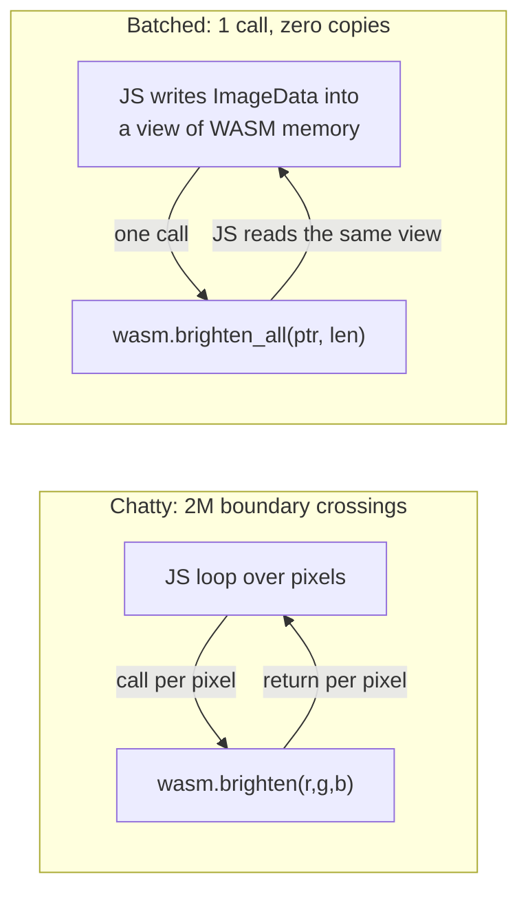

---

### Section 6: Performance Reality — When WASM Wins

JavaScript engines are very fast at typical app code. WebAssembly's advantages are **predictability, low-level control (memory layout, SIMD, threads) and reusing existing native libraries**, not a blanket speed-up. Academic measurements (e.g. *Not So Fast*, USENIX ATC 2019) also found WASM measurably slower than the same code compiled natively, so "near-native" means "close", not "equal".

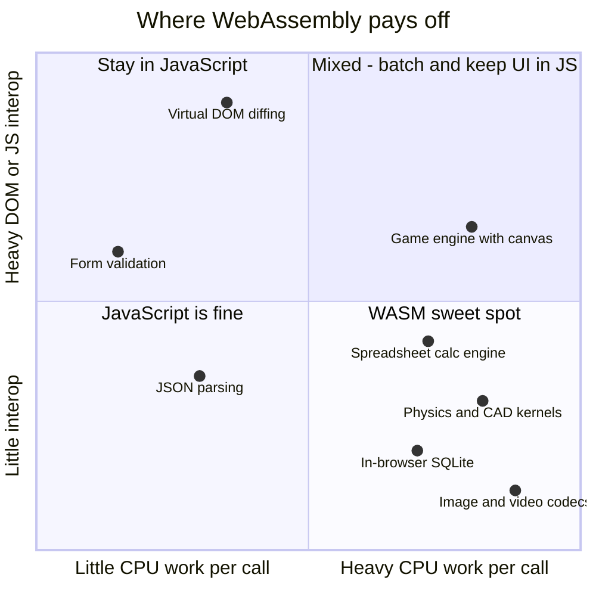

| Good fit | Why | Real examples (public write-ups) |
|---|---|---|
| Image, audio, video codecs and processing | Tight numeric loops, SIMD, existing C libraries | Squoosh (codecs), ffmpeg.wasm |
| Design, CAD and 3D tools | Large existing C++ codebases, predictable frame times | Figma (C++ engine), AutoCAD Web, Photoshop on the web |
| Databases and search in the browser | Mature native engines, long-lived state inside WASM | SQLite WASM (official build), DuckDB-WASM |
| Calculation engines shared with other platforms | One codebase for server, desktop, mobile and web | Google Sheets' calc engine (WasmGC, from Java) |
| Games and emulators | Existing engines (Unity and Godot export to WASM) | Many web game exports |
| Crypto/compression **libraries** you can't replace | Port an audited library rather than rewriting | zstd, Argon2 — but prefer Web Crypto for standard algorithms |

| Poor fit | Why |
|---|---|
| DOM-heavy UI, forms, routing | Every DOM touch goes through JS anyway, plus boundary cost |
| Small, short functions called often | Boundary overhead dominates the work |
| "Make my React app faster" | Rendering cost is DOM, layout and re-renders, not raw compute. See [React Performance](../04-performance-engineering/react-performance-memo-usememo-usecallback.md) |
| Work the server should do | A big download to every client may cost more than one server call |
| Standard crypto | `crypto.subtle` is native, constant-time and audited |

> **Measure before deciding.** Write the JS version, profile it, and look for a hot, self-contained function. Port that function, not the app.

---

### Section 7: Off the Main Thread — Workers, Threads, SIMD

**A WASM call on the main thread is still a long task.** WASM gives speed, not concurrency. Heavy modules belong in a **Web Worker**, exactly like heavy JS (see [Web Workers for Heavy Computation](../04-performance-engineering/web-workers-for-heavy-computation.md)).

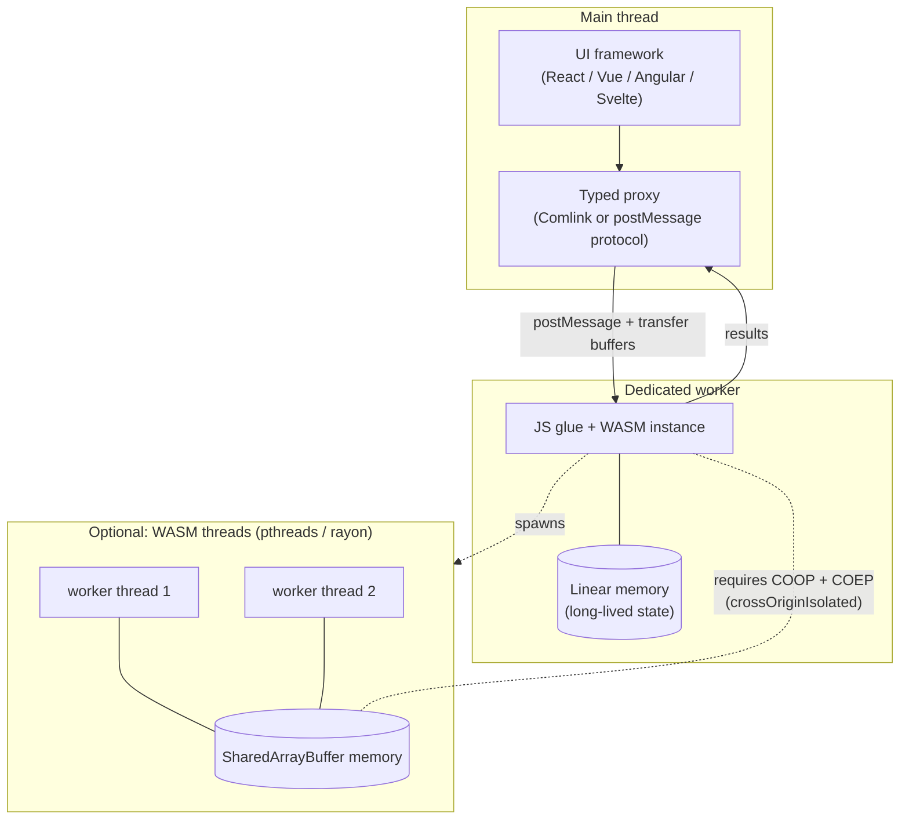

| Technique | What it gives | Requirements |
|---|---|---|
| **One worker + WASM** | UI stays responsive; module state lives in the worker | Nothing special. Default architecture |
| **Compile once, share the Module** | Several workers instantiate without recompiling | `compileStreaming` on main, `postMessage(module)` |
| **WASM threads** (Emscripten `-pthread`, Rust `wasm-bindgen-rayon`) | True shared-memory parallelism | `SharedArrayBuffer` → page must be **cross-origin isolated** (`COOP: same-origin` + `COEP: require-corp` or `credentialless`) |
| **SIMD (128-bit)** | Process 4×f32 or 16×u8 per instruction | Supported in all major browsers. Compile with `-msimd128` (clang) or `target-feature=+simd128` (Rust). Ship a non-SIMD fallback only if you support old browsers |
| **Relaxed SIMD** | Faster, hardware-dependent variants of some SIMD ops | Chromium and Firefox; not Safari yet. Feature-detect |

**Threads caveats:**
- `Atomics.wait` is not allowed on the browser main thread. Emscripten falls back to busy-waiting there, which can freeze the UI. Run threaded code from a worker (Emscripten's `-sPROXY_TO_PTHREAD` moves `main()` off the main thread).
- Cross-origin isolation can break third-party embeds and OAuth/payment popups. Isolate only the routes that need threads if you can.
- **Feature-detect** threads and SIMD with a small probe (e.g. `wasm-feature-detect`) and load the matching build.

---

### Section 8: Languages and Toolchains

| Language | Toolchain | Output and runtime | Notes |
|---|---|---|---|
| **C / C++** | Emscripten (clang/LLVM) | `.wasm` + JS glue; libc, filesystem emulation, OpenGL→WebGL | The most mature path for porting existing code |
| **Rust** | `cargo` + `wasm-bindgen` (often through `wasm-pack`) | Small binaries; generated TypeScript types | No GC, good for size and speed. Rust's WASM tooling moved between GitHub organizations in 2025 — check the current wasm-bindgen docs |
| **Go** | Standard Go (`GOOS=js GOARCH=wasm`) or **TinyGo** | Standard Go ships its runtime and GC inside the binary, so output is large; TinyGo is much smaller | Needs the `wasm_exec.js` support file |
| **AssemblyScript** | `asc` | TypeScript-like syntax, small output | Easy for JS teams; it is not TypeScript and has different semantics |
| **Kotlin** | Kotlin/Wasm | Uses **WasmGC** | Compose Multiplatform for web targets it |
| **Dart / Flutter** | `dart2wasm` (`flutter build web --wasm`) | Uses **WasmGC** | Falls back to the JS build where WasmGC isn't available |
| **C# / .NET** | Blazor WebAssembly / .NET WASM SDK | Ships the .NET runtime as WASM | Large initial download; trimming and AOT options exist |
| **Python** | Pyodide (CPython compiled with Emscripten) | Full interpreter + packages | Great for notebooks and education, heavy for typical apps |
| **Zig, Swift, others** | LLVM-based targets | Varies | Swift's WASM support has matured recently; check its docs |

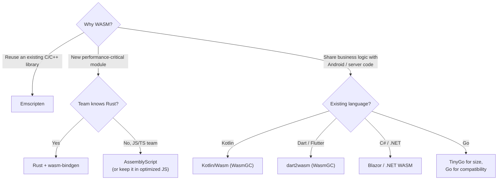

**WasmGC changed the picture for managed languages.** Before it, Java/Kotlin/Dart/C# had to ship their own garbage collector inside linear memory. With WasmGC the **browser's GC manages their objects**, which shrinks binaries and lets JS and WASM objects reference each other without leaks across two heaps.

**WASI and the Component Model** are mostly about WASM **outside** the browser (servers, edge, plugins). Browsers don't implement WASI natively. Tools like `jco` can transpile WASI components to run in JS hosts. For frontend work you'll mainly meet them when sharing modules with backend or edge code.

---

### Section 9: Modern Features and Browser Support

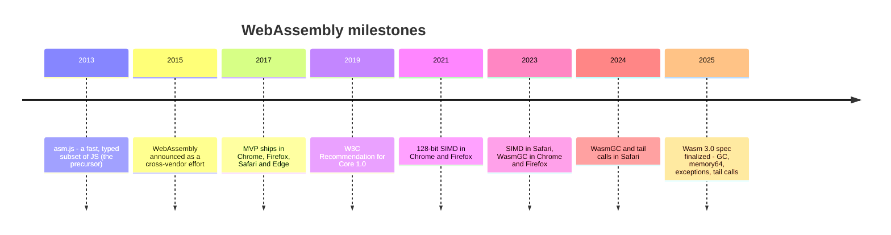

Support snapshot from MDN's browser-compat-data (late 2026). Versions change, so **check MDN or [webassembly.org/features](https://webassembly.org/features/) before relying on a feature**:

| Feature | What it enables | Chromium | Firefox | Safari |
|---|---|---|---|---|
| Streaming compile/instantiate | Compile while downloading | ✅ | ✅ | ✅ (15+) |
| BigInt ↔ i64 | Pass 64-bit ints to JS | ✅ | ✅ | ✅ |
| Bulk memory, multi-value, reference types | Faster `memcpy`, multiple return values, `externref` | ✅ | ✅ | ✅ |
| Fixed-width SIMD | 128-bit vector math | ✅ | ✅ | ✅ (16.4+) |
| Threads and atomics | Shared memory parallelism (needs cross-origin isolation) | ✅ | ✅ | ✅ |
| Exception handling | Native `try`/`throw` for C++ exceptions and Rust panics | ✅ | ✅ | ✅ (final `exnref` form from 18.4) |
| Tail calls | Functional languages, interpreters | ✅ | ✅ | ✅ (18.2+) |
| Garbage collection (WasmGC) | Kotlin, Dart, Java, OCaml without a bundled GC | ✅ (119+) | ✅ (120+) | ✅ (18.2+) |
| JS String Builtins | Use JS strings directly from WASM | ✅ | ✅ | ✅ (recent) |
| Memory64 | More than 4 GiB address space | ✅ | ✅ | ❌ (preview only) |
| Multiple memories | Several linear memories per module | ✅ | ✅ | ❌ (preview only) |
| Relaxed SIMD | Faster hardware-specific SIMD | ✅ | ✅ (recent) | ❌ (preview only) |
| JSPI (JS Promise Integration) | Synchronous-style WASM code awaiting JS promises | ✅ | ✅ (very recent) | Newest releases only. Check MDN |

**Shipping strategy for newer features:**

```text
1. Baseline build:    MVP + features every target browser has (SIMD, bulk memory, BigInt are safe now)
2. Feature-detect:    WebAssembly.validate(tinyProbeBytes)  or the wasm-feature-detect package
3. Load the variant:  codec.simd-threads.wasm  vs  codec.simd.wasm
4. Fallback:          a pure-JS path or a server endpoint for very old browsers or memory-constrained devices
```

---

### Section 10: Security Model and CSP

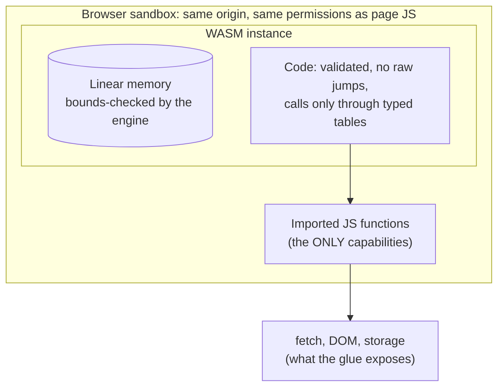

| Property | Detail |
|---|---|
| **Same sandbox as JS** | WASM gets no extra power. It can only do what its imported JS functions do, under the page's origin, CSP and permissions |
| **Host memory safety** | Every load/store is bounds-checked against linear memory. A bug can't read browser memory or other origins |
| **Internal memory unsafety** | C/C++ bugs (buffer overflows, use-after-free) still corrupt the module's **own** linear memory. Native mitigations such as ASLR and guard pages are mostly absent inside it (see *Everything Old is New Again*, USENIX Security 2020). Prefer memory-safe languages for code that parses untrusted input |
| **Supply chain** | A `.wasm` file from npm is an opaque binary. Pin versions, prefer reproducible builds, check provenance, and use `fetch(url, { integrity })` for third-party binaries |
| **Spectre** | Shared memory and high-resolution timers are gated behind cross-origin isolation for this reason |

**Content Security Policy.** Compiling WASM counts as code generation. Under a CSP with `script-src` that lacks `'unsafe-eval'`, compilation is blocked unless you add **`'wasm-unsafe-eval'`**, which allows WASM compilation **without** enabling JavaScript `eval()`:

```http
Content-Security-Policy: script-src 'self' 'nonce-r4nd0m' 'strict-dynamic' 'wasm-unsafe-eval'; object-src 'none'; base-uri 'none'
```

`'wasm-unsafe-eval'` is supported in all major browsers (Chrome 97+, Firefox 102+, Safari 16+). Never add `'unsafe-eval'` just to make WASM work. See [Content Security Policy (CSP)](../07-security/content-security-policy-csp.md).

> **Edge runtimes are stricter.** Platforms such as Cloudflare Workers don't allow compiling WASM from arbitrary bytes at runtime; you import the `.wasm` at build time instead. Check your platform's docs.

---

### Section 11: Bundlers, Frameworks, SSR, Edge and Native

**Bundlers:**

| Tool | How to load WASM |
|---|---|
| **Vite** | `import init from './add.wasm?init'` for raw modules; `?url` to get a hashed URL; wasm-pack `--target web` output works as-is (it uses `new URL('…_bg.wasm', import.meta.url)`); `vite-plugin-wasm` for the ESM-integration style (`--target bundler`) |
| **webpack 5 / Rspack** | `experiments: { asyncWebAssembly: true }` to `import` `.wasm` as an async module; or treat it as an asset and fetch it |
| **esbuild / Rollup** | Plugins, or the portable pattern: `new URL('./x.wasm', import.meta.url)` + `instantiateStreaming` |
| **Native ESM import of `.wasm`** | The WebAssembly ESM Integration proposal is not shipped in browsers by default. Node.js and bundlers have their own support. Don't rely on it in browser code |

**Frameworks.** The pattern is the same everywhere: **load on the client only, lazily, ideally inside a worker, and expose a small async API to components.**

| Stack | Where to load | SSR concern |
|---|---|---|
| **React** | A module-level singleton promise + a hook (`useEffect`, or `use()` with Suspense) | In Next.js, keep it in a `'use client'` component or a worker; never instantiate during server render unless you mean to |
| **Vue / Nuxt** | A composable called in `onMounted`; Nuxt `.client` plugin or `<ClientOnly>` | Server render shows a placeholder |
| **Angular** | An injectable service that loads the module once; heavy work in a worker (`ng generate web-worker`) | Guard with `isPlatformBrowser` or `afterNextRender` |
| **Svelte / SvelteKit** | `onMount` or `$effect`; a shared module-level promise | Guard with `browser` from `$app/environment` |
| **Server (Node, SSR)** | `WebAssembly.instantiate(await readFile(path))` works in Node, Deno and Bun | Instantiate once per process, not per request |
| **Edge functions** | Import the `.wasm` at build time (platform-specific syntax) | No runtime compilation from bytes on some platforms |

**Native mobile:**
- iOS `WKWebView` and Android `WebView` are full browser engines and run WASM, so hybrid apps (Capacitor, Cordova, Tauri mobile) can use the same `.wasm`.
- **React Native**: as of this writing the Hermes engine doesn't expose the `WebAssembly` JS API. The usual route is a native module (C++/Rust via JSI or Turbo Modules) built from the same source. Community projects that compile WASM ahead of time for React Native exist; check their maturity.
- Native iOS/Android apps can embed a WASM runtime (e.g. Wasmtime, WAMR, wasm3) to share logic. iOS restricts JIT compilation for third-party apps, so those runtimes use interpreters or ahead-of-time compilation there.
- Often the simpler choice is to share the **source** (Rust, C++, Kotlin Multiplatform) and compile natively per platform, using WASM only for the web build.

---

### Section 12: Debugging and Profiling

| Need | Tool |
|---|---|
| Readable function names in stack traces and profiles | Keep the **name section** (`-g` / debug builds, or `wasm-opt --debuginfo`); strip it only in the final artifact if size matters |
| Step through C/C++/Rust source | Chrome DevTools with DWARF debug info (the "C/C++ DevTools Support (DWARF)" extension); source maps are also supported |
| CPU profile | DevTools **Performance** panel shows WASM functions in the flame chart, next to JS |
| Inspect a binary | WABT: `wasm2wat`, `wasm-objdump`; `wasm-tools` from the Bytecode Alliance |
| What makes the binary big? | `twiggy` (Rust and others), Emscripten `--emit-symbol-map`, `wasm-opt` statistics |
| Memory growth | Watch `memory.buffer.byteLength` over time; WASM memory never shrinks, so a leak in C/Rust shows up as steady growth |

```bash
# Size optimization passes after the compiler (Binaryen)
wasm-opt -Oz --strip-debug -o codec.opt.wasm codec.wasm

# Compare sizes before and after compression
ls -l codec.wasm codec.opt.wasm
brotli -k -q 11 codec.opt.wasm && ls -l codec.opt.wasm.br
```

> **Production error reporting:** a trap reaches JS as `WebAssembly.RuntimeError` (e.g. "unreachable", "memory access out of bounds"). Rust panics show up as `unreachable` unless you install `console_error_panic_hook` or an equivalent. Ship symbol maps to your error tracker so stack frames are readable.

---

## Decision Matrix

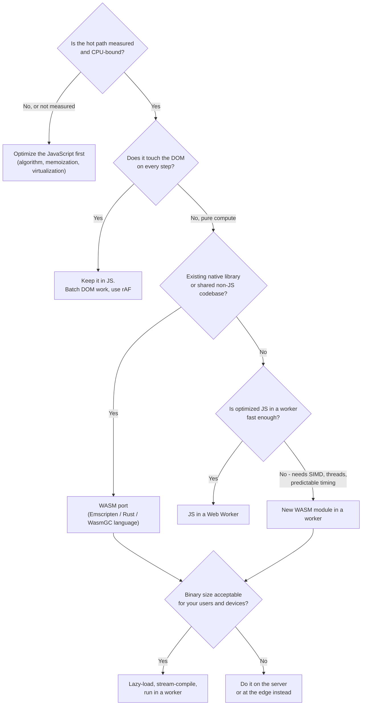

| Option | Startup cost | Peak speed | Interop | Team cost | Best for |
|---|---|---|---|---|---|
| **Optimized JS (main thread)** | None | Good | Native | Low | Most app logic |
| **JS in a Web Worker** | Worker startup | Good | `postMessage` | Low–medium | Parsing, sorting, diffing |
| **WASM in a worker** | Download + compile | High, predictable | Batch through memory | Medium–high | Codecs, engines, ported libraries |
| **WASM threads + SIMD** | + cross-origin isolation | Highest in the browser | Shared memory | High | Video, 3D, ML inference, scientific |
| **Server / edge** | Network round trip | Server hardware | HTTP | Depends | Big models, secrets, very large data |
| **WebGPU compute** | Shader compile | Massive for parallel math | GPU buffers | High | ML inference, large parallel numeric work |

---

## Real-World Examples

**Example 1 — Rust image filter with wasm-bindgen:**

```toml
# Cargo.toml
[package]
name = "imgfx"
version = "0.1.0"
edition = "2021"

[lib]
crate-type = ["cdylib"]

[dependencies]
wasm-bindgen = "0.2"

[profile.release]
opt-level = "s"   # optimize for size; try "3" if speed matters more
lto = true
```

```rust
// src/lib.rs
use wasm_bindgen::prelude::*;

/// Converts RGBA pixels to grayscale in place.
#[wasm_bindgen]
pub fn grayscale(pixels: &mut [u8]) {
    for px in pixels.chunks_exact_mut(4) {
        let y = (0.299 * px[0] as f32 + 0.587 * px[1] as f32 + 0.114 * px[2] as f32) as u8;
        px[0] = y;
        px[1] = y;
        px[2] = y; // px[3] (alpha) unchanged
    }
}
```

```bash
# Emits pkg/imgfx.js (glue), pkg/imgfx_bg.wasm and pkg/imgfx.d.ts (TypeScript types)
wasm-pack build --target web --release
```

**Example 2 — Run it in a worker and call it from React (Comlink):**

```typescript
// fx.worker.ts
import * as Comlink from 'comlink';
import init, { grayscale } from './pkg/imgfx.js';

const ready = init(); // fetches and compiles imgfx_bg.wasm once per worker

const api = {
  async grayscale(buffer: ArrayBuffer): Promise<ArrayBuffer> {
    await ready;
    grayscale(new Uint8Array(buffer)); // glue copies in, runs, copies the result back
    return Comlink.transfer(buffer, [buffer]); // hand the buffer back without copying
  },
};

export type FxApi = typeof api;
Comlink.expose(api);
```

```tsx
// useGrayscale.ts
import { useCallback, useState } from 'react';
import * as Comlink from 'comlink';
import type { FxApi } from './fx.worker';

let fx: Comlink.Remote<FxApi> | undefined;
const getFx = () =>
  (fx ??= Comlink.wrap<FxApi>(
    new Worker(new URL('./fx.worker.ts', import.meta.url), { type: 'module' }),
  ));

export function useGrayscale() {
  const [busy, setBusy] = useState(false);

  const apply = useCallback(async (canvas: HTMLCanvasElement) => {
    const ctx = canvas.getContext('2d');
    if (!ctx) return;
    const img = ctx.getImageData(0, 0, canvas.width, canvas.height);
    setBusy(true);
    try {
      const buf = img.data.buffer;
      const out = await getFx().grayscale(Comlink.transfer(buf, [buf]));
      ctx.putImageData(new ImageData(new Uint8ClampedArray(out), img.width, img.height), 0, 0);
    } finally {
      setBusy(false);
    }
  }, []);

  return { apply, busy };
}
```

The main thread never blocks: the worker owns the WASM instance, and pixel buffers are **transferred**, not copied, between threads.

**Example 3 — Framework-agnostic loader with streaming and fallback:**

```typescript
// wasm-loader.ts
const cache = new Map<string, Promise<WebAssembly.Instance>>();

export function loadWasm(url: string, imports: WebAssembly.Imports = {}) {
  let p = cache.get(url);
  if (!p) {
    p = (async () => {
      try {
        const { instance } = await WebAssembly.instantiateStreaming(fetch(url), imports);
        return instance;
      } catch (err) {
        // Usually a wrong Content-Type. Log it so ops can fix the server, then fall back.
        console.warn('Streaming compile failed; falling back to ArrayBuffer', err);
        const bytes = await (await fetch(url)).arrayBuffer();
        const { instance } = await WebAssembly.instantiate(bytes, imports);
        return instance;
      }
    })();
    cache.set(url, p);
  }
  return p;
}
```

Using it from other frameworks:

```typescript
// Vue 3 composable
import { onMounted, shallowRef } from 'vue';
import wasmUrl from './add.wasm?url'; // Vite: hashed asset URL
import { loadWasm } from './wasm-loader';

export function useAdder() {
  const add = shallowRef<((a: number, b: number) => number) | null>(null);
  onMounted(async () => {
    const inst = await loadWasm(wasmUrl);
    add.value = inst.exports.add as (a: number, b: number) => number;
  });
  return { add };
}
```

```typescript
// Angular service (client-only)
import { Injectable, PLATFORM_ID, inject } from '@angular/core';
import { isPlatformBrowser } from '@angular/common';
import { loadWasm } from './wasm-loader';

@Injectable({ providedIn: 'root' })
export class AdderService {
  private readonly isBrowser = isPlatformBrowser(inject(PLATFORM_ID));
  private instance?: Promise<WebAssembly.Instance>;

  async add(a: number, b: number): Promise<number> {
    if (!this.isBrowser) throw new Error('WASM is loaded in the browser only');
    this.instance ??= loadWasm('/wasm/add.wasm'); // served from the public folder
    const { exports } = await this.instance;
    return (exports.add as (a: number, b: number) => number)(a, b);
  }
}
```

```svelte
<!-- Svelte 5 component -->
<script lang="ts">
  import { onMount } from 'svelte';
  import { loadWasm } from './wasm-loader';
  import wasmUrl from './add.wasm?url';

  let result = $state<number | null>(null);
  onMount(async () => {
    const inst = await loadWasm(wasmUrl);
    result = (inst.exports.add as (a: number, b: number) => number)(2, 3);
  });
</script>

<p>{result ?? 'Loading…'}</p>
```

**Example 4 — Chatty vs batched boundary (BAD → GOOD):**

```typescript
// ❌ BAD: one boundary crossing per pixel (millions of calls for a photo)
for (let i = 0; i < data.length; i += 4) {
  data[i] = wasm.brighten(data[i]);
  data[i + 1] = wasm.brighten(data[i + 1]);
  data[i + 2] = wasm.brighten(data[i + 2]);
}

// ✅ GOOD: allocate once inside WASM memory, fill it through a view, make ONE call
const ptr = wasm.alloc(data.length);                       // exported allocator
new Uint8Array(wasm.memory.buffer, ptr, data.length).set(data);
wasm.brighten_all(ptr, data.length);
// Re-create the view AFTER the call: memory may have grown and detached the old buffer
data.set(new Uint8Array(wasm.memory.buffer, ptr, data.length));
wasm.dealloc(ptr, data.length);
```

**Example 5 — Serving `.wasm` correctly (nginx) and the CSP it needs:**

```nginx
# mime.types usually includes this; add it if your build is older
types { application/wasm wasm; }

location ~* \.wasm$ {
    add_header Cache-Control "public, max-age=31536000, immutable" always;
    add_header Content-Security-Policy "script-src 'self' 'wasm-unsafe-eval'; object-src 'none'" always;
    gzip_types application/wasm;   # or brotli_types if the brotli module is installed
    try_files $uri =404;            # never fall back to index.html for a missing .wasm
}
```

> The CSP that matters is the one on the **HTML document** that runs the code. The `.wasm` header block above is only a reminder of where `'wasm-unsafe-eval'` must appear; set it on your HTML responses too.

**Example 6 — SQLite in the browser, the offline-first way:**

```typescript
// db.worker.ts — the official SQLite WASM build, persisted with OPFS
import sqlite3InitModule from '@sqlite.org/sqlite-wasm';

// Start initializing immediately, but register the message handler first,
// so messages sent while the WASM is still compiling aren't lost.
const dbReady = (async () => {
  const sqlite3 = await sqlite3InitModule();
  // "opfs-sahpool" persists to the Origin Private File System and does not need
  // cross-origin isolation; the plain "opfs" VFS needs SharedArrayBuffer (COOP/COEP).
  const pool = await sqlite3.installOpfsSAHPoolVfs({});
  const db = new pool.OpfsSAHPoolDb('/notes.sqlite3');
  db.exec('CREATE TABLE IF NOT EXISTS notes (id TEXT PRIMARY KEY, body TEXT, updated INTEGER)');
  return db;
})();

self.onmessage = async ({ data }) => {
  const db = await dbReady;
  if (data.type === 'search') {
    const rows = db.exec({
      sql: 'SELECT id, body FROM notes WHERE body LIKE ? ORDER BY updated DESC LIMIT 50',
      bind: [`%${data.q}%`],
      returnValue: 'resultRows',
      rowMode: 'object',
    });
    self.postMessage({ type: 'results', rows });
  }
};
```

The whole database lives inside the worker. The UI sends small commands and receives small result sets: a coarse-grained boundary. See [Offline-First Architecture](../03-state-and-data/offline-first-architecture.md) and [Browser Storage Mechanisms](../01-web-fundamentals/browser-storage-mechanisms.md).

---

## Key Points Summary

| Concept | One-Line Explanation |
|---|---|
| **WebAssembly** | Portable, sandboxed binary format that browsers compile to machine code alongside JS |
| **Not a JS replacement** | No direct DOM access; every Web API call goes through imported JS functions |
| **Module vs Instance** | Module = compiled, stateless code (shareable); Instance = module + imports + state |
| **Linear memory** | One bounds-checked byte array shared with JS through typed-array views |
| **`memory.grow()`** | Detaches the old `ArrayBuffer`; re-create views afterwards |
| **Streaming compile** | `instantiateStreaming` compiles while downloading; needs `Content-Type: application/wasm` |
| **Boundary cost** | Numbers are cheap; strings and objects need encoding and copying; batch calls |
| **Where it wins** | CPU-heavy, self-contained work and ported native libraries |
| **Main thread** | A long WASM call is still a long task; run heavy modules in a worker |
| **Threads** | Built on workers + SharedArrayBuffer; require cross-origin isolation |
| **SIMD** | 128-bit vectors, available in all major browsers |
| **WasmGC** | Browser-managed GC objects for Kotlin, Dart, Java; smaller binaries |
| **CSP** | Allow compilation with `'wasm-unsafe-eval'`, never `'unsafe-eval'` |
| **Security** | Host-safe sandbox, but C/C++ bugs can still corrupt the module's own memory |
| **Delivery** | Hashed name, immutable caching, Brotli, lazy load, preload with `as="fetch" crossorigin` |

---

## Test Your Understanding

**Q1 (Basic):**
A teammate says "Let's rewrite our React dashboard in Rust compiled to WebAssembly so the UI is faster." What's wrong with this reasoning?

<details>
<summary>Answer</summary>

WebAssembly **can't touch the DOM directly**. Every DOM read or write goes through JavaScript, and the cost of a dashboard is usually rendering, layout, re-renders and network, not raw computation. Moving UI code to WASM adds boundary crossings (string and object conversion), a larger download and a compile step, so it's likely to be slower and harder to maintain.

The right move is to **profile first**. Fix rendering with memoization, virtualization and fewer re-renders. If a specific computation is hot (for example aggregating a million rows), move *that function* to a worker, and to WASM only if optimized JS in the worker isn't enough.
</details>

**Q2 (Application):**
You're building a browser photo editor with filters, resize and AVIF/WebP export. Sketch the architecture.

<details>
<summary>Answer</summary>

- **UI** in the framework of choice (React/Vue/Angular/Svelte) on the main thread: controls, previews, undo history metadata.
- **Image engine in a dedicated worker** running WASM codecs and filters (C/C++ via Emscripten or Rust), compiled with **SIMD**. It holds the working image in **linear memory** so repeated filters don't copy back and forth.
- **Boundary:** coarse commands (`applyFilter('blur', 4)`, `export('avif', 0.7)`), with pixel buffers **transferred**, not copied. Preview via `OffscreenCanvas` or by transferring a downscaled `ImageBitmap`.
- **Loading:** lazy-load the engine when the editor opens; each codec as its own hashed `.wasm` loaded on first use (AVIF encoder only when exporting AVIF). Serve `application/wasm`, Brotli, immutable caching; `compileStreaming` and share the Module if you use several workers.
- **Optional threads** for export: requires COOP/COEP, so check third-party embeds first; fall back to single-threaded.
- **CSP:** add `'wasm-unsafe-eval'`.
- **Fallback:** use native `canvas.toBlob('image/webp')` where it's good enough, so small edits don't need the big codec at all.
</details>

**Q3 (Tricky):**
You port a string-formatting function from JS to Rust/WASM and it's **slower** than the original, even though the Rust code is efficient. Why?

<details>
<summary>Answer</summary>

The work is dominated by **crossing the boundary**, not computing. Each call encodes the JS string (UTF-16) to UTF-8, allocates in linear memory, copies it in, runs a tiny function, then allocates, copies and decodes the result back into a JS string, plus `free` calls. For a short function called often, this overhead is larger than the work. Meanwhile, JS engines optimize string operations very well.

Fixes: keep it in JS; or batch (format 10,000 strings in one call over one buffer); or keep the data and the following processing inside WASM so strings never cross per item. For WasmGC languages, **JS String Builtins** reduce the conversion cost.
</details>

**Q4 (Tricky):**
After moving static files to a new object store, production logs show `TypeError: ... Incorrect response MIME type. Expected 'application/wasm'`, and a week later, after a security hardening, `CompileError: ... violates the following Content Security Policy directive`. Explain both and fix them properly.

<details>
<summary>Answer</summary>

1. **MIME type:** `instantiateStreaming`/`compileStreaming` require the response's `Content-Type` to be `application/wasm`. The new store serves `.wasm` as `application/octet-stream`. Fix the upload metadata or CDN rule to set `application/wasm` (and enable compression for it). A fallback to `instantiate(arrayBuffer)` keeps users working but loses streaming compilation and, in Chromium, code caching, so it shouldn't be the fix.
2. **CSP:** compiling WASM is treated like code generation. The new `script-src` doesn't allow it. Add **`'wasm-unsafe-eval'`** to `script-src` on the HTML document. Do **not** add `'unsafe-eval'`, which would also re-enable `eval()` and `new Function()` for attackers exploiting an XSS bug.
</details>

**Q5 (Tricky):**
JS keeps `const view = new Uint8Array(wasm.memory.buffer)` and reads results from it after each call. It works in tests, but on large images `view.length` is suddenly `0` and results are empty. What's happening?

<details>
<summary>Answer</summary>

When the module **grows its memory** (the allocator needed more space for a large image), the engine allocates a bigger buffer and **detaches** the old `ArrayBuffer`. Every typed-array view over the old buffer becomes length 0. Small test images never triggered growth.

Fix: re-create views from `wasm.memory.buffer` **after every call that might allocate**, or use the toolchain's helpers (wasm-bindgen and Emscripten refresh their heap views). Alternatively, pre-size memory (`initial` pages) for known workloads, but still never cache views across calls.
</details>

**Q6 (System design):**
Design an offline-capable notes app with full-text search over 100k notes in the browser. Would you use WASM, and how would it fit in?

<details>
<summary>Answer</summary>

A good design uses **SQLite WASM (with FTS5) in a dedicated worker**, persisted to the **Origin Private File System**:

- **Why WASM:** a mature, tested database engine with full-text search, transactions and SQL, ported rather than re-invented in JS. State lives inside WASM memory and OPFS, so the boundary carries only small queries and result pages.
- **Worker:** queries and indexing never block typing (INP). The UI talks through a small message protocol (`search`, `upsert`, `delete`), and debounces search input.
- **Persistence:** the `opfs-sahpool` VFS avoids the need for cross-origin isolation; the `opfs` VFS needs COOP/COEP. Ask for `navigator.storage.persist()` to reduce eviction risk.
- **Sync:** an outbox table plus background sync to the server, with conflict rules (see [Offline-First Architecture](../03-state-and-data/offline-first-architecture.md)).
- **Loading:** lazy-load the SQLite WASM after first paint, show cached UI meanwhile; hashed `.wasm`, immutable, Brotli.
- **Security:** CSP `'wasm-unsafe-eval'`; notes may contain personal data, so clear OPFS on logout.
- **Alternative:** if the dataset were small, IndexedDB plus a JS search index (e.g. a prebuilt inverted index) would avoid the binary download. The 100k notes and complex queries are what justify WASM here.
</details>

---

## Cheat Sheet

**Key Definitions:**
- **WebAssembly (WASM):** Portable binary instruction format, compiled by the browser and run in the JS sandbox
- **WAT:** Human-readable text format of WASM
- **Module / Instance:** Compiled stateless code / module + imports + state
- **Linear memory:** Bounds-checked byte array shared with JS as an `ArrayBuffer`, grown in 64 KiB pages
- **Glue code:** Generated JS that loads the module and converts values (wasm-bindgen, Emscripten)
- **WasmGC:** Engine-managed structs and arrays for garbage-collected languages
- **SIMD:** 128-bit vector instructions
- **WASM threads:** Workers sharing a `SharedArrayBuffer` memory; need cross-origin isolation
- **`'wasm-unsafe-eval'`:** CSP keyword that allows WASM compilation without allowing `eval()`
- **WASI / Component Model:** System interface and module composition, mainly for non-browser hosts

**Quick Reference:**
```text
Load:         WebAssembly.instantiateStreaming(fetch(url), imports)        // default
Share:        compileStreaming once → postMessage(module) → instantiate per worker
Serve:        Content-Type: application/wasm · Brotli · hashed name + immutable · CORS if cross-origin
Preload:      <link rel="preload" href="x.wasm" as="fetch" type="application/wasm" crossorigin>
CSP:          script-src ... 'wasm-unsafe-eval'
Threads:      COOP: same-origin + COEP: require-corp (or credentialless) → crossOriginIsolated
Memory:       re-create typed-array views after any call that may grow memory
Boundary:     few big calls · numbers > bytes > strings > objects · keep state inside WASM
Placement:    heavy WASM → Web Worker (a WASM long task is still a long task)
Size:         wasm-opt -Oz · Rust opt-level "s"/"z" + lto · TinyGo over Go · lazy-load per feature
Detect:       WebAssembly.validate(probe) / wasm-feature-detect → load the matching build
Frameworks:   client-only, lazy, singleton promise, worker-backed async API
```

**Common Mistakes to Avoid:**

| Mistake | Why Wrong | Fix |
|---|---|---|
| Using WASM to "speed up the UI" | No DOM access; UI cost isn't raw compute | Profile; optimize rendering; use WASM for compute only |
| Calling WASM per item in a hot loop | Boundary cost dominates | Batch: one call over a buffer |
| Running heavy WASM on the main thread | Still a long task → bad INP | Run it in a Web Worker |
| Serving `.wasm` as `application/octet-stream` | Streaming compile fails with a `TypeError` | Set `Content-Type: application/wasm` |
| Loading the `.wasm` on first paint for every route | Big download and compile hurt LCP and data costs | Lazy-load on the feature; preload just before use |
| Caching typed-array views across calls | `memory.grow()` detaches the buffer | Re-create views after calls |
| Adding `'unsafe-eval'` to make WASM work | Re-enables JS `eval` for attackers | Use `'wasm-unsafe-eval'` |
| Enabling COOP/COEP site-wide for threads without testing | Breaks third-party embeds and OAuth popups | Isolate only the routes that need threads; consider `credentialless` |
| Shipping debug builds | Large files, slow code | Release build + `wasm-opt`; keep symbol maps separately |
| Reimplementing standard crypto in WASM | Timing leaks, unaudited code | Use Web Crypto (`crypto.subtle`) |
| Instantiating WASM during SSR on every request | Wasted CPU per request | Instantiate once per process, or load client-only |
| Assuming the newest WASM features exist everywhere | Safari and older devices lag | Feature-detect and ship a baseline build |

---

## References & Further Reading

**Core docs**
- MDN: [WebAssembly](https://developer.mozilla.org/en-US/docs/WebAssembly)
- MDN: [`WebAssembly.instantiateStreaming()`](https://developer.mozilla.org/en-US/docs/WebAssembly/JavaScript_interface/instantiateStreaming_static) · [`WebAssembly.Memory`](https://developer.mozilla.org/en-US/docs/WebAssembly/JavaScript_interface/Memory)
- MDN: [Compiling from Rust to WebAssembly](https://developer.mozilla.org/en-US/docs/WebAssembly/Rust_to_Wasm)
- MDN: [CSP `script-src` (including `'wasm-unsafe-eval'`)](https://developer.mozilla.org/en-US/docs/Web/HTTP/Reference/Headers/Content-Security-Policy/script-src)
- webassembly.org: [Feature status by engine](https://webassembly.org/features/)

**Specs**
- WebAssembly: [Core specification](https://webassembly.github.io/spec/core/) · [JavaScript API](https://webassembly.github.io/spec/js-api/) · [Web API (streaming)](https://webassembly.github.io/spec/web-api/)
- W3C: [WebAssembly Core Specification 1.0](https://www.w3.org/TR/wasm-core-1/)

**Engines, performance and tooling**
- V8: [Liftoff — a new baseline compiler for WebAssembly](https://v8.dev/blog/liftoff) · [Code caching for WebAssembly developers](https://v8.dev/blog/wasm-code-caching)
- Chrome for Developers: [WebAssembly Garbage Collection (WasmGC) enabled by default](https://developer.chrome.com/blog/wasmgc) · [Debugging WebAssembly with modern tools](https://developer.chrome.com/blog/wasm-debugging-2020)
- web.dev: [Using WebAssembly threads from C, C++ and Rust](https://web.dev/articles/webassembly-threads) · [WebAssembly feature detection](https://web.dev/articles/webassembly-feature-detection)
- Emscripten: [Getting started](https://emscripten.org/docs/getting_started/index.html) · [Pthreads support](https://emscripten.org/docs/porting/pthreads.html)
- wasm-bindgen: [API docs](https://docs.rs/wasm-bindgen)
- Binaryen: [`wasm-opt` and friends](https://github.com/WebAssembly/binaryen)
- GoogleChromeLabs: [wasm-feature-detect](https://github.com/GoogleChromeLabs/wasm-feature-detect) · [Comlink](https://github.com/GoogleChromeLabs/comlink)

**Bundlers and libraries**
- Vite: [WebAssembly imports](https://vite.dev/guide/features.html#webassembly)
- webpack: [`experiments.asyncWebAssembly`](https://webpack.js.org/configuration/experiments/)
- SQLite: [WASM persistence options (OPFS VFSes)](https://sqlite.org/wasm/doc/trunk/persistence.md)
- Bytecode Alliance: [WASI](https://wasi.dev/) · [The Component Model](https://component-model.bytecodealliance.org/)

**Deep dives and case studies**
- USENIX ATC 2019: [Not So Fast — Analyzing the Performance of WebAssembly vs. Native Code](https://www.usenix.org/conference/atc19/presentation/jangda)
- USENIX Security 2020: [Everything Old is New Again — Binary Security of WebAssembly](https://www.usenix.org/conference/usenixsecurity20/presentation/lehmann)
- Figma: [WebAssembly cut Figma's load time](https://www.figma.com/blog/webassembly-cut-figmas-load-time-by-3x/)

---

> **Previous Topic:** [Progressive Web Apps (PWA)](./progressive-web-apps-pwa.md)
> — Installable, offline-capable web apps built on Service Workers and the manifest

> **Next Topic:** [Web Components & Shadow DOM](./web-components-and-shadow-dom.md)
> — Framework-agnostic custom elements with encapsulated DOM and styles

*Saved on: 2026-11-06 | Repo: Frontend System Design Learning Notes*
