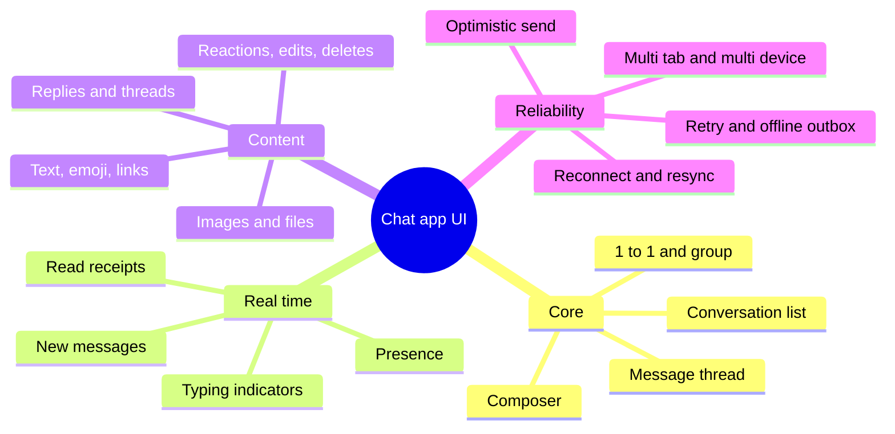
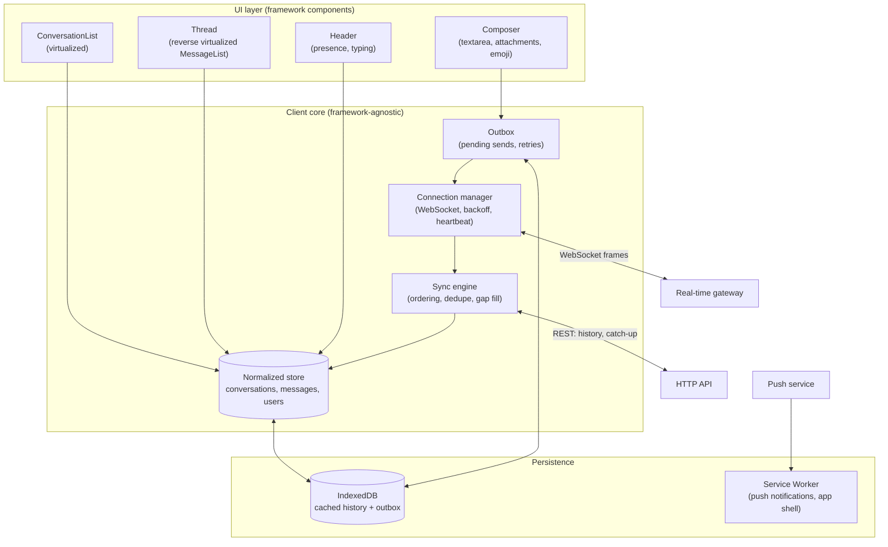
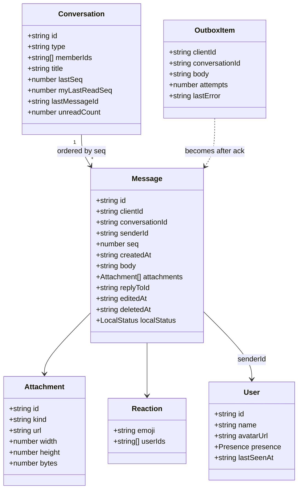
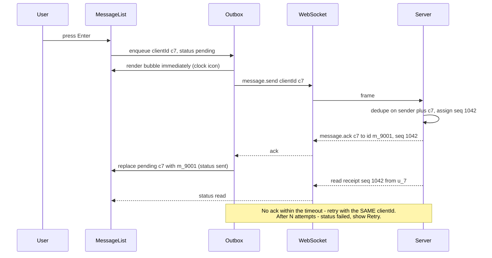
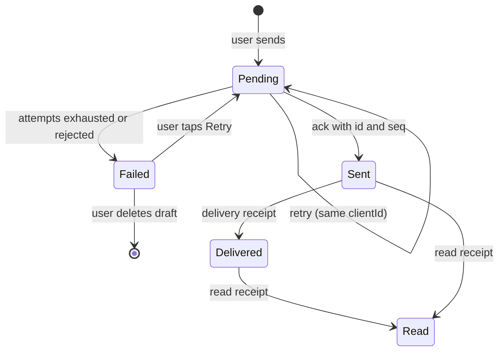
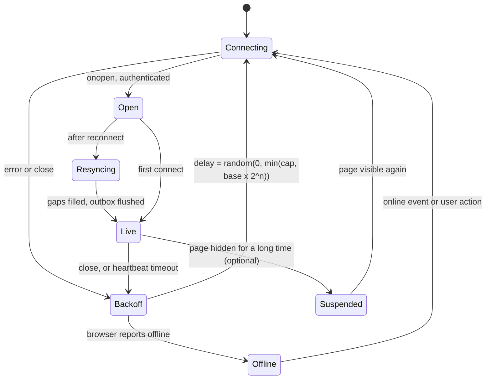
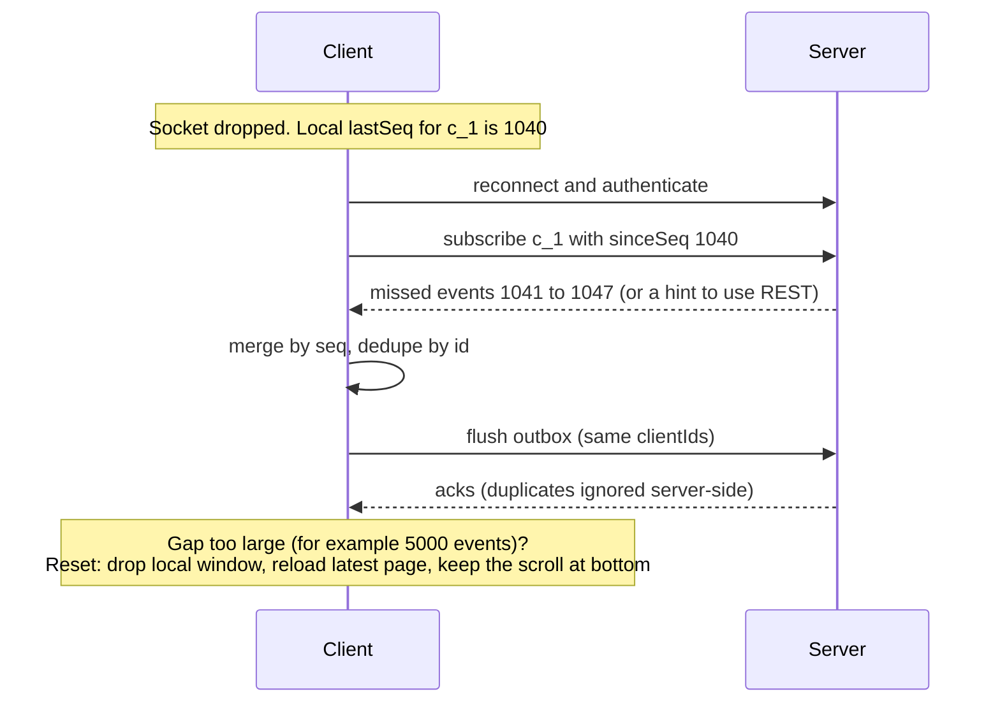
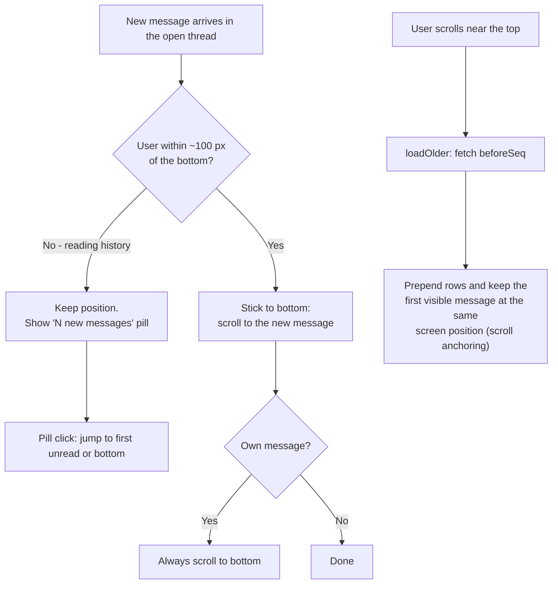

# Design a Chat Application UI

> **Date:** 2026-11-06 · **Last updated:** 2026-11-06
> **Category:** Frontend System Design
> **Sub-Topic:** System Design Cases / Messaging — Real-Time Chat Client
> **Level:** Advanced · **Reading time:** ~38 min
> **Informs:** real-time transport choice (WebSocket vs SSE vs polling), reconnect and resync strategy, optimistic sends and idempotency keys, message ordering and deduplication, reverse infinite scroll and scroll anchoring, message-list virtualization, offline outbox, multi-tab socket sharing, notifications and unread badges, chat accessibility (role=log, composer, IME), bidi text, XSS-safe message rendering, WebSocket authentication

> **Pre-requisite:** [WebSockets, SSE & Long Polling](../01-web-fundamentals/websockets-sse-long-polling.md) and [Optimistic UI Updates](../03-state-and-data/optimistic-ui-updates.md).
> This case is where real-time transport, normalized client state, virtualization and offline support all meet in one screen.

**Previous:** [Design an Image Carousel / Gallery](./design-an-image-carousel-gallery.md) · **Next:** [Design a Spreadsheet (Google Sheets)](./design-a-spreadsheet-google-sheets.md)

---

## Table of Contents

1. [ELI5 — Simple Explanation](#eli5--simple-explanation)
2. [Section 1: R — Requirements](#section-1-r--requirements)
3. [Section 2: A — Architecture](#section-2-a--architecture)
4. [Section 3: D — Data Model](#section-3-d--data-model)
5. [Section 4: I — Interface (Real-Time Protocol, REST and Components)](#section-4-i--interface-real-time-protocol-rest-and-components)
6. [Section 5: O — Real-Time Reliability](#section-5-o--real-time-reliability)
7. [Section 6: O — Rendering Performance and the Message List](#section-6-o--rendering-performance-and-the-message-list)
8. [Section 7: O — Accessibility, i18n, Security, Offline and Edge Cases](#section-7-o--accessibility-i18n-security-offline-and-edge-cases)
9. [Interview Walkthrough](#interview-walkthrough)
10. [Framework and Platform Comparison](#framework-and-platform-comparison)
11. [Real-World Examples](#real-world-examples)
12. [Key Points Summary](#key-points-summary)
13. [Test Your Understanding (with answers)](#test-your-understanding)
14. [Cheat Sheet](#cheat-sheet)
15. [References & Further Reading](#references--further-reading)

---

## ELI5 — Simple Explanation

Imagine passing notes in class with a friend across the room, through a **messenger kid** who runs back and forth:
- You write a note, put **your own sticker number** on it ("my note #7"), and hand it to the messenger. You keep a copy on your desk marked **"sending…"** (optimistic UI).
- The teacher (server) stamps every note with an **official number** in the order received. When the messenger brings back "your #7 got stamped 1042", you change your copy to **"sent ✓"**.
- If the messenger trips and you're not sure the note arrived, you send it **again with the same sticker number** — the teacher sees "#7 again" and doesn't post it twice (idempotency).
- If you step out of the room (go offline), notes pile up in your **outbox**. When you return, you send them and ask the teacher "what did I miss after stamp 1040?" (resync).
- Your notebook shows the **newest notes at the bottom**. Flipping back loads older pages **above** — without losing your place on the page you were reading.

> **One-line takeaway: a chat client is a local, ordered, deduplicated copy of the server's message log, kept in sync over an unreliable real-time connection, rendered as a bottom-anchored virtual list.**

---

## Core Concept — Step by Step

The design follows **RADIO**: **R**equirements → **A**rchitecture → **D**ata model → **I**nterface → **O**ptimizations.

### Section 1: R — Requirements



**Functional requirements:**

| # | Requirement | Notes |
|---|---|---|
| F1 | **Conversation list** sorted by latest activity, with unread counts and last-message preview | Updates in real time |
| F2 | **Message thread**: newest at the bottom, scroll up to load history | Reverse infinite scroll |
| F3 | **Send** text, emoji and attachments; see pending → sent → delivered → read | Optimistic, retryable |
| F4 | **Receive** messages in real time in the open thread and in the list | Also when the tab is in the background |
| F5 | **Typing indicators** and **presence** (online / last seen) | Cheap, lossy is fine |
| F6 | **Edit, delete, react, reply** | Updates must propagate to all viewers |
| F7 | **Notifications**: in-app, browser notification, tab title / badge | When the conversation isn't visible |
| F8 | **Search** messages | Usually server-side; mention, don't deep-dive |

**Non-functional requirements:**

| Concern | Target |
|---|---|
| **Latency** | A sent message appears **instantly** for the sender (optimistic) and within a second or so for recipients on a healthy connection |
| **Correctness** | No lost messages, **no duplicates**, consistent **order** for everyone in a conversation |
| **Resilience** | Survives flaky mobile networks, laptop sleep, server deploys (reconnect + catch-up) |
| **Performance** | Smooth scrolling through thousands of messages; typing in the composer never lags (good INP) |
| **Accessibility** | New messages announced appropriately; full keyboard use; IME-safe composer |
| **i18n** | Mixed-direction text, localized times and plurals |
| **Security** | No XSS through message content, authenticated socket, safe attachments and links |

**Questions to ask the interviewer:**

```text
- 1:1 only, or groups too? Maximum group size? (affects typing/presence fan-out and read receipts)
- Which features are in scope: receipts, typing, presence, reactions, threads, search?
- Is end-to-end encryption required? (changes search, previews, key storage)
- Web only, or also mobile apps sharing the same backend?
- Must it work offline (compose and queue)? Must history be available offline?
- Expected history size per conversation? (thousands vs millions → virtualization, pagination)
- Multiple tabs / devices per user at once?
- Is the backend given (e.g. a WebSocket gateway exists) or part of the discussion?
```

---

### Section 2: A — Architecture

#### 2.1 Client architecture



**Why split it this way:**
- The **connection manager** only knows about frames, reconnects and heartbeats.
- The **sync engine** turns frames and REST pages into a correct, ordered, deduplicated store. It's where the hard logic lives, and it can be unit-tested without a UI.
- The **outbox** owns every unsent message until the server acknowledges it.
- **UI components** subscribe to small slices of the store (one conversation, one message), so a single status change doesn't re-render the whole list. See [Client State Management Patterns](../03-state-and-data/client-state-management-patterns.md).

#### 2.2 Transport choice

| Option | Direction | Fit for chat |
|---|---|---|
| **WebSocket** | Full duplex over one connection | ✅ Default: low latency both ways, cheap typing/presence events |
| **SSE + HTTP POST** | Server→client stream, sends via POST | ✅ Good alternative: plain HTTP, auto-reconnect with `Last-Event-ID`, works well over HTTP/2 and HTTP/3 |
| **Long polling** | Simulated push | ⚠️ Fallback only: more latency and overhead |
| **Short polling** | Client asks every N seconds | ❌ Wasteful, laggy |
| **WebTransport** | Streams + datagrams over HTTP/3 | ⚠️ Promising, but not yet in every browser — check MDN |

Details and trade-offs: [WebSockets, SSE & Long Polling](../01-web-fundamentals/websockets-sse-long-polling.md) and [Real-Time Data Sync](../03-state-and-data/real-time-data-sync.md).

#### 2.3 Rendering strategy

- **CSR app shell** behind authentication — no SEO, highly interactive. An SSR/static shell can paint the frame quickly; message data comes from the client.
- **Local-first start:** render conversations and recent messages from **IndexedDB** immediately, then catch up from the network (stale-while-revalidate for chat). See [Offline-First Architecture](../03-state-and-data/offline-first-architecture.md).
- **Code-split** heavy, rarely used parts: emoji picker, media viewer, search, call UI. See [Code Splitting & Lazy Loading](../04-performance-engineering/code-splitting-and-lazy-loading.md).
- Routes: `/c/:conversationId` (deep-linkable), `/c/:conversationId?m=:messageId` to jump to a message.

---

### Section 3: D — Data Model



**Key modelling decisions:**

| Decision | Why |
|---|---|
| **Server-assigned `seq` per conversation** (monotonic) | Everyone sees the same order. Client clocks are skewed and can't be trusted for ordering |
| **`clientId` (UUID) on every message the client creates** | Matches the optimistic message to the server ack, and makes retries **idempotent** (server dedupes on sender + `clientId`) |
| **`createdAt` from the server** | Display timestamps from the server clock; show local "sending…" time only for pending items |
| **Normalized store**: `messagesById` + `conversation → ordered seq list` | Edits/reactions update one entity; the list re-renders only the affected row. See [Data Normalization & Caching](../03-state-and-data/data-normalization-and-caching.md) |
| **`lastSeq` and `myLastReadSeq` on the conversation** | Unread count = derived from seqs; detects **gaps** after reconnect |
| **Soft delete (`deletedAt`)** | Replies and receipts that reference it still resolve; show "Message deleted" |
| **`localStatus`**: `pending` / `sent` / `failed` (+ `delivered` / `read` from receipts) | UI state machine for each bubble (Section 5) |

**Caching layers:**

```text
Memory (normalized store)   → what the UI renders
IndexedDB                   → last N messages per conversation, conversation list, outbox
                              (instant start, offline reading, survives reload)
Server                      → source of truth; REST for pages, socket for live events
```

Cap local history (e.g. last few hundred messages per conversation, LRU across conversations) and **clear it on logout** — it's personal data. See [Browser Storage Mechanisms](../01-web-fundamentals/browser-storage-mechanisms.md).

---

### Section 4: I — Interface (Real-Time Protocol, REST and Components)

#### 4.1 WebSocket protocol (JSON frames)

```json
{ "type": "message.send",  "clientId": "4b1c…", "conversationId": "c_1", "body": "On my way!" }
{ "type": "message.ack",   "clientId": "4b1c…", "id": "m_9001", "seq": 1042, "createdAt": "2026-11-06T10:15:02Z" }
{ "type": "message.new",   "message": { "id": "m_9002", "seq": 1043, "conversationId": "c_1", "senderId": "u_7", "body": "👍" } }
{ "type": "message.updated", "message": { "id": "m_9001", "seq": 1042, "body": "On my way! 10 min", "editedAt": "…" } }
{ "type": "typing",        "conversationId": "c_1", "userId": "u_7", "state": "start" }
{ "type": "read",          "conversationId": "c_1", "userId": "u_7", "seq": 1042 }
{ "type": "presence",      "userId": "u_7", "status": "online" }
{ "type": "ping" }  { "type": "pong" }
```

Every server event that changes the log carries the conversation's **`seq`**, so the client can detect gaps and ignore duplicates.

#### 4.2 REST endpoints

| Endpoint | Purpose |
|---|---|
| `GET /api/conversations?cursor=&limit=30` | Conversation list, sorted by last activity |
| `GET /api/conversations/:id/messages?beforeSeq=1000&limit=50` | **Older history** (scrolling up) |
| `GET /api/conversations/:id/messages?afterSeq=1040&limit=200` | **Catch-up / gap fill** after reconnect |
| `GET /api/conversations/:id/messages?aroundId=m_123` | Jump to a searched or linked message |
| `POST /api/conversations/:id/messages` (with `clientId`) | Send fallback when the socket is down (same idempotency key) |
| `POST /api/uploads` → presigned URL | Upload attachments directly to storage, then send a message referencing them |
| `POST /api/conversations/:id/read` `{ seq }` | Read position (can also go over the socket) |

#### 4.3 Component API

```tsx
<ChatProvider client={chatClient}>                       {/* owns connection + store */}
  <ConversationList onSelect={(id) => navigate(`/c/${id}`)} />
  <Thread conversationId={id}>
    <Thread.Header />                                     {/* title, presence, typing */}
    <Thread.Messages renderMessage={(m) => <MessageBubble message={m} />} />
    <Thread.Composer maxLength={4000} onSend={(draft) => chatClient.send(id, draft)} />
  </Thread>
</ChatProvider>
```

```typescript
// The framework-agnostic client the UI talks to
interface ChatClient {
  send(conversationId: string, draft: { body: string; attachmentIds?: string[] }): string; // returns clientId
  retry(clientId: string): void;
  loadOlder(conversationId: string): Promise<void>;
  markRead(conversationId: string, seq: number): void;
  setTyping(conversationId: string, typing: boolean): void;
  subscribe(listener: () => void): () => void;             // for useSyncExternalStore / Vue ref / Angular signal
  getSnapshot(): ChatState;
  connectionState(): 'connecting' | 'open' | 'reconnecting' | 'offline';
}
```

---

### Section 5: O — Real-Time Reliability

#### 5.1 Optimistic send, ack and retry





- Pending messages stay **at the bottom in send order** until acked; then they take their server `seq` position (usually the same place).
- A **rejected** send (permission removed, message too long) goes straight to `failed` with a reason — don't retry it automatically.

#### 5.2 Connection lifecycle



Rules:
- **Exponential backoff with jitter** — otherwise a server restart makes every client reconnect at the same instant (thundering herd).
- **App-level heartbeat.** The browser `WebSocket` API can't send protocol-level pings, and a half-dead connection (Wi-Fi switch, NAT timeout) may not fire `close` for a long time. Send `ping` every ~25–30 s and treat a missing `pong` as a dead socket.
- **`navigator.onLine` is a hint, not truth** — `true` only means there's a network interface. Trust the socket state, use `online`/`offline` events only to reconnect sooner.
- **Reconnect immediately on `visibilitychange` → visible** — mobile browsers often freeze or kill background sockets.

#### 5.3 Resync after reconnect



**Ordering and dedup rules in the sync engine:**

```text
on event(e) for conversation c:
  if e.id already in store              → apply as update (edit/reaction) or ignore
  if e.seq <= c.lastSeq and not known   → late arrival: insert in seq order
  if e.seq == c.lastSeq + 1             → append, lastSeq++
  if e.seq >  c.lastSeq + 1             → GAP: buffer e, fetch afterSeq=c.lastSeq, then apply in order
```

---

### Section 6: O — Rendering Performance and the Message List

#### 6.1 Scroll behaviour



- **Prepending history** must not move what the user is looking at. Browsers with **CSS scroll anchoring** (`overflow-anchor`, long supported in Chromium and Firefox, arriving in Safari only recently — check MDN) handle simple cases; virtualized lists usually need manual compensation: measure `scrollHeight` before and after and add the difference to `scrollTop`.
- **Never yank the user to the bottom** while they're reading older messages; show a "new messages" pill instead.
- A **"New messages" divider** at `myLastReadSeq` when opening a conversation helps people catch up.

#### 6.2 Virtualization

A busy conversation can hold tens of thousands of messages. Render only the visible window plus a buffer:
- **Variable heights** (text wraps, images, link previews) → use a virtualizer that **measures** rows (`ResizeObserver`) and corrects positions; reserve image space with known `width`/`height` from the attachment metadata so heights don't change after load.
- **Reverse lists** (bottom-anchored) are harder than normal ones; prefer a library that supports them (e.g. react-virtuoso's `followOutput` and `firstItemIndex` for prepending, TanStack Virtual with manual anchoring).
- For moderate lists, **`content-visibility: auto`** + `contain-intrinsic-size` on message groups gives cheap off-screen skipping without full virtualization.
- See [Virtual Scrolling & Windowing](../04-performance-engineering/virtual-scrolling-and-windowing.md).

#### 6.3 Keeping the main thread free

| Problem | Fix |
|---|---|
| A burst of 200 messages after reconnect → 200 renders | **Batch** socket events and apply them in one store update per animation frame |
| Status change re-renders every bubble | Entity-level subscriptions + memoized rows (`React.memo`, Vue computed per item, Angular `OnPush` + signals) |
| Typing in the composer lags in a huge thread | Keep composer state **local**; don't put the draft in the global store on every keystroke |
| Typing indicator events flood the socket | **Throttle** "typing" to about once every few seconds; the receiver **expires** it after a few seconds without refresh |
| Markdown/link parsing on every render | Parse once per message version and cache the result |
| Large image attachments | Server-generated thumbnails, `loading="lazy"`, known dimensions |

See [React Performance (memo, useMemo, useCallback)](../04-performance-engineering/react-performance-memo-usememo-usecallback.md) and [Debouncing & Throttling](../04-performance-engineering/debouncing-and-throttling.md).

---

### Section 7: O — Accessibility, i18n, Security, Offline and Edge Cases

**Accessibility**
- Give the message list **`role="log"`** (implicit `aria-live="polite"`) so screen readers announce appended messages without interrupting. In very active groups this can be noisy — consider announcing only messages from others in the **open** conversation through a separate, throttled live region, and offer a setting.
- Each message should read sensibly out of context: **sender, time, text, status** ("Ana, 10:15, On my way, read"). Visually grouped consecutive messages still need the sender in accessible text (visually hidden).
- **Composer:** a labelled `<textarea>` ("Message Ana"); Enter sends, Shift+Enter inserts a newline, and the **Send button** is always available (on touch keyboards Enter usually inserts a newline). `enterkeyhint="send"` adjusts the virtual keyboard's Enter key label.
- **IME safety:** while a CJK/Korean input method is composing, Enter confirms the candidate — it must **not** send. Check `event.isComposing` (and, for older Safari quirks, `keyCode === 229`).
- **Keyboard navigation** between messages (roving focus or each message focusable) so users can reach actions (reply, react) without a mouse; action menus as real buttons. See [Keyboard Navigation & Focus Management](../06-accessibility-and-i18n/keyboard-navigation-and-focus-management.md).
- Don't rely on colour alone for status (pending/failed) — add icons with text alternatives.

**i18n**
- Put **`dir="auto"`** on each message body: an Arabic message inside an English UI (or the reverse) gets the right direction. Usernames and previews need it too. See [RTL Layout Support](../06-accessibility-and-i18n/rtl-layout-support.md).
- Format times with `Intl.DateTimeFormat` / `Intl.RelativeTimeFormat` in the **viewer's** time zone; group by day ("Today", "Yesterday") with locale rules.
- Plurals ("3 new messages") via `Intl.PluralRules` or ICU messages; count characters by **grapheme** (`Intl.Segmenter`) so "👨‍👩‍👧" counts as one.
- See [Internationalization (i18n) Architecture](../06-accessibility-and-i18n/internationalization-i18n-architecture.md).

**Security**
- **Message bodies are untrusted input.** Render as text, or parse a Markdown subset into elements; if you must produce HTML, sanitize it (e.g. DOMPurify) and back it with a strict [CSP](../07-security/content-security-policy-csp.md). See [XSS Prevention](../07-security/xss-prevention-reflected-stored-dom.md).
- **Linkify safely:** only `http:`/`https:` (never `javascript:`), `rel="noopener noreferrer"`, show the real domain.
- **Link previews are fetched by the server**, not the client — this protects readers' IP addresses and avoids CORS issues; the server must defend against SSRF.
- **WebSocket auth:** the browser `WebSocket` constructor can't set an `Authorization` header. Use the session cookie (and have the server **validate the `Origin` header** to stop cross-site WebSocket hijacking) or a short-lived, single-use ticket obtained over HTTPS. Re-authenticate on reconnect; close the socket on logout.
- **Attachments:** upload via presigned URLs, scan server-side, serve from a separate domain, strip image metadata.
- **End-to-end encryption** (Signal-protocol style) changes the design: the server can't search or render previews, keys live on the device (non-extractable `CryptoKey` in IndexedDB), and multi-device needs key management. Treat it as a separate deep dive.

**Offline**
- **Outbox in IndexedDB**: messages composed offline are stored and sent on reconnect with their original `clientId`.
- **Background Sync** (`SyncManager`) can send the outbox even after the tab closes, but it's **Chromium-only** — treat it as an enhancement.
- **Push notifications** via a Service Worker and the Push API reach users when no tab is open. On iOS/iPadOS, web push works only for web apps added to the Home Screen.

**Edge cases**

| Case | Handling |
|---|---|
| Duplicate event (retry, reconnect replay) | Dedupe by `id`, and by `clientId` for own messages |
| Out-of-order delivery | Insert by `seq`; buffer and gap-fill when `seq` jumps |
| Edit/delete for a message not loaded yet | Ignore (it'll arrive correct when the page loads) or store as a pending patch |
| Removed from a group while composing | Send is rejected → `failed` with reason, composer disabled |
| Clock skew (client clock 5 min off) | Order by `seq`, display server `createdAt` |
| Very long message / huge paste | Enforce `maxLength` by graphemes; offer "send as file" |
| Large group typing | Collapse to "Several people are typing…" |
| Message arrives for a conversation not in the loaded list | Fetch that conversation and insert it at the top |
| Laptop sleeps for hours | Heartbeat fails → reconnect → `sinceSeq` catch-up or full reset if too far behind |
| Same user in 3 tabs | See Q6 — one notification, consistent read state |
| Deep link to a message far back in history | `aroundId` page, then load in both directions |

---

## Interview Walkthrough

```mermaid
gantt
    title 45-minute chat UI interview
    dateFormat mm
    axisFormat %M
    section Clarify
    Scope, features, scale             :a1, 00, 6m
    section Design
    Client architecture and transport  :a2, after a1, 8m
    Data model, ordering, ids          :a3, after a2, 8m
    Protocol and API                   :a4, after a3, 5m
    section Deep dives
    Optimistic send and reconnect      :a5, after a4, 8m
    Message list scroll and virtualization :a6, after a5, 5m
    section Wrap up
    A11y, i18n, security, offline      :a7, after a6, 5m
```



**Script:**

1. **Clarify (≈6 min).** 1:1 vs groups, group size, which features (receipts, typing, presence, threads), offline, multi-device, E2EE. Agree on F1–F7 and the non-functional list: instant send, no lost or duplicate messages, consistent order.
2. **Architecture (≈8 min).** Draw UI → normalized store ← sync engine ← connection manager, plus outbox and IndexedDB. Pick **WebSocket**, mention SSE + POST as a valid alternative, and long polling as a fallback.
3. **Data model (≈8 min).** The two ids: **`clientId`** (idempotency + optimistic matching) and **server `seq`** (ordering + gap detection). Normalization and `lastSeq` / `myLastReadSeq`.
4. **Protocol (≈5 min).** List frames (`send`, `ack`, `new`, `updated`, `typing`, `read`, `ping`), REST for history (`beforeSeq`) and catch-up (`afterSeq`).
5. **Deep dive 1 (≈8 min).** Optimistic send state machine, retries with the same `clientId`, backoff with jitter, heartbeat, resync on reconnect.
6. **Deep dive 2 (≈5 min).** Bottom-anchored list, prepend without jumping, "new messages" pill, virtualization with variable heights, batching.
7. **Wrap up (≈5 min).** `role="log"`, IME-safe Enter, `dir="auto"`, sanitize/linkify, WebSocket auth + Origin check, outbox, push notifications.

**Trade-offs to discuss:**

| Trade-off | Option A | Option B | Say this |
|---|---|---|---|
| Transport | WebSocket: full duplex, custom protocol | SSE + POST: plain HTTP, built-in resume | "WebSocket for chat; SSE if infra or proxies make sockets hard" |
| Ordering | Server `seq` per conversation | Client timestamps / vector clocks | "Server order is simple and consistent; chat rarely needs more" |
| Optimistic UI | Instant feedback | Must reconcile and show failures | "Always optimistic for own messages, with visible pending/failed states" |
| One socket per tab | Simple | N connections per user, N notifications | "Start simple; share via Web Locks leader + BroadcastChannel if tab count matters" |
| Local persistence | Instant start, offline reading | Storage, privacy, cache invalidation | "Cap per conversation, clear on logout" |
| Read receipts in big groups | Per-user receipts | Aggregate "seen by 12" | "Aggregate above a threshold — fan-out cost grows with group size" |
| Virtualization | Handles huge threads | Complexity: variable heights, anchoring, find-in-page | "Virtualize beyond a few hundred rows; `content-visibility` before that" |

---

## Framework and Platform Comparison

| Stack | Store and subscription | Message list | Socket |
|---|---|---|---|
| **React** | External store + `useSyncExternalStore`, or Zustand/Redux Toolkit; TanStack Query `useInfiniteQuery` for history pages | react-virtuoso or TanStack Virtual | Custom manager; libraries such as Socket.IO client if the backend uses it |
| **Vue** | Pinia store; composables (`useConversation(id)`) | vue-virtual-scroller or TanStack Virtual (Vue adapter) | Same client core, exposed through refs |
| **Angular** | Signals or NgRx; RxJS streams for events | CDK `cdk-virtual-scroll-viewport` (variable heights need extra work) | RxJS `webSocket()` subject with `retry({ delay })` |
| **Svelte** | Runes / stores wrapping the client core | TanStack Virtual (Svelte adapter) or custom | Same client core |
| **iOS** | Observable models; local DB (Core Data / SwiftData) | SwiftUI `ScrollView` + `LazyVStack` with `.defaultScrollAnchor(.bottom)` (iOS 17+), or UIKit collection view | `URLSessionWebSocketTask`; APNs for background delivery |
| **Android** | ViewModel + Flow; Room for local history | Compose `LazyColumn(reverseLayout = true)` | OkHttp WebSocket; FCM for background delivery |

> Mobile operating systems suspend background connections aggressively, so native apps rely on **push notifications** (APNs/FCM) for delivery while backgrounded and resync on foreground — the same catch-up-by-`seq` protocol works for web and native.

---

## Real-World Examples

**Example 1 — Connection manager with backoff, jitter and heartbeat (TypeScript):**
```typescript
type Listener = (msg: unknown) => void;

export class Connection {
  private ws?: WebSocket;
  private attempt = 0;
  private heartbeat?: ReturnType<typeof setInterval>;
  private lastPong = 0;
  private closedByUser = false;

  constructor(private url: string, private onMessage: Listener, private onOpen: () => void) {
    document.addEventListener('visibilitychange', () => {
      if (document.visibilityState === 'visible' && this.ws?.readyState !== WebSocket.OPEN) this.connect();
    });
    window.addEventListener('online', () => this.connect());
  }

  connect() {
    if (this.ws && this.ws.readyState <= WebSocket.OPEN) return; // CONNECTING or OPEN
    this.closedByUser = false;
    this.ws = new WebSocket(this.url); // auth via cookie (server checks Origin) or a short-lived ticket in the URL

    this.ws.onopen = () => {
      this.attempt = 0;
      this.lastPong = Date.now();
      this.heartbeat = setInterval(() => this.checkHeartbeat(), 25_000);
      this.onOpen(); // sync engine: resubscribe with sinceSeq, flush outbox
    };
    this.ws.onmessage = (e) => {
      const msg = JSON.parse(e.data);
      if (msg.type === 'pong') { this.lastPong = Date.now(); return; }
      this.onMessage(msg);
    };
    this.ws.onclose = () => this.scheduleReconnect();
    // onerror is always followed by onclose, so reconnect logic lives in onclose only
  }

  send(frame: object): boolean {
    if (this.ws?.readyState !== WebSocket.OPEN) return false; // caller keeps it in the outbox
    this.ws.send(JSON.stringify(frame));
    return true;
  }

  close() {
    this.closedByUser = true;
    clearInterval(this.heartbeat);
    this.ws?.close(1000, 'logout');
  }

  private checkHeartbeat() {
    if (Date.now() - this.lastPong > 60_000) { this.ws?.close(); return; } // half-dead socket
    this.send({ type: 'ping' });
  }

  private scheduleReconnect() {
    clearInterval(this.heartbeat);
    if (this.closedByUser) return;
    const base = 500, cap = 30_000;
    const delay = Math.random() * Math.min(cap, base * 2 ** this.attempt++); // "full jitter"
    setTimeout(() => this.connect(), delay);
  }
}
```

**Example 2 — Optimistic send and reconciliation (reducer):**
```typescript
type Msg = { id?: string; clientId?: string; seq?: number; body: string; localStatus: 'pending' | 'sent' | 'failed' };
// confirmed: server ids sorted by seq · pending: local keys in send order (rendered after confirmed)
type Thread = { byKey: Record<string, Msg>; confirmed: string[]; pending: string[]; lastSeq: number };
type Action =
  | { type: 'sendLocal'; clientId: string; body: string }
  | { type: 'ack'; clientId: string; id: string; seq: number }
  | { type: 'incoming'; message: { id: string; seq: number; body: string; clientId?: string } }
  | { type: 'failed'; clientId: string };

const localKey = (clientId: string) => `local:${clientId}`;

function insertBySeq(ids: string[], id: string, seq: number, byKey: Record<string, Msg>): string[] {
  const i = ids.findIndex((k) => (byKey[k]?.seq ?? 0) > seq);   // late arrivals land in the right place
  return i === -1 ? [...ids, id] : [...ids.slice(0, i), id, ...ids.slice(i)];
}

export function threadReducer(state: Thread, action: Action): Thread {
  switch (action.type) {
    case 'sendLocal': {
      const key = localKey(action.clientId);
      const m: Msg = { clientId: action.clientId, body: action.body, localStatus: 'pending' };
      return { ...state, byKey: { ...state.byKey, [key]: m }, pending: [...state.pending, key] };
    }
    case 'ack': {
      const key = localKey(action.clientId);
      const local = state.byKey[key];
      if (!local || state.byKey[action.id]) return state;            // duplicate ack: already reconciled
      const { [key]: _removed, ...rest } = state.byKey;
      const byKey = { ...rest, [action.id]: { ...local, id: action.id, seq: action.seq, localStatus: 'sent' as const } };
      return {
        byKey,
        confirmed: insertBySeq(state.confirmed, action.id, action.seq, byKey),
        pending: state.pending.filter((k) => k !== key),
        lastSeq: Math.max(state.lastSeq, action.seq),
      };
    }
    case 'incoming': {
      const m = action.message;
      if (state.byKey[m.id]) return state;                            // duplicate event
      if (m.clientId && state.byKey[localKey(m.clientId)]) {          // our own message echoed before its ack
        return threadReducer(state, { type: 'ack', clientId: m.clientId, id: m.id, seq: m.seq });
      }
      // Real code: if m.seq > state.lastSeq + 1, buffer it and trigger a gap fill first
      const byKey = { ...state.byKey, [m.id]: { ...m, localStatus: 'sent' as const } };
      return { ...state, byKey, confirmed: insertBySeq(state.confirmed, m.id, m.seq, byKey), lastSeq: Math.max(state.lastSeq, m.seq) };
    }
    case 'failed': {
      const key = localKey(action.clientId);
      const m = state.byKey[key];
      return m ? { ...state, byKey: { ...state.byKey, [key]: { ...m, localStatus: 'failed' } } } : state;
    }
  }
}

// Render order: [...thread.confirmed, ...thread.pending].map((k) => thread.byKey[k])
```

**Example 3 — IME-safe composer with throttled typing events (React):**
```tsx
import { useRef, useState, type KeyboardEvent } from 'react';

export function Composer({ to, onSend, onTyping }: {
  to: string;
  onSend: (body: string) => void;
  onTyping: (typing: boolean) => void;
}) {
  const [draft, setDraft] = useState('');           // local: never in the global store per keystroke
  const lastTypingSent = useRef(0);

  const submit = () => {
    const body = draft.trim();
    if (!body) return;
    onSend(body);
    setDraft('');
    onTyping(false);
  };

  const onKeyDown = (e: KeyboardEvent<HTMLTextAreaElement>) => {
    // ❌ BAD: if (e.key === 'Enter') submit();  → sends half-composed Japanese/Chinese/Korean text
    if (e.key === 'Enter' && !e.shiftKey && !e.nativeEvent.isComposing && e.keyCode !== 229) {
      e.preventDefault();
      submit();
    }
  };

  return (
    <form onSubmit={(e) => { e.preventDefault(); submit(); }}>
      <label htmlFor="composer" className="visually-hidden">Message {to}</label>
      <textarea
        id="composer"
        dir="auto"
        enterKeyHint="send"
        rows={1}
        value={draft}
        onKeyDown={onKeyDown}
        onChange={(e) => {
          setDraft(e.target.value);
          const now = Date.now();
          if (now - lastTypingSent.current > 3000) {   // throttle "typing" to one event per ~3 s
            lastTypingSent.current = now;
            onTyping(true);
          }
        }}
      />
      <button type="submit" disabled={!draft.trim()}>Send</button>
    </form>
  );
}
```

**Example 4 — Stick-to-bottom and prepend without jumping (React hook):**
```tsx
import { useLayoutEffect, useRef, type RefObject } from 'react';

export function useChatScroll(ref: RefObject<HTMLElement | null>, deps: { firstKey?: string; lastKey?: string }) {
  const wasNearBottom = useRef(true);
  const prevHeight = useRef(0);
  const prevFirst = useRef<string | undefined>(undefined);

  // Record position BEFORE React commits the new rows
  const onScroll = () => {
    const el = ref.current!;
    wasNearBottom.current = el.scrollHeight - el.scrollTop - el.clientHeight < 100;
  };

  useLayoutEffect(() => {
    const el = ref.current;
    if (!el) return;
    if (prevFirst.current && deps.firstKey !== prevFirst.current) {
      // Older messages were PREPENDED: keep the same message under the user's eyes
      el.scrollTop += el.scrollHeight - prevHeight.current;
    } else if (wasNearBottom.current) {
      el.scrollTop = el.scrollHeight;                 // new message at the bottom: follow it
    }
    prevHeight.current = el.scrollHeight;
    prevFirst.current = deps.firstKey;
  }, [deps.firstKey, deps.lastKey, ref]);

  return { onScroll, isNearBottom: () => wasNearBottom.current };
}
```

> `useLayoutEffect` runs before paint, so the adjustment is invisible. Vue's equivalent is a watcher with `flush: 'post'`; Angular can use `afterRenderEffect` / `afterNextRender`; Svelte 5 can use `$effect.pre` to read before and `tick()` to adjust after the DOM update. If the browser's own scroll anchoring already adjusted the position, disable it on the scroller (`overflow-anchor: none`) to avoid double correction.

**Example 5 — Rendering message text safely (BAD → GOOD):**
```tsx
// ❌ BAD: stored XSS — any user can run script in every recipient's session
<div dangerouslySetInnerHTML={{ __html: linkify(message.body) }} />

// ✅ GOOD: split into text and link tokens, render as elements (React escapes text)
import type { ReactNode } from 'react';
const URL_RE = /\bhttps?:\/\/[^\s<]+/gi;

function MessageText({ body }: { body: string }) {
  const parts: ReactNode[] = [];
  let last = 0;
  for (const match of body.matchAll(URL_RE)) {
    const url = match[0];
    parts.push(body.slice(last, match.index));
    try {
      const u = new URL(url);
      parts.push(
        <a key={match.index} href={u.href} target="_blank" rel="noopener noreferrer">{u.host}{u.pathname}</a>,
      );
    } catch {
      parts.push(url); // not a valid URL: keep as text
    }
    last = match.index! + url.length;
  }
  parts.push(body.slice(last));
  return <p dir="auto" className="message-text">{parts}</p>;
}
```

**Example 6 — One socket for many tabs (Web Locks leader + BroadcastChannel):**
```typescript
const channel = new BroadcastChannel('chat-events');

// Only one tab at a time holds the lock → only that tab opens the WebSocket.
// When it closes, the lock is released and another waiting tab takes over automatically.
navigator.locks.request('chat-socket-leader', async () => {
  const conn = new Connection('wss://chat.example.com/ws',
    (msg) => { channel.postMessage(msg); applyToStore(msg); },
    () => resyncAll());
  conn.connect();
  channel.onmessage = (e) => { if (e.data.type === 'send') conn.send(e.data.frame); };
  await new Promise(() => {}); // hold the lock for the lifetime of this tab
});

// Follower tabs: apply events from the leader, and forward sends to it
channel.addEventListener('message', (e) => { if (e.data.type !== 'send') applyToStore(e.data); });
```

> `BroadcastChannel` doesn't deliver to the tab that posted, so the leader applies events to its own store directly. Followers must keep sends in their outbox until they see the ack, in case the leader tab closes mid-send. A `SharedWorker` holding the socket is another option, but it was unavailable on Chrome for Android until very recently — check MDN.

**Example 7 — Localized timestamps and unread label:**
```typescript
const time = new Intl.DateTimeFormat(navigator.language, { hour: 'numeric', minute: '2-digit' });
const rel = new Intl.RelativeTimeFormat(navigator.language, { numeric: 'auto' });
const plural = new Intl.PluralRules(navigator.language);

time.format(new Date('2026-11-06T10:15:02Z'));   // "10:15 AM" or "10:15" depending on locale and time zone
rel.format(-1, 'day');                            // "yesterday" / "hier" / "gestern"
const unreadLabel = (n: number) =>
  plural.select(n) === 'one' ? `${n} new message` : `${n} new messages`; // real apps: ICU messages per locale
```

---

## Key Points Summary

| Concept | One-Line Explanation |
|---|---|
| **Transport** | WebSocket by default; SSE + POST is a solid alternative; polling only as fallback |
| **Server `seq`** | Per-conversation sequence number gives one consistent order and detects gaps |
| **`clientId`** | Client-generated id that links optimistic and acked messages and makes retries idempotent |
| **Optimistic send** | Show the message instantly as pending; reconcile on ack; failed → Retry |
| **Outbox** | Persistent queue of unsent messages, flushed on reconnect with the same ids |
| **Backoff + jitter** | Randomized, growing reconnect delays avoid thundering herds |
| **Heartbeat** | App-level ping/pong detects half-dead sockets |
| **Resync** | On reconnect, fetch events after `lastSeq`; reset if the gap is too large |
| **Normalized store** | Messages by id + ordered ids per conversation; small re-renders |
| **Bottom-anchored list** | Stick to bottom only when near it; prepend history without moving the view |
| **Virtualization** | Variable-height, reverse virtual list for long threads |
| **`role="log"`** | Polite announcements of new messages for screen readers |
| **IME-safe Enter** | Don't send while `isComposing` |
| **`dir="auto"`** | Each message gets its own text direction |
| **Safe rendering** | Text or sanitized output only; linkify http(s) only; server-side previews |
| **WebSocket auth** | Cookie + server Origin check, or short-lived ticket — no custom headers |

---

## Test Your Understanding

**Q1 (Basic):**
Why is WebSocket the usual transport for chat, and when would SSE + HTTP POST be a reasonable alternative?

<details>
<summary>Answer</summary>

Chat needs **low-latency delivery in both directions** plus many tiny events (typing, presence, receipts). A WebSocket keeps one full-duplex connection open, so each event is a small frame with no per-request HTTP overhead.

SSE + POST is reasonable when infrastructure (corporate proxies, load balancers, serverless platforms) makes long-lived WebSockets hard, or when you want plain HTTP semantics: SSE gives server→client streaming with **built-in reconnect and `Last-Event-ID` resume**, and sends go through normal POST requests, which are easy to authenticate, rate-limit and retry. Over HTTP/2 or HTTP/3 the extra requests are cheap. Polling only makes sense as a fallback because it adds latency and load.
</details>

**Q2 (Application):**
A user taps Send on a train. The frame is written to the socket, then the connection drops before any ack. On reconnect the client resends. How do you guarantee the message appears exactly once for everyone, and what does the sender see meanwhile?

<details>
<summary>Answer</summary>

The client generated a **`clientId`** (e.g. `crypto.randomUUID()`) when the user tapped Send and stored the message in the **outbox** (IndexedDB) as `pending`. The bubble shows immediately with a pending indicator.

On reconnect the outbox resends with the **same `clientId`**. The server keeps a dedupe record keyed by (sender, `clientId`): if the first attempt was already committed, it doesn't insert again and just returns the existing `id`/`seq` in the ack. The client reconciles the pending bubble to the server id. Recipients only ever got one `message.new` because the server created only one message.

If the server echo (`message.new` with our `clientId`) arrives before the ack, the reducer treats it as the ack. After N failed attempts or a hard rejection, the bubble becomes `failed` with a Retry action — never silently dropped.
</details>

**Q3 (Tricky):**
A user scrolls up to read last week's messages. Two things go wrong: (a) a new message arrives and the view jumps to the bottom; (b) when older history loads, the content jumps so the user loses their place. Explain both and fix them.

<details>
<summary>Answer</summary>

(a) The list is scrolling to the bottom on **every** new message. Only stick to the bottom if the user was already near it (e.g. within 100 px) **before** the update, or if the message is their own. Otherwise keep the position and show a "N new messages ↓" pill.

(b) Prepending rows above the viewport increases `scrollHeight`, but `scrollTop` stays the same, so the content under the user's eyes moves down. Browsers with **scroll anchoring** (`overflow-anchor`) compensate in simple cases, but support historically lagged in Safari and virtualized lists often defeat it. Fix: record `scrollHeight` before the update and, in a layout effect (before paint), add `newScrollHeight − oldScrollHeight` to `scrollTop` — or use a virtualizer that supports prepending (e.g. a `firstItemIndex`-style API).
</details>

**Q4 (Tricky):**
Japanese users report that their messages are sent half-written: pressing Enter to pick a kanji candidate sends the message. What's wrong and how do you fix it?

<details>
<summary>Answer</summary>

With an **IME** (Japanese, Chinese, Korean input methods), Enter during **composition** confirms the candidate text — it isn't the user's "send" intent. A keydown handler that sends on every Enter ignores this.

Fix: don't send when `event.isComposing` is `true` (in React, `e.nativeEvent.isComposing`). Some apps also check `keyCode === 229` because of historical browser quirks around the Enter that ends composition (notably in Safari). Test with real IMEs, and keep a visible Send button. On touch devices, many apps make Enter insert a newline and rely on the button.
</details>

**Q5 (System design):**
A user closes their laptop for two hours with the chat open. When they open it, what should happen, step by step, and what goes wrong without a heartbeat?

<details>
<summary>Answer</summary>

Without an app-level heartbeat, the socket can look `OPEN` even though the network path died (NAT entry expired, Wi-Fi changed), and the browser may not fire `close` for a long time. The UI then shows stale data and sends go nowhere.

With the design:
1. On wake, `visibilitychange`/`online` fire, and the next heartbeat gets no `pong` → the client closes the socket and **reconnects** with backoff and jitter.
2. After authenticating, the sync engine **resubscribes with `sinceSeq`** for open/recent conversations and fetches the conversation list (unread counts, new conversations).
3. If the server reports the gap is too large, the client **resets** each affected conversation: drops the local window and loads the latest page, keeping the view at the bottom or at the first unread divider.
4. The **outbox flushes** with original `clientId`s; duplicates are ignored server-side.
5. Typing/presence state older than a few seconds is discarded rather than replayed.
</details>

**Q6 (System design):**
A user has the chat open in three tabs. They get three desktop notifications per message, the server sees three sockets per user, and read state differs between tabs. Design a fix.

<details>
<summary>Answer</summary>

Options, from simplest:
- **Notifications:** only show a notification when **no** tab is visible. Use the `tag` option of `showNotification`/`Notification` so duplicates replace each other, and let one leader decide. Push-based notifications should come through the Service Worker, which is shared by all tabs of the origin, so it's naturally one per message.
- **One socket:** elect a **leader tab** with the **Web Locks API** (`navigator.locks.request`); only the leader opens the WebSocket and rebroadcasts events to other tabs with **`BroadcastChannel`**; followers forward sends to the leader. When the leader closes, the lock is released and another tab takes over. A `SharedWorker` that owns the socket is an alternative where supported.
- **Read state:** treat read position as server state. When one tab marks `seq` read, the server broadcasts a `read` event to all of the user's connections (and devices), and the leader rebroadcasts locally, so every tab's unread badge updates.

Trade-off: leader election adds complexity and failure modes (the leader tab being throttled in the background), so many apps accept one socket per tab and only deduplicate notifications.
</details>

---

## Cheat Sheet

**Key Definitions:**
- **Optimistic send:** show the message before the server confirms it.
- **`clientId` / idempotency key:** client-generated id so retries don't create duplicates.
- **`seq`:** server-assigned, per-conversation, monotonic sequence number.
- **Outbox:** persisted queue of unsent messages.
- **Gap fill / resync:** fetching events after the last known `seq` when a jump or reconnect happens.
- **Heartbeat:** periodic app-level ping/pong to detect dead connections.
- **Full jitter backoff:** wait `random(0, min(cap, base × 2^attempt))` before reconnecting.
- **Scroll anchoring:** keeping visible content steady when content is inserted above it.
- **`role="log"`:** live region for sequential, appended content (implicitly polite).

**Quick Reference:**
```text
TRANSPORT    WebSocket (default) | SSE + POST (alt) | long polling (fallback)
IDS          clientId = crypto.randomUUID() on send; server returns id + seq in ack
ORDER        sort by seq; pending tail in send order; dedupe by id and clientId
GAPS         seq > lastSeq + 1 → buffer, GET ?afterSeq=lastSeq; too big → reset window
RECONNECT    backoff with full jitter (cap ~30 s) · heartbeat ~25-30 s · reconnect on visible/online
             → resubscribe sinceSeq → flush outbox → refresh conversation list
LIST         stick to bottom only if near bottom or own message; pill for new messages
             prepend: scrollTop += newHeight - oldHeight (before paint)
             virtualize variable heights; batch events per frame; memoized rows
COMPOSER     local draft · Enter sends unless shift or isComposing · enterkeyhint=send · typing throttle ~3 s
A11Y         role=log · sender+time+status in accessible text · labelled textarea · keyboard actions
I18N         dir=auto per message · Intl.DateTimeFormat / RelativeTimeFormat / PluralRules / Segmenter
SECURITY     text rendering or sanitize · http(s) links only · server-side previews (SSRF guard)
             WS auth: cookie + Origin check, or short-lived ticket · close socket on logout
OFFLINE      outbox + recent history in IndexedDB · push via Service Worker · Background Sync (Chromium only)
```

**Common Mistakes to Avoid:**

| Mistake | Why Wrong | Fix |
|---|---|---|
| Ordering by client timestamps | Clock skew → different order on each device | Server `seq` |
| Retrying without an idempotency key | Duplicate messages | Same `clientId` on every retry, server dedupe |
| Removing failed messages silently | User thinks it was sent | `failed` state with Retry |
| Reconnecting at fixed intervals | Thundering herd after outages | Exponential backoff with jitter |
| Trusting `onclose` to detect dead sockets | Half-open connections stay "open" | App-level heartbeat |
| No catch-up after reconnect | Missed messages until reload | `sinceSeq` resync / gap fill |
| Always scrolling to bottom | Yanks users reading history | Stick only when near bottom |
| Prepending without compensating scroll | View jumps, user loses place | Adjust `scrollTop` by height delta before paint |
| Rendering every message in the DOM | Slow scrolling, memory growth | Virtualization / `content-visibility` |
| Draft in the global store per keystroke | Whole app re-renders while typing (bad INP) | Local composer state |
| `dangerouslySetInnerHTML` for linkified text | Stored XSS | Tokenize and render elements, or sanitize |
| Sending on Enter during IME composition | Half-written messages | Check `isComposing` |
| Token in a WebSocket URL that never expires | Leaks via logs and history | Short-lived single-use ticket, or cookie + Origin check |
| Fetching link previews in the client | Leaks reader IP, CORS failures | Server-side unfurling with SSRF protection |
| Keeping history in IndexedDB after logout | Personal data left on shared devices | Clear storage on logout |

---

## References & Further Reading

**Transport and real time**
- MDN: [WebSocket API](https://developer.mozilla.org/en-US/docs/Web/API/WebSockets_API) · [Writing WebSocket client applications](https://developer.mozilla.org/en-US/docs/Web/API/WebSockets_API/Writing_WebSocket_client_applications)
- MDN: [Using server-sent events](https://developer.mozilla.org/en-US/docs/Web/API/Server-sent_events/Using_server-sent_events)
- IETF: [RFC 6455 — The WebSocket Protocol](https://www.rfc-editor.org/rfc/rfc6455)
- WHATWG: [HTML Standard — Server-sent events](https://html.spec.whatwg.org/multipage/server-sent-events.html)
- AWS Architecture Blog: [Exponential Backoff And Jitter](https://aws.amazon.com/blogs/architecture/exponential-backoff-and-jitter/)
- OWASP: [HTML5 Security Cheat Sheet (WebSockets section)](https://cheatsheetseries.owasp.org/cheatsheets/HTML5_Security_Cheat_Sheet.html)

**Browser APIs**
- MDN: [Web Locks API](https://developer.mozilla.org/en-US/docs/Web/API/Web_Locks_API) · [Broadcast Channel API](https://developer.mozilla.org/en-US/docs/Web/API/Broadcast_Channel_API)
- MDN: [Push API](https://developer.mozilla.org/en-US/docs/Web/API/Push_API) · [Notifications API](https://developer.mozilla.org/en-US/docs/Web/API/Notifications_API) · [Background Synchronization API](https://developer.mozilla.org/en-US/docs/Web/API/Background_Synchronization_API)
- MDN: [`overflow-anchor`](https://developer.mozilla.org/en-US/docs/Web/CSS/overflow-anchor) · [`KeyboardEvent.isComposing`](https://developer.mozilla.org/en-US/docs/Web/API/KeyboardEvent/isComposing) · [`enterkeyhint`](https://developer.mozilla.org/en-US/docs/Web/HTML/Reference/Global_attributes/enterkeyhint)
- WebKit: [Web Push for Web Apps on iOS and iPadOS](https://webkit.org/blog/13878/web-push-for-web-apps-on-ios-and-ipados/)

**Accessibility and i18n**
- W3C: [WAI-ARIA 1.2 — `log` role](https://www.w3.org/TR/wai-aria-1.2/#log)
- MDN: [ARIA live regions](https://developer.mozilla.org/en-US/docs/Web/Accessibility/ARIA/ARIA_Live_Regions)
- MDN: [`dir` global attribute](https://developer.mozilla.org/en-US/docs/Web/HTML/Reference/Global_attributes/dir) · [`Intl`](https://developer.mozilla.org/en-US/docs/Web/JavaScript/Reference/Global_Objects/Intl)
- W3C i18n: [Inline markup and bidirectional text in HTML](https://www.w3.org/International/articles/inline-bidi-markup/)

**Frameworks and platforms**
- React: [`useSyncExternalStore`](https://react.dev/reference/react/useSyncExternalStore)
- TanStack: [Virtual](https://tanstack.com/virtual/latest) · [Infinite Queries](https://tanstack.com/query/latest/docs/framework/react/guides/infinite-queries)
- react-virtuoso: [Documentation](https://virtuoso.dev/)
- RxJS: [`webSocket`](https://rxjs.dev/api/webSocket/webSocket)
- Android: [Lists and grids in Compose](https://developer.android.com/develop/ui/compose/lists)

---

> **Previous Topic:** [Design an Image Carousel / Gallery](./design-an-image-carousel-gallery.md)
> — Carousel engines, LCP-aware image loading and the accessible carousel pattern

> **Next Topic:** [Design a Spreadsheet (Google Sheets)](./design-a-spreadsheet-google-sheets.md)
> — Virtualized grids, formula dependency graphs and collaborative editing

*Saved on: 2026-11-06 | Repo: Frontend System Design Learning Notes*
