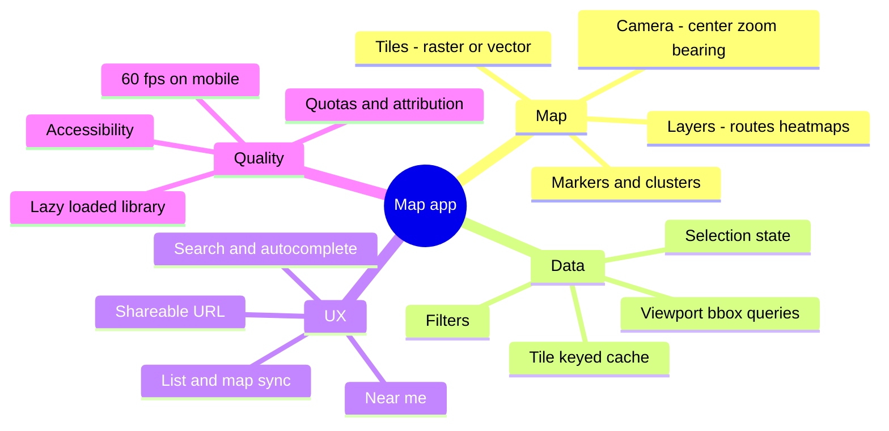
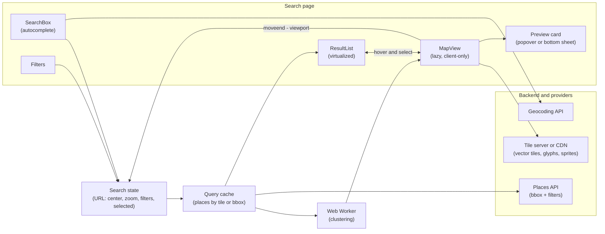
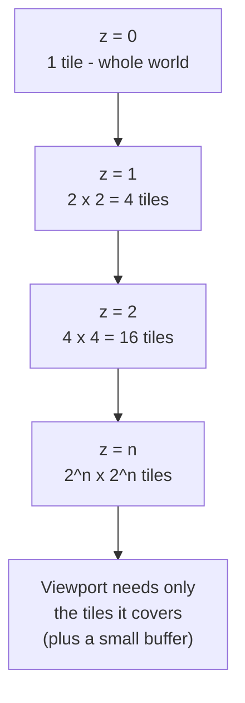
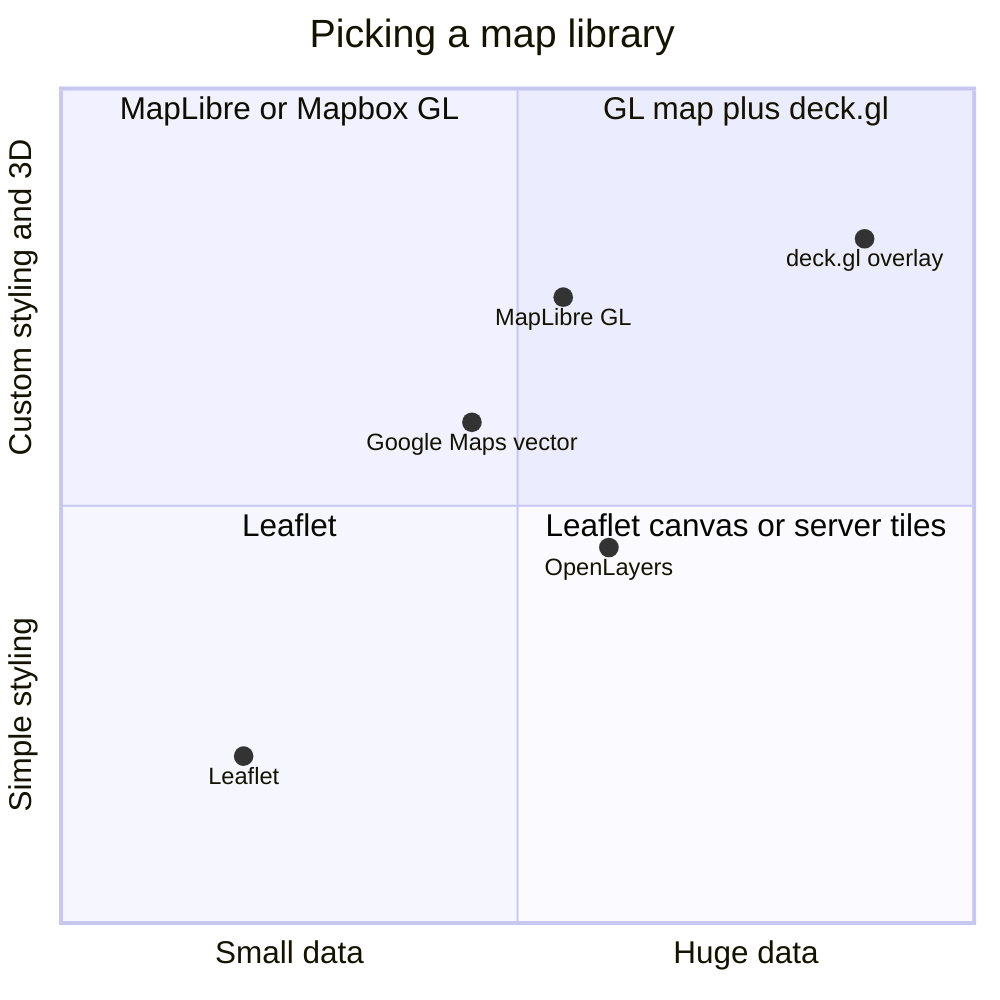
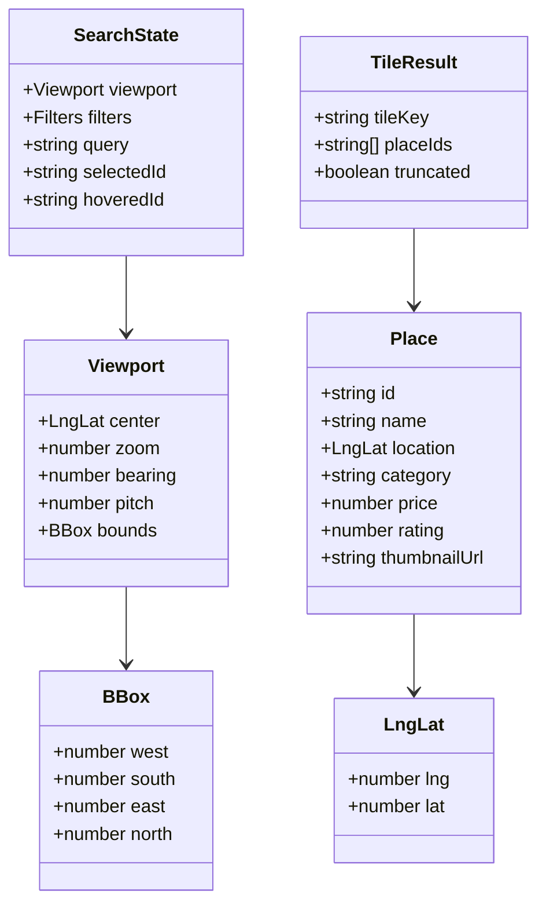
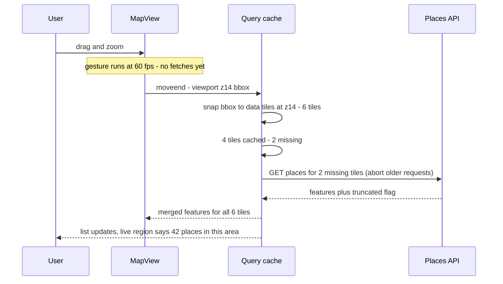
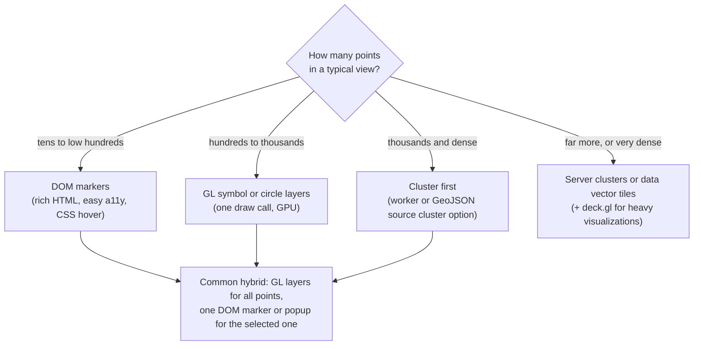
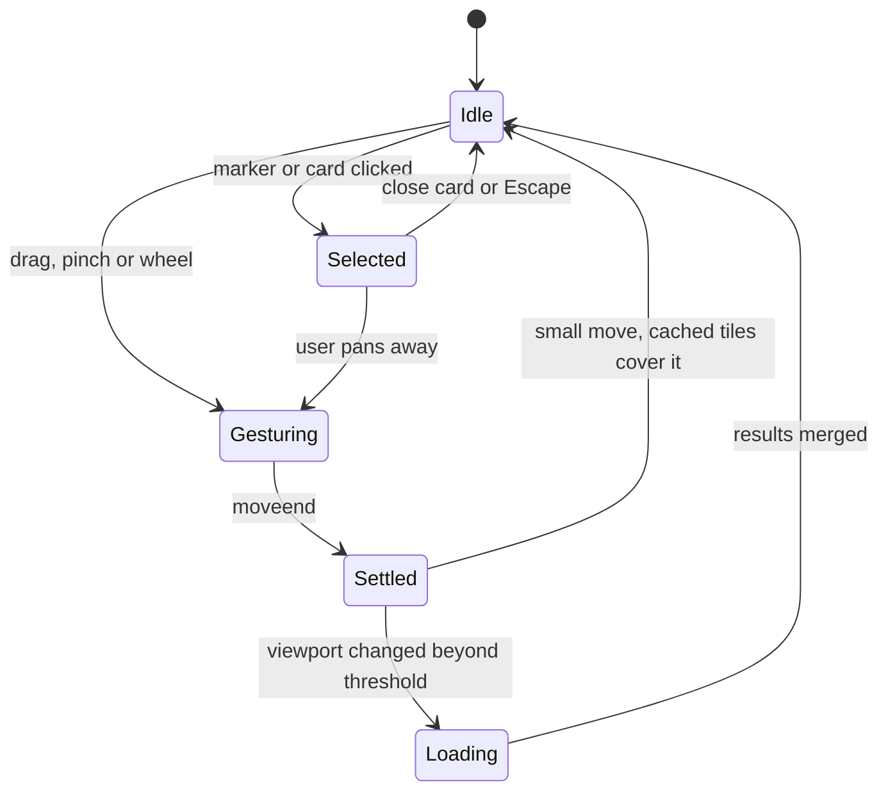
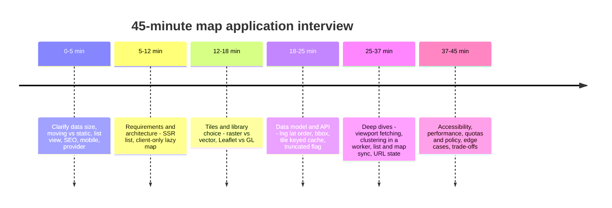

# Design a Map-Based Application

> **Date:** 2026-11-06 · **Last updated:** 2026-11-06
> **Category:** Frontend System Design
> **Sub-Topic:** System Design Cases / Geo (interactive maps, place search, map + list UIs)
> **Level:** Advanced · **Reading time:** ~36 min
> **Informs:** map library choice (Leaflet vs MapLibre GL vs Google Maps vs OpenLayers), raster vs vector tiles, viewport-driven data fetching (bbox, tile-keyed caching), marker strategy (DOM markers vs GL layers vs clustering), list–map synchronization, URL state for shareable views, geolocation permission UX, map accessibility (keyboard, dragging alternatives, list equivalent), lazy-loading the map and LCP, API-key and tile-usage policy, label language and RTL text

> **Pre-requisite:** [Virtual Scrolling & Windowing](../04-performance-engineering/virtual-scrolling-and-windowing.md) and [Web Workers for Heavy Computation](../04-performance-engineering/web-workers-for-heavy-computation.md).
> This case applies **RADIO** to a "search places on a map" product — think Airbnb's map search, a store locator, a delivery tracker or a real-estate map.

**Previous:** [Design a Notification System UI](./design-a-notification-system-ui.md) · **Next:** [Design a Calendar Component](./design-a-calendar-component.md)

---

## Table of Contents

1. [ELI5 — Simple Explanation](#eli5--simple-explanation)
2. [Section 1: Requirements (R)](#section-1-requirements-r)
3. [Section 2: Architecture (A)](#section-2-architecture-a)
4. [Section 3: How Web Maps Work — Projections and Tiles](#section-3-how-web-maps-work--projections-and-tiles)
5. [Section 4: Data Model (D)](#section-4-data-model-d)
6. [Section 5: Interface (I)](#section-5-interface-i)
7. [Section 6: Optimizations — Viewport-Driven Data Loading (O)](#section-6-optimizations--viewport-driven-data-loading-o)
8. [Section 7: Optimizations — Markers, Clustering and Rendering](#section-7-optimizations--markers-clustering-and-rendering)
9. [Section 8: Optimizations — List and Map Sync, URL State](#section-8-optimizations--list-and-map-sync-url-state)
10. [Section 9: Optimizations — Loading Performance](#section-9-optimizations--loading-performance)
11. [Section 10: Optimizations — Accessibility, i18n, Security, Offline](#section-10-optimizations--accessibility-i18n-security-offline)
12. [Section 11: Edge Cases](#section-11-edge-cases)
13. [Interview Walkthrough](#interview-walkthrough)
14. [Real-World Examples](#real-world-examples)
15. [Key Points Summary](#key-points-summary)
16. [Test Your Understanding (with answers)](#test-your-understanding)
17. [Cheat Sheet](#cheat-sheet)
18. [References & Further Reading](#references--further-reading)

---

## ELI5 — Simple Explanation

Imagine the world is a **giant poster made of puzzle pieces**:
- When you look at the **whole world**, you need only a few big pieces with very little detail.
- When you **zoom into your street**, you need different pieces with much more detail — but only the ones in front of your eyes, not the whole planet.
- These pieces are **tiles**. The app fetches only the tiles for your **window** (the viewport) and zoom level.
- On top of the poster you put **stickers** — restaurants, homes, scooters. If 5,000 stickers land in one city, you can't read any of them, so you replace a pile with one big sticker that says **"120"** (a **cluster**). Zoom in and the pile splits.
- The **list next to the map** is the same stickers written as text — easier to read, and essential for people who can't use the map.

> **A map app is a camera over a tiled world: fetch only what the viewport needs, draw markers on the GPU or cluster them, keep the list and URL in sync with the camera, and always offer a non-map way to get the same information.**

---

## Core Concept — Step by Step

### Section 1: Requirements (R)

**Questions to ask the interviewer:**

| Question | Why it changes the design |
|---|---|
| What's on the map — **how many points** in a typical city view? Tens, thousands, millions? | DOM markers vs GL layers vs clustering vs server-side tiles |
| Static points (stores) or **moving** (couriers, vehicles)? | Real-time updates, animation, interpolation |
| Is there a **list view** next to the map? Does panning the map **re-search**? | List–map sync, "Search this area" button vs auto-search |
| **SEO** needed? (e.g. `/homes/paris` landing pages) | SSR the list; map is client-only |
| **Mobile-first**? | Bottom sheet over the map, gesture conflicts with page scroll |
| Which **map provider** and budget? Licensing constraints? | Google Maps vs Mapbox vs self-hosted MapLibre + OSM-based tiles |
| Need **directions/routing**, drawing shapes, heatmaps? | Extra layers and APIs |
| **User location** ("near me")? | Geolocation permission UX, privacy |
| **Offline** use (field workers, hiking)? | Offline tile packs — often a native-app feature |

**Functional requirements (typical scope):**
- Pan/zoom an interactive map; show **places** as markers or clusters.
- **Search** by text (city, address, place) with autocomplete, plus **filters** (price, category, rating).
- A **result list** synchronized with the map: hover a card → highlight marker; click marker → show a preview card.
- **"Search as I move the map"** (auto) or a **"Search this area"** button.
- **Near me** using the device location.
- **Shareable URL** that restores the same view and filters.

**Non-functional requirements:**
- Smooth 60 fps pan/zoom on mid-range phones.
- Fast first paint even though map libraries are large.
- Bounded network and memory use while panning across a continent.
- Accessible without the map (keyboard and screen-reader users get the list).
- Stay within provider **quotas, terms and attribution** rules.



---

### Section 2: Architecture (A)



**Responsibilities:**

| Part | Responsibility |
|---|---|
| **MapView** | Owns the imperative map instance; renders base map tiles and data layers; emits viewport changes; never owns business data |
| **Search state** | `center`, `zoom`, `bounds`, `filters`, `selectedId`, mirrored in the URL |
| **Query cache** | Fetches places for the viewport, deduplicates, caches by tile key, aborts stale requests |
| **Worker** | Clusters thousands of points off the main thread |
| **ResultList** | Accessible, virtualized list of the places in view, sorted by relevance |
| **Tile server / CDN** | Serves base-map tiles, fonts (glyphs) and icons (sprites), long-cached |

**Rendering strategy:**
- **SSR (or ISR) the page shell and the result list** for landing URLs like `/homes/paris` — that's where SEO and LCP come from ([Server-Side Rendering](../02-rendering-and-architecture/server-side-rendering-ssr.md)).
- **The map is client-only.** It needs `window`, WebGL and the viewport size. Load it with a dynamic import after first paint, and show a placeholder (static map image or a skeleton with the same size) so there's no layout shift.
- On mobile, consider **list-first** with a "Map" toggle, so the heavy library loads only if the user asks for it.

---

### Section 3: How Web Maps Work — Projections and Tiles

**Projection.** Most web maps use **Web Mercator** (EPSG:3857). It turns the globe into a square, which makes tiling simple, but it distorts area near the poles and cuts off at about **±85.05° latitude**.

**Tile pyramid.** At zoom level `z` the world is split into `2^z × 2^z` tiles addressed as `z/x/y` (the "slippy map" scheme). Each zoom level doubles the resolution.



**Raster vs vector tiles:**

| | Raster tiles (PNG/WebP/JPEG) | Vector tiles (MVT, protobuf) |
|---|---|---|
| Content | Pre-rendered images | Geometry + attributes, styled in the browser |
| Rendering | ``/canvas — any library (Leaflet) | GPU (WebGL) — MapLibre GL, Mapbox GL, Google vector maps, OpenLayers |
| Zoom | Blurry between levels | Crisp at fractional zooms, smooth rotation/tilt |
| Styling | Fixed at render time (one style per tile set) | Change colors, language, dark mode **at runtime** |
| Size | Larger per tile, simple | Smaller, but needs a style JSON, glyphs (fonts) and sprites |
| Device cost | Low CPU/GPU | Needs WebGL; parsing happens in workers |

**Single-file tile archives:** formats like **PMTiles** pack a whole tile set into one file served from object storage with HTTP **range requests** — no tile server needed. Useful for self-hosted base maps or custom data layers.

**Map libraries in 2026:**

| Library | Model | Notes |
|---|---|---|
| **Leaflet** | DOM + CSS transforms, raster tiles; SVG/Canvas vectors | Small and simple; great for modest data; plugins for clustering |
| **MapLibre GL JS** | WebGL, vector tiles | Open-source fork of Mapbox GL JS (created when Mapbox GL JS v2 moved to a proprietary license in late 2020); works with many tile providers or your own |
| **Mapbox GL JS** | WebGL, vector tiles | Proprietary license, tied to Mapbox services |
| **Google Maps JavaScript API** | Raster and WebGL vector maps | Uses **Advanced Markers** (`AdvancedMarkerElement`); the legacy `google.maps.Marker` is deprecated |
| **OpenLayers** | Canvas/WebGL, many projections | Strong for GIS needs (non-Mercator projections, WMS/WMTS) |
| **deck.gl** | WebGL/WebGPU data layers | Overlay for very large datasets on top of a base map |



> The positions are qualitative guidance, not benchmarks.

---

### Section 4: Data Model (D)



**Design decisions:**

| Decision | Choice | Why |
|---|---|---|
| **Coordinate order** | Store `{ lng, lat }` objects in app code; convert at library boundaries | GeoJSON (RFC 7946) is `[lng, lat]`; Leaflet's `LatLng` is `[lat, lng]`; Google uses `{ lat, lng }` — mixing them is a classic bug |
| **Normalization** | `placesById` + per-tile ID lists | Panning re-uses tiles; one place in two tiles is stored once |
| **Cache key** | `(dataZoom, x, y, filtersHash)` — the viewport snapped to a tile grid | Raw bboxes almost never repeat (every pan is a new float), so they never hit the cache |
| **Server-side limit** | Return at most N places per request + `truncated: true` | A zoomed-out view of a country can contain millions of points |
| **Clusters** | Client-side (worker) for up to tens of thousands of points; server-side (pre-aggregated per zoom, or vector data tiles) beyond that | Client clustering needs all points in memory |
| **UI state** | `selectedId`, `hoveredId` separate from data | Highlighting must not refetch or re-cluster |
| **Moving objects** | Separate live layer keyed by ID with last-known position + timestamp | Don't invalidate the static places cache on every GPS ping |

---

### Section 5: Interface (I)

**Server API contract:**

```http
GET /api/places?bbox=2.29,48.84,2.37,48.88&zoom=14&category=cafe&minRating=4&limit=500
→ 200 { "type": "FeatureCollection",
        "features": [ { "type": "Feature", "id": "p_1",
                        "geometry": { "type": "Point", "coordinates": [2.3376, 48.8606] },
                        "properties": { "id": "p_1", "name": "Café X", "rating": 4.6, "price": 2 } } ],
        "truncated": false, "total": 312 }

GET /api/places/tile/{z}/{x}/{y}?category=cafe           → same FeatureCollection for one tile (tile-snapped, CDN-cacheable)
GET /api/places/tiles/{z}/{x}/{y}.mvt?category=cafe      (alternative for huge datasets: data as vector tiles)
GET /api/places/:id                                        → full details for the preview card
GET /api/geocode?q=gare%20du%20nord&proximity=2.35,48.86&lang=fr → [{ label, center, bbox }]
```

Contract rules:
- **`bbox` order is `west,south,east,north`** (min lng, min lat, max lng, max lat — the GeoJSON `bbox` convention).
- **Responses are cacheable**: `GET` + `Cache-Control: public, max-age=60, stale-while-revalidate=300` for public places; vary only on query parameters ([Browser Caching Strategies](../01-web-fundamentals/browser-caching-strategies.md)).
- The list endpoint returns **only fields the marker and card need**; details come from `/places/:id`.
- If the viewport crosses the **antimeridian** (180°), `west > east` — the server must handle it or the client splits it into two boxes.

**Component APIs (React/TypeScript):**

```tsx
<MapView
  initialViewport={{ center: { lng: 2.35, lat: 48.86 }, zoom: 12 }}
  onViewportChange={setViewport}        // fired on moveend, not every frame
  features={clusteredFeatures}          // already clustered for this zoom
  selectedId={selectedId}
  hoveredId={hoveredId}
  onFeatureClick={(id) => setSelectedId(id)}
  onClusterClick={(c) => map.zoomTo(c.expansionZoom, c.center)}
  styleUrl="/map-styles/light.json"     // swap for dark mode
/>

<ResultList
  items={placesInView}
  selectedId={selectedId}
  onHover={setHoveredId}                // highlight marker
  onSelect={setSelectedId}              // open card and pan if needed
/>

const { viewport, setViewport, filters, setFilters } = useMapSearchState();  // URL-backed
const { places, isFetching, truncated } = useViewportPlaces(viewport, filters);
```

| API rule | Why |
|---|---|
| `MapView` is **controlled at the "settled" level** (`moveend`), uncontrolled during gestures | Pushing every animation frame through React state causes jank |
| Data passed in as features; the map **doesn't fetch** | Testable, swappable library, list and map share one source |
| Library objects (map instance, markers) stay **inside** `MapView` | Keeps the rest of the app library-agnostic; switching from Google to MapLibre touches one component |

---

### Section 6: Optimizations — Viewport-Driven Data Loading (O)



**Rules:**
- **Fetch on `moveend` / `idle`**, not on `move`. Optionally debounce ~200–300 ms so fling gestures don't fire several requests ([Debouncing & Throttling](../04-performance-engineering/debouncing-and-throttling.md)).
- **Snap to a tile grid** at a fixed "data zoom" (e.g. the current integer zoom, clamped to a range) so panning back re-uses cached tiles.
- **Abort stale requests** with `AbortController`; keep showing the previous results until new ones arrive (no flashing empty map).
- **Prefetch a ring** of neighboring tiles when idle, if quotas allow.
- **Evict** tiles far from the viewport (LRU) to bound memory.
- **Auto-search vs button:** auto-search feels magic but can surprise users ("my results changed while I was reading"). A **"Search this area"** button after the map moves is calmer; many products offer a checkbox to choose.

**Server-side alternatives for huge datasets:**

| Approach | When |
|---|---|
| bbox query + limit + `truncated` | Up to thousands of points per view |
| Server-side clustering per zoom (precomputed or geohash/H3 buckets) | Many points, need counts at low zoom |
| **Data as vector tiles** (`/tiles/{z}/{x}/{y}.mvt`) rendered by the GL library | Very large or dense data; the GPU draws it and the browser caches tiles like any static asset |

---

### Section 7: Optimizations — Markers, Clustering and Rendering



> These ranges are rough rules of thumb — profile on your target devices. DOM markers cost layout and paint per element and are moved on every camera frame.

**Clustering:**
- MapLibre/Mapbox GeoJSON sources have a built-in `cluster: true` option; Leaflet has `Leaflet.markercluster`; Google offers `@googlemaps/markerclusterer`; the **supercluster** library works anywhere and can run in a **Web Worker**.
- Clicking a cluster zooms to its **expansion zoom** (the zoom where it splits).
- Keep clusters **stable** while panning (cluster all points in the loaded area, not just the visible ones) so numbers don't jump.

**Rendering performance:**
- GL libraries parse tiles in **workers** and draw on the GPU; keep your own main-thread work small during gestures.
- **One map instance per page.** Browsers limit the number of active WebGL contexts; creating a new map per card or per route change leaks GPU memory. Reuse the instance and call `map.remove()` on unmount.
- Don't re-create layers on every React render — **diff** data and call `source.setData()`.
- Animate moving objects by interpolating positions in `requestAnimationFrame` between updates; batch incoming updates per frame.
- Use `devicePixelRatio`-aware sprites; avoid huge PNG markers.

---

### Section 8: Optimizations — List and Map Sync, URL State



**Sync rules:**
- **Hover card → highlight marker** (state only, no refetch). **Hover marker → highlight card**, and scroll it into view only on click, not hover (scrolling on hover is disorienting).
- **Select card → pan only if the marker is off-screen** (or under the bottom sheet / side panel — use the library's padding option so "center" means the visible area).
- **List content = places in the current viewport**, ordered by relevance — not by distance from the map center unless the user asked.

**URL state** (shareable, back-button friendly):

```text
/search?q=cafe&minRating=4&lat=48.8606&lng=2.3376&z=14.25&selected=p_1
```

- Use `history.replaceState` while panning (one history entry per *search*, not per drag) and `pushState` for meaningful changes (new query, filters, selected place).
- **Round** coordinates (about 5 decimals is roughly meter-level) and zoom (2 decimals) to keep URLs short and cache keys stable.
- On load, the URL is the **source of truth**; the map initializes from it, and the SSR list uses the same parameters.

---

### Section 9: Optimizations — Loading Performance

Map libraries are among the heaviest dependencies a page can have, and the map itself is rarely the LCP element you want.

| Technique | Detail |
|---|---|
| **Lazy-load the library** | `import()` the map module after first paint, on visibility (`IntersectionObserver`) or on "Show map" ([Code Splitting & Lazy Loading](../04-performance-engineering/code-splitting-and-lazy-loading.md)) |
| **Facade / placeholder** | A static map image (provider static-map API or a pre-rendered image) at the same size, swapped for the interactive map on interaction or idle |
| **Reserve space** | Fixed `aspect-ratio`/height container → no CLS when the map mounts |
| **Preconnect** | `<link rel="preconnect">` to the tile/CDN origin once you know the map will load ([Prefetching & Preloading](../04-performance-engineering/prefetching-and-preloading.md)) |
| **Cache tiles** | Versioned tile URLs with long `max-age`; style, glyphs and sprites too |
| **Avoid scroll-jacking** | Use cooperative gestures (`cooperativeGestures` in MapLibre, `gestureHandling: 'cooperative'` in Google Maps) on pages where the map is embedded in scrolling content |
| **Reduce work in hidden state** | Pause live layers when the tab is hidden; stop animations off-screen |

---

### Section 10: Optimizations — Accessibility, i18n, Security, Offline

**Accessibility** — an interactive map canvas is largely opaque to assistive tech, so design for **equivalence**:
- The **result list is the accessible primary view** — every place on the map must be reachable there, with the same actions.
- Map container: focusable with a clear label (`aria-label="Map of search results"`), **keyboard pan** (arrow keys) and **zoom** (`+`/`-`) — GL libraries ship keyboard handlers; document them.
- **WCAG 2.5.7 Dragging Movements** (2.2, AA): panning by drag needs a single-pointer alternative — zoom buttons, "Search this area", or the list. **WCAG 2.5.1 Pointer Gestures**: pinch-to-zoom needs a single-pointer alternative too (zoom buttons).
- Markers that are DOM elements should be `<button>`s with names ("Café X, rating 4.6"); GL-layer markers need the list as their accessible twin.
- Announce result changes politely ("42 places in this area") via a live region; never move focus when results update.
- `prefers-reduced-motion`: replace `flyTo` animations with jumps.
- Don't rely on color alone for categories; meet contrast for labels and marker outlines ([Color Contrast & Visual Accessibility](../06-accessibility-and-i18n/color-contrast-and-visual-accessibility.md)).

**i18n:**
- **Label language:** vector styles can choose `name:<lang>` fields at runtime; raster tiles are fixed per tile set.
- **RTL scripts:** MapLibre needs its **RTL text plugin** (`setRTLTextPlugin`) to shape Arabic and Hebrew labels correctly.
- **Units:** `Intl.NumberFormat(locale, { style: 'unit', unit: 'kilometer' })`; choose metric/imperial by locale or setting.
- **Disputed borders:** some providers offer "worldview" options; this is a product and legal decision, not just a style choice.
- Geocoding requests send the UI language and a proximity/viewport bias.

**Security, privacy and policy:**
- **Browser API keys are public.** Restrict them by HTTP referrer and by API, set quotas and alerts; proxy anything that needs a secret.
- **Tile usage policies matter.** The public OpenStreetMap tile servers forbid heavy use and bulk download/prefetch; the public Nominatim geocoder forbids client-side autocomplete. Use a commercial provider or self-host for production.
- **Attribution** (e.g. "© OpenStreetMap contributors") must stay visible.
- **CSP:** GL libraries create workers (often from `blob:` URLs); check the library's CSP guidance (MapLibre documents the needed directives and offers a CSP-friendly build) — see [Content Security Policy](../07-security/content-security-policy-csp.md).
- **Location privacy:** ask only on "Near me"; don't send precise coordinates to analytics (round them); explain why you need location.

**Geolocation UX:**
- Requires a **secure context** (HTTPS) and user permission; in iframes it also needs `allow="geolocation"` (Permissions Policy).
- Call `getCurrentPosition` from a **user action**; handle `PERMISSION_DENIED`, `POSITION_UNAVAILABLE` and `TIMEOUT`; show the **accuracy circle** (`coords.accuracy` in meters).
- Fall back to a **default region** (from the URL, user profile or coarse IP geolocation server-side) rather than a world view.

**Offline:** base-map offline packs are mainly a **native SDK** feature (MapLibre Native, Mapbox mobile SDKs). On the web, a Service Worker can cache visited tiles and the style **if the tile license allows it**; offline search results can come from IndexedDB ([Offline-First Architecture](../03-state-and-data/offline-first-architecture.md)).

---

### Section 11: Edge Cases

| Case | Handling |
|---|---|
| **Antimeridian** (viewport crosses 180°) | `west > east` in the bbox → split into two queries or support it server-side |
| **World wrap** (repeated worlds when zoomed out) | Normalize longitudes to [-180, 180] before querying and keying |
| **Poles** | Web Mercator stops at ~±85.05°; clamp latitude |
| **Many points at the same coordinate** (apartment building) | Cluster never splits → show a list popup ("12 places here") or spiderfy |
| **Container resize** (sidebar toggles, bottom sheet) | Call the library's `resize()` — use `ResizeObserver` on the container |
| **Hidden container on mount** (tabs, `display: none`) | Init when visible, or `resize()` when shown |
| **Zero results** | Suggest zooming out or clearing filters; don't auto-zoom without telling the user |
| **WebGL unavailable** (old device, blocklisted GPU) | Detect failure; fall back to a static image + list, or a raster library |
| **Slow network** | Keep previous tiles/results; show a subtle loading indicator, not a blank map |

---

## Interview Walkthrough



**What to say, in order:**
1. **Clarify scale** — "How many points in a city view?" decides almost everything.
2. **Draw the split:** SSR list + filters (SEO, LCP), lazy client-only map, shared URL-backed state.
3. **Explain tiles** in two sentences and pick a library with a reason (vector tiles + MapLibre for styling and density; Leaflet for a simple store locator).
4. **Data loading:** `moveend` → snap to tiles → cache → abort stale → `truncated` flag.
5. **Rendering:** GL layers + clustering in a worker; one DOM element for the selected place.
6. **Sync and URL:** hover/select rules, `replaceState` during panning.
7. **Close** with accessibility (list as equivalent, keyboard, 2.5.7), performance (facade, preconnect) and policy (keys, attribution, usage limits).

**Trade-offs to discuss:**

| Decision | Option A | Option B | Lean |
|---|---|---|---|
| Base map | Raster tiles (simple, any device) | Vector tiles (crisp, runtime style, smaller) | Vector unless WebGL or simplicity is a concern |
| Library | Leaflet (small, DOM) | MapLibre/Google GL (GPU, rich) | Match to data size and styling needs |
| Markers | DOM (rich, accessible) | GL layers (fast) | GL for all + DOM for the selected one |
| Clustering | Client (worker) | Server (per zoom or data tiles) | Client up to tens of thousands of points |
| Search trigger | Auto on move | "Search this area" button | Button or opt-in toggle on mobile |
| Data fetch key | Raw bbox | Tile-snapped bbox | Tile-snapped (cache hits) |
| Map loading | Eager | Facade + lazy | Lazy unless the map *is* the page |

---

## Real-World Examples

**Example 1 — Tile math (lng/lat → slippy tile) for cache keys:**
```typescript
export interface LngLat { lng: number; lat: number }
export interface BBox { west: number; south: number; east: number; north: number }

const MAX_LAT = 85.05112878;

export function lngLatToTile({ lng, lat }: LngLat, z: number) {
  const n = 2 ** z;
  const clampedLat = Math.max(-MAX_LAT, Math.min(MAX_LAT, lat));
  const latRad = (clampedLat * Math.PI) / 180;
  const x = Math.floor(((lng + 180) / 360) * n);
  const y = Math.floor(((1 - Math.log(Math.tan(latRad) + 1 / Math.cos(latRad)) / Math.PI) / 2) * n);
  return { x: Math.min(n - 1, Math.max(0, x)), y: Math.min(n - 1, Math.max(0, y)), z };
}

/** All tile keys covering a bbox at data zoom z (assumes the bbox doesn't cross the antimeridian). */
export function tilesForBBox(b: BBox, z: number): string[] {
  const nw = lngLatToTile({ lng: b.west, lat: b.north }, z);
  const se = lngLatToTile({ lng: b.east, lat: b.south }, z);
  const keys: string[] = [];
  for (let x = nw.x; x <= se.x; x++) for (let y = nw.y; y <= se.y; y++) keys.push(`${z}/${x}/${y}`);
  return keys;
}
```

**Example 2 — A React wrapper around MapLibre GL JS (imperative instance, declarative props):**
```tsx
import { useEffect, useRef } from 'react';
import maplibregl, { type GeoJSONSource, type Map as MLMap } from 'maplibre-gl';
import 'maplibre-gl/dist/maplibre-gl.css';

type Props = {
  styleUrl: string;
  initial: { center: [number, number]; zoom: number };      // [lng, lat]
  data: GeoJSON.FeatureCollection<GeoJSON.Point>;
  selectedId: string | null;
  onViewportChange(v: { bbox: [number, number, number, number]; zoom: number }): void;
  onSelect(id: string): void;
};

export default function MapView({ styleUrl, initial, data, selectedId, onViewportChange, onSelect }: Props) {
  const containerRef = useRef<HTMLDivElement>(null);
  const mapRef = useRef<MLMap | null>(null);
  const cbRef = useRef({ onViewportChange, onSelect });
  cbRef.current = { onViewportChange, onSelect };            // always call the latest callbacks

  // Create the map ONCE
  useEffect(() => {
    const map = new maplibregl.Map({
      container: containerRef.current!,
      style: styleUrl,
      center: initial.center,
      zoom: initial.zoom,
      cooperativeGestures: true,                             // no scroll-jacking in long pages
    });
    map.addControl(new maplibregl.NavigationControl(), 'top-right');   // single-pointer zoom buttons
    map.on('load', () => {
      map.addSource('places', { type: 'geojson', data, cluster: true, clusterRadius: 50, promoteId: 'id' });
      // features carry properties.id; promoteId makes it the feature-state id
      map.addLayer({ id: 'clusters', type: 'circle', source: 'places', filter: ['has', 'point_count'],
        paint: { 'circle-radius': 18, 'circle-color': '#2563eb' } });
      map.addLayer({ id: 'points', type: 'circle', source: 'places', filter: ['!', ['has', 'point_count']],
        paint: { 'circle-radius': ['case', ['boolean', ['feature-state', 'selected'], false], 10, 6],
                 'circle-color': '#dc2626', 'circle-stroke-width': 2, 'circle-stroke-color': '#fff' } });
      map.on('click', 'points', (e) => {
        const id = e.features?.[0]?.properties?.id;
        if (id) cbRef.current.onSelect(String(id));
      });
    });
    map.on('moveend', () => {
      const b = map.getBounds();
      cbRef.current.onViewportChange({ bbox: [b.getWest(), b.getSouth(), b.getEast(), b.getNorth()], zoom: map.getZoom() });
    });
    const ro = new ResizeObserver(() => map.resize());
    ro.observe(containerRef.current!);
    mapRef.current = map;
    return () => { ro.disconnect(); map.remove(); mapRef.current = null; };   // free the WebGL context
    // eslint-disable-next-line react-hooks/exhaustive-deps
  }, []);

  // Update data without re-creating layers
  useEffect(() => {
    const src = mapRef.current?.getSource('places') as GeoJSONSource | undefined;
    src?.setData(data);
  }, [data]);

  // Selection is feature-state, not new data
  useEffect(() => {
    const map = mapRef.current;
    if (!map || !selectedId || !map.getSource('places')) return;
    map.setFeatureState({ source: 'places', id: selectedId }, { selected: true });
    return () => { if (map.getSource('places')) map.setFeatureState({ source: 'places', id: selectedId }, { selected: false }); };
  }, [selectedId]);

  return <div ref={containerRef} role="region" aria-label="Map of search results" style={{ height: '100%', minHeight: 400 }} />;
}
```

```tsx
// Next.js (App Router): load the map client-only, after the SSR list
'use client';
import dynamic from 'next/dynamic';
const MapView = dynamic(() => import('./MapView'), { ssr: false, loading: () => <div className="map-skeleton" /> });
```

**Example 3 — Viewport query with tile-snapped keys, abort and "keep previous results":**
```typescript
import { useQueries, keepPreviousData } from '@tanstack/react-query';

export function useViewportPlaces(bbox: BBox, zoom: number, filters: Record<string, string>) {
  const dataZoom = Math.max(8, Math.min(16, Math.floor(zoom)));       // clamp the data grid
  const filterKey = new URLSearchParams(filters).toString();
  const tiles = tilesForBBox(bbox, dataZoom);

  const results = useQueries({
    queries: tiles.map((key) => ({
      queryKey: ['places', key, filterKey],
      queryFn: async ({ signal }) => {
        const res = await fetch(`/api/places/tile/${key}?${filterKey}`, { signal });   // aborted if unused
        if (!res.ok) throw new Error(`HTTP ${res.status}`);
        return (await res.json()) as GeoJSON.FeatureCollection<GeoJSON.Point>;
      },
      staleTime: 60_000,
      gcTime: 5 * 60_000,                // evict tiles we haven't looked at for a while
      placeholderData: keepPreviousData,
    })),
  });

  // Merge and dedupe by feature id (each place should belong to one tile, but be defensive)
  const byId = new Map<string, GeoJSON.Feature<GeoJSON.Point>>();
  for (const r of results) for (const f of r.data?.features ?? []) byId.set(String(f.id), f);
  return {
    features: [...byId.values()],
    isFetching: results.some((r) => r.isFetching),
  };
}
```

**Example 4 — Clustering in a Web Worker with supercluster:**
```typescript
// cluster.worker.ts
import Supercluster from 'supercluster';

let index: Supercluster | null = null;

self.onmessage = (e: MessageEvent) => {
  const msg = e.data;
  if (msg.type === 'load') {
    index = new Supercluster({ radius: 60, maxZoom: 16 });
    index.load(msg.features);                         // GeoJSON Point features
    self.postMessage({ type: 'ready' });
  } else if (msg.type === 'getClusters' && index) {
    const clusters = index.getClusters(msg.bbox, Math.floor(msg.zoom));   // bbox: [w, s, e, n]
    self.postMessage({ type: 'clusters', requestId: msg.requestId, clusters });
  } else if (msg.type === 'expansionZoom' && index) {
    self.postMessage({ type: 'expansionZoom', requestId: msg.requestId, zoom: index.getClusterExpansionZoom(msg.clusterId) });
  }
};
```

**Example 5 — URL state with `replaceState` while panning (BAD → GOOD):**
```typescript
// ❌ BAD: one history entry per drag → the Back button replays every pan
map.on('moveend', () => history.pushState(null, '', urlFor(map)));

// ✅ GOOD: replace while exploring; push only for meaningful changes
const round = (n: number, d: number) => Number(n.toFixed(d));
function urlFor(view: { lat: number; lng: number; zoom: number }, params: URLSearchParams) {
  params.set('lat', String(round(view.lat, 5)));
  params.set('lng', String(round(view.lng, 5)));
  params.set('z', String(round(view.zoom, 2)));
  return `${location.pathname}?${params}`;
}
map.on('moveend', () => {
  const c = map.getCenter();
  history.replaceState(history.state, '', urlFor({ lat: c.lat, lng: c.lng, zoom: map.getZoom() }, new URLSearchParams(location.search)));
});
function onNewSearch(q: string) {
  const params = new URLSearchParams(location.search);
  params.set('q', q);
  history.pushState(null, '', `${location.pathname}?${params}`);   // Back returns to the previous search
}
```

**Example 6 — "Near me" with proper error handling:**
```typescript
export function locateUser(): Promise<{ lng: number; lat: number; accuracy: number }> {
  return new Promise((resolve, reject) => {
    if (!('geolocation' in navigator)) return reject(new Error('unsupported'));
    navigator.geolocation.getCurrentPosition(
      (pos) => resolve({ lng: pos.coords.longitude, lat: pos.coords.latitude, accuracy: pos.coords.accuracy }),
      (err) => {
        // err.code: 1 PERMISSION_DENIED, 2 POSITION_UNAVAILABLE, 3 TIMEOUT
        reject(new Error(err.code === 1 ? 'denied' : err.code === 3 ? 'timeout' : 'unavailable'));
      },
      { enableHighAccuracy: false, timeout: 10_000, maximumAge: 60_000 }   // a cached fix is fine for "near me"
    );
  });
}
// Call it from the "Near me" button's click handler — never on page load.
```

**Other stacks:**
- **Vue:** wrap the map instance in a component that creates it in `onMounted` and calls `map.remove()` in `onBeforeUnmount`; keep the instance in a non-reactive variable (`shallowRef` or `markRaw`) so Vue doesn't deep-proxy it. Community wrappers exist for MapLibre and Leaflet.
- **Angular:** create the map in `ngAfterViewInit`, destroy it in `ngOnDestroy`, and run map event handlers **outside the Angular zone** (`NgZone.runOutsideAngular`) in zone-based apps so every frame doesn't trigger change detection; zoneless apps with signals avoid that by design.
- **Svelte:** an action (`use:map`) or `onMount`/`onDestroy` around the instance; feed data through a store.
- **Native mobile:** MapKit (iOS), Google Maps SDK, and MapLibre Native / Mapbox SDKs render natively and support **offline packs**; the same bbox/tile-keyed data API serves web and native.

---

## Key Points Summary

| Concept | One-Line Explanation |
|---|---|
| **Web Mercator** | Square projection used by web maps; clips at ~±85.05° latitude |
| **Tile pyramid** | `2^z × 2^z` tiles at zoom `z`, addressed `z/x/y`; fetch only those in view |
| **Raster vs vector tiles** | Pre-rendered images vs GPU-styled geometry (crisp, runtime style, needs WebGL) |
| **MapLibre GL JS** | Open-source WebGL vector map library, fork of Mapbox GL JS v1 |
| **SSR list, client-only map** | SEO and LCP from the list; heavy map lazy-loaded behind a placeholder |
| **`[lng, lat]`** | GeoJSON order; Leaflet and Google use lat-first — normalize at boundaries |
| **Fetch on `moveend`** | Never per animation frame; debounce flings |
| **Tile-snapped cache keys** | Raw bboxes never repeat; tile keys do |
| **`truncated` flag** | Server caps results; client says "zoom in to see more" |
| **GL layers + clustering** | Draw thousands of points on the GPU; cluster in a worker or on the server |
| **One map instance** | WebGL contexts are limited; `remove()` on unmount |
| **`replaceState` while panning** | Shareable URLs without polluting history |
| **List as accessible equivalent** | Maps are hard for AT; the list must offer everything the map does |
| **WCAG 2.5.7 / 2.5.1** | Drag and pinch need single-pointer alternatives (buttons, list) |
| **Policies** | Restrict API keys; respect tile/geocoder usage policies and attribution |

---

## Test Your Understanding

**Q1 (Basic):**
What's the difference between raster and vector tiles, and when would you still choose raster?

<details>
<summary>Answer</summary>

**Raster tiles** are pre-rendered images per `z/x/y`; the browser just draws them. **Vector tiles** contain geometry and attributes; the client styles and draws them on the GPU. Vector tiles are crisp at fractional zooms, support rotation/tilt, can switch language or dark mode at runtime, and are usually smaller — but they need WebGL, a style JSON, glyphs and sprites, and more client CPU/GPU.

Choose raster for a **simple store locator** with a lightweight library (Leaflet), for **satellite/aerial imagery** (inherently raster), for very old or low-end devices without reliable WebGL, or when your provider only offers raster.
</details>

**Q2 (Application):**
Your map fetches `/api/places?bbox=...` on every `move` event. Users report a laggy map and a huge API bill. Redesign the data loading.

<details>
<summary>Answer</summary>

- Fetch on **`moveend`/`idle`**, optionally debounced, never on `move` (which fires every frame).
- **Snap the viewport to a tile grid** at a fixed data zoom and fetch per tile; key the cache by `(z/x/y, filters)` so panning back is a cache hit. Raw float bboxes never repeat.
- **Abort** in-flight requests that are no longer needed and keep showing previous results.
- Server returns at most N places with a **`truncated`** flag; the UI says "Zoom in to see more".
- Make the endpoint **cacheable** (`GET`, `Cache-Control` with `stale-while-revalidate`) so a CDN absorbs repeated tiles.
- For very large datasets, serve **data as vector tiles** or server-side clusters.
- Optionally switch from auto-search to a **"Search this area"** button.
</details>

**Q3 (Tricky):**
A teammate's markers appear in the ocean off the coast of Somalia instead of in Paris. What probably happened?

<details>
<summary>Answer</summary>

**Swapped coordinates.** Paris is about lat 48.86, lng 2.35. Plotting `[48.86, 2.35]` as `[lng, lat]` puts the point at lng 48.86, lat 2.35 — in the Indian Ocean near Somalia. GeoJSON (RFC 7946) uses **`[longitude, latitude]`**, while Leaflet's `LatLng` and Google's `{ lat, lng }` are latitude-first. Fix: use named `{ lng, lat }` objects in app code and convert explicitly at each library boundary; add a test with a known city.
</details>

**Q4 (Tricky):**
The map works in development, but in production on a page with a sidebar toggle, the map shows grey areas and click positions are off after the sidebar collapses. Why?

<details>
<summary>Answer</summary>

The map library measured its container when it was created. When the container's size changes (sidebar collapse, bottom sheet, tab switch, a container that was `display: none` on init), the canvas and internal transforms are stale — unrendered areas appear grey and pointer coordinates map to the wrong place. Fix: observe the container with **`ResizeObserver`** and call the library's `resize()` (MapLibre/Mapbox `map.resize()`, Leaflet `invalidateSize()`); initialize maps only when their container is visible.
</details>

**Q5 (Application):**
How do you make a map search page accessible to a screen-reader user who can't use the map at all?

<details>
<summary>Answer</summary>

Make the **result list the accessible primary interface**: every place on the map is in the list with the same information and actions (open details, directions, save). Filters and a text location search drive both list and map. Announce updates politely ("42 places in this area") through a persistent live region. The map region is labeled, keyboard-pannable (arrows) and zoomable (`+`/`-`), with visible zoom buttons for **WCAG 2.5.1/2.5.7** (no pinch or drag required). DOM markers are buttons with names; GL markers rely on the list as their equivalent. Don't move focus when results change, and honor reduced motion for `flyTo`.
</details>

**Q6 (System design):**
Design the frontend for a delivery-tracking map that shows one courier moving in real time plus the restaurant and the customer's address. What's different from a place-search map?

<details>
<summary>Answer</summary>

- **Data:** three points, not thousands — DOM markers are fine (rich, accessible); no clustering.
- **Real-time:** courier positions arrive every few seconds over SSE/WebSocket ([WebSockets, SSE & Long Polling](../01-web-fundamentals/websockets-sse-long-polling.md)). Keep them in a small live store; **interpolate** between positions in `requestAnimationFrame` so the marker glides; ignore out-of-order updates by timestamp/seq.
- **Camera:** fit bounds to include courier and destination with padding for the bottom sheet; don't fight the user — stop auto-following once they pan, and offer a "Re-center" button.
- **Route:** draw the route polyline (encoded polyline or GeoJSON) once; update ETA text, not geometry, on every tick.
- **Text equivalent:** a status line ("Courier is 4 minutes away, on Rue X") announced politely at meaningful changes, not on every ping.
- **Performance and battery:** pause updates when the tab is hidden; reconnect on `visibilitychange`.
- **Privacy:** courier location is visible only to this customer and only during the delivery.
</details>

---

## Cheat Sheet

**Key Definitions:**
- **Web Mercator (EPSG:3857):** the square projection most web maps use.
- **Slippy tiles:** `z/x/y` tile scheme, `2^z × 2^z` tiles per zoom level.
- **MVT:** Mapbox Vector Tile format (protobuf); styled client-side.
- **Style JSON:** describes sources and layers for GL maps; plus **glyphs** (fonts) and **sprites** (icons).
- **bbox:** `[west, south, east, north]` in degrees.
- **Cluster expansion zoom:** zoom level at which a cluster splits.
- **Cooperative gestures:** require Ctrl/Cmd + scroll (desktop) or two fingers (touch) to move an embedded map.
- **PMTiles:** single-file tile archive served with HTTP range requests.

**Quick Reference:**
```text
Render           SSR list + filters · lazy client-only map behind a same-size placeholder
Library          Leaflet (small/raster) · MapLibre GL (vector/WebGL, OSS) · Google Maps (Advanced Markers) · OpenLayers (GIS) · deck.gl (huge data)
Coordinates      app: { lng, lat } · GeoJSON [lng, lat] · Leaflet [lat, lng] · Google { lat, lng }
Fetch            moveend → snap to tiles at data zoom → cache (z/x/y + filters) → abort stale → keep previous
Server           limit + truncated · cacheable GET · data vector tiles for huge sets
Markers          DOM (≤ low hundreds) · GL layers (thousands) · cluster (dense) · server/vector tiles (huge)
Clustering       GeoJSON source cluster:true · supercluster in a Worker · click → expansion zoom
Instance         one per page · remove() on unmount · ResizeObserver → resize()
URL              replaceState while panning · pushState on new search/selection · round to 5 decimals
A11y             list = equivalent · keyboard pan/zoom · zoom buttons (2.5.1/2.5.7) · polite result count
i18n             name:<lang> labels · RTL text plugin · Intl unit formatting · worldview decisions
Policy           restrict API keys · attribution visible · no bulk use of public OSM tiles/Nominatim
Geolocation      HTTPS · from a click · handle denied/timeout · show accuracy · default region fallback
```

**Common Mistakes to Avoid:**

| Mistake | Why Wrong | Fix |
|---|---|---|
| Fetching on every `move` | Floods the API, janks the gesture | `moveend` + debounce + abort |
| Caching by raw bbox | Floats never repeat → zero cache hits | Tile-snapped keys |
| Thousands of DOM markers | Layout/paint per marker per frame | GL layers, clustering |
| New map instance per render/route | WebGL context and memory leaks | One instance; `remove()` on unmount |
| Pushing camera state through React every frame | Re-renders at 60 fps | Uncontrolled during gestures; sync on `moveend` |
| Mixing `[lat, lng]` and `[lng, lat]` | Points land in the wrong place | Named `{ lng, lat }`; convert at boundaries |
| Eager-loading the map library | Hurts LCP and INP on pages where the map is secondary | Facade + dynamic import |
| `pushState` on every pan | Back button replays drags | `replaceState` while panning |
| Map-only UI | Inaccessible to keyboard/SR users | Synchronized list with equal capabilities |
| Unrestricted browser API key | Quota theft and surprise bills | Referrer + API restrictions, quotas, alerts |
| Using public OSM tiles/Nominatim in production | Violates usage policies, may be blocked | Commercial provider or self-hosted tiles/geocoder |
| Requesting location on page load | Users deny; permission prompt fatigue | Ask from "Near me", fall back to a default region |
| Not handling container resize | Grey areas, wrong click positions | `ResizeObserver` → `resize()` |

---

## References & Further Reading

**Core docs**
- MapLibre GL JS: [Documentation](https://maplibre.org/maplibre-gl-js/docs/) · [Style specification](https://maplibre.org/maplibre-style-spec/)
- Leaflet: [Documentation](https://leafletjs.com/reference.html)
- Google Maps Platform: [Advanced Markers](https://developers.google.com/maps/documentation/javascript/advanced-markers/overview) · [Marker clustering](https://developers.google.com/maps/documentation/javascript/marker-clustering)
- OpenLayers: [Documentation](https://openlayers.org/doc/)
- deck.gl: [Documentation](https://deck.gl/docs)
- MDN: [Geolocation API](https://developer.mozilla.org/en-US/docs/Web/API/Geolocation_API) · [`ResizeObserver`](https://developer.mozilla.org/en-US/docs/Web/API/ResizeObserver) · [`History.replaceState()`](https://developer.mozilla.org/en-US/docs/Web/API/History/replaceState)

**Tiles, formats and specs**
- OpenStreetMap Wiki: [Slippy map tilenames](https://wiki.openstreetmap.org/wiki/Slippy_map_tilenames)
- Mapbox: [Vector Tile Specification](https://github.com/mapbox/vector-tile-spec)
- Protomaps: [PMTiles](https://docs.protomaps.com/pmtiles/)
- IETF: [RFC 7946 — The GeoJSON Format](https://www.rfc-editor.org/rfc/rfc7946)
- W3C: [Geolocation](https://www.w3.org/TR/geolocation/)

**Policies**
- OpenStreetMap: [Tile Usage Policy](https://operations.osmfoundation.org/policies/tiles/) · [Nominatim Usage Policy](https://operations.osmfoundation.org/policies/nominatim/) · [Copyright and attribution](https://www.openstreetmap.org/copyright)

**Accessibility**
- W3C WAI: [Understanding SC 2.5.7 Dragging Movements](https://www.w3.org/WAI/WCAG22/Understanding/dragging-movements.html) · [Understanding SC 2.5.1 Pointer Gestures](https://www.w3.org/WAI/WCAG22/Understanding/pointer-gestures.html)

**Deep dives**
- Mapbox (supercluster author): [supercluster on GitHub](https://github.com/mapbox/supercluster)
- Chrome for Developers (Lighthouse): [Lazy load third-party resources with facades](https://developer.chrome.com/docs/lighthouse/performance/third-party-facades)

---

> **Previous Topic:** [Design a Notification System UI](./design-a-notification-system-ui.md)
> — Inbox, toasts and Web Push fed by one event stream

> **Next Topic:** [Design a Calendar Component](./design-a-calendar-component.md)
> — Month/week/day views, time zones and DST, recurring events, overlap layout and an accessible grid

*Saved on: 2026-11-06 | Repo: Frontend System Design Learning Notes*
